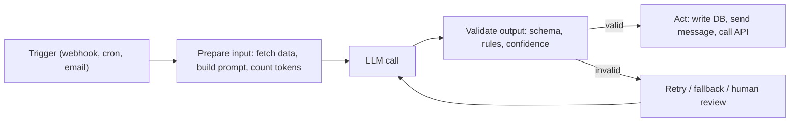
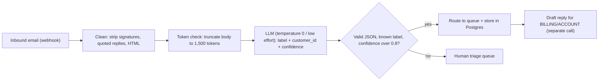

# 01 · How LLMs Work: Tokens, Context, Temperature, Hallucinations & Cost

> **In one line:** An LLM is a stateless function that turns a token sequence into a probability distribution over the next token. Everything you'll build in this handbook (prompts, tools, RAG, agents) is a way to feed that function better input and handle its output safely, within your budget.

> **Versions used:** tiktoken 0.14 · numpy 2.x · ollama (Python) 0.6 · anthropic 2.x · python-dotenv 1.x · **Fast-moving:** model names, context-window sizes and per-token prices change every few months. Treat every number here as an example and check the provider's pricing page.

---

## 1. Overview

You already build systems that call APIs, transform JSON and write to databases. An LLM call is just another API call, but with three properties that no other API you've used has:

1. **The output is probabilistic.** The same input can give different outputs. Your code must validate, not trust.
2. **The cost scales with text length**, on both input and output. A careless prompt template can multiply your bill by 10 without changing a line of business logic.
3. **The service has no memory.** Every call starts from zero. "Conversation" is an illusion your code creates by re-sending history.

This chapter gives you the working mental model, not the maths. If you want the transformer internals (attention, embeddings, training), read [AI Engineering · How LLMs Work](../ai-engineering/topic.html?p=25-how-llms-work) and [Decoding & Sampling](../ai-engineering/topic.html?p=26-decoding-sampling). Here we focus on what changes your automation code.

Where does the LLM sit in an automation? Almost always in the middle, surrounded by ordinary code that prepares its input and checks its output:



The deterministic boxes are where your existing Python skills live, and they are where most production reliability comes from. The LLM box is the only part that "thinks". Your job is to keep it small, well-fed and well-checked.

---

## 2. Key Concepts

### Tokens: the unit of everything

Models don't read characters or words. They read **tokens**, chunks of text from a fixed vocabulary of ~100k–200k entries built by an algorithm called byte-pair encoding (BPE). Common words are one token. Rare words, code and non-English text break into several.

> **Analogy:** tokens are Scrabble tiles. The model has a bag of ~200k tiles. Some carry whole words (`" the"`), some carry fragments (`"ization"`). Every prompt is spelled with tiles, and you pay per tile.

Rules of thumb for English: **1 token ≈ 4 characters ≈ 0.75 words**, so 1,000 words ≈ 1,300 tokens. JSON, code, URLs, numbers and languages like Hindi or Japanese are much less efficient. Measure them, don't guess.

Each provider has its own tokenizer. `tiktoken` counts OpenAI tokens exactly. For Claude, use the API's `count_tokens` endpoint. For open models, use the model's Hugging Face tokenizer. Counts for the same text can differ by 10–35% between providers.

### Context window: the model's whiteboard

The **context window** is the maximum number of tokens in one request: system prompt + conversation history + retrieved documents + tool definitions + the output being generated. Today's frontier models offer 200k to 1M tokens. Small local models often run with 4k–32k.

> **Analogy:** a whiteboard that is wiped after every meeting. Whatever you want the model to consider must be written on it this time, and space is finite.

Three practical consequences:
- **Bigger isn't free.** Every token in context is billed and adds latency. Stuffing 500k tokens "just in case" is the most common cost mistake.
- **Attention dilutes.** Models recall facts at the start and end of long contexts better than facts in the middle ("lost in the middle"). Put instructions first and the question last.
- **Output tokens count against the window too**, and are capped separately by `max_tokens`.

### Next-token prediction and sampling

At each step the model outputs a score (**logit**) for every token in its vocabulary. A softmax turns scores into probabilities, then a **sampler** picks one token. The token is appended and the process repeats. This loop is why responses stream word by word, and why **output tokens are slower and more expensive than input tokens**: input is processed in one parallel pass, output is generated one token at a time.

The diagram shows how temperature reshapes the same distribution:

```svg
<svg viewBox="0 0 860 300" width="100%" height="300" font-family="ui-sans-serif,system-ui,sans-serif" font-size="11" xmlns="http://www.w3.org/2000/svg">
  <text x="430" y="22" text-anchor="middle" font-size="14" font-weight="700" fill="#1e293b">Same logits, three temperatures: next token after "The invoice is"</text>
  <g transform="translate(40,50)">
    <text x="115" y="0" text-anchor="middle" font-size="12" font-weight="700" fill="#2563eb">T = 0.2 (focused)</text>
    <line x1="0" y1="200" x2="240" y2="200" stroke="#94a3b8"/>
    <rect x="10" y="22" width="40" height="178" fill="#2563eb"/><text x="30" y="16" text-anchor="middle" fill="#1e293b">97%</text>
    <rect x="58" y="195" width="40" height="5" fill="#93c5fd"/><text x="78" y="190" text-anchor="middle" fill="#1e293b">3%</text>
    <rect x="106" y="199" width="40" height="1" fill="#93c5fd"/><text x="126" y="194" text-anchor="middle" fill="#1e293b">~0</text>
    <rect x="154" y="199" width="40" height="1" fill="#93c5fd"/><text x="174" y="194" text-anchor="middle" fill="#1e293b">~0</text>
    <text x="30" y="216" text-anchor="middle" fill="#334155">due</text><text x="78" y="216" text-anchor="middle" fill="#334155">overdue</text>
    <text x="126" y="216" text-anchor="middle" fill="#334155">attached</text><text x="174" y="216" text-anchor="middle" fill="#334155">purple</text>
    <text x="115" y="240" text-anchor="middle" fill="#334155">Near-deterministic: extraction,</text>
    <text x="115" y="254" text-anchor="middle" fill="#334155">classification, routing</text>
  </g>
  <g transform="translate(320,50)">
    <text x="115" y="0" text-anchor="middle" font-size="12" font-weight="700" fill="#16a34a">T = 1.0 (model's own distribution)</text>
    <line x1="0" y1="200" x2="240" y2="200" stroke="#94a3b8"/>
    <rect x="10" y="80" width="40" height="120" fill="#16a34a"/><text x="30" y="74" text-anchor="middle" fill="#1e293b">60%</text>
    <rect x="58" y="140" width="40" height="60" fill="#86efac"/><text x="78" y="134" text-anchor="middle" fill="#1e293b">30%</text>
    <rect x="106" y="180" width="40" height="20" fill="#86efac"/><text x="126" y="174" text-anchor="middle" fill="#1e293b">10%</text>
    <rect x="154" y="198" width="40" height="2" fill="#86efac"/><text x="174" y="192" text-anchor="middle" fill="#1e293b">1%</text>
    <text x="30" y="216" text-anchor="middle" fill="#334155">due</text><text x="78" y="216" text-anchor="middle" fill="#334155">overdue</text>
    <text x="126" y="216" text-anchor="middle" fill="#334155">attached</text><text x="174" y="216" text-anchor="middle" fill="#334155">purple</text>
    <text x="115" y="240" text-anchor="middle" fill="#334155">Balanced: chat, drafting,</text>
    <text x="115" y="254" text-anchor="middle" fill="#334155">summaries</text>
  </g>
  <g transform="translate(600,50)">
    <text x="115" y="0" text-anchor="middle" font-size="12" font-weight="700" fill="#dc2626">T = 2.0 (flattened)</text>
    <line x1="0" y1="200" x2="240" y2="200" stroke="#94a3b8"/>
    <rect x="10" y="118" width="40" height="82" fill="#dc2626"/><text x="30" y="112" text-anchor="middle" fill="#1e293b">45%</text>
    <rect x="58" y="143" width="40" height="57" fill="#fca5a5"/><text x="78" y="137" text-anchor="middle" fill="#1e293b">31%</text>
    <rect x="106" y="167" width="40" height="33" fill="#fca5a5"/><text x="126" y="161" text-anchor="middle" fill="#1e293b">18%</text>
    <rect x="154" y="189" width="40" height="11" fill="#fca5a5"/><text x="174" y="183" text-anchor="middle" fill="#1e293b">6%</text>
    <text x="30" y="216" text-anchor="middle" fill="#334155">due</text><text x="78" y="216" text-anchor="middle" fill="#334155">overdue</text>
    <text x="126" y="216" text-anchor="middle" fill="#334155">attached</text><text x="174" y="216" text-anchor="middle" fill="#334155">purple</text>
    <text x="115" y="240" text-anchor="middle" fill="#334155">Nonsense ~1 in 20 draws:</text>
    <text x="115" y="254" text-anchor="middle" fill="#dc2626">never use in automation</text>
  </g>
</svg>
```

- **Temperature** divides the logits before softmax. Below 1 sharpens the distribution, above 1 flattens it. Zero means "always take the top token" (greedy), which is *mostly* but not perfectly deterministic: GPU batching and floating-point effects still cause occasional variation.
- **Top-p (nucleus sampling)** keeps only the smallest set of tokens whose probabilities sum to *p* (e.g. 0.9) and samples among them. It cuts off the long tail of nonsense.
- **Reasoning effort replaces sampling knobs on newer models.** Several current frontier APIs no longer accept `temperature` at all. Current Claude models, for example, reject `temperature`/`top_p`/`top_k` with a 400 error and expose `effort` (`low` → `max`) instead. OpenAI's reasoning models ignore or reject it too. Treat temperature as a knob for local and open-weight models, and check each provider's docs.

> **Rule for automation:** you want **repeatable** output. Use the lowest temperature the model accepts (0–0.3) for extraction, classification and routing, and get variety from the prompt, not from sampling. Then *validate* (Ch 03), because low temperature doesn't guarantee correctness.

### Statelessness

The API has no memory between calls. A chat app re-sends the entire history every turn, which means turn 20 pays for turns 1–19 again. Memory strategies (trimming, summarising, retrieval) are covered in [Ch 22 · Agent Memory](topic.html?p=22-agent-memory-mem0). For now: **you own the history, and you pay for it every call.**

### Hallucinations: confident autocomplete

A **hallucination** is fluent, plausible output that isn't true: an invented invoice number, a non-existent API parameter, a fake citation. It isn't a bug that will be patched. It's what next-token prediction does when the answer isn't in the context or strongly in the training data. The model is always producing *the most plausible continuation*, and "plausible" isn't "verified".

> **Analogy:** an intern who never says "I don't know" and fills gaps with what *sounds* right. Great with a source document in front of them, dangerous from memory.

What reduces hallucinations, in order of impact:
1. **Ground it.** Put the facts in the context (RAG, [Part 4](topic.html?p=16-rag-fundamentals)) and tell the model to answer *only* from them.
2. **Give it an exit.** Explicitly allow "UNKNOWN" / `null` in your schema. Models invent less when not inventing is a valid answer.
3. **Constrain the output.** Enums and schemas ([Ch 03](topic.html?p=03-structured-outputs)) make whole classes of invention impossible.
4. **Verify in code.** Check that quoted evidence actually appears in the source, that IDs exist in your DB, that totals add up.
5. **Use a stronger model or more reasoning effort** for steps where errors are expensive.

### Cost and latency

Every provider bills **input tokens** and **output tokens** separately, per million tokens (MTok). Output is typically 4–8× more expensive than input.

```text
cost per call  = input_tokens  × input_price  / 1,000,000
               + output_tokens × output_price / 1,000,000
monthly cost   = cost per call × calls per day × 30
latency        ≈ time-to-first-token (TTFT) + output_tokens / tokens-per-second
```

Two discounts matter a lot in automation:
- **Prompt caching**: a repeated prefix (long system prompt, tool definitions, reference docs) is billed at a fraction of the input price on later calls. Covered in [Ch 42](topic.html?p=42-reliability-cost).
- **Batch APIs**: non-urgent jobs (nightly classification of 50k rows) usually run at ~50% off with results within 24 hours.

---

## 3. Setup

You'll use a local model (free) for the sampling experiments and a cloud key only where noted.

```bash
python3.11 -m venv .venv && source .venv/bin/activate
pip install "tiktoken>=0.14" "numpy>=2" "ollama>=0.6" "python-dotenv>=1" "pandas>=2"
pip install "anthropic>=2"            # optional: exact Claude token counts

# Local model runtime (macOS/Linux): https://ollama.com/download
ollama pull llama3.2                  # ~2 GB, runs on a laptop CPU/GPU
```

Create `.env` (never commit it; add it to `.gitignore`):

```bash
# .env.example — copy to .env and fill in
OLLAMA_HOST=http://localhost:11434
OLLAMA_MODEL=llama3.2
ANTHROPIC_API_KEY=            # optional, only for Example 2b
```

Every script in this handbook loads configuration the same way:

```python
from dotenv import load_dotenv
import os

load_dotenv()                              # reads .env into os.environ
model = os.getenv("OLLAMA_MODEL", "llama3.2")
api_key = os.environ["ANTHROPIC_API_KEY"]  # KeyError if missing = fail fast, never hardcode
```

---

## 4. Code Examples

### Example 1: See tokens with tiktoken

```python
# tokens_demo.py — how text becomes tokens (OpenAI's o200k_base encoding)
import tiktoken

enc = tiktoken.get_encoding("o200k_base")   # encoding used by current OpenAI models

samples = {
    "english": "Please summarise the attached invoice and flag anything overdue.",
    "json": '{"invoice_id": "INV-2024-00917", "amount": 1249.50, "currency": "EUR"}',
    "code": "df.groupby('customer_id')['amount'].sum().sort_values(ascending=False)",
    "hindi": "कृपया संलग्न चालान का सारांश दें।",
    "url": "https://example.com/api/v2/customers/8f14e45f-ceea-467f-a8b7-22c1/invoices?page=3",
}

for name, text in samples.items():
    ids = enc.encode(text)
    pieces = [enc.decode([i]) for i in ids]
    print(f"{name:8} chars={len(text):3} tokens={len(ids):3} "
          f"chars/token={len(text)/len(ids):.1f}")
    print("         ", pieces[:12], "..." if len(pieces) > 12 else "")

if __name__ == "__main__":
    pass
```

Output (tiktoken 0.14; exact splits vary by encoding version):

```text
english  chars= 64 tokens= 11 chars/token=5.8
          ['Please', ' summar', 'ise', ' the', ' attached', ' invoice', ' and', ' flag', ' anything', ' overdue', '.']
json     chars= 70 tokens= 28 chars/token=2.5
          ['{"', 'invoice', '_id', '":', ' "', 'INV', '-', '202', '4', '-', '009', '17'] ...
code     chars= 70 tokens= 16 chars/token=4.4
          ['df', '.groupby', "('", 'customer', '_id', "')['", 'amount', "'].", 'sum', '().', 'sort', '_values'] ...
hindi    chars= 33 tokens= 14 chars/token=2.4
          ['क', 'ृ', 'प', 'या', ' सं', 'लग', '्न', ' चाल', 'ान', ' का', ' सार', 'ांश'] ...
url      chars= 81 tokens= 34 chars/token=2.4
          ['https', '://', 'example', '.com', '/api', '/v', '2', '/custom', 'ers', '/', '8', 'f'] ...
```

JSON, IDs, URLs and non-Latin scripts cost **over 2× more tokens per character** than English prose. When you stuff raw API payloads into prompts, strip fields the model doesn't need first.

### Example 2: Count tokens before you send (and for Claude, ask the API)

```python
# count_tokens.py — budget check before an LLM call
import os
import tiktoken
from dotenv import load_dotenv

load_dotenv()
enc = tiktoken.get_encoding("o200k_base")


def approx_tokens(text: str) -> int:
    """Fast local estimate. Exact for OpenAI models, ±10-35% for other providers."""
    return len(enc.encode(text))


def fits(system: str, history: list[dict], max_output: int, window: int) -> bool:
    used = approx_tokens(system) + sum(approx_tokens(m["content"]) for m in history)
    print(f"prompt≈{used} + max_output={max_output} vs window={window}")
    return used + max_output <= window


def claude_exact_count(system: str, messages: list[dict]) -> int:
    """Exact count from Anthropic's free count_tokens endpoint (needs ANTHROPIC_API_KEY)."""
    import anthropic
    client = anthropic.Anthropic()          # reads ANTHROPIC_API_KEY from env
    resp = client.messages.count_tokens(
        model=os.getenv("CLAUDE_MODEL", "claude-opus-5-5"),
        system=system,
        messages=messages,
    )
    return resp.input_tokens


if __name__ == "__main__":
    system = "You are an accounts-payable assistant. Answer in one sentence."
    history = [{"role": "user", "content": "Is invoice INV-917 overdue? Due 2026-10-01, today 2026-11-12."}]
    print("fits 8k local model:", fits(system, history, max_output=500, window=8_192))
    if os.getenv("ANTHROPIC_API_KEY"):
        print("Claude exact input tokens:", claude_exact_count(system, history))
```

### Example 3: Temperature, reproduced with numpy

This needs no API at all. It's the actual maths the sampler runs.

```python
# temperature_math.py — how temperature and top-p reshape a distribution
import numpy as np

tokens = ["due", "overdue", "attached", "purple"]
logits = np.array([4.0, 3.3, 2.2, 0.0])          # raw scores from the model


def softmax(x: np.ndarray) -> np.ndarray:
    e = np.exp(x - x.max())                       # subtract max for numerical stability
    return e / e.sum()


def with_temperature(logits: np.ndarray, t: float) -> np.ndarray:
    if t == 0:                                    # greedy: all mass on the argmax
        p = np.zeros_like(logits); p[logits.argmax()] = 1.0
        return p
    return softmax(logits / t)


def top_p_filter(p: np.ndarray, top_p: float) -> np.ndarray:
    order = np.argsort(p)[::-1]                   # most likely first
    keep = np.cumsum(p[order]) <= top_p
    keep[0] = True                                # always keep the best token
    mask = np.zeros_like(p, dtype=bool); mask[order[keep]] = True
    q = np.where(mask, p, 0.0)
    return q / q.sum()


if __name__ == "__main__":
    rng = np.random.default_rng(42)
    for t in (0, 0.2, 0.7, 1.0, 2.0):
        p = with_temperature(logits, t)
        draws = rng.choice(tokens, size=1000, p=p)
        purple = (draws == "purple").mean()
        print(f"T={t:<4} probs={np.round(p, 3)}  'purple' sampled {purple:.1%} of the time")
    print("top_p=0.9 at T=1:", np.round(top_p_filter(with_temperature(logits, 1.0), 0.9), 3))
```

```text
T=0    probs=[1. 0. 0. 0.]  'purple' sampled 0.0% of the time
T=0.2  probs=[0.971 0.029 0.    0.   ]  'purple' sampled 0.0% of the time
T=0.7  probs=[0.691 0.254 0.053 0.002]  'purple' sampled 0.3% of the time
T=1.0  probs=[0.595 0.296 0.098 0.011]  'purple' sampled 0.9% of the time
T=2.0  probs=[0.445 0.314 0.181 0.06 ]  'purple' sampled 4.6% of the time
top_p=0.9 at T=1: [0.668 0.332 0.    0.   ]
```

At T=2 the nonsense token appears about one time in twenty. In a pipeline that runs 10,000 times a day, that's roughly 500 broken outputs. Top-p removes the tail entirely.

### Example 4: Temperature on a real local model, with latency and token stats

```python
# local_sampling.py — same prompt, different temperatures, on Ollama (free, local)
import os
import time
import ollama
from dotenv import load_dotenv

load_dotenv()
MODEL = os.getenv("OLLAMA_MODEL", "llama3.2")
client = ollama.Client(host=os.getenv("OLLAMA_HOST", "http://localhost:11434"))

PROMPT = ("Classify this ticket as one of BILLING, BUG, FEATURE, OTHER. "
          "Reply with the label only.\n\nTicket: 'I was charged twice for October.'")


def run(temperature: float, seed: int | None = None) -> tuple[str, dict]:
    t0 = time.perf_counter()
    resp = client.chat(
        model=MODEL,
        messages=[{"role": "user", "content": PROMPT}],
        options={"temperature": temperature, "seed": seed, "num_predict": 10},
    )
    wall = time.perf_counter() - t0
    stats = {
        "in_tokens": resp.prompt_eval_count,          # tokens the model read
        "out_tokens": resp.eval_count,                # tokens it generated
        "tok_per_s": resp.eval_count / (resp.eval_duration / 1e9) if resp.eval_duration else 0,
        "wall_s": round(wall, 2),
    }
    return resp.message.content.strip(), stats


if __name__ == "__main__":
    for t in (0.0, 0.7, 1.5):
        labels = [run(t)[0] for _ in range(5)]
        print(f"T={t}: {labels}")
    label, stats = run(0.0, seed=7)
    print("one call:", label, stats)
```

Illustrative output from llama3.2 on a laptop (yours will differ):

```text
T=0.0: ['BILLING', 'BILLING', 'BILLING', 'BILLING', 'BILLING']
T=0.7: ['BILLING', 'BILLING', 'BILLING', 'Billing', 'BILLING']
T=1.5: ['BILLING', 'BILLING.', 'BILLING - double charge', 'BILLING', 'Billing issue']
one call: BILLING {'in_tokens': 52, 'out_tokens': 3, 'tok_per_s': 41.7, 'wall_s': 0.31}
```

The label is right every time. The *format* is what drifts at higher temperature, and format drift is what breaks downstream code. That's why the next two chapters (prompting and structured outputs) matter as much as model choice.

### Example 5: A cost estimator you'll reuse all handbook long

```python
# llm_cost.py — estimate per-call and monthly cost across models
from dataclasses import dataclass

# USD per 1M tokens. EXAMPLES ONLY — verify on each provider's pricing page before budgeting.
PRICES: dict[str, tuple[float, float]] = {
    "claude-opus-5-5":   (4.00, 20.00),
    "claude-sonnet-5-5": (2.00, 10.00),
    "claude-haiku-5-5":  (0.10, 0.50),
    "local/llama3.2":    (0.00, 0.00),   # electricity and hardware not included
}


@dataclass
class Estimate:
    model: str
    per_call: float
    per_month: float


def estimate(model: str, in_tok: int, out_tok: int, calls_per_day: int,
             cached_fraction: float = 0.0, cache_discount: float = 0.9) -> Estimate:
    """cached_fraction: share of input tokens served from prompt cache (billed at 1-discount)."""
    pin, pout = PRICES[model]
    effective_in = in_tok * (1 - cached_fraction) + in_tok * cached_fraction * (1 - cache_discount)
    per_call = (effective_in * pin + out_tok * pout) / 1_000_000
    return Estimate(model, per_call, per_call * calls_per_day * 30)


if __name__ == "__main__":
    # Ticket triage: 1,800-token prompt (1,500 of it a fixed system prompt), 60-token answer, 700 tickets/day
    for m in PRICES:
        e = estimate(m, in_tok=1_800, out_tok=60, calls_per_day=700, cached_fraction=1500 / 1800)
        print(f"{e.model:18} ${e.per_call:.5f}/call  ${e.per_month:8.2f}/month")
```

```text
claude-opus-5-5    $0.00300/call  $   63.00/month
claude-sonnet-5-5  $0.00150/call  $   31.50/month
claude-haiku-5-5   $0.00007/call  $    1.57/month
local/llama3.2     $0.00000/call  $    0.00/month
```

The spread between tiers is 40×. Picking the cheapest model that passes your evaluation set ([Ch 41](topic.html?p=41-evaluation)) is one of the most valuable decisions in any automation.

### Example 6: A cheap hallucination check (verify quoted evidence)

```python
# evidence_check.py — make the model quote its source, then verify the quote exists
import json
import re


def normalise(s: str) -> str:
    return re.sub(r"\s+", " ", s).strip().lower()


def verify_answer(answer_json: str, source_text: str) -> dict:
    """Expects {"answer": str, "evidence": str} from the model. Flags invented evidence."""
    data = json.loads(answer_json)
    quote = data.get("evidence") or ""
    grounded = bool(quote) and normalise(quote) in normalise(source_text)
    return {**data, "grounded": grounded}


if __name__ == "__main__":
    contract = "Payment terms: net 30 days from invoice date. Late fee: 1.5% per month."
    good = '{"answer": "30 days", "evidence": "net 30 days from invoice date"}'
    bad = '{"answer": "45 days", "evidence": "net 45 days after delivery"}'
    print(verify_answer(good, contract))   # grounded: True
    print(verify_answer(bad, contract))    # grounded: False -> route to human review
```

Asking for verbatim evidence and checking it in code catches a large share of hallucinations for almost no cost. You'll see this pattern again in RAG.

---

## 5. Real-World Use Case

**Company:** a 40-person B2B SaaS. **Problem:** 700 support emails a day, read and routed by hand by two people. **Goal:** auto-label each ticket (BILLING / BUG / FEATURE / ACCOUNT / OTHER), extract the customer ID, and draft a reply for the easy cases.



The decisions this chapter informs:

| Decision | Choice | Why |
|---|---|---|
| Truncate inputs | 1,500 tokens max per email | 95th-percentile email is ~900 tokens. Long threads are mostly quoted history, which costs money and dilutes attention |
| Sampling | Lowest available temperature / low effort | Label format must be stable for the router |
| Model tier | Small/fast tier for labelling, mid tier for drafts | Labelling is easy, drafts are customer-facing |
| Grounding | Draft only from the KB article matched by label | Prevents invented refund policies |
| Cost | ~$2–65/month depending on tier (Example 5) | Compared with ~3 hours/day of staff time |

**Outcome pattern seen in practice:** the classifier handles roughly 80–90% of tickets automatically. The rest go to humans, and those are exactly the ones that needed a human. The mistake teams make is skipping the "no" branch.

---

## 6. Mini Project: LLM Cost & Token Profiler (1–2 hours)

**Goal:** a CLI that takes a CSV of real prompts (e.g. exported support tickets), measures token counts, estimates monthly cost across model tiers, and benchmarks latency on a local model. You'll reuse it whenever someone asks "what will this cost?".

**Layout**

```text
token-profiler/
├── .env
├── prompts.csv          # columns: id, text
├── llm_cost.py          # from Example 5
└── profile.py
```

**Step 1: sample data.** If you don't have real tickets, generate some:

```python
# make_sample.py
import pandas as pd

rows = [
    (1, "I was charged twice for October, please refund one of them."),
    (2, "The export button returns a 500 error when the report has more than 10k rows."),
    (3, "Could you add SSO with Okta? Our security team requires it."),
    (4, "How do I change the billing email on our account?"),
    (5, "Love the product. Any plans for a dark mode?"),
] * 40
pd.DataFrame(rows, columns=["id", "text"]).to_csv("prompts.csv", index=False)
print("wrote prompts.csv", len(rows), "rows")
```

**Step 2: the profiler.**

```python
# profile.py — token stats, cost projection, local latency benchmark
import argparse
import os
import statistics
import time

import ollama
import pandas as pd
import tiktoken
from dotenv import load_dotenv

from llm_cost import PRICES, estimate

load_dotenv()
enc = tiktoken.get_encoding("o200k_base")
SYSTEM = ("You are a support triage assistant. Classify the ticket as BILLING, BUG, FEATURE, "
          "ACCOUNT or OTHER and reply with the label only.")


def token_stats(df: pd.DataFrame) -> pd.Series:
    sys_tokens = len(enc.encode(SYSTEM))
    df["tokens"] = df["text"].map(lambda t: len(enc.encode(str(t)))) + sys_tokens
    return df["tokens"].describe(percentiles=[0.5, 0.95, 0.99])


def bench_local(df: pd.DataFrame, n: int) -> dict:
    client = ollama.Client(host=os.getenv("OLLAMA_HOST", "http://localhost:11434"))
    model = os.getenv("OLLAMA_MODEL", "llama3.2")
    lat, outs = [], []
    for text in df["text"].head(n):
        t0 = time.perf_counter()
        r = client.chat(model=model, options={"temperature": 0, "num_predict": 8},
                        messages=[{"role": "system", "content": SYSTEM},
                                  {"role": "user", "content": str(text)}])
        lat.append(time.perf_counter() - t0)
        outs.append(r.message.content.strip())
    return {"p50_s": round(statistics.median(lat), 2),
            "max_s": round(max(lat), 2),
            "labels": pd.Series(outs).value_counts().to_dict()}


def main() -> None:
    ap = argparse.ArgumentParser()
    ap.add_argument("csv")
    ap.add_argument("--calls-per-day", type=int, default=700)
    ap.add_argument("--out-tokens", type=int, default=10)
    ap.add_argument("--bench", type=int, default=0, help="N prompts to run on the local model")
    a = ap.parse_args()

    df = pd.read_csv(a.csv)
    stats = token_stats(df)
    print("Input tokens per call:\n", stats.round(1).to_string(), "\n")

    p95 = int(stats["95%"])
    print(f"Projection at {a.calls_per_day}/day using p95={p95} input tokens:")
    for m in PRICES:
        e = estimate(m, p95, a.out_tokens, a.calls_per_day)
        print(f"  {m:18} ${e.per_month:9.2f}/month")

    if a.bench:
        print("\nLocal benchmark:", bench_local(df, a.bench))


if __name__ == "__main__":
    main()
```

**Step 3: run it.**

```bash
python make_sample.py
python profile.py prompts.csv --calls-per-day 700 --bench 10
```

**Done when:**
- [ ] It prints p50/p95/p99 token counts for your CSV.
- [ ] It projects monthly cost for every model in `PRICES`, using p95 rather than the mean (budgets break on the tail).
- [ ] `--bench` runs N prompts locally and reports latency and the label distribution.

**Stretch goals:** add a `--provider claude` flag that uses `client.messages.count_tokens` for exact counts. Add a 20%-cached system prompt scenario. Write a Markdown report to `report.md` so non-engineers can read it.

---

## 7. Comparison Table

**Choosing a model tier for an automation step**

| Tier | Examples (Nov 2026) | Strengths | Weaknesses | Use for |
|---|---|---|---|---|
| Frontier | Claude Opus 5.5, top GPT/Gemini models | Best reasoning, long context, reliable tool use | Highest cost and latency | Agents, complex extraction, customer-facing drafts, code |
| Mid | Claude Sonnet 5.5, GPT/Gemini "flash/mini" class | Strong quality per dollar | Weaker on multi-step reasoning | Most production steps, RAG answers |
| Small/fast | Claude Haiku 5.5, Groq-hosted open models | Very cheap, fast | Needs tighter prompts and validation | Classification, routing, tagging, short summaries |
| Local | Llama, Qwen, Gemma, Mistral via Ollama | Free per call, private, offline | Your hardware; lower ceiling | PII-heavy data, dev/test, high-volume simple tasks |

**Sampling settings by task**

| Task | Temperature (where supported) | Reasoning effort (where supported) | Also do |
|---|---|---|---|
| Extraction / classification | 0–0.2 | low | Schema + enum validation |
| Summaries / reports | 0.3–0.5 | low–medium | Length limit in prompt |
| Customer replies | 0.4–0.7 | medium | Ground in KB, human review at first |
| Brainstorming / copy variants | 0.8–1.0 | low | Generate N, pick with rules or a judge |
| Agents / multi-step planning | 0–0.3 | high | Step limits, tool validation |

---

## 8. Common Mistakes & Best Practices

**Mistake 1: estimating cost from the average prompt.** Means hide long-tail emails with 30k-token quoted threads. *Fix:* budget on p95, and hard-truncate inputs with a token counter.

```python
# Before: the whole thread goes in
prompt = email_body
# After: cap at 1,500 tokens, keep the start (newest message is usually on top)
ids = enc.encode(email_body)
prompt = enc.decode(ids[:1500])
```

**Mistake 2: using character counts as token counts.** Fine for prose, off by 2× for JSON or non-English. *Fix:* count with the right tokenizer, or the provider's count endpoint.

**Mistake 3: high temperature for "creativity" in a pipeline.** It produces format drift and occasional nonsense. *Fix:* low temperature or low effort, plus variety via prompts.

**Mistake 4: assuming temperature 0 means deterministic.** It's near-deterministic. Batching and hardware make outputs vary occasionally, and providers update models behind the same alias. *Fix:* validate every output, and pin dated model versions where the provider offers them.

**Mistake 5: re-sending unbounded chat history.** Turn N costs O(N) tokens, so total conversation cost grows O(N²). *Fix:* sliding window + summary (Ch 22).

**Mistake 6: trusting fluent output.** *Fix:* grounding, an "unknown" option, schema validation, code-level checks (Example 6).

**Mistake 7: ignoring output token cost.** Asking for "a detailed explanation" when you need a label multiplies output cost. *Fix:* ask for exactly the format you need and set `max_tokens`.

**Best-practice checklist**
- [ ] Count tokens before every call in hot paths; truncate with a tokenizer, not string slicing.
- [ ] Put stable content (system prompt, tool schemas, reference docs) first, so prompt caching can kick in.
- [ ] Set `max_tokens` deliberately for every call.
- [ ] Log `input_tokens`, `output_tokens`, latency and model for every call. You'll need them in Ch 40.
- [ ] Keep a price table in config, not scattered through code.
- [ ] Treat every response as untrusted input until validated.

---

## 9. Exercises

1. **Tokenizer tour.** Run Example 1 on five of your own payloads (an API response, a SQL query, an email in your second language). Which costs most per character? Rewrite the worst one to use 40% fewer tokens without losing information.
2. **Temperature sweep.** Extend Example 4 to run 20 calls at T = 0, 0.5, 1.0, 1.5 and compute the share of outputs that exactly equal one of the five labels. Plot it with pandas.
3. **Budget guard.** Write `call_with_budget(prompt, max_input_tokens, max_output_tokens)` that refuses (raises) instead of truncating when the input is over budget. Then add a `truncate=True` mode that keeps the first 70% and last 30% of the token budget.
4. **Cost drill.** A nightly job summarises 12,000 support tickets (avg 700 input tokens, 120 output). Compute monthly cost on three tiers, then with a 50% batch discount. Which tier would you choose and why?
5. **Hallucination trap.** Ask a local model "What is the late fee in our contract?" with no contract in context, then with the contract and the instruction "answer only from the contract, else say UNKNOWN". Record both answers and run Example 6 on the second.

### Self-check questions

**Q: Why are output tokens priced higher and generated slower than input tokens?**
A: Input tokens are processed in one parallel forward pass. The model reads the whole prompt at once. Output tokens are generated autoregressively, one forward pass per token, each depending on the previous one. That sequential work dominates GPU time, so providers charge several times more per output token, and latency grows linearly with output length.

**Q: What is a context window, and what counts against it?**
A: It's the maximum number of tokens one request can contain, including the output. The system prompt, every message in the history, tool definitions, retrieved documents and the generated answer all count. Going over it causes an error or silent truncation, depending on the provider.

**Q: Does temperature 0 guarantee the same output every time?**
A: No. It makes sampling greedy, but floating-point non-associativity in batched GPU inference, and silent model updates behind an alias, still cause occasional differences. Design for "usually identical" and validate outputs anyway.

**Q: Why do LLMs hallucinate, and what's the single most effective mitigation in an automation?**
A: They generate the most plausible continuation, not a verified fact. When the answer isn't in the context, plausible fiction is what comes out. The most effective mitigation is grounding: put the source data in the prompt, instruct the model to answer only from it with an explicit "unknown" option, and verify quoted evidence in code.

**Q: You need exact Claude token counts for a budget report. Should you use tiktoken? (Senior)**
A: No. tiktoken implements OpenAI's encodings, and Claude uses a different tokenizer, so counts can differ by tens of percent. Use Anthropic's `messages.count_tokens` endpoint, which accepts the same system/messages/tools payload and returns exact input tokens. Keep tiktoken as a fast local heuristic only.

**Q: A chat assistant's cost per conversation grows much faster than its number of turns. Why, and how do you fix it? (Senior)**
A: The API is stateless, so every turn re-sends the full history. Turn N pays for all previous turns, making total tokens roughly quadratic in turns. Fix with a sliding window of recent turns plus a running summary, retrieval of relevant past turns, and prompt caching for the stable prefix.

**Q: A provider rejects your `temperature=0` parameter with a 400 error. What happened, and what do you do instead?**
A: Many current reasoning-model APIs, including current Claude models, have removed sampling parameters and control output with reasoning effort instead. Drop `temperature`, set the provider's effort control (e.g. low for classification), and get consistency from tight prompts, schemas and validation.

---

## 10. Summary & Official Docs

- An LLM maps tokens to a probability distribution over the next token. Sampling picks from it, one token at a time.
- **Tokens** are the unit of cost, latency and limits. ~4 English characters each, far fewer for JSON, code and non-English text. Count them with the right tokenizer.
- The **context window** holds everything for one call, including the output. Bigger costs more and dilutes attention.
- **Temperature/top-p** reshape the distribution. Use low values for automation, and expect newer APIs to replace them with **reasoning effort**.
- The API is **stateless**: you re-send history and pay for it every call.
- **Hallucination** is plausible fiction. Ground, allow "unknown", constrain with schemas and verify in code.
- **Cost** = input × price + output × price. Budget on p95 inputs, cap outputs, use caching and batch discounts, and pick the cheapest model that passes your evals.

| Concept | Rule of thumb |
|---|---|
| 1 token | ≈ 4 chars / 0.75 English words |
| Output vs input price | ~4–8× |
| Automation temperature | 0–0.3, or low effort |
| Budget on | p95 input size, not mean |
| Hallucination defence #1 | Grounding + verified evidence |

**Official docs**
- OpenAI tokenizer & tiktoken: https://github.com/openai/tiktoken
- Anthropic token counting: https://docs.claude.com/en/docs/build-with-claude/token-counting
- Anthropic pricing: https://www.anthropic.com/pricing
- OpenAI pricing: https://openai.com/api/pricing/
- Ollama API & options: https://github.com/ollama/ollama/blob/main/docs/api.md
- Theory deep-dive: [AI Engineering · Context, Tokens & Cost](../ai-engineering/topic.html?p=28-context-tokens-cost)

**Next:** [Ch 02 · Prompt Engineering](topic.html?p=02-prompt-engineering): turning these mechanics into prompts that behave the same way 10,000 times in a row.

---

*AI Automation with Python Handbook — chapter 01.*
