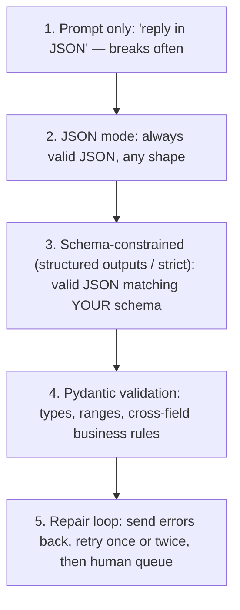
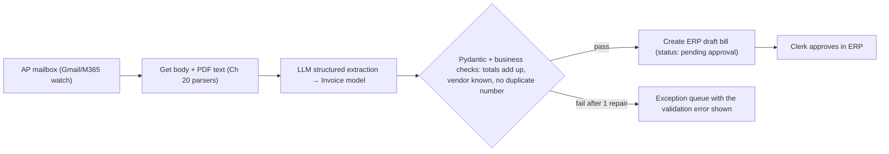

# 03 · Structured Outputs: Reliable JSON with Pydantic

> **In one line:** Automation code needs data, not prose. Define the output as a Pydantic model, have the provider constrain generation to that schema, validate the result anyway, and design the schema so "I don't know" is a legal answer.

> **Versions used:** pydantic 2.14 · openai 3.x · anthropic 2.x · google-genai 3.x · ollama 0.6 · instructor 1.17 · pandas 2.x/3.x · **Fast-moving:** every provider has shipped (and renamed) structured-output features in the last two years: OpenAI `response_format`/`text_format`, Anthropic `output_config.format`, Gemini `response_schema`, Ollama `format`. Schema-feature support (e.g. `minLength`, recursive refs) differs per provider.

---

## 1. Overview

> **Builds on:** [Ch 02 · Prompt Engineering](topic.html?p=02-prompt-engineering) (output contracts) and [Ch 01](topic.html?p=01-how-llms-work) (why outputs are probabilistic).

In Ch 02 we asked for `label: BILLING` and parsed it with string handling. That works until the model writes `Label: Billing.` or adds a friendly sentence. In production you need the LLM to behave like a typed function: `extract(email: str) -> Invoice`.

There's a ladder of reliability. Climb as high as your provider allows:



Steps 3–5 together give you output that's **syntactically guaranteed and semantically checked**. This chapter shows that stack on Ollama (free), OpenAI-compatible servers, Claude and Gemini, plus Instructor, the library that wraps it all.

---

## 2. Key Concepts

### JSON mode vs. structured outputs

- **JSON mode** guarantees the output *parses* as JSON. It doesn't guarantee the keys, types or enums you wanted.
- **Structured outputs** (also called schema-constrained decoding or strict mode) guarantee the output matches a **JSON Schema** you supply: required keys present, enums respected, types right.

How the guarantee works is easiest to see as a token mask applied at every generation step:

```svg
<svg viewBox="0 0 860 280" width="100%" height="280" font-family="ui-sans-serif,system-ui,sans-serif" font-size="11" xmlns="http://www.w3.org/2000/svg">
  <defs><marker id="aa03a" viewBox="0 0 10 10" refX="9" refY="5" markerWidth="7" markerHeight="7" orient="auto"><path d="M0,0 L10,5 L0,10 z" fill="#334155"/></marker></defs>
  <text x="430" y="22" text-anchor="middle" font-size="14" font-weight="700" fill="#1e293b">Constrained decoding: the schema masks invalid tokens before sampling</text>
  <rect x="30" y="45" width="230" height="70" rx="8" fill="#ede9fe" stroke="#7c3aed"/>
  <text x="145" y="66" text-anchor="middle" font-weight="700" fill="#1e293b">Generated so far</text>
  <text x="145" y="86" text-anchor="middle" font-family="ui-monospace,monospace" fill="#334155">{"label": "</text>
  <text x="145" y="104" text-anchor="middle" fill="#334155">schema: label in [BILLING, BUG, OTHER]</text>
  <line x1="262" y1="80" x2="318" y2="80" stroke="#334155" stroke-width="1.5" marker-end="url(#aa03a)"/>
  <rect x="320" y="40" width="250" height="220" rx="8" fill="#ffffff" stroke="#94a3b8"/>
  <text x="445" y="60" text-anchor="middle" font-weight="700" fill="#1e293b">Model's next-token probabilities</text>
  <rect x="335" y="72" width="150" height="20" fill="#dcfce7" stroke="#16a34a"/><text x="345" y="86" fill="#1e293b">BILL     0.46</text><text x="500" y="86" fill="#16a34a" font-weight="700">allowed</text>
  <rect x="335" y="98" width="150" height="20" fill="#fee2e2" stroke="#dc2626"/><text x="345" y="112" fill="#1e293b">Billing  0.31</text><text x="500" y="112" fill="#dc2626" font-weight="700">masked</text>
  <rect x="335" y="124" width="150" height="20" fill="#dcfce7" stroke="#16a34a"/><text x="345" y="138" fill="#1e293b">BUG      0.12</text><text x="500" y="138" fill="#16a34a" font-weight="700">allowed</text>
  <rect x="335" y="150" width="150" height="20" fill="#fee2e2" stroke="#dc2626"/><text x="345" y="164" fill="#1e293b">Payment  0.07</text><text x="500" y="164" fill="#dc2626" font-weight="700">masked</text>
  <rect x="335" y="176" width="150" height="20" fill="#dcfce7" stroke="#16a34a"/><text x="345" y="190" fill="#1e293b">OTHER    0.03</text><text x="500" y="190" fill="#16a34a" font-weight="700">allowed</text>
  <rect x="335" y="202" width="150" height="20" fill="#fee2e2" stroke="#dc2626"/><text x="345" y="216" fill="#1e293b">"\n      0.01</text><text x="500" y="216" fill="#dc2626" font-weight="700">masked</text>
  <text x="445" y="246" text-anchor="middle" fill="#334155">masked tokens get probability 0</text>
  <line x1="572" y1="150" x2="628" y2="150" stroke="#334155" stroke-width="1.5" marker-end="url(#aa03a)"/>
  <rect x="630" y="95" width="210" height="110" rx="8" fill="#dcfce7" stroke="#16a34a"/>
  <text x="735" y="118" text-anchor="middle" font-weight="700" fill="#1e293b">Renormalise and sample</text>
  <text x="735" y="140" text-anchor="middle" fill="#334155">BILL 0.75 · BUG 0.20 · OTHER 0.05</text>
  <text x="735" y="164" text-anchor="middle" fill="#334155">Output can only ever be</text>
  <text x="735" y="180" text-anchor="middle" fill="#334155">valid against the schema.</text>
  <text x="735" y="196" text-anchor="middle" fill="#dc2626">Valid is not the same as correct.</text>
</svg>
```

> **Analogy:** JSON mode is giving someone a blank form with "write neatly". Structured outputs is a web form with dropdowns and required fields. They can still pick the wrong dropdown value, which is why step 4 (validation) and good schema design still matter.

### Pydantic as the single source of truth

Define the shape once as a Pydantic model. Generate the JSON Schema from it (`Model.model_json_schema()`) for the provider, then parse the response back into the model (`Model.model_validate_json(...)`). Types, enums, defaults, field descriptions (which the model reads!) and validators all live in one place.

### Schema design rules for LLMs

- **Make missing data legal:** `Optional[str] = None` for anything that might not be in the input. A required field with no source data is an invitation to hallucinate.
- **Use enums (`Literal[...]`) for categories**, never free text you'll compare later.
- **Write `Field(description=...)`.** Descriptions are part of the prompt. "Amount in the invoice currency, without symbols" prevents `"€1.249,50"`.
- **Keep it flat-ish.** Two levels of nesting is fine, five isn't. Very large schemas cost input tokens and degrade quality.
- **Order matters.** Fields generate in order, so put `reasoning`/`evidence` before the decision field (Ch 02).
- **Numbers as numbers, dates as ISO strings.** Validate formats in Pydantic, because not every provider enforces `format: date`.

### Valid is not correct

A schema guarantees *shape*. It doesn't guarantee the invoice total is the real total. Add **semantic validation**: line items sum to the total, the due date comes after the invoice date, the customer ID exists in your DB. When validation fails, either **repair** (send the error back to the model once) or **escalate** (human queue).

---

## 3. Setup

```bash
pip install "pydantic>=2.10" "openai>=3" "anthropic>=2" "google-genai>=3" "ollama>=0.6" \
            "instructor>=1.17" "pandas>=2" "python-dotenv>=1"
ollama pull llama3.2
```

```bash
# .env.example
LLM_BASE_URL=http://localhost:11434/v1
LLM_API_KEY=ollama
LLM_MODEL=llama3.2
OLLAMA_MODEL=llama3.2
OPENAI_API_KEY=            # optional
OPENAI_MODEL=gpt-5-mini    # check platform.openai.com/docs/models for current names
ANTHROPIC_API_KEY=         # optional
CLAUDE_MODEL=claude-opus-5-5
GEMINI_API_KEY=            # optional
GEMINI_MODEL=gemini-2.5-flash   # check ai.google.dev/gemini-api/docs/models
```

The schema used throughout the chapter (save as `schemas.py`):

```python
# schemas.py — one Pydantic model = prompt contract + JSON Schema + validator
from datetime import date
from typing import Literal, Optional

from pydantic import BaseModel, Field, field_validator, model_validator


class LineItem(BaseModel):
    description: str
    quantity: float = Field(gt=0)
    unit_price: float = Field(ge=0, description="Price per unit, number only, no currency symbol")


class Invoice(BaseModel):
    vendor_name: str
    invoice_number: Optional[str] = Field(None, description="Exactly as printed; null if absent")
    invoice_date: Optional[date] = Field(None, description="ISO 8601 date YYYY-MM-DD")
    due_date: Optional[date] = None
    currency: Literal["EUR", "USD", "GBP", "INR", "OTHER"]
    total: float = Field(ge=0, description="Grand total including tax, number only")
    line_items: list[LineItem] = Field(default_factory=list)

    @field_validator("vendor_name")
    @classmethod
    def strip_name(cls, v: str) -> str:
        return v.strip()

    @model_validator(mode="after")
    def check_business_rules(self) -> "Invoice":
        if self.invoice_date and self.due_date and self.due_date < self.invoice_date:
            raise ValueError("due_date is before invoice_date")
        if self.line_items:
            s = round(sum(li.quantity * li.unit_price for li in self.line_items), 2)
            # allow for tax: line items may be net while total is gross (up to 30% higher)
            if not (s <= self.total <= s * 1.30 + 0.01):
                raise ValueError(f"line items sum to {s} but total is {self.total}")
        return self
```

A sample input used by the examples:

```python
# sample.py
EMAIL = """From: billing@northwind-supplies.de
Subject: Rechnung / Invoice NW-2026-0412

Hello Acme team,
please find our invoice NW-2026-0412 dated 3 November 2026, payable by 3 December 2026.
- 12 x Ergonomic chair @ 189.00 EUR
- 4 x Standing desk @ 420.00 EUR
Subtotal 3,948.00 EUR, VAT 19% 750.12 EUR, Total due: 4,698.12 EUR
Bank: DE89 3704 0044 0532 0130 00
"""
```

---

## 4. Code Examples

### Example 1: Ollama, schema-constrained, free and local

Ollama accepts a JSON Schema in `format` and constrains generation to it.

```python
# ex1_ollama_structured.py
import os
import ollama
from dotenv import load_dotenv
from schemas import Invoice
from sample import EMAIL

load_dotenv()

resp = ollama.chat(
    model=os.getenv("OLLAMA_MODEL", "llama3.2"),
    messages=[
        {"role": "system", "content": "Extract the invoice. Use null for anything not stated. "
                                      "Return amounts as plain numbers (4698.12, not '4,698.12 EUR')."},
        {"role": "user", "content": EMAIL},
    ],
    format=Invoice.model_json_schema(),   # constrain decoding to our schema
    options={"temperature": 0},
)

if __name__ == "__main__":
    invoice = Invoice.model_validate_json(resp.message.content)   # semantic validation runs here
    print(invoice.model_dump_json(indent=2))
```

```text
{
  "vendor_name": "Northwind Supplies",
  "invoice_number": "NW-2026-0412",
  "invoice_date": "2026-11-03",
  "due_date": "2026-12-03",
  "currency": "EUR",
  "total": 4698.12,
  "line_items": [
    {"description": "Ergonomic chair", "quantity": 12.0, "unit_price": 189.0},
    {"description": "Standing desk", "quantity": 4.0, "unit_price": 420.0}
  ]
}
```

### Example 2: OpenAI SDK: `parse()` with a Pydantic model

The OpenAI SDK converts the Pydantic model to a strict JSON Schema and parses the reply back for you. Both the newer Responses API and Chat Completions support it:

```python
# ex2_openai_parse.py — needs OPENAI_API_KEY
import os
from dotenv import load_dotenv
from openai import OpenAI
from schemas import Invoice
from sample import EMAIL

load_dotenv()
client = OpenAI()                              # reads OPENAI_API_KEY
MODEL = os.getenv("OPENAI_MODEL", "gpt-5-mini")


def extract_responses_api(text: str) -> Invoice:
    resp = client.responses.parse(
        model=MODEL,
        instructions="Extract the invoice. Use null for anything not stated.",
        input=text,
        text_format=Invoice,                   # Pydantic model → strict JSON schema
    )
    return resp.output_parsed                  # an Invoice instance (or None on refusal)


def extract_chat_completions(text: str) -> Invoice:
    resp = client.chat.completions.parse(
        model=MODEL,
        messages=[{"role": "system", "content": "Extract the invoice. Use null for anything not stated."},
                  {"role": "user", "content": text}],
        response_format=Invoice,
    )
    msg = resp.choices[0].message
    if msg.refusal:
        raise RuntimeError(f"model refused: {msg.refusal}")
    return msg.parsed


if __name__ == "__main__":
    print(extract_responses_api(EMAIL))
```

> **Strict-mode schema limits:** OpenAI's strict mode requires every property to be listed in `required` (optional fields become `"type": ["string", "null"]`) and `additionalProperties: false`. The SDK's `parse()` does this conversion for you. If you hand-write schemas, follow those rules or you'll get a 400.

### Example 3: Claude: `messages.parse()` with a Pydantic model

```python
# ex3_claude_parse.py — needs ANTHROPIC_API_KEY
import os
import anthropic
from dotenv import load_dotenv
from schemas import Invoice
from sample import EMAIL

load_dotenv()
client = anthropic.Anthropic()                 # reads ANTHROPIC_API_KEY
MODEL = os.getenv("CLAUDE_MODEL", "claude-opus-5-5")


def extract(text: str) -> Invoice:
    resp = client.messages.parse(
        model=MODEL,
        max_tokens=4096,
        system="Extract the invoice. Use null for anything not stated.",
        messages=[{"role": "user", "content": text}],
        output_format=Invoice,                 # schema-constrained output, parsed into Invoice
    )
    if resp.stop_reason == "refusal":
        raise RuntimeError("model declined the request")
    return resp.parsed_output


if __name__ == "__main__":
    print(extract(EMAIL).model_dump())
```

Without the `parse` helper, pass a raw schema with `output_config={"format": {"type": "json_schema", "schema": {...}}}` on `messages.create()` and `json.loads` the first text block. The older top-level `output_format` parameter on `create()` is deprecated.

### Example 4: Gemini: `response_schema`

```python
# ex4_gemini_schema.py — needs GEMINI_API_KEY (pip install google-genai)
import os
from dotenv import load_dotenv
from google import genai
from google.genai import types
from schemas import Invoice
from sample import EMAIL

load_dotenv()
client = genai.Client()                        # reads GEMINI_API_KEY (or GOOGLE_API_KEY)

resp = client.models.generate_content(
    model=os.getenv("GEMINI_MODEL", "gemini-2.5-flash"),
    contents=EMAIL,
    config=types.GenerateContentConfig(
        system_instruction="Extract the invoice. Use null for anything not stated.",
        response_mime_type="application/json",
        response_schema=Invoice,               # Pydantic model accepted directly
    ),
)

if __name__ == "__main__":
    invoice: Invoice = resp.parsed             # SDK-parsed instance
    print(invoice)
```

### Example 5: Provider-agnostic validate-and-repair loop

Not every endpoint supports strict schemas (older local models, some proxies). This loop works anywhere: JSON-mode or plain prompt, then Pydantic, then one repair attempt with the error message.

```python
# ex5_repair_loop.py — works with any OpenAI-compatible server
import json
from pydantic import ValidationError
from llm import chat                           # helper from Ch 02 setup
from schemas import Invoice
from sample import EMAIL

SCHEMA = json.dumps(Invoice.model_json_schema())


def extract_with_repair(text: str, max_attempts: int = 3) -> Invoice | None:
    messages = [
        {"role": "system", "content": f"Extract the invoice as JSON matching this schema:\n{SCHEMA}\n"
                                      "Use null for anything not stated. Output JSON only."},
        {"role": "user", "content": text},
    ]
    for attempt in range(1, max_attempts + 1):
        raw = chat(messages, response_format={"type": "json_object"})   # JSON mode
        try:
            return Invoice.model_validate_json(raw)
        except ValidationError as e:
            print(f"attempt {attempt} failed: {e.error_count()} error(s)")
            messages += [
                {"role": "assistant", "content": raw},
                {"role": "user", "content": f"That JSON failed validation:\n{e}\n"
                                            "Return corrected JSON only. Do not invent values; use null."},
            ]
    return None                                # caller routes to human review


if __name__ == "__main__":
    print(extract_with_repair(EMAIL))
```

Validation errors are excellent feedback. Pydantic tells the model exactly which field and rule failed, and one repair round fixes most issues. More than two rounds rarely helps. Escalate instead.

### Example 6: Instructor: the same pattern, packaged

[Instructor](https://python.useinstructor.com/) patches a client so `create()` takes a `response_model`, then validates and retries automatically, across 15+ providers.

```python
# ex6_instructor.py — local Ollama via its OpenAI-compatible endpoint
import os
import instructor
from dotenv import load_dotenv
from openai import OpenAI
from schemas import Invoice
from sample import EMAIL

load_dotenv()
client = instructor.from_openai(
    OpenAI(base_url=os.getenv("LLM_BASE_URL", "http://localhost:11434/v1"),
           api_key=os.getenv("LLM_API_KEY", "ollama")),
    mode=instructor.Mode.JSON,                 # JSON mode; TOOLS mode for providers with tool calling
)

invoice = client.chat.completions.create(
    model=os.getenv("LLM_MODEL", "llama3.2"),
    response_model=Invoice,                    # validated output type
    max_retries=2,                             # re-asks with validation errors, like Example 5
    messages=[{"role": "system", "content": "Extract the invoice. Use null for anything not stated."},
              {"role": "user", "content": EMAIL}],
)

if __name__ == "__main__":
    print(type(invoice).__name__, invoice.total, invoice.currency)
```

```text
Invoice 4698.12 EUR
```

### Example 7: Batch extraction into a DataFrame

```python
# ex7_batch_to_dataframe.py — many documents in, a clean table out, failures quarantined
import pandas as pd
from ex5_repair_loop import extract_with_repair

emails = {"mail_001": open("mail_001.txt").read(), "mail_002": open("mail_002.txt").read()}

rows, failed = [], []
for doc_id, text in emails.items():
    inv = extract_with_repair(text)
    if inv is None:
        failed.append(doc_id)
        continue
    rows.append({"doc_id": doc_id, **inv.model_dump(exclude={"line_items"}),
                 "n_items": len(inv.line_items)})

if __name__ == "__main__":
    df = pd.DataFrame(rows)
    df.to_csv("invoices.csv", index=False)
    print(df.head())
    print("needs human review:", failed)
```

---

## 5. Real-World Use Case

**Company:** a 120-person distributor receiving ~400 supplier invoices a month by email, as PDF attachments and inline text, in English and German. **Before:** an AP clerk keys each one into the ERP (6–8 minutes each). **After:** the automation pre-fills the ERP draft, and the clerk approves or fixes it.



Design points:
- The **schema mirrors the ERP's bill object**, so there's no mapping layer to drift.
- **Cross-checks in code:** the vendor must match the vendor master (fuzzy match on name + IBAN), the invoice number must be unique per vendor, and line items must reconcile with the total.
- **Nothing is auto-paid.** The LLM creates *drafts*. A human approval stays in the loop until the error rate on the exception queue is well understood.
- **Measured outcome to track:** share of invoices that pass validation untouched, and per-field correction rate. Field-level stats tell you whether to fix the prompt, the schema or the parser.

---

## 6. Mini Project: Email-to-CRM Lead Extractor (1–2 hours)

**Goal:** turn a folder of inbound sales emails into validated lead records in SQLite, with a quarantine for anything that fails validation.

```text
lead-extractor/
├── .env
├── llm.py                # Ch 02 helper
├── lead_schema.py
├── extract_leads.py
├── inbox/                # *.txt emails
└── leads.db              # created by the script
```

**Step 1: the schema.**

```python
# lead_schema.py
from typing import Literal, Optional
from pydantic import BaseModel, EmailStr, Field


class Lead(BaseModel):
    full_name: Optional[str] = None
    email: Optional[EmailStr] = None           # pip install "pydantic[email]"
    company: Optional[str] = None
    company_size: Literal["1-10", "11-50", "51-200", "201-1000", "1000+", "UNKNOWN"] = "UNKNOWN"
    intent: Literal["DEMO", "PRICING", "PARTNERSHIP", "SUPPORT", "SPAM", "OTHER"]
    budget_mentioned: bool = False
    evidence: str = Field(description="Verbatim sentence from the email that best shows the intent")
    summary: str = Field(max_length=200)
```

**Step 2: sample inbox.**

```python
# make_inbox.py
from pathlib import Path

Path("inbox").mkdir(exist_ok=True)
samples = {
    "a.txt": "Hi, I'm Maria Lopez, ops lead at Brightpath Logistics (about 80 people). "
             "Could we book a demo next week? We have budget approved for Q1. maria@brightpath.io",
    "b.txt": "Dear Sir, we offer SEO services at the best price!!! Reply now.",
    "c.txt": "Hey, what does the Team plan cost for 15 users? -- Tom, tom@smallco.dev",
    "d.txt": "We're a 3,000-person retailer exploring a reseller partnership. Who should I talk to? "
             "— Anjali Rao, Head of Alliances, Meridian Retail",
}
for name, body in samples.items():
    Path("inbox", name).write_text(body)
print("inbox ready")
```

**Step 3: extraction with validation, evidence check and storage.**

```python
# extract_leads.py
import json
import sqlite3
from pathlib import Path

import pandas as pd
from pydantic import ValidationError

from lead_schema import Lead
from llm import chat

SYSTEM = ("You extract sales leads from inbound emails. Return JSON matching this schema:\n"
          f"{json.dumps(Lead.model_json_schema())}\n"
          "Use null/UNKNOWN when a value is not stated. 'evidence' must be copied verbatim from the email. "
          "Output JSON only.")


def extract(text: str) -> tuple[Lead | None, str | None]:
    messages = [{"role": "system", "content": SYSTEM}, {"role": "user", "content": text}]
    for _ in range(2):                                         # one repair attempt
        raw = chat(messages, response_format={"type": "json_object"})
        try:
            lead = Lead.model_validate_json(raw)
            if lead.evidence.strip().lower() not in text.lower():
                raise ValueError("evidence is not a verbatim quote from the email")
            return lead, None
        except (ValidationError, ValueError) as e:
            messages += [{"role": "assistant", "content": raw},
                         {"role": "user", "content": f"Fix this error and return JSON only: {e}"}]
            err = str(e)
    return None, err


def main() -> None:
    ok, bad = [], []
    for f in sorted(Path("inbox").glob("*.txt")):
        lead, err = extract(f.read_text())
        if lead:
            ok.append({"file": f.name, **lead.model_dump()})
        else:
            bad.append({"file": f.name, "error": err})
    with sqlite3.connect("leads.db") as con:
        pd.DataFrame(ok).to_sql("leads", con, if_exists="replace", index=False)
        pd.DataFrame(bad, columns=["file", "error"]).to_sql("quarantine", con, if_exists="replace", index=False)
    print(pd.DataFrame(ok)[["file", "intent", "company", "company_size", "email"]].to_string())
    print(f"\nquarantined: {len(bad)}")


if __name__ == "__main__":
    main()
```

**Step 4: run it.**

```bash
pip install "pydantic[email]"
python make_inbox.py && python extract_leads.py
sqlite3 leads.db "select intent, count(*) from leads group by 1;"
```

**Done when:**
- [ ] All four sample emails produce a `Lead`, with SPAM correctly labelled and size `1000+` for Meridian.
- [ ] A deliberately broken record (edit the code to require a field that isn't there) lands in `quarantine` with its error.
- [ ] Evidence that isn't verbatim is rejected.

**Stretch:** swap the hand-rolled loop for Instructor (Example 6). Run the same inbox through two models and diff the tables with pandas. Add a `confidence` field and quarantine anything below 0.7.

---

## 7. Comparison Table

**Techniques**

| Approach | Guarantees | Works with | Use when |
|---|---|---|---|
| Prompt "reply in JSON" | Nothing | Everything | Prototyping only |
| JSON mode | Parseable JSON | Most APIs, Ollama | Provider lacks schema support; pair with Pydantic + repair |
| Structured outputs / strict schema | Parseable *and* schema-valid | OpenAI, Claude, Gemini, Ollama, vLLM, others | Default for extraction and classification |
| Tool call with a schema | Schema-valid arguments | All tool-calling models | You want the model to *choose* among several structured actions (Ch 04) |
| Instructor | Validation + automatic retries, many providers | 15+ providers | One API across providers, rich validators |

**Provider APIs (Nov 2026; check docs, these move)**

| Provider | Pydantic helper | Raw schema parameter |
|---|---|---|
| OpenAI | `responses.parse(text_format=M)` · `chat.completions.parse(response_format=M)` | `text={"format": {"type": "json_schema", ...}}` / `response_format={"type": "json_schema", ...}` |
| Anthropic | `messages.parse(output_format=M)` → `parsed_output` | `output_config={"format": {"type": "json_schema", "schema": ...}}` |
| Gemini | `response_schema=M` → `response.parsed` | `response_json_schema={...}` + `response_mime_type="application/json"` |
| Ollama | `format=M.model_json_schema()` | `format={...}` or `format="json"` |
| Groq / OpenRouter / vLLM | OpenAI-compatible `response_format` (support varies by model) | `response_format={"type": "json_schema", ...}` |

---

## 8. Common Mistakes & Best Practices

**Mistake 1: required fields with no possible source.** If `invoice_number: str` is required and the email has none, the model *will* make one up. *Fix:* `Optional[...] = None` plus the instruction "use null when not stated".

**Mistake 2: free-text categories.** `status: str` gives you "Paid", "paid", "PAID ✅". *Fix:* `Literal[...]` enums.

**Mistake 3: trusting schema-valid output.** *Fix:* business-rule validators (totals, date order, existence checks) and evidence quotes verified in code.

**Mistake 4: numbers as formatted strings.** `"4.698,12 €"` is a parsing nightmare. *Fix:* `float` fields with descriptions saying "number only".

```python
# Before
total: str
# After
total: float = Field(ge=0, description="Grand total including tax, number only, '.' as decimal separator")
```

**Mistake 5: giant schemas.** A 60-field schema with deep nesting costs thousands of input tokens per call and lowers accuracy. *Fix:* extract in stages: header fields first, then line items in a second call for long documents.

**Mistake 6: infinite repair loops.** *Fix:* at most 1–2 repair rounds, then a human queue with the error attached.

**Mistake 7: silently dropping failures.** *Fix:* quarantine table + metric. A rising quarantine rate is your earliest quality alarm.

**Best-practice checklist**
- [ ] One Pydantic model per output, shared by prompt, schema and validation.
- [ ] Optional for anything that may be absent; enums for categories; descriptions on ambiguous fields.
- [ ] Use the provider's strict/structured mode where available; JSON mode + validation otherwise.
- [ ] Business validators + evidence checks for anything that triggers actions.
- [ ] Bounded repair, then escalate; log validation failures per field.

---

## 9. Exercises

1. **Hallucination by schema.** Make `invoice_number` required (no `Optional`) and run Example 1 on an email without one. What does the model output? Make it Optional and re-run.
2. **Business rule.** Add a validator that rejects invoices whose `due_date` is more than 120 days after `invoice_date`. Feed it a case that violates it and watch the repair loop.
3. **Cross-provider diff.** Run the Invoice extraction on Ollama and on one hosted provider over 10 emails. Use pandas to compute per-field agreement.
4. **Two-stage extraction.** For a 40-line invoice, extract the header with one schema and line items with a second, then reconcile. Compare token usage with the single-call version.
5. **Instructor validators.** Add a Pydantic validator that raises if `vendor_name` isn't in a known-vendors list, and observe how Instructor's retries respond.

### Self-check questions

**Q: What's the difference between JSON mode and structured outputs?**
A: JSON mode only guarantees that the output parses as JSON. Keys, types and enums can still be anything. Structured outputs constrain decoding against a supplied JSON Schema, so required keys, types and enum values are guaranteed to match.

**Q: Why should fields that may be absent be Optional with a null default?**
A: If a field is required and the source has no value, the model must produce *something*, and that something is a plausible invention. Making null legal, and telling the model to use it, turns a hallucination into an honest "not present" your code can handle.

**Q: Structured outputs guarantee the schema. Why validate with Pydantic anyway?**
A: The schema checks shape, not truth or business logic. Pydantic validators enforce cross-field rules (totals reconcile, due date after invoice date), formats some providers don't enforce, and lookups against your own data. Valid JSON with a wrong total is still wrong.

**Q: How do Field descriptions affect extraction quality?**
A: They're sent to the model as part of the schema, so they act as per-field instructions: units, formats, what to do when absent, how to disambiguate. Good descriptions fix many errors without touching the main prompt.

**Q: When would you choose a tool call over a structured output? (Senior)**
A: Use structured output when every request should produce one known shape (extract an Invoice). Use tool calling when the model must decide *which* action and shape to produce, or whether to act at all: e.g. create_ticket vs. refund vs. escalate, each with its own schema, possibly several per turn. Tools also integrate with agent loops (Ch 04).

**Q: Your extraction pipeline's validation-failure rate jumps from 3% to 15% overnight with no code change. How do you investigate? (Senior)**
A: Check whether the model behind the alias changed (provider release notes, response model IDs in logs) and whether the input distribution changed (a new supplier template, a different language, parser output changes). Group failures by field and validator to find the pattern, replay a sample against the previous pinned model version, and add the new cases to the golden set before fixing the prompt, schema or parser.

**Q: What does a good repair loop look like, and how many retries should it allow?**
A: Append the invalid output and the exact validation errors to the conversation and ask for corrected JSON with an instruction not to invent values. One or two rounds fix most issues, and beyond that success rarely improves while cost does. After the limit, send the record to a human queue with the error attached.

---

## 10. Summary & Official Docs

- Treat the LLM as a typed function: **Pydantic model in, validated instance out.**
- Climb the ladder: prompt → JSON mode → **schema-constrained** → **validated** → **bounded repair → human queue**.
- Design schemas for honesty: **Optional + null**, **enums**, **descriptions**, flat structures, evidence fields.
- Every major provider has a Pydantic-friendly helper (`responses.parse`, `messages.parse`, `response_schema`, Ollama `format`). **Instructor** unifies them.
- **Valid ≠ correct:** business rules and evidence checks in code.

**Official docs**
- OpenAI structured outputs: https://platform.openai.com/docs/guides/structured-outputs
- Anthropic structured outputs: https://docs.claude.com/en/docs/build-with-claude/structured-outputs
- Gemini structured output: https://ai.google.dev/gemini-api/docs/structured-output
- Ollama structured outputs: https://ollama.com/blog/structured-outputs
- Pydantic: https://docs.pydantic.dev/latest/
- Instructor: https://python.useinstructor.com/

**Next:** [Ch 04 · Function Calling & Tool Use](topic.html?p=04-function-calling): letting the model choose which typed action to take.

---

*AI Automation with Python Handbook — chapter 03.*
