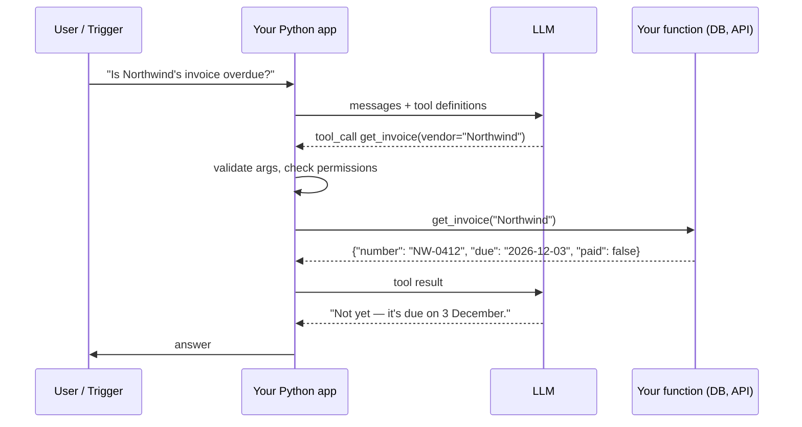
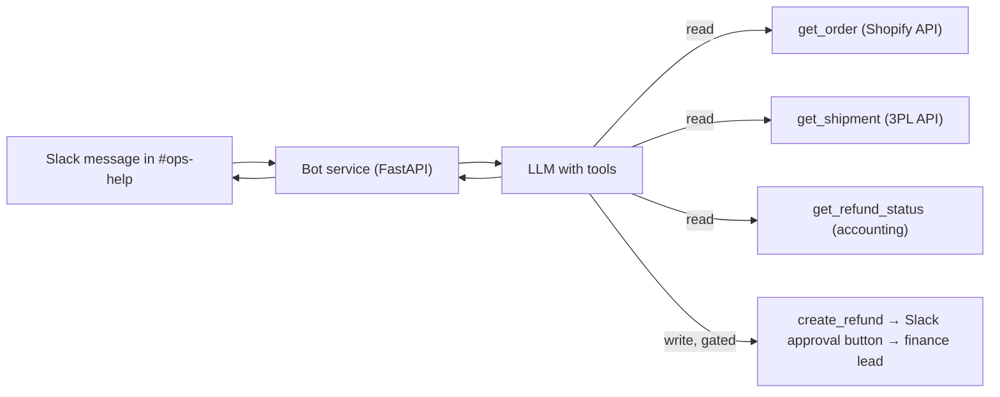

# 04 · Function Calling & Tool Use

> **In one line:** With function calling, the model *requests* a typed call to one of your functions and your code decides whether and how to run it, then returns the result. This request → execute → return loop turns a text generator into something that can act, and it's the engine inside every agent in this handbook.

> **Versions used:** openai 3.x · anthropic 2.x (incl. beta tool runner) · google-genai 3.x · pydantic 2.14 · **Fast-moving:** tool-choice options, strict-mode rules and SDK helpers (tool runners, automatic function calling) change frequently. Some current models reject *forced* tool choice entirely.

---

## 1. Overview

> **Builds on:** [Ch 03 · Structured Outputs](topic.html?p=03-structured-outputs) (schemas) and [Ch 02 · Prompt Engineering](topic.html?p=02-prompt-engineering).

Structured output answers "give me data in this shape". **Tool use** answers "decide what to do, and ask me to do it". You describe functions (`get_invoice`, `search_kb`, `create_ticket`) with names, descriptions and JSON-Schema parameters. The model reads the user's request and either answers directly or emits a **tool call**: a name plus JSON arguments. Your code runs the function and sends the result back. The model then answers, or calls another tool.

The model **never executes anything**. You do. That boundary is your security model: every tool call is a request you can validate, rate-limit, log, or refuse.



The deep theory (constrained decoding of arguments, why descriptions matter) is in [AI Engineering · Tool & Function Calling](../ai-engineering/topic.html?p=33-tool-function-calling). This chapter is about building it correctly across providers.

---

## 2. Key Concepts

- **Tool definition**: `name`, `description` (when and why to use it, which the model reads), and a JSON Schema for its parameters.
- **Tool call**: the model's structured request: an ID, the tool name, and arguments.
- **Tool result**: your reply, keyed by that ID, containing the output *or an error message*.
- **The loop**: keep calling the model while it returns tool calls. Stop when it returns a final answer, or when you hit a step limit.
- **Parallel tool calls**: one model turn may request several independent calls. Run them (concurrently if you like) and return **all results together** in the next message.
- **Tool choice**: `auto` (model decides, the default), `none`, or forcing a call. Several current models (e.g. Claude Opus 5.5 / Sonnet 5.5) **reject forced tool choice**. Steer with the prompt instead and use `strict` schemas.
- **Strict tools**: schema-constrained arguments (same mechanism as Ch 03). Requires `additionalProperties: false` and all properties listed.
- **Side effects**: read tools (search, lookup) are safe to retry. Write tools (send email, refund) need idempotency keys, confirmation and audit logs.

> **Analogy:** the model is a manager who can only send written requests to departments. "Finance: get invoice NW-0412." The department (your code) checks the request is allowed, does the work, and replies in writing. The manager never touches the filing cabinet.

How the message list grows during the loop is what trips people up most:

```svg
<svg viewBox="0 0 860 300" width="100%" height="300" font-family="ui-sans-serif,system-ui,sans-serif" font-size="11" xmlns="http://www.w3.org/2000/svg">
  <defs><marker id="aa04a" viewBox="0 0 10 10" refX="9" refY="5" markerWidth="7" markerHeight="7" orient="auto"><path d="M0,0 L10,5 L0,10 z" fill="#334155"/></marker></defs>
  <text x="430" y="22" text-anchor="middle" font-size="14" font-weight="700" fill="#1e293b">The tool loop: the messages list you re-send each turn</text>
  <g font-family="ui-monospace,monospace">
    <rect x="30" y="40" width="250" height="26" rx="4" fill="#dbeafe" stroke="#2563eb"/><text x="40" y="57" fill="#1e293b">system: rules + tool list</text>
    <rect x="30" y="70" width="250" height="26" rx="4" fill="#dbeafe" stroke="#2563eb"/><text x="40" y="87" fill="#1e293b">user: "Is NW overdue?"</text>
    <text x="155" y="118" text-anchor="middle" fill="#334155" font-family="ui-sans-serif,system-ui,sans-serif">call 1 →</text>

    <rect x="310" y="40" width="250" height="26" rx="4" fill="#dbeafe" stroke="#2563eb"/><text x="320" y="57" fill="#1e293b">system</text>
    <rect x="310" y="70" width="250" height="26" rx="4" fill="#dbeafe" stroke="#2563eb"/><text x="320" y="87" fill="#1e293b">user</text>
    <rect x="310" y="100" width="250" height="26" rx="4" fill="#ede9fe" stroke="#7c3aed"/><text x="320" y="117" fill="#1e293b">assistant: tool_call id=t1</text>
    <rect x="310" y="130" width="250" height="26" rx="4" fill="#dcfce7" stroke="#16a34a"/><text x="320" y="147" fill="#1e293b">tool result id=t1: {...}</text>
    <text x="435" y="178" text-anchor="middle" fill="#334155" font-family="ui-sans-serif,system-ui,sans-serif">call 2 →</text>

    <rect x="590" y="40" width="250" height="26" rx="4" fill="#dbeafe" stroke="#2563eb"/><text x="600" y="57" fill="#1e293b">system</text>
    <rect x="590" y="70" width="250" height="26" rx="4" fill="#dbeafe" stroke="#2563eb"/><text x="600" y="87" fill="#1e293b">user</text>
    <rect x="590" y="100" width="250" height="26" rx="4" fill="#ede9fe" stroke="#7c3aed"/><text x="600" y="117" fill="#1e293b">assistant: tool_call t1</text>
    <rect x="590" y="130" width="250" height="26" rx="4" fill="#dcfce7" stroke="#16a34a"/><text x="600" y="147" fill="#1e293b">tool result t1</text>
    <rect x="590" y="160" width="250" height="26" rx="4" fill="#ede9fe" stroke="#7c3aed"/><text x="600" y="177" fill="#1e293b">assistant: final text</text>
  </g>
  <line x1="282" y1="83" x2="306" y2="83" stroke="#334155" stroke-width="1.5" marker-end="url(#aa04a)"/>
  <line x1="562" y1="83" x2="586" y2="83" stroke="#334155" stroke-width="1.5" marker-end="url(#aa04a)"/>
  <rect x="30" y="210" width="810" height="74" rx="8" fill="#fef3c7" stroke="#d97706"/>
  <text x="46" y="232" font-weight="700" fill="#1e293b">Rules that cause 400 errors when broken</text>
  <text x="46" y="250" fill="#334155">1. Append the assistant turn that contains the tool call BEFORE the tool result. 2. Every tool-call ID needs exactly one result.</text>
  <text x="46" y="268" fill="#334155">3. Several calls in one turn: return all their results in one message. 4. Failed tool: still return a result, flagged as an error.</text>
</svg>
```

### Writing good tool descriptions

The description is a prompt. Say **what** the tool does, **when** to use it (and when not), what the **arguments** mean, and what it **returns**. "get_invoice: Look up one supplier invoice by vendor name or invoice number. Use when the user asks about payment status, amounts or due dates. Returns JSON with number, total, currency, due_date, paid." That beats "gets invoice".

### How many tools?

Accuracy drops as the tool list grows and overlaps. Keep **5–15 sharply distinct tools** per call. For more, group them (sub-agents, [Part 5](topic.html?p=21-agent-patterns)), use provider tool-search features, or expose them through [MCP](topic.html?p=28-mcp-fastmcp) and load only the relevant server.

---

## 3. Setup

```bash
pip install "openai>=3" "anthropic>=2" "google-genai>=3" "pydantic>=2.10" "python-dotenv>=1"
ollama pull llama3.2          # supports tool calling; qwen3 and mistral-family models do too
```

```bash
# .env.example
LLM_BASE_URL=http://localhost:11434/v1
LLM_API_KEY=ollama
LLM_MODEL=llama3.2
ANTHROPIC_API_KEY=
CLAUDE_MODEL=claude-opus-5-5
GEMINI_API_KEY=
GEMINI_MODEL=gemini-2.5-flash
```

A fake back office used by every example (save as `backoffice.py`). In real life these would be SQL queries and API calls:

```python
# backoffice.py — stand-in for your DB / ERP / CRM
from datetime import date

INVOICES = {
    "NW-0412": {"vendor": "Northwind", "total": 4698.12, "currency": "EUR", "due": "2026-12-03", "paid": False},
    "CT-0099": {"vendor": "Contoso", "total": 1200.00, "currency": "USD", "due": "2026-10-15", "paid": False},
    "CT-0101": {"vendor": "Contoso", "total": 310.50, "currency": "USD", "due": "2026-11-01", "paid": True},
}
SENT_EMAILS: list[dict] = []


def find_invoices(vendor: str | None = None, unpaid_only: bool = False) -> list[dict]:
    rows = [{"number": k, **v} for k, v in INVOICES.items()]
    if vendor:
        rows = [r for r in rows if r["vendor"].lower() == vendor.lower()]
    if unpaid_only:
        rows = [r for r in rows if not r["paid"]]
    return rows


def days_overdue(number: str, today: str | None = None) -> int:
    inv = INVOICES[number]                              # KeyError → becomes a tool error
    t = date.fromisoformat(today) if today else date.today()
    return max(0, (t - date.fromisoformat(inv["due"])).days)


def send_reminder(number: str, tone: str = "polite") -> dict:
    SENT_EMAILS.append({"invoice": number, "tone": tone})
    return {"status": "queued", "invoice": number}
```

---

## 4. Code Examples

### Example 1: A provider-neutral tool registry from Pydantic

Define each tool once: a Pydantic model for arguments plus a Python function. Generate schemas for any provider, and validate arguments before execution.

```python
# tools.py — define tools once, export schemas for OpenAI-style and Claude-style APIs
import json
from dataclasses import dataclass
from typing import Callable, Literal, Optional

from pydantic import BaseModel, Field, ValidationError

import backoffice


@dataclass
class Tool:
    name: str
    description: str
    args: type[BaseModel]
    fn: Callable
    side_effect: bool = False                    # True = needs approval / idempotency

    def schema(self) -> dict:
        s = self.args.model_json_schema()
        s.pop("title", None)
        s["additionalProperties"] = False
        return s

    def openai_spec(self) -> dict:              # Chat Completions format (Ollama, Groq, OpenRouter...)
        return {"type": "function",
                "function": {"name": self.name, "description": self.description, "parameters": self.schema()}}

    def claude_spec(self) -> dict:
        return {"name": self.name, "description": self.description, "input_schema": self.schema()}


class FindInvoicesArgs(BaseModel):
    vendor: Optional[str] = Field(None, description="Vendor name, e.g. 'Northwind'. Omit for all vendors.")
    unpaid_only: bool = Field(False, description="True to return only unpaid invoices")


class DaysOverdueArgs(BaseModel):
    number: str = Field(description="Invoice number exactly as returned by find_invoices, e.g. 'NW-0412'")
    today: Optional[str] = Field(None, description="ISO date to compute against; omit for today")


class SendReminderArgs(BaseModel):
    number: str
    tone: Literal["polite", "firm"] = "polite"


TOOLS = {t.name: t for t in [
    Tool("find_invoices", "List supplier invoices, optionally filtered by vendor and unpaid status. "
         "Use for any question about invoices, amounts, due dates or payment status.",
         FindInvoicesArgs, backoffice.find_invoices),
    Tool("days_overdue", "Compute how many days an invoice is past its due date (0 if not overdue). "
         "Always use this instead of doing date arithmetic yourself.",
         DaysOverdueArgs, backoffice.days_overdue),
    Tool("send_reminder", "Queue a payment-reminder email to the vendor's AP contact. "
         "Only use when the user explicitly asks to send a reminder.",
         SendReminderArgs, backoffice.send_reminder, side_effect=True),
]}


def execute(name: str, raw_args: str | dict, approve: Callable[[str, dict], bool] = lambda n, a: True) -> tuple[str, bool]:
    """Validate and run a tool. Returns (result_json, is_error). Never raises to the loop."""
    tool = TOOLS.get(name)
    if tool is None:
        return json.dumps({"error": f"unknown tool {name}"}), True
    try:
        args = tool.args.model_validate_json(raw_args) if isinstance(raw_args, str) else tool.args.model_validate(raw_args)
    except ValidationError as e:
        return json.dumps({"error": "invalid arguments", "details": e.errors(include_url=False)}), True
    if tool.side_effect and not approve(name, args.model_dump()):
        return json.dumps({"error": "user declined this action"}), True
    try:
        return json.dumps(tool.fn(**args.model_dump()), default=str), False
    except Exception as e:                       # tool failures go back to the model as data
        return json.dumps({"error": f"{type(e).__name__}: {e}"}), True
```

### Example 2: The tool loop on any OpenAI-compatible model (local by default)

```python
# ex2_openai_compatible_loop.py
import json
import os

from dotenv import load_dotenv
from openai import OpenAI

from tools import TOOLS, execute

load_dotenv()
client = OpenAI(base_url=os.getenv("LLM_BASE_URL", "http://localhost:11434/v1"),
                api_key=os.getenv("LLM_API_KEY", "ollama"))
MODEL = os.getenv("LLM_MODEL", "llama3.2")
SYSTEM = "You are an accounts-payable assistant. Use tools for facts; never guess numbers or dates. Today is 2026-11-12."


def run(question: str, max_steps: int = 6, approve=lambda name, args: True) -> str:
    messages = [{"role": "system", "content": SYSTEM}, {"role": "user", "content": question}]
    specs = [t.openai_spec() for t in TOOLS.values()]
    for step in range(max_steps):
        resp = client.chat.completions.create(model=MODEL, messages=messages, tools=specs, temperature=0)
        msg = resp.choices[0].message
        if not msg.tool_calls:                               # final answer
            return msg.content or ""
        messages.append(msg.model_dump(exclude_none=True))   # 1) the assistant turn WITH its tool calls
        for call in msg.tool_calls:                          # 2) one result per call id
            result, is_err = execute(call.function.name, call.function.arguments, approve)
            print(f"  step {step}: {call.function.name}({call.function.arguments}) -> {result[:80]}")
            messages.append({"role": "tool", "tool_call_id": call.id, "content": result})
    return "Stopped: step limit reached."                   # never loop forever


if __name__ == "__main__":
    print(run("Which Contoso invoices are unpaid, and how many days overdue is each?"))
```

Illustrative output with a small local model:

```text
  step 0: find_invoices({"vendor": "Contoso", "unpaid_only": true}) -> [{"number": "CT-0099", "vendor": "Contoso", ...
  step 1: days_overdue({"number": "CT-0099", "today": "2026-11-12"}) -> 28
Contoso has one unpaid invoice, CT-0099 (USD 1,200.00), which is 28 days overdue.
```

### Example 3: Claude: the manual loop

The shape is the same: tool definitions with `input_schema`, `tool_use` blocks out, `tool_result` blocks back.

```python
# ex3_claude_loop.py — needs ANTHROPIC_API_KEY
import os

import anthropic
from dotenv import load_dotenv

from tools import TOOLS, execute

load_dotenv()
client = anthropic.Anthropic()
MODEL = os.getenv("CLAUDE_MODEL", "claude-opus-5-5")
SYSTEM = "You are an accounts-payable assistant. Use tools for facts; never guess numbers or dates. Today is 2026-11-12."


def run(question: str, max_steps: int = 8) -> str:
    messages = [{"role": "user", "content": question}]
    tools = [t.claude_spec() for t in TOOLS.values()]   # args are validated by execute() anyway
    for _ in range(max_steps):
        resp = client.messages.create(model=MODEL, max_tokens=4096, system=SYSTEM,
                                      tools=tools, messages=messages)
        if resp.stop_reason != "tool_use":                     # end_turn, max_tokens, refusal...
            return "".join(b.text for b in resp.content if b.type == "text")
        messages.append({"role": "assistant", "content": resp.content})
        results = []
        for block in resp.content:
            if block.type == "tool_use":
                out, is_err = execute(block.name, block.input)  # block.input is already a dict
                results.append({"type": "tool_result", "tool_use_id": block.id,
                                "content": out, "is_error": is_err})
        messages.append({"role": "user", "content": results})   # ALL results in ONE message
    return "Stopped: step limit reached."


if __name__ == "__main__":
    print(run("List every unpaid invoice with its days overdue, most overdue first."))
```

### Example 4: Claude's SDK tool runner (less code, same loop)

The Anthropic SDK's beta **tool runner** builds the schema from a typed, documented function and runs the loop for you.

```python
# ex4_claude_tool_runner.py — needs ANTHROPIC_API_KEY
import json
import os

import anthropic
from anthropic import beta_tool
from dotenv import load_dotenv

import backoffice

load_dotenv()
client = anthropic.Anthropic()


@beta_tool
def find_invoices(vendor: str = "", unpaid_only: bool = False) -> str:
    """List supplier invoices, optionally filtered.

    Args:
        vendor: Vendor name such as 'Northwind'; empty string for all vendors.
        unpaid_only: True to return only unpaid invoices.
    """
    return json.dumps(backoffice.find_invoices(vendor or None, unpaid_only))


@beta_tool
def days_overdue(number: str) -> str:
    """Days past due for an invoice number such as 'NW-0412' (0 if not overdue).

    Args:
        number: Invoice number exactly as returned by find_invoices.
    """
    return str(backoffice.days_overdue(number, today="2026-11-12"))


runner = client.beta.messages.tool_runner(
    model=os.getenv("CLAUDE_MODEL", "claude-opus-5-5"),
    max_tokens=4096,
    tools=[find_invoices, days_overdue],
    messages=[{"role": "user", "content": "Which invoices are overdue and by how many days?"}],
)

if __name__ == "__main__":
    final = runner.until_done()                 # runs tool calls until Claude stops asking
    print("".join(b.text for b in final.content if b.type == "text"))
```

Use the runner when tools are pure functions. Keep the manual loop (Example 3) when you need approval gates, custom logging or step budgets in one obvious place. The runner offers per-turn hooks for those too, but the manual loop is easier to read when you're learning.

### Example 5: Gemini: automatic function calling

The `google-genai` SDK can take plain Python functions, derive their schemas from type hints and docstrings, execute them, and return the final text.

```python
# ex5_gemini_auto.py — needs GEMINI_API_KEY
import os

from dotenv import load_dotenv
from google import genai
from google.genai import types

import backoffice

load_dotenv()
client = genai.Client()


def find_invoices(vendor: str = "", unpaid_only: bool = False) -> list[dict]:
    """List supplier invoices, optionally filtered by vendor name and unpaid status."""
    return backoffice.find_invoices(vendor or None, unpaid_only)


resp = client.models.generate_content(
    model=os.getenv("GEMINI_MODEL", "gemini-2.5-flash"),
    contents="How much do we owe Contoso in total on unpaid invoices?",
    config=types.GenerateContentConfig(tools=[find_invoices]),   # SDK runs the loop automatically
)

if __name__ == "__main__":
    print(resp.text)
```

Automatic execution is convenient for read-only tools. For tools with side effects, disable it (`automatic_function_calling=types.AutomaticFunctionCallingConfig(disable=True)`), handle `resp.function_calls` yourself, and gate them.

### Example 6: Human approval for side-effect tools

```python
# ex6_approval.py — reuse Example 2's loop, gating side-effect tools behind a human "yes"
import backoffice
from ex2_openai_compatible_loop import run


def cli_approve(name: str, args: dict) -> bool:
    """Called by tools.execute() only for tools marked side_effect=True."""
    answer = input(f"\nModel wants to run {name}({args}). Approve? [y/N] ")
    return answer.strip().lower() == "y"


if __name__ == "__main__":
    print(run("Contoso's unpaid invoice is overdue. Send them a firm reminder.", approve=cli_approve))
    print("sent:", backoffice.SENT_EMAILS)
```

When the user declines, the model receives `{"error": "user declined this action"}` and should say so, not retry in a loop. In Slack or n8n, the approver becomes an interactive button ([Ch 24](topic.html?p=24-langgraph-production) builds durable approvals with LangGraph interrupts).

---

## 5. Real-World Use Case

**Company:** a 60-person e-commerce brand. **Problem:** the ops team answers ~80 internal questions a day in Slack ("where's order 18823?", "did the Contoso refund go out?"), each needing lookups in Shopify, the 3PL portal and the accounting system. **Automation:** a Slack assistant with read tools for each system, and one write tool behind approval.



Design decisions:
- **Read tools are broad. Write tools are narrow and gated.** `create_refund` requires an order ID and an amount no larger than the order total (validated in code), and posts an approval button. Nothing moves money without a human click.
- **Tool results are trimmed.** Shopify returns ~6 KB per order and the tool returns the 12 fields that matter. That keeps context small and cost down.
- **Every call is logged** (user, tool, args, latency, result size) to a table. That's the audit trail, and it's the dataset for evaluating the bot later.
- **Step limit 6**, then a fallback message tagging a human.

---

## 6. Mini Project: Ops Assistant CLI over SQLite (1–2 hours)

**Goal:** a terminal assistant that answers questions about orders and customers using tools over a real SQLite database, with one approval-gated write action.

```text
ops-assistant/
├── .env
├── seed.py
├── ops.db               # created by seed.py
├── ops_tools.py
└── assistant.py
```

**Step 1: seed data with pandas.**

```python
# seed.py
import sqlite3
import pandas as pd

customers = pd.DataFrame({
    "customer_id": [1, 2, 3],
    "name": ["Brightpath Logistics", "Meridian Retail", "Smallco"],
    "email": ["ap@brightpath.io", "finance@meridian.example", "tom@smallco.dev"],
    "tier": ["gold", "platinum", "standard"],
})
orders = pd.DataFrame({
    "order_id": [18821, 18822, 18823, 18824],
    "customer_id": [1, 2, 2, 3],
    "status": ["delivered", "shipped", "processing", "cancelled"],
    "amount": [1250.0, 9800.0, 430.0, 99.0],
    "created": ["2026-10-30", "2026-11-05", "2026-11-10", "2026-11-11"],
})
with sqlite3.connect("ops.db") as con:
    customers.to_sql("customers", con, if_exists="replace", index=False)
    orders.to_sql("orders", con, if_exists="replace", index=False)
    con.execute("CREATE TABLE IF NOT EXISTS notes (order_id INT, note TEXT, author TEXT)")
print("seeded ops.db")
```

**Step 2: tools.** Use parameterised SQL only. The model never writes SQL here.

```python
# ops_tools.py
import json
import sqlite3
from typing import Literal, Optional

from pydantic import BaseModel, Field, ValidationError

DB = "ops.db"


def q(sql: str, params: tuple = ()) -> list[dict]:
    with sqlite3.connect(DB) as con:
        con.row_factory = sqlite3.Row
        return [dict(r) for r in con.execute(sql, params).fetchall()]


class GetOrder(BaseModel):
    order_id: int = Field(description="Numeric order ID, e.g. 18823")


class FindCustomer(BaseModel):
    name: str = Field(description="Full or partial customer name")


class ListOrders(BaseModel):
    customer_id: int
    status: Optional[Literal["processing", "shipped", "delivered", "cancelled"]] = None


class AddNote(BaseModel):
    order_id: int
    note: str = Field(max_length=300)


def get_order(a: GetOrder): return q("SELECT * FROM orders WHERE order_id=?", (a.order_id,)) or {"error": "not found"}
def find_customer(a: FindCustomer): return q("SELECT * FROM customers WHERE name LIKE ?", (f"%{a.name}%",))
def list_orders(a: ListOrders):
    if a.status:
        return q("SELECT * FROM orders WHERE customer_id=? AND status=?", (a.customer_id, a.status))
    return q("SELECT * FROM orders WHERE customer_id=?", (a.customer_id,))
def add_note(a: AddNote):
    with sqlite3.connect(DB) as con:
        con.execute("INSERT INTO notes VALUES (?,?,?)", (a.order_id, a.note, "assistant"))
    return {"status": "saved"}


REGISTRY = {
    "get_order": (GetOrder, get_order, "Get one order by ID: status, amount, customer_id, created date.", False),
    "find_customer": (FindCustomer, find_customer, "Find customers by (partial) name. Returns customer_id, tier, email.", False),
    "list_orders": (ListOrders, list_orders, "List a customer's orders, optionally by status.", False),
    "add_note": (AddNote, add_note, "Attach an internal note to an order. Only when the user asks to record something.", True),
}


def specs() -> list[dict]:
    out = []
    for name, (model, _, desc, _) in REGISTRY.items():
        schema = model.model_json_schema(); schema.pop("title", None)
        out.append({"type": "function", "function": {"name": name, "description": desc, "parameters": schema}})
    return out


def call(name: str, raw: str, approve) -> str:
    if name not in REGISTRY:
        return json.dumps({"error": f"unknown tool {name}"})
    model, fn, _, gated = REGISTRY[name]
    try:
        args = model.model_validate_json(raw)
    except ValidationError as e:
        return json.dumps({"error": e.errors(include_url=False)})
    if gated and not approve(name, args.model_dump()):
        return json.dumps({"error": "user declined"})
    return json.dumps(fn(args), default=str)
```

**Step 3: the assistant loop with a REPL.**

```python
# assistant.py
import os
from dotenv import load_dotenv
from openai import OpenAI
from ops_tools import call, specs

load_dotenv()
client = OpenAI(base_url=os.getenv("LLM_BASE_URL", "http://localhost:11434/v1"),
                api_key=os.getenv("LLM_API_KEY", "ollama"))
MODEL = os.getenv("LLM_MODEL", "llama3.2")
SYSTEM = ("You are an ops assistant. Answer only from tool results. If a lookup finds nothing, say so. "
          "Look up customers by name before listing their orders.")


def approve(name: str, args: dict) -> bool:
    return input(f"  ⚠ approve {name} {args}? [y/N] ").lower().startswith("y")


def answer(history: list[dict], max_steps: int = 6) -> str:
    for _ in range(max_steps):
        msg = client.chat.completions.create(model=MODEL, messages=history, tools=specs(),
                                             temperature=0).choices[0].message
        if not msg.tool_calls:
            history.append({"role": "assistant", "content": msg.content or ""})
            return msg.content or ""
        history.append(msg.model_dump(exclude_none=True))
        for c in msg.tool_calls:
            print(f"  → {c.function.name}({c.function.arguments})")
            history.append({"role": "tool", "tool_call_id": c.id,
                            "content": call(c.function.name, c.function.arguments, approve)})
    return "Step limit reached — escalating to a human."


if __name__ == "__main__":
    history = [{"role": "system", "content": SYSTEM}]
    while (q := input("\nops> ").strip()) not in {"", "exit"}:
        history.append({"role": "user", "content": q})
        print(answer(history))
```

**Step 4: try it.**

```bash
python seed.py && python assistant.py
ops> What's the status of order 18823 and who is the customer?
ops> Does Meridian have anything still processing?
ops> Add a note to 18823 that the customer asked for express shipping.
```

**Done when:**
- [ ] Questions are answered from tool results, with tool calls printed.
- [ ] "Order 99999" gives an honest "not found", not an invented order.
- [ ] `add_note` asks for approval, and declining is reported politely.
- [ ] A malformed argument (try "order eighteen thousand") results in a validation error the model recovers from.

**Stretch:** log every tool call to a `tool_log` table. Add a per-session budget of 10 tool calls. Swap the backend to Claude (Example 3) without changing `ops_tools.py`'s logic.

---

## 7. Comparison Table

**Provider tool APIs**

| | OpenAI-compatible (Chat Completions) | OpenAI Responses API | Anthropic Claude | Google Gemini |
|---|---|---|---|---|
| Tool spec | `{"type":"function","function":{name, description, parameters}}` | `{"type":"function", name, description, parameters}` | `{name, description, input_schema}` | Python callables or `FunctionDeclaration` |
| Call arrives as | `message.tool_calls[].function.arguments` (JSON **string**) | `function_call` output items | `tool_use` content blocks (`input` is a **dict**) | `function_call` parts |
| Result goes back as | `{"role": "tool", "tool_call_id", "content"}` | `function_call_output` input item | `tool_result` block in a user message | `function_response` part |
| Loop helper | none (write it) | Agents SDK (Ch 26) | `tool_runner` (beta) | automatic function calling |
| Strict args | `strict: true` (OpenAI) | `strict: true` | `strict: true` | schema-constrained |

**Tool calling vs. related approaches**

| Approach | Use when |
|---|---|
| Structured output (Ch 03) | Every input maps to one fixed output shape |
| Tool calling, single step | Model must choose among actions, or fetch facts before answering |
| Tool loop / agent (Part 5) | Open-ended tasks needing several dependent steps |
| MCP server (Ch 28) | You want tools reusable across apps, IDEs and agents, with standard discovery |
| Deterministic workflow (n8n, code) | The steps are known in advance. Don't make the model rediscover them |

---

## 8. Common Mistakes & Best Practices

**Mistake 1: letting the model write raw SQL or shell commands.** It works in demos and is a prompt-injection catastrophe in production. *Fix:* narrow, parameterised tools (`get_order(order_id: int)`). If you truly need ad-hoc SQL, use a read-only replica, a restricted DB role, statement timeouts and an allowlist of tables.

**Mistake 2: forgetting the assistant turn.** Sending tool results without first appending the assistant message containing the tool calls produces a 400 ("tool result without matching call").

**Mistake 3: raising exceptions out of the loop.** *Fix:* catch and return `{"error": ...}` with `is_error`. The model can often fix its arguments or explain the failure.

**Mistake 4: no step limit.** A confused model can call the same tool 50 times. *Fix:* `max_steps`, plus de-duplication of identical consecutive calls.

**Mistake 5: auto-executing side effects.** *Fix:* mark write tools, require approval or policy checks, use idempotency keys so retries don't send two emails.

```python
# Idempotent side effect: same (invoice, day) → same key → the email provider dedupes
key = f"reminder:{number}:{date.today().isoformat()}"
email_api.send(to=..., body=..., idempotency_key=key)
```

**Mistake 6: dumping huge tool results into context.** *Fix:* select fields, paginate, summarise. Return IDs plus a "use get_x for details" hint.

**Mistake 7: overlapping tools.** `search_orders`, `find_order` and `lookup_order` confuse the model. *Fix:* one tool per job, and distinct names and descriptions.

**Best-practice checklist**
- [ ] Narrow tools with Pydantic-validated args. Descriptions say when to use them.
- [ ] `strict` schemas where the provider supports them.
- [ ] Errors returned as tool results, never raised. Step limit enforced.
- [ ] Side-effect tools gated, idempotent and audit-logged.
- [ ] Tool results trimmed to what the model needs.
- [ ] 5–15 tools per call. Split into sub-agents or MCP servers beyond that.

---

## 9. Exercises

1. **Parallel calls.** Ask Example 2 "Compare Northwind's and Contoso's unpaid totals." Does the model emit two `find_invoices` calls in one turn? Modify the loop to run them with `concurrent.futures.ThreadPoolExecutor`.
2. **Bad arguments.** Change `days_overdue`'s description to remove the format example and ask about "invoice 412". Watch the validation error and recovery. Then restore the description.
3. **Loop guard.** Add de-duplication: if the model requests the exact same tool and arguments twice in a row, return an error telling it to use the previous result.
4. **Provider swap.** Make `assistant.py` work with Claude by converting `specs()` to Claude format and adapting the loop (Example 3).
5. **Audit log.** Write each tool call (timestamp, tool, args, latency_ms, is_error, result_bytes) to SQLite and build a pandas report of the slowest and most-failing tools.

### Self-check questions

**Q: Who executes a tool call, the model or your application, and why does that matter?**
A: Your application. The model only emits a structured request with a name and arguments. Because your code sits between request and execution, you can validate arguments, enforce permissions, require approval, rate-limit, log and refuse. That boundary is the core security property of tool use.

**Q: What happens if you send a tool result without the preceding assistant message that contained the tool call?**
A: The API rejects the request, because each tool result must reference a tool-call ID from the immediately preceding assistant turn. Always append the full assistant turn (including its tool-call blocks) first, then exactly one result per call ID.

**Q: How should a tool failure be reported to the model?**
A: As a normal tool result containing an error message, flagged as an error where the API supports it (e.g. `is_error: true` for Claude). The model can then correct its arguments, try another approach, or tell the user. Raising an exception out of the loop loses that chance and breaks the conversation state.

**Q: Why do good tool descriptions matter as much as the schema?**
A: The model decides *whether* and *which* tool to call almost entirely from names and descriptions. Saying what the tool does, when to use it, what the arguments mean and what it returns reduces wrong-tool calls, missing calls and malformed arguments, the same way a clear prompt does.

**Q: A current model returns a 400 when you set `tool_choice` to force a specific tool. What do you do? (Senior)**
A: Some current models no longer support forced tool choice. Use `auto`, instruct the model in the prompt to use the tool, set `strict` schemas so arguments stay valid, and check in code that a tool call came back, re-prompting if not. If you only forced the tool to get JSON, switch to structured outputs instead.

**Q: How do you make a tool that sends emails safe to use in an agent loop with retries? (Senior)**
A: Mark it as side-effecting and gate it behind approval or policy checks. Validate recipients and content against allowlists, and pass an idempotency key derived from the business action (e.g. invoice + date) so retries and duplicate calls don't send twice. Log every invocation for audit, and rate-limit per user and tenant. Indirect prompt injection from retrieved content is a real risk, so never let untrusted text alone authorise the action.

**Q: When would you choose a deterministic workflow over a tool-calling loop?**
A: When the sequence of steps is known in advance: e.g. always fetch the order, then the shipment, then format a reply. Code (or n8n) runs that cheaper, faster and more predictably. Reserve model-driven tool selection for cases where the path genuinely depends on the input.

---

## 10. Summary & Official Docs

- Tool calling = **model requests, your code executes**, results go back, and the loop repeats until a final answer.
- Define tools once (Pydantic args + function + description) and export to each provider's format.
- Follow the message rules: **assistant turn first, one result per call ID, all parallel results in one message, errors as results.**
- **Validate arguments, cap steps, trim results, gate side effects** with approval and idempotency.
- Providers differ in shape (string vs. dict arguments, `tool` role vs. `tool_result` blocks) but not in concept. SDK helpers (Claude tool runner, Gemini automatic calling) remove the boilerplate.
- Prefer deterministic workflows when the steps are known. Use tools when the path depends on the input.

**Official docs**
- OpenAI function calling: https://platform.openai.com/docs/guides/function-calling
- Anthropic tool use: https://docs.claude.com/en/docs/agents-and-tools/tool-use/overview
- Gemini function calling: https://ai.google.dev/gemini-api/docs/function-calling
- Ollama tool support: https://ollama.com/blog/tool-support
- Theory: [AI Engineering · Tool & Function Calling](../ai-engineering/topic.html?p=33-tool-function-calling)

**Next:** [Ch 05 · Embeddings](topic.html?p=05-embeddings): the other half of the LLM toolkit, turning text into vectors for search, dedup and routing.

---

*AI Automation with Python Handbook — chapter 04.*
