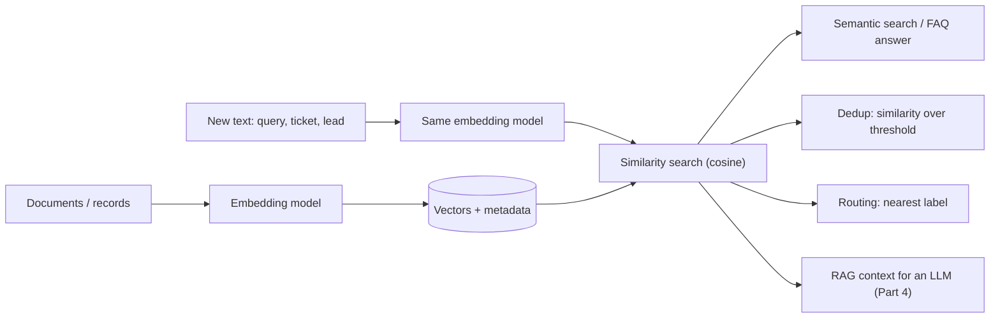
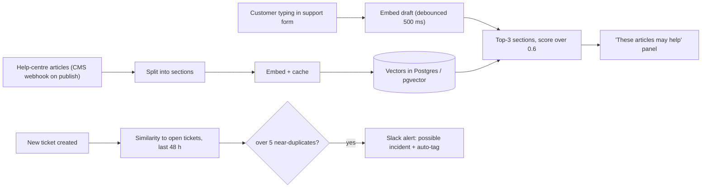

# 05 · Embeddings & Semantic Similarity

> **In one line:** An embedding model turns text into a vector so that similar meanings land close together. That one trick powers semantic search, deduplication, clustering, routing and RAG, often with no generative LLM call at all and at a tiny fraction of the cost.

> **Versions used:** ollama 0.6 (`nomic-embed-text`) · sentence-transformers 6.x · openai 3.x · google-genai 3.x · numpy 2.x · pandas 2.x/3.x · **Fast-moving:** embedding leaderboards (MTEB) change monthly. Model names, dimensions and per-token prices shift. Always re-embed everything when you switch models.

---

## 1. Overview

> **Builds on:** [Ch 01 · How LLMs Work](topic.html?p=01-how-llms-work) (tokens, cost).

Your automations constantly need to answer "which of these is most like that?":
- Which help-centre article answers this ticket?
- Is this new lead a duplicate of an existing CRM record?
- Which team should this email go to?
- Which 5 paragraphs of a 300-page contract are relevant to the question?

Keyword search fails on these because people don't use the same words: "I can't get in" and "login fails" share no keywords. **Embeddings** compare *meaning*. They're cheap (often ~100× cheaper than generation per token, or free locally), fast, and deterministic: the same text always gives the same vector.



This chapter does all of that with numpy and pandas, which is plenty up to ~100k vectors. [Ch 18 · Vector Databases](topic.html?p=18-vector-databases) covers storing millions. For how embedding models are trained, see [AI Engineering · Embeddings](../ai-engineering/topic.html?p=21-embeddings-representation).

---

## 2. Key Concepts

### Vectors as coordinates of meaning

An embedding is a list of floats, typically 384–3072 numbers. Each text becomes a point in that high-dimensional space. Training arranges the space so that texts with similar meaning are close and unrelated texts are far apart.

> **Analogy:** a map where cities are placed by *culture* instead of geography. "Refund request" and "charged twice" are neighbourhoods in the same city. "Dark mode please" is in another country.

```svg
<svg viewBox="0 0 860 320" width="100%" height="320" font-family="ui-sans-serif,system-ui,sans-serif" font-size="11" xmlns="http://www.w3.org/2000/svg">
  <defs><marker id="aa05a" viewBox="0 0 10 10" refX="9" refY="5" markerWidth="7" markerHeight="7" orient="auto"><path d="M0,0 L10,5 L0,10 z" fill="#2563eb"/></marker>
  <marker id="aa05b" viewBox="0 0 10 10" refX="9" refY="5" markerWidth="7" markerHeight="7" orient="auto"><path d="M0,0 L10,5 L0,10 z" fill="#dc2626"/></marker></defs>
  <text x="430" y="22" text-anchor="middle" font-size="14" font-weight="700" fill="#1e293b">Embedding space (2-D sketch of ~768 dimensions) and cosine similarity</text>
  <rect x="20" y="36" width="500" height="270" rx="8" fill="#ffffff" stroke="#94a3b8"/>
  <circle cx="300" cy="105" r="62" fill="#dbeafe" stroke="#2563eb" stroke-dasharray="4 3"/>
  <text x="300" y="58" text-anchor="middle" font-weight="700" fill="#2563eb">billing</text>
  <circle cx="280" cy="95" r="5" fill="#2563eb"/><text x="290" y="92" fill="#1e293b">"charged twice"</text>
  <circle cx="310" cy="122" r="5" fill="#2563eb"/><text x="320" y="126" fill="#1e293b">"refund please"</text>
  <circle cx="262" cy="130" r="5" fill="#2563eb"/><text x="186" y="150" fill="#1e293b">"invoice wrong"</text>
  <circle cx="420" cy="245" r="48" fill="#dcfce7" stroke="#16a34a" stroke-dasharray="4 3"/>
  <text x="420" y="208" text-anchor="middle" font-weight="700" fill="#16a34a">access</text>
  <circle cx="410" cy="240" r="5" fill="#16a34a"/><text x="380" y="262" fill="#1e293b">"can't log in"</text>
  <circle cx="440" cy="232" r="5" fill="#16a34a"/><text x="448" y="230" fill="#1e293b">"2FA lost"</text>
  <circle cx="110" cy="250" r="5" fill="#7c3aed"/><text x="60" y="272" fill="#1e293b">"add dark mode"</text>
  <circle cx="60" cy="290" r="4" fill="#334155"/><text x="68" y="294" fill="#334155">origin</text>
  <line x1="60" y1="290" x2="276" y2="99" stroke="#2563eb" stroke-width="2" marker-end="url(#aa05a)"/>
  <line x1="60" y1="290" x2="306" y2="125" stroke="#2563eb" stroke-width="2" marker-end="url(#aa05a)"/>
  <line x1="60" y1="290" x2="106" y2="254" stroke="#dc2626" stroke-width="2" marker-end="url(#aa05b)"/>
  <rect x="545" y="36" width="295" height="270" rx="8" fill="#f8fafc" stroke="#94a3b8"/>
  <text x="692" y="60" text-anchor="middle" font-weight="700" fill="#1e293b">Cosine similarity = angle between arrows</text>
  <text x="560" y="86" fill="#334155" font-family="ui-monospace,monospace">cos(a, b) = a·b / (|a| |b|)</text>
  <rect x="560" y="100" width="265" height="34" rx="5" fill="#dbeafe"/>
  <text x="570" y="115" fill="#1e293b">small angle → ~0.8–0.9: same topic</text>
  <text x="570" y="128" fill="#334155">"charged twice" vs "refund please"</text>
  <rect x="560" y="140" width="265" height="34" rx="5" fill="#fee2e2"/>
  <text x="570" y="155" fill="#1e293b">wide angle → ~0.2–0.4: unrelated</text>
  <text x="570" y="168" fill="#334155">"charged twice" vs "add dark mode"</text>
  <text x="560" y="200" fill="#334155">Normalise vectors to length 1 and</text>
  <text x="560" y="216" fill="#334155">cosine becomes a plain dot product:</text>
  <text x="560" y="234" fill="#334155" font-family="ui-monospace,monospace">scores = M @ q   (one matmul)</text>
  <text x="560" y="262" fill="#dc2626">Absolute values differ per model:</text>
  <text x="560" y="278" fill="#dc2626">calibrate thresholds on YOUR data.</text>
</svg>
```

### The vocabulary you need

- **Dimensions**: vector length (384, 768, 1536, 3072…). More dimensions can capture more nuance but cost more storage and compute. Some models (OpenAI `text-embedding-3-*`, Matryoshka-trained models) let you truncate to fewer dimensions with modest quality loss.
- **Cosine similarity**: the angle-based score, usually between about 0 and 1 for text. On **normalised** (unit-length) vectors it equals the dot product, so search over a matrix is one matrix multiplication.
- **Max input length**: embedding models truncate long input (often 512–8192 tokens), usually *silently*. Long documents must be chunked ([Ch 15](topic.html?p=15-document-loaders-splitters)).
- **Asymmetric models**: some models expect prefixes or separate modes for queries vs. documents (e.g. `search_query: ` / `search_document: ` for nomic-embed-text, `query: ` / `passage: ` for E5). Skipping them noticeably hurts retrieval.
- **One space per model**: vectors from different models (or versions) aren't comparable. Store the model name with every vector, and re-embed everything on a model change.
- **Threshold**: a similarity cut-off for decisions like "duplicate" or "confident match". It's model-specific and data-specific, so calibrate it on labelled pairs.

### What embeddings are good and bad at

Good: topical similarity, paraphrase detection, multilingual matching (with multilingual models), fuzzy dedup, clustering, nearest-label routing.

Weak: **negation and exact constraints** ("orders *not* shipped" ≈ "orders shipped"), **numbers and IDs** ("invoice 4471" vs. "invoice 4417"), and precise filtering by date or amount. Combine embeddings with metadata filters and keyword search ([Ch 17 · Hybrid Search](topic.html?p=17-reranking-hybrid-search)).

---

## 3. Setup

```bash
pip install "ollama>=0.6" "sentence-transformers>=5" "numpy>=2" "pandas>=2" "python-dotenv>=1"
pip install "openai>=3" "google-genai>=3"     # optional hosted embeddings
ollama pull nomic-embed-text                  # 768-dim local embedding model (~270 MB)
```

```bash
# .env.example
OLLAMA_HOST=http://localhost:11434
EMBED_MODEL=nomic-embed-text
OPENAI_API_KEY=            # optional
GEMINI_API_KEY=            # optional
```

> **Claude users:** Anthropic doesn't offer an embeddings endpoint. Pair Claude for generation with any embedding provider (local models, OpenAI, Gemini, Voyage AI, Cohere). Mixing providers across generation and embeddings is normal.

---

## 4. Code Examples

### Example 1: Local embeddings with Ollama and cosine similarity in numpy

```python
# ex1_ollama_embed.py
import os

import numpy as np
import ollama
from dotenv import load_dotenv

load_dotenv()
client = ollama.Client(host=os.getenv("OLLAMA_HOST", "http://localhost:11434"))
MODEL = os.getenv("EMBED_MODEL", "nomic-embed-text")


def embed(texts: list[str], kind: str = "document") -> np.ndarray:
    """Return an (n, d) array of L2-normalised vectors. nomic-embed-text expects task prefixes."""
    prefix = "search_query: " if kind == "query" else "search_document: "
    resp = client.embed(model=MODEL, input=[prefix + t for t in texts])
    v = np.array(resp.embeddings, dtype=np.float32)
    return v / np.linalg.norm(v, axis=1, keepdims=True)    # unit length → cosine == dot


if __name__ == "__main__":
    docs = ["I was charged twice this month", "Please refund my last payment",
            "I can't log in to my account", "Could you add a dark mode?"]
    D = embed(docs)
    q = embed(["double billing on my card"], kind="query")[0]
    scores = D @ q                                         # cosine similarities in one matmul
    for s, d in sorted(zip(scores, docs), reverse=True):
        print(f"{s:.3f}  {d}")
    print("dims:", D.shape[1])
```

Illustrative output (exact scores depend on model version):

```text
0.781  I was charged twice this month
0.664  Please refund my last payment
0.412  I can't log in to my account
0.355  Could you add a dark mode?
dims: 768
```

"Double billing" shares no keywords with "charged twice", and it still ranks first.

### Example 2: sentence-transformers (local, batch, no server)

```python
# ex2_sentence_transformers.py — runs in-process on CPU/GPU; model downloads once (~90 MB)
from sentence_transformers import SentenceTransformer

model = SentenceTransformer("sentence-transformers/all-MiniLM-L6-v2")   # 384 dims, fast, English

tickets = [
    "Export to CSV is broken for large reports",
    "CSV download fails when the report is big",
    "How do I invite a teammate?",
    "Adding a new user to our workspace",
    "The app is great, thanks!",
]

if __name__ == "__main__":
    emb = model.encode(tickets, normalize_embeddings=True, batch_size=64)
    sim = model.similarity(emb, emb)          # (n, n) cosine matrix as a tensor
    for i in range(len(tickets)):
        for j in range(i + 1, len(tickets)):
            if sim[i, j] > 0.6:
                print(f"{sim[i, j]:.2f}  '{tickets[i]}'  ≈  '{tickets[j]}'")
```

```text
0.83  'Export to CSV is broken for large reports'  ≈  'CSV download fails when the report is big'
0.66  'How do I invite a teammate?'  ≈  'Adding a new user to our workspace'
```

For better retrieval quality, swap in a stronger open model (e.g. the BGE, E5, GTE or nomic families from the MTEB leaderboard). Check the model card for required prefixes, or use `encode_query()` / `encode_document()`, which apply them for models that define them.

### Example 3: Hosted embeddings (OpenAI and Gemini)

```python
# ex3_hosted_embed.py — needs OPENAI_API_KEY and/or GEMINI_API_KEY
import os

import numpy as np
from dotenv import load_dotenv

load_dotenv()
texts = ["charged twice", "refund my payment", "dark mode request"]


def openai_embed(texts: list[str], dims: int = 512) -> np.ndarray:
    from openai import OpenAI
    client = OpenAI()
    resp = client.embeddings.create(model="text-embedding-3-small", input=texts,
                                    dimensions=dims)        # shorter vectors: cheaper storage
    return np.array([d.embedding for d in resp.data], dtype=np.float32)


def gemini_embed(texts: list[str]) -> np.ndarray:
    from google import genai
    client = genai.Client()
    resp = client.models.embed_content(model=os.getenv("GEMINI_EMBED_MODEL", "gemini-embedding-001"),
                                       contents=texts)
    return np.array([e.values for e in resp.embeddings], dtype=np.float32)


if __name__ == "__main__":
    if os.getenv("OPENAI_API_KEY"):
        v = openai_embed(texts); v /= np.linalg.norm(v, axis=1, keepdims=True)
        print("openai", v.shape, np.round(v @ v.T, 2))
    if os.getenv("GEMINI_API_KEY"):
        v = gemini_embed(texts); v /= np.linalg.norm(v, axis=1, keepdims=True)
        print("gemini", v.shape, np.round(v @ v.T, 2))
```

Batch your inputs (hundreds per request, within the provider's limits) instead of one call per text. It's dramatically faster and kinder to rate limits.

### Example 4: An embedding cache (never pay twice for the same text)

```python
# embed_cache.py — SQLite cache keyed by (model, sha256(text)); wraps any embed function
import hashlib
import sqlite3
from typing import Callable

import numpy as np


class EmbeddingCache:
    def __init__(self, path: str, model: str, embed_fn: Callable[[list[str]], np.ndarray]):
        self.model, self.embed_fn = model, embed_fn
        self.db = sqlite3.connect(path)
        self.db.execute("CREATE TABLE IF NOT EXISTS emb (k TEXT PRIMARY KEY, model TEXT, v BLOB)")

    def _key(self, text: str) -> str:
        return hashlib.sha256(f"{self.model}\x00{text}".encode()).hexdigest()

    def get(self, texts: list[str]) -> np.ndarray:
        keys = [self._key(t) for t in texts]
        found = {k: np.frombuffer(v, dtype=np.float32)
                 for k, v in self.db.execute(
                     f"SELECT k, v FROM emb WHERE k IN ({','.join('?' * len(keys))})", keys)}
        missing = [(k, t) for k, t in zip(keys, texts) if k not in found]
        if missing:
            vecs = self.embed_fn([t for _, t in missing])
            self.db.executemany("INSERT OR REPLACE INTO emb VALUES (?,?,?)",
                                [(k, self.model, v.astype(np.float32).tobytes())
                                 for (k, _), v in zip(missing, vecs)])
            self.db.commit()
            found.update({k: v for (k, _), v in zip(missing, vecs)})
        return np.stack([found[k] for k in keys])


if __name__ == "__main__":
    from ex1_ollama_embed import embed
    cache = EmbeddingCache("emb_cache.db", "nomic-embed-text", embed)
    print(cache.get(["hello world", "charged twice"]).shape)   # first run: computes
    print(cache.get(["hello world", "charged twice"]).shape)   # second run: from SQLite
```

Including the model name in the key means a model switch can never silently mix vector spaces.

### Example 5: Near-duplicate detection on a DataFrame

```python
# ex5_dedup.py — flag likely duplicate tickets created within 48 hours of each other
import numpy as np
import pandas as pd
from ex1_ollama_embed import embed

df = pd.DataFrame({
    "id": [101, 102, 103, 104, 105],
    "created": pd.to_datetime(["2026-11-10 09:00", "2026-11-10 09:20", "2026-11-10 11:00",
                               "2026-11-11 16:00", "2026-11-12 08:00"]),
    "text": ["Export to CSV fails with error 500", "CSV export gives a 500 error",
             "Cannot reset my password", "Password reset email never arrives",
             "Export to CSV is broken again"],
})

THRESHOLD = 0.85            # calibrate on labelled pairs from your own data!

if __name__ == "__main__":
    V = embed(df["text"].tolist())
    sim = V @ V.T
    pairs = []
    for i in range(len(df)):
        for j in range(i + 1, len(df)):
            close_in_time = abs(df.created[i] - df.created[j]) <= pd.Timedelta(hours=48)
            if sim[i, j] >= THRESHOLD and close_in_time:
                pairs.append((df.id[i], df.id[j], round(float(sim[i, j]), 3)))
    print(pd.DataFrame(pairs, columns=["ticket_a", "ticket_b", "similarity"]))
```

Notice the **metadata rule** (within 48 hours) combined with the embedding score. Pure similarity would also merge last month's unrelated CSV ticket.

### Example 6: Zero-shot routing to the nearest label

```python
# ex6_route.py — route text to a team by similarity to label descriptions (no LLM call)
import numpy as np
from ex1_ollama_embed import embed

ROUTES = {
    "billing": "invoices, charges, refunds, payment methods, VAT, pricing questions",
    "access": "login problems, passwords, two-factor authentication, SSO, locked accounts",
    "bugs": "errors, crashes, broken features, something not working as expected",
    "sales": "demos, new plans, upgrades, number of seats, partnerships",
}
names = list(ROUTES)
R = embed([f"{k}: {v}" for k, v in ROUTES.items()])


def route(text: str, min_score: float = 0.45, margin: float = 0.03) -> str:
    s = R @ embed([text], kind="query")[0]
    best, second = np.argsort(s)[::-1][:2]
    if s[best] < min_score or s[best] - s[second] < margin:
        return "needs_llm_or_human"                 # low confidence → escalate to an LLM classifier
    return names[best]


if __name__ == "__main__":
    for t in ["my card was billed two times", "SSO with Okta stopped working",
              "can we get a quote for 40 seats?", "hello?"]:
        print(f"{route(t):20} <- {t}")
```

This is a **cheap first stage**: the clear cases are routed in milliseconds for almost nothing, and only the ambiguous ones go to an LLM classifier (Ch 02/03). Two-stage routing like this is one of the most effective cost patterns in production.

---

## 5. Real-World Use Case

**Company:** a SaaS with a 400-article help centre and ~1,000 tickets/week. **Goal:** deflect tickets by suggesting the right article *while the customer is typing*, and stop agents answering duplicates of an incident in progress.



Why embeddings rather than an LLM here: suggestion latency must stay under ~150 ms and runs on every keystroke pause, so a generative call per keystroke is too slow and too expensive. Embedding a 30-word draft costs a fraction of a cent (or nothing locally), and search over a few thousand vectors is a numpy matmul.

**Metrics to watch:** suggestion click-through, "ticket abandoned after click" (deflection), and duplicate clusters per day. When click-through on an article is high but tickets still get filed, the article needs rewriting. That's a content insight, not a model problem.

---

## 6. Mini Project: Semantic FAQ Search Without a Vector DB (1–2 hours)

**Goal:** a CLI that answers questions from a FAQ CSV by semantic search, with a confidence threshold, a cache, and an accuracy measurement (recall@k) on test questions.

```text
faq-search/
├── .env
├── embed_cache.py        # Example 4
├── faq.csv               # question, answer
├── tests.csv             # user_question, expected_faq_index
└── faq_search.py
```

**Step 1: data.**

```python
# make_data.py
import pandas as pd

faq = pd.DataFrame({
    "question": [
        "How do I reset my password?",
        "Can I get a refund?",
        "How do I add a teammate?",
        "Which payment methods do you accept?",
        "How do I export my data to CSV?",
        "Do you offer SSO?",
        "How do I cancel my subscription?",
        "Where can I download invoices?",
    ],
    "answer": [
        "Use 'Forgot password' on the login page; the link is valid for 30 minutes.",
        "Annual plans are refundable within 14 days of purchase.",
        "Settings → Members → Invite; paid seats are prorated.",
        "Visa, Mastercard, Amex and SEPA direct debit.",
        "Reports → Export → CSV. Exports over 100k rows are emailed.",
        "SAML SSO is available on the Business plan and above.",
        "Settings → Billing → Cancel. Access continues until period end.",
        "Settings → Billing → Invoices lists every PDF invoice.",
    ],
})
tests = pd.DataFrame({
    "user_question": ["forgot my login", "I want my money back", "invite a colleague",
                      "do you take amex", "download a spreadsheet of my reports",
                      "okta single sign on", "stop my plan", "where is my receipt pdf",
                      "what's the weather"],
    "expected": [0, 1, 2, 3, 4, 5, 6, 7, -1],          # -1 = should say "no good match"
})
faq.to_csv("faq.csv", index=False); tests.to_csv("tests.csv", index=False)
print("data written")
```

**Step 2: the search engine.**

```python
# faq_search.py
import argparse
import os

import numpy as np
import ollama
import pandas as pd
from dotenv import load_dotenv

from embed_cache import EmbeddingCache

load_dotenv()
MODEL = os.getenv("EMBED_MODEL", "nomic-embed-text")
client = ollama.Client(host=os.getenv("OLLAMA_HOST", "http://localhost:11434"))


def _embed(texts: list[str]) -> np.ndarray:
    v = np.array(client.embed(model=MODEL, input=texts).embeddings, dtype=np.float32)
    return v / np.linalg.norm(v, axis=1, keepdims=True)


cache = EmbeddingCache("faq_cache.db", MODEL, _embed)


class FAQIndex:
    def __init__(self, csv: str):
        self.df = pd.read_csv(csv)
        # embed question + answer together: answers carry useful words too
        docs = ("search_document: " + self.df["question"] + " " + self.df["answer"]).tolist()
        self.M = cache.get(docs)

    def search(self, query: str, k: int = 3) -> list[tuple[int, float]]:
        q = cache.get(["search_query: " + query])[0]
        scores = self.M @ q
        top = np.argsort(scores)[::-1][:k]
        return [(int(i), float(scores[i])) for i in top]


def evaluate(index: FAQIndex, tests_csv: str, k: int, threshold: float) -> None:
    t = pd.read_csv(tests_csv)
    hits, correct_reject = 0, 0
    for q, exp in zip(t["user_question"], t["expected"]):
        res = index.search(q, k)
        if exp == -1:
            correct_reject += res[0][1] < threshold
        else:
            hits += exp in [i for i, s in res if s >= threshold]
    n_pos = (t["expected"] >= 0).sum()
    print(f"recall@{k} = {hits}/{n_pos}   correct 'no match' = {correct_reject}/{(t['expected'] == -1).sum()}")


if __name__ == "__main__":
    ap = argparse.ArgumentParser()
    ap.add_argument("--eval", action="store_true")
    ap.add_argument("--threshold", type=float, default=0.55)
    a = ap.parse_args()
    idx = FAQIndex("faq.csv")
    if a.eval:
        for th in (0.45, 0.55, 0.65):
            print(f"threshold {th}: ", end=""); evaluate(idx, "tests.csv", 3, th)
    else:
        while (q := input("\nask> ").strip()):
            (i, s), *_ = idx.search(q, 1)
            print(idx.df.answer[i] if s >= a.threshold else "No confident match — routing to a human.",
                  f"  (score {s:.2f})")
```

**Step 3: run and calibrate.**

```bash
python make_data.py
python faq_search.py --eval          # pick the threshold with the best recall / rejection balance
python faq_search.py --threshold 0.55
```

**Done when:**
- [ ] `--eval` prints recall@3 and correct rejections at three thresholds, and you can justify the one you choose.
- [ ] The second run is much faster (cache hit), which you can confirm by timing both.
- [ ] "what's the weather" is rejected rather than answered with the nearest FAQ.

**Stretch:** compare `nomic-embed-text` with `all-MiniLM-L6-v2` (Example 2) on the same tests. Embed questions only vs. question + answer and compare recall. Add 20 paraphrased test questions from colleagues.

---

## 7. Comparison Table

**Embedding model options (Nov 2026; check MTEB and provider docs for current leaders)**

| Option | Where it runs | Dims | Cost | Strengths | Watch out for |
|---|---|---|---|---|---|
| `nomic-embed-text` (Ollama) | Local | 768 | Free | Easy, good English retrieval, long input | Needs `search_query:`/`search_document:` prefixes |
| `all-MiniLM-L6-v2` (sentence-transformers) | Local, in-process | 384 | Free | Tiny, fast on CPU, great for dedup/clustering | English-centric; weaker on long retrieval |
| BGE / E5 / GTE families (sentence-transformers) | Local | 384–1024 | Free | Strong retrieval, multilingual variants | Model-specific prefixes; bigger models need a GPU |
| OpenAI `text-embedding-3-small` / `-large` | Hosted | 1536 / 3072 (truncatable) | Low, per token | Solid quality, `dimensions` parameter | Data leaves your network; re-embed on upgrades |
| Gemini embeddings | Hosted | up to 3072 (truncatable) | Low, per token | Multilingual, task types | Same as above |
| Voyage AI, Cohere | Hosted | varies | Per token | Retrieval-tuned, domain models (code, legal, finance) | Another vendor and key to manage |

**When to use which:** start local (`nomic-embed-text` or a sentence-transformers model) for prototypes, PII-sensitive data and high-volume dedup. Move to a hosted or larger model only when your **own recall@k evaluation** shows a gain worth the cost and data-handling trade-off. For multilingual content, pick an explicitly multilingual model.

**Embeddings vs. LLM calls for the same job**

| Job | Embeddings | LLM |
|---|---|---|
| Find similar items / search | ✅ fast, cheap | ❌ slow, can't scan a corpus |
| Dedup / clustering | ✅ | ❌ |
| Routing with clear categories | ✅ first stage | ✅ for ambiguous cases |
| Extraction, reasoning, generation | ❌ | ✅ |

---

## 8. Common Mistakes & Best Practices

**Mistake 1: mixing models in one index.** Vectors from two models (or two versions of one) live in different spaces, so scores between them are meaningless. *Fix:* store `model` with each vector, and re-embed everything on change.

**Mistake 2: forgetting prefixes or modes.** Asymmetric models lose noticeable retrieval quality without their query/document prefixes. *Fix:* read the model card and wrap prefixes in your `embed()` function so callers can't forget.

**Mistake 3: un-normalised vectors with dot product.** Longer vectors win regardless of meaning. *Fix:* L2-normalise once at write time and use dot product, or use cosine explicitly.

**Mistake 4: embedding whole documents.** Input beyond the model's limit is silently truncated, and one vector for 40 pages averages away the detail. *Fix:* chunk ([Ch 15](topic.html?p=15-document-loaders-splitters)) and embed sections.

**Mistake 5: copying someone else's threshold.** 0.8 means "near duplicate" for one model and "vaguely related" for another. *Fix:* label 50–100 pairs from your data and pick the threshold from the precision/recall trade-off.

**Mistake 6: one API call per text.** *Fix:* batch, and cache by content hash.

```python
# Before: 10,000 HTTP calls
vecs = [embed([t])[0] for t in texts]
# After: ~40 calls of 256, plus a cache that skips unchanged texts on the next run
vecs = np.vstack([cache.get(texts[i:i + 256]) for i in range(0, len(texts), 256)])
```

**Mistake 7: expecting embeddings to handle negation, numbers or filters.** *Fix:* metadata filters (date, customer, status) in code or SQL, and hybrid keyword search for IDs.

**Best-practice checklist**
- [ ] One embedding function per project that applies prefixes, batches and normalisation.
- [ ] Cache keyed by `(model, sha256(text))`.
- [ ] Model name stored with vectors. Full re-embed on change.
- [ ] Thresholds calibrated on labelled examples, with recall@k tracked.
- [ ] Metadata filters for hard constraints. Embeddings for meaning.

---

## 9. Exercises

1. **Paraphrase vs. negation.** Embed "orders that shipped" and "orders that have not shipped". What's the similarity? Explain what this means for a search feature, and how a metadata filter fixes it.
2. **Threshold calibration.** Write 30 pairs of tickets labelled duplicate / not duplicate. Compute precision and recall at thresholds 0.6–0.95 (step 0.05) with pandas and pick one.
3. **Dimension truncation.** With OpenAI `text-embedding-3-small`, compare recall@3 in the mini project at `dimensions=256, 512, 1536`. Is the storage saving worth it?
4. **Clustering.** Embed 200 ticket subjects and cluster them with `sklearn.cluster.KMeans` (k=8). Ask an LLM to name each cluster from 5 sample members. That gives you a weekly "what are customers talking about" report.
5. **Two-stage router.** Combine Example 6 with the Ch 03 structured classifier: embeddings first, LLM only for `needs_llm_or_human`. Measure what fraction of traffic reaches the LLM.

### Self-check questions

**Q: What does cosine similarity measure, and why normalise vectors?**
A: It measures the angle between two vectors, i.e. how similar their direction (meaning) is regardless of magnitude. Normalising to unit length makes cosine equal to the dot product, so you can score a query against a whole matrix with one matrix multiplication, and vector length can't bias results.

**Q: Why can't you compare embeddings produced by two different models?**
A: Each model learns its own coordinate system, so dimension 17 means different things in each, and even the dimensionality may differ. Similarities across models are meaningless. Store the model name with every vector, and re-embed the whole corpus when you change models.

**Q: Name two things embeddings are bad at, and how you compensate.**
A: Negation and exact constraints (shipped vs. not shipped, after a date) and exact identifiers or numbers (invoice 4471 vs. 4417). Compensate with metadata filters in code or SQL and with keyword/BM25 search combined in a hybrid retriever.

**Q: Why does an asymmetric embedding model need different handling for queries and documents?**
A: It was trained with distinct task prefixes or modes for short queries and longer passages, so the two sides map into the space appropriately. Omitting or mixing them pushes queries and documents apart and lowers retrieval quality. Wrap the prefixes inside your embedding function so they're always applied.

**Q: How would you choose a duplicate-detection threshold for production? (Senior)**
A: Sample real pairs from your own data, label them, compute precision and recall across thresholds, and choose by the cost of each error type. False merges hide distinct issues, and missed duplicates waste agent time. Add metadata constraints (time window, same customer), re-calibrate when the model changes, and monitor merge rates after launch.

**Q: Your RAG answers got worse right after someone upgraded the embedding model. What likely happened? (Senior)**
A: New query embeddings are being compared with document vectors from the old model, which live in an incompatible space, or the new model needs different prefixes. Fix it by re-embedding the full corpus with the new model (ideally as a new index swapped in atomically), storing the model ID per vector, and gating upgrades on a recall@k evaluation.

**Q: When is an embedding-based router better than an LLM classifier?**
A: When categories are semantically distinct, volume is high, and latency or cost matter: routing then costs a matmul instead of a generation call. Use it as a first stage with a confidence score and margin, and fall back to an LLM classifier only for low-confidence or ambiguous inputs.

---

## 10. Summary & Official Docs

- Embeddings map text to vectors where **distance ≈ difference in meaning**. Compare with **cosine** (dot product on normalised vectors).
- Uses: **semantic search, dedup, clustering, routing**, and the retrieval half of RAG. They're cheap, fast and deterministic.
- Respect the model: **prefixes/modes, max length, one vector space per model**, and re-embed on change.
- Engineer it: **batch, cache by content hash, store the model name, calibrate thresholds, add metadata filters.**
- For up to ~100k vectors, numpy + pandas is enough. Beyond that, vector databases (Ch 18).

**Official docs**
- Ollama embeddings: https://ollama.com/blog/embedding-models
- Sentence Transformers: https://www.sbert.net/
- MTEB leaderboard: https://huggingface.co/spaces/mteb/leaderboard
- OpenAI embeddings: https://platform.openai.com/docs/guides/embeddings
- Gemini embeddings: https://ai.google.dev/gemini-api/docs/embeddings
- Anthropic on embeddings (Voyage AI): https://docs.claude.com/en/docs/build-with-claude/embeddings

**Next:** [Ch 06 · Model APIs](topic.html?p=06-model-apis): the four API families you'll call in production, and a thin client that hides their differences.

---

*AI Automation with Python Handbook — chapter 05.*
