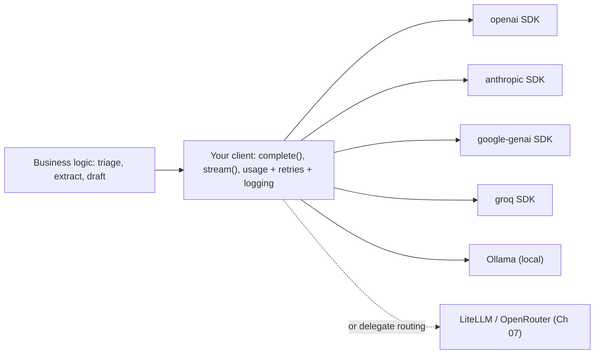
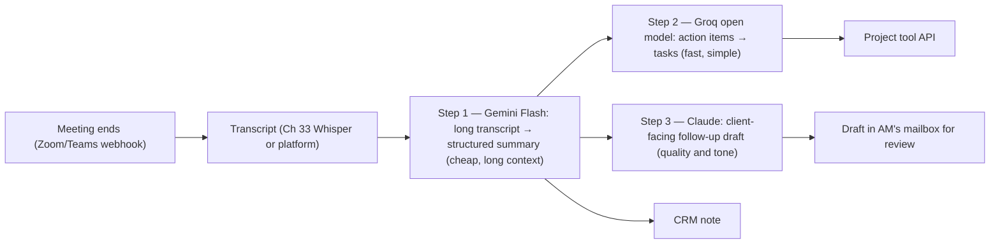

# 06 · Model APIs: OpenAI, Claude, Gemini & Groq

> **In one line:** The four API families you'll meet in production all do the same thing (messages in, text, tool calls or JSON out), but they differ in request shape, streaming events, usage fields, error types and limits. Learn each natively once, then put a thin client of your own in front of them.

> **Versions used:** openai 3.x · anthropic 2.x · google-genai 3.x · groq 1.x · tenacity 9.x · **Fast-moving:** model names change constantly (always read them from env vars). OpenAI's Responses API, Claude's effort/thinking controls and Gemini's SDK all changed shape in 2025–26. Pin SDK versions in `requirements.txt` and re-test on upgrades.

---

## 1. Overview

> **Builds on:** [Ch 01](topic.html?p=01-how-llms-work) (tokens, cost), [Ch 03](topic.html?p=03-structured-outputs) (structured outputs), [Ch 04](topic.html?p=04-function-calling) (tools).

In earlier chapters you used an OpenAI-compatible helper against a local model. Production automations usually call one or more hosted providers:

| Provider | Why teams pick it |
|---|---|
| **OpenAI** | Broad model range, mature ecosystem, Responses API with built-in tools |
| **Anthropic (Claude)** | Strong reasoning, coding, long documents and agentic tool use; 1M-token context on current models |
| **Google (Gemini)** | Multimodal (video, audio, images), long context, Google Cloud integration, generous free tier |
| **Groq** | Very fast inference of open-weight models (Llama, Qwen, GPT-OSS…) on custom hardware, so low latency at low cost |

Each has its own official Python SDK. Learn them natively. Shims hide differences you'll need when something breaks: streaming events, refusal handling, caching fields, error classes. Then wrap them behind **your own small interface** so business code never imports a vendor SDK directly:



---

## 2. Key Concepts

### Same idea, four request shapes

```svg
<svg viewBox="0 0 880 300" width="100%" height="300" font-family="ui-sans-serif,system-ui,sans-serif" font-size="11" xmlns="http://www.w3.org/2000/svg">
  <text x="440" y="22" text-anchor="middle" font-size="14" font-weight="700" fill="#1e293b">Where the system prompt, messages and answer live in each API</text>
  <g font-family="ui-monospace,monospace" font-size="10.5">
    <rect x="10" y="38" width="208" height="250" rx="8" fill="#dcfce7" stroke="#16a34a"/>
    <text x="114" y="58" text-anchor="middle" font-family="ui-sans-serif,system-ui,sans-serif" font-size="12" font-weight="700" fill="#1e293b">OpenAI Responses</text>
    <text x="22" y="82" fill="#1e293b">responses.create(</text>
    <text x="30" y="98" fill="#1e293b">model=...,</text>
    <text x="30" y="114" fill="#16a34a">instructions="sys",</text>
    <text x="30" y="130" fill="#1e293b">input="user text"</text>
    <text x="22" y="146" fill="#1e293b">)</text>
    <text x="22" y="176" fill="#334155">→ resp.output_text</text>
    <text x="22" y="192" fill="#334155">→ resp.usage.input_tokens</text>
    <text x="22" y="208" fill="#334155">  /output_tokens</text>
    <text x="22" y="238" fill="#334155">stream: event.type ==</text>
    <text x="22" y="254" fill="#334155">"response.output_text</text>
    <text x="22" y="270" fill="#334155">  .delta"</text>

    <rect x="228" y="38" width="208" height="250" rx="8" fill="#ede9fe" stroke="#7c3aed"/>
    <text x="332" y="58" text-anchor="middle" font-family="ui-sans-serif,system-ui,sans-serif" font-size="12" font-weight="700" fill="#1e293b">Anthropic Messages</text>
    <text x="240" y="82" fill="#1e293b">messages.create(</text>
    <text x="248" y="98" fill="#1e293b">model=..., max_tokens=N,</text>
    <text x="248" y="114" fill="#7c3aed">system="sys",</text>
    <text x="248" y="130" fill="#1e293b">messages=[{user}]</text>
    <text x="240" y="146" fill="#1e293b">)</text>
    <text x="240" y="176" fill="#334155">→ content blocks:</text>
    <text x="240" y="192" fill="#334155">  b.type == "text"</text>
    <text x="240" y="208" fill="#334155">→ usage.input_tokens</text>
    <text x="240" y="238" fill="#334155">stream: messages.stream()</text>
    <text x="240" y="254" fill="#334155">  .text_stream</text>
    <text x="240" y="270" fill="#dc2626">max_tokens required</text>

    <rect x="446" y="38" width="208" height="250" rx="8" fill="#dbeafe" stroke="#2563eb"/>
    <text x="550" y="58" text-anchor="middle" font-family="ui-sans-serif,system-ui,sans-serif" font-size="12" font-weight="700" fill="#1e293b">Gemini (google-genai)</text>
    <text x="458" y="82" fill="#1e293b">models.generate_content(</text>
    <text x="466" y="98" fill="#1e293b">model=...,</text>
    <text x="466" y="114" fill="#1e293b">contents="user text",</text>
    <text x="466" y="130" fill="#2563eb">config=Config(</text>
    <text x="474" y="146" fill="#2563eb">system_instruction=)</text>
    <text x="458" y="176" fill="#334155">→ resp.text</text>
    <text x="458" y="192" fill="#334155">→ usage_metadata</text>
    <text x="458" y="208" fill="#334155">  .prompt_token_count</text>
    <text x="458" y="238" fill="#334155">stream:</text>
    <text x="458" y="254" fill="#334155">generate_content_stream</text>
    <text x="458" y="270" fill="#334155">  → chunk.text</text>

    <rect x="664" y="38" width="208" height="250" rx="8" fill="#fef3c7" stroke="#d97706"/>
    <text x="768" y="58" text-anchor="middle" font-family="ui-sans-serif,system-ui,sans-serif" font-size="12" font-weight="700" fill="#1e293b">Groq / Chat Completions</text>
    <text x="676" y="82" fill="#1e293b">chat.completions.create(</text>
    <text x="684" y="98" fill="#1e293b">model=...,</text>
    <text x="684" y="114" fill="#d97706">messages=[{system},</text>
    <text x="684" y="130" fill="#1e293b">          {user}]</text>
    <text x="676" y="146" fill="#1e293b">)</text>
    <text x="676" y="176" fill="#334155">→ choices[0].message</text>
    <text x="676" y="192" fill="#334155">  .content</text>
    <text x="676" y="208" fill="#334155">→ usage.prompt_tokens</text>
    <text x="676" y="238" fill="#334155">stream: chunk.choices[0]</text>
    <text x="676" y="254" fill="#334155">  .delta.content</text>
    <text x="676" y="270" fill="#334155">(also Ollama, vLLM...)</text>
  </g>
</svg>
```

### Concepts that matter across all four

- **Model IDs and aliases.** Providers offer moving aliases ("latest") and sometimes pinned snapshots. Aliases quietly change behaviour, so pin where offered for critical automations and read model names from config.
- **Streaming (SSE).** The response arrives as server-sent events. Streaming lowers *perceived* latency for UIs and avoids HTTP timeouts on long outputs. For batch automations you often don't need it.
- **Usage accounting.** Every response reports input/output tokens, though with different field names (diagram above). Log them for every call.
- **Rate limits.** Requests per minute (RPM) and tokens per minute (TPM), per model and per account tier. A 429 response, often with a `retry-after` header, means back off and retry.
- **Retries.** The OpenAI, Anthropic and Groq SDKs retry 408/409/429/5xx and connection errors automatically (2 retries by default, `max_retries=` to change). Add your own retry layer only for longer outages, cross-provider fallback (Ch 07) or google-genai calls.
- **Reasoning controls.** Current models think before answering. OpenAI exposes `reasoning={"effort": ...}` on reasoning models, Claude uses `output_config={"effort": ...}` with adaptive thinking (current Claude models reject `temperature`), and Gemini exposes thinking budgets/levels. Higher effort costs more tokens and time.
- **Refusals and stop reasons.** Always check *why* generation stopped: `max_tokens` (truncated, so your JSON may be cut off), tool use, or a safety refusal. Claude reports `stop_reason == "refusal"`, and OpenAI structured outputs report `refusal`.
- **Prompt caching and batch.** All four support some form of discounted repeated prefixes and/or batch processing (≈50% off for asynchronous jobs). [Ch 42](topic.html?p=42-reliability-cost) covers both.
- **Data handling.** Read each provider's retention and training policy for API data, and choose regional or zero-retention options if your contracts require it ([Ch 44](topic.html?p=44-secrets-pii)).

> **Analogy:** four courier companies. They all deliver parcels, but the forms, tracking codes and failure notices differ. You don't want every department filling in four kinds of forms, so you build one internal shipping desk.

---

## 3. Setup

```bash
pip install "openai>=3" "anthropic>=2" "google-genai>=3" "groq>=1" "tenacity>=9" "python-dotenv>=1"
```

```bash
# .env.example — get keys from each provider's console; never commit .env
OPENAI_API_KEY=
OPENAI_MODEL=gpt-5-mini                 # platform.openai.com/docs/models
ANTHROPIC_API_KEY=
CLAUDE_MODEL=claude-opus-5-5            # also claude-sonnet-5-5, claude-haiku-5-5
GEMINI_API_KEY=
GEMINI_MODEL=gemini-2.5-flash           # ai.google.dev/gemini-api/docs/models
GROQ_API_KEY=
GROQ_MODEL=llama-3.3-70b-versatile      # console.groq.com/docs/models
```

Where to get keys: OpenAI (platform.openai.com), Anthropic (console.anthropic.com / platform.claude.com), Google AI Studio (aistudio.google.com), Groq (console.groq.com). Each has a free or trial tier suitable for this chapter. Set a **monthly spend limit** in every console before you start.

---

## 4. Code Examples

### Example 1: OpenAI: the Responses API

```python
# ex1_openai.py — needs OPENAI_API_KEY
import os
from dotenv import load_dotenv
from openai import OpenAI

load_dotenv()
client = OpenAI()                                   # reads OPENAI_API_KEY
MODEL = os.getenv("OPENAI_MODEL", "gpt-5-mini")


def ask(question: str) -> str:
    resp = client.responses.create(
        model=MODEL,
        instructions="You are a concise assistant for a finance team. Max 3 sentences.",
        input=question,
    )
    u = resp.usage
    print(f"[usage] in={u.input_tokens} out={u.output_tokens} model={resp.model}")
    return resp.output_text                          # convenience: all text output joined


def ask_stream(question: str) -> None:
    stream = client.responses.create(model=MODEL, input=question, stream=True)
    for event in stream:
        if event.type == "response.output_text.delta":
            print(event.delta, end="", flush=True)
    print()


if __name__ == "__main__":
    print(ask("What is the difference between accrual and cash accounting?"))
    ask_stream("Give three tips for faster month-end close.")
```

The older **Chat Completions** API (`client.chat.completions.create(messages=[...])`) is still supported and is the shape every OpenAI-compatible server speaks. Use the Responses API for new OpenAI-specific code: it's where new features (built-in tools, reasoning items, conversation state) land first.

### Example 2: Anthropic Claude: the Messages API

```python
# ex2_claude.py — needs ANTHROPIC_API_KEY
import os
import anthropic
from dotenv import load_dotenv

load_dotenv()
client = anthropic.Anthropic()                      # reads ANTHROPIC_API_KEY
MODEL = os.getenv("CLAUDE_MODEL", "claude-opus-5-5")
SYSTEM = "You are a concise assistant for a finance team. Max 3 sentences."


def ask(question: str, effort: str = "low") -> str:
    resp = client.messages.create(
        model=MODEL,
        max_tokens=16000,                           # required; it's a ceiling, not a target
        system=SYSTEM,
        output_config={"effort": effort},           # low | medium | high | xhigh | max
        messages=[{"role": "user", "content": question}],
    )
    if resp.stop_reason == "refusal":
        return "[declined]"
    if resp.stop_reason == "max_tokens":
        print("[warn] output truncated")
    print(f"[usage] in={resp.usage.input_tokens} out={resp.usage.output_tokens}")
    return "".join(b.text for b in resp.content if b.type == "text")


def ask_stream(question: str) -> None:
    with client.messages.stream(
        model=MODEL, max_tokens=16000, system=SYSTEM,
        messages=[{"role": "user", "content": question}],
    ) as stream:
        for text in stream.text_stream:
            print(text, end="", flush=True)
        final = stream.get_final_message()         # full Message with usage, stop_reason
    print(f"\n[usage] out={final.usage.output_tokens}")


if __name__ == "__main__":
    print(ask("What is the difference between accrual and cash accounting?"))
    ask_stream("Give three tips for faster month-end close.")
```

Claude specifics worth knowing:
- `system` is a top-level argument, not a message. `max_tokens` is required.
- The response is a **list of content blocks** (text, thinking, tool_use…). Filter on `block.type`.
- Current models have **adaptive thinking** built in. Control depth and cost with `effort` rather than `temperature`, which they reject.
- **Refusal fallbacks.** On current models a safety classifier can occasionally decline a request (`stop_reason == "refusal"`). The API can transparently retry such requests on a fallback model, which is worth enabling for unattended automations:

```python
# ex2b_claude_fallbacks.py — server-side fallback on refusals (beta feature; check docs for status)
import anthropic

client = anthropic.Anthropic()
resp = client.beta.messages.create(
    model="claude-opus-5-5",
    max_tokens=16000,
    betas=["server-side-fallback-2026-07-01"],
    fallbacks="default",                 # let the API pick the fallback per refusal category
    messages=[{"role": "user", "content": "Summarise our incident-response runbook in 5 bullets."}],
)
print(resp.model, resp.stop_reason)      # resp.model shows which model actually answered
```

### Example 3: Google Gemini: the google-genai SDK

```python
# ex3_gemini.py — needs GEMINI_API_KEY   (pip install google-genai; NOT the deprecated google-generativeai)
import os
from dotenv import load_dotenv
from google import genai
from google.genai import types

load_dotenv()
client = genai.Client()                             # reads GEMINI_API_KEY (or GOOGLE_API_KEY)
MODEL = os.getenv("GEMINI_MODEL", "gemini-2.5-flash")
CONFIG = types.GenerateContentConfig(
    system_instruction="You are a concise assistant for a finance team. Max 3 sentences.",
    max_output_tokens=1024,
)


def ask(question: str) -> str:
    resp = client.models.generate_content(model=MODEL, contents=question, config=CONFIG)
    um = resp.usage_metadata
    print(f"[usage] in={um.prompt_token_count} out={um.candidates_token_count} "
          f"thinking={um.thoughts_token_count}")
    return resp.text


def ask_stream(question: str) -> None:
    for chunk in client.models.generate_content_stream(model=MODEL, contents=question, config=CONFIG):
        print(chunk.text or "", end="", flush=True)
    print()


if __name__ == "__main__":
    print(ask("What is the difference between accrual and cash accounting?"))
    ask_stream("Give three tips for faster month-end close.")
```

The same SDK talks to the Gemini Developer API (API key) and to **Vertex AI** (Google Cloud project, IAM auth) by constructing `genai.Client(vertexai=True, project=..., location=...)`. Enterprises on GCP usually choose Vertex for data-residency and billing reasons.

### Example 4: Groq: fast open-weight models

```python
# ex4_groq.py — needs GROQ_API_KEY
import os
import time
from dotenv import load_dotenv
from groq import Groq

load_dotenv()
client = Groq()                                     # reads GROQ_API_KEY
MODEL = os.getenv("GROQ_MODEL", "llama-3.3-70b-versatile")


def ask(question: str) -> str:
    t0 = time.perf_counter()
    resp = client.chat.completions.create(
        model=MODEL,
        messages=[{"role": "system", "content": "Concise finance assistant. Max 3 sentences."},
                  {"role": "user", "content": question}],
        temperature=0.2,                            # open-weight models still accept sampling params
        max_tokens=512,
    )
    dt = time.perf_counter() - t0
    u = resp.usage
    print(f"[usage] in={u.prompt_tokens} out={u.completion_tokens} "
          f"wall={dt:.2f}s ≈ {u.completion_tokens / dt:.0f} tok/s end-to-end")
    return resp.choices[0].message.content


if __name__ == "__main__":
    print(ask("What is the difference between accrual and cash accounting?"))
```

Groq's API follows the Chat Completions shape, so the same code also works through the `openai` SDK with `base_url="https://api.groq.com/openai/v1"`. Use Groq when latency dominates: voice agents ([Ch 33](topic.html?p=33-voice-agents)), interactive routing, high-volume classification.

### Example 5: Your own thin client (one interface, usage logging, retries)

```python
# llm_client.py — the only module in your codebase that imports vendor SDKs
import logging
import os
import time
from dataclasses import dataclass

from dotenv import load_dotenv
from tenacity import retry, retry_if_exception, stop_after_attempt, wait_random_exponential

load_dotenv()
log = logging.getLogger("llm")


@dataclass
class Completion:
    text: str
    provider: str
    model: str
    input_tokens: int
    output_tokens: int
    latency_s: float
    stop_reason: str


def _transient(e: Exception) -> bool:
    """Retry only rate limits, timeouts, connection errors and 5xx — never 400/401/404."""
    status = getattr(e, "status_code", None) or getattr(e, "code", None)
    name = type(e).__name__
    return name in {"RateLimitError", "APIConnectionError", "APITimeoutError", "InternalServerError",
                    "ServerError"} or (isinstance(status, int) and (status == 429 or status >= 500))


@retry(retry=retry_if_exception(_transient), wait=wait_random_exponential(min=1, max=30),
       stop=stop_after_attempt(4), reraise=True)
def complete(provider: str, system: str, user: str, max_tokens: int = 1024) -> Completion:
    t0 = time.perf_counter()
    if provider == "openai":
        from openai import OpenAI
        model = os.getenv("OPENAI_MODEL", "gpt-5-mini")
        r = OpenAI().responses.create(model=model, instructions=system, input=user,
                                      max_output_tokens=max_tokens)
        out = Completion(r.output_text, provider, r.model, r.usage.input_tokens,
                         r.usage.output_tokens, 0, r.status)
    elif provider == "claude":
        import anthropic
        model = os.getenv("CLAUDE_MODEL", "claude-opus-5-5")
        r = anthropic.Anthropic().messages.create(
            model=model, max_tokens=max_tokens, system=system,
            output_config={"effort": "low"},
            messages=[{"role": "user", "content": user}])
        text = "".join(b.text for b in r.content if b.type == "text")
        out = Completion(text, provider, r.model, r.usage.input_tokens,
                         r.usage.output_tokens, 0, r.stop_reason)
    elif provider == "gemini":
        from google import genai
        from google.genai import types
        model = os.getenv("GEMINI_MODEL", "gemini-2.5-flash")
        r = genai.Client().models.generate_content(
            model=model, contents=user,
            config=types.GenerateContentConfig(system_instruction=system, max_output_tokens=max_tokens))
        um = r.usage_metadata
        out = Completion(r.text or "", provider, model, um.prompt_token_count or 0,
                         (um.candidates_token_count or 0) + (um.thoughts_token_count or 0), 0,
                         str(r.candidates[0].finish_reason) if r.candidates else "")
    elif provider in ("groq", "ollama"):
        from openai import OpenAI
        if provider == "groq":
            c, model = OpenAI(base_url="https://api.groq.com/openai/v1",
                              api_key=os.environ["GROQ_API_KEY"]), os.getenv("GROQ_MODEL", "llama-3.3-70b-versatile")
        else:
            c, model = OpenAI(base_url=os.getenv("OLLAMA_BASE_URL", "http://localhost:11434/v1"),
                              api_key="ollama"), os.getenv("OLLAMA_MODEL", "llama3.2")
        r = c.chat.completions.create(model=model, max_tokens=max_tokens,
                                      messages=[{"role": "system", "content": system},
                                                {"role": "user", "content": user}])
        out = Completion(r.choices[0].message.content or "", provider, r.model,
                         r.usage.prompt_tokens, r.usage.completion_tokens, 0, r.choices[0].finish_reason)
    else:
        raise ValueError(f"unknown provider {provider}")
    out.latency_s = round(time.perf_counter() - t0, 3)
    log.info("llm_call provider=%s model=%s in=%d out=%d latency=%.2fs stop=%s",
             out.provider, out.model, out.input_tokens, out.output_tokens, out.latency_s, out.stop_reason)
    return out


if __name__ == "__main__":
    logging.basicConfig(level=logging.INFO)
    print(complete(os.getenv("PROVIDER", "ollama"), "Reply in one sentence.", "What is EBITDA?").text)
```

Your business code now calls `complete("claude", ...)` and never knows about content blocks or usage field names. Swapping or adding a provider is one branch in one file. (When this file grows beyond ~5 providers, or you need routing and budgets, use LiteLLM instead. That's [Ch 07](topic.html?p=07-multi-provider-routing).)

Note the retry design: **only transient errors are retried**, with jittered exponential backoff. Retrying a 400 (bad request) or 401 (bad key) just wastes time and quota.

### Example 6: Concurrent fan-out with the async clients

```python
# ex6_async_fanout.py — ask several providers at once; total time ≈ the slowest one
import asyncio
import os
import time

import anthropic
from dotenv import load_dotenv
from openai import AsyncOpenAI

load_dotenv()
Q = "In one sentence: why do companies use a 13-week cash-flow forecast?"


async def openai_call() -> tuple[str, str]:
    r = await AsyncOpenAI().responses.create(model=os.getenv("OPENAI_MODEL", "gpt-5-mini"), input=Q)
    return "openai", r.output_text


async def claude_call() -> tuple[str, str]:
    r = await anthropic.AsyncAnthropic().messages.create(
        model=os.getenv("CLAUDE_MODEL", "claude-opus-5-5"), max_tokens=1024,
        output_config={"effort": "low"}, messages=[{"role": "user", "content": Q}])
    return "claude", "".join(b.text for b in r.content if b.type == "text")


async def groq_call() -> tuple[str, str]:
    c = AsyncOpenAI(base_url="https://api.groq.com/openai/v1", api_key=os.environ["GROQ_API_KEY"])
    r = await c.chat.completions.create(model=os.getenv("GROQ_MODEL", "llama-3.3-70b-versatile"),
                                        messages=[{"role": "user", "content": Q}])
    return "groq", r.choices[0].message.content


async def main() -> None:
    calls = {"OPENAI_API_KEY": openai_call, "ANTHROPIC_API_KEY": claude_call, "GROQ_API_KEY": groq_call}
    tasks = [fn() for key, fn in calls.items() if os.getenv(key)]
    t0 = time.perf_counter()
    for res in await asyncio.gather(*tasks, return_exceptions=True):
        print(res if isinstance(res, Exception) else f"{res[0]:7} {res[1][:120]}")
    print(f"total {time.perf_counter() - t0:.2f}s")


if __name__ == "__main__":
    asyncio.run(main())
```

Use the async clients when an automation makes many independent calls: classifying 500 rows, or asking two models for a comparison. Cap concurrency with an `asyncio.Semaphore` so you stay under your rate limits ([Ch 42](topic.html?p=42-reliability-cost)).

---

## 5. Real-World Use Case

**Company:** a 200-person professional-services firm. **Automation:** after every client call, the recording's transcript is turned into (1) a structured summary in the CRM, (2) action items in the project tool, and (3) a draft follow-up email for the account manager.



Why **multiple providers**? Each step has a different shape: a 90-minute transcript (~20k tokens) with a simple job, a tiny extraction job, and a short, high-stakes piece of writing. Picking per step, through one client interface, typically cuts cost substantially compared with sending everything to the strongest model. It also gives you a ready fallback when one provider has an incident. The business code stays the same: `complete(provider_for("summary"), ...)`, with `provider_for` read from config.

Operational must-haves: per-step usage logging (to see where money goes), a spend limit in each console, alerting on error rate per provider, and data-processing agreements because transcripts contain client information.

---

## 6. Mini Project: Model Bake-Off (1–2 hours)

**Goal:** run the same prompts through every provider you have keys for (plus local Ollama), and produce a table of latency, tokens, estimated cost and correctness. This is how you make the "which model?" decision with data.

```text
bake-off/
├── .env
├── llm_client.py         # Example 5
├── tasks.csv             # id, system, user, expected (substring that must appear, optional)
├── prices.json
└── bakeoff.py
```

**Step 1: tasks and prices.**

```python
# make_tasks.py
import json
import pandas as pd

tasks = pd.DataFrame([
    ("t1", "Classify the ticket. Reply with one word: BILLING, BUG or FEATURE.",
     "My invoice shows the wrong VAT number.", "BILLING"),
    ("t2", "Classify the ticket. Reply with one word: BILLING, BUG or FEATURE.",
     "The export button crashes the app.", "BUG"),
    ("t3", "Extract the total amount as a number only.",
     "Subtotal 1,000.00, VAT 190.00, total due 1,190.00 EUR.", "1190"),
    ("t4", "Answer yes or no.", "Is 2026-02-29 a valid date?", "no"),
    ("t5", "Summarise in one sentence for a CFO.",
     "Revenue grew 12% QoQ to $4.1M while gross margin fell from 71% to 66% due to higher hosting costs.", "margin"),
], columns=["id", "system", "user", "expected"])
tasks.to_csv("tasks.csv", index=False)

# USD per 1M tokens (input, output). EXAMPLES — fill in from current pricing pages.
json.dump({"claude": [4.0, 20.0], "openai": [0.25, 2.0], "gemini": [0.30, 2.5],
           "groq": [0.59, 0.79], "ollama": [0, 0]}, open("prices.json", "w"), indent=1)
print("tasks.csv + prices.json written")
```

**Step 2: the runner.**

```python
# bakeoff.py
import json
import os

import pandas as pd

from llm_client import complete

KEYS = {"openai": "OPENAI_API_KEY", "claude": "ANTHROPIC_API_KEY",
        "gemini": "GEMINI_API_KEY", "groq": "GROQ_API_KEY", "ollama": None}
prices = json.load(open("prices.json"))


def available() -> list[str]:
    return [p for p, k in KEYS.items() if k is None or os.getenv(k)]


def main() -> None:
    tasks = pd.read_csv("tasks.csv")
    rows = []
    for provider in available():
        for t in tasks.itertuples():
            try:
                c = complete(provider, t.system, t.user, max_tokens=300)
                pin, pout = prices[provider]
                rows.append({
                    "provider": provider, "model": c.model, "task": t.id,
                    "ok": str(t.expected).lower() in c.text.lower().replace(",", ""),
                    "latency_s": c.latency_s, "in": c.input_tokens, "out": c.output_tokens,
                    "cost_usd": (c.input_tokens * pin + c.output_tokens * pout) / 1e6,
                    "answer": c.text.strip()[:60],
                })
            except Exception as e:
                rows.append({"provider": provider, "task": t.id, "ok": False, "answer": f"ERROR {e}"[:60]})
    df = pd.DataFrame(rows)
    df.to_csv("results.csv", index=False)
    summary = df.groupby("provider").agg(accuracy=("ok", "mean"), p50_latency=("latency_s", "median"),
                                         total_cost=("cost_usd", "sum"), out_tokens=("out", "sum"))
    print(summary.sort_values(["accuracy", "total_cost"], ascending=[False, True]).round(4))
    print("\nWrong answers:\n", df.loc[~df["ok"], ["provider", "task", "answer"]].to_string(index=False))


if __name__ == "__main__":
    main()
```

**Step 3: run.**

```bash
python make_tasks.py && python bakeoff.py
```

**Done when:**
- [ ] The summary table ranks providers by accuracy, then cost, with p50 latency.
- [ ] Missing keys are skipped, not crashes. A failing provider shows `ERROR` rows rather than aborting the run.
- [ ] You can state which provider you'd choose for classification vs. summarisation and why.

**Stretch:** add 20 real tasks from your own work. Run each task 3 times to measure consistency. Add a streaming time-to-first-token measurement. Plot latency vs. cost with pandas.

---

## 7. Comparison Table

| | OpenAI | Anthropic Claude | Google Gemini | Groq |
|---|---|---|---|---|
| Python SDK | `openai` | `anthropic` | `google-genai` | `groq` (or `openai` with base_url) |
| Main endpoint | Responses (`responses.create`); Chat Completions still supported | Messages (`messages.create`) | `models.generate_content` | Chat Completions |
| System prompt | `instructions=` | `system=` | `config.system_instruction` | `{"role": "system"}` message |
| Required extras | none | `max_tokens` | none | none |
| Reasoning control | `reasoning={"effort": ...}` on reasoning models | `output_config={"effort": ...}`, adaptive thinking | thinking config | model-dependent |
| Structured output | `text_format` / `response_format` | `output_format` / `output_config.format` | `response_schema` | `response_format` (model-dependent) |
| Strengths | Ecosystem, built-in tools, broad model range | Reasoning, coding, long documents, agents | Multimodal, long context, GCP | Raw speed and low price on open models |
| Enterprise route | Azure OpenAI | Amazon Bedrock, Google Vertex AI, Microsoft Foundry | Vertex AI | GroqCloud |

**When to use which:** default to the provider your evals (and contracts) favour for each *step*, not one provider for everything. Use Groq or a local model for latency-critical or high-volume simple steps. Use a frontier model (Claude, top OpenAI/Gemini) for reasoning, agents and customer-facing writing. Use Gemini when the input is video, audio or very long multimodal content. Use the cloud-marketplace routes (Bedrock, Vertex, Azure) when procurement or data residency requires your existing cloud contract.

---

## 8. Common Mistakes & Best Practices

**Mistake 1: vendor SDK calls scattered through business code.** Changing providers becomes a refactor. *Fix:* one client module (Example 5) or LiteLLM (Ch 07).

**Mistake 2: hardcoded model names.** *Fix:* env/config, with the model logged per call. Pin snapshots for critical paths where available.

**Mistake 3: retrying everything.** A 400 retried 5 times is still a 400. *Fix:* retry only 429/5xx/timeouts, with jittered backoff. Respect `retry-after`.

**Mistake 4: ignoring `stop_reason` / `finish_reason`.** Truncated output (`max_tokens`/`length`) produces broken JSON downstream. *Fix:* check it, and raise `max_tokens` or split the task.

```python
# After every call
if stop in ("max_tokens", "length", "MAX_TOKENS"):
    raise TruncatedOutput(f"{provider} hit the output cap; raise max_tokens or shorten the task")
```

**Mistake 5: using deprecated SDKs.** `google-generativeai` is superseded by `google-genai`. Old `openai.ChatCompletion.create` (pre-1.0) code still circulates in tutorials. *Fix:* check the SDK's README for the current client pattern.

**Mistake 6: no spend limits.** A loop bug can burn a month's budget overnight. *Fix:* console spend limits, per-key budgets (LiteLLM proxy, Ch 07) and alerts.

**Mistake 7: sending sampling params everywhere.** Some current reasoning models reject `temperature`/`top_p`. *Fix:* make sampling params provider-specific in your client.

**Best-practice checklist**
- [ ] One client module. Business code never imports vendor SDKs.
- [ ] Model names in config. Model, tokens, latency and stop reason logged per call.
- [ ] SDK built-in retries + your transient-only retry layer.
- [ ] Spend limits and per-provider error-rate alerts.
- [ ] `requirements.txt` with pinned SDK versions, re-tested on upgrade.
- [ ] A fallback provider configured for critical automations.

---

## 9. Exercises

1. **Native trio.** Run Examples 1–3 (whichever keys you have). Note three concrete differences in the response objects that would break naive code.
2. **Streaming TTFT.** Measure time-to-first-token and total time for a 300-word answer on two providers using streaming. Which matters more for a Slack bot? For a nightly batch?
3. **Truncation drill.** Call each provider with `max_tokens=20` on a long question. Print each `stop_reason`/`finish_reason`, then add the truncation check to `llm_client.py`.
4. **Rate-limit drill.** With `asyncio.gather`, fire 50 small requests at a free-tier key. Observe 429s and SDK retries, then add an `asyncio.Semaphore(5)` and compare.
5. **Bake-off on your data.** Replace `tasks.csv` with 20 real tasks from your domain and decide, with numbers, which provider handles which step.

### Self-check questions

**Q: Why wrap vendor SDKs in your own client instead of calling them directly from business code?**
A: Request shapes, response objects, usage fields, error classes and features differ per provider. A single client module normalises them into one `Completion` type, centralises retries, logging and cost tracking, and makes adding, swapping or falling back between providers a one-file change.

**Q: Which errors should be retried, and how?**
A: Transient ones: 429 rate limits, 5xx server errors, timeouts and connection errors. Retry with exponential backoff plus jitter, respecting `retry-after` when present, and cap attempts. Never retry 400/401/403/404, because they'll fail the same way again.

**Q: What's the risk of ignoring the stop or finish reason?**
A: Output cut off at the token cap looks like a normal response but may be truncated JSON or a half sentence, and safety refusals look like odd text. Checking the reason lets you raise `max_tokens`, split the task, route to a fallback model, or alert, instead of passing corrupt output downstream.

**Q: When would you choose Groq over a frontier model API?**
A: When latency and cost per call dominate and an open-weight model passes your evals: voice agents, interactive routing, high-volume classification and extraction. Use a frontier model when the step needs stronger reasoning, long-document understanding or reliable multi-step tool use.

**Q: Your automation uses one provider alias like "latest", and output quality suddenly changes. What happened, and how do you prevent it? (Senior)**
A: The alias probably moved to a new model version. Prevent it by pinning dated model snapshots where the provider offers them, logging the resolved model ID from every response, running a golden-set evaluation before adopting new versions, and treating model changes as deployments with a rollback path.

**Q: How would you design for a provider outage in a business-critical automation? (Senior)**
A: Abstract providers behind one client, configure a tested fallback provider and model per step (with prompts validated on both), and switch on sustained 5xx/timeouts using a circuit breaker so you don't retry into an outage. Queue non-urgent work for later, and alert humans. Run the fallback path regularly so it doesn't rot. Tools like LiteLLM's router implement much of this.

**Q: What does `max_tokens` mean on the Claude API, and why is it required?**
A: It's the hard upper limit on tokens generated in the response, not a target length. Claude requires it so every request has an explicit output ceiling. Set it generously for open-ended tasks (and stream for very large values to avoid HTTP timeouts), and tightly for short labels.

---

## 10. Summary & Official Docs

- Four families, one idea: **messages in, text/tools/JSON out**, with different shapes, usage fields, streaming events and errors.
- **OpenAI**: Responses API (`instructions`, `input`, `output_text`). **Claude**: Messages API (`system`, required `max_tokens`, content blocks, `effort`). **Gemini**: `google-genai` (`generate_content`, `system_instruction`). **Groq**: fast Chat-Completions-compatible open models.
- Put **one client module** in front of all of them: normalised output, usage logging, transient-only retries.
- Pick providers **per step** using a bake-off on your own tasks. Set spend limits. Check stop reasons. Pin and log model versions.

**Official docs**
- OpenAI API reference: https://platform.openai.com/docs/api-reference
- OpenAI Python SDK: https://github.com/openai/openai-python
- Anthropic API (Claude) docs: https://docs.claude.com/en/api/overview
- Anthropic Python SDK: https://github.com/anthropics/anthropic-sdk-python
- Gemini API docs: https://ai.google.dev/gemini-api/docs
- Google Gen AI Python SDK: https://googleapis.github.io/python-genai/
- Groq docs: https://console.groq.com/docs/overview

**Next:** [Ch 07 · Multi-Provider Routing](topic.html?p=07-multi-provider-routing): replacing the hand-rolled client with LiteLLM and OpenRouter, and adding fallbacks, load balancing and budgets.

---

*AI Automation with Python Handbook — chapter 06.*
