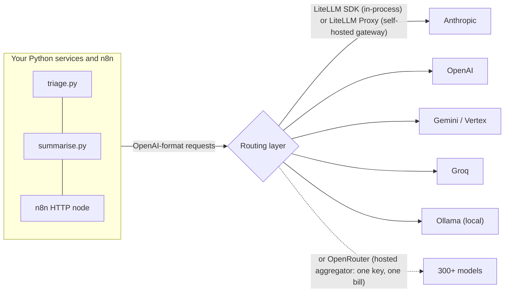
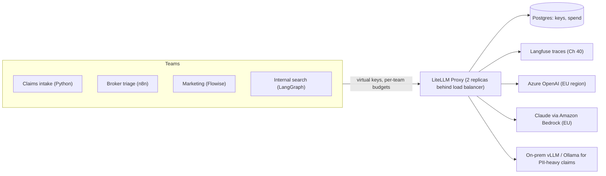

# 07 · Multi-Provider Routing: LiteLLM & OpenRouter

> **In one line:** Don't hand-roll multi-provider plumbing. LiteLLM gives you one OpenAI-shaped Python call (and an optional self-hosted gateway) for 100+ providers, with fallbacks, load balancing, cost tracking and budgets. OpenRouter gives you the same idea as a hosted service with one key and one bill.

> **Versions used:** litellm 1.x (SDK + proxy) · openai 3.x (OpenRouter client) · python-dotenv 1.x · **Fast-moving:** LiteLLM ships several releases a week. Model-name prefixes, cost maps and proxy config keys change, so pin the version and read the changelog on upgrades. OpenRouter model IDs and provider lists change constantly.

---

## 1. Overview

> **Builds on:** [Ch 06 · Model APIs](topic.html?p=06-model-apis): you built a thin client by hand. This chapter replaces it with battle-tested tools.

Once an automation goes to production, "which model?" stops being one decision and becomes a **policy**:
- Use a cheap model for classification and a strong one for drafting.
- If Claude is rate-limited, fall back to OpenAI, and then to a local model.
- Spread load over two API keys or regions.
- Stop the marketing team's experiments at $200/month.
- Report cost per feature, per customer, per day.

That policy belongs in a **routing layer** between your code and the providers. Two popular options:



- **LiteLLM** is open source. Use it as a **Python library** (`litellm.completion(...)`) or run it as a **proxy server** that exposes an OpenAI-compatible endpoint to all your services, with virtual keys, budgets, logging and an admin UI.
- **OpenRouter** is a hosted aggregator. You call one OpenAI-compatible endpoint with one API key, choose from hundreds of models, and get model fallbacks and provider routing as request options. It adds a small markup on some routes, and your data flows through a third party.

---

## 2. Key Concepts

- **Unified interface**: every provider is called with OpenAI's Chat Completions shape (`messages`, `tools`, `response_format`) and returns an OpenAI-shaped response. The router translates to each native API.
- **Model naming**: LiteLLM uses `provider/model` (e.g. `anthropic/claude-opus-5-5`, `gemini/gemini-2.5-flash`, `groq/llama-3.3-70b-versatile`, `ollama_chat/llama3.2`). OpenRouter uses `vendor/model` IDs from its catalogue.
- **Model groups / aliases**: name a *capability* ("fast", "smart", "local") and map it to one or more deployments. Code asks for "smart" and never names a vendor.
- **Fallbacks**: if a deployment fails (errors, rate limits, context-window overflow, content-policy refusals), retry the same request on the next model in a list.
- **Load balancing**: several deployments behind one alias (two keys, two regions, Azure + OpenAI), chosen by strategy: shuffle, least-busy, latency-based, usage-based.
- **Cooldowns**: a deployment that keeps failing is temporarily taken out of rotation, like a circuit breaker.
- **Cost tracking**: a price table per model turns token usage into dollars on every call.
- **Budgets and virtual keys** (proxy): issue each team, app or customer their own key with a spend cap and rate limit. Real provider keys never leave the gateway.

> **Analogy:** a travel agent. You say "a flight to Berlin tomorrow, under €300". The agent knows every airline's booking system, books the best option, rebooks you if it's cancelled, and sends finance one consolidated invoice.

How a router handles one request:

```svg
<svg viewBox="0 0 860 300" width="100%" height="300" font-family="ui-sans-serif,system-ui,sans-serif" font-size="11" xmlns="http://www.w3.org/2000/svg">
  <defs><marker id="aa07a" viewBox="0 0 10 10" refX="9" refY="5" markerWidth="7" markerHeight="7" orient="auto"><path d="M0,0 L10,5 L0,10 z" fill="#334155"/></marker></defs>
  <text x="430" y="22" text-anchor="middle" font-size="14" font-weight="700" fill="#1e293b">One request for alias "smart": balance, fail, cool down, fall back</text>
  <rect x="20" y="120" width="120" height="50" rx="8" fill="#dbeafe" stroke="#2563eb"/>
  <text x="80" y="141" text-anchor="middle" font-weight="700" fill="#1e293b">completion(</text>
  <text x="80" y="157" text-anchor="middle" fill="#1e293b">model="smart")</text>
  <line x1="142" y1="145" x2="188" y2="145" stroke="#334155" stroke-width="1.5" marker-end="url(#aa07a)"/>
  <rect x="190" y="40" width="250" height="230" rx="8" fill="#f8fafc" stroke="#94a3b8"/>
  <text x="315" y="60" text-anchor="middle" font-weight="700" fill="#1e293b">alias "smart" (load-balanced)</text>
  <rect x="205" y="75" width="220" height="44" rx="6" fill="#fee2e2" stroke="#dc2626"/>
  <text x="315" y="93" text-anchor="middle" fill="#1e293b">deployment A: Claude, key #1</text>
  <text x="315" y="109" text-anchor="middle" fill="#dc2626">429 rate limit → retry, then cooldown 60 s</text>
  <rect x="205" y="127" width="220" height="44" rx="6" fill="#fef3c7" stroke="#d97706"/>
  <text x="315" y="145" text-anchor="middle" fill="#1e293b">deployment B: Claude, key #2</text>
  <text x="315" y="161" text-anchor="middle" fill="#d97706">503 overloaded → also fails</text>
  <text x="315" y="196" text-anchor="middle" fill="#334155">all "smart" deployments failed</text>
  <text x="315" y="212" text-anchor="middle" fill="#334155">→ consult fallbacks:</text>
  <text x="315" y="228" text-anchor="middle" fill="#334155" font-family="ui-monospace,monospace">{"smart": ["smart-backup", "local"]}</text>
  <line x1="442" y1="200" x2="508" y2="120" stroke="#334155" stroke-width="1.5" marker-end="url(#aa07a)"/>
  <rect x="510" y="70" width="160" height="80" rx="8" fill="#dcfce7" stroke="#16a34a"/>
  <text x="590" y="92" text-anchor="middle" font-weight="700" fill="#1e293b">"smart-backup"</text>
  <text x="590" y="110" text-anchor="middle" fill="#1e293b">OpenAI model</text>
  <text x="590" y="128" text-anchor="middle" fill="#16a34a">200 OK</text>
  <text x="590" y="143" text-anchor="middle" fill="#334155">(prompts tested on it!)</text>
  <rect x="510" y="175" width="160" height="60" rx="8" fill="#ede9fe" stroke="#7c3aed"/>
  <text x="590" y="198" text-anchor="middle" font-weight="700" fill="#1e293b">"local"</text>
  <text x="590" y="216" text-anchor="middle" fill="#334155">Ollama, last resort</text>
  <line x1="672" y1="110" x2="718" y2="110" stroke="#334155" stroke-width="1.5" marker-end="url(#aa07a)"/>
  <rect x="720" y="70" width="125" height="120" rx="8" fill="#dbeafe" stroke="#2563eb"/>
  <text x="782" y="92" text-anchor="middle" font-weight="700" fill="#1e293b">Response</text>
  <text x="782" y="112" text-anchor="middle" fill="#334155">OpenAI-shaped</text>
  <text x="782" y="130" text-anchor="middle" fill="#334155">+ model actually</text>
  <text x="782" y="146" text-anchor="middle" fill="#334155">used + cost</text>
  <text x="782" y="170" text-anchor="middle" fill="#334155">→ log both!</text>
</svg>
```

---

## 3. Setup

```bash
pip install "litellm>=1.70" "openai>=3" "python-dotenv>=1"
pip install "litellm[proxy]>=1.70"        # only for the self-hosted gateway (Examples 5-6)
```

```bash
# .env.example
ANTHROPIC_API_KEY=
OPENAI_API_KEY=
GEMINI_API_KEY=
GROQ_API_KEY=
OPENROUTER_API_KEY=                 # openrouter.ai/keys
OLLAMA_API_BASE=http://localhost:11434
LITELLM_MASTER_KEY=sk-change-me     # proxy admin key (Example 5); generate a long random value
```

Generate a strong master key instead of inventing one:

```bash
python -c "import secrets; print('sk-' + secrets.token_urlsafe(32))"
```

---

## 4. Code Examples

### Example 1: One call shape for every provider

```python
# ex1_litellm_basic.py — the same function call reaches five providers
import os
import litellm
from dotenv import load_dotenv

load_dotenv()
litellm.drop_params = True     # silently drop params a provider doesn't support (e.g. temperature on some models)

MODELS = {
    "ollama_chat/llama3.2": None,                       # local, no key
    "anthropic/claude-opus-5-5": "ANTHROPIC_API_KEY",
    "openai/gpt-5-mini": "OPENAI_API_KEY",
    "gemini/gemini-2.5-flash": "GEMINI_API_KEY",
    "groq/llama-3.3-70b-versatile": "GROQ_API_KEY",
}
messages = [{"role": "system", "content": "Answer in one sentence."},
            {"role": "user", "content": "What is a purchase order?"}]

if __name__ == "__main__":
    for model, key in MODELS.items():
        if key and not os.getenv(key):
            continue
        resp = litellm.completion(model=model, messages=messages, max_tokens=200,
                                  api_base=os.getenv("OLLAMA_API_BASE") if model.startswith("ollama") else None)
        # OpenAI-shaped response regardless of provider
        cost = resp._hidden_params.get("response_cost")   # None if LiteLLM has no price for the model
        print(f"{model:32} in={resp.usage.prompt_tokens:4} out={resp.usage.completion_tokens:4} "
              f"cost={cost}  {resp.choices[0].message.content[:70]}")
```

Tools (`tools=[...]`), JSON output (`response_format=...`), streaming (`stream=True`) and async (`litellm.acompletion`) use the same OpenAI-style parameters and are translated per provider. **Where a provider has a unique feature** (Claude's effort control, Gemini's thinking config), check LiteLLM's provider page for the mapped parameter, or call that provider's SDK directly for that step.

### Example 2: Router with aliases, retries, fallbacks and cooldowns

```python
# router.py — your app asks for "fast" / "smart"; the policy lives here
import os
from dotenv import load_dotenv
from litellm import Router

load_dotenv()

model_list = [
    # alias "smart": two deployments, load-balanced (e.g. two keys or regions)
    {"model_name": "smart", "litellm_params": {"model": "anthropic/claude-opus-5-5",
                                               "api_key": os.getenv("ANTHROPIC_API_KEY")}},
    {"model_name": "smart", "litellm_params": {"model": "anthropic/claude-opus-5-5",
                                               "api_key": os.getenv("ANTHROPIC_API_KEY_2", os.getenv("ANTHROPIC_API_KEY"))}},
    # backup for "smart" on a different vendor
    {"model_name": "smart-backup", "litellm_params": {"model": "openai/gpt-5-mini",
                                                      "api_key": os.getenv("OPENAI_API_KEY")}},
    # alias "fast": cheap and quick
    {"model_name": "fast", "litellm_params": {"model": "groq/llama-3.3-70b-versatile",
                                              "api_key": os.getenv("GROQ_API_KEY")}},
    # alias "local": always available, free
    {"model_name": "local", "litellm_params": {"model": "ollama_chat/llama3.2",
                                               "api_base": os.getenv("OLLAMA_API_BASE", "http://localhost:11434")}},
]

router = Router(
    model_list=model_list,
    routing_strategy="simple-shuffle",     # also: "least-busy", "latency-based-routing", "usage-based-routing-v2"
    num_retries=2,                         # retries within an alias before falling back
    fallbacks=[{"smart": ["smart-backup", "local"]}, {"fast": ["local"]}],
    context_window_fallbacks=[{"fast": ["smart"]}],   # prompt too long for "fast" → use "smart"
    allowed_fails=3, cooldown_time=60,     # 3 failures in a minute → deployment rests 60 s
    timeout=60,
)


def ask(alias: str, prompt: str) -> str:
    resp = router.completion(model=alias, messages=[{"role": "user", "content": prompt}], max_tokens=300)
    print(f"[{alias} → {resp.model}]")     # which model actually served it
    return resp.choices[0].message.content


if __name__ == "__main__":
    print(ask("fast", "Label this ticket BILLING, BUG or FEATURE: 'charged twice'"))
    print(ask("smart", "Draft a two-sentence apology for a double charge."))
```

Run it with a deliberately wrong `ANTHROPIC_API_KEY` and watch "smart" fall through to the backup. That's a chaos test you should repeat before every launch.

> **Fallback rule:** a fallback model only helps if your **prompts and parsers are tested on it**. Run your golden set ([Ch 02](topic.html?p=02-prompt-engineering)) against every model in a fallback chain.

### Example 3: Cost and usage tracking with a callback

```python
# cost_tracking.py — record every call (model, tokens, cost, latency, feature tag) to SQLite
import sqlite3
import time

import litellm
from litellm.integrations.custom_logger import CustomLogger

DB = sqlite3.connect("llm_usage.db", check_same_thread=False)
DB.execute("""CREATE TABLE IF NOT EXISTS usage (ts REAL, feature TEXT, model TEXT,
              in_tok INT, out_tok INT, cost REAL, latency REAL, ok INT)""")


class UsageLogger(CustomLogger):
    def log_success_event(self, kwargs, response_obj, start_time, end_time):
        meta = (kwargs.get("litellm_params") or {}).get("metadata") or {}
        u = response_obj.usage
        DB.execute("INSERT INTO usage VALUES (?,?,?,?,?,?,?,1)", (
            time.time(), meta.get("feature", "untagged"), response_obj.model,
            u.prompt_tokens, u.completion_tokens, kwargs.get("response_cost") or 0.0,
            (end_time - start_time).total_seconds()))
        DB.commit()

    def log_failure_event(self, kwargs, response_obj, start_time, end_time):
        meta = (kwargs.get("litellm_params") or {}).get("metadata") or {}
        DB.execute("INSERT INTO usage VALUES (?,?,?,0,0,0,?,0)", (
            time.time(), meta.get("feature", "untagged"), kwargs.get("model"),
            (end_time - start_time).total_seconds()))
        DB.commit()


litellm.callbacks = [UsageLogger()]

if __name__ == "__main__":
    for feature in ("ticket_triage", "ticket_triage", "weekly_report"):
        litellm.completion(model="ollama_chat/llama3.2", max_tokens=50,
                           messages=[{"role": "user", "content": "Say hi"}],
                           metadata={"feature": feature})          # tag calls by business feature
    import pandas as pd
    print(pd.read_sql("SELECT feature, model, COUNT(*) calls, SUM(in_tok) in_tok, "
                      "SUM(out_tok) out_tok, ROUND(SUM(cost), 6) cost FROM usage GROUP BY 1, 2", DB))
```

**Tag every call with a business feature** (and customer/tenant if you bill per customer). "We spent $3,100 on LLMs last month" is useless. "Ticket drafting cost $2,400, and 70% of it was for a customer on the free plan" is a decision. For models LiteLLM doesn't have prices for yet, register them with `litellm.register_model({...})` or compute cost from your own price table.

### Example 4: OpenRouter: one key, hundreds of models

OpenRouter speaks the OpenAI API, so the `openai` SDK works with a different `base_url`:

```python
# ex4_openrouter.py — needs OPENROUTER_API_KEY
import os
from dotenv import load_dotenv
from openai import OpenAI

load_dotenv()
client = OpenAI(base_url="https://openrouter.ai/api/v1", api_key=os.environ["OPENROUTER_API_KEY"])

resp = client.chat.completions.create(
    model=os.getenv("OPENROUTER_MODEL", "anthropic/claude-sonnet-4.5"),   # IDs: openrouter.ai/models
    messages=[{"role": "user", "content": "Give one tip for reducing invoice processing time."}],
    max_tokens=200,
    extra_body={
        # model fallbacks: tried in order if the first is unavailable or errors
        "models": [os.getenv("OPENROUTER_FALLBACK", "openai/gpt-4o-mini")],
        # provider routing preferences for the chosen model
        "provider": {"sort": "price", "data_collection": "deny"},
    },
    extra_headers={"X-Title": "ai-automation-handbook"},   # optional: app name in OpenRouter dashboards
)

if __name__ == "__main__":
    print(resp.model, "→", resp.choices[0].message.content)
    print("usage:", resp.usage)
```

Through LiteLLM it's just another prefix: `litellm.completion(model="openrouter/anthropic/claude-sonnet-4.5", ...)`.

When OpenRouter shines: prototyping across many models without opening ten accounts, accessing open models from many hosts, and teams that want one invoice. Trade-offs: an extra network hop and vendor in your data path, a markup on some routes, and rate limits tied to OpenRouter's terms. Review its data-handling settings (e.g. `data_collection: "deny"`) against your obligations.

### Example 5: LiteLLM Proxy, a gateway for the whole company

The proxy runs LiteLLM as a server. Every service, notebook and n8n workflow calls it with the plain OpenAI SDK.

```yaml
# litellm_config.yaml
model_list:
  - model_name: smart
    litellm_params:
      model: anthropic/claude-opus-5-5
      api_key: os.environ/ANTHROPIC_API_KEY        # read from env at startup; never inline keys
  - model_name: smart-backup
    litellm_params:
      model: openai/gpt-5-mini
      api_key: os.environ/OPENAI_API_KEY
  - model_name: fast
    litellm_params:
      model: groq/llama-3.3-70b-versatile
      api_key: os.environ/GROQ_API_KEY
  - model_name: local
    litellm_params:
      model: ollama_chat/llama3.2
      api_base: http://host.docker.internal:11434

router_settings:
  routing_strategy: simple-shuffle
  num_retries: 2
  fallbacks: [{"smart": ["smart-backup", "local"]}, {"fast": ["local"]}]

litellm_settings:
  drop_params: true

general_settings:
  master_key: os.environ/LITELLM_MASTER_KEY
  database_url: os.environ/DATABASE_URL            # Postgres: needed for virtual keys and spend tracking
```

A Docker Compose file runs it with Postgres:

```yaml
# docker-compose.yml
services:
  litellm:
    image: ghcr.io/berriai/litellm:main-stable     # pin a specific version tag in production
    command: ["--config", "/app/config.yaml", "--port", "4000"]
    ports: ["4000:4000"]
    volumes: ["./litellm_config.yaml:/app/config.yaml:ro"]
    env_file: .env
    environment:
      DATABASE_URL: postgresql://litellm:litellm@db:5432/litellm
    depends_on: [db]
  db:
    image: postgres:16
    environment: {POSTGRES_USER: litellm, POSTGRES_PASSWORD: litellm, POSTGRES_DB: litellm}
    volumes: ["pgdata:/var/lib/postgresql/data"]
volumes:
  pgdata:
```

Start it, then issue a **virtual key** with a budget for one team:

```bash
docker compose up -d
curl -s http://localhost:4000/key/generate \
  -H "Authorization: Bearer $LITELLM_MASTER_KEY" -H "Content-Type: application/json" \
  -d '{"models": ["fast", "smart"], "max_budget": 50, "budget_duration": "30d",
       "metadata": {"team": "support-automation"}}'
# → {"key": "sk-...", ...}   give THIS key to the team, never the provider keys
```

### Example 6: Calling the gateway from any service (plain OpenAI SDK)

```python
# ex6_use_gateway.py — services only know the gateway URL and their virtual key
import os
from openai import OpenAI

client = OpenAI(base_url=os.getenv("LLM_GATEWAY_URL", "http://localhost:4000"),
                api_key=os.environ["LLM_GATEWAY_KEY"])             # the virtual key from /key/generate

resp = client.chat.completions.create(
    model="smart",                                                  # alias, not a vendor model
    messages=[{"role": "user", "content": "Summarise: customer was double-charged; refund issued."}],
    max_tokens=100,
)
print(resp.model, resp.choices[0].message.content)
```

n8n, Flowise and most low-code tools have an "OpenAI-compatible" credential type. Point it at the gateway and every workflow inherits your routing, budgets and logging ([Part 2](topic.html?p=09-n8n-fundamentals)).

---

## 5. Real-World Use Case

**Company:** a 300-person insurer with six teams building AI automations (claims intake, broker email triage, policy Q&A, marketing copy, internal search, analytics). **Problem:** each team had its own provider keys in `.env` files, there was no visibility into spend, one provider outage broke three workflows, and security couldn't audit which data went where.



Policies enforced at the gateway rather than in six codebases:
- **Data routing:** the alias `claims-pii` maps *only* to the on-prem model. Teams can't accidentally send claim documents to a public API.
- **Region pinning:** cloud aliases map only to EU-region deployments, to satisfy the data-protection officer.
- **Budgets:** each team key has a monthly cap and a requests-per-minute limit. Marketing hitting its cap doesn't affect claims.
- **Fallbacks:** "smart" falls back across two clouds. Outages became non-events for teams.
- **One audit log** of who called which model with how many tokens, exported monthly for finance chargeback.

---

## 6. Mini Project: Resilient Router with a Spend Report (1–2 hours)

**Goal:** a small library + CLI that routes by alias with fallbacks, tags calls by feature, survives a broken provider, and prints a cost report.

```text
resilient-router/
├── .env
├── router.py            # Example 2
├── cost_tracking.py     # Example 3
├── app.py
└── chaos.sh
```

**Step 1: an app that uses aliases and feature tags.**

```python
# app.py
import argparse

import pandas as pd

import cost_tracking  # noqa: F401  (registers the usage logger)
from router import router

TICKETS = ["I was charged twice", "Export crashes on big reports", "Please add SSO",
           "Refund still not received", "App logs me out constantly"]


def triage(ticket: str) -> str:
    r = router.completion(model="fast", max_tokens=10, metadata={"feature": "triage"},
                          messages=[{"role": "system", "content": "Reply with one word: BILLING, BUG or FEATURE."},
                                    {"role": "user", "content": ticket}])
    return r.choices[0].message.content.strip()


def draft(ticket: str, label: str) -> str:
    r = router.completion(model="smart", max_tokens=150, metadata={"feature": "draft"},
                          messages=[{"role": "user", "content": f"Write a 2-sentence reply to a {label} ticket: {ticket}"}])
    return r.choices[0].message.content.strip()


def report() -> None:
    db = cost_tracking.DB
    print(pd.read_sql("""SELECT feature, model, COUNT(*) calls, SUM(ok) ok,
                         ROUND(AVG(latency), 2) avg_s, ROUND(SUM(cost), 5) usd
                         FROM usage GROUP BY 1, 2 ORDER BY usd DESC""", db).to_string(index=False))


if __name__ == "__main__":
    ap = argparse.ArgumentParser()
    ap.add_argument("--report", action="store_true")
    if ap.parse_args().report:
        report()
    else:
        for t in TICKETS:
            label = triage(t)
            print(f"{label:8} | {t} | {draft(t, label)[:70]}...")
```

**Step 2: a chaos script.**

```bash
#!/usr/bin/env bash
# chaos.sh — run the app with the primary provider's key broken
set -euo pipefail
ANTHROPIC_API_KEY="sk-ant-invalid" GROQ_API_KEY="gsk-invalid" python app.py
python app.py --report
```

**Step 3: run.**

```bash
python app.py            # normal run
bash chaos.sh            # primary providers broken → fallbacks serve every request
```

**Done when:**
- [ ] With all keys valid, `triage` is served by "fast" and `draft` by "smart".
- [ ] With broken keys, every request still completes, and the report shows which fallback models served it, plus the failures logged.
- [ ] The report gives calls, success count, average latency and cost per feature and model.

**Stretch:** move the config into the LiteLLM Proxy (Example 5), issue one virtual key per feature with a $1 budget, and watch a budget-exceeded error. Add a `latency-based-routing` strategy and compare p50 latency.

---

## 7. Comparison Table

| | Hand-rolled client (Ch 06) | LiteLLM SDK | LiteLLM Proxy | OpenRouter | Cloud gateways (Bedrock, Vertex, Azure AI Foundry) |
|---|---|---|---|---|---|
| What it is | Your code | Python library | Self-hosted OpenAI-compatible gateway | Hosted aggregator API | Cloud provider's model catalogue |
| Providers | The ones you write | 100+ | 100+ | Hundreds of models, many hosts | That cloud's catalogue (incl. Claude, Llama, Mistral…) |
| Fallbacks / load balancing | DIY | ✅ Router | ✅ | ✅ (`models`, provider routing) | Partial / regional |
| Budgets, virtual keys | ❌ | Basic | ✅ per key/team/user | Credit-based per key | Via cloud IAM and quotas |
| Data path | Direct to providers | Direct to providers | Your infra → providers | Via OpenRouter | Within your cloud contract |
| Ops burden | Low (small) | Low | Medium (service + Postgres) | None | Low if already on that cloud |
| Cost | Free | Free (OSS) | Free OSS (enterprise tier exists) | Pay-as-you-go, markup on some routes | Cloud pricing |

**When to use which:**
- **One service, two providers:** a hand-rolled client or the LiteLLM SDK.
- **Several services or teams, budgets, audit, no third party in the data path:** LiteLLM Proxy.
- **Exploring many models fast, or one bill and key for a small team:** OpenRouter (check its data policies).
- **Enterprise already standardised on AWS/GCP/Azure:** that cloud's model gateway, possibly *behind* LiteLLM Proxy for a uniform API.

---

## 8. Common Mistakes & Best Practices

**Mistake 1: fallback models nobody tested.** The fallback fires during an incident and produces different JSON, so the parser breaks and the incident gets worse. *Fix:* golden-set tests for every model in every chain, in CI.

**Mistake 2: not logging which model actually answered.** After a fallback, quality reports blame the wrong model. *Fix:* log `response.model` (and the deployment) on every call.

**Mistake 3: fallbacks that cross data boundaries.** "If on-prem fails, use the public API" can violate data agreements. *Fix:* separate aliases per data classification. PII aliases never fall back to external providers.

**Mistake 4: retry storms.** Each layer (SDK, router, your code, n8n) retries 3×, so one failure becomes 81 requests. *Fix:* retry in exactly one layer, the router, and set the SDK retries inside it to 0 or 1.

**Mistake 5: provider keys in every service.** *Fix:* keys live only in the gateway (or a secrets manager). Services get scoped virtual keys ([Ch 44](topic.html?p=44-secrets-pii)).

**Mistake 6: trusting the built-in price map blindly.** New models and negotiated discounts aren't in it. *Fix:* register custom prices, and reconcile monthly against provider invoices.

**Mistake 7: lowest-common-denominator usage.** Routing everything through the OpenAI shape can hide valuable provider features. *Fix:* use the router for the 90% case, and call native SDKs for steps that need special features (Claude effort, prompt caching specifics, Gemini video).

**Best-practice checklist**
- [ ] Code asks for **capabilities** ("fast", "smart", "claims-pii"), not vendor model names.
- [ ] Every fallback chain is tested with the golden set and respects data classification.
- [ ] Retries in one layer only. Cooldowns enabled.
- [ ] Every call tagged with feature (and tenant) and logged with model, tokens, cost and latency.
- [ ] Budgets and rate limits per team or app key. Provider keys never leave the gateway.
- [ ] Pinned LiteLLM version, upgraded deliberately.

---

## 9. Exercises

1. **Alias refactor.** Take any script from Ch 02–06 and change it to call `router.completion(model="fast" | "smart")`. Remove every vendor model name from the business code.
2. **Context-window fallback.** Send a prompt longer than a small local model's context through "fast" with `context_window_fallbacks` configured. Verify that "smart" served it.
3. **Budget wall.** Run the proxy, create a key with `max_budget: 0.01`, and loop requests until it's rejected. What does the error look like to the client, and how should your app handle it?
4. **OpenRouter comparison.** Use OpenRouter to run the Ch 06 bake-off across five models you don't have direct accounts for. Compare its reported usage with your own token counts.
5. **Spend dashboard.** From `llm_usage.db`, build a pandas report of daily cost by feature for the last 7 days, and flag features whose cost grew more than 50% week over week.

### Self-check questions

**Q: What problem does a routing layer like LiteLLM solve that a single provider SDK doesn't?**
A: It gives one OpenAI-shaped interface to many providers, so code stays provider-neutral. On top of that it adds policy in one place: aliases, load balancing across deployments, retries, cooldowns, fallbacks, cost tracking and (as a proxy) budgets and virtual keys. Without it, every service reimplements these inconsistently.

**Q: What's the difference between the LiteLLM SDK and the LiteLLM Proxy?**
A: The SDK is a Python library running inside your process. It's ideal for a single service. The proxy is a separate OpenAI-compatible server that any language or tool (n8n, Flowise, notebooks) can call. It centralises provider keys, routing, budgets, virtual keys, rate limits and logging for many teams, at the cost of running a service and its database.

**Q: Why must fallback models be tested with your prompts?**
A: Different models follow instructions and formats differently. A fallback that returns slightly different JSON or labels can break parsers exactly when you're already in an incident. Running the golden set against every model in the chain ensures the fallback actually keeps the automation working.

**Q: When would you choose OpenRouter over LiteLLM Proxy?**
A: When you want access to many models without managing provider accounts, infrastructure or a database: prototyping, small teams, model exploration. Choose the self-hosted proxy when you need data to go directly to providers under your own contracts, fine-grained internal budgets and audit, or on-prem models in the mix.

**Q: How do you prevent retry storms in a layered system? (Senior)**
A: Retry in exactly one place, normally the router or gateway, and disable or minimise retries in the SDKs and callers beneath and above it. Use backoff with jitter, honour `retry-after`, add cooldowns or circuit breakers so failing deployments are skipped, and cap total attempts and timeouts end to end, so a single failure can't multiply into dozens of requests.

**Q: How would you route requests containing personal data differently from other traffic? (Senior)**
A: Classify the data at the caller (or with a PII detector at the gateway) and send it to a dedicated alias whose deployments are approved for that data: on-prem models or region-pinned enterprise endpoints with the right agreements. That alias has no fallback to non-approved providers. Enforce it with key permissions (that team's key can only use that alias), and audit-log every call.

**Q: Why tag LLM calls with a business feature, and what do you do with it?**
A: Raw spend totals don't tell you what to optimise. Tags let you attribute cost, latency and errors to features (and tenants), spot runaway features, compute unit economics like cost per ticket handled, set budgets per feature, and target optimisation where it pays: model downgrades, caching, prompt trimming.

---

## 10. Summary & Official Docs

- Put a **routing layer** between code and providers: aliases, load balancing, retries, cooldowns, fallbacks, cost tracking.
- **LiteLLM SDK** for one service. **LiteLLM Proxy** as a company gateway with virtual keys, budgets and centralised provider keys. **OpenRouter** for hosted, one-key access to hundreds of models.
- Fallbacks must be **tested** and must respect **data classification**. Log which model actually answered.
- Retry in **one** layer. Tag every call with a **feature** for cost attribution.
- Use the unified API for the common path and native SDKs for provider-specific features.

**Official docs**
- LiteLLM docs: https://docs.litellm.ai/
- LiteLLM Router (fallbacks, load balancing): https://docs.litellm.ai/docs/routing
- LiteLLM Proxy (virtual keys, budgets): https://docs.litellm.ai/docs/simple_proxy
- LiteLLM providers list: https://docs.litellm.ai/docs/providers
- OpenRouter quickstart: https://openrouter.ai/docs/quickstart
- OpenRouter model routing and provider routing: https://openrouter.ai/docs/features/model-routing

**Next:** [Ch 08 · Local Models](topic.html?p=08-local-models): running models on your own hardware with Ollama and Hugging Face, and deciding when that beats an API.

---

*AI Automation with Python Handbook — chapter 07.*
