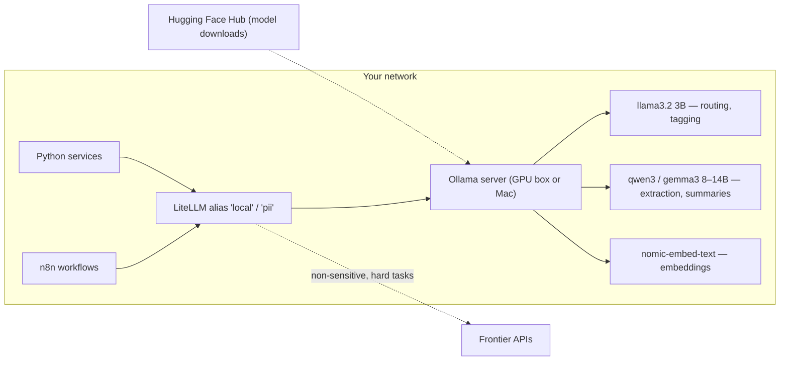
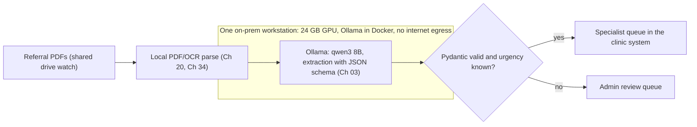

# 08 · Local Models: Ollama & Hugging Face

> **In one line:** Open-weight models running on your own hardware cost nothing per call, keep data inside your network and work offline. Ollama makes them one command away and speaks the OpenAI API. Hugging Face is where the models (and a hosted way to run them) live. The trade-off is a lower quality ceiling plus the hardware and ops are now yours.

> **Versions used:** Ollama (server) 0.12+ · ollama (Python) 0.6 · transformers 5.x · huggingface_hub 1.x · accelerate 1.x · openai 3.x · **Fast-moving:** the best small open models change every few months (Llama, Qwen, Gemma, Mistral, Phi, GPT-OSS families). Ollama adds features (new APIs, context defaults) frequently. Re-run your evals before switching models.

---

## 1. Overview

> **Builds on:** [Ch 06 · Model APIs](topic.html?p=06-model-apis) and [Ch 07 · Routing](topic.html?p=07-multi-provider-routing). Local models slot in as just another provider.

You've already used Ollama as the free default throughout Part 1. This chapter is about running local models *deliberately*: choosing a model that fits your hardware, configuring context and concurrency, serving it to n8n and Python services, and knowing when local is the right call.

Reasons teams run models locally:
1. **Data can't leave.** Patient records, legal files and HR cases, under contracts or regulations that forbid third-party processing.
2. **Volume economics.** Millions of simple classifications a month on a GPU you already own.
3. **Offline or edge.** Factory floors, ships, air-gapped networks.
4. **Development and testing.** Free, unlimited calls while building and running CI.
5. **Control.** No surprise model updates behind an alias, no rate limits, no deprecations.

Where local fits in an automation stack:



---

## 2. Key Concepts

### Parameters, quantisation and memory

A model's size is its **parameter count** (3B, 8B, 70B…). Each parameter is a number stored at some precision. **Quantisation** stores weights with fewer bits (e.g. 4-bit instead of 16-bit), which cuts memory ~4× with a modest quality loss. Ollama's default downloads are typically 4-bit **GGUF** files (the llama.cpp format).

> **Analogy:** quantisation is JPEG for model weights. At a sensible quality setting you barely notice the difference, and the file is a quarter of the size. Push it too far and artefacts appear.

The rule of thumb for memory:

```text
weights_GB ≈ parameters_in_billions × bits_per_weight / 8
total_GB   ≈ weights_GB + KV cache (grows with context length × parallel requests) + ~0.5–1 GB overhead
```

```svg
<svg viewBox="0 0 860 300" width="100%" height="300" font-family="ui-sans-serif,system-ui,sans-serif" font-size="11" xmlns="http://www.w3.org/2000/svg">
  <text x="430" y="22" text-anchor="middle" font-size="14" font-weight="700" fill="#1e293b">Approximate memory for an 8B-parameter model (weights + 8k-token KV cache)</text>
  <line x1="200" y1="44" x2="200" y2="236" stroke="#94a3b8"/>
  <text x="190" y="72" text-anchor="end" fill="#1e293b">FP16 (16-bit)</text>
  <rect x="200" y="58" width="480" height="24" fill="#fee2e2" stroke="#dc2626"/><text x="440" y="74" text-anchor="middle" fill="#1e293b">~16 GB weights</text>
  <rect x="680" y="58" width="36" height="24" fill="#fef3c7" stroke="#d97706"/><text x="724" y="74" fill="#334155">≈17+ GB</text>
  <text x="190" y="114" text-anchor="end" fill="#1e293b">Q8 (8-bit)</text>
  <rect x="200" y="100" width="255" height="24" fill="#fef3c7" stroke="#d97706"/><text x="327" y="116" text-anchor="middle" fill="#1e293b">~8.5 GB</text>
  <rect x="455" y="100" width="36" height="24" fill="#fef3c7" stroke="#d97706"/><text x="499" y="116" fill="#334155">≈9.5 GB</text>
  <text x="190" y="156" text-anchor="end" fill="#1e293b">Q4_K_M (≈4.8-bit)</text>
  <rect x="200" y="142" width="148" height="24" fill="#dcfce7" stroke="#16a34a"/><text x="274" y="158" text-anchor="middle" fill="#1e293b">~4.9 GB</text>
  <rect x="348" y="142" width="36" height="24" fill="#fef3c7" stroke="#d97706"/><text x="392" y="158" fill="#334155">≈6 GB: Ollama default</text>
  <text x="190" y="198" text-anchor="end" fill="#1e293b">3B model, Q4</text>
  <rect x="200" y="184" width="60" height="24" fill="#dbeafe" stroke="#2563eb"/><text x="230" y="200" text-anchor="middle" fill="#1e293b">~2 GB</text>
  <rect x="260" y="184" width="20" height="24" fill="#fef3c7" stroke="#d97706"/><text x="288" y="200" fill="#334155">≈2.5 GB: any laptop</text>
  <rect x="200" y="250" width="14" height="12" fill="#dcfce7" stroke="#16a34a"/><text x="220" y="260" fill="#334155">weights</text>
  <rect x="290" y="250" width="14" height="12" fill="#fef3c7" stroke="#d97706"/><text x="310" y="260" fill="#334155">KV cache + overhead (more context or parallel requests = bigger)</text>
  <text x="200" y="286" fill="#dc2626">If it doesn't fit in GPU VRAM / Apple unified memory, layers spill to CPU and speed drops 5–20×.</text>
</svg>
```

Practical hardware tiers (Nov 2026, rough):
- **Laptop, 16 GB unified memory or an 8 GB GPU:** 3–8B models at Q4. Good for classification, routing, tagging, short extraction.
- **Workstation, 24 GB GPU or 32–64 GB Mac:** 14–32B models. Good summaries, solid extraction, decent tool calling.
- **Server, 48–80 GB+ GPUs:** 70B-class models or many concurrent users on smaller ones. Use vLLM rather than Ollama for high-throughput serving.

### Context length is a setting, not a given

The model may *support* 128k tokens, but the runtime allocates memory for a configured context (`num_ctx` in Ollama). Ollama's default is only a few thousand tokens. **Longer prompts are silently truncated from the start**, which is the #1 "local model is dumb" bug. Set it explicitly per request (`options={"num_ctx": 16384}`) or per server (`OLLAMA_CONTEXT_LENGTH`), and remember memory grows with it.

### Ollama in five ideas

1. **Server + CLI.** `ollama serve` runs an HTTP server on port 11434. `ollama pull/run/list/ps/rm` manage models.
2. **Two APIs.** Native (`/api/chat`, `/api/generate`, `/api/embed`) and **OpenAI-compatible** (`/v1/chat/completions`, `/v1/embeddings`). Everything that speaks OpenAI can use it.
3. **Modelfiles.** Bake a system prompt and parameters into a named model (`FROM llama3.2` + `SYSTEM ...` + `PARAMETER num_ctx 8192`).
4. **Keep-alive.** Models stay loaded in memory for a while after use (default ~5 minutes). The first call after unloading pays a cold-start load time.
5. **Concurrency.** `OLLAMA_NUM_PARALLEL` (requests per model) and `OLLAMA_MAX_LOADED_MODELS` control throughput vs. memory.

### Hugging Face in four ideas

1. **The Hub** hosts hundreds of thousands of models with model cards, licences and files. Ollama and other runtimes ultimately pull from these.
2. **`transformers`** runs models in Python directly (PyTorch), giving you full control. It's the place for fine-tuning, custom pipelines and non-chat models (NER, classification, vision).
3. **Inference Providers** (`huggingface_hub.InferenceClient`) give a hosted, pay-per-use API to many open models across partner providers. It's "local model, someone else's GPU".
4. **Licences matter.** "Open weights" isn't always "open source". Check commercial-use terms (Llama community licence, Gemma terms, Apache-2.0 for Qwen/Mistral variants…) before shipping.

---

## 3. Setup

```bash
# 1) Install Ollama: https://ollama.com/download (macOS app, Linux script, Windows installer)
#    Linux:  curl -fsSL https://ollama.com/install.sh | sh
ollama --version
ollama pull llama3.2            # 3B, ~2 GB
ollama pull qwen3:8b            # 8B, ~5 GB; check ollama.com/library for current tags
ollama pull nomic-embed-text    # embeddings
ollama list && ollama ps        # what's downloaded / what's loaded in memory

# 2) Python
pip install "ollama>=0.6" "openai>=3" "python-dotenv>=1" "pandas>=2"
pip install "transformers>=5" "accelerate>=1" torch "huggingface_hub>=1"   # Hugging Face examples
```

Or run Ollama in Docker (useful on servers, and next to n8n in Part 2):

```bash
docker run -d --name ollama -p 127.0.0.1:11434:11434 -v ollama:/root/.ollama ollama/ollama
# NVIDIA GPU: add --gpus=all (requires the NVIDIA Container Toolkit)
docker exec ollama ollama pull llama3.2
```

Note the `127.0.0.1:` binding. **Ollama has no authentication.** Never expose port 11434 to the internet. Put it behind a reverse proxy with auth, or a gateway like LiteLLM ([Ch 07](topic.html?p=07-multi-provider-routing)).

```bash
# .env.example
OLLAMA_HOST=http://localhost:11434
OLLAMA_MODEL=llama3.2
OLLAMA_MODEL_LARGE=qwen3:8b
HF_TOKEN=                        # huggingface.co/settings/tokens (gated models, Inference Providers)
```

---

## 4. Code Examples

### Example 1: The Ollama Python client: chat, streaming, context and keep-alive

```python
# ex1_ollama_client.py
import os
import ollama
from dotenv import load_dotenv

load_dotenv()
client = ollama.Client(host=os.getenv("OLLAMA_HOST", "http://localhost:11434"))
MODEL = os.getenv("OLLAMA_MODEL", "llama3.2")


def chat(prompt: str, num_ctx: int = 8192) -> str:
    r = client.chat(
        model=MODEL,
        messages=[{"role": "system", "content": "You are a concise operations assistant."},
                  {"role": "user", "content": prompt}],
        options={"temperature": 0.2, "num_ctx": num_ctx, "num_predict": 400},  # ALWAYS set num_ctx
        keep_alive="30m",                                                    # keep the model warm
    )
    secs = (r.eval_duration or 1) / 1e9
    print(f"[{r.model}] prompt={r.prompt_eval_count} tok, out={r.eval_count} tok, "
          f"{r.eval_count / secs:.1f} tok/s, load={(r.load_duration or 0) / 1e9:.2f}s")
    return r.message.content


def stream(prompt: str) -> None:
    for part in client.chat(model=MODEL, messages=[{"role": "user", "content": prompt}], stream=True):
        print(part.message.content, end="", flush=True)
    print()


if __name__ == "__main__":
    print(chat("List three checks before approving a supplier invoice."))
    stream("Write a two-line status update about a delayed shipment.")
    print([m.model for m in client.ps().models])      # models currently loaded in memory
```

Run it twice. The first run shows a non-zero `load` time (cold start), and the second shows ~0. For latency-sensitive automations, keep models warm with `keep_alive`, or send a warm-up request on startup.

### Example 2: A Modelfile: bake the prompt and settings into a named model

```text
# Modelfile.triage
FROM llama3.2
PARAMETER temperature 0
PARAMETER num_ctx 4096
SYSTEM """You triage support emails. Reply with exactly one label:
BILLING, BUG, FEATURE, ACCOUNT or OTHER."""
```

Create it once, then call it by name from anywhere (CLI, Python, n8n):

```bash
ollama create triage -f Modelfile.triage
ollama run triage "I was charged twice for October"
# BILLING
```

Modelfiles are handy for low-code tools that can't easily send system prompts. Keep the Modelfile in git next to your prompts ([Ch 02](topic.html?p=02-prompt-engineering)).

### Example 3: The same local model through the OpenAI SDK and LiteLLM

```python
# ex3_openai_compat.py — zero code changes between local and cloud
import os

import litellm
from openai import OpenAI

# a) OpenAI SDK against Ollama's /v1 endpoint
oa = OpenAI(base_url=os.getenv("OLLAMA_HOST", "http://localhost:11434") + "/v1", api_key="ollama")
r = oa.chat.completions.create(model="llama3.2", messages=[{"role": "user", "content": "Say OK"}])
print("openai-sdk:", r.choices[0].message.content)

# b) LiteLLM: 'ollama_chat/' prefix uses Ollama's chat endpoint
r = litellm.completion(model="ollama_chat/llama3.2", api_base=os.getenv("OLLAMA_HOST", "http://localhost:11434"),
                       messages=[{"role": "user", "content": "Say OK"}])
print("litellm:", r.choices[0].message.content)

# c) Embeddings via the OpenAI-compatible endpoint
e = oa.embeddings.create(model="nomic-embed-text", input=["search_document: hello"])
print("embedding dims:", len(e.data[0].embedding))
```

This is why every earlier chapter defaulted to Ollama: the same code moves to a hosted model by changing `base_url`, `api_key` and `model`.

### Example 4: Hugging Face `transformers`, running a model in-process

```python
# ex4_transformers.py — small instruct model, CPU-friendly (~1 GB download on first run)
from transformers import pipeline

generator = pipeline(
    "text-generation",
    model="Qwen/Qwen2.5-0.5B-Instruct",   # tiny Apache-2.0 model; swap for bigger ones if you have a GPU
    device_map="auto",                    # GPU / Apple MPS if available, else CPU (needs accelerate)
)

messages = [
    {"role": "system", "content": "Classify the email as BILLING, BUG or FEATURE. Reply with the label only."},
    {"role": "user", "content": "The export button crashes the whole app."},
]

if __name__ == "__main__":
    out = generator(messages, max_new_tokens=10, do_sample=False)   # chat template applied automatically
    print(out[0]["generated_text"][-1]["content"])                   # last message = assistant reply
```

```text
BUG
```

Use `transformers` when you need things Ollama doesn't do: a fine-tuned checkpoint you trained, task-specific models (token classification for PII, zero-shot classifiers, rerankers), batch inference inside a data pipeline, or custom generation logic. For serving a chat model to many users, use a server (Ollama, llama.cpp server, vLLM) instead.

### Example 5: Hugging Face Inference Providers, open models without your own GPU

```python
# ex5_hf_inference.py — needs HF_TOKEN; billed per use through your HF account
import os
from dotenv import load_dotenv
from huggingface_hub import InferenceClient

load_dotenv()
client = InferenceClient(provider="auto", api_key=os.environ["HF_TOKEN"])   # auto-picks an available provider

resp = client.chat.completions.create(               # OpenAI-style method on InferenceClient
    model=os.getenv("HF_MODEL", "meta-llama/Llama-3.1-8B-Instruct"),
    messages=[{"role": "user", "content": "In one sentence, what is three-way invoice matching?"}],
    max_tokens=120,
)

if __name__ == "__main__":
    print(resp.choices[0].message.content)
```

This is useful for trying a 70B open model before buying hardware, or for bursting beyond your local capacity with the same model family.

### Example 6: Benchmark local models on your task (quality + speed)

```python
# ex6_local_bench.py — accuracy and tokens/s for each local model on a labelled sample
import os
import time

import ollama
import pandas as pd

client = ollama.Client(host=os.getenv("OLLAMA_HOST", "http://localhost:11434"))
MODELS = [m for m in os.getenv("BENCH_MODELS", "llama3.2,qwen3:8b").split(",")]
SAMPLES = pd.DataFrame({
    "text": ["charged twice for october", "app crashes on export", "please add SSO",
             "refund not received yet", "login page shows error 500", "add dark mode please"],
    "label": ["BILLING", "BUG", "FEATURE", "BILLING", "BUG", "FEATURE"],
})
SYSTEM = "Classify as BILLING, BUG or FEATURE. Reply with the label only."

rows = []
for model in MODELS:
    client.chat(model=model, messages=[{"role": "user", "content": "hi"}], keep_alive="10m")  # warm-up
    for t in SAMPLES.itertuples():
        t0 = time.perf_counter()
        r = client.chat(model=model, options={"temperature": 0, "num_predict": 8, "num_ctx": 2048},
                        messages=[{"role": "system", "content": SYSTEM}, {"role": "user", "content": t.text}],
                        think=False)                 # turn off reasoning for thinking-capable models
        rows.append({"model": model, "ok": t.label in r.message.content.upper(),
                     "latency_s": time.perf_counter() - t0,
                     "tok_s": r.eval_count / max((r.eval_duration or 1) / 1e9, 1e-9)})

if __name__ == "__main__":
    df = pd.DataFrame(rows)
    print(df.groupby("model").agg(accuracy=("ok", "mean"), p50_latency=("latency_s", "median"),
                                  tok_per_s=("tok_s", "median")).round(3))
```

> `think=False` disables the reasoning phase on thinking-capable local models (Qwen3, GPT-OSS, DeepSeek-R1 families). That's essential for fast classification. Turn it on for harder reasoning tasks.

### Example 7: Batch-processing a DataFrame locally, with concurrency

```python
# ex7_batch_local.py — classify thousands of rows locally; tune OLLAMA_NUM_PARALLEL on the server
import asyncio
import os

import pandas as pd
from ollama import AsyncClient

client = AsyncClient(host=os.getenv("OLLAMA_HOST", "http://localhost:11434"))
SEM = asyncio.Semaphore(int(os.getenv("CONCURRENCY", "4")))   # match the server's OLLAMA_NUM_PARALLEL


async def label(text: str) -> str:
    async with SEM:
        r = await client.chat(model=os.getenv("OLLAMA_MODEL", "llama3.2"),
                              options={"temperature": 0, "num_predict": 6},
                              messages=[{"role": "system", "content": "Reply BILLING, BUG or FEATURE only."},
                                        {"role": "user", "content": text}])
        return r.message.content.strip().upper()


async def main(df: pd.DataFrame) -> pd.DataFrame:
    df["label"] = await asyncio.gather(*(label(t) for t in df["text"]))
    return df


if __name__ == "__main__":
    data = pd.DataFrame({"text": ["charged twice", "export crashes", "add SSO"] * 50})
    out = asyncio.run(main(data))
    print(out["label"].value_counts())
```

Start the server with e.g. `OLLAMA_NUM_PARALLEL=4 ollama serve` and match `CONCURRENCY`. More parallel slots raise throughput but need more memory (each slot gets its own KV cache).

---

## 5. Real-World Use Case

**Organisation:** a 50-person medical clinic group. **Constraint:** patient letters and referral notes may not be sent to external AI services under their data-protection policy. **Goal:** auto-route ~600 incoming referral documents a week to the right specialist queue and pre-extract key fields (urgency, referring doctor, requested service).



Why local works here: the task is **narrow** (fixed schema, a few document types), volume is **steady**, and the data constraint is **absolute**. A workstation-class GPU runs an 8–14B model at interactive speed. Everything runs behind the clinic firewall with no outbound access. The team still benchmarked two local models on 200 labelled historical referrals (Example 6), and kept the 8B model because the 14B model's small accuracy gain didn't justify doubling latency.

What they had to own: hardware procurement, Ollama and driver updates, monitoring the box, model version pinning, and a clear process for re-evaluating newer models twice a year.

---

## 6. Mini Project: Private Document Summariser (1–2 hours)

**Goal:** summarise and tag a folder of confidential text documents entirely on your machine, compare two local models, and run the stack with Docker Compose.

```text
private-summariser/
├── docker-compose.yml
├── .env
├── docs/                 # *.txt — your documents (or the generated samples)
├── make_docs.py
└── summarise.py
```

**Step 1: Docker Compose with Ollama.**

```yaml
# docker-compose.yml
services:
  ollama:
    image: ollama/ollama            # pin a version tag in production
    ports: ["127.0.0.1:11434:11434"]
    volumes: ["ollama:/root/.ollama"]
    environment:
      OLLAMA_NUM_PARALLEL: "2"
      OLLAMA_KEEP_ALIVE: "30m"
    # deploy: {resources: {reservations: {devices: [{capabilities: [gpu]}]}}}   # NVIDIA GPU
volumes:
  ollama:
```

```bash
docker compose up -d
docker compose exec ollama ollama pull llama3.2
docker compose exec ollama ollama pull qwen3:8b
```

**Step 2: sample documents.**

```python
# make_docs.py
from pathlib import Path

Path("docs").mkdir(exist_ok=True)
docs = {
    "contract_renewal.txt": "The master services agreement with Contoso renews on 1 March 2027 for 24 months. "
                            "Fees rise 6% unless notice is given 60 days before renewal. Liability cap: 12 months of fees.",
    "incident_report.txt": "On 4 Nov at 14:10 the payments API returned 503 for 37 minutes. Root cause: expired TLS "
                           "certificate on the internal gateway. 412 checkouts failed; customers were not charged.",
    "hr_note.txt": "Employee requested parental leave from 1 Feb to 30 Apr. Manager approved; cover plan agreed "
                   "with the analytics team. Payroll to be notified by 15 Jan.",
}
for name, text in docs.items():
    Path("docs", name).write_text(text)
print("docs ready")
```

**Step 3: the summariser with structured output and a model comparison.**

```python
# summarise.py
import argparse
import os
import time
from pathlib import Path
from typing import Literal

import ollama
import pandas as pd
from pydantic import BaseModel, Field

client = ollama.Client(host=os.getenv("OLLAMA_HOST", "http://localhost:11434"))


class DocSummary(BaseModel):
    doc_type: Literal["CONTRACT", "INCIDENT", "HR", "FINANCE", "OTHER"]
    summary: str = Field(description="Two sentences, plain language")
    key_dates: list[str] = Field(default_factory=list, description="Dates exactly as written")
    action_needed: bool
    sensitivity: Literal["LOW", "MEDIUM", "HIGH"]


def summarise(model: str, text: str) -> tuple[DocSummary | None, float]:
    t0 = time.perf_counter()
    r = client.chat(
        model=model,
        messages=[{"role": "system", "content": "Summarise the document. Use only facts in it."},
                  {"role": "user", "content": text}],
        format=DocSummary.model_json_schema(),
        options={"temperature": 0, "num_ctx": 8192},
        think=False,
    )
    try:
        return DocSummary.model_validate_json(r.message.content), time.perf_counter() - t0
    except Exception:
        return None, time.perf_counter() - t0


def main() -> None:
    ap = argparse.ArgumentParser()
    ap.add_argument("--models", default="llama3.2,qwen3:8b")
    a = ap.parse_args()
    rows = []
    for model in a.models.split(","):
        for f in sorted(Path("docs").glob("*.txt")):
            s, secs = summarise(model, f.read_text())
            rows.append({"model": model, "file": f.name, "valid": s is not None, "seconds": round(secs, 2),
                         **(s.model_dump() if s else {})})
    df = pd.DataFrame(rows)
    df.to_csv("summaries.csv", index=False)
    print(df[["model", "file", "valid", "seconds", "doc_type", "action_needed", "sensitivity"]].to_string(index=False))
    print("\n", df.groupby("model")[["valid", "seconds"]].mean().round(2))


if __name__ == "__main__":
    main()
```

**Step 4: run, then prove nothing left the machine.**

```bash
python make_docs.py && python summarise.py
# Optional proof: disconnect from the network (or block egress) and run again — it still works.
```

**Done when:**
- [ ] Every document gets a validated `DocSummary` from at least one model.
- [ ] You have a table comparing validity and speed for two models, and you can say which you'd deploy.
- [ ] The run works with networking disabled.

**Stretch:** add a third model and a "reviewer" field you fill in by hand to measure accuracy. Put LiteLLM in front with alias `private` and make sure it has no cloud fallback. Run 100 synthetic documents with Example 7's concurrency and find the `OLLAMA_NUM_PARALLEL` value that maximises throughput.

---

## 7. Comparison Table

**Ways to run open models**

| Option | Best for | Strengths | Limits |
|---|---|---|---|
| **Ollama** | Dev machines, small teams, single-server automations | One-command install, model library, OpenAI-compatible API, Modelfiles, Docker image | Not designed for high-concurrency serving; no built-in auth |
| **LM Studio** | Desktop exploration, non-engineers | GUI, model browser, local OpenAI-compatible server | Desktop-oriented |
| **llama.cpp (server)** | Lean CPU/GPU serving, edge devices | Fast, minimal, GGUF native, fine-grained control | More manual setup |
| **vLLM** | Production serving at scale on NVIDIA/AMD GPUs | High throughput (continuous batching, paged attention), OpenAI-compatible | Needs real GPUs, uses full-precision or GPU quant formats |
| **HF `transformers`** | Pipelines, fine-tuned or task-specific models, research | Full control, every model type, training | You manage batching, memory and serving |
| **HF Inference Providers** | Trying or bursting open models without hardware | Many open models via one token, pay-per-use | Data leaves your network; provider availability varies |

**Local vs. hosted API**

| Factor | Local | Hosted API |
|---|---|---|
| Per-call cost | ~0 (hardware + power) | Per token |
| Quality ceiling | Good on narrow tasks; below frontier on hard reasoning | Highest |
| Data control | Full | Contract- and region-dependent |
| Latency | Predictable on your hardware; cold starts | Network + provider queue; very fast on Groq-class hosts |
| Ops burden | Yours: hardware, drivers, updates, monitoring | Provider's |
| Scaling | Buy hardware | Raise limits |

**When to use which:** start hosted for quality and speed of development. Move a step to local when data rules demand it, when volume makes per-token cost dominant, or when it's a narrow task where a small model passes your evals. Use Ollama for dev and single-box deployments, and vLLM when many users or high throughput hit one model.

---

## 8. Common Mistakes & Best Practices

**Mistake 1: leaving `num_ctx` at the default.** Long documents get silently truncated, and the model "ignores" instructions that were cut off. *Fix:* set `num_ctx` per request or server-wide, and check that `prompt_eval_count` matches your expected prompt size.

**Mistake 2: a model that doesn't fit in VRAM.** Layers spill to CPU and throughput collapses. *Fix:* check `ollama ps` (it shows the GPU/CPU split), use a smaller model or a lower quantisation, or reduce context and parallelism.

**Mistake 3: exposing Ollama to the network.** There's no auth, so anyone can use (and abuse) your GPU. *Fix:* bind to `127.0.0.1`, or put a reverse proxy with auth or LiteLLM in front.

**Mistake 4: judging local models on hard, open-ended tasks.** A 3B model won't draft a nuanced legal reply. *Fix:* use local models for narrow, well-specified steps, with structured outputs and evals. Route hard steps elsewhere.

**Mistake 5: ignoring licences.** *Fix:* read the model card's licence before commercial use, and record it alongside the model version.

**Mistake 6: cold starts in latency-sensitive paths.** *Fix:* `keep_alive`, a warm-up request at service start, and enough memory to keep the needed models loaded (`OLLAMA_MAX_LOADED_MODELS`).

**Mistake 7: unpinned model tags.** `llama3.2` (latest) can change when you `pull` again. *Fix:* use specific tags (e.g. `llama3.2:3b-instruct-q4_K_M`) or record the model digest from `ollama list`, and re-run evals before upgrading.

**Best-practice checklist**
- [ ] Model choice backed by a benchmark on *your* labelled data (accuracy + latency).
- [ ] `num_ctx`, `keep_alive` and parallelism set explicitly. Memory headroom verified with `ollama ps`.
- [ ] Server bound to localhost or behind auth. No public port.
- [ ] Model tag/digest and licence recorded. Upgrades gated on evals.
- [ ] Reasoning (`think`) off for simple classification, on for hard steps.
- [ ] Local models exposed through the same router/alias as hosted ones.

---

## 9. Exercises

1. **Truncation detective.** Send a 6,000-token document with a question at the end, using `num_ctx` 2048 and then 8192. Compare `prompt_eval_count` and the answers.
2. **Quantisation trade-off.** Pull two quantisations of the same model (e.g. `q4_K_M` and `q8_0` tags) and run Example 6. Record accuracy, tokens/s and `ollama ps` memory.
3. **Modelfile for n8n.** Create a `summariser` model with a baked system prompt and `num_ctx 8192`, then call it from `curl` against `/api/chat` and against `/v1/chat/completions`.
4. **Throughput tuning.** Run Example 7 on 200 rows with `OLLAMA_NUM_PARALLEL` = 1, 2, 4, 8. Plot rows/minute and note where memory or latency becomes the limit.
5. **Local vs. hosted decision.** For a task from your work, estimate monthly API cost (Ch 01 calculator) against hardware cost and decide. Write the decision as a one-paragraph memo with the numbers.

### Self-check questions

**Q: How do you estimate whether a model will fit on a machine?**
A: Weights take roughly parameters × bits per weight ÷ 8 bytes: an 8B model at 4-bit is ~5 GB, at 16-bit ~16 GB. Add the KV cache, which grows with context length and the number of parallel requests, plus some runtime overhead, and compare with GPU VRAM or Apple unified memory. If it doesn't fit, layers spill to CPU and speed collapses.

**Q: Why do local models often seem to "ignore" long instructions, and what's the fix?**
A: The runtime's configured context window (Ollama's `num_ctx`) defaults to a few thousand tokens, and longer prompts are truncated, often dropping the start where instructions live. Set `num_ctx` explicitly to cover prompt plus output, and check the prompt token count reported in the response.

**Q: What does quantisation trade, and what's a sensible default?**
A: It reduces the bits per weight to cut memory and increase speed, at some quality cost that grows as bits drop. 4-bit K-quant variants (like Q4_K_M) are a common sweet spot. Use 8-bit when memory allows and quality matters, and validate on your own task either way.

**Q: When would you use Hugging Face `transformers` instead of Ollama?**
A: When you need full control in Python: running a fine-tuned checkpoint, task-specific models (token classification, rerankers, zero-shot classifiers), batch inference inside a data pipeline, or custom generation and training. Ollama is better for simply serving chat and embedding models over an API.

**Q: A team wants to expose its Ollama server so n8n Cloud can reach it. What do you advise? (Senior)**
A: Don't expose Ollama directly: it has no authentication, so anyone could use the GPU and probe the box. Put an authenticating gateway (LiteLLM proxy or a reverse proxy with API keys and TLS) in front, restrict source IPs, apply rate limits, and log usage. Better still, run n8n self-hosted next to Ollama on the private network, especially if the reason for going local was data control.

**Q: How would you decide between running a model locally and calling a hosted API for a new automation step? (Senior)**
A: Start from constraints: if data may not leave, local (or an approved private deployment) is mandatory. Otherwise evaluate candidate local and hosted models on a labelled set for accuracy and latency, and compute total cost: per-token API cost at expected volume against hardware, power and ops time. Choose local for narrow, high-volume or sensitive steps that pass the evals, hosted for hard or low-volume steps, and route both through one gateway so you can change your mind.

**Q: What's `keep_alive` in Ollama, and why does it matter for automations?**
A: It controls how long a model stays loaded in memory after a request. When it expires the model unloads, and the next request pays a cold-start load time of seconds. Latency-sensitive automations should keep models warm with a longer `keep_alive` or a warm-up request, balanced against memory needed for other models.

---

## 10. Summary & Official Docs

- Local models trade **quality ceiling and ops effort** for **zero per-call cost, data control and offline operation**.
- Size the hardware: **weights ≈ params × bits / 8**, plus a KV cache that grows with context and parallelism. Q4 is the usual default.
- **Ollama**: pull/run/serve, native + OpenAI-compatible APIs, Modelfiles, `num_ctx`, `keep_alive`, `OLLAMA_NUM_PARALLEL`. Never expose it unauthenticated.
- **Hugging Face**: the Hub for models and licences, `transformers` for in-process and task-specific models, Inference Providers for hosted open models.
- Benchmark on **your** data, pin model tags, and route local models through the same gateway as hosted ones.

**Official docs**
- Ollama: https://ollama.com and API reference https://github.com/ollama/ollama/blob/main/docs/api.md
- Ollama Modelfile reference: https://github.com/ollama/ollama/blob/main/docs/modelfile.md
- Ollama OpenAI compatibility: https://github.com/ollama/ollama/blob/main/docs/openai.md
- Hugging Face Transformers: https://huggingface.co/docs/transformers
- Hugging Face Inference Providers: https://huggingface.co/docs/inference-providers
- vLLM: https://docs.vllm.ai/
- Theory: [AI Engineering · Quantization & Inference Optimisation](../ai-engineering/topic.html?p=38-quantization-inference-opt) · [Serving LLMs](../ai-engineering/topic.html?p=39-serving-llms)

**Next:** [Part 2 · Ch 09 · n8n](topic.html?p=09-n8n-fundamentals): wiring everything from Part 1 into visual, self-hosted workflows.

---

*AI Automation with Python Handbook — chapter 08.*
