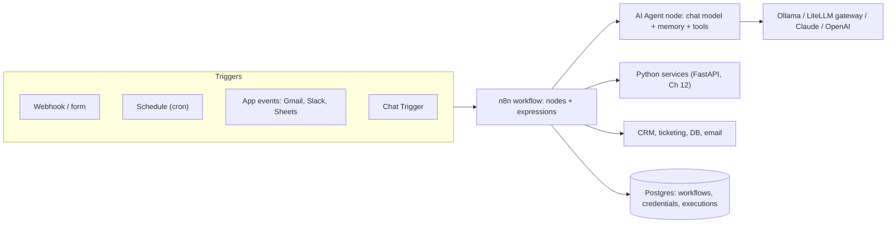
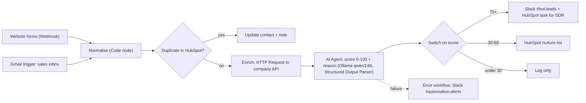

# 09 · n8n: Triggers, Nodes, AI Agent Node, Code Node, Webhooks & Self-Hosting

> **In one line:** n8n is a self-hostable workflow engine where a trigger starts a run, items flow through nodes, expressions wire data between them, and an AI Agent node plugs a chat model, memory and tools into the middle. Learn its data model, webhooks and Docker deployment once and you can ship most glue automations in an afternoon, with Python where it earns its place.

> **Versions used:** n8n 2.47 (stable, Docker `n8nio/n8n` + `n8nio/runners`) · PostgreSQL 16 · Ollama 0.x · requests 2.34 · httpx 0.28 · python-dotenv 1.2 · **Fast-moving:** n8n ships a minor release roughly every week. Node parameter names, `typeVersion`s, AI node options and env var names change (2.0 replaced Activate with **Publish**, removed Pyodide, disabled Execute Command by default; 2.35 renamed `WEBHOOK_URL` to `N8N_WEBHOOK_URL`). Pin the image tag and read the release notes before upgrading.

---

## 1. Overview

> **Builds on:** [Ch 04 · Function Calling](topic.html?p=04-function-calling) (the tool loop the AI Agent node runs for you), [Ch 07 · Multi-Provider Routing](topic.html?p=07-multi-provider-routing) (point n8n at a gateway) and [Ch 08 · Local Models](topic.html?p=08-local-models) (Ollama as the free default).

You have written webhook handlers, cron jobs and API clients. Most business automations are exactly that, glued together: "when a form is submitted, enrich the lead, ask a model to score it, post hot leads to Slack, write everything to the CRM". **n8n** (pronounced "n-eight-n", short for *nodemation*) lets you build that glue visually, run it on your own server, and still drop into JavaScript or Python for the hard bits.

Why it matters for AI automation specifically:
- **400+ integrations** (Gmail, Slack, Postgres, HubSpot, Google Sheets, HTTP) mean you stop writing OAuth flows and pagination loops.
- **LangChain-based AI nodes** (AI Agent, Basic LLM Chain, Information Extractor, Text Classifier, vector stores) turn the tool loop from Ch 04 into a canvas of boxes.
- **Self-hosting** under a fair-code licence: data stays on your box, and the Community edition has no per-execution fee.
- **Every run is recorded** with each node's input and output, which is the debugging experience you wish your cron scripts had.

Where it sits in an automation stack:



**Rule of thumb:** n8n owns *orchestration and integrations*; Python owns *heavy logic, data science and anything you want unit-tested*. Chapter 12 is about that boundary.

---

## 2. Key Concepts

- **Workflow**: a graph of **nodes** saved as JSON. Editing a workflow changes a draft; in n8n 2.x you **Publish** it to make production triggers live (the old *Active* toggle).
- **Trigger node**: what starts an execution. Webhook, Schedule Trigger, Chat Trigger, Form Trigger, app triggers (new Gmail message, new row), Error Trigger, Execute Workflow Trigger (called from another workflow), Manual Trigger.
- **Regular node**: does one thing per run: HTTP Request, Edit Fields (Set), IF, Switch, Merge, Loop Over Items, Code, app actions.
- **Items**: the unit of data. Every node receives and returns a **list of items**, each `{"json": {...}, "binary": {...}}`. Most nodes run **once per item** automatically, so a node that receives 50 items makes 50 API calls. This is the single most important idea in n8n.
- **Expressions**: `{{ ... }}` JavaScript snippets in any parameter. `{{ $json.email }}` is the current item's field; `{{ $('Webhook').item.json.body.id }}` reaches back to another node's matching item (n8n tracks **paired items** for you); `{{ $now.toISO() }}` uses Luxon dates.
- **Cluster nodes**: a **root node** (AI Agent, Basic LLM Chain, Vector Store) plus **sub-nodes** attached underneath: **chat model** (Ollama, OpenAI, Anthropic, Groq…), **memory** (Simple Memory, Postgres, Redis), **tools** (HTTP Request Tool, Code Tool, Calculator, a whole sub-workflow, any app node in tool mode), **output parser** (Structured Output Parser).
- **Credentials**: API keys and OAuth tokens stored encrypted in the database with **`N8N_ENCRYPTION_KEY`**. Nodes reference credentials by ID, so exported workflow JSON contains no secrets.
- **Executions**: the log of every run with per-node data. Failed production runs can be retried from the failed node.
- **Error workflow**: a separate workflow starting with an **Error Trigger**, assigned in a workflow's settings. It fires when a production execution fails: your alerting hook.
- **Code node**: JavaScript (Node.js) or **native Python** (task runner) over items. Runs in a sandboxed **task runner**, not in the n8n process.

> **Analogy:** an assembly line. The trigger drops a tray of parts (items) on the belt; each station (node) processes every part on the tray and passes the tray on; the AI Agent station is a worker with a phone (chat model), a notebook (memory) and a toolbox (tools).

The core mechanism, items in and items out, with an AI Agent cluster in the middle:

```svg
<svg viewBox="0 0 880 330" width="100%" height="330" font-family="ui-sans-serif,system-ui,sans-serif" font-size="11" xmlns="http://www.w3.org/2000/svg">
  <defs><marker id="aa09a" viewBox="0 0 10 10" refX="9" refY="5" markerWidth="7" markerHeight="7" orient="auto"><path d="M0,0 L10,5 L0,10 z" fill="#334155"/></marker></defs>
  <text x="440" y="22" text-anchor="middle" font-size="14" font-weight="700" fill="#1e293b">Items flow node to node; the AI Agent root node borrows its sub-nodes</text>
  <rect x="20" y="60" width="130" height="70" rx="8" fill="#dbeafe" stroke="#2563eb"/>
  <text x="85" y="84" text-anchor="middle" font-weight="700" fill="#1e293b">Webhook</text>
  <text x="85" y="101" text-anchor="middle" fill="#334155">trigger</text>
  <text x="85" y="118" text-anchor="middle" fill="#334155">1 item: body, headers</text>
  <line x1="152" y1="95" x2="198" y2="95" stroke="#334155" stroke-width="1.5" marker-end="url(#aa09a)"/>
  <rect x="200" y="60" width="140" height="70" rx="8" fill="#fef3c7" stroke="#d97706"/>
  <text x="270" y="84" text-anchor="middle" font-weight="700" fill="#1e293b">Code (JS / Python)</text>
  <text x="270" y="101" text-anchor="middle" fill="#334155">split body.tickets</text>
  <text x="270" y="118" text-anchor="middle" fill="#334155">1 item → 3 items</text>
  <line x1="342" y1="95" x2="388" y2="95" stroke="#334155" stroke-width="1.5" marker-end="url(#aa09a)"/>
  <rect x="390" y="50" width="200" height="90" rx="8" fill="#ede9fe" stroke="#7c3aed"/>
  <text x="490" y="74" text-anchor="middle" font-weight="700" fill="#1e293b">AI Agent (root node)</text>
  <text x="490" y="92" text-anchor="middle" fill="#334155">runs once per item</text>
  <text x="490" y="108" text-anchor="middle" fill="#334155">prompt: {{ $json.text }}</text>
  <text x="490" y="124" text-anchor="middle" fill="#334155">tool loop (Ch 04) inside</text>
  <line x1="592" y1="95" x2="638" y2="95" stroke="#334155" stroke-width="1.5" marker-end="url(#aa09a)"/>
  <rect x="640" y="60" width="100" height="70" rx="8" fill="#dcfce7" stroke="#16a34a"/>
  <text x="690" y="84" text-anchor="middle" font-weight="700" fill="#1e293b">Switch</text>
  <text x="690" y="101" text-anchor="middle" fill="#334155">route by</text>
  <text x="690" y="118" text-anchor="middle" fill="#334155">{{ $json.output }}</text>
  <line x1="742" y1="80" x2="790" y2="66" stroke="#334155" stroke-width="1.5" marker-end="url(#aa09a)"/>
  <line x1="742" y1="110" x2="790" y2="124" stroke="#334155" stroke-width="1.5" marker-end="url(#aa09a)"/>
  <rect x="792" y="48" width="78" height="34" rx="6" fill="#f8fafc" stroke="#94a3b8"/>
  <text x="831" y="69" text-anchor="middle" fill="#1e293b">Slack</text>
  <rect x="792" y="108" width="78" height="34" rx="6" fill="#f8fafc" stroke="#94a3b8"/>
  <text x="831" y="129" text-anchor="middle" fill="#1e293b">CRM</text>
  <line x1="420" y1="142" x2="330" y2="210" stroke="#7c3aed" stroke-width="1.5" stroke-dasharray="4 3"/>
  <line x1="460" y1="142" x2="440" y2="210" stroke="#7c3aed" stroke-width="1.5" stroke-dasharray="4 3"/>
  <line x1="520" y1="142" x2="560" y2="210" stroke="#7c3aed" stroke-width="1.5" stroke-dasharray="4 3"/>
  <line x1="560" y1="142" x2="680" y2="210" stroke="#7c3aed" stroke-width="1.5" stroke-dasharray="4 3"/>
  <rect x="260" y="212" width="130" height="62" rx="8" fill="#dbeafe" stroke="#2563eb"/>
  <text x="325" y="234" text-anchor="middle" font-weight="700" fill="#1e293b">Chat Model</text>
  <text x="325" y="252" text-anchor="middle" fill="#334155">Ollama / Claude /</text>
  <text x="325" y="266" text-anchor="middle" fill="#334155">OpenAI-compatible</text>
  <rect x="400" y="212" width="110" height="62" rx="8" fill="#fef3c7" stroke="#d97706"/>
  <text x="455" y="234" text-anchor="middle" font-weight="700" fill="#1e293b">Memory</text>
  <text x="455" y="252" text-anchor="middle" fill="#334155">keyed by</text>
  <text x="455" y="266" text-anchor="middle" fill="#334155">session id</text>
  <rect x="520" y="212" width="110" height="62" rx="8" fill="#dcfce7" stroke="#16a34a"/>
  <text x="575" y="234" text-anchor="middle" font-weight="700" fill="#1e293b">Tools</text>
  <text x="575" y="252" text-anchor="middle" fill="#334155">HTTP, Code,</text>
  <text x="575" y="266" text-anchor="middle" fill="#334155">sub-workflow</text>
  <rect x="640" y="212" width="120" height="62" rx="8" fill="#fee2e2" stroke="#dc2626"/>
  <text x="700" y="234" text-anchor="middle" font-weight="700" fill="#1e293b">Output Parser</text>
  <text x="700" y="252" text-anchor="middle" fill="#334155">JSON schema</text>
  <text x="700" y="266" text-anchor="middle" fill="#334155">(optional)</text>
  <text x="440" y="306" text-anchor="middle" fill="#334155">Sub-nodes resolve expressions against the FIRST item only; the root node iterates over all items.</text>
</svg>
```

> **Gotcha:** sub-node parameters (e.g. the memory's session key) evaluate expressions against the first incoming item, while root and regular nodes evaluate per item. If you send 20 items into an agent with memory, all 20 may share one session. Split with Loop Over Items, or send one item per execution.

---

## 3. Setup

You need Docker (see the [Docker handbook](../docker/topic.html?p=18-compose)) and, for the local model path, Ollama from Ch 08. The production-shaped stack: **Postgres** for workflows/credentials/executions, **n8n**, an **external task runner** sidecar for Code nodes (required for Python in 2.x), and optionally **Ollama** in the same Compose network.

```bash
# .env.example  (next to docker-compose.yml; never commit the real .env)
N8N_VERSION=2.47.4                  # pin exactly; check docs.n8n.io release notes
POSTGRES_PASSWORD=change-me
N8N_ENCRYPTION_KEY=                 # 32+ random chars. LOSE IT AND EVERY CREDENTIAL IS UNREADABLE
N8N_RUNNERS_AUTH_TOKEN=             # shared secret between n8n and the runners sidecar
N8N_HOST=localhost
N8N_WEBHOOK_URL=http://localhost:5678/   # public base URL; behind a proxy: https://n8n.example.com/
TZ=Europe/Berlin
# for the Python scripts in this chapter
N8N_BASE_URL=http://localhost:5678
N8N_API_KEY=                        # Settings → n8n API → Create an API key
N8N_WEBHOOK_TOKEN=                  # value for the Header Auth credential on your webhooks
```

Generate the secrets instead of inventing them:

```bash
for v in N8N_ENCRYPTION_KEY N8N_RUNNERS_AUTH_TOKEN N8N_WEBHOOK_TOKEN; do
  echo "$v=$(python3 -c 'import secrets; print(secrets.token_urlsafe(32))')"
done
```

The Compose file. It follows the official Postgres and external-runner examples, trimmed to what this chapter uses:

```yaml
# docker-compose.yml
services:
  postgres:
    image: postgres:16
    restart: unless-stopped
    environment:
      POSTGRES_USER: n8n
      POSTGRES_PASSWORD: ${POSTGRES_PASSWORD}
      POSTGRES_DB: n8n
    volumes: ["pgdata:/var/lib/postgresql/data"]
    healthcheck:
      test: ["CMD-SHELL", "pg_isready -U n8n -d n8n"]
      interval: 5s
      retries: 10

  n8n:
    image: n8nio/n8n:${N8N_VERSION}
    restart: unless-stopped
    ports: ["5678:5678"]
    environment:
      DB_TYPE: postgresdb
      DB_POSTGRESDB_HOST: postgres
      DB_POSTGRESDB_PORT: 5432
      DB_POSTGRESDB_DATABASE: n8n
      DB_POSTGRESDB_USER: n8n
      DB_POSTGRESDB_PASSWORD: ${POSTGRES_PASSWORD}
      N8N_ENCRYPTION_KEY: ${N8N_ENCRYPTION_KEY}
      N8N_HOST: ${N8N_HOST}
      N8N_WEBHOOK_URL: ${N8N_WEBHOOK_URL}   # before 2.35 the name was WEBHOOK_URL
      GENERIC_TIMEZONE: ${TZ}
      TZ: ${TZ}
      N8N_RUNNERS_MODE: external
      N8N_RUNNERS_BROKER_LISTEN_ADDRESS: 0.0.0.0
      N8N_RUNNERS_AUTH_TOKEN: ${N8N_RUNNERS_AUTH_TOKEN}
      EXECUTIONS_DATA_PRUNE: "true"
      EXECUTIONS_DATA_MAX_AGE: 336           # hours of execution history to keep
    volumes: ["n8n_data:/home/node/.n8n"]    # keep it even with Postgres: key file, logs
    depends_on:
      postgres: {condition: service_healthy}

  task-runners:
    image: n8nio/runners:${N8N_VERSION}      # must match the n8n version
    restart: unless-stopped
    environment:
      N8N_RUNNERS_TASK_BROKER_URI: http://n8n:5679
      N8N_RUNNERS_AUTH_TOKEN: ${N8N_RUNNERS_AUTH_TOKEN}
    depends_on: [n8n]

  ollama:
    image: ollama/ollama
    restart: unless-stopped
    volumes: ["ollama:/root/.ollama"]
    ports: ["11434:11434"]                   # drop this line if only n8n needs Ollama

volumes:
  pgdata:
  n8n_data:
  ollama:
```

```bash
docker compose up -d
docker compose exec ollama ollama pull llama3.2
open http://localhost:5678          # create the owner account on first visit
pip install "requests>=2.32" "httpx>=0.27" "python-dotenv>=1"
```

> **Version note:** on n8n 1.111–1.x you also needed `N8N_RUNNERS_ENABLED=true` and `N8N_NATIVE_PYTHON_RUNNER=true`. In 2.x task runners are always on and Python *requires* external mode. If you skip the runners sidecar, JavaScript Code nodes still work (internal mode) but Python Code nodes don't.

**Connecting n8n to Ollama.** Create an *Ollama* credential with Base URL `http://ollama:11434` (same Compose network). If Ollama runs on your Mac instead, use `http://host.docker.internal:11434`. `http://localhost:11434` from inside the n8n container points at the container itself, the number one "connection refused" cause. To route through the LiteLLM gateway from Ch 07 instead, use an *OpenAI* credential with a custom Base URL (`http://litellm:4000/v1`) and a virtual key.

**Scaling later: queue mode.** One n8n process runs everything by default. For throughput, switch to **queue mode**: the main instance enqueues executions in **Redis** (BullMQ) and **workers** pull them. Every process shares the same Postgres and the same `N8N_ENCRYPTION_KEY`.

```yaml
# docker-compose.queue.yml (overlay): docker compose -f docker-compose.yml -f docker-compose.queue.yml up -d
services:
  redis:
    image: redis:7
    restart: unless-stopped
  n8n:
    environment:
      EXECUTIONS_MODE: queue
      QUEUE_BULL_REDIS_HOST: redis
    depends_on: [redis]
  n8n-worker:
    image: n8nio/n8n:${N8N_VERSION}
    command: worker --concurrency=5
    restart: unless-stopped
    environment:
      EXECUTIONS_MODE: queue
      QUEUE_BULL_REDIS_HOST: redis
      DB_TYPE: postgresdb
      DB_POSTGRESDB_HOST: postgres
      DB_POSTGRESDB_DATABASE: n8n
      DB_POSTGRESDB_USER: n8n
      DB_POSTGRESDB_PASSWORD: ${POSTGRES_PASSWORD}
      N8N_ENCRYPTION_KEY: ${N8N_ENCRYPTION_KEY}   # MUST equal the main instance's key
    depends_on: [redis, postgres]
```

In queue mode each worker needs its own task-runner sidecar for Code nodes (omitted above for brevity). `docker compose up -d --scale n8n-worker=3` adds workers; webhook-heavy setups add dedicated `webhook` processes behind the load balancer.

---

## 4. Code Examples

Examples 1–2 are workflow building blocks (expressions and Code nodes); 3–6 are the Python side: calling webhooks, validating exported JSON, and driving n8n's public REST API.

### Example 1: Expressions you will use daily

Expressions are JavaScript inside `{{ }}`. A cheat sheet against a Webhook item whose body is `{"customer": {"email": "Priya@Acme.io"}, "tickets": [...]}`:

```text
{{ $json.body.customer.email }}                    → "Priya@Acme.io"   (current item, Webhook puts payload under body)
{{ $json.body.customer.email.toLowerCase() }}      → plain JS methods work
{{ $json.body.tickets.length }}                    → 3
{{ $('Webhook').item.json.headers['x-request-id'] }}   → reach back to a named node's paired item
{{ $('Webhook').first().json.body }}               → first item of a named node (no pairing)
{{ $input.all().length }}                          → number of items entering this node
{{ $now.toISO() }}   {{ $today.minus({days: 7}).toFormat('yyyy-MM-dd') }}   → Luxon dates
{{ $json.score ?? 0 }}                             → defaults for missing fields
{{ $execution.id }}   {{ $workflow.name }}         → metadata, great for logging and idempotency keys
```

> **Why this matters:** most "n8n is flaky" complaints are item mistakes: an expression points at `$json.email` when the field moved under `body`, or a node ran 30 times because it got 30 items. Open the node's INPUT panel and drag fields in; n8n writes the expression for you.

### Example 2: The Code node in JavaScript and native Python

The same transform in both languages: split one webhook item carrying a `tickets` array into one item per ticket, normalise fields, and drop empties. **Mode: Run Once for All Items.**

JavaScript (fastest, full built-ins: `$input`, `$json`, `$('Node')`, Luxon, `crypto`):

```javascript
// Code node · JavaScript · Run Once for All Items
const out = [];
for (const item of $input.all()) {
  const body = item.json.body ?? {};
  for (const t of body.tickets ?? []) {
    const text = String(t.text ?? '').trim();
    if (!text) continue;
    out.push({
      json: {
        ticket_id: t.id,
        customer_email: String(body.customer?.email ?? '').toLowerCase(),
        text: text.slice(0, 4000),            // cap prompt size before it reaches the model
        received_at: $now.toISO(),
      },
    });
  }
}
return out;                                   // always a list of {json: ...}
```

Native Python. Only `_items` (all-items mode) or `_item` (per-item mode) exist; items are plain dicts, so use bracket access:

```python
# Code node · Python (native, task runner) · Run Once for All Items
# _items is injected by n8n: a list of {"json": {...}, ...} dicts
out = []
for item in _items:
    body = item["json"].get("body") or {}
    email = str((body.get("customer") or {}).get("email", "")).lower()
    for t in body.get("tickets") or []:
        text = str(t.get("text", "")).strip()
        if not text:
            continue
        out.append({"json": {"ticket_id": t.get("id"), "customer_email": email, "text": text[:4000]}})
return out
```

That last `return` at module level is legal only because n8n wraps your code in a function. Outside n8n it's a syntax error, so keep a testable copy of the logic in a plain function (Ch 12 shows how).

Limits to know before reaching for Python inside n8n:
- No `$json`, `$('Node')`, `$now` and friends: pass what you need in the items.
- Imports are **deny-by-default**. Self-hosted, you allowlist stdlib modules (`N8N_RUNNERS_STDLIB_ALLOW`) and third-party packages (`N8N_RUNNERS_EXTERNAL_ALLOW`) and bake the packages into a custom `n8nio/runners` image. On n8n Cloud you can't import libraries.
- Environment variables are blocked in Code nodes by default since 2.0 (`N8N_BLOCK_ENV_ACCESS_IN_NODE=true`). Use credentials, not env vars, for secrets.
- Each run has a timeout and a memory cap. pandas over 200 MB of rows belongs in a real service.

> **Rule:** short transforms in a Code node; anything with dependencies, tests or more than ~50 lines goes into a FastAPI service the workflow calls ([Ch 12](topic.html?p=12-n8n-with-python)).

### Example 3: Trigger an n8n webhook from Python (test vs production URLs)

A Webhook node on path `intake` gets **two URLs**:
- **Test URL** `…/webhook-test/intake`: registered only while you click *Listen for test event* / *Execute workflow* in the editor; the data shows up on the canvas. One call, then it stops listening.
- **Production URL** `…/webhook/intake`: registered when the workflow is **published**; runs appear under *Executions*.

**Response modes** decide what the caller gets back: *Immediately* (`"Workflow got started"`, fire-and-forget), *When Last Node Finishes* (last node's output), *Using 'Respond to Webhook' Node* (you build the exact response), and *Streaming* (tokens streamed back from AI Agent nodes). Webhook **authentication** options: None, Basic, Header, JWT. Use Header auth with a long random token at minimum. Max payload is 16 MB by default (`N8N_PAYLOAD_SIZE_MAX`).

```python
# trigger_n8n.py — call an n8n webhook safely from any Python job
import os
import sys
import uuid

import requests
from dotenv import load_dotenv
from requests.adapters import HTTPAdapter
from urllib3.util.retry import Retry

load_dotenv()
BASE = os.getenv("N8N_BASE_URL", "http://localhost:5678").rstrip("/")


def session_with_retries() -> requests.Session:
    s = requests.Session()
    retry = Retry(total=3, backoff_factor=1.0, status_forcelist=[429, 502, 503, 504],
                  allowed_methods=["POST"])          # POST is retried: only safe with an idempotency key
    s.mount("http://", HTTPAdapter(max_retries=retry))
    s.mount("https://", HTTPAdapter(max_retries=retry))
    return s


def trigger(path: str, payload: dict, test: bool = False, timeout: float = 60) -> dict:
    url = f"{BASE}/{'webhook-test' if test else 'webhook'}/{path}"
    headers = {
        "X-Webhook-Token": os.environ["N8N_WEBHOOK_TOKEN"],   # matches the Header Auth credential
        "Idempotency-Key": payload.setdefault("request_id", str(uuid.uuid4())),
    }
    r = session_with_retries().post(url, json=payload, headers=headers, timeout=timeout)
    if r.status_code == 404:
        raise RuntimeError(f"{url} not registered: workflow unpublished, or test URL not listening")
    r.raise_for_status()
    return r.json() if r.headers.get("content-type", "").startswith("application/json") else {"raw": r.text}


if __name__ == "__main__":
    use_test = "--test" in sys.argv
    print(trigger("intake", {"customer": {"email": "Priya@Acme.io"},
                             "tickets": [{"id": 1, "text": "Charged twice for November"},
                                         {"id": 2, "text": "  "}]}, test=use_test))
```

Illustrative output (workflow from Example 4, published):

```text
{'received': 1, 'tickets': [{'ticket_id': 1, 'customer_email': 'priya@acme.io', 'text': 'Charged twice for November'}]}
```

### Example 4: An exportable workflow (JSON) and a validator

Workflows export as JSON (*⋯ → Download*, or `n8n export:workflow --id=<id>` in the container). This one is importable as-is: Webhook (Header auth, respond via node) → Code (the JS from Example 2) → Respond to Webhook. After import, select your Header Auth credential on the Webhook node, then Publish.

```json
{
  "name": "Intake: split tickets",
  "nodes": [
    {
      "id": "3f1c2b8e-0001-4a51-9a4e-000000000001",
      "name": "Webhook",
      "type": "n8n-nodes-base.webhook",
      "typeVersion": 2,
      "position": [0, 0],
      "webhookId": "3f1c2b8e-0001-4a51-9a4e-0000000000aa",
      "parameters": {
        "httpMethod": "POST",
        "path": "intake",
        "authentication": "headerAuth",
        "responseMode": "responseNode",
        "options": {}
      }
    },
    {
      "id": "3f1c2b8e-0001-4a51-9a4e-000000000002",
      "name": "Split tickets",
      "type": "n8n-nodes-base.code",
      "typeVersion": 2,
      "position": [240, 0],
      "parameters": {
        "jsCode": "const out = [];\nfor (const item of $input.all()) {\n  const body = item.json.body ?? {};\n  for (const t of body.tickets ?? []) {\n    const text = String(t.text ?? '').trim();\n    if (!text) continue;\n    out.push({ json: { ticket_id: t.id, customer_email: String(body.customer?.email ?? '').toLowerCase(), text } });\n  }\n}\nreturn out;"
      }
    },
    {
      "id": "3f1c2b8e-0001-4a51-9a4e-000000000003",
      "name": "Respond",
      "type": "n8n-nodes-base.respondToWebhook",
      "typeVersion": 1.1,
      "position": [480, 0],
      "parameters": {
        "respondWith": "json",
        "responseBody": "={{ { received: $input.all().length, tickets: $input.all().map(i => i.json) } }}",
        "options": {}
      }
    }
  ],
  "connections": {
    "Webhook": {"main": [[{"node": "Split tickets", "type": "main", "index": 0}]]},
    "Split tickets": {"main": [[{"node": "Respond", "type": "main", "index": 0}]]}
  },
  "settings": {"executionOrder": "v1"}
}
```

Three things to notice: `connections` is keyed by node **name** (rename a node and the JSON changes); a parameter starting with `=` is an expression; and there are no secrets, only (after you pick one) a credential ID. If an import complains about a `typeVersion`, add the node fresh from the panel; n8n keeps old versions working but the UI always offers the newest.

> **Gotcha:** Respond to Webhook runs **once**, for the first item that reaches it. That's why the response body above aggregates `$input.all()`. If the Code node returns zero items, nothing reaches Respond and n8n answers with an empty response; enable *Always Output Data* on the Code node (Settings tab) when "no tickets" is a valid outcome.

Because workflows are JSON, treat them like code: commit them, review diffs, and lint them in CI. A small validator you can run offline:

```python
# check_workflow.py — lint exported n8n workflow JSON before committing / importing
import json
import sys
from pathlib import Path

RISKY_TYPES = {"n8n-nodes-base.executeCommand", "n8n-nodes-base.ssh"}
SECRET_HINTS = ("sk-", "api_key", "password", "Bearer ")


def check(wf: dict) -> list[str]:
    problems: list[str] = []
    names = [n["name"] for n in wf.get("nodes", [])]
    if len(names) != len(set(names)):
        problems.append("duplicate node names (connections are keyed by name)")
    for src, outputs in wf.get("connections", {}).items():
        if src not in names:
            problems.append(f"connection from unknown node {src!r}")
        for conn_type, branches in outputs.items():
            for branch in branches:
                for c in branch or []:
                    if c["node"] not in names:
                        problems.append(f"{src} -> unknown node {c['node']!r} ({conn_type})")
    for n in wf.get("nodes", []):
        if n["type"] in RISKY_TYPES:
            problems.append(f"{n['name']}: risky node type {n['type']}")
        p = n.get("parameters", {})
        if n["type"].endswith(".webhook") and p.get("authentication", "none") == "none":
            problems.append(f"{n['name']}: webhook without authentication")
        blob = json.dumps(p)
        if any(h in blob for h in SECRET_HINTS) and "credentials" not in n:
            problems.append(f"{n['name']}: parameters look like they contain a secret")
    triggers = [n for n in wf.get("nodes", []) if "trigger" in n["type"].lower() or n["type"].endswith(".webhook")]
    if not triggers:
        problems.append("no trigger node")
    return problems


if __name__ == "__main__":
    paths = sys.argv[1:] or [str(p) for p in Path("workflows").glob("*.json")]
    failed = False
    for path in paths:
        issues = check(json.loads(Path(path).read_text()))
        print(f"{'FAIL' if issues else 'ok  '} {path}")
        for i in issues:
            print(f"     - {i}")
        failed |= bool(issues)
    sys.exit(1 if failed else 0)
```

Saved as `workflows/intake.json`, the workflow above prints `ok   workflows/intake.json`; delete the `authentication` line and it fails with `webhook without authentication`.

### Example 5: An AI Agent workflow with Ollama, memory and tools

Build this on the canvas (it's faster than writing JSON by hand):

1. **Webhook** `POST /webhook/assistant`, Header auth, Respond: *When Last Node Finishes*.
2. **AI Agent**. Prompt (User Message): *Define below* → `{{ $json.body.message }}`. Options → System Message: "You are the ops assistant for Acme. Use tools for any order or stock question. Never invent order data. Answer in at most 3 sentences." Max Iterations: 5.
3. Sub-node **Ollama Chat Model** → credential Base URL `http://ollama:11434`, model `llama3.2` (or `qwen3:8b`, better at tools).
4. Sub-node **Simple Memory** → Session ID: *Define below* → `{{ $json.body.session_id }}`, Context Window Length: 10.
5. Sub-node **HTTP Request Tool** named `get_order`, description "Look up an order by id. Input: order_id.", URL `http://orders-api:8000/orders/{order_id}` with a placeholder `order_id` the model fills in.
6. Sub-node **Calculator**.

In the exported JSON the sub-nodes are wired with special connection types instead of `main`:

```json
{
  "Ollama Chat Model": {"ai_languageModel": [[{"node": "AI Agent", "type": "ai_languageModel", "index": 0}]]},
  "Simple Memory":     {"ai_memory":        [[{"node": "AI Agent", "type": "ai_memory", "index": 0}]]},
  "get_order":         {"ai_tool":          [[{"node": "AI Agent", "type": "ai_tool", "index": 0}]]},
  "Calculator":        {"ai_tool":          [[{"node": "AI Agent", "type": "ai_tool", "index": 0}]]}
}
```

AI nodes live in the `@n8n/n8n-nodes-langchain` package (`@n8n/n8n-nodes-langchain.agent`, `.lmChatOllama`, `.memoryBufferWindow`, `.toolHttpRequest`). The agent's output item is `{"output": "..."}`; turn on *Require Specific Output Format* and attach a **Structured Output Parser** when the next node needs fields, not prose (same idea as [Ch 03](topic.html?p=03-structured-outputs)).

A Python chat client that keeps a session id so memory works across turns:

```python
# chat_with_agent.py — multi-turn chat against the n8n AI Agent webhook
import os
import uuid

import httpx
from dotenv import load_dotenv

load_dotenv()
URL = os.getenv("N8N_BASE_URL", "http://localhost:5678").rstrip("/") + "/webhook/assistant"
HEADERS = {"X-Webhook-Token": os.environ.get("N8N_WEBHOOK_TOKEN", "")}


def ask(client: httpx.Client, session_id: str, message: str) -> str:
    r = client.post(URL, json={"session_id": session_id, "message": message}, headers=HEADERS)
    r.raise_for_status()
    data = r.json()
    item = data[0] if isinstance(data, list) else data      # "last node" mode may return a list
    return item.get("output", str(item))


if __name__ == "__main__":
    sid = f"cli-{uuid.uuid4().hex[:8]}"
    with httpx.Client(timeout=httpx.Timeout(120.0, connect=5.0)) as client:   # local models can be slow
        for msg in ["Where is order 1042?", "And how many days late is it if it was due on the 3rd?"]:
            print("you  :", msg)
            print("agent:", ask(client, sid, msg))
```

Illustrative output with `qwen3:8b`:

```text
you  : Where is order 1042?
agent: Order 1042 shipped on 6 Nov via DHL (tracking DE12345) and is currently in transit.
you  : And how many days late is it if it was due on the 3rd?
agent: It shipped 3 days after the due date of 3 Nov, so it is 3 days late.
```

The second answer only works because memory held turn one under the same `session_id`. Simple Memory lives in the n8n process: it's lost on restart and not shared between queue-mode workers. Use **Postgres Chat Memory** or **Redis Chat Memory** in production.

### Example 6: The public REST API: failed executions and workflow backups

n8n exposes a public API at `/api/v1` authenticated with the `X-N8N-API-KEY` header (create the key under *Settings → n8n API*). Two jobs every team ends up scripting: a daily failure report and a git backup of all workflows.

```python
# n8n_admin.py — failure report + workflow backup via the n8n public API
import json
import os
from pathlib import Path

import requests
from dotenv import load_dotenv

load_dotenv()
API = os.getenv("N8N_BASE_URL", "http://localhost:5678").rstrip("/") + "/api/v1"
S = requests.Session()
S.headers["X-N8N-API-KEY"] = os.environ.get("N8N_API_KEY", "")


def paged(path: str, **params):
    """Yield every record from a cursor-paginated list endpoint."""
    params.setdefault("limit", 100)
    while True:
        r = S.get(f"{API}{path}", params=params, timeout=30)
        r.raise_for_status()
        body = r.json()
        yield from body["data"]
        if not body.get("nextCursor"):
            return
        params["cursor"] = body["nextCursor"]


def failed_executions(limit: int = 50) -> list[dict]:
    rows = []
    for ex in paged("/executions", status="error"):
        rows.append({"id": ex["id"], "workflowId": ex["workflowId"], "startedAt": ex.get("startedAt")})
        if len(rows) >= limit:
            break
    return rows


def backup_workflows(out_dir: str = "workflows") -> int:
    Path(out_dir).mkdir(exist_ok=True)
    n = 0
    for wf in paged("/workflows"):
        safe = "".join(c if c.isalnum() or c in "-_" else "_" for c in wf["name"])
        Path(out_dir, f"{safe}.json").write_text(json.dumps(wf, indent=2, sort_keys=True))
        n += 1
    return n


if __name__ == "__main__":
    for row in failed_executions():
        print("FAILED", row)
    print("backed up", backup_workflows(), "workflows → commit the folder to git")
```

Run the backup nightly (cron, or a Schedule Trigger workflow calling it) and `check_workflow.py` in CI on the same folder. For alerting *as it happens*, use an **error workflow**: Error Trigger → Slack/email node with `{{ $json.workflow.name }}`, `{{ $json.execution.url }}` and `{{ $json.execution.error.message }}`, then set it under each workflow's *Settings → Error workflow*.

---

## 5. Real-World Use Case

**Company:** a 40-person B2B agency. **Trigger:** about 600 inbound leads a month from three website forms and a shared inbox. **Before:** an SDR spent ~2 hours a day copying leads into HubSpot, googling the company, and deciding who to call. Hot leads waited a median 9 hours.



**Numbers after 6 weeks:**
- Volume: ~600 leads/month → ~600 executions plus ~1,800 node-level API calls. One small VPS (2 vCPU, 4 GB, plus a GPU box already used for other Ollama jobs).
- Latency: form to Slack in 15–40 s (enrichment API ~2 s, agent ~10–25 s on a local 8B model). Median time-to-first-contact for hot leads fell from 9 h to 35 min.
- Cost: VPS ~€20/month, enrichment API on its own plan, **$0 LLM spend** (local). The same agent on a hosted small model would be roughly 600 × ~2k tokens ≈ 1.2M tokens/month: cents to a few dollars, so the local choice was about data policy, not cost.
- Quality: SDRs agreed with the score bucket in 86% of a 100-lead audit; the prompt was tuned twice using the misses (the Ch 02 regression habit, run by exporting executions).

What made it production-grade: Postgres not SQLite, the error workflow, header-auth webhooks behind Caddy with TLS, nightly workflow backups to git, and a human (the SDR) still owning the call.

---

## 6. Mini Project: Self-Hosted FAQ Assistant Webhook (1–2 hours)

**Goal:** run n8n + Postgres + Ollama in Docker, build a webhook-driven AI Agent that answers product FAQs using a Code-node "knowledge base" tool and memory, return clean JSON, wire an error workflow, and drive it with a Python test harness that measures latency and checks answers.

```text
n8n-faq/
├── .env
├── docker-compose.yml        # from Setup
├── workflows/
│   └── faq-assistant.json    # exported after you build it (commit this)
├── check_workflow.py         # Example 4
├── faq_cases.json
└── run_faq_tests.py
```

**Step 1: start the stack.** `docker compose up -d`, pull `qwen3:8b` (or `llama3.2`) into the Ollama container, create the owner account, create a **Header Auth** credential (Name `X-Webhook-Token`, Value = your `N8N_WEBHOOK_TOKEN`) and an **Ollama** credential (`http://ollama:11434`).

**Step 2: build the workflow.**
1. **Webhook** `POST faq`, Authentication: Header Auth, Respond: *Using 'Respond to Webhook' Node*.
2. **AI Agent**: prompt `{{ $json.body.question }}`; System Message: "Answer questions about Acme Cloud using ONLY the faq_lookup tool. If the tool returns nothing relevant, say you don't know and suggest support@acme.example. Max 2 sentences." Max Iterations 4.
3. Sub-nodes: **Ollama Chat Model**, **Simple Memory** with session key `{{ $json.body.session_id }}`, and a **Code Tool** named `faq_lookup` (description: "Search the FAQ. Input: a short search query.") with this JavaScript:

```javascript
// Code Tool · faq_lookup — `query` is the string the model passes in
const FAQ = [
  { q: 'refund policy', a: 'Refunds within 30 days of purchase, to the original payment method.' },
  { q: 'plans pricing seats', a: 'Starter is 3 seats, Team is 20 seats, Enterprise is unlimited.' },
  { q: 'sso saml login', a: 'SAML SSO is available on Enterprise only.' },
  { q: 'data region eu storage', a: 'Customer data is stored in Frankfurt (EU) by default.' },
];
const words = String(query).toLowerCase().split(/\W+/).filter(Boolean);
const hits = FAQ.map(f => ({ ...f, score: words.filter(w => f.q.includes(w)).length }))
  .filter(f => f.score > 0)
  .sort((a, b) => b.score - a.score)
  .slice(0, 2);
return hits.length ? hits.map(h => h.a).join('\n') : 'NO_MATCH';
```

4. **Respond to Webhook** → Respond With: JSON, body:

```text
={{ { answer: $json.output, session_id: $('Webhook').item.json.body.session_id, execution_id: $execution.id } }}
```

5. **Publish** the workflow. Then create a second workflow, **FAQ errors**: Error Trigger → (for now) a Code node that just returns the error item, so you can see the shape in Executions. Set it as the FAQ workflow's error workflow.

**Step 3: test cases.**

```json
[
  {"question": "What is your refund policy?", "must_contain": ["30 days"]},
  {"question": "Do you support SAML SSO on the Team plan?", "must_contain": ["Enterprise"]},
  {"question": "Where is my data stored?", "must_contain": ["Frankfurt"]},
  {"question": "Can I pay with Bitcoin?", "must_contain": ["support@acme.example"]}
]
```

**Step 4: the Python harness.**

```python
# run_faq_tests.py — fire the cases at the published webhook, check answers, report latency
import json
import os
import statistics
import time
import uuid
from pathlib import Path

import httpx
from dotenv import load_dotenv

load_dotenv()
URL = os.getenv("N8N_BASE_URL", "http://localhost:5678").rstrip("/") + "/webhook/faq"
HEADERS = {"X-Webhook-Token": os.environ.get("N8N_WEBHOOK_TOKEN", "")}


def run_case(client: httpx.Client, case: dict) -> dict:
    t0 = time.perf_counter()
    r = client.post(URL, headers=HEADERS,
                    json={"question": case["question"], "session_id": f"test-{uuid.uuid4().hex[:6]}"})
    elapsed = time.perf_counter() - t0
    r.raise_for_status()
    answer = r.json().get("answer", "")
    ok = all(s.lower() in answer.lower() for s in case["must_contain"])
    return {"q": case["question"], "ok": ok, "s": round(elapsed, 1), "answer": answer}


def main() -> None:
    cases = json.loads(Path("faq_cases.json").read_text())
    with httpx.Client(timeout=120) as client:
        results = [run_case(client, c) for c in cases]
    for r in results:
        print(f"{'PASS' if r['ok'] else 'FAIL'} {r['s']:5.1f}s  {r['q']}\n      → {r['answer'][:100]}")
    lat = [r["s"] for r in results]
    print(f"\n{sum(r['ok'] for r in results)}/{len(results)} passed · median {statistics.median(lat):.1f}s · max {max(lat):.1f}s")


if __name__ == "__main__":
    main()
```

**Step 5: run, break, observe.**

```bash
python run_faq_tests.py
docker compose stop ollama && python run_faq_tests.py   # expect failures + an error-workflow execution
docker compose start ollama
python n8n_admin.py && python check_workflow.py workflows/*.json
```

**Done when:**
- [ ] All four cases pass with a local model, median latency printed.
- [ ] Stopping Ollama produces failed executions *and* an execution of the error workflow.
- [ ] Calling the webhook without the token returns 403, and `/webhook-test/faq` returns 404 when the editor isn't listening.
- [ ] The workflow is exported to `workflows/` and passes `check_workflow.py`.
- [ ] `docker compose down && docker compose up -d` keeps workflows and credentials (Postgres + the same encryption key).

**Stretch goals:** swap Simple Memory for Postgres Chat Memory and restart n8n mid-conversation; attach a Structured Output Parser returning `{answer, confidence, sources}`; point the chat model at the LiteLLM gateway from Ch 07 and compare latency; switch the Respond mode to Streaming and consume it from Python.

---

## 7. Comparison Table

| | n8n self-hosted | n8n Cloud | Make / Zapier ([Ch 10](topic.html?p=10-make-zapier-power-automate)) | Flowise / Langflow / Dify ([Ch 11](topic.html?p=11-flowise-langflow-dify)) | Pure Python (FastAPI + Celery) |
|---|---|---|---|---|---|
| Sweet spot | Integrations + AI steps, data stays home | Same, no ops | Business users, SaaS-to-SaaS | LLM apps: RAG/chat/agents | Complex logic, scale, tests |
| AI support | AI Agent, chains, vector stores, any model incl. Ollama | Same (no local models unless reachable) | AI steps, hosted models | Deep: RAG, agents, eval | Anything (Part 3+) |
| Custom code | JS + Python Code nodes, allowlisted imports | JS/Python, no external packages | Limited (Code by Zapier, Make custom functions) | Custom components (Python/JS) | Unlimited |
| Pricing unit | Your server (Community edition) | Per execution, tiered plans | Tasks / credits per step | Server (OSS) or cloud plans | Your server + your time |
| Ops burden | Medium: Postgres, backups, upgrades | None | None | Medium | High |

**When to use which:**
- **n8n self-hosted:** you need many integrations, AI steps, and data control (local models, EU hosting), and someone on the team can run Docker.
- **n8n Cloud:** same workflows, no ops, and your data policy allows a hosted vendor.
- **Make/Zapier:** non-developers own the automation and it's mostly SaaS-to-SaaS.
- **Flowise/Langflow/Dify:** the product *is* an LLM app (chatbot, RAG assistant) rather than a business-process flow.
- **Pure Python:** heavy compute, strict testing, high volume or unusual control flow. Often called *from* n8n (Ch 12).

---

## 8. Common Mistakes & Best Practices

**Mistake 1: shipping the test URL.** A Python job calls `/webhook-test/...`, which works while you're in the editor and 404s at night. *Fix:* production code uses `/webhook/...` only, and the workflow is **published**. In 2.x, remember edits aren't live until you publish again.

**Mistake 2: losing `N8N_ENCRYPTION_KEY`.** n8n generates one into `/home/node/.n8n` if you don't set it. Recreate the volume and every stored credential is undecryptable. *Fix:* set it explicitly from a secrets manager, back it up separately from the database, and give the same key to every worker.

**Mistake 3: SQLite and no backups in production.** *Fix:* Postgres, nightly `pg_dump`, workflow JSON in git (Example 6), execution pruning on.

**Mistake 4: wrong public URL.** Behind a reverse proxy without `N8N_WEBHOOK_URL`, the editor shows `http://localhost:5678/webhook/...` and OAuth callbacks break. *Fix:* set it to the public `https://` base URL and terminate TLS at the proxy.

**Mistake 5: `localhost` inside containers.** The Ollama credential points at `http://localhost:11434` and fails. *Fix:* service name (`http://ollama:11434`) or `host.docker.internal`.

**Mistake 6: forgetting items multiply.** A Slack node after a 200-item Code node posts 200 messages. *Fix:* aggregate first (Aggregate node, or a Code node returning one item), or use *Execute Once* in node settings.

**Mistake 7: unauthenticated webhooks.** Anyone who finds the URL can burn your LLM budget or inject prompts. *Fix:* Header/JWT auth, rate limiting at the proxy, payload size limits, and treat webhook text as untrusted input to the model ([Ch 43](topic.html?p=43-prompt-injection-sandboxing)).

**Mistake 8: a 300-line Code node.** Untestable, unreviewable, no dependencies. *Fix:* move it to a FastAPI service and call it with HTTP Request (Ch 12).

**Mistake 9: re-enabling Execute Command casually.** It runs shell commands as the n8n user; 2.0 disabled it for a reason. *Fix:* call an HTTP service instead; if you must, keep it excluded on internet-facing instances.

**Mistake 10: no error workflow.** Failures sit silently in the Executions list. *Fix:* one shared error workflow that alerts with workflow name, execution URL and error message.

**Best-practice checklist**
- [ ] Image tag pinned; release notes read before upgrades; staging instance for big jumps.
- [ ] Postgres, explicit `N8N_ENCRYPTION_KEY` backed up, `N8N_WEBHOOK_URL` set, TLS at the proxy.
- [ ] Every webhook authenticated; production URLs only in callers.
- [ ] Secrets only in credentials, never in parameters or Code nodes.
- [ ] Workflows exported to git and linted; one error workflow everywhere.
- [ ] Code nodes short; real logic in tested services.
- [ ] Persistent chat memory (Postgres/Redis) for anything beyond a demo; queue mode when one process isn't enough.

---

## 9. Exercises

1. **Items drill.** Build Manual Trigger → Code (return 5 items) → HTTP Request to `https://httpbin.org/anything`. Count the requests made. Then make it one request containing all five, two different ways (Aggregate node, and *Execute Once*).
2. **Python vs JS.** Implement the same "extract emails from text and dedupe" transform in a JS Code node and a native Python Code node. Compare execution time for 1,000 items in the Executions view.
3. **Response modes.** Expose one workflow with each of the four Respond modes and call it from `trigger_n8n.py`. Write down what the caller receives and when.
4. **Structured agent.** Attach a Structured Output Parser to the FAQ agent so it returns `{"answer": str, "confidence": "high"|"low"}`, and route low-confidence answers to a human via an IF node.
5. **Queue mode.** Apply the queue overlay, scale to 3 workers, fire 30 concurrent requests from Python with `httpx.AsyncClient`, and compare total wall time against single-process mode.

### Self-check questions

**Q: What is an "item" in n8n, and why does it matter for cost and side effects?**
A: An item is one `{json, binary}` record in the list that every node receives and returns. Most nodes run once per item, so a node fed 50 items makes 50 API calls, 50 LLM calls or 50 Slack posts. Knowing how many items reach each node (and aggregating or using Execute Once where needed) is how you control cost and avoid duplicate side effects.

**Q: What's the difference between a webhook's test URL and production URL?**
A: The test URL (`/webhook-test/...`) is only registered while you're listening in the editor and shows data on the canvas for one call. The production URL (`/webhook/...`) is registered when the workflow is published, runs in the background, and logs to Executions. Callers in production must use the production URL, and edits only go live after publishing again.

**Q: Which sub-nodes can you attach to the AI Agent node, and what does each do?**
A: A chat model (required: the LLM, e.g. Ollama or Claude), memory (conversation history keyed by a session id), tools (functions the agent may call: HTTP Request Tool, Code Tool, sub-workflows, app nodes) and, when *Require Specific Output Format* is on, an output parser that enforces a schema. The agent node runs the tool-calling loop from Ch 04 for you, bounded by Max Iterations.

**Q: Why must `N8N_ENCRYPTION_KEY` be set explicitly and shared with workers?**
A: n8n encrypts stored credentials with it. If it's auto-generated into a volume that gets lost, all credentials become unreadable. In queue mode, workers decrypt credentials themselves, so they need exactly the main instance's key or every execution touching a credential fails.

**Q: When would you put logic in a Code node versus a separate Python service?**
A: Code nodes suit short, dependency-free transforms: reshaping items, simple validation, small calculations. Anything that needs libraries, unit tests, significant CPU or memory, secrets beyond credentials, or reuse across workflows belongs in a service (FastAPI) the workflow calls over HTTP, where it can be versioned, tested and scaled independently.

**Q: Your n8n AI assistant forgets context after each deploy, and some users see each other's history. What's wrong and how do you fix it? (Senior)**
A: Simple Memory is held in the n8n process, so restarts (and different queue-mode workers) lose it. Mixed histories mean the session key is wrong: for example a constant, or evaluated against the first item while many items are processed in one execution. Use Postgres or Redis chat memory, key it by a stable per-user or per-conversation id passed in the request, and process one conversation per execution (or loop items individually).

**Q: How would you take a single-container n8n to production for a team running hundreds of AI workflows? (Senior)**
A: Postgres instead of SQLite, a pinned image, an explicit backed-up encryption key, `N8N_WEBHOOK_URL` with TLS behind a reverse proxy, and execution pruning. Switch to queue mode with Redis and several workers (each with a task-runner sidecar and the shared key), optionally dedicated webhook processes. Add an error workflow, metrics/log shipping, nightly DB backups and workflow JSON in git with CI linting, a staging instance for upgrades, authenticated webhooks with rate limits, and a model gateway so budgets and fallbacks live outside the workflows.

**Q: Why might a Python Code node fail with "module not allowed" even though the package is installed on your machine?**
A: Code runs in the task-runner container, not on your machine or in the n8n container, and imports are deny-by-default. The package has to be installed in a custom `n8nio/runners` image and allowlisted via `N8N_RUNNERS_EXTERNAL_ALLOW` (stdlib modules via `N8N_RUNNERS_STDLIB_ALLOW`). On n8n Cloud imports aren't possible at all.

---

## 10. Summary & Official Docs

- A **trigger** starts an execution; **items** flow through **nodes**; **expressions** (`{{ $json... }}`, `$('Node')`) wire data. Count items to control cost.
- The **AI Agent** root node runs the tool loop with a **chat model**, **memory**, **tools** and an optional **output parser** attached as sub-nodes.
- **Code node**: JavaScript with full built-ins, or native Python (`_items`/`_item`) on an external task runner with allowlisted imports.
- **Webhooks**: test vs production URLs, four response modes, always authenticate. Publish to go live.
- **Credentials** are encrypted with `N8N_ENCRYPTION_KEY`: set it, back it up, share it with workers.
- Self-host with **Docker Compose**: Postgres, runners sidecar, pinned version, `N8N_WEBHOOK_URL`; **queue mode** with Redis and workers to scale.
- Use **Ollama** via the service name (or a LiteLLM gateway) as the chat model; treat workflows as code: export, lint, commit; one **error workflow** for alerts.

| Need | n8n feature |
|---|---|
| Start from HTTP | Webhook node (+ Respond to Webhook) |
| Schedule | Schedule Trigger |
| LLM with tools | AI Agent + chat model + tool sub-nodes |
| Fixed-shape JSON from an LLM | Structured Output Parser / Information Extractor |
| Custom transform | Code node (JS / Python) |
| Alerting | Error Trigger workflow |

**Official docs**
- n8n documentation: https://docs.n8n.io/
- Docker installation: https://docs.n8n.io/hosting/installation/docker/
- Task runners (external mode, Python packages): https://docs.n8n.io/hosting/configuration/task-runners/
- Queue mode: https://docs.n8n.io/hosting/scaling/queue-mode/
- Webhook node: https://docs.n8n.io/integrations/builtin/core-nodes/n8n-nodes-base.webhook/
- Code node: https://docs.n8n.io/code/code-node/
- AI Agent node: https://docs.n8n.io/integrations/builtin/cluster-nodes/root-nodes/n8n-nodes-langchain.agent/
- n8n 2.0 breaking changes: https://docs.n8n.io/2-0-breaking-changes/
- Docker Compose background: [Docker · Compose](../docker/topic.html?p=18-compose) · [Compose in production](../docker/topic.html?p=20-compose-production)

**Next:** [Ch 10 · Make, Zapier & Power Automate](topic.html?p=10-make-zapier-power-automate): the hosted SaaS platforms, their pricing units and limits, and how they compare with n8n.

---

*AI Automation with Python Handbook — chapter 09.*
