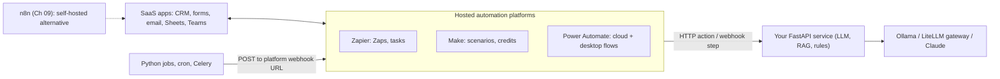
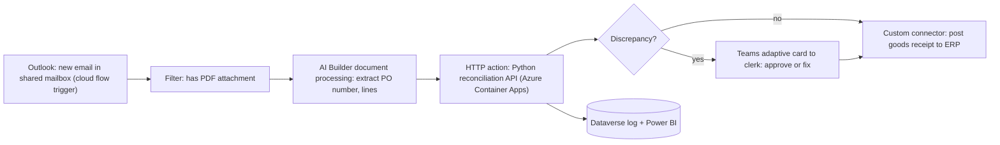

# 10 · Make, Zapier & Power Automate

> **In one line:** Make, Zapier and Power Automate are hosted automation platforms where business users wire SaaS apps together and add AI steps without servers. As a Python developer your job is to know their units of cost, their limits and their governance story, and to connect them to your own services through webhooks in both directions.

> **Versions used:** SaaS platforms as of Nov 2026 (no version numbers; they change continuously) · fastapi 0.162 · uvicorn 0.54 · httpx 0.28 · requests 2.34 · pydantic 2.14 · openai 3.49 · python-dotenv 1.2 · **Fast-moving:** pricing units and AI metering change every few months. Make switched billing from *operations* to *credits* in Aug 2025; Zapier re-tiered AI step pricing in 2026; Microsoft is replacing AI Builder credits with Copilot Credits (seeded credits end 1 Nov 2026). Always re-read the pricing pages before you estimate.

---

## 1. Overview

> **Builds on:** [Ch 09 · n8n](topic.html?p=09-n8n-fundamentals) (triggers, items, webhooks: the same ideas with different names) and [Ch 02 · Prompt Engineering](topic.html?p=02-prompt-engineering) (AI steps are still prompts).

Many automations in a company will never live in your repo. Sales ops builds a Zap, finance builds a Make scenario, and the Microsoft 365 team builds Power Automate flows. These platforms win when the owner is not a developer and the work is mostly **SaaS-to-SaaS**: "new Typeform response → add HubSpot contact → summarise with AI → post to Teams".

You'll meet them in three roles:
1. **Caller:** a Zap or flow calls *your* Python service (classification, RAG, a pricing engine) over HTTP.
2. **Callee:** your Python job triggers a scenario or flow through its webhook URL, reusing integrations someone already built and maintains.
3. **Alternative:** you're asked "should we build this in Zapier, Make, Power Automate or n8n?" and need a defensible answer on cost, limits and governance.



---

## 2. Key Concepts

**Make** (formerly Integromat):
- A **scenario** is a visual graph of **modules**: one trigger (instant webhook or a scheduled poll), then actions, searches, **routers** (branches), **filters**, **iterators** (split arrays) and **aggregators** (combine).
- Data travels as **bundles**, Make's word for n8n's items. Each module run on a bundle is an **operation**. Since Aug 2025 you are billed in **credits**: most operations cost one credit, while Make's own AI modules cost credits based on tokens used.
- **Error handlers** per module: Resume, Ignore, Break (store as an incomplete execution to retry), Commit, Rollback. **Data stores** give you a small key-value table inside Make.
- AI: Make AI Agents and the AI toolkit, plus modules for OpenAI, Anthropic, Gemini and more (bring your own key, and you pay the provider for tokens).

**Zapier**:
- A **Zap** = trigger + one or more action steps, with Filters, Paths (branches), Formatter, Delay, Looping, and Code by Zapier (JavaScript or Python).
- Billing unit: the **task**, roughly one successful action step. Triggers don't use tasks; filters and path rules generally don't. **AI by Zapier** steps multiply task usage by model tier, and Zapier MCP calls draw from the same pool.
- **Polling triggers** check every 1–15 minutes depending on plan; **instant triggers** (webhooks, many apps) fire immediately.
- AI: AI by Zapier steps, Zapier Agents, Copilot (build Zaps from a description), Zapier MCP (exposes thousands of app actions as tools to Claude and other MCP clients, see [Ch 28](topic.html?p=28-mcp-fastmcp)).

**Power Automate** (Microsoft):
- **Cloud flows**: automated (event-triggered), instant (button or HTTP), scheduled. **Desktop flows**: RPA on Windows UI, attended or unattended ([Ch 35](topic.html?p=35-rpa)).
- **Connectors**: standard vs **premium** (premium includes the generic HTTP action and the "When an HTTP request is received" trigger, and needs a premium licence). **Custom connectors** wrap your own API from an OpenAPI definition.
- Licensing is **per user or per flow**, plus **Power Platform request limits** (API calls per 24 h per licence).
- AI: **AI Builder** (prompts, document processing, classification) consumes AI Builder credits, being replaced by **Copilot Credits**; **Copilot** in the designer builds flows from natural language; flows can call Copilot Studio agents.
- Governance lives in the admin center: **environments**, **DLP policies** that group connectors into business / non-business / blocked, Managed Environments, and the CoE Starter Kit for inventory.

> **Analogy:** three car-rental companies. Same cars (SaaS connectors), different meters: Zapier charges per delivery made, Make per kilometre driven, Microsoft per driver's licence with a daily mileage cap. Know the meter before you plan the road trip.

The same five-step automation, metered three ways:

```svg
<svg viewBox="0 0 880 320" width="100%" height="320" font-family="ui-sans-serif,system-ui,sans-serif" font-size="11" xmlns="http://www.w3.org/2000/svg">
  <defs><marker id="aa10a" viewBox="0 0 10 10" refX="9" refY="5" markerWidth="7" markerHeight="7" orient="auto"><path d="M0,0 L10,5 L0,10 z" fill="#334155"/></marker></defs>
  <text x="440" y="22" text-anchor="middle" font-size="14" font-weight="700" fill="#1e293b">One run: new form entry with 3 line items → AI summary → CRM → chat post</text>
  <rect x="20" y="45" width="120" height="44" rx="6" fill="#dbeafe" stroke="#2563eb"/>
  <text x="80" y="64" text-anchor="middle" font-weight="700" fill="#1e293b">Trigger</text>
  <text x="80" y="80" text-anchor="middle" fill="#334155">form webhook</text>
  <rect x="190" y="45" width="120" height="44" rx="6" fill="#fef3c7" stroke="#d97706"/>
  <text x="250" y="64" text-anchor="middle" font-weight="700" fill="#1e293b">Split 3 items</text>
  <text x="250" y="80" text-anchor="middle" fill="#334155">iterator / loop</text>
  <rect x="360" y="45" width="120" height="44" rx="6" fill="#ede9fe" stroke="#7c3aed"/>
  <text x="420" y="64" text-anchor="middle" font-weight="700" fill="#1e293b">AI summary</text>
  <text x="420" y="80" text-anchor="middle" fill="#334155">per item</text>
  <rect x="530" y="45" width="120" height="44" rx="6" fill="#dcfce7" stroke="#16a34a"/>
  <text x="590" y="64" text-anchor="middle" font-weight="700" fill="#1e293b">CRM update</text>
  <text x="590" y="80" text-anchor="middle" fill="#334155">per item</text>
  <rect x="700" y="45" width="160" height="44" rx="6" fill="#f8fafc" stroke="#94a3b8"/>
  <text x="780" y="64" text-anchor="middle" font-weight="700" fill="#1e293b">Chat post</text>
  <text x="780" y="80" text-anchor="middle" fill="#334155">once (aggregated)</text>
  <line x1="142" y1="67" x2="188" y2="67" stroke="#334155" stroke-width="1.5" marker-end="url(#aa10a)"/>
  <line x1="312" y1="67" x2="358" y2="67" stroke="#334155" stroke-width="1.5" marker-end="url(#aa10a)"/>
  <line x1="482" y1="67" x2="528" y2="67" stroke="#334155" stroke-width="1.5" marker-end="url(#aa10a)"/>
  <line x1="652" y1="67" x2="698" y2="67" stroke="#334155" stroke-width="1.5" marker-end="url(#aa10a)"/>
  <rect x="20" y="115" width="840" height="56" rx="8" fill="#fef3c7" stroke="#d97706"/>
  <text x="35" y="137" font-weight="700" fill="#1e293b">Make: credits</text>
  <text x="35" y="157" fill="#334155">trigger 1 + iterator 1 + AI 3 (own AI modules: token-based) + CRM 3 + aggregator/post 2 ≈ 10+ credits; every module run on every bundle counts</text>
  <rect x="20" y="181" width="840" height="56" rx="8" fill="#dbeafe" stroke="#2563eb"/>
  <text x="35" y="203" font-weight="700" fill="#1e293b">Zapier: tasks</text>
  <text x="35" y="223" fill="#334155">trigger 0 + AI step ×3 (× model-tier multiplier) + CRM 3 + post 1 ≈ 7+ tasks; filters and path rules generally free</text>
  <rect x="20" y="247" width="840" height="56" rx="8" fill="#ede9fe" stroke="#7c3aed"/>
  <text x="35" y="269" font-weight="700" fill="#1e293b">Power Automate: licence + request limits + AI credits</text>
  <text x="35" y="289" fill="#334155">flow covered by a per-user / per-flow licence; ~10 actions count toward the daily request limit; AI Builder prompt ×3 consumes AI Builder / Copilot credits</text>
</svg>
```

> **Why this matters:** loops multiply every meter. A scenario that iterates 200 rows through 4 modules is 800 operations per run on Make and 600+ tasks on Zapier. Moving the loop into one HTTP call to your Python service often cuts the bill by 10–100×.

---

## 3. Setup

You need free accounts on whichever platforms you want to try (all three have free tiers or trials) and a way to expose a local service to them: a tunnel such as `cloudflared tunnel --url http://localhost:8000` or ngrok, or a small VPS.

```bash
pip install "fastapi>=0.115" "uvicorn>=0.30" "httpx>=0.27" "requests>=2.32" "pydantic>=2.10" "openai>=3" "python-dotenv>=1" pytest
ollama pull llama3.2
```

```bash
# .env.example
# Inbound: platforms call YOUR service with this bearer token
AUTOMATION_API_TOKEN=                    # python -c "import secrets; print(secrets.token_urlsafe(32))"
LLM_BASE_URL=http://localhost:11434/v1   # Ollama; or your LiteLLM gateway (Ch 07)
LLM_API_KEY=ollama
LLM_MODEL=llama3.2
# Outbound: webhook URLs YOU call. Treat each one as a secret: whoever has it can trigger the flow.
MAKE_WEBHOOK_URL=https://hook.eu2.make.com/xxxxxxxxxxxxxxxx
ZAPIER_WEBHOOK_URL=https://hooks.zapier.com/hooks/catch/0000000/xxxxxxx/
POWER_AUTOMATE_URL=                      # copy exactly from the "When an HTTP request is received" trigger
MAKE_API_TOKEN=                          # Profile → API access (Example 5)
MAKE_ZONE=eu2.make.com
MAKE_TEAM_ID=
```

Where each webhook URL comes from:
- **Make:** add a *Webhooks → Custom webhook* module as the scenario trigger; it shows `https://hook.<zone>.make.com/<id>`. Turn the scenario **on** (and set it to run *immediately as data arrives*).
- **Zapier:** trigger *Webhooks by Zapier → Catch Hook*; it shows `https://hooks.zapier.com/hooks/catch/<account>/<hook>/`. Webhooks by Zapier needs a paid plan.
- **Power Automate:** trigger *When an HTTP request is received* (premium). Save the flow to get the URL, which embeds a signature (`sig=`) in the query string. You can restrict who may trigger it (anyone with the URL, or authenticated users in your tenant). Microsoft migrated these URLs to a new host in 2025, so copy the URL exactly instead of building it.

---

## 4. Code Examples

### Example 1: One Python client for all three platforms' webhooks

The three platforms answer differently by default. Make replies `Accepted` immediately unless the scenario ends in a *Webhook response* module. Zapier always replies immediately with a small JSON receipt (a Zap can't return data to the caller). Power Automate replies `202 Accepted` unless the flow contains a *Response* action.

```python
# platform_webhooks.py — trigger Make / Zapier / Power Automate from Python jobs
import os
import time
import uuid
from dataclasses import dataclass

import httpx
from dotenv import load_dotenv

load_dotenv()


@dataclass
class TriggerResult:
    platform: str
    status: int
    body: object
    seconds: float


def _post(platform: str, url: str, payload: dict, timeout: float) -> TriggerResult:
    payload = {"request_id": str(uuid.uuid4()), **payload}       # let the flow dedupe on request_id
    t0 = time.perf_counter()
    for attempt in range(3):
        try:
            r = httpx.post(url, json=payload, timeout=timeout)
        except httpx.TransportError:
            if attempt == 2:
                raise
            time.sleep(2 ** attempt)
            continue
        if r.status_code in (429, 500, 502, 503, 504) and attempt < 2:
            time.sleep(float(r.headers.get("retry-after", 2 ** attempt)))
            continue
        r.raise_for_status()
        try:
            body = r.json()
        except ValueError:
            body = r.text
        return TriggerResult(platform, r.status_code, body, round(time.perf_counter() - t0, 2))
    raise RuntimeError("unreachable")


def trigger_make(payload: dict) -> TriggerResult:
    # 200 "Accepted" unless the scenario uses a Webhook response module (then: your body)
    return _post("make", os.environ["MAKE_WEBHOOK_URL"], payload, timeout=40)


def trigger_zapier(payload: dict) -> TriggerResult:
    # always immediate: {"status": "success", "id": ..., "request_id": ...}; the Zap runs afterwards
    return _post("zapier", os.environ["ZAPIER_WEBHOOK_URL"], payload, timeout=15)


def trigger_power_automate(payload: dict) -> TriggerResult:
    # 202 Accepted unless the flow has a Response action; the URL carries its own signature
    return _post("power_automate", os.environ["POWER_AUTOMATE_URL"], payload, timeout=120)


if __name__ == "__main__":
    lead = {"email": "priya@acme.io", "company": "Acme GmbH", "message": "Need 40 seats with SSO"}
    for fn, var in [(trigger_make, "MAKE_WEBHOOK_URL"), (trigger_zapier, "ZAPIER_WEBHOOK_URL"),
                    (trigger_power_automate, "POWER_AUTOMATE_URL")]:
        if os.getenv(var) and "xxxx" not in os.getenv(var, ""):
            print(fn(lead))
        else:
            print(f"skip {fn.__name__}: set {var}")
```

Illustrative output:

```text
TriggerResult(platform='make', status=200, body='Accepted', seconds=0.41)
TriggerResult(platform='zapier', status=200, body={'attempt': '019a…', 'id': '019a…', 'request_id': '019a…', 'status': 'success'}, seconds=0.38)
TriggerResult(platform='power_automate', status=202, body='', seconds=0.95)
```

> **Gotcha:** none of these platforms deduplicates for you. A retry after a timeout can run the scenario twice. Send a `request_id` and make the first step check it (a Make data store, a Zapier Storage/Tables lookup, a Dataverse row) when the flow has side effects.

### Example 2: A Python AI service the platforms can call

Instead of paying per AI step and fighting prompt UIs, many teams expose one well-tested endpoint. Make's *HTTP → Make a request*, Zapier's *Webhooks by Zapier → POST* (or Custom Request) and Power Automate's *HTTP* action (or a custom connector) all call it the same way: JSON in, JSON out, a bearer token in the header.

```python
# ai_service.py — classify + summarise inbound leads for any automation platform
import hmac
import json
import os
from typing import Literal

from dotenv import load_dotenv
from fastapi import Depends, FastAPI, Header, HTTPException
from openai import OpenAI
from pydantic import BaseModel, Field

load_dotenv()
app = FastAPI(title="automation-ai")
llm = OpenAI(base_url=os.getenv("LLM_BASE_URL", "http://localhost:11434/v1"),
             api_key=os.getenv("LLM_API_KEY", "ollama"))
MODEL = os.getenv("LLM_MODEL", "llama3.2")


def require_token(authorization: str = Header(default="")) -> None:
    expected = f"Bearer {os.environ.get('AUTOMATION_API_TOKEN', '')}"
    if not os.environ.get("AUTOMATION_API_TOKEN") or not hmac.compare_digest(authorization, expected):
        raise HTTPException(status_code=401, detail="bad token")


class Lead(BaseModel):
    request_id: str | None = None
    email: str
    company: str = ""
    message: str = Field(max_length=5000)


class LeadVerdict(BaseModel):
    category: Literal["sales", "support", "partnership", "spam"]
    score: int = Field(ge=0, le=100)
    summary: str
    request_id: str | None = None


SYSTEM = ("Classify an inbound website lead. Reply with JSON only: "
          '{"category": "sales|support|partnership|spam", "score": 0-100 buying intent, '
          '"summary": "one sentence"}')


def classify(lead: Lead) -> LeadVerdict:
    resp = llm.chat.completions.create(
        model=MODEL, max_tokens=200, response_format={"type": "json_object"},
        messages=[{"role": "system", "content": SYSTEM},
                  {"role": "user", "content": f"Company: {lead.company}\nMessage: {lead.message}"}])
    data = json.loads(resp.choices[0].message.content or "{}")
    data.pop("request_id", None)
    return LeadVerdict(**data, request_id=lead.request_id)     # pydantic validates (Ch 03)


@app.post("/v1/leads/classify", response_model=LeadVerdict, dependencies=[Depends(require_token)])
def classify_lead(lead: Lead) -> LeadVerdict:
    try:
        return classify(lead)
    except Exception as exc:                      # model down or bad JSON: fail loudly, platform retries
        raise HTTPException(status_code=503, detail=f"classification failed: {type(exc).__name__}")


@app.get("/healthz")
def healthz() -> dict:
    return {"ok": True}


if __name__ == "__main__":
    import uvicorn
    uvicorn.run(app, host="0.0.0.0", port=8000)
```

Test it offline with FastAPI's `TestClient` and a stubbed model, the same way you'd test any API:

```python
# test_ai_service.py — run with: pytest -q  (no model needed)
import os

os.environ["AUTOMATION_API_TOKEN"] = "test-token"
from fastapi.testclient import TestClient  # noqa: E402

import ai_service  # noqa: E402


def fake_classify(lead: ai_service.Lead) -> ai_service.LeadVerdict:
    return ai_service.LeadVerdict(category="sales", score=88, summary="Wants 40 seats.", request_id=lead.request_id)


def test_requires_token():
    c = TestClient(ai_service.app)
    assert c.post("/v1/leads/classify", json={"email": "a@b.c", "message": "hi"}).status_code == 401


def test_classifies(monkeypatch):
    monkeypatch.setattr(ai_service, "classify", fake_classify)
    c = TestClient(ai_service.app)
    r = c.post("/v1/leads/classify", headers={"Authorization": "Bearer test-token"},
               json={"request_id": "r1", "email": "a@b.c", "message": "Need 40 seats"})
    assert r.status_code == 200 and r.json()["score"] == 88 and r.json()["request_id"] == "r1"


if __name__ == "__main__":
    import pytest
    raise SystemExit(pytest.main(["-q", __file__]))
```

```text
2 passed
```

How each platform calls it:
- **Make:** HTTP → *Make a request*, Method POST, Headers `Authorization: Bearer {{token}}`, Body type Raw / JSON, **Parse response: Yes** so later modules can map `score` and `category`.
- **Zapier:** *Webhooks by Zapier → Custom Request* with the header and a JSON body; the response fields become available to later steps.
- **Power Automate:** *HTTP* action (premium), then *Parse JSON* with the response schema; or wrap the service as a **custom connector** from its OpenAPI spec (`/openapi.json`, which FastAPI generates) so makers get a typed "Classify lead" action and admins can govern it with DLP.

### Example 3: Code by Zapier in Python

Code by Zapier runs a short Python (or JavaScript) snippet in a sandbox. Inputs arrive in the `input_data` dict (all values are strings); you assign a dict (or list of dicts) to `output`. `requests` is available. Runtime and memory are capped by plan, so keep it to transforms and one quick HTTP call.

```python
# Code by Zapier · Run Python — input_data and output are provided by Zapier.
# Input Data fields configured in the step: email, message, api_url, api_token
import requests

input_data = globals().get("input_data") or {    # lets you run this file locally too
    "email": "Priya@Acme.io", "message": "Need 40 seats", "api_url": "", "api_token": ""}

email = input_data["email"].strip().lower()
domain = email.split("@")[-1]
free_mail = domain in {"gmail.com", "outlook.com", "yahoo.com", "icloud.com"}

verdict = {}
if input_data.get("api_url"):
    r = requests.post(input_data["api_url"], timeout=20,
                      headers={"Authorization": f"Bearer {input_data['api_token']}"},
                      json={"email": email, "message": input_data["message"]})
    r.raise_for_status()
    verdict = r.json()

output = {"email": email, "domain": domain, "free_mail": free_mail,
          "score": verdict.get("score", 0), "category": verdict.get("category", "unknown")}
print(output)
```

Locally it prints `{'email': 'priya@acme.io', 'domain': 'acme.io', 'free_mail': False, 'score': 0, 'category': 'unknown'}`. Notice the same idea as Ch 09's Code node: the snippet is glue; the real logic lives behind `api_url`.

Make has no general-purpose Python step on most plans: you use its built-in functions in mapping fields (`{{lower(1.email)}}`, `{{split(...)}}`) and call out over HTTP for anything heavier. Power Automate uses **expressions** in its Workflow Definition Language (`toLower(triggerBody()?['email'])`) and, again, HTTP or Azure Functions for real code.

### Example 4: Estimate monthly usage before you pick a platform

Prices change, so this model counts **units**, and you supply the current price per unit from each pricing page. It encodes the counting rules from Key Concepts.

```python
# usage_estimator.py — count platform units for a workflow; plug in today's unit prices yourself
from dataclasses import dataclass


@dataclass
class Step:
    name: str
    per_item: bool = True          # runs once per item (inside the loop) or once per run
    kind: str = "action"           # action | trigger | filter | ai
    ai_multiplier: int = 1         # Zapier AI tier multiplier (e.g. 1, 3, 5); Make AI is token-based


def make_credits(steps: list[Step], items: int, ai_credits_per_call: float = 1.0) -> float:
    total = 0.0
    for s in steps:
        runs = items if s.per_item else 1
        total += runs * (ai_credits_per_call if s.kind == "ai" else 1)     # every module run counts
    return total


def zapier_tasks(steps: list[Step], items: int) -> int:
    total = 0
    for s in steps:
        if s.kind in ("trigger", "filter"):
            continue                                       # triggers and filters don't use tasks
        runs = items if s.per_item else 1
        total += runs * (s.ai_multiplier if s.kind == "ai" else 1)
    return total


def power_automate_requests(steps: list[Step], items: int) -> int:
    # every action execution counts toward Power Platform request limits (per licence, per 24 h)
    return sum(items if s.per_item else 1 for s in steps)


def monthly(runs_per_month: int, per_run: float, unit_price: float | None) -> str:
    units = runs_per_month * per_run
    cost = f" ≈ {units * unit_price:,.2f} at {unit_price}/unit" if unit_price else ""
    return f"{units:,.0f} units/month{cost}"


if __name__ == "__main__":
    flow = [Step("form trigger", per_item=False, kind="trigger"),
            Step("split line items", per_item=False),
            Step("only B2B", kind="filter"),
            Step("AI summary", kind="ai", ai_multiplier=3),
            Step("CRM update"),
            Step("post to chat", per_item=False)]
    items, runs = 3, 2_000
    print("Make credits   :", monthly(runs, make_credits(flow, items, ai_credits_per_call=2), None))
    print("Zapier tasks   :", monthly(runs, zapier_tasks(flow, items), None))
    print("PA requests    :", monthly(runs, power_automate_requests(flow, items), None))
    # Move AI + CRM into ONE call to your Python service (Example 2):
    slim = [flow[0], Step("POST /v1/batch (Python)", per_item=False), flow[-1]]
    print("Make (slim)    :", monthly(runs, make_credits(slim, items), None))
    print("Zapier (slim)  :", monthly(runs, zapier_tasks(slim, items), None))
```

```text
Make credits   : 30,000 units/month
Zapier tasks   : 28,000 units/month
PA requests    : 24,000 units/month
Make (slim)    : 6,000 units/month
Zapier (slim)  : 4,000 units/month
```

These are deterministic counts from the rules above, not quotes. Multiply by today's price per credit or task (or check which plan tier covers that volume) and add the cost of your own service and LLM tokens. The slim version shows why "loop in Python, glue in the platform" is a common pattern.

### Example 5: Governance from Python: inventory Make scenarios

Shadow automations are the real risk of SaaS platforms: nobody knows which scenarios touch customer data or which person's account they run under. Make has a REST API (v2) authenticated with an API token in the `Authorization: Token …` header; this lists scenarios for a team so you can review them.

```python
# make_inventory.py — list Make scenarios for a governance review (read-only)
import csv
import os
import sys

import requests
from dotenv import load_dotenv

load_dotenv()
BASE = f"https://{os.getenv('MAKE_ZONE', 'eu2.make.com')}/api/v2"


def list_scenarios(team_id: str) -> list[dict]:
    r = requests.get(f"{BASE}/scenarios", params={"teamId": team_id},
                     headers={"Authorization": f"Token {os.environ['MAKE_API_TOKEN']}"}, timeout=30)
    r.raise_for_status()
    return r.json().get("scenarios", [])


if __name__ == "__main__":
    if not os.getenv("MAKE_API_TOKEN"):
        sys.exit("set MAKE_API_TOKEN and MAKE_TEAM_ID")
    rows = [{"id": s.get("id"), "name": s.get("name"), "active": s.get("isActive"),
             "scheduling": (s.get("scheduling") or {}).get("type"), "last_edit": s.get("lastEdit")}
            for s in list_scenarios(os.environ["MAKE_TEAM_ID"])]
    w = csv.DictWriter(sys.stdout, fieldnames=["id", "name", "active", "scheduling", "last_edit"])
    w.writeheader()
    w.writerows(rows)
```

Field names in API responses evolve; check Make's API reference for your zone. The Power Platform equivalent is the **CoE Starter Kit** or admin connectors/PowerShell, which inventory flows, owners and connectors across environments. Zapier exposes ownership and app usage in its admin console on Team/Enterprise plans.

---

## 5. Real-World Use Case

**Company:** a 600-person logistics firm on Microsoft 365. **Problem:** about 3,000 supplier emails a month with PDF delivery notes land in a shared mailbox; two clerks retype quantities into an ERP and flag discrepancies.



**Why this split:**
- The mailbox, Teams approval cards and Dataverse are native to Power Automate and governed by the IT team's DLP policies. Rebuilding that in Python would mean OAuth, Graph API subscriptions and an approval UI.
- Reconciliation (fuzzy-matching supplier SKUs to ERP items, tolerance rules, unit conversion) is ~600 lines of tested Python with pandas. That would be unmaintainable as flow expressions.
- **Numbers:** ~3,000 runs/month, ~12 actions each (≈36,000 actions/month against request limits, comfortably inside the licences already owned). AI Builder document processing is the main metered AI cost, so they budgeted it in AI Builder/Copilot credits and moved low-confidence extractions to the Python service using a local vision model ([Ch 34](topic.html?p=34-ocr-vision)). Clerk time dropped from ~60 to ~12 hours/month; median email-to-receipt time fell from 1 day to 7 minutes.
- **Governance:** the HTTP action is premium and blocked by DLP for most makers, so the Python API was published as a **custom connector**, allowed in the "Business" group for this environment only.

---

## 6. Mini Project: One AI Service, Three Platforms (1–2 hours)

**Goal:** deploy `ai_service.py` behind a tunnel, call it from at least two of Make / Zapier / Power Automate, trigger each of those flows from Python, and compare latency, units consumed and developer experience in a short report.

```text
platform-bridge/
├── .env
├── ai_service.py           # Example 2
├── test_ai_service.py
├── platform_webhooks.py    # Example 1
├── usage_estimator.py      # Example 4
└── bridge_report.py
```

**Step 1: run the service and expose it.**

```bash
pytest -q test_ai_service.py
python ai_service.py &
cloudflared tunnel --url http://localhost:8000      # note the https://<random>.trycloudflare.com URL
```

**Step 2: build the same flow on each platform:** webhook trigger → HTTP POST to `<tunnel>/v1/leads/classify` with the bearer token → branch on `score >= 70` → for hot leads, append a row to a Google Sheet (or a SharePoint list for Power Automate) → respond. On Make, end with a *Webhook response* returning the verdict; on Power Automate, end with a *Response* action; on Zapier, accept that the caller only gets a receipt.

**Step 3: a harness that drives all of them and records results.**

```python
# bridge_report.py — fire N leads at each configured platform and summarise
import os
import statistics

from platform_webhooks import trigger_make, trigger_power_automate, trigger_zapier

LEADS = [
    {"email": "cto@bigco.com", "company": "BigCo", "message": "Need 200 seats and SSO this quarter"},
    {"email": "kid@gmail.com", "company": "", "message": "is this free??"},
    {"email": "ops@shop.de", "company": "Shop", "message": "Our export keeps failing since Monday"},
    {"email": "bd@agency.io", "company": "Agency", "message": "Interested in a reseller partnership"},
]
PLATFORMS = {"make": (trigger_make, "MAKE_WEBHOOK_URL"),
             "zapier": (trigger_zapier, "ZAPIER_WEBHOOK_URL"),
             "power_automate": (trigger_power_automate, "POWER_AUTOMATE_URL")}


def main() -> None:
    for name, (fn, var) in PLATFORMS.items():
        if not os.getenv(var) or "xxxx" in os.getenv(var, ""):
            print(f"{name:15} skipped (no {var})")
            continue
        results = [fn(lead) for lead in LEADS]
        lat = [r.seconds for r in results]
        returns_data = any(isinstance(r.body, dict) and "score" in r.body for r in results)
        print(f"{name:15} ok={sum(r.status < 300 for r in results)}/{len(results)} "
              f"median={statistics.median(lat):.2f}s returns_verdict={returns_data}")


if __name__ == "__main__":
    main()
```

**Step 4: compare.** After the run, read each platform's usage page (Make: credits used by the scenario; Zapier: task history; Power Automate: run history and analytics) and compare with `usage_estimator.py`.

**Done when:**
- [ ] `test_ai_service.py` passes and the service rejects calls without the token.
- [ ] At least two platforms call the service and branch on `score`.
- [ ] `bridge_report.py` prints latency per platform and shows which ones can return the verdict synchronously.
- [ ] Measured units per run match your estimator within one or two units (explain any gap).
- [ ] A half-page note: which platform you'd give to the sales-ops team, and why.

**Stretch goals:** wrap the service as a Power Automate custom connector from `/openapi.json`; add a `request_id` dedupe check in the Make scenario using a data store; build the same flow in n8n (Ch 09) and add it to the report.

---

## 7. Comparison Table

| | Zapier | Make | Power Automate | n8n ([Ch 09](topic.html?p=09-n8n-fundamentals)) |
|---|---|---|---|---|
| Primary users | Business teams, SMBs | Ops/technical makers | Microsoft 365 organisations | Developers, technical ops |
| Model | Linear Zaps + Paths | Visual graph, routers, iterators | Cloud flows + desktop RPA | Visual graph + code |
| Billing unit | Tasks (AI steps multiplied by tier) | Credits (ops; AI by tokens) | Per user / per flow licences, request limits, AI credits | Executions (Cloud) or your server (self-hosted) |
| Loops/arrays | Looping step, costly | Iterators/aggregators, every bundle counts | Apply to each, counts toward limits | Items, free when self-hosted |
| Custom code | Code by Zapier (Python/JS) | Functions in mappings; HTTP out | Expressions; Azure Functions; custom connectors | JS + Python Code nodes |
| Return data to caller | No (receipt only) | Yes (Webhook response) | Yes (Response action) | Yes (Respond to Webhook) |
| AI | AI by Zapier, Agents, MCP | AI Agents, AI modules (BYO key or Make's) | AI Builder, Copilot, Copilot Studio | AI Agent node, any model incl. local |
| Self-host / data residency | No | No (EU/US zones) | Microsoft cloud regions | Yes |
| Governance | Admin console, SSO on higher tiers | Teams/orgs, roles | Environments, DLP, CoE kit (strongest) | You build it (RBAC on paid tiers) |

**When to use which:**
- **Zapier:** a non-developer owns it, the apps are mainstream SaaS, volume is modest, and nobody needs a synchronous answer.
- **Make:** complex branching and array handling by a technical maker, at lower per-unit cost than Zapier for multi-step flows.
- **Power Automate:** the company runs on Microsoft 365, needs Outlook/Teams/SharePoint/Dataverse plus central DLP governance, or needs desktop RPA.
- **n8n:** developers own it, data must stay on your infrastructure, you want local models, or per-step pricing would explode at your volume.
- **Your Python service behind any of them:** whenever the logic needs tests, libraries, batching or an LLM pipeline you want to control.

---

## 8. Common Mistakes & Best Practices

**Mistake 1: looping in the platform.** 500 rows through 4 modules every hour quietly burns a plan. *Fix:* send the whole array to one Python endpoint that batches the work and returns one result.

**Mistake 2: a personal account as the owner of business-critical flows.** The maker leaves, their account is disabled, and the flow and its connections die. *Fix:* service accounts or team ownership, documented owners, and an inventory (Example 5).

**Mistake 3: webhook URLs pasted into wikis and chat.** The URL *is* the credential for Make, Zapier and (with "anyone" access) Power Automate. *Fix:* store them in a secrets manager, rotate by regenerating the trigger, and restrict Power Automate triggers to tenant users where possible.

**Mistake 4: no idempotency.** Platforms retry, and so does your client. Duplicate CRM records and double emails follow. *Fix:* `request_id` on every call, checked in the first step or in your service.

**Mistake 5: trusting AI step output blindly.** An AI step's free text flows straight into a CRM field or a customer email. *Fix:* ask for JSON, validate it (in your service with Pydantic, or a Parse JSON + condition step), and send low-confidence cases to a human.

**Mistake 6: ignoring DLP and data residency.** A maker connects a customer-data source to a consumer AI connector. *Fix:* DLP policies in Power Platform, approved-app lists in Zapier/Make admin settings, and an approved internal AI endpoint (your service or gateway) as the default.

**Mistake 7: estimating cost from the pricing page headline.** *Fix:* count units per run with real item counts (Example 4), include AI multipliers, then pick the tier.

**Best-practice checklist**
- [ ] Each flow has an owner, a description and a team (not personal) account.
- [ ] Webhook URLs and API tokens stored as secrets; HTTP calls to your services use bearer tokens.
- [ ] Every trigger payload carries a `request_id`; side-effect steps are idempotent.
- [ ] Loops and heavy AI logic live in a tested Python service; the platform does glue.
- [ ] Error handling configured (Make error handlers, Zapier error notifications/autoreplay, Power Automate *Configure run after* + scope try/catch).
- [ ] Monthly review of usage against the estimate, and an inventory of active flows and connectors.

---

## 9. Exercises

1. **Three receipts.** Trigger the same payload into a Make scenario, a Zap and a Power Automate flow without response steps. Record status code, body and latency. Then add the response steps and repeat.
2. **Unit counting.** Build a Make scenario that iterates over a 10-item array through two modules. Predict the credits with `usage_estimator.py`, run it, and compare with the scenario's history.
3. **Custom connector.** Import `ai_service.py`'s `/openapi.json` into Power Automate as a custom connector. What did you have to change in the spec (auth, operation ids) to make it pleasant for makers?
4. **Zap with Code.** Build a Zap: Catch Hook → Code by Zapier (Python) that normalises the email and calls your service → Filter on `score` → Google Sheets. Count tasks per run.
5. **Migration plan.** Take a real or imagined 12-step Zap that loops over rows. Write the n8n + Python version and estimate units saved per month.

### Self-check questions

**Q: What is the billing unit on Zapier, Make and Power Automate?**
A: Zapier bills **tasks**, roughly each successful action step, with AI by Zapier steps multiplied by model tier and triggers/filters generally free. Make bills **credits**: each module operation on each bundle usually costs one, and Make's own AI modules cost credits by tokens. Power Automate is licensed **per user or per flow**, with Power Platform **request limits** per 24 hours and separate **AI Builder / Copilot credits** for AI features.

**Q: Why do loops make these platforms expensive, and what's the usual fix?**
A: Every module or step runs once per item, and each run is metered, so 200 items × 4 steps is 800 units per run. The fix is to send the whole array to one HTTP endpoint (your Python service) that batches the work and returns one result, so the platform pays for a handful of steps instead of hundreds.

**Q: Which platforms can return data synchronously to a webhook caller?**
A: Make (with a Webhook response module), Power Automate (with a Response action) and n8n (Respond to Webhook or last-node mode) can. Zapier's Catch Hook returns only a receipt immediately and runs the Zap afterwards, so callers needing a result must poll or receive a callback.

**Q: How should a Make scenario or Power Automate flow call your Python AI service securely?**
A: Over HTTPS with a bearer token (or OAuth for a Power Automate custom connector) stored in the platform's connection or credential settings, never in a mapped text field. The service validates the token with a constant-time compare, validates the body with Pydantic, returns JSON with a stable schema, and uses `request_id` for idempotency.

**Q: What does Power Automate's DLP do, and why does it matter for AI automations? (Senior)**
A: Data Loss Prevention policies group connectors into business, non-business and blocked sets per environment, and a flow can't mix business and non-business connectors. For AI, it stops makers from piping business data (SharePoint, Dataverse, Outlook) into unapproved AI or HTTP connectors. The usual pattern is to block the generic HTTP connector, publish an approved internal AI service as a custom connector in the business group, and govern it centrally.

**Q: A business team's Zapier account is spending 10× its estimate. How do you investigate and fix it? (Senior)**
A: Pull task history per Zap and find which steps consume tasks: usually a loop or a polling trigger feeding many items, AI steps on a high model tier (multiplied tasks), or a Zap retrigger loop (a Zap updates a record that triggers itself). Fix by filtering early (filters are free), deduplicating with a `request_id`, breaking self-triggering loops, choosing a lower AI tier or moving AI and loops into one Python endpoint, and setting usage alerts. Then re-estimate with real item counts.

**Q: When would you recommend n8n over Make or Zapier?**
A: When developers own the automation, data must stay on your infrastructure or reach local models, per-step pricing would be large at your volume, or you need real code (JS/Python) and synchronous responses. Make/Zapier win when non-developers own it and the ops burden of self-hosting isn't worth it.

---

## 10. Summary & Official Docs

- **Zapier** (Zaps, tasks), **Make** (scenarios, modules, bundles, credits) and **Power Automate** (cloud/desktop flows, licences, request limits, AI credits) are hosted automation platforms for SaaS glue.
- Know the **meter**: loops multiply every unit; AI steps are metered separately or with multipliers.
- From Python, **trigger** them via webhook URLs (treat the URL as a secret, send a `request_id`); know which can **respond synchronously**.
- **Into** Python: expose one tested FastAPI endpoint with a bearer token; call it via HTTP modules or a Power Automate **custom connector**.
- Keep **loops and heavy AI logic in Python**; let the platform own the connectors and approvals.
- **Governance**: team ownership, inventories, DLP and approved AI endpoints.
- Choose n8n when developers own it, data must stay home, or volume makes per-step pricing painful.

**Official docs**
- Make Help Center: https://help.make.com/
- Make API reference: https://developers.make.com/api-documentation
- Zapier Help Center: https://help.zapier.com/
- Zapier pricing: https://zapier.com/pricing
- Power Automate documentation: https://learn.microsoft.com/power-automate/
- Power Platform DLP policies: https://learn.microsoft.com/power-platform/admin/wp-data-loss-prevention
- AI Builder: https://learn.microsoft.com/ai-builder/
- Custom connectors: https://learn.microsoft.com/connectors/custom-connectors/

**Next:** [Ch 11 · Flowise, Langflow & Dify](topic.html?p=11-flowise-langflow-dify): visual builders specifically for LLM apps, RAG and agents.

---

*AI Automation with Python Handbook — chapter 10.*
