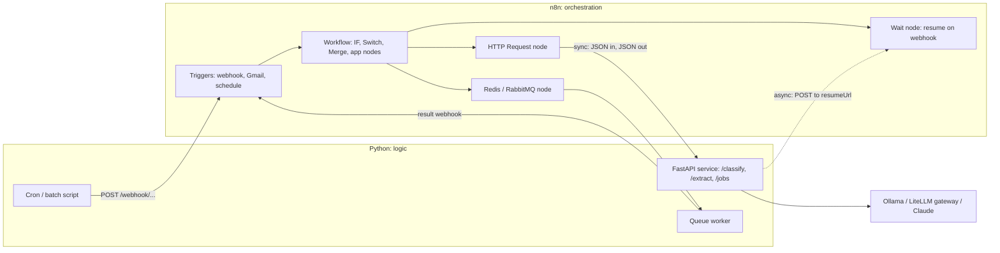
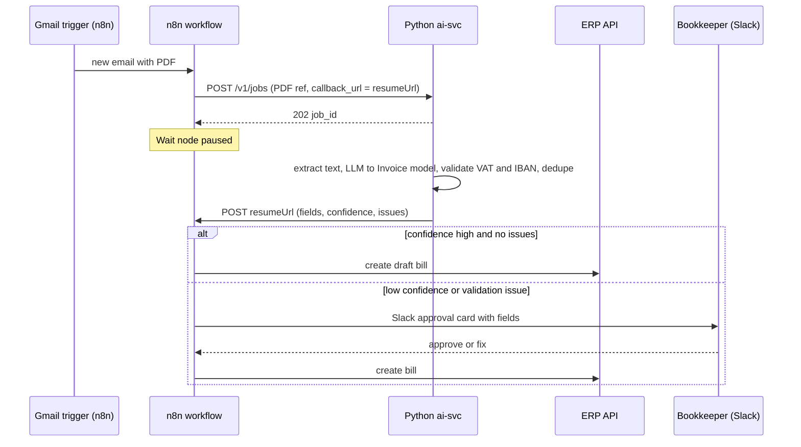

# 12 · Connecting n8n with Python Scripts

> **In one line:** let n8n own triggers, integrations and the visible flow, and let small, tested Python services own the logic; connect them with authenticated HTTP in both directions, a callback pattern for long jobs, and a queue when volume or reliability demands it.

> **Versions used:** n8n 2.47 (Docker `n8nio/n8n` + `n8nio/runners`) · fastapi 0.162 · uvicorn 0.3x · pydantic 2.14 · httpx 0.28 · openai 3.x (OpenAI-compatible client for Ollama) · redis 5+ · python-dotenv 1.2 · **Fast-moving:** n8n node `typeVersion`s and parameter names (HTTP Request is on 4.x), the Wait node's options, and n8n 2.x security defaults (Execute Command disabled via `NODES_EXCLUDE`, env access blocked in Code nodes). FastAPI minor releases are frequent but the APIs used here are stable. Pin both and read release notes.

---

## 1. Overview

> **Builds on:** [Ch 09 · n8n Fundamentals](topic.html?p=09-n8n-fundamentals) (items, webhooks, Code node, Docker setup), [Ch 03 · Structured Outputs](topic.html?p=03-structured-outputs) (Pydantic contracts) and [Ch 08 · Local Models](topic.html?p=08-local-models) (Ollama). REST background: [REST API · Webhooks & async APIs](../rest-api/topic.html?p=29-async-apis-webhooks).

Ch 09 ended with a rule: short transforms in a Code node, anything bigger in a service. This chapter is that boundary in practice. You already know how to write a FastAPI endpoint and call a webhook. The new parts are the **contract** between the two worlds (n8n items vs your request models), **who calls whom**, how to **authenticate** both directions, and what to do when work takes longer than an HTTP timeout.

The hybrid shape almost every production team converges on:



**Where each piece of logic should live:**
- **n8n:** triggers, SaaS credentials and OAuth, branching a human can read on the canvas, retries/alerts at the workflow level, simple field mapping.
- **Python:** prompts and model calls you want versioned and evaluated, parsing and validation, anything needing libraries (pandas, PyMuPDF, scikit-learn), unit tests, CPU-heavy or long work, logic reused by several workflows.

> **Why this matters:** a 300-line JavaScript Code node with three prompts inside is the n8n version of a 3,000-line `main.py`: nobody can test it, diff it or reuse it. Pulling logic into a service turns "the workflow is broken" into "this endpoint returns 422 for this payload", which a test can catch.

---

## 2. Key Concepts

- **Sync call (n8n → Python):** the **HTTP Request** node POSTs each item (or a batch) to your FastAPI endpoint and waits for JSON. Simple, visible, good for anything under ~30–60 s.
- **Trigger call (Python → n8n):** your script POSTs to a **Webhook** node's production URL (`/webhook/<path>`). This makes a workflow a callable function for Python cron jobs, other services or CI.
- **Callback (async) pattern:** n8n sends a job plus a callback URL and pauses on a **Wait** node set to *Resume: On Webhook Call*. Your service answers `202 Accepted` immediately, works in the background, then POSTs the result to the callback (`{{ $execution.resumeUrl }}`). The execution resumes with your payload. No timeouts, no polling.
- **Queue pattern:** n8n pushes jobs to Redis or RabbitMQ; Python workers consume at their own pace and report back via a webhook. Use it for spiky volume, slow models, or when Python must survive n8n restarts (and vice versa). Background: [Messaging · What is a message queue](../messaging/topic.html?p=01-what-is-a-message-queue).
- **Contract:** a Pydantic request/response model per endpoint is the single source of truth. n8n's HTTP Request node maps item fields into that body; versioned paths (`/v1/...`) let you change it without breaking old workflows.
- **Batch endpoints:** n8n sends one request per item by default. An endpoint that accepts `{"items": [...]}` (fed by an Aggregate node) turns 200 HTTP calls into one and lets Python batch model calls.
- **Auth both ways:** n8n → Python with an **API key header** stored as an n8n *Header Auth* credential (or mTLS / private network); Python → n8n with the webhook's Header Auth; for third parties or tamper-proofing, an **HMAC signature** over the body plus a timestamp.
- **Idempotency:** retries happen on both sides. Pass `{{ $execution.id }}` (plus item index) as an idempotency key and make the service return the stored result for a repeated key ([REST API · Idempotency keys](../rest-api/topic.html?p=27-idempotency-keys-retries)).
- **Execute Command node:** runs a shell command on the n8n host. Disabled by default in n8n 2.x (`NODES_EXCLUDE`) because it gives workflow editors a shell. Prefer HTTP to a service.

> **Analogy:** n8n is the restaurant's front of house (takes orders, talks to suppliers, tracks every table); Python services are the kitchen stations. Orders go in on tickets with a fixed format (the contract); quick dishes come straight back (sync); slow-roasted ones get a buzzer (callback); at rush hour tickets go on a rail and cooks pull them when ready (queue).

The four integration patterns side by side:

```svg
<svg viewBox="0 0 880 380" width="100%" height="380" font-family="ui-sans-serif,system-ui,sans-serif" font-size="11" xmlns="http://www.w3.org/2000/svg">
  <defs>
    <marker id="aa12a" viewBox="0 0 10 10" refX="9" refY="5" markerWidth="7" markerHeight="7" orient="auto"><path d="M0,0 L10,5 L0,10 z" fill="#334155"/></marker>
    <marker id="aa12b" viewBox="0 0 10 10" refX="9" refY="5" markerWidth="7" markerHeight="7" orient="auto"><path d="M0,0 L10,5 L0,10 z" fill="#16a34a"/></marker>
  </defs>
  <text x="440" y="22" text-anchor="middle" font-size="14" font-weight="700" fill="#1e293b">Four ways n8n and Python talk, and what each one costs you</text>
  <text x="110" y="52" text-anchor="middle" font-weight="700" fill="#2563eb">n8n</text>
  <text x="560" y="52" text-anchor="middle" font-weight="700" fill="#16a34a">Python</text>
  <rect x="20" y="64" width="180" height="56" rx="8" fill="#dbeafe" stroke="#2563eb"/>
  <text x="110" y="88" text-anchor="middle" font-weight="700" fill="#1e293b">1 · HTTP Request node</text>
  <text x="110" y="106" text-anchor="middle" fill="#334155">waits for the response</text>
  <line x1="202" y1="84" x2="468" y2="84" stroke="#334155" stroke-width="1.5" marker-end="url(#aa12a)"/>
  <line x1="468" y1="102" x2="204" y2="102" stroke="#16a34a" stroke-width="1.5" marker-end="url(#aa12b)"/>
  <text x="335" y="78" text-anchor="middle" fill="#334155">POST /v1/classify + X-API-Key</text>
  <text x="335" y="116" text-anchor="middle" fill="#16a34a">200 JSON, under ~60 s</text>
  <rect x="470" y="64" width="180" height="56" rx="8" fill="#dcfce7" stroke="#16a34a"/>
  <text x="560" y="88" text-anchor="middle" font-weight="700" fill="#1e293b">FastAPI endpoint</text>
  <text x="560" y="106" text-anchor="middle" fill="#334155">Pydantic in, Pydantic out</text>
  <rect x="20" y="140" width="180" height="56" rx="8" fill="#dbeafe" stroke="#2563eb"/>
  <text x="110" y="164" text-anchor="middle" font-weight="700" fill="#1e293b">2 · Webhook trigger</text>
  <text x="110" y="182" text-anchor="middle" fill="#334155">workflow as a function</text>
  <line x1="468" y1="168" x2="204" y2="168" stroke="#334155" stroke-width="1.5" marker-end="url(#aa12a)"/>
  <text x="335" y="160" text-anchor="middle" fill="#334155">POST /webhook/intake + token</text>
  <rect x="470" y="140" width="180" height="56" rx="8" fill="#dcfce7" stroke="#16a34a"/>
  <text x="560" y="164" text-anchor="middle" font-weight="700" fill="#1e293b">Script / cron / service</text>
  <text x="560" y="182" text-anchor="middle" fill="#334155">httpx + retries</text>
  <rect x="20" y="216" width="180" height="66" rx="8" fill="#fef3c7" stroke="#d97706"/>
  <text x="110" y="240" text-anchor="middle" font-weight="700" fill="#1e293b">3 · HTTP + Wait node</text>
  <text x="110" y="258" text-anchor="middle" fill="#334155">execution paused,</text>
  <text x="110" y="274" text-anchor="middle" fill="#334155">no worker blocked</text>
  <line x1="202" y1="232" x2="468" y2="232" stroke="#334155" stroke-width="1.5" marker-end="url(#aa12a)"/>
  <text x="335" y="226" text-anchor="middle" fill="#334155">POST /v1/jobs {callback_url: resumeUrl}</text>
  <line x1="468" y1="250" x2="204" y2="250" stroke="#94a3b8" stroke-width="1.5" marker-end="url(#aa12a)"/>
  <text x="335" y="246" text-anchor="middle" fill="#334155">202 Accepted</text>
  <line x1="468" y1="272" x2="204" y2="272" stroke="#16a34a" stroke-width="1.5" stroke-dasharray="5 3" marker-end="url(#aa12b)"/>
  <text x="335" y="286" text-anchor="middle" fill="#16a34a">minutes later: POST result to resumeUrl</text>
  <rect x="470" y="216" width="180" height="66" rx="8" fill="#dcfce7" stroke="#16a34a"/>
  <text x="560" y="240" text-anchor="middle" font-weight="700" fill="#1e293b">Background task</text>
  <text x="560" y="258" text-anchor="middle" fill="#334155">long PDF, slow model,</text>
  <text x="560" y="274" text-anchor="middle" fill="#334155">batch of 500 rows</text>
  <rect x="20" y="302" width="180" height="56" rx="8" fill="#ede9fe" stroke="#7c3aed"/>
  <text x="110" y="326" text-anchor="middle" font-weight="700" fill="#1e293b">4 · Redis / RabbitMQ node</text>
  <text x="110" y="344" text-anchor="middle" fill="#334155">push job, move on</text>
  <rect x="270" y="310" width="130" height="40" rx="6" fill="#f8fafc" stroke="#94a3b8"/>
  <text x="335" y="334" text-anchor="middle" fill="#1e293b">queue: jobs</text>
  <line x1="202" y1="330" x2="268" y2="330" stroke="#334155" stroke-width="1.5" marker-end="url(#aa12a)"/>
  <line x1="402" y1="330" x2="468" y2="330" stroke="#334155" stroke-width="1.5" marker-end="url(#aa12a)"/>
  <rect x="470" y="302" width="180" height="56" rx="8" fill="#dcfce7" stroke="#16a34a"/>
  <text x="560" y="326" text-anchor="middle" font-weight="700" fill="#1e293b">Worker pool</text>
  <text x="560" y="344" text-anchor="middle" fill="#334155">own pace, survives restarts</text>
  <rect x="680" y="64" width="186" height="294" rx="8" fill="#f8fafc" stroke="#94a3b8"/>
  <text x="773" y="88" text-anchor="middle" font-weight="700" fill="#1e293b">Pick by duration and volume</text>
  <text x="692" y="114" fill="#334155">1 · under 60 s, steady load</text>
  <text x="692" y="134" fill="#334155">2 · Python starts the flow</text>
  <text x="692" y="154" fill="#334155">3 · minutes per job,</text>
  <text x="704" y="170" fill="#334155">result needed in the flow</text>
  <text x="692" y="190" fill="#334155">4 · spiky volume, slow</text>
  <text x="704" y="206" fill="#334155">consumers, decoupled deploys</text>
  <text x="692" y="240" fill="#dc2626">Avoid: Execute Command</text>
  <text x="704" y="256" fill="#334155">(shell on the n8n host,</text>
  <text x="704" y="272" fill="#334155">disabled by default in 2.x)</text>
  <text x="692" y="304" fill="#334155">All four: auth header,</text>
  <text x="692" y="320" fill="#334155">idempotency key from</text>
  <text x="692" y="336" fill="#334155">$execution.id, timeouts</text>
</svg>
```

> **Gotcha:** the HTTP Request node runs **once per item**. A webhook delivering 1 item is fine; a "Get many rows" node returning 400 rows becomes 400 requests to your service unless you aggregate first or enable the node's **Batching** option (items per batch + interval).

---

## 3. Setup

Extend the Ch 09 Compose stack with your Python service on the same Docker network, so n8n reaches it at `http://ai-svc:8000` and nothing is exposed publicly.

```bash
pip install "fastapi>=0.115,<1" "uvicorn[standard]>=0.30" "pydantic>=2.11,<3" "httpx>=0.27,<1" \
            "openai>=3.4,<4" "redis>=5,<8" "python-dotenv>=1" pytest
```

The environment file, shared by Compose and the Python code:

```bash
# .env.example  (shared by docker compose and the Python code)
# --- service ---
SVC_API_KEY=                     # n8n sends this in X-API-Key; generate with secrets.token_urlsafe(32)
SVC_HMAC_SECRET=                 # optional: signs callbacks / verifies signed requests
LLM_BASE_URL=http://ollama:11434/v1     # Ch 02 convention; on the host: http://localhost:11434/v1
LLM_API_KEY=ollama               # any string for Ollama; a real key for hosted providers
LLM_MODEL=qwen3:8b
LLM_MODE=llm                     # llm | rules (rules = no model, for tests and demos)
REDIS_URL=redis://redis:6379/0
# --- n8n side (from Ch 09) ---
N8N_BASE_URL=http://localhost:5678
N8N_WEBHOOK_TOKEN=               # Header Auth value on your n8n webhooks
```

Add the service to the Ch 09 `docker-compose.yml`:

```yaml
# docker-compose.override.yml — adds the Python service next to n8n, Postgres and Ollama
services:
  ai-svc:
    build: ./svc
    restart: unless-stopped
    env_file: .env
    expose: ["8000"]                     # reachable as http://ai-svc:8000 from n8n, not from the internet
    healthcheck:
      test: ["CMD", "python", "-c", "import urllib.request; urllib.request.urlopen('http://localhost:8000/healthz')"]
      interval: 10s
      retries: 5
  redis:
    image: redis:7
    restart: unless-stopped
  worker:
    build: ./svc
    command: python worker.py
    restart: unless-stopped
    env_file: .env
    depends_on: [redis]
```

A minimal image for the service (the worker reuses it with a different command):

```dockerfile
# svc/Dockerfile
FROM python:3.12-slim
WORKDIR /app
COPY requirements.txt .
RUN pip install --no-cache-dir -r requirements.txt
COPY . .
USER 1000
CMD ["uvicorn", "app:app", "--host", "0.0.0.0", "--port", "8000", "--workers", "2"]
```

In n8n, create one **Header Auth** credential named `ai-svc key` (Name: `X-API-Key`, Value: your `SVC_API_KEY`). Every HTTP Request node that calls the service selects it, so the key lives encrypted in n8n and never appears in workflow JSON. Container basics: [Docker · Compose](../docker/topic.html?p=18-compose).

---

## 4. Code Examples

### Example 1: The FastAPI service n8n calls

One service, three endpoints: single classify, batch classify, health. The model call is isolated in one function so tests can replace it, and `LLM_MODE=rules` gives a deterministic keyword classifier for demos without a model.

```python
# svc/app.py — the logic n8n delegates to
import logging
import os
import secrets
import time
from typing import Literal

from dotenv import load_dotenv
from fastapi import Depends, FastAPI, Header, HTTPException
from openai import OpenAI
from pydantic import BaseModel, Field

load_dotenv()
log = logging.getLogger("ai-svc")
app = FastAPI(title="ai-svc", version="1.0.0")

Category = Literal["billing", "bug", "how_to", "sales", "other"]


class TicketIn(BaseModel):
    id: str
    subject: str = ""
    body: str = Field(max_length=20_000)


class TicketOut(BaseModel):
    id: str
    category: Category
    urgency: int = Field(ge=1, le=5)
    summary: str


class Classification(BaseModel):          # what we ask the model for (no id: we never trust the model with ids)
    category: Category
    urgency: int = Field(ge=1, le=5)
    summary: str = Field(max_length=160)


class BatchIn(BaseModel):
    items: list[TicketIn] = Field(max_length=200)


class BatchOut(BaseModel):
    results: list[TicketOut]
    errors: list[dict]


def require_key(x_api_key: str = Header(default="")) -> None:
    expected = os.environ["SVC_API_KEY"]
    if not secrets.compare_digest(x_api_key, expected):        # constant-time comparison
        raise HTTPException(status_code=401, detail="invalid API key")


_client: OpenAI | None = None


def llm() -> OpenAI:
    global _client
    if _client is None:
        _client = OpenAI(base_url=os.getenv("LLM_BASE_URL", "http://localhost:11434/v1"),
                         api_key=os.getenv("LLM_API_KEY", "ollama"), timeout=60, max_retries=2)
    return _client


def classify_text(subject: str, body: str) -> Classification:
    if os.getenv("LLM_MODE", "llm") == "rules":
        text = f"{subject} {body}".lower()
        cat = next((c for c, kws in {"billing": ["charge", "invoice", "refund"], "bug": ["error", "crash", "502"],
                                     "how_to": ["how do i", "how to"], "sales": ["pricing", "quote"]}.items()
                    if any(k in text for k in kws)), "other")
        urgent = any(k in text for k in ["down", "asap", "urgent", "all customers"])
        return Classification(category=cat, urgency=5 if urgent else 2, summary=(subject or body)[:160])
    resp = llm().chat.completions.parse(
        model=os.getenv("LLM_MODEL", "qwen3:8b"),
        messages=[
            {"role": "system", "content": "Classify the support ticket. urgency 5 = outage affecting many customers."},
            {"role": "user", "content": f"Subject: {subject}\n\n{body[:8000]}"},
        ],
        response_format=Classification,             # Ollama, OpenAI, vLLM: JSON-schema constrained output
    )
    parsed = resp.choices[0].message.parsed
    if parsed is None:
        raise ValueError("model returned no parseable output")
    return parsed


@app.get("/healthz")
def healthz() -> dict:
    return {"ok": True, "mode": os.getenv("LLM_MODE", "llm")}


@app.post("/v1/classify", response_model=TicketOut, dependencies=[Depends(require_key)])
def classify(t: TicketIn) -> TicketOut:
    t0 = time.perf_counter()
    c = classify_text(t.subject, t.body)
    log.info("classified id=%s cat=%s in %.0f ms", t.id, c.category, (time.perf_counter() - t0) * 1000)
    return TicketOut(id=t.id, **c.model_dump())


@app.post("/v1/classify/batch", response_model=BatchOut, dependencies=[Depends(require_key)])
def classify_batch(b: BatchIn) -> BatchOut:
    results, errors = [], []
    for t in b.items:                                # partial success: one bad ticket doesn't fail 199 good ones
        try:
            results.append(TicketOut(id=t.id, **classify_text(t.subject, t.body).model_dump()))
        except Exception as e:                        # noqa: BLE001 — reported per item, not swallowed
            errors.append({"id": t.id, "error": type(e).__name__, "detail": str(e)[:200]})
    return BatchOut(results=results, errors=errors)


if __name__ == "__main__":
    import uvicorn
    uvicorn.run("app:app", host="0.0.0.0", port=8000, reload=True)
```

Run it and poke it like n8n would:

```bash
cd svc && LLM_MODE=rules SVC_API_KEY=dev python app.py
curl -s localhost:8000/v1/classify -H 'X-API-Key: dev' -H 'content-type: application/json' \
     -d '{"id":"T-1","subject":"Checkout down","body":"502 for all customers since 9am"}'
```

Response:

```text
{"id":"T-1","category":"bug","urgency":5,"summary":"Checkout down"}
```

Two design choices to copy: the **model never sees or returns the id** (the service copies it from the request), and the batch endpoint returns **partial results plus per-item errors** so the workflow can route failures instead of failing the whole execution.

### Example 2: The n8n side: HTTP Request node, batching and retries

The node, as it appears in exported workflow JSON. Build it in the UI, then compare:

```json
{
  "name": "Classify ticket",
  "type": "n8n-nodes-base.httpRequest",
  "typeVersion": 4.2,
  "position": [480, 0],
  "retryOnFail": true,
  "maxTries": 3,
  "waitBetweenTries": 2000,
  "onError": "continueErrorOutput",
  "parameters": {
    "method": "POST",
    "url": "http://ai-svc:8000/v1/classify",
    "authentication": "genericCredentialType",
    "genericAuthType": "httpHeaderAuth",
    "sendHeaders": true,
    "headerParameters": {"parameters": [{"name": "Idempotency-Key", "value": "={{ $execution.id }}-{{ $itemIndex }}"}]},
    "sendBody": true,
    "specifyBody": "json",
    "jsonBody": "={{ { id: String($json.ticket_id), subject: $json.subject ?? '', body: $json.text } }}",
    "options": {
      "timeout": 60000,
      "batching": {"batch": {"batchSize": 5, "batchInterval": 500}}
    }
  },
  "credentials": {"httpHeaderAuth": {"id": "REPLACE_ME", "name": "ai-svc key"}}
}
```

What each setting buys you:
- **`authentication` + credential:** the API key lives in n8n's encrypted store; the JSON only has a credential id.
- **`retryOnFail` / `maxTries` / `waitBetweenTries`** (node *Settings* tab): absorbs restarts and 502s from the service. Safe only because the service is idempotent for the same `Idempotency-Key`.
- **`onError: continueErrorOutput`**: the node grows a second (error) output, so failed items go to a "needs human" branch instead of stopping the execution.
- **Batching:** 5 requests at a time, 500 ms apart: a polite cap on a single-GPU Ollama box.
- **`timeout`:** fail fast instead of hanging; anything that needs more than a minute should use Example 4.

For the batch endpoint, put an **Aggregate** node (*Individual Fields* or *All Item Data* into a field `items`) before the HTTP Request node and send `={{ { items: $json.items } }}`; then a **Split Out** node on `results` turns the response back into one item per ticket.

> **Version note:** HTTP Request `typeVersion` 4.2 is what recent 1.x/2.x editors create; newer minor releases may bump it. If an import complains, add the node fresh from the panel and copy the settings across.

### Example 3: Authentication and HMAC signatures both ways

API-key headers are enough on a private Docker network. When either side is on the public internet, or a third party calls you through n8n, sign the body: the receiver recomputes an HMAC over `timestamp.body` with a shared secret, rejects stale timestamps (replay protection) and compares in constant time.

```python
# svc/signing.py — HMAC-SHA256 signatures for requests between n8n and Python
import hashlib
import hmac
import json
import os
import time

TOLERANCE_S = 300


def sign(body: bytes, secret: str, ts: int | None = None) -> dict[str, str]:
    ts = ts or int(time.time())
    mac = hmac.new(secret.encode(), f"{ts}.".encode() + body, hashlib.sha256).hexdigest()
    return {"X-Timestamp": str(ts), "X-Signature": f"sha256={mac}"}


def verify(body: bytes, headers: dict[str, str], secret: str, now: int | None = None) -> bool:
    try:
        ts = int(headers["X-Timestamp"])
        given = headers["X-Signature"].removeprefix("sha256=")
    except (KeyError, ValueError):
        return False
    if abs((now or int(time.time())) - ts) > TOLERANCE_S:
        return False                                        # replayed or badly skewed clock
    expected = hmac.new(secret.encode(), f"{ts}.".encode() + body, hashlib.sha256).hexdigest()
    return hmac.compare_digest(given, expected)


if __name__ == "__main__":
    secret = os.getenv("SVC_HMAC_SECRET", "dev-secret")
    body = json.dumps({"id": "T-1", "category": "bug"}, separators=(",", ":")).encode()
    h = sign(body, secret, ts=1_700_000_000)
    print(h)
    print("valid  :", verify(body, h, secret, now=1_700_000_010))
    print("tamper :", verify(body.replace(b"bug", b"sales"), h, secret, now=1_700_000_010))
    print("replay :", verify(body, h, secret, now=1_700_000_900))
```

Output:

```text
{'X-Timestamp': '1700000000', 'X-Signature': 'sha256=…64 hex chars…'}
valid  : True
tamper : False
replay : False
```

Verifying inside FastAPI must use the **raw bytes** (re-serialising parsed JSON changes whitespace and breaks the MAC):

```python
# svc/signed_routes.py — a FastAPI dependency that rejects unsigned or tampered requests
import os

from fastapi import APIRouter, Depends, HTTPException, Request

from signing import verify

router = APIRouter()


async def require_signature(request: Request) -> bytes:
    raw = await request.body()                                      # raw bytes, before any JSON parsing
    headers = {"X-Timestamp": request.headers.get("x-timestamp", ""),   # Starlette headers are case-insensitive
               "X-Signature": request.headers.get("x-signature", "")}
    if not verify(raw, headers, os.environ["SVC_HMAC_SECRET"]):
        raise HTTPException(status_code=401, detail="bad signature")
    return raw


@router.post("/v1/signed/echo")
async def signed_echo(raw: bytes = Depends(require_signature)) -> dict:
    return {"ok": True, "bytes": len(raw)}


if __name__ == "__main__":
    print([r.path for r in router.routes])
```

On the n8n side, sign before the HTTP Request node with a JavaScript Code node (Node's `crypto` is available; the secret comes from a credential-backed field or, if you must, an allowed env var), and send the body as the *exact same string*:

```javascript
// Code node · JavaScript · Run Once for Each Item — produces body + signature headers
const crypto = require('crypto');
const secret = $('Config').first().json.hmac_secret;       // from a Set node fed by credentials, not hardcoded
const body = JSON.stringify({ id: $json.ticket_id, category: $json.category });
const ts = Math.floor(Date.now() / 1000);
const sig = crypto.createHmac('sha256', secret).update(`${ts}.${body}`).digest('hex');
return { json: { body, ts: String(ts), sig: `sha256=${sig}` } };
```

Then the HTTP Request node sends *Body Content Type: Raw* with `{{ $json.body }}` and headers `X-Timestamp`, `X-Signature`. For the opposite direction (Python → n8n webhook), n8n's Webhook node offers Header, Basic and JWT auth natively; HMAC verification there is a Code node right after the webhook (enable the *Raw Body* option so you hash the original bytes).

### Example 4: Long jobs: 202 Accepted + callback to a Wait node

Summarising a 200-page PDF with a local model takes minutes. Holding an HTTP connection that long is fragile (proxies time out, retries duplicate work). Instead:

1. n8n **HTTP Request** → `POST /v1/jobs` with `callback_url = {{ $execution.resumeUrl }}`.
2. n8n **Wait** node: *Resume: On Webhook Call*, HTTP Method POST, *Limit Wait Time* 30 min (so a lost callback doesn't wait forever).
3. The service replies `202` with a job id at once, does the work in the background, then POSTs the result to the callback URL. The workflow resumes with that payload as the Wait node's output.

```python
# svc/jobs.py — accept now, work in the background, call n8n back when done
import json
import logging
import os
import time
import uuid

import httpx
from fastapi import BackgroundTasks, Depends, FastAPI
from pydantic import BaseModel, Field, HttpUrl

from app import classify_text, require_key
from signing import sign

log = logging.getLogger("jobs")
app = FastAPI(title="ai-svc-jobs")
JOBS: dict[str, dict] = {}            # demo store; use Redis/Postgres so status survives restarts


class JobIn(BaseModel):
    idempotency_key: str
    callback_url: HttpUrl
    tickets: list[dict] = Field(min_length=1, max_length=5000)


def run_job(job_id: str, job: JobIn) -> None:
    t0 = time.perf_counter()
    results, errors = [], []
    for t in job.tickets:
        try:
            c = classify_text(t.get("subject", ""), t.get("body", ""))
            results.append({"id": t.get("id"), **c.model_dump()})
        except Exception as e:                                      # noqa: BLE001
            errors.append({"id": t.get("id"), "error": type(e).__name__})
    payload = {"job_id": job_id, "status": "done", "results": results, "errors": errors,
               "seconds": round(time.perf_counter() - t0, 1)}
    JOBS[job_id].update(payload)                                    # keep idempotency_key for repeat requests
    body = json.dumps(payload).encode()
    headers = {"content-type": "application/json", **sign(body, os.getenv("SVC_HMAC_SECRET", "dev-secret"))}
    for attempt in range(5):                                        # the callback itself must be retried
        try:
            r = httpx.post(str(job.callback_url), content=body, headers=headers, timeout=30)
            if r.status_code < 500:
                log.info("callback %s → %s", job_id, r.status_code)
                return
        except httpx.HTTPError as e:
            log.warning("callback attempt %d failed: %s", attempt + 1, e)
        time.sleep(2 ** attempt)
    JOBS[job_id]["status"] = "callback_failed"                      # alert on this; the result is still queryable


@app.post("/v1/jobs", status_code=202, dependencies=[Depends(require_key)])
def create_job(job: JobIn, background: BackgroundTasks) -> dict:
    for jid, j in JOBS.items():                                     # idempotent: n8n retries must not start twice
        if j.get("idempotency_key") == job.idempotency_key:
            return {"job_id": jid, "status": j["status"]}
    job_id = uuid.uuid4().hex[:12]
    JOBS[job_id] = {"status": "running", "idempotency_key": job.idempotency_key}
    background.add_task(run_job, job_id, job)
    return {"job_id": job_id, "status": "running"}


@app.get("/v1/jobs/{job_id}", dependencies=[Depends(require_key)])
def job_status(job_id: str) -> dict:
    return JOBS.get(job_id, {"status": "unknown"})


if __name__ == "__main__":
    import uvicorn
    uvicorn.run(app, host="0.0.0.0", port=8001)
```

The HTTP Request node body for step 1:

```text
={{ { idempotency_key: $execution.id, callback_url: $execution.resumeUrl, tickets: $json.tickets } }}
```

> **Gotcha:** `$execution.resumeUrl` is built from n8n's public webhook base URL (`N8N_WEBHOOK_URL`, Ch 09). If that's `http://localhost:5678/`, a service in another container can't reach it. Set it to an address the service can resolve, or rewrite the host in the service (`http://n8n:5678/...`) for same-network setups. `BackgroundTasks` runs in the API process: fine for minutes-long jobs at low volume, but a deploy kills in-flight work. At higher volume use the queue pattern (Example 6) or Celery ([Ch 36](topic.html?p=36-scheduling-task-queues)).

### Example 5: Python calling n8n: workflows as async functions

The reverse direction: a nightly Python job sends 300 accounts to an n8n "enrich and post to CRM" workflow. Fan out with a concurrency cap, a per-call idempotency key, and a summary at the end.

```python
# call_n8n.py — fan out to an n8n webhook with bounded concurrency and retries
import asyncio
import os
import random
import uuid

import httpx
from dotenv import load_dotenv

load_dotenv()
BASE = os.getenv("N8N_BASE_URL", "http://localhost:5678").rstrip("/")
HEADERS = {"X-Webhook-Token": os.environ.get("N8N_WEBHOOK_TOKEN", "")}


async def call_workflow(client: httpx.AsyncClient, sem: asyncio.Semaphore, path: str, payload: dict,
                        attempts: int = 4) -> dict:
    key = payload.setdefault("request_id", str(uuid.uuid4()))
    async with sem:
        for i in range(attempts):
            try:
                r = await client.post(f"{BASE}/webhook/{path}", json=payload,
                                      headers=HEADERS | {"Idempotency-Key": key})
                if r.status_code in (429, 502, 503, 504):
                    raise httpx.HTTPStatusError("retryable", request=r.request, response=r)
                r.raise_for_status()
                return {"ok": True, "id": payload.get("account_id"), "data": r.json()}
            except (httpx.TransportError, httpx.HTTPStatusError) as e:
                if i == attempts - 1:
                    return {"ok": False, "id": payload.get("account_id"), "error": str(e)}
                await asyncio.sleep(2 ** i + random.random())          # backoff with jitter


async def main(accounts: list[dict], concurrency: int = 5) -> None:
    sem = asyncio.Semaphore(concurrency)
    async with httpx.AsyncClient(timeout=httpx.Timeout(60, connect=5)) as client:
        results = await asyncio.gather(*(call_workflow(client, sem, "enrich-account", a) for a in accounts))
    ok = [r for r in results if r["ok"]]
    print(f"{len(ok)}/{len(results)} ok")
    for r in results:
        if not r["ok"]:
            print("FAILED", r["id"], r["error"][:120])


if __name__ == "__main__":
    demo = [{"account_id": f"acc_{i}", "domain": d} for i, d in enumerate(["acme.io", "globex.com", "initech.dev"])]
    asyncio.run(main(demo))
```

Illustrative output (workflow published, Respond: *When Last Node Finishes*):

```text
3/3 ok
```

Match `concurrency` to what the workflow can absorb: in single-process mode n8n runs executions concurrently in one Node.js process, so 50 parallel AI-agent executions will slow everything. Queue mode with workers (Ch 09) or a lower cap fixes that.

### Example 6: The queue pattern with Redis

When volume is spiky or work is slow, put a queue between them. n8n's **Redis** node (*Operation: Push*, list `jobs:classify`, data `{{ JSON.stringify($json) }}`) enqueues and the workflow finishes immediately. Python workers pop, process and report back through a webhook that starts a "store result" workflow.

```python
# svc/worker.py — pull jobs n8n pushed to Redis, classify, post results back to n8n
import json
import logging
import os
import signal

import httpx
import redis
from dotenv import load_dotenv

from app import classify_text

load_dotenv()
logging.basicConfig(level=logging.INFO, format="%(asctime)s %(levelname)s %(message)s")
log = logging.getLogger("worker")
QUEUE, PROCESSING, DEAD = "jobs:classify", "jobs:classify:processing", "jobs:classify:dead"
RESULT_URL = os.getenv("N8N_BASE_URL", "http://n8n:5678").rstrip("/") + "/webhook/classify-result"
running = True


def stop(*_):
    global running
    running = False                                      # finish the current job, then exit (docker stop sends SIGTERM)


def handle(raw: str, http: httpx.Client) -> None:
    job = json.loads(raw)
    c = classify_text(job.get("subject", ""), job.get("body", ""))
    r = http.post(RESULT_URL, json={"id": job["id"], **c.model_dump()},
                  headers={"X-Webhook-Token": os.environ.get("N8N_WEBHOOK_TOKEN", "")})
    r.raise_for_status()


def main() -> None:
    signal.signal(signal.SIGTERM, stop)
    r = redis.Redis.from_url(os.getenv("REDIS_URL", "redis://localhost:6379/0"), decode_responses=True)
    with httpx.Client(timeout=30) as http:
        while running:
            # atomically move one job to a processing list, so a crash doesn't lose it (reliable-queue pattern)
            raw = r.blmove(QUEUE, PROCESSING, timeout=5, src="RIGHT", dest="LEFT")
            if raw is None:
                continue
            try:
                handle(raw, http)
                r.lrem(PROCESSING, 1, raw)
            except Exception:                            # noqa: BLE001
                log.exception("job failed, moving to dead-letter list")
                r.lrem(PROCESSING, 1, raw)
                r.lpush(DEAD, raw)


if __name__ == "__main__":
    main()
```

n8n's Redis *Push* adds to the head (left) of the list unless you enable its *Tail* option, so popping from the right gives FIFO; check the option on your node version. A small reaper (cron or n8n Schedule) re-queues items stuck in `jobs:classify:processing` for longer than N minutes, and an alert fires when `jobs:classify:dead` is non-empty. For stronger guarantees (acks, redelivery, routing) use RabbitMQ: n8n has a RabbitMQ node and trigger, and Python uses `pika` or `aio-pika` ([Messaging · Acks & prefetch](../messaging/topic.html?p=08-acks-prefetch-qos)).

### Example 7: Execute Command, and why you'll rarely need it

The **Execute Command** node runs a shell command inside the n8n container. In n8n 2.x it's **disabled by default** (listed in `NODES_EXCLUDE`) because anyone who can edit a workflow gets a shell with n8n's privileges, including its encryption key. If you still have a legitimate single-tenant use (an internal box, trusted editors), the safe shape is a script that reads JSON on stdin and writes JSON on stdout, with no shell interpolation of item data:

```python
# scripts/score_cli.py — stdin JSON → stdout JSON; testable and callable from Execute Command or anywhere
import json
import sys


def score(lead: dict) -> dict:
    s = 0
    s += 40 if lead.get("employees", 0) >= 50 else 10
    s += 30 if str(lead.get("email", "")).split("@")[-1] not in {"gmail.com", "outlook.com"} else 0
    s += 30 if lead.get("country") in {"DE", "AT", "CH"} else 10
    return {**lead, "score": s}


if __name__ == "__main__":
    data = json.load(sys.stdin)
    items = data if isinstance(data, list) else [data]
    json.dump([score(x) for x in items], sys.stdout)
```

If you really must re-enable the node, the safe shape looks like this:

```bash
# re-enable ONLY on a trusted, single-tenant instance (default in 2.x excludes executeCommand + localFileTrigger)
NODES_EXCLUDE='["n8n-nodes-base.localFileTrigger"]'
# Execute Command node command (item data passed base64-encoded, never spliced raw into the shell):
#   echo '{{ $json.toJsonString().base64Encode() }}' | base64 -d | python3 /scripts/score_cli.py
```

You also need Python and the script *inside the n8n image*, which means a custom image to maintain. The same logic behind `POST /v1/score` in your service is easier to deploy, scale, test and secure. Prefer that.

---

## 5. Real-World Use Case

**Company:** a 60-person accounting firm. **Trigger:** ~4,000 supplier invoices a month arrive as PDFs in a shared mailbox. **Before:** two bookkeepers keyed invoice header data into the ERP; turnaround 2–3 days; ~2% keying errors.

**Split of responsibilities:** n8n watches the mailbox, stores the PDF, routes and posts to the ERP and Slack. Python does everything that needs libraries and tests: PDF text extraction (PyMuPDF, [Ch 20](topic.html?p=20-document-parsing)), LLM extraction into a Pydantic `Invoice` model, VAT and IBAN validation, duplicate detection against Postgres.



**Numbers after 3 months:**
- **Volume:** ~4,000 invoices/month, peaks of 300 on the 1st. Single n8n instance + one `ai-svc` container with 2 workers + Ollama on a 24 GB GPU.
- **Latency:** median 40 s per invoice end to end (most of it LLM extraction on long PDFs, which is why it uses the callback pattern instead of a 60 s HTTP timeout).
- **Automation rate:** 81% posted as drafts without human edits; the rest go to Slack with the specific failed check ("IBAN doesn't match supplier master data").
- **Cost:** hardware already owned; $0 per-token. A hosted small model would be ~4,000 × ~6k tokens ≈ 24M tokens/month; compute it from the provider's pricing page before choosing.
- **Engineering:** 140 unit tests on the Python side (fixtures of real anonymised invoices) run in CI on every change; the n8n workflow has 14 nodes and almost no logic. A prompt change ships like any code change, with an eval run ([Ch 41](topic.html?p=41-evaluation)).

---

## 6. Mini Project: Lead Scoring Service + n8n Workflow (1–2 hours)

**Goal:** a FastAPI service that scores inbound leads (rules + an LLM "fit" judgement), called from an n8n webhook workflow with batching and an error branch, with offline tests and a Python end-to-end check.

```text
lead-scoring/
├── .env
├── docker-compose.yml            # Ch 09 stack + ai-svc (Setup)
├── svc/
│   ├── Dockerfile
│   ├── requirements.txt
│   ├── leads.py                  # the service
│   └── test_leads.py
├── workflows/lead-intake.json    # exported from n8n after you build it
└── e2e.py                        # fires leads at the n8n webhook
```

**Step 1: the service.** Deterministic rules decide most of the score; the LLM only judges free-text "fit" and is swappable for tests.

```python
# svc/leads.py — POST /v1/leads/score (single or batch), API-key protected
import os
import secrets
from typing import Callable, Literal

from dotenv import load_dotenv
from fastapi import Depends, FastAPI, Header, HTTPException
from openai import OpenAI
from pydantic import BaseModel, EmailStr, Field

load_dotenv()
app = FastAPI(title="lead-scoring", version="1.0.0")
FREE_MAIL = {"gmail.com", "yahoo.com", "outlook.com", "hotmail.com", "proton.me"}


class Lead(BaseModel):
    id: str
    email: EmailStr
    company: str = ""
    employees: int = Field(default=0, ge=0)
    message: str = Field(default="", max_length=5000)


class Fit(BaseModel):
    fit: Literal["strong", "weak", "none"]
    reason: str = Field(max_length=200)


class Scored(BaseModel):
    id: str
    score: int = Field(ge=0, le=100)
    tier: Literal["hot", "warm", "cold"]
    reasons: list[str]


def llm_fit(message: str) -> Fit:
    client = OpenAI(base_url=os.getenv("LLM_BASE_URL", "http://localhost:11434/v1"),
                    api_key=os.getenv("LLM_API_KEY", "ollama"), timeout=60)
    r = client.chat.completions.parse(
        model=os.getenv("LLM_MODEL", "qwen3:8b"),
        messages=[{"role": "system", "content": "We sell B2B workflow-automation software to companies with "
                   "50+ staff. Judge if this inbound message shows buying intent for that."},
                  {"role": "user", "content": message[:4000]}],
        response_format=Fit,
    )
    return r.choices[0].message.parsed or Fit(fit="none", reason="unparseable")


def rules_fit(message: str) -> Fit:
    m = message.lower()
    if any(k in m for k in ("pricing", "demo", "quote", "rollout", "seats")):
        return Fit(fit="strong", reason="asks about pricing/demo")
    return Fit(fit="weak" if len(m) > 40 else "none", reason="no buying signal")


FitFn = Callable[[str], Fit]


def get_fit_fn() -> FitFn:
    return rules_fit if os.getenv("LLM_MODE", "llm") == "rules" else llm_fit


def require_key(x_api_key: str = Header(default="")) -> None:
    if not secrets.compare_digest(x_api_key, os.environ["SVC_API_KEY"]):
        raise HTTPException(status_code=401, detail="invalid API key")


def score_lead(lead: Lead, fit_fn: FitFn) -> Scored:
    score, reasons = 0, []
    domain = lead.email.split("@")[1].lower()
    if domain not in FREE_MAIL:
        score += 25; reasons.append(f"business domain {domain}")
    if lead.employees >= 50:
        score += 30; reasons.append(f"{lead.employees} employees")
    elif lead.employees >= 10:
        score += 15; reasons.append("10-49 employees")
    if lead.message.strip():
        fit = fit_fn(lead.message)
        score += {"strong": 45, "weak": 15, "none": 0}[fit.fit]
        reasons.append(f"fit={fit.fit}: {fit.reason}")
    tier = "hot" if score >= 70 else "warm" if score >= 40 else "cold"
    return Scored(id=lead.id, score=min(score, 100), tier=tier, reasons=reasons)


@app.get("/healthz")
def healthz() -> dict:
    return {"ok": True}


@app.post("/v1/leads/score", response_model=list[Scored], dependencies=[Depends(require_key)])
def score(leads: Lead | list[Lead], fit_fn: FitFn = Depends(get_fit_fn)) -> list[Scored]:
    batch = leads if isinstance(leads, list) else [leads]       # n8n may send one item or an aggregated list
    return [score_lead(l, fit_fn) for l in batch]


if __name__ == "__main__":
    import uvicorn
    uvicorn.run("leads:app", host="0.0.0.0", port=8000, reload=True)
```

`requirements.txt`: `fastapi>=0.115,<1`, `uvicorn[standard]>=0.30`, `pydantic[email]>=2.11,<3`, `openai>=3.4,<4`, `python-dotenv>=1`, `httpx>=0.27`, `pytest`.

**Step 2: tests (offline).** `dependency_overrides` swaps the LLM for a stub; the API key comes from the environment like in production.

```python
# svc/test_leads.py — pytest -q
import pytest
from fastapi.testclient import TestClient

from leads import Fit, app, get_fit_fn

H = {"X-API-Key": "test-key"}


@pytest.fixture
def client(monkeypatch):
    monkeypatch.setenv("SVC_API_KEY", "test-key")
    app.dependency_overrides[get_fit_fn] = lambda: (lambda msg: Fit(fit="strong", reason="stub"))
    yield TestClient(app)
    app.dependency_overrides.clear()


def test_rejects_missing_key(client):
    assert client.post("/v1/leads/score", json={"id": "1", "email": "a@b.io"}).status_code == 401


def test_hot_lead(client):
    r = client.post("/v1/leads/score", headers=H, json={
        "id": "L1", "email": "cto@globex.com", "employees": 120, "message": "Can we get a demo for 80 seats?"})
    assert r.status_code == 200
    assert r.json()[0]["tier"] == "hot" and r.json()[0]["score"] == 100


def test_batch_and_free_mail(client):
    r = client.post("/v1/leads/score", headers=H, json=[
        {"id": "L2", "email": "sam@gmail.com", "employees": 3},
        {"id": "L3", "email": "ops@initech.dev", "employees": 60}])
    tiers = {x["id"]: x["tier"] for x in r.json()}
    assert tiers == {"L2": "cold", "L3": "warm"}


def test_validation_error_is_422(client):
    assert client.post("/v1/leads/score", headers=H, json={"id": "x", "email": "not-an-email"}).status_code == 422
```

**Step 3: the n8n workflow** (build in the editor, then export to `workflows/lead-intake.json`):
1. **Webhook** `POST lead-intake`, Header Auth, Respond: *Using 'Respond to Webhook' Node*.
2. **Edit Fields (Set)**: map form fields to the contract: `id = {{ $json.body.id ?? $execution.id }}`, `email`, `company`, `employees = {{ Number($json.body.employees ?? 0) }}`, `message`.
3. **HTTP Request** `POST http://ai-svc:8000/v1/leads/score`, credential `ai-svc key`, JSON body `={{ $json }}`, *Settings*: Retry On Fail 3×, On Error: *Continue (using error output)*.
4. **Split Out** on the response array, then **Switch** on `{{ $json.tier }}`: `hot` → Slack `#sales-hot`; `warm` → Google Sheets "nurture"; `cold` → no-op.
5. Error output of step 3 → Slack `#automation-alerts` with `{{ $json.error.message }}`.
6. **Respond to Webhook** with `={{ { received: true, tier: $json.tier } }}`.

**Step 4: end-to-end check from Python.**

```python
# e2e.py — post sample leads through the published n8n workflow and check the tiers
import os

import httpx
from dotenv import load_dotenv

load_dotenv()
URL = os.getenv("N8N_BASE_URL", "http://localhost:5678").rstrip("/") + "/webhook/lead-intake"
CASES = [
    ({"id": "e2e-1", "email": "cto@globex.com", "employees": 120, "message": "Pricing for 80 seats and a demo?"}, "hot"),
    ({"id": "e2e-2", "email": "sam@gmail.com", "employees": 1, "message": ""}, "cold"),
]

if __name__ == "__main__":
    with httpx.Client(timeout=90, headers={"X-Webhook-Token": os.environ.get("N8N_WEBHOOK_TOKEN", "")}) as c:
        for body, want in CASES:
            got = c.post(URL, json=body).json().get("tier")
            print(f"{'PASS' if got == want else 'FAIL'} {body['id']}: want {want}, got {got}")
```

**Step 5: run.**

```bash
cd svc && pytest -q && cd ..                    # 4 passed, no model, no n8n
docker compose up -d --build                    # n8n + postgres + ollama + ai-svc
python e2e.py                                   # after building + publishing the workflow
docker compose stop ai-svc && python e2e.py     # expect the error branch to alert, not a silent failure
```

**Done when:**
- [ ] Unit tests pass offline; a request without `X-API-Key` gets 401 and a bad email 422.
- [ ] `e2e.py` prints PASS for both cases through the real workflow.
- [ ] `ai-svc` has no published port; only n8n can reach it.
- [ ] Stopping `ai-svc` routes executions to the alert branch after 3 retries.
- [ ] The exported workflow JSON contains no API key (Ch 09's `check_workflow.py` passes).

**Stretch goals:** aggregate 50 leads and call the endpoint once with a list; add the HMAC signature check from Example 3; move LLM fit scoring to the callback pattern and measure the webhook's response time; record each scored lead with the `$execution.id` so you can join n8n executions to service logs.

---

## 7. Comparison Table

| Where the logic runs | How n8n reaches it | Dependencies | Testing | Scaling | Security | Use for |
|---|---|---|---|---|---|---|
| Code node, JavaScript | In-process (task runner) | Built-ins only (+ allowlisted npm when self-hosted) | Manual, in editor | With n8n | Sandboxed | Field reshaping, small transforms |
| Code node, Python (native) | Task runner sidecar | Allowlisted stdlib/packages in a custom runners image | Manual | With n8n | Sandboxed | Short Python transforms |
| Execute Command | Shell in n8n container | Whatever you bake into the image | Hard | With n8n | Shell access for editors; off by default | Legacy scripts on trusted single-tenant boxes |
| **FastAPI service (sync)** | HTTP Request node | Anything | **pytest, CI** | Independently | API key / HMAC, private network | Most AI logic: classify, extract, score |
| FastAPI + callback | HTTP Request + Wait node | Anything | pytest | Independently | Same + signed callbacks | Jobs of minutes: long PDFs, batches |
| Queue worker | Redis / RabbitMQ node | Anything | pytest | Workers scale out, buffer spikes | Broker auth | Spiky or slow workloads, decoupled deploys |
| Python calls n8n | Webhook trigger | n/a | e2e scripts | n8n queue mode | Webhook auth | Scripts and services that reuse n8n integrations |

**When to use which:** default to a **FastAPI service called by HTTP Request** for any logic with a prompt, a library or a test. Use the **callback pattern** once a call can exceed ~60 s, and a **queue** when traffic is bursty or the consumer must be isolated from n8n's availability. Keep **Code nodes** for glue under ~50 lines. Treat **Execute Command** as a last resort. And when the Python side is the main program, flip it: let Python **call n8n webhooks** to reuse n8n's integrations and credentials.

---

## 8. Common Mistakes & Best Practices

**Mistake 1: one request per item without noticing.** 500 rows → 500 calls → a melted GPU. *Fix:* Aggregate + batch endpoint, or HTTP Request *Batching*; check the item count on the node's input panel.

**Mistake 2: `localhost` across containers.** n8n calls `http://localhost:8000` and gets connection refused. *Fix:* the Compose service name (`http://ai-svc:8000`), or `host.docker.internal` for a service running on your Mac.

**Mistake 3: long synchronous calls.** A 4-minute extraction behind a 60 s proxy timeout; n8n retries; the service now does the work three times. *Fix:* 202 + callback to `$execution.resumeUrl`, idempotency keys, a wait-time limit on the Wait node.

**Mistake 4: no idempotency.** Retries on either side create duplicate CRM records or double-charged refunds. *Fix:* send `{{ $execution.id }}-{{ $itemIndex }}` as an `Idempotency-Key`; the service stores and replays results per key.

**Mistake 5: secrets in workflow parameters.** An API key pasted into a header field ends up in exported JSON and git. *Fix:* n8n credentials (Header Auth) for outbound calls; env vars/secrets manager on the Python side.

**Mistake 6: exposing the service publicly "for testing".** *Fix:* `expose`, not `ports`, in Compose; if it must be public, TLS + API key + HMAC + rate limiting ([REST API · Rate limiting](../rest-api/topic.html?p=24-rate-limiting-throttling)).

**Mistake 7: the contract lives only in the workflow.** Someone renames `text` to `body` in the service and every workflow breaks silently. *Fix:* versioned paths (`/v1`), Pydantic models as the contract, FastAPI's OpenAPI at `/docs`, and an e2e script in CI that runs the real workflow.

**Mistake 8: swallowing errors in the service.** Returning `200 {"category": "other"}` when the model failed hides outages. *Fix:* real status codes (422 invalid input, 502/503 model unavailable), per-item `errors` in batch responses, and the HTTP Request node's error output wired to an alert.

**Mistake 9: re-enabling Execute Command for convenience.** *Fix:* call a service; if it's truly necessary, only on a trusted instance, with item data passed via stdin, never interpolated into the shell string.

**Best-practice checklist**
- [ ] Pydantic request/response models per endpoint; versioned paths; OpenAPI published.
- [ ] Service on the private Docker network; API key via n8n Header Auth credential; constant-time key comparison.
- [ ] Idempotency key from `$execution.id` on every call that writes.
- [ ] Timeouts on every HTTP Request node; retries only on idempotent endpoints.
- [ ] Callback pattern for anything over ~60 s; Wait node with a time limit.
- [ ] Queue (Redis/RabbitMQ) with dead-letter handling for bursty or slow work.
- [ ] Error output of HTTP nodes wired to alerts; service logs carry the execution id.
- [ ] Unit tests with the model stubbed; an e2e script through the published workflow.

---

## 9. Exercises

1. **Contract test.** Generate the service's OpenAPI JSON (`app.openapi()`), and write a test that fails if a required request field is removed or renamed.
2. **Idempotency store.** Add an `Idempotency-Key` header to `/v1/classify` backed by Redis (`SET key value NX EX 86400`). Show that a retried request returns the cached response without a second model call.
3. **Callback timeout.** Build the Example 4 workflow with *Limit Wait Time* = 2 minutes, make the job take 3 minutes, and handle the timeout branch (n8n continues after the limit, so check for a missing `job_id` in the output).
4. **Queue vs sync.** Fire 200 tickets at the sync endpoint (HTTP Request with batching) and through the Redis queue with 2 workers. Compare wall time, failures when you restart `ai-svc` mid-run, and n8n execution counts.
5. **HMAC end to end.** Sign requests in an n8n Code node, verify in FastAPI with `require_signature`, then prove a modified body and a 10-minute-old timestamp are both rejected.

### Self-check questions

**Q: What kind of logic belongs in n8n and what belongs in a Python service?**
A: n8n owns triggers, SaaS integrations and credentials, readable routing, and workflow-level retries and alerts. Python owns prompts and model calls you want versioned and evaluated, parsing and validation, anything needing libraries, CPU-heavy or long work, logic reused across workflows, and everything you want unit-tested.

**Q: Why does an HTTP Request node sometimes call your service hundreds of times in one execution, and how do you control it?**
A: n8n nodes run once per incoming item, so 400 items produce 400 requests. Aggregate items into one list and call a batch endpoint, or use the node's Batching option to limit requests per interval, and check item counts on the node's input.

**Q: How does the callback pattern with the Wait node work?**
A: The workflow POSTs the job with `callback_url` set to `$execution.resumeUrl` and then hits a Wait node configured to resume on a webhook call. The service replies 202 immediately, does the work in the background, and POSTs the result to the resume URL; the paused execution continues with that payload. A wait-time limit protects against lost callbacks.

**Q: How do you authenticate calls between n8n and a Python service?**
A: On a private network, an API key in a header, stored as an n8n Header Auth credential and compared in constant time in the service. Across the internet or for tamper-proofing, add an HMAC-SHA256 signature over timestamp plus raw body with a shared secret, reject stale timestamps, and verify on raw bytes. Calls into n8n use the Webhook node's Header, Basic or JWT auth.

**Q: Why is Execute Command discouraged, and what replaces it?**
A: It runs shell commands inside the n8n container, so anyone who can edit workflows gets a shell with n8n's privileges, and item data spliced into commands invites injection. n8n 2.x disables it by default through `NODES_EXCLUDE`. Replace it with an HTTP call to a service that runs the same Python with proper isolation, tests and scaling.

**Q: Retries happen at three layers (n8n node, HTTP client, service-to-model). How do you prevent duplicate side effects? (Senior)**
A: Make every write idempotent: derive a key from `$execution.id` and item index in n8n, send it as `Idempotency-Key`, and have the service store the result per key and replay it for repeats. Retry only on transient errors (timeouts, 429, 5xx), keep retry counts small and layered deliberately (SDK retries model calls, n8n retries the service), and make callbacks and queue consumers idempotent too, because at-least-once delivery means duplicates will arrive.

**Q: When would you introduce a queue between n8n and Python instead of synchronous HTTP? (Senior)**
A: When load is bursty (month-end, outage storms) and the consumer is slower than the producer, when individual jobs are long, or when you need the two sides to deploy and fail independently. The queue absorbs spikes, workers scale horizontally, and failed jobs go to a dead-letter list instead of failed executions. The cost is more moving parts: broker operations, a result path back to n8n (webhook), reaping of stuck jobs and monitoring queue depth.

**Q: Your n8n workflow calls `http://localhost:8000` and gets connection refused, but curl from your laptop works. Why?**
A: Inside the n8n container, `localhost` is the container itself, not your machine or the service container. Use the Compose service name on the shared network (`http://ai-svc:8000`) or `host.docker.internal` when the service runs on the host.

---

## 10. Summary & Official Docs

- n8n orchestrates (triggers, integrations, routing, alerts); Python services hold logic you want to **test, version and scale**.
- **Sync:** HTTP Request node → FastAPI with Pydantic contracts, Header Auth credential, timeouts, retries, error output.
- **Reverse:** Python → `/webhook/<path>` turns workflows into callable functions; cap concurrency and add idempotency keys.
- **Long jobs:** 202 + background work + POST to `$execution.resumeUrl` with a Wait node; retry the callback.
- **Volume:** Redis/RabbitMQ between n8n and workers, reliable-queue moves and a dead-letter list.
- **Auth:** private network + API key; HMAC over timestamp and raw body when crossing trust boundaries.
- **Batching:** n8n runs per item; aggregate and use batch endpoints with partial-success responses.
- **Execute Command** is off by default in n8n 2.x; prefer a service.

| Situation | Pattern |
|---|---|
| Classify or extract, under 60 s | HTTP Request → FastAPI |
| Minutes of work, result needed in the flow | HTTP + Wait node callback |
| Bursty volume, slow consumers | Redis/RabbitMQ + workers |
| Python job needs n8n's integrations | Python → n8n webhook |
| 10-line field reshaping | Code node |

**Official docs**
- HTTP Request node: https://docs.n8n.io/integrations/builtin/core-nodes/n8n-nodes-base.httprequest/
- Wait node: https://docs.n8n.io/integrations/builtin/core-nodes/n8n-nodes-base.wait/
- Webhook node: https://docs.n8n.io/integrations/builtin/core-nodes/n8n-nodes-base.webhook/
- Redis node: https://docs.n8n.io/integrations/builtin/app-nodes/n8n-nodes-base.redis/
- Execute Command node: https://docs.n8n.io/integrations/builtin/core-nodes/n8n-nodes-base.executecommand/
- n8n 2.0 breaking changes: https://docs.n8n.io/2-0-breaking-changes/
- FastAPI: https://fastapi.tiangolo.com/ (background tasks, dependencies, testing)
- Background: [REST API · Webhooks & async APIs](../rest-api/topic.html?p=29-async-apis-webhooks) · [Idempotency keys](../rest-api/topic.html?p=27-idempotency-keys-retries) · [Docker · Compose](../docker/topic.html?p=18-compose)

**Next:** [Ch 13 · LangChain Core](topic.html?p=13-langchain-core-lcel): build the Python side's LLM pipelines with prompts, LCEL chains and output parsers.

---

*AI Automation with Python Handbook — chapter 12.*
