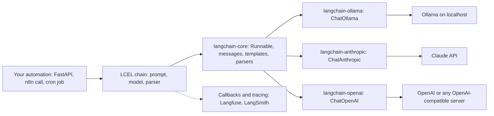
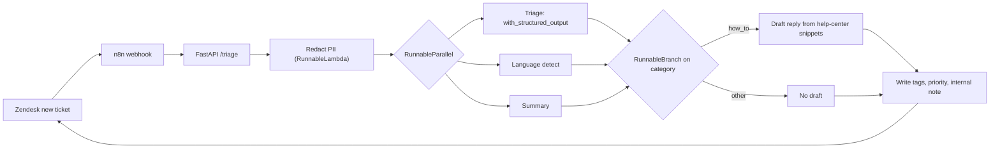

# 13 · LangChain Core: Prompts, Chains (LCEL) & Output Parsers

> **In one line:** LangChain's core is one interface, the **Runnable** (`invoke`, `stream`, `batch` and their async twins), plus a pipe operator that composes prompts, chat models, parsers and plain Python functions into chains you can stream, batch, retry, fall back and trace without changing the chain itself.

> **Versions used:** langchain-core 1.8 · langchain 1.5 · langchain-ollama 1.1 · langchain-anthropic 1.7 · langchain-openai 1.7 · pydantic 2.14 · python-dotenv 1.2 · **Fast-moving:** partner packages (`langchain-anthropic`, `langchain-openai`, `langchain-ollama`) release every week or two and add provider options (Claude's `output_config`, OpenAI's Responses API flag). `astream_events` gained a `v3` format in 2026 (`v2` remains the default). Legacy chains (`LLMChain`, `RetrievalQA`, `ConversationChain`) live in `langchain-classic` and are not used here. Check the release notes when you bump a minor version.

---

## 1. Overview

> **Builds on:** [Ch 02 · Prompt Engineering](topic.html?p=02-prompt-engineering) (what goes in the template), [Ch 03 · Structured Outputs](topic.html?p=03-structured-outputs) (Pydantic schemas), [Ch 06 · Model APIs](topic.html?p=06-model-apis) (the raw SDKs LangChain wraps) and [Ch 08 · Local Models](topic.html?p=08-local-models) (Ollama as the default model).

In Part 1 you called provider SDKs directly: build a message list, call `client.messages.create`, pull out the text, validate JSON with Pydantic. That works, and for one call it's often all you need. The moment you have five steps (format a prompt, call a model, parse JSON, call a second model with the result, stream the last step to a user) you start writing the same plumbing again: retries, fallbacks, concurrency limits, streaming, logging every intermediate value.

**LangChain** gives you that plumbing as a library. In the 1.x line it's split into packages with clear jobs:

- **`langchain-core`**: the interfaces. Messages, prompt templates, the `Runnable` protocol, output parsers, tools, callbacks. Small, few dependencies, stable.
- **Partner packages**: `langchain-ollama`, `langchain-anthropic`, `langchain-openai`, `langchain-google-genai`, `langchain-groq`… each wraps one provider SDK behind the common `BaseChatModel` interface.
- **`langchain`**: the high-level layer: `init_chat_model`, `create_agent` and middleware ([Ch 14](topic.html?p=14-langchain-tools-agents)). Agents run on **LangGraph** ([Ch 23](topic.html?p=23-langgraph-fundamentals)).
- **`langchain-classic`**: the pre-1.0 chains and retrievers, kept for migration only.

This chapter is about `langchain-core`: the pieces every other LangChain feature (RAG in [Ch 16](topic.html?p=16-rag-fundamentals), agents in Ch 14, graphs in Ch 23) is built from.



> **Why this matters:** the value isn't "fewer lines for one call". It's that every step speaks the same protocol, so `.batch()` with a concurrency cap, `.with_retry()`, `.with_fallbacks()` and token streaming work on a whole pipeline the same way they work on one model.

---

## 2. Key Concepts

- **Chat model**: a `BaseChatModel` subclass (`ChatOllama`, `ChatAnthropic`, `ChatOpenAI`). Input: a string, a list of messages, or a prompt value. Output: an **`AIMessage`** with `.content`, `.tool_calls`, `.usage_metadata` and `.response_metadata`. `init_chat_model("ollama:llama3.2")` picks the class from a `provider:model` string.
- **Messages**: `SystemMessage`, `HumanMessage`, `AIMessage`, `ToolMessage`. Tuples like `("system", "...")` and dicts like `{"role": "user", "content": "..."}` are accepted anywhere a message is.
- **Prompt template**: `ChatPromptTemplate.from_messages([...])` with `{placeholders}`. Invoking it returns a `ChatPromptValue` (a list of messages), not a string. **`MessagesPlaceholder`** splices in a whole list of messages (chat history, few-shot examples).
- **Runnable**: anything with `invoke`/`stream`/`batch` and `ainvoke`/`astream`/`abatch`. Templates, models, parsers, retrievers, tools, agents and your own functions (via `RunnableLambda`) are all Runnables.
- **LCEL** (LangChain Expression Language): composing Runnables with `|`. `prompt | model | parser` builds a **`RunnableSequence`** whose output type is the last step's output type.
- **Parallel and passthrough**: a dict of Runnables becomes a **`RunnableParallel`** (same input to every branch, dict of outputs). **`RunnablePassthrough.assign(key=runnable)`** adds a computed key while keeping the input keys, the most-used idiom for carrying context forward.
- **Output parser**: turns an `AIMessage` into something useful. `StrOutputParser` (text), `JsonOutputParser` (dict, streams partial JSON), `PydanticOutputParser` (validated model, gives you format instructions for the prompt).
- **`with_structured_output(Schema)`**: asks the provider for native structured output (tool calling or JSON schema) and returns a Pydantic instance. Prefer it over parsers when the model supports it.
- **`RunnableConfig`**: the second argument to every `invoke`: `tags`, `metadata`, `callbacks`, `run_name`, `max_concurrency`, `configurable`. It propagates to every child step, which is how tracing and concurrency limits reach deep into a chain.
- **Wrappers**: `.with_retry()`, `.with_fallbacks([...])`, `.with_config(...)`, `.bind(**kwargs)` return a new Runnable around the old one.

> **Analogy:** Unix pipes. `cat log | grep ERROR | sort | uniq -c` works because every program reads stdin and writes stdout. LCEL is the same contract for LLM steps: every Runnable takes one input and returns one output, so you can snap them together, and the shell-like operators (`batch` ≈ `xargs -P`, `with_fallbacks` ≈ `||`) apply to the whole pipe.

The core mechanism, with the data type on every arrow:

```svg
<svg viewBox="0 0 880 320" width="100%" height="320" font-family="ui-sans-serif,system-ui,sans-serif" font-size="11" xmlns="http://www.w3.org/2000/svg">
  <defs><marker id="aa13a" viewBox="0 0 10 10" refX="9" refY="5" markerWidth="7" markerHeight="7" orient="auto"><path d="M0,0 L10,5 L0,10 z" fill="#334155"/></marker></defs>
  <text x="440" y="22" text-anchor="middle" font-size="14" font-weight="700" fill="#1e293b">chain = prompt | model | parser : one Runnable, typed at every hop</text>
  <rect x="20" y="70" width="120" height="70" rx="8" fill="#f8fafc" stroke="#94a3b8"/>
  <text x="80" y="94" text-anchor="middle" font-weight="700" fill="#1e293b">Input</text>
  <text x="80" y="112" text-anchor="middle" fill="#334155">dict</text>
  <text x="80" y="128" text-anchor="middle" fill="#334155">{"ticket": "..."}</text>
  <line x1="142" y1="105" x2="188" y2="105" stroke="#334155" stroke-width="1.5" marker-end="url(#aa13a)"/>
  <rect x="190" y="70" width="150" height="70" rx="8" fill="#dbeafe" stroke="#2563eb"/>
  <text x="265" y="94" text-anchor="middle" font-weight="700" fill="#1e293b">ChatPromptTemplate</text>
  <text x="265" y="112" text-anchor="middle" fill="#334155">fills {placeholders}</text>
  <text x="265" y="128" text-anchor="middle" fill="#334155">→ ChatPromptValue</text>
  <line x1="342" y1="105" x2="388" y2="105" stroke="#334155" stroke-width="1.5" marker-end="url(#aa13a)"/>
  <rect x="390" y="70" width="150" height="70" rx="8" fill="#ede9fe" stroke="#7c3aed"/>
  <text x="465" y="94" text-anchor="middle" font-weight="700" fill="#1e293b">Chat model</text>
  <text x="465" y="112" text-anchor="middle" fill="#334155">Ollama / Claude / OpenAI</text>
  <text x="465" y="128" text-anchor="middle" fill="#334155">→ AIMessage</text>
  <line x1="542" y1="105" x2="588" y2="105" stroke="#334155" stroke-width="1.5" marker-end="url(#aa13a)"/>
  <rect x="590" y="70" width="140" height="70" rx="8" fill="#dcfce7" stroke="#16a34a"/>
  <text x="660" y="94" text-anchor="middle" font-weight="700" fill="#1e293b">Output parser</text>
  <text x="660" y="112" text-anchor="middle" fill="#334155">Str / Json / Pydantic</text>
  <text x="660" y="128" text-anchor="middle" fill="#334155">→ str | dict | Model</text>
  <line x1="732" y1="105" x2="778" y2="105" stroke="#334155" stroke-width="1.5" marker-end="url(#aa13a)"/>
  <rect x="780" y="70" width="84" height="70" rx="8" fill="#f8fafc" stroke="#94a3b8"/>
  <text x="822" y="100" text-anchor="middle" font-weight="700" fill="#1e293b">Output</text>
  <text x="822" y="118" text-anchor="middle" fill="#334155">typed</text>
  <rect x="190" y="180" width="540" height="56" rx="8" fill="#fef3c7" stroke="#d97706"/>
  <text x="460" y="202" text-anchor="middle" font-weight="700" fill="#1e293b">Same methods on the whole chain as on each step</text>
  <text x="460" y="222" text-anchor="middle" fill="#334155">invoke · stream (tokens flow through the parser) · batch(max_concurrency) · ainvoke · astream_events</text>
  <rect x="190" y="252" width="540" height="50" rx="8" fill="#fee2e2" stroke="#dc2626"/>
  <text x="460" y="272" text-anchor="middle" font-weight="700" fill="#1e293b">Wrappers return new Runnables</text>
  <text x="460" y="290" text-anchor="middle" fill="#334155">model.with_retry() · chain.with_fallbacks([backup]) · chain.with_config(tags, metadata, callbacks)</text>
  <line x1="460" y1="142" x2="460" y2="178" stroke="#94a3b8" stroke-width="1.5" stroke-dasharray="4 3"/>
</svg>
```

> **Gotcha:** a chain's types must line up. Piping a `StrOutputParser` into a template that expects `{"ticket": ...}` fails with a confusing "Expected mapping type" error. Wrap the string first: `parser | (lambda s: {"ticket": s}) | next_prompt`. A plain function or dict in a pipe is auto-wrapped as `RunnableLambda`/`RunnableParallel`.

---

## 3. Setup

Install core plus the providers you'll use. Ollama is the free default; Claude and OpenAI are the paid alternatives.

```bash
pip install "langchain>=1.5,<2" "langchain-core>=1.8,<2" "langchain-ollama>=1.1,<2" \
            "langchain-anthropic>=1.7,<2" "langchain-openai>=1.7,<2" \
            "pydantic>=2.11,<3" "python-dotenv>=1"
ollama pull llama3.2          # or qwen3:8b: better at JSON and tools
```

Then the environment file:

```bash
# .env.example  (copy to .env; never commit .env)
LC_PROVIDER=ollama                 # ollama | anthropic | openai | fake (offline tests)
OLLAMA_MODEL=llama3.2
OLLAMA_BASE_URL=http://localhost:11434
ANTHROPIC_API_KEY=                 # only if LC_PROVIDER=anthropic
CLAUDE_MODEL=claude-opus-5-5       # check the provider's model list
CLAUDE_EFFORT=low                  # low | medium | high | xhigh | max
OPENAI_API_KEY=                    # only if LC_PROVIDER=openai
OPENAI_MODEL=gpt-5-mini            # check the provider's model list
FAKE_RESPONSES=ok                  # "||"-separated canned replies for LC_PROVIDER=fake
```

Every example imports one helper so you can switch providers with an env var. The `fake` provider uses `langchain-core`'s `FakeListChatModel`, which returns canned replies: perfect for unit tests and CI with no model running.

```python
# models.py — one place to choose the chat model for every example
import os

from dotenv import load_dotenv
from langchain.chat_models import init_chat_model
from langchain_core.language_models import BaseChatModel

load_dotenv()


def get_model(provider: str | None = None) -> BaseChatModel:
    provider = provider or os.getenv("LC_PROVIDER", "ollama")
    if provider == "fake":
        from langchain_core.language_models.fake_chat_models import FakeListChatModel
        return FakeListChatModel(responses=os.getenv("FAKE_RESPONSES", "ok").split("||"))
    if provider == "anthropic":
        # Claude: max_tokens always set; NO temperature (rejected on current models), use effort instead
        return init_chat_model(
            f"anthropic:{os.getenv('CLAUDE_MODEL', 'claude-opus-5-5')}",
            max_tokens=1024,
            output_config={"effort": os.getenv("CLAUDE_EFFORT", "low")},
            max_retries=2,
        )
    if provider == "openai":
        return init_chat_model(f"openai:{os.getenv('OPENAI_MODEL', 'gpt-5-mini')}", max_retries=2)
    return init_chat_model(
        f"ollama:{os.getenv('OLLAMA_MODEL', 'llama3.2')}",
        base_url=os.getenv("OLLAMA_BASE_URL", "http://localhost:11434"),
        temperature=0,
    )


if __name__ == "__main__":
    m = get_model()
    print(type(m).__name__, "→", m.invoke("Reply with the single word: ready").content)
```

`ChatAnthropic` reads `ANTHROPIC_API_KEY` and `ChatOpenAI` reads `OPENAI_API_KEY` from the environment; you never pass keys in code. To point `ChatOpenAI` at Groq, OpenRouter or a LiteLLM proxy ([Ch 07](topic.html?p=07-multi-provider-routing)), pass `base_url=` and `api_key=os.environ[...]`.

> **Version note:** `init_chat_model` forwards extra keyword arguments to the provider class, so `output_config={"effort": "low"}` reaches `ChatAnthropic` unchanged (verified on langchain-anthropic 1.7: it lands in the request payload). If a newer release renames this, set it on `ChatAnthropic(...)` directly.

---

## 4. Code Examples

Run each with `LC_PROVIDER=fake` first (no model needed) to see the plumbing, then with Ollama for real answers.

### Example 1: Talk to a chat model directly

```python
# ex1_chat_model.py — messages in, AIMessage out
from langchain_core.messages import HumanMessage, SystemMessage

from models import get_model


def main() -> None:
    model = get_model()
    msg = model.invoke([
        SystemMessage("You are a terse ops assistant. Answer in one sentence."),
        HumanMessage("What does HTTP 429 mean for an API client?"),
    ])
    print("content :", msg.content)
    print("usage   :", msg.usage_metadata)          # {'input_tokens': .., 'output_tokens': .., 'total_tokens': ..}
    print("model   :", msg.response_metadata.get("model") or msg.response_metadata.get("model_name"))

    # streaming: chunks are AIMessageChunk; they add up with +
    for chunk in model.stream("Name three HTTP methods, comma separated."):
        print(chunk.content, end="", flush=True)
    print()


if __name__ == "__main__":
    main()
```

Illustrative output (`llama3.2` via Ollama):

```text
content : It means you are being rate limited; slow down and retry after the Retry-After delay.
usage   : {'input_tokens': 38, 'output_tokens': 19, 'total_tokens': 57}
model   : llama3.2
GET, POST, PUT
```

`usage_metadata` has the same shape for every provider, which is what makes cost tracking across providers easy ([Ch 42](topic.html?p=42-reliability-cost)). The fake model returns `None` for usage.

### Example 2: Prompt templates, history and few-shot

```python
# ex2_prompts.py — templates are Runnables too; invoke them to see exactly what the model gets
from langchain_core.messages import AIMessage, HumanMessage
from langchain_core.prompts import ChatPromptTemplate, MessagesPlaceholder

support = ChatPromptTemplate.from_messages([
    ("system", "You are the support assistant for {company}. Tone: {tone}. Never promise refunds."),
    MessagesPlaceholder("history", optional=True),      # a whole list of messages goes here
    ("human", "{question}"),
])

# partial(): fix some variables once, fill the rest per call
acme_support = support.partial(company="Acme Cloud", tone="friendly, concise")

# few-shot as real message pairs (models follow these better than examples pasted into one string)
EXAMPLES = [("Card declined at checkout", "billing"), ("App crashes on login", "bug")]
few_shot = ChatPromptTemplate.from_messages(
    [("system", "Classify the ticket as billing, bug, or other. Reply with the label only.")]
    + [m for text, label in EXAMPLES for m in (("human", text), ("ai", label))]
    + [("human", "{ticket}")]
)

if __name__ == "__main__":
    print(acme_support.input_variables, acme_support.optional_variables)
    value = acme_support.invoke({
        "question": "Can I get my money back?",
        "history": [HumanMessage("Hi, I was double charged."), AIMessage("Sorry to hear that! Let me check.")],
    })
    for m in value.to_messages():
        print(f"{m.type:>6}: {m.content}")
    print("---")
    for m in few_shot.invoke({"ticket": "Invoice shows wrong VAT"}).to_messages():
        print(f"{m.type:>6}: {m.content}")
```

Output (deterministic, no model involved):

```text
['question'] ['history']
system: You are the support assistant for Acme Cloud. Tone: friendly, concise. Never promise refunds.
 human: Hi, I was double charged.
    ai: Sorry to hear that! Let me check.
 human: Can I get my money back?
---
system: Classify the ticket as billing, bug, or other. Reply with the label only.
 human: Card declined at checkout
    ai: billing
 human: App crashes on login
    ai: bug
 human: Invoice shows wrong VAT
```

> **Gotcha:** templates use f-string syntax, so literal braces in a prompt (a JSON example!) must be doubled: `{{"label": "bug"}}`. A single `{` raises a missing-variable `KeyError` at invoke time. Or pass `template_format="jinja2"` / `"mustache"`.

### Example 3: Your first chain: invoke, stream and batch

```python
# ex3_first_chain.py — prompt | model | parser, and the three ways to run it
import time

from langchain_core.output_parsers import StrOutputParser
from langchain_core.prompts import ChatPromptTemplate

from models import get_model

prompt = ChatPromptTemplate.from_messages([
    ("system", "Summarise the support ticket in at most 12 words. No preamble."),
    ("human", "{ticket}"),
])
chain = prompt | get_model() | StrOutputParser()

TICKETS = [
    "Hi, I was charged twice for the November invoice, please fix ASAP, my finance team is angry.",
    "The export button does nothing in Firefox 132, works in Chrome.",
    "How do I add a teammate to my workspace? Can't find the setting.",
    "Since this morning the API returns 502 on /v2/orders roughly every 10th call.",
]

if __name__ == "__main__":
    print("invoke:", chain.invoke({"ticket": TICKETS[0]}))

    print("stream: ", end="")
    for piece in chain.stream({"ticket": TICKETS[1]}):   # str chunks: the parser streams too
        print(piece, end="|", flush=True)
    print()

    t0 = time.perf_counter()
    results = chain.batch([{"ticket": t} for t in TICKETS], config={"max_concurrency": 2})
    print(f"batch ({time.perf_counter() - t0:.1f}s):")
    for r in results:
        print("  -", r)
```

Illustrative output (`llama3.2`):

```text
invoke: Customer double-charged for November invoice, needs urgent fix.
stream: Export| button| broken| in| Firefox| 132|,| works| in| Chrome|.|
batch (3.8s):
  - Customer double-charged for November invoice, needs urgent fix.
  - Export button broken in Firefox 132, works in Chrome.
  - User asks how to add a teammate to the workspace.
  - API returns intermittent 502s on /v2/orders since this morning.
```

`batch` runs calls in a thread pool; `max_concurrency` caps parallel calls so you don't hammer a local GPU or hit a provider's rate limit. Pass `return_exceptions=True` to get exceptions in the result list instead of losing the whole batch to one failure.

### Example 4: Composition: parallel branches, assign and routing

A real pipeline rarely is one straight line. Here one ticket fans out to three independent steps (summary, label, sentiment), the results merge into one dict, and a branch picks the reply prompt based on the label.

```python
# ex4_compose.py — RunnableParallel, RunnablePassthrough.assign, RunnableLambda, RunnableBranch
from langchain_core.output_parsers import StrOutputParser
from langchain_core.prompts import ChatPromptTemplate
from langchain_core.runnables import RunnableBranch, RunnableLambda, RunnablePassthrough

from models import get_model

model = get_model()
text = StrOutputParser()


def ask(instruction: str):
    """Small factory: a one-shot prompt over {ticket} that returns a stripped string."""
    p = ChatPromptTemplate.from_messages([("system", instruction), ("human", "{ticket}")])
    return p | model | text | RunnableLambda(lambda s: s.strip().lower())


analyse = RunnablePassthrough.assign(          # keeps "ticket", adds three keys computed in parallel
    summary=ask("Summarise in at most 12 words."),
    label=ask("Reply with exactly one word: billing, bug, or other."),
    sentiment=ask("Reply with exactly one word: angry, neutral, or happy."),
)

billing_reply = ChatPromptTemplate.from_template(
    "Write a 2-sentence reply to a {sentiment} customer about a billing issue: {summary}") | model | text
bug_reply = ChatPromptTemplate.from_template(
    "Write a 2-sentence reply acknowledging this bug and asking for browser/OS: {summary}") | model | text
default_reply = RunnableLambda(lambda d: "Thanks! A teammate will get back to you within one business day.")

route = RunnableBranch(
    (lambda d: "billing" in d["label"], billing_reply),
    (lambda d: "bug" in d["label"], bug_reply),
    default_reply,                                  # the last argument is the default branch
)

pipeline = analyse | RunnablePassthrough.assign(reply=route)

if __name__ == "__main__":
    out = pipeline.invoke({"ticket": "I was charged twice for November and nobody answers my emails!!"})
    for k, v in out.items():
        print(f"{k:>9}: {v}")
```

Illustrative output:

```text
   ticket: I was charged twice for November and nobody answers my emails!!
  summary: customer double-charged in november, no response to emails.
    label: billing
sentiment: angry
    reply: I'm sorry you were charged twice for November and that we were slow to respond. I've flagged the duplicate charge to our billing team and you'll hear back within 24 hours.
```

Three things worth noticing:
- The three `ask(...)` branches inside `assign` run **concurrently** (a thread pool for sync, `asyncio.gather` for async). Total latency ≈ the slowest branch, not the sum.
- A plain `dict` of Runnables in a pipe (`{"a": r1, "b": r2} | next`) is the same as `RunnableParallel(a=r1, b=r2)`.
- For routing, a `RunnableLambda` that *returns a Runnable* also works (LangChain invokes the returned Runnable). `RunnableBranch` is clearer when there are a few fixed conditions.

> **Why this matters:** this is where LCEL beats hand-written SDK code. The same `pipeline` can be `.batch()`-ed over 500 tickets with a concurrency cap, `.astream_events()`-ed into a UI, or traced in Langfuse with every branch visible, without touching its definition.

### Example 5: Structured output: native first, parsers as the fallback

Two ways to get typed data back ([Ch 03](topic.html?p=03-structured-outputs) explains why schemas beat "please return JSON").

```python
# ex5_structured.py — with_structured_output vs PydanticOutputParser
from typing import Literal

from langchain_core.output_parsers import PydanticOutputParser
from langchain_core.prompts import ChatPromptTemplate
from pydantic import BaseModel, Field

from models import get_model


class Triage(BaseModel):
    """Triage result for one support ticket."""
    category: Literal["billing", "bug", "how_to", "other"]
    urgency: int = Field(ge=1, le=5, description="1 = whenever, 5 = drop everything")
    summary: str = Field(max_length=120)
    needs_human: bool


prompt = ChatPromptTemplate.from_messages([
    ("system", "You triage SaaS support tickets."),
    ("human", "{ticket}"),
])

# A) Native: the provider enforces the schema (Ollama json_schema format, Claude tools, OpenAI json_schema)
native_chain = prompt | get_model().with_structured_output(Triage)

# B) Parser: schema instructions go into the prompt, the parser validates the text reply
parser = PydanticOutputParser(pydantic_object=Triage)
parser_prompt = ChatPromptTemplate.from_messages([
    ("system", "You triage SaaS support tickets.\n{format_instructions}"),
    ("human", "{ticket}"),
]).partial(format_instructions=parser.get_format_instructions())
parser_chain = parser_prompt | get_model() | parser

if __name__ == "__main__":
    ticket = {"ticket": "Since 9am every API call to /v2/orders returns 502. Our checkout is down."}
    t = native_chain.invoke(ticket)
    print("native:", type(t).__name__, t.model_dump())
    print("parser:", parser_chain.invoke(ticket).model_dump())
```

Illustrative output (`qwen3:8b`):

```text
native: Triage {'category': 'bug', 'urgency': 5, 'summary': 'API /v2/orders returning 502 since 9am, checkout down', 'needs_human': True}
parser: {'category': 'bug', 'urgency': 5, 'summary': 'Checkout down: /v2/orders 502 errors since 9am', 'needs_human': True}
```

How `with_structured_output` works per provider (checked against the 1.x packages):

| Class | Default `method` | Other options |
|---|---|---|
| `ChatOllama` | `json_schema` (Ollama's `format` constrained decoding) | `function_calling`, `json_mode` |
| `ChatOpenAI` | `json_schema` (strict structured outputs) | `function_calling`, `json_mode` |
| `ChatAnthropic` | `function_calling` (a forced-shape tool) | `json_schema` (Claude's native structured output) |

Pass `include_raw=True` to get `{"raw": AIMessage, "parsed": Triage | None, "parsing_error": Exception | None}` instead of raising. That's the form you want in batch jobs: log the bad ones, keep the rest.

> **Gotcha:** `PydanticOutputParser` validates but can't *force* a weak model to comply. Small local models sometimes wrap JSON in prose or code fences (the parser strips fences, not prose). Use native structured output where the provider supports it; keep the parser for providers that don't, and put a retry around it.

### Example 6: Production wrappers: retries, fallbacks, rate limits, caching, tracing

```python
# ex6_reliability.py — wrap a chain, don't rewrite it
import time
from typing import Any

from langchain_core.callbacks import BaseCallbackHandler
from langchain_core.caches import InMemoryCache
from langchain_core.globals import set_llm_cache
from langchain_core.output_parsers import StrOutputParser
from langchain_core.prompts import ChatPromptTemplate
from langchain_core.rate_limiters import InMemoryRateLimiter

from models import get_model


class TimingHandler(BaseCallbackHandler):
    """Prints per-model-call latency and token usage. Swap for Langfuse's handler in production (Ch 40)."""

    def __init__(self) -> None:
        self.t0: dict[Any, float] = {}

    def on_chat_model_start(self, serialized, messages, *, run_id, **kwargs):
        self.t0[run_id] = time.perf_counter()

    def on_llm_end(self, response, *, run_id, **kwargs):
        ms = (time.perf_counter() - self.t0.pop(run_id, time.perf_counter())) * 1000
        msg = response.generations[0][0].message
        print(f"  [trace] {ms:6.0f} ms usage={getattr(msg, 'usage_metadata', None)}")


set_llm_cache(InMemoryCache())               # identical prompt + model params → no second call (use Redis/SQLite caches across processes)

limiter = InMemoryRateLimiter(requests_per_second=2, max_bucket_size=2)   # client-side token bucket
primary = get_model()
primary.rate_limiter = limiter

prompt = ChatPromptTemplate.from_template("Give one actionable tip about: {topic}. One sentence.")

primary_chain = prompt | primary.with_retry(stop_after_attempt=3) | StrOutputParser()
backup_chain = prompt | get_model("fake") | StrOutputParser()   # in real life: a hosted model, e.g. get_model("anthropic")

chain = primary_chain.with_fallbacks([backup_chain]).with_config(
    run_name="tip-chain", tags=["demo", "ch13"], metadata={"tenant": "acme"}, callbacks=[TimingHandler()],
)

if __name__ == "__main__":
    for topic in ["webhook retries", "webhook retries", "API keys"]:   # second call is a cache hit
        print(topic, "→", chain.invoke({"topic": topic}))
```

Illustrative output (Ollama running; the cached second call still fires the callback, but in ~0 ms):

```text
  [trace]   1180 ms usage={'input_tokens': 21, 'output_tokens': 24, 'total_tokens': 45}
webhook retries → Use exponential backoff with jitter and an idempotency key on every retried webhook.
  [trace]      0 ms usage={'input_tokens': 21, 'output_tokens': 24, 'total_tokens': 45}
webhook retries → Use exponential backoff with jitter and an idempotency key on every retried webhook.
  [trace]    940 ms usage={'input_tokens': 20, 'output_tokens': 18, 'total_tokens': 38}
API keys → Store API keys in a secrets manager and rotate them on a fixed schedule.
```

Stop Ollama and rerun: every call fails three times with backoff, then the fallback answers. Order matters: **retry the primary, then fall back**. Wrapping the fallback chain in a retry instead would retry the backup too.

> **Version note:** `with_retry(stop_after_attempt=3, wait_exponential_jitter=True, retry_if_exception_type=(...))` is the 1.x signature. Narrow `retry_if_exception_type` to transient errors (rate limits, timeouts, 5xx); retrying a 400 "bad request" three times just triples the bill. Provider SDKs already retry 429/5xx themselves (`max_retries`), so keep LangChain's count small.

### Example 7: Async, and streaming events for a UI

Web backends (FastAPI, [Ch 38](topic.html?p=38-ai-uis)) want async, and a chat UI wants tokens from *one* step of a multi-step chain. `astream_events` emits typed events for every step: filter for the model's stream.

```python
# ex7_async_events.py — ainvoke/abatch, and token streaming from inside a chain
import asyncio

from langchain_core.output_parsers import StrOutputParser
from langchain_core.prompts import ChatPromptTemplate

from models import get_model

model = get_model()
summarise = (ChatPromptTemplate.from_template("Summarise in one line: {text}") | model | StrOutputParser()
             ).with_config(run_name="summarise")
reply = (ChatPromptTemplate.from_template("Write a short friendly reply to a customer about: {summary}")
         | model | StrOutputParser()).with_config(run_name="reply", tags=["reply"])   # child events inherit tags
chain = {"summary": summarise} | reply


async def main() -> None:
    texts = [{"text": "Login page is slow"}, {"text": "Need an invoice copy"}]
    print("abatch:", await summarise.abatch(texts, config={"max_concurrency": 4}))

    print("tokens from the reply step only:")
    async for ev in chain.astream_events({"text": "Export to CSV drops the last row"}, version="v2"):
        # events: on_chain_start/stream/end, on_chat_model_start/stream/end, on_parser_*...
        if ev["event"] == "on_chat_model_stream" and "reply" in ev.get("tags", []):
            print(ev["data"]["chunk"].content, end="", flush=True)
        elif ev["event"] == "on_chain_end" and ev["name"] == "summarise":
            print(f"  (summary ready: {ev['data']['output']!r})")
    print()


if __name__ == "__main__":
    asyncio.run(main())
```

The `on_chat_model_stream` event's `name` is the model class (`ChatOllama`), not your chain name, and both steps use the same model. That's why the reply chain gets `tags=["reply"]`: tags are inherited by every child run, so only the reply step's token events carry it. `run_name` is still useful for the `on_chain_*` events (`ev["name"] == "summarise"`). Pass `include_tags=["reply"]` to `astream_events` to drop everything else at the source.

Illustrative output:

```text
abatch: ['The login page loads slowly.', 'Customer requests a copy of an invoice.']
tokens from the reply step only:
  (summary ready: 'CSV export is missing the final row.')
Thanks for flagging this! We've reproduced the missing last row in CSV exports and our team is on a fix.
```

---

## 5. Real-World Use Case

**Company:** a 25-person e-commerce platform team. **Trigger:** ~9,000 support emails a month land in Zendesk. **Before:** two agents spent their first hour every day labelling and prioritising the overnight queue; SLA breaches on urgent "checkout broken" tickets happened weekly.

**Automation:** a Zendesk webhook (via n8n, [Ch 09](topic.html?p=09-n8n-fundamentals)) posts each new ticket to a FastAPI service ([Ch 12](topic.html?p=12-n8n-with-python)) that runs one LCEL pipeline: PII redaction (a `RunnableLambda`) → parallel `{triage (structured), language, summary}` → a branch that drafts a reply only for `how_to` tickets → write tags, priority and the draft back to Zendesk.



**Numbers:**
- **Volume:** ~9,000 tickets/month, peaks of 60/minute after outages; `abatch` with `max_concurrency=8` on the backfill job, single `ainvoke` per webhook live.
- **Model mix:** triage and language on a local `qwen3:8b` (one GPU box shared with other jobs); drafting on Claude Sonnet via `with_fallbacks` from the local model when its p95 latency exceeds the SLO.
- **Latency:** p50 2.1 s, p95 5.8 s per ticket (parallel branches cut it from ~6 s sequential).
- **Cost:** local triage ≈ $0 marginal. Drafting ~2,500 how-to tickets × ~1.5k input + 250 output tokens ≈ 3.75M in / 0.6M out per month. At Sonnet 5.5's listed $2/$10 per M tokens that's about **$14/month**; check the pricing page before you budget.
- **Outcome:** morning triage hour gone; urgent tickets reach on-call in under 2 minutes; agents accept ~60% of drafts with light edits.

What made it maintainable: the whole pipeline is one importable object with unit tests on the fake model, `metadata={"ticket_id": ...}` on every invoke so traces are searchable, and `include_raw=True` on triage so malformed outputs go to a review queue instead of crashing the webhook.

---

## 6. Mini Project: Batch Ticket Triage CLI (1–2 hours)

**Goal:** a command-line tool that reads `tickets.csv`, runs an LCEL pipeline (redact → structured triage → conditional draft) over every row with bounded concurrency, writes `triaged.csv` plus `failures.jsonl`, and has offline tests using the fake model.

```text
triage-cli/
├── .env
├── models.py          # from Setup
├── pipeline.py        # the LCEL chain
├── triage.py          # CLI: CSV in, CSV out
├── tickets.csv
└── test_pipeline.py   # offline tests (LC_PROVIDER=fake)
```

**Step 1: sample data.**

```text
id,text
1,"I was charged twice for November, card ending 4242. Email me at sam@example.com"
2,"Export to CSV drops the last row in Firefox"
3,"How do I add a teammate to my workspace?"
4,"Checkout returns 502 for every customer since 9am!!!"
```

**Step 2: the pipeline.** Native structured output with `include_raw=True` so one bad reply never kills the batch.

```python
# pipeline.py — redact → triage (structured) → draft only for how_to tickets
import re
from typing import Literal

from langchain_core.output_parsers import StrOutputParser
from langchain_core.prompts import ChatPromptTemplate
from langchain_core.runnables import Runnable, RunnableLambda, RunnablePassthrough
from pydantic import BaseModel, Field

from models import get_model

EMAIL = re.compile(r"[\w.+-]+@[\w-]+\.[\w.-]+")
CARD = re.compile(r"\b(?:\d[ -]?){12,19}\b|\bending \d{4}\b", re.I)


class Triage(BaseModel):
    category: Literal["billing", "bug", "how_to", "other"]
    urgency: int = Field(ge=1, le=5)
    summary: str = Field(max_length=140)


def redact(d: dict) -> dict:
    text = EMAIL.sub("[EMAIL]", d["text"])
    return {**d, "text": CARD.sub("[CARD]", text)}


TRIAGE_PROMPT = ChatPromptTemplate.from_messages([
    ("system", "Triage this SaaS support ticket. urgency 5 = outage affecting many customers."),
    ("human", "{text}"),
])
DRAFT_PROMPT = ChatPromptTemplate.from_messages([
    ("system", "Write a 2-3 sentence helpful reply. If unsure, say a teammate will follow up. No promises."),
    ("human", "{text}"),
])


def unpack(d: dict) -> dict:
    """Turn the include_raw result into flat fields, or an error marker."""
    res = d.pop("triage_raw")
    parsed: Triage | None = res.get("parsed")
    if parsed is None:
        return {**d, "error": repr(res.get("parsing_error") or "no parse")}
    return {**d, **parsed.model_dump()}


def build_pipeline(model=None) -> Runnable:
    model = model or get_model()
    triage = TRIAGE_PROMPT | model.with_structured_output(Triage, include_raw=True)
    draft = DRAFT_PROMPT | model | StrOutputParser()
    maybe_draft = RunnableLambda(
        lambda d: draft if d.get("category") == "how_to" else RunnableLambda(lambda _: "")
    )   # a lambda that RETURNS a Runnable: LangChain invokes it with the same input
    return (
        RunnableLambda(redact)
        | RunnablePassthrough.assign(triage_raw=triage)
        | RunnableLambda(unpack)
        | RunnablePassthrough.assign(draft=maybe_draft)
    ).with_config(run_name="ticket-triage")
```

**Step 3: the CLI.**

```python
# triage.py — python triage.py tickets.csv --concurrency 4
import argparse
import csv
import json
import time
from pathlib import Path

from pipeline import build_pipeline

FIELDS = ["id", "category", "urgency", "summary", "draft", "text"]


def main() -> None:
    ap = argparse.ArgumentParser()
    ap.add_argument("csv_in")
    ap.add_argument("--out", default="triaged.csv")
    ap.add_argument("--concurrency", type=int, default=4)
    args = ap.parse_args()

    rows = list(csv.DictReader(Path(args.csv_in).open(newline="")))
    chain = build_pipeline()
    t0 = time.perf_counter()
    results = chain.batch(
        rows,
        config=[{"max_concurrency": args.concurrency, "metadata": {"ticket_id": r["id"]}} for r in rows],
        return_exceptions=True,                    # one network error must not lose the other 999 rows
    )
    ok, failed = [], []
    for row, res in zip(rows, results):
        if isinstance(res, Exception) or "error" in res:
            failed.append({"id": row["id"], "error": repr(res) if isinstance(res, Exception) else res["error"]})
        else:
            ok.append(res)

    with Path(args.out).open("w", newline="") as f:
        w = csv.DictWriter(f, fieldnames=FIELDS, extrasaction="ignore")
        w.writeheader()
        w.writerows(sorted(ok, key=lambda r: -r["urgency"]))
    Path("failures.jsonl").write_text("".join(json.dumps(x) + "\n" for x in failed))
    print(f"{len(ok)} triaged, {len(failed)} failed in {time.perf_counter() - t0:.1f}s → {args.out}")


if __name__ == "__main__":
    main()
```

**Step 4: offline tests.** The fake model can't do native structured output, so the test injects a tiny stand-in whose `with_structured_output` returns canned `include_raw`-shaped dicts. You're testing *your* plumbing (redaction, branching, error handling), not the model.

```python
# test_pipeline.py — run with: pytest -q   (no model, no network)
from langchain_core.language_models.fake_chat_models import FakeListChatModel
from langchain_core.runnables import RunnableLambda

from pipeline import Triage, build_pipeline, redact


class StubModel(FakeListChatModel):
    """Fake chat model whose structured output is scripted per ticket text."""

    def with_structured_output(self, schema, include_raw=False, **kw):
        def fake(prompt_value):
            text = prompt_value.to_messages()[-1].content
            if "garbage" in text:
                return {"raw": None, "parsed": None, "parsing_error": ValueError("bad json")}
            cat = "how_to" if "How do I" in text else "bug"
            return {"raw": None, "parsed": schema(category=cat, urgency=3, summary=text[:40]), "parsing_error": None}
        return RunnableLambda(fake)


def test_redact_removes_email_and_card():
    out = redact({"text": "card ending 4242, mail sam@example.com"})
    assert "4242" not in out["text"] and "sam@" not in out["text"]


def test_draft_only_for_how_to():
    chain = build_pipeline(StubModel(responses=["Go to Settings → Members."]))
    a, b = chain.batch([{"id": "1", "text": "How do I add a teammate?"}, {"id": "2", "text": "Export broken"}])
    assert a["category"] == "how_to" and a["draft"].startswith("Go to")
    assert b["category"] == "bug" and b["draft"] == ""


def test_parse_failure_is_reported_not_raised():
    out = build_pipeline(StubModel(responses=["x"])).invoke({"id": "9", "text": "garbage"})
    assert "error" in out and "bad json" in out["error"]


def test_schema_bounds():
    assert Triage(category="bug", urgency=5, summary="x").urgency == 5
```

**Step 5: run it.**

```bash
pytest -q test_pipeline.py                          # offline, < 2 s
python triage.py tickets.csv --concurrency 4        # Ollama (qwen3:8b recommended for structured output)
LC_PROVIDER=anthropic python triage.py tickets.csv  # same code, Claude
```

Illustrative output:

```text
4 triaged, 0 failed in 6.3s → triaged.csv
```

**Done when:**
- [ ] `pytest` passes with no model running.
- [ ] `triaged.csv` is sorted by urgency, the 502 ticket is urgency 5, and only the how-to ticket has a draft.
- [ ] No email address or card digits appear in `triaged.csv`.
- [ ] Stopping Ollama mid-run produces entries in `failures.jsonl` instead of a crash.
- [ ] Switching `LC_PROVIDER` changes the model with zero code changes.

**Stretch goals:** add `.with_fallbacks([build_pipeline(get_model("anthropic"))])`; stream progress with `batch_as_completed`; add the `TimingHandler` from Example 6 and print total tokens; run triage with `abatch` inside a FastAPI endpoint.

---

## 7. Comparison Table

| | Raw provider SDK (Ch 06) | LCEL chain (this chapter) | `create_agent` ([Ch 14](topic.html?p=14-langchain-tools-agents)) | LangGraph ([Ch 23](topic.html?p=23-langgraph-fundamentals)) | LlamaIndex / Haystack ([Ch 19](topic.html?p=19-llamaindex-haystack)) |
|---|---|---|---|---|---|
| Shape | One call at a time | Fixed DAG of steps | Model decides tool calls in a loop | Explicit graph with state, cycles | Retrieval-centric pipelines |
| Control flow | Your Python | Pipe, parallel, branch | Agent loop + middleware | Nodes, edges, conditional edges | Query engines, pipelines |
| Streaming/batch/retry | You write it | Built in on every step | Built in | Built in, plus checkpoints | Built in (varies) |
| Provider switching | Rewrite calls | Change one model object | Same | Same | Same |
| Debuggability | Plain stack traces | Traces per step; deeper stacks | Per-step traces | Per-node traces + state history | Per-component |
| Best for | One or two calls, max control | Deterministic multi-step LLM pipelines | Tool-using assistants | Long-running, stateful, human-in-the-loop | Document Q&A at scale |

And within this chapter:

| Need | Use | Avoid |
|---|---|---|
| Plain text | `StrOutputParser` | Reading `.content` by hand in every step |
| Typed object, capable model | `with_structured_output(Model)` | Parsing prose with regex |
| Typed object, no native support | `PydanticOutputParser` + format instructions + retry | Trusting the first reply |
| Partial JSON while streaming | `JsonOutputParser` | `PydanticOutputParser` (validates only at the end) |
| Independent steps | dict / `RunnableParallel` / `.assign` | Sequential calls that could run together |
| A few fixed routes | `RunnableBranch` | A model deciding when rules suffice |

**When to use which:** raw SDK for one call or when you need a brand-new provider feature on day one; LCEL when the *steps are known in advance*; `create_agent` when the *model chooses* which tools to call; LangGraph when you need state that survives across steps and restarts, loops, or human approval.

---

## 8. Common Mistakes & Best Practices

**Mistake 1: building chains that are hard to type-check.** A parser outputs `str`, the next template wants a dict, and the error surfaces three steps later. *Fix:* insert explicit adapters and inspect types: `chain.input_schema.model_json_schema()` and `chain.output_schema` show what a chain expects and returns.

**Mistake 2: sequential calls that could be parallel.**

```python
# before: three round-trips, latency = sum
summary = summarise.invoke(d); label = classify.invoke(d); mood = sentiment.invoke(d)
# after: one RunnableParallel, latency = max
out = RunnableParallel(summary=summarise, label=classify, mood=sentiment).invoke(d)
```

**Mistake 3: unbounded `batch`.** `chain.batch(10_000_rows)` with the default executor floods Ollama or trips provider rate limits. *Fix:* `config={"max_concurrency": N}`, an `InMemoryRateLimiter` on the model, and `return_exceptions=True`.

**Mistake 4: passing `temperature` to Claude.** Current Claude models reject sampling parameters with a 400. *Fix:* `ChatAnthropic(model=..., max_tokens=..., output_config={"effort": "low"})`; leave `temperature` unset (its default is `None`, so it isn't sent).

**Mistake 5: retrying everything.** `with_retry()` defaults to retrying on any `Exception`, including validation errors and 400s. *Fix:* `retry_if_exception_type=(httpx.TimeoutException, anthropic.RateLimitError, ...)` and rely on SDK-level retries for HTTP 429/5xx.

**Mistake 6: unescaped braces in prompts.** A JSON example inside a template becomes a missing variable. *Fix:* double the braces or use `template_format="jinja2"`.

**Mistake 7: reaching for legacy chains.** Tutorials still show `LLMChain`, `ConversationChain`, `RetrievalQA`. They're in `langchain-classic`, deprecated. *Fix:* LCEL for pipelines, `create_agent` for agents, LangGraph for state.

**Mistake 8: no tests because "it's an LLM".** *Fix:* test the plumbing with `FakeListChatModel` / stubs (Mini Project step 4), test quality with evals ([Ch 41](topic.html?p=41-evaluation)).

**Mistake 9: putting secrets or PII into traces.** Callbacks see every prompt. *Fix:* redact in the first step of the chain, and configure your tracer's masking.

**Best-practice checklist**
- [ ] One `get_model()` factory; provider chosen by env var; no keys in code.
- [ ] Every chain has a `run_name`; every invoke carries `metadata` (ticket id, tenant) for tracing.
- [ ] Native structured output with `include_raw=True` in batch jobs; parsers only as a fallback.
- [ ] Parallel where steps are independent; `max_concurrency` on every batch.
- [ ] Retries narrowed to transient errors; fallbacks to a different provider for availability.
- [ ] Offline unit tests on fake models in CI; evals for quality.
- [ ] Pin `langchain-*` versions together; read release notes before bumping.

---

## 9. Exercises

1. **Translate and back.** Build `ticket → translate to English → triage (structured) → translate the summary back to the original language` using `RunnablePassthrough.assign` so the original text and language survive every step.
2. **Parser shoot-out.** Run the same 20 tickets through `with_structured_output` and `PydanticOutputParser` on `llama3.2` and `qwen3:8b`. Count parse failures and median latency for each of the four combinations.
3. **Streaming JSON.** Use `JsonOutputParser` in a chain and print each partial dict as it streams. Explain why `PydanticOutputParser` can't do this.
4. **Fallback drill.** Make a chain with `ChatOllama` primary and Claude fallback. Prove the fallback fires by pointing `OLLAMA_BASE_URL` at a dead port, and add a callback that counts how often each model answered.
5. **Event filter.** In Example 7, tag only the reply chain and use `include_tags` so `astream_events` emits only that step's tokens. Measure time-to-first-token versus `invoke`.

### Self-check questions

**Q: What is a Runnable, and which methods does every Runnable have?**
A: A Runnable is LangChain's unit of composition: anything that takes one input and returns one output through a common interface. Every Runnable has `invoke`, `stream` and `batch` plus async `ainvoke`, `astream`, `abatch`, and `astream_events`. Prompt templates, chat models, parsers, retrievers, tools, agents and wrapped Python functions all implement it, which is why they compose with `|`.

**Q: What does `RunnablePassthrough.assign(x=step)` do, and why is it used so often?**
A: It passes the input dict through unchanged and adds a key `x` computed by running `step` on that input (several keys run in parallel). It's the standard way to carry context forward: later steps can use both the original fields and newly computed ones without hand-written merging.

**Q: When would you choose `with_structured_output` over `PydanticOutputParser`?**
A: Whenever the model and provider support native structured output (tool calling or JSON schema), because the provider constrains or validates generation and you avoid prose-wrapped JSON. Use `PydanticOutputParser` with format instructions for providers that lack it, or when you need the same prompt to work everywhere, and add retries because it can only validate, not enforce.

**Q: How do you limit concurrency and survive individual failures when batching 5,000 inputs?**
A: Call `chain.batch(inputs, config={"max_concurrency": N}, return_exceptions=True)` (or `abatch`), add a rate limiter to the model if the provider has request limits, and process results by checking for exceptions so failed items go to a retry or review file instead of aborting the batch.

**Q: Why is the order of `with_retry` and `with_fallbacks` important?**
A: `primary.with_retry().with_fallbacks([backup])` retries the primary a few times and only then switches to the backup, which is usually what you want. Reversing the composition can retry the whole fallback chain (doubling cost and latency) or fall back on the first transient blip without retrying. Retries handle transient errors; fallbacks handle sustained outages.

**Q: A chain built from five steps streams nothing until the very end. What are the likely causes? (Senior)**
A: A step in the chain doesn't support streaming transformation and buffers its whole input: typically a `RunnableLambda` wrapping a normal function (it waits for the full input), a parser like `PydanticOutputParser` that validates only complete output, or a step after the model that needs the whole text. Fixes: move non-streaming steps before the model, use generator functions (which LangChain treats as streaming transforms) or `JsonOutputParser` for partial output, or use `astream_events` and read the model's `on_chat_model_stream` events directly.

**Q: How would you make an LCEL pipeline observable and debuggable in production? (Senior)**
A: Give every chain and important sub-step a `run_name` and tags, pass per-request `metadata` (tenant, ticket id) in the config so it propagates to all child runs, attach a tracing callback handler (Langfuse or LangSmith) at the top-level invoke, record `usage_metadata` per call for cost, use `include_raw=True` to capture raw outputs on parse failures, redact PII in the first step, and keep offline tests on fake models so plumbing regressions are caught before deploy.

**Q: Why might `prompt | model` fail with a KeyError about a variable you never defined?**
A: Template strings use f-string syntax, so any literal `{...}` in the prompt (often a JSON example) is treated as a placeholder. Escape literal braces by doubling them, or switch to `template_format="jinja2"` or `"mustache"`.

---

## 10. Summary & Official Docs

- `langchain-core` defines the interfaces; partner packages (`langchain-ollama`, `-anthropic`, `-openai`) implement chat models; `langchain` adds `init_chat_model` and agents.
- Everything is a **Runnable** with `invoke`/`stream`/`batch` and async twins; `|` composes them into a `RunnableSequence`.
- **Prompt templates** produce message lists; `MessagesPlaceholder` splices in history; `partial()` fixes variables; double literal braces.
- **Parallelism** comes from dicts / `RunnableParallel` and `RunnablePassthrough.assign`; **routing** from `RunnableBranch` or a lambda returning a Runnable.
- Prefer **`with_structured_output(Model)`** (with `include_raw=True` in batch jobs); use `PydanticOutputParser` / `JsonOutputParser` where native support is missing.
- Wrap, don't rewrite: `.with_retry()`, `.with_fallbacks()`, `.with_config(run_name, tags, metadata, callbacks)`, rate limiters, caches.
- `astream_events(version="v2")` exposes per-step events for UIs; tag the step you want to stream.
- Test plumbing offline with fake chat models; never send `temperature` to current Claude models.

| You want | LangChain core piece |
|---|---|
| Choose a model by string | `init_chat_model("ollama:llama3.2")` |
| Template with history | `ChatPromptTemplate` + `MessagesPlaceholder` |
| Run steps together | `RunnableParallel` / `.assign` |
| Typed output | `.with_structured_output(Model, include_raw=True)` |
| Many inputs | `.batch(..., config={"max_concurrency": n})` |
| Resilience | `.with_retry()` then `.with_fallbacks([...])` |
| Token streaming from a step | `astream_events` + tags |

**Official docs**
- LangChain (Python) docs: https://docs.langchain.com/oss/python/langchain/overview
- LangChain reference (API): https://reference.langchain.com/python/
- Models and `init_chat_model`: https://docs.langchain.com/oss/python/langchain/models
- Structured output: https://docs.langchain.com/oss/python/langchain/structured-output
- Ollama integration: https://docs.langchain.com/oss/python/integrations/chat/ollama
- Anthropic integration: https://docs.langchain.com/oss/python/integrations/chat/anthropic
- Background theory: [AI Engineering · RAG](../ai-engineering/topic.html?p=29-rag) · [Tool calling](../ai-engineering/topic.html?p=33-tool-function-calling)

**Next:** [Ch 14 · LangChain Tools & Agents](topic.html?p=14-langchain-tools-agents): turn Python functions into tools and let the model decide which to call with `create_agent` and middleware.

---

*AI Automation with Python Handbook — chapter 13.*
