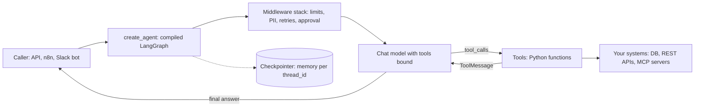
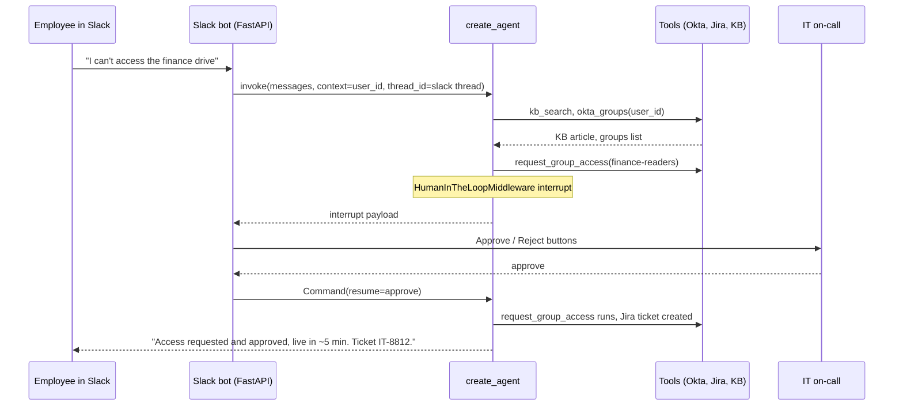

# 14 · LangChain Tools & Agents

> **In one line:** a LangChain **tool** is a typed Python function with a description the model can read; `create_agent` wraps a chat model and your tools in the standard tool-calling loop (built on LangGraph), and **middleware** lets you hook every model and tool call for limits, retries, PII redaction, human approval and custom policy without rewriting the loop.

> **Versions used:** langchain 1.5 · langchain-core 1.8 · langgraph 1.2 · langchain-ollama 1.1 · langchain-anthropic 1.7 · pydantic 2.14 · python-dotenv 1.2 · **Fast-moving:** the middleware catalogue grows almost every minor release (recent additions include `ToolErrorMiddleware`, `ModelRouterMiddleware` and `AutoModeMiddleware`), and hook signatures have changed before. `create_react_agent` from `langgraph.prebuilt` is the pre-1.0 API; new code uses `langchain.agents.create_agent`. Check the release notes when you bump.

---

## 1. Overview

> **Builds on:** [Ch 04 · Function Calling](topic.html?p=04-function-calling) (the raw tool loop), [Ch 13 · LangChain Core](topic.html?p=13-langchain-core-lcel) (chat models, Runnables, `models.py`) and [Ch 21 · Agent Patterns](topic.html?p=21-agent-patterns) (ReAct, planning, when agents are the wrong tool).

In Ch 04 you wrote the tool loop by hand: send tools to the model, read `tool_use` blocks, run your function, append a result, repeat until the model answers in text. You also wrote the boring parts: max-iteration guards, error messages back to the model, logging. In Ch 13 every step of a pipeline was fixed in advance.

An **agent** is the case where the model decides the steps. LangChain's agent API is deliberately small:

- **Tools**: plain Python functions decorated with `@tool`. LangChain builds the JSON schema from type hints and the docstring.
- **`create_agent(model, tools, system_prompt=..., middleware=[...])`**: returns a compiled **LangGraph** graph with two nodes, `model` and `tools`, looping until the model stops calling tools.
- **Middleware**: hooks around the loop (`before_model`, `wrap_model_call`, `wrap_tool_call`, `after_model`…) for everything that isn't "call the model, run the tool".



> **Why this matters:** most agent incidents aren't "the model was dumb"; they're unbounded loops, a tool exception that crashed the run, a refund issued without approval, or PII sent to a hosted model. Middleware is where you fix those once, for every agent.

---

## 2. Key Concepts

- **Tool**: a `BaseTool` with a **name**, a **description** (what the model reads to decide when to call it) and an **args schema** (JSON schema from type hints or a Pydantic model). `@tool` turns a function into one; `parse_docstring=True` lifts per-argument descriptions from a Google-style `Args:` section.
- **Tool call**: what the model emits instead of text: `AIMessage.tool_calls == [{"name": "get_order", "args": {"order_id": "A-1042"}, "id": "call_1"}]`. Provider differences (Claude `tool_use` blocks, OpenAI `tool_calls`, Ollama) are normalised to this shape.
- **ToolMessage**: the result you send back, linked by `tool_call_id`. `status="error"` marks a failed call so the model can recover.
- **`bind_tools(tools)`**: attaches tool schemas to a chat model. Useful on its own for a single "pick a function" step without a loop.
- **Agent loop**: `model → (tool calls?) → tools → model → … → final AIMessage`. `create_agent` compiles it as a LangGraph `StateGraph` with nodes `model` and `tools`. The **state** is a dict with `messages` (and `structured_response` when you ask for one).
- **Runtime context**: per-invocation, read-only data (user id, tenant, DB handle) passed as `agent.invoke(..., context=Ctx(...))` and declared with `context_schema`. Tools read it via a `runtime: ToolRuntime` parameter that the model **never sees**.
- **Structured response**: `response_format=Schema` makes the agent finish with a validated object in `result["structured_response"]` (`ToolStrategy` uses a synthetic tool; `ProviderStrategy` uses the provider's native JSON schema).
- **Middleware**: classes or decorated functions with hooks: `before_agent`, `before_model`, `wrap_model_call`, `after_model`, `wrap_tool_call`, `after_agent`. Built-ins cover call limits, retries, fallbacks, summarisation, PII, human-in-the-loop, tool selection.
- **Checkpointer**: persists state per `thread_id` (in-memory, SQLite, Postgres). Gives the agent conversation memory and makes **interrupts** (pause for human approval, resume later) possible.

> **Analogy:** a new support hire with a runbook. Tools are the internal systems they have logins for (each with a one-line "use this when…"). The agent loop is them working a ticket: look something up, think, look something else up, reply. Middleware is the team lead's rules: "max 10 lookups per ticket", "refunds need my sign-off", "never paste card numbers into chat".

Where the middleware hooks fire in one agent run:

```svg
<svg viewBox="0 0 880 360" width="100%" height="360" font-family="ui-sans-serif,system-ui,sans-serif" font-size="11" xmlns="http://www.w3.org/2000/svg">
  <defs>
    <marker id="aa14a" viewBox="0 0 10 10" refX="9" refY="5" markerWidth="7" markerHeight="7" orient="auto"><path d="M0,0 L10,5 L0,10 z" fill="#334155"/></marker>
    <marker id="aa14b" viewBox="0 0 10 10" refX="9" refY="5" markerWidth="7" markerHeight="7" orient="auto"><path d="M0,0 L10,5 L0,10 z" fill="#16a34a"/></marker>
  </defs>
  <text x="440" y="22" text-anchor="middle" font-size="14" font-weight="700" fill="#1e293b">create_agent = a LangGraph loop with middleware hooks at every edge</text>
  <rect x="20" y="140" width="110" height="60" rx="8" fill="#f8fafc" stroke="#94a3b8"/>
  <text x="75" y="166" text-anchor="middle" font-weight="700" fill="#1e293b">invoke</text>
  <text x="75" y="184" text-anchor="middle" fill="#334155">messages + context</text>
  <line x1="132" y1="170" x2="178" y2="170" stroke="#334155" stroke-width="1.5" marker-end="url(#aa14a)"/>
  <rect x="180" y="140" width="110" height="60" rx="8" fill="#fef3c7" stroke="#d97706"/>
  <text x="235" y="166" text-anchor="middle" font-weight="700" fill="#1e293b">before_agent</text>
  <text x="235" y="184" text-anchor="middle" fill="#334155">once per run</text>
  <line x1="292" y1="170" x2="338" y2="170" stroke="#334155" stroke-width="1.5" marker-end="url(#aa14a)"/>
  <rect x="340" y="60" width="230" height="130" rx="10" fill="#ede9fe" stroke="#7c3aed"/>
  <text x="455" y="82" text-anchor="middle" font-weight="700" fill="#1e293b">model node</text>
  <rect x="356" y="94" width="198" height="24" rx="5" fill="#fef3c7" stroke="#d97706"/>
  <text x="455" y="110" text-anchor="middle" fill="#1e293b">before_model: trim, summarise, PII</text>
  <rect x="356" y="124" width="198" height="24" rx="5" fill="#fef3c7" stroke="#d97706"/>
  <text x="455" y="140" text-anchor="middle" fill="#1e293b">wrap_model_call: retry, route, prompt</text>
  <rect x="356" y="154" width="198" height="24" rx="5" fill="#fef3c7" stroke="#d97706"/>
  <text x="455" y="170" text-anchor="middle" fill="#1e293b">after_model: limits, approval, guard</text>
  <line x1="572" y1="110" x2="660" y2="110" stroke="#334155" stroke-width="1.5" marker-end="url(#aa14a)"/>
  <text x="616" y="102" text-anchor="middle" fill="#334155">tool_calls</text>
  <rect x="662" y="70" width="200" height="90" rx="10" fill="#dcfce7" stroke="#16a34a"/>
  <text x="762" y="92" text-anchor="middle" font-weight="700" fill="#1e293b">tools node</text>
  <rect x="678" y="104" width="168" height="24" rx="5" fill="#fef3c7" stroke="#d97706"/>
  <text x="762" y="120" text-anchor="middle" fill="#1e293b">wrap_tool_call: audit, retry, errors</text>
  <text x="762" y="146" text-anchor="middle" fill="#334155">runs tools, returns ToolMessages</text>
  <path d="M762,162 C762,240 455,240 455,194" fill="none" stroke="#16a34a" stroke-width="1.5" marker-end="url(#aa14b)"/>
  <text x="610" y="236" text-anchor="middle" fill="#16a34a">ToolMessage results back to the model</text>
  <line x1="455" y1="192" x2="455" y2="268" stroke="#334155" stroke-width="1.5" marker-end="url(#aa14a)"/>
  <text x="530" y="262" text-anchor="middle" fill="#334155">no tool_calls</text>
  <rect x="380" y="270" width="150" height="40" rx="8" fill="#fef3c7" stroke="#d97706"/>
  <text x="455" y="294" text-anchor="middle" font-weight="700" fill="#1e293b">after_agent</text>
  <line x1="532" y1="290" x2="608" y2="290" stroke="#334155" stroke-width="1.5" marker-end="url(#aa14a)"/>
  <rect x="610" y="270" width="200" height="40" rx="8" fill="#dbeafe" stroke="#2563eb"/>
  <text x="710" y="288" text-anchor="middle" font-weight="700" fill="#1e293b">result</text>
  <text x="710" y="302" text-anchor="middle" fill="#334155">messages (+ structured_response)</text>
  <rect x="20" y="230" width="300" height="100" rx="8" fill="#fee2e2" stroke="#dc2626"/>
  <text x="170" y="252" text-anchor="middle" font-weight="700" fill="#1e293b">Checkpointer (optional)</text>
  <text x="170" y="272" text-anchor="middle" fill="#334155">saves state after every step per thread_id</text>
  <text x="170" y="290" text-anchor="middle" fill="#334155">enables memory across invokes and</text>
  <text x="170" y="308" text-anchor="middle" fill="#334155">interrupts: pause for approval, resume later</text>
</svg>
```

> **Gotcha:** by default a Python exception inside a tool **propagates and ends the run** (verified on langchain 1.5). Only argument-validation errors are turned into an error `ToolMessage` automatically. Decide per tool which failures the model should see (Example 1 and 6 show the two ways).

---

## 3. Setup

```bash
pip install "langchain>=1.5,<2" "langchain-core>=1.8,<2" "langgraph>=1.2,<2" \
            "langchain-ollama>=1.1,<2" "langchain-anthropic>=1.7,<2" \
            "pydantic>=2.11,<3" "python-dotenv>=1" pytest
ollama pull qwen3:8b            # llama3.2 works, but qwen3:8b is much better at tool calling
```

The chapter's environment file:

```bash
# .env.example
LC_PROVIDER=ollama               # ollama | anthropic | openai
OLLAMA_MODEL=qwen3:8b
OLLAMA_BASE_URL=http://localhost:11434
ANTHROPIC_API_KEY=               # only for LC_PROVIDER=anthropic
CLAUDE_MODEL=claude-opus-5-5     # check the provider's model list
CLAUDE_EFFORT=low
```

Reuse `models.py` from [Ch 13](topic.html?p=13-langchain-core-lcel) (its `get_model()` reads these vars). For offline runs and tests add one more helper: a scripted chat model that "decides" to call tools from a list you give it. It lets you exercise every middleware path with no model, no network and no flakiness.

```python
# fakes.py — a deterministic tool-calling chat model for tests and offline demos
from langchain_core.language_models.fake_chat_models import GenericFakeChatModel
from langchain_core.messages import AIMessage


class ScriptedModel(GenericFakeChatModel):
    """Returns the given AIMessages in order. bind_tools is a no-op so create_agent accepts it."""

    def bind_tools(self, tools, **kwargs):
        return self


def call(name: str, call_id: str = "c1", **args) -> AIMessage:
    """An AIMessage that asks for one tool call."""
    return AIMessage(content="", tool_calls=[{"name": name, "args": args, "id": call_id}])


def scripted(*steps: AIMessage) -> ScriptedModel:
    return ScriptedModel(messages=iter(steps))


if __name__ == "__main__":
    m = scripted(call("get_order", order_id="A-1042"), AIMessage("Order A-1042 has shipped."))
    print(m.invoke("x").tool_calls, "|", m.invoke("x").content)
```

---

## 4. Code Examples

### Example 1: Defining tools well

The model only sees the name, description and argument schema, so those are your prompt. Three styles, from quickest to most controlled:

```python
# ex1_tools.py — @tool with type hints, parsed docstrings, a Pydantic args schema, and errors
from typing import Literal

from langchain.tools import tool
from langchain_core.tools import ToolException
from pydantic import BaseModel, Field

ORDERS = {"A-1042": {"status": "shipped", "carrier": "DHL", "eta": "2026-11-14"}}


@tool
def get_order_status(order_id: str) -> str:
    """Look up the shipping status of an order by its id, e.g. A-1042."""
    order = ORDERS.get(order_id.strip().upper())
    return str(order) if order else f"No order {order_id!r}. Ask the customer to check the id."


@tool(parse_docstring=True)
def convert_currency(amount: float, to: Literal["EUR", "USD", "GBP"]) -> str:
    """Convert an amount in EUR to another currency at today's rate.

    Args:
        amount: Amount in EUR, e.g. 49.99.
        to: Target currency code.
    """
    rates = {"EUR": 1.0, "USD": 1.08, "GBP": 0.85}
    return f"{amount * rates[to]:.2f} {to}"


class RefundArgs(BaseModel):
    order_id: str = Field(description="Order id, e.g. A-1042")
    amount_eur: float = Field(gt=0, le=500, description="Refund amount in EUR, max 500")
    reason: str = Field(min_length=10, description="Why the refund is justified")


@tool("request_refund", args_schema=RefundArgs)
def request_refund(order_id: str, amount_eur: float, reason: str) -> str:
    """Create a refund REQUEST for a human to approve. Never claims the money was returned."""
    if order_id not in ORDERS:
        raise ToolException(f"Unknown order {order_id}; refunds need a valid order id.")
    return f"Refund request R-{abs(hash(order_id)) % 10000} created for {amount_eur:.2f} EUR, pending approval."


request_refund.handle_tool_error = True     # ToolException → error ToolMessage the model can read


if __name__ == "__main__":
    for t in (get_order_status, convert_currency, request_refund):
        print(f"{t.name}: {t.description[:60]}…\n   args={t.args}")
    print(get_order_status.invoke({"order_id": "a-1042"}))
    # Invoking with a full ToolCall returns a ToolMessage, exactly what the agent loop does
    msg = request_refund.invoke({"type": "tool_call", "id": "c9", "name": "request_refund",
                                 "args": {"order_id": "Z-1", "amount_eur": 20, "reason": "Arrived broken, photo sent"}})
    print(type(msg).__name__, msg.status, "→", msg.content)
```

Output (deterministic; argument dicts shortened):

```text
get_order_status: Look up the shipping status of an order by its id, e.g. A-1042.…
   args={'order_id': {'title': 'Order Id', 'type': 'string'}}
convert_currency: Convert an amount in EUR to another currency at today's rate.…
   args={'amount': {'description': 'Amount in EUR, e.g. 49.99.', 'title': 'Amount', 'type': 'number'}, 'to': {'description': 'Target currency code.', 'enum': ['EUR', 'USD', 'GBP'], 'title': 'To', 'type': 'string'}}
request_refund: Create a refund REQUEST for a human to approve. Never claims …
   args={'order_id': {...}, 'amount_eur': {..., 'exclusiveMinimum': 0, 'maximum': 500, ...}, 'reason': {...}}
{'status': 'shipped', 'carrier': 'DHL', 'eta': '2026-11-14'}
ToolMessage error → Unknown order Z-1; refunds need a valid order id.
```

Tool design rules that matter more than the framework:
- **Names are verbs**, descriptions say *when* to use the tool and give an example id format.
- **Constrain arguments** (`Literal`, `Field(gt=..., le=...)`): invalid calls are rejected before your code runs, and the model gets the validation error back to self-correct.
- **Return short, model-readable strings** (or small dicts); a 5 MB JSON blob blows the context window ([Ch 01](topic.html?p=01-how-llms-work)).
- **"Not found" is a result, not an exception.** Raise only for failures the model can't fix by retrying with different arguments.

### Example 2: The loop by hand with `bind_tools` (so you know what `create_agent` does)

```python
# ex2_manual_loop.py — the Ch 04 loop, LangChain-style, ~20 lines
from langchain_core.messages import AIMessage, HumanMessage, SystemMessage, ToolMessage

from ex1_tools import convert_currency, get_order_status
from fakes import call, scripted

TOOLS = {t.name: t for t in (get_order_status, convert_currency)}


def run(model, question: str, max_steps: int = 5) -> str:
    llm = model.bind_tools(list(TOOLS.values()))
    messages = [SystemMessage("Use tools for facts. Be brief."), HumanMessage(question)]
    for _ in range(max_steps):
        ai: AIMessage = llm.invoke(messages)
        messages.append(ai)
        if not ai.tool_calls:
            return ai.content
        for tc in ai.tool_calls:
            result: ToolMessage = TOOLS[tc["name"]].invoke(tc)   # invoking with the ToolCall returns a ToolMessage
            messages.append(result)
    return "Stopped: too many steps."


if __name__ == "__main__":
    fake = scripted(call("get_order_status", order_id="A-1042"),
                    AIMessage("A-1042 shipped with DHL, ETA 14 Nov."))
    print(run(fake, "Where is A-1042?"))
    # live: from models import get_model; print(run(get_model(), "Where is A-1042?"))
```

Output:

```text
A-1042 shipped with DHL, ETA 14 Nov.
```

Everything below is this loop plus state, streaming, persistence and hooks.

### Example 3: `create_agent`: invoke and stream

```python
# ex3_create_agent.py — the standard agent in a few lines
import sys

from langchain.agents import create_agent
from langchain_core.messages import AIMessage

from ex1_tools import convert_currency, get_order_status, request_refund
from fakes import call, scripted
from models import get_model

SYSTEM = ("You are Acme's order assistant. Use tools for any order, refund or currency question. "
          "Never invent order data. Refunds are requests pending human approval. Max 3 sentences.")


def build(model):
    return create_agent(model, tools=[get_order_status, convert_currency, request_refund],
                        system_prompt=SYSTEM, name="order_assistant")


if __name__ == "__main__":
    offline = "--offline" in sys.argv
    model = scripted(call("get_order_status", order_id="A-1042"),
                     call("convert_currency", "c2", amount=49.99, to="USD"),
                     AIMessage("A-1042 shipped via DHL (ETA 14 Nov). 49.99 EUR is 53.99 USD.")) if offline else get_model()
    agent = build(model)
    question = {"messages": [{"role": "user", "content": "Where is A-1042, and what's 49.99 EUR in USD?"}]}

    # stream_mode="updates": one dict per finished node: {"model": {...}} or {"tools": {...}}
    for update in agent.stream(question, stream_mode="updates"):
        for node, data in update.items():
            last = data["messages"][-1]
            print(f"[{node}]", getattr(last, "tool_calls", None) or last.content)
```

Output with `--offline` (a live `qwen3:8b` run has the same shape):

```text
[model] [{'name': 'get_order_status', 'args': {'order_id': 'A-1042'}, 'id': 'c1', 'type': 'tool_call'}]
[tools] {'status': 'shipped', 'carrier': 'DHL', 'eta': '2026-11-14'}
[model] [{'name': 'convert_currency', 'args': {'amount': 49.99, 'to': 'USD'}, 'id': 'c2', 'type': 'tool_call'}]
[tools] 53.99 USD
[model] A-1042 shipped via DHL (ETA 14 Nov). 49.99 EUR is 53.99 USD.
```

Other stream modes: `"messages"` yields `(token_chunk, metadata)` tuples for chat-UI token streaming (`metadata["langgraph_node"]` tells you which node); `"values"` yields the whole state after each step. `agent.invoke(...)` returns the final state: `result["messages"][-1].content` is the answer.

> **Version note:** the agent is a LangGraph `CompiledStateGraph` (`agent.get_graph().nodes` → `__start__, model, tools, __end__`). Anything LangGraph can do (checkpointers, `stream_mode`, `Command(resume=...)`, LangGraph Platform deployment) works on it. [Ch 23](topic.html?p=23-langgraph-fundamentals) builds such graphs by hand.

### Example 4: Runtime context and a dynamic system prompt

Never let the model choose *whose* data to read. Pass identity in `context`, read it in tools through `ToolRuntime`; the model sees only `order_id`.

```python
# ex4_context.py — per-request context the model can't see or forge
from dataclasses import dataclass

from langchain.agents import create_agent
from langchain.agents.middleware import ModelRequest, dynamic_prompt
from langchain.tools import ToolRuntime, tool
from langchain_core.messages import AIMessage

from fakes import call, scripted

ORDERS = {("cust_7", "A-1042"): "shipped", ("cust_9", "B-2001"): "processing"}


@dataclass
class Ctx:
    customer_id: str
    plan: str = "starter"


@tool
def my_order_status(order_id: str, runtime: ToolRuntime[Ctx]) -> str:
    """Status of one of the current customer's orders."""
    status = ORDERS.get((runtime.context.customer_id, order_id))
    return status or f"No order {order_id} on this account."      # cross-customer lookups simply miss


@dynamic_prompt
def plan_aware_prompt(request: ModelRequest) -> str:
    ctx: Ctx = request.runtime.context
    sla = "within 1 hour" if ctx.plan == "enterprise" else "within 1 business day"
    return f"You help customer {ctx.customer_id} ({ctx.plan} plan). Human follow-up SLA: {sla}."


def build(model):
    return create_agent(model, tools=[my_order_status], middleware=[plan_aware_prompt], context_schema=Ctx)


if __name__ == "__main__":
    agent = build(scripted(call("my_order_status", order_id="B-2001"), AIMessage("I can't find B-2001 on your account.")))
    print("args the model sees:", my_order_status.tool_call_schema.model_json_schema()["properties"])
    out = agent.invoke({"messages": [{"role": "user", "content": "Status of B-2001?"}]},
                       context=Ctx(customer_id="cust_7", plan="enterprise"))
    print([m.content for m in out["messages"] if m.type == "tool"], "→", out["messages"][-1].content)
```

Output:

```text
args the model sees: {'order_id': {'title': 'Order Id', 'type': 'string'}}
["No order B-2001 on this account."] → I can't find B-2001 on your account.
```

`ToolRuntime` also exposes `runtime.state` (the current messages), `runtime.store` (long-term memory, [Ch 22](topic.html?p=22-agent-memory-mem0)), `runtime.stream_writer` (custom progress events) and `runtime.tool_call_id`.

### Example 5: Structured final answers

When the caller is code (an n8n workflow, a ticket system), ask for an object, not prose.

```python
# ex5_structured.py — agent that ends with a validated Pydantic object
from typing import Literal

from langchain.agents import create_agent
from langchain.agents.structured_output import ToolStrategy
from langchain_core.messages import AIMessage
from pydantic import BaseModel, Field

from ex1_tools import get_order_status
from fakes import call, scripted


class Resolution(BaseModel):
    intent: Literal["where_is_order", "refund", "other"]
    order_id: str | None
    answer: str = Field(max_length=300)
    escalate: bool


def build(model):
    # ToolStrategy: the schema becomes an extra tool the model "calls" to finish (works on any tool-calling model).
    # ProviderStrategy(Resolution) uses native JSON-schema output where the provider supports it.
    return create_agent(model, tools=[get_order_status], response_format=ToolStrategy(Resolution),
                        system_prompt="Resolve the customer's question, then return a Resolution.")


if __name__ == "__main__":
    agent = build(scripted(
        call("get_order_status", order_id="A-1042"),
        call("Resolution", "c2", intent="where_is_order", order_id="A-1042",
             answer="Shipped via DHL, arriving 14 Nov.", escalate=False),
    ))
    out = agent.invoke({"messages": [{"role": "user", "content": "where's my order A-1042"}]})
    print(out["structured_response"])
```

Output:

```text
intent='where_is_order' order_id='A-1042' answer='Shipped via DHL, arriving 14 Nov.' escalate=False
```

Passing the bare class (`response_format=Resolution`) lets LangChain pick: provider-native if the model profile supports it, otherwise the tool strategy. `ToolStrategy(..., handle_errors=True)` (the default) sends validation errors back to the model for another try.

### Example 6: Middleware: built-ins plus your own policy

```python
# ex6_middleware.py — guard rails without touching the loop
import json
import time

from langchain.agents import create_agent
from langchain.agents.middleware import (
    ModelCallLimitMiddleware, PIIMiddleware, ToolCallLimitMiddleware, ToolErrorMiddleware, wrap_tool_call,
)
from langchain.tools import tool
from langchain_core.messages import AIMessage, ToolMessage

from fakes import call, scripted


@tool
def crm_lookup(email: str) -> str:
    """Find a customer record by email."""
    raise ConnectionError("CRM timeout")          # simulate an outage


@tool
def delete_customer(customer_id: str) -> str:
    """Delete a customer. Dangerous."""
    return "deleted"


def tool_errors_to_model(exc: Exception, request) -> str | None:
    if isinstance(exc, (ConnectionError, TimeoutError)):
        return f"{request.tool_call['name']} is temporarily unavailable ({type(exc).__name__}). Tell the user to retry later."
    return None                                    # anything else propagates (a bug you want to see)


BLOCKED = {"delete_customer"}


@wrap_tool_call
def audit_and_policy(request, handler):
    """Log every tool call as JSON; refuse blocked tools without running them."""
    tc = request.tool_call
    t0 = time.perf_counter()
    if tc["name"] in BLOCKED:
        result = ToolMessage(content=f"{tc['name']} is not allowed for this agent.", tool_call_id=tc["id"], status="error")
    else:
        result = handler(request)
    print(json.dumps({"tool": tc["name"], "args": tc["args"], "ms": round((time.perf_counter() - t0) * 1000),
                      "status": getattr(result, "status", "ok")}))
    return result


def build(model):
    return create_agent(model, tools=[crm_lookup, delete_customer], middleware=[
        PIIMiddleware("email", strategy="redact", apply_to_input=True),   # before the model sees the user text
        ModelCallLimitMiddleware(run_limit=6),                          # stop runaway loops
        ToolCallLimitMiddleware(run_limit=4, exit_behavior="end"),
        audit_and_policy,                                               # outer: sees the final result
        ToolErrorMiddleware(tool_errors_to_model),                      # inner: converts outages to messages
    ])


if __name__ == "__main__":
    agent = build(scripted(
        call("crm_lookup", email="someone@example.com"),
        call("delete_customer", "c2", customer_id="cust_7"),
        AIMessage("The CRM is down right now, and I'm not allowed to delete accounts. Please try again later."),
    ))
    out = agent.invoke({"messages": [{"role": "user", "content": "I'm sam@example.com, delete my account"}]})
    print("user text the model saw:", out["messages"][0].content)
    print("final:", out["messages"][-1].content)
```

Output:

```text
{"tool": "crm_lookup", "args": {"email": "someone@example.com"}, "ms": 1, "status": "error"}
{"tool": "delete_customer", "args": {"customer_id": "cust_7"}, "ms": 0, "status": "error"}
user text the model saw: I'm [REDACTED_EMAIL], delete my account
final: The CRM is down right now, and I'm not allowed to delete accounts. Please try again later.
```

Order matters: middleware listed **first wraps outermost**. `audit_and_policy` before `ToolErrorMiddleware` means the audit log sees the converted error message rather than a raw exception. The built-ins you'll reach for most:

| Middleware | What it does |
|---|---|
| `ModelCallLimitMiddleware(run_limit=, thread_limit=)` | Caps model calls per run / per thread; ends gracefully by default |
| `ToolCallLimitMiddleware(tool_name=, run_limit=, exit_behavior=)` | Caps tool calls (all, or one expensive tool) |
| `ModelRetryMiddleware` / `ToolRetryMiddleware` | Exponential backoff with jitter on failures |
| `ToolErrorMiddleware(on_error)` | Turns chosen tool exceptions into error `ToolMessage`s (opt-in) |
| `ModelFallbackMiddleware(model_a, model_b)` | Tries backup models when the primary errors |
| `SummarizationMiddleware(model, trigger=("tokens", 4000), keep=("messages", 20))` | Summarises old history near the context limit |
| `PIIMiddleware(type, strategy=redact/mask/hash/block)` | Detects emails, cards, IPs, custom regexes in input/output/tool results |
| `HumanInTheLoopMiddleware(interrupt_on={...})` | Pauses before chosen tools for approve / edit / reject (Example 7) |
| `LLMToolSelectorMiddleware(max_tools=)` | A cheap model pre-selects relevant tools when you have dozens |

> **Gotcha:** `ToolCallLimitMiddleware`'s default `exit_behavior="continue"` blocks further tool calls but lets the model keep going, which is right for real models (they give up and answer). Use `"end"` when you want a hard stop, and always pair it with `ModelCallLimitMiddleware` as the backstop.

### Example 7: Memory and human approval with a checkpointer

```python
# ex7_hitl.py — thread memory + pause before a refund, resume with a human decision
from langchain.agents import create_agent
from langchain.agents.middleware import HumanInTheLoopMiddleware
from langchain_core.messages import AIMessage
from langgraph.checkpoint.memory import InMemorySaver
from langgraph.types import Command

from ex1_tools import get_order_status, request_refund
from fakes import call, scripted


def build(model):
    return create_agent(
        model, tools=[get_order_status, request_refund],
        middleware=[HumanInTheLoopMiddleware(interrupt_on={
            "request_refund": {"allowed_decisions": ["approve", "edit", "reject"]},
            "get_order_status": False,                   # read-only: never interrupt
        })],
        checkpointer=InMemorySaver(),                    # SQLite/Postgres savers in production (Ch 24)
    )


if __name__ == "__main__":
    agent = build(scripted(
        call("request_refund", amount_eur=120, order_id="A-1042", reason="Parcel arrived crushed, photos attached"),
        AIMessage("Your refund request for 60.00 EUR is created and pending approval."),
    ))
    cfg = {"configurable": {"thread_id": "ticket-5521"}}   # same thread_id = same conversation
    out = agent.invoke({"messages": [{"role": "user", "content": "Refund 120 EUR for A-1042, it's crushed"}]}, cfg)

    pending = out["__interrupt__"][0].value["action_requests"][0]
    print("PAUSED:", pending["name"], pending["args"])
    # ... a human reviews in Slack / a web UI; the process can even restart (with a persistent checkpointer) ...
    decision = {"type": "edit", "edited_action": {"name": "request_refund",
                "args": {**pending["args"], "amount_eur": 60}}}       # approve a partial refund
    out = agent.invoke(Command(resume={"decisions": [decision]}), cfg)
    print("TOOL RAN WITH:", [m.content for m in out["messages"] if m.type == "tool"])
    print("FINAL:", out["messages"][-1].content)
```

Output:

```text
PAUSED: request_refund {'amount_eur': 120, 'order_id': 'A-1042', 'reason': 'Parcel arrived crushed, photos attached'}
TOOL RAN WITH: ['Note: a human reviewer replaced this tool call before it ran. … Executed instead: request_refund with arguments {"amount_eur": 60, …}.\n\nTool response:\nRefund request R-1291 created for 60.00 EUR, pending approval.']
FINAL: Your refund request for 60.00 EUR is created and pending approval.
```

On an **edit**, the middleware prefixes the tool result with an `edit_notice` telling the model the human changed its call, so it doesn't "correct" the amount back to 120 on the next turn. You can change that text with `HumanInTheLoopMiddleware(..., edit_notice="...")`.

Decision types are `approve`, `edit` (with `edited_action`), `reject` (with an optional `message` explaining why) and `respond` (answer on the tool's behalf). The interrupt payload is plain JSON, so you can post it to Slack ([Ch 31](topic.html?p=31-chat-bots)) and resume from a button click handler.

### How this relates to LangGraph

`create_agent` *is* a LangGraph graph with a fixed shape: model ↔ tools. Stay with it while your logic fits "one model with tools, plus policies". Move to hand-built LangGraph ([Ch 23](topic.html?p=23-langgraph-fundamentals), [Ch 24](topic.html?p=24-langgraph-production)) when you need **deterministic steps between model calls** (always run validation, then branch), **multiple agents** with different tools and prompts, **custom state** beyond messages that several nodes update, or **parallel branches** inside one run. Agents built with `create_agent` can be dropped into a larger graph as a node, so nothing you write here is wasted.

---

## 5. Real-World Use Case

**Company:** a 300-person logistics SaaS. **Trigger:** the internal IT helpdesk Slack channel, ~1,400 requests/month ("reset my VPN token", "why can't I see the finance drive", "laptop for new hire"). **Before:** two IT staff triaged by hand; median first response 47 minutes.

**Agent:** `create_agent` with Claude Sonnet (hosted, approved by security for internal data) and 9 tools: Okta user lookup, group membership, password-reset link, VPN token reissue, Jira Service Management ticket create/update, Confluence KB search (RAG, [Ch 16](topic.html?p=16-rag-fundamentals)), asset inventory lookup, hardware order request, on-call lookup.



**Numbers (after 2 months):**
- **Deflection:** 58% of requests resolved without a human writing a reply (KB answers, password/VPN self-service); every privilege change still goes through an approval click.
- **Latency:** median first response 9 s; approvals add a median 6 minutes.
- **Cost:** ~1,400 conversations × ~4 model calls × ~3k input / 300 output tokens ≈ 17M input / 1.7M output tokens a month. At Sonnet 5.5's $2/$10 per M that's about **$51/month** before prompt caching (the 9 tool schemas + system prompt cache well; check the pricing page).
- **Guard rails:** `ModelCallLimitMiddleware(run_limit=8)`, `ToolCallLimitMiddleware(tool_name="okta_groups", run_limit=3)`, `PIIMiddleware` on tool results for personal phone numbers, user identity only via `context` (never from message text), JSON audit log from a `wrap_tool_call` middleware shipped to the SIEM.

---

## 6. Mini Project: Order-Support Agent with Approval and Tests (1–2 hours)

**Goal:** an order-support agent over a SQLite database with three tools, per-customer context, approval before refunds, call limits, an audit log, a CLI chat with memory, and a pytest suite that runs offline.

```text
order-agent/
├── .env
├── models.py        # Ch 13
├── fakes.py         # Setup
├── db.py            # seed + queries
├── agent.py         # tools, middleware, build_agent()
├── chat.py          # CLI with approval prompts
└── test_agent.py    # offline tests
```

**Step 1: data.**

```python
# db.py — tiny SQLite store for the agent's tools
import sqlite3
from pathlib import Path

DB = Path("orders.db")


def connect() -> sqlite3.Connection:
    con = sqlite3.connect(DB)
    con.row_factory = sqlite3.Row
    return con


def seed() -> None:
    with connect() as con:
        con.executescript("""
        DROP TABLE IF EXISTS orders; DROP TABLE IF EXISTS refunds;
        CREATE TABLE orders (id TEXT PRIMARY KEY, customer_id TEXT, status TEXT, total_eur REAL, eta TEXT);
        CREATE TABLE refunds (id INTEGER PRIMARY KEY AUTOINCREMENT, order_id TEXT, amount_eur REAL, reason TEXT);
        INSERT INTO orders VALUES
          ('A-1042','cust_7','shipped',89.90,'2026-11-14'),
          ('A-1077','cust_7','processing',24.50,NULL),
          ('B-2001','cust_9','delivered',310.00,NULL);
        """)


if __name__ == "__main__":
    seed()
    print([dict(r) for r in connect().execute("SELECT * FROM orders")])
```

**Step 2: the agent.**

```python
# agent.py — tools + middleware + build_agent()
import json
import logging
from dataclasses import dataclass

from langchain.agents import create_agent
from langchain.agents.middleware import (
    HumanInTheLoopMiddleware, ModelCallLimitMiddleware, ToolErrorMiddleware, wrap_tool_call,
)
from langchain.tools import ToolRuntime, tool
from langgraph.checkpoint.memory import InMemorySaver
from pydantic import BaseModel, Field

from db import connect

log = logging.getLogger("audit")
SYSTEM = ("You are Acme's order-support assistant. Use tools for every fact about orders. "
          "Refunds can't exceed the order total. If a tool says something isn't found, say so. "
          "Never reveal other customers' data. Answer in at most 3 sentences.")


@dataclass
class Ctx:
    customer_id: str


@tool
def list_my_orders(runtime: ToolRuntime[Ctx]) -> str:
    """List the current customer's orders with status and total."""
    rows = connect().execute("SELECT id, status, total_eur, eta FROM orders WHERE customer_id = ?",
                             (runtime.context.customer_id,)).fetchall()
    return json.dumps([dict(r) for r in rows]) or "[]"


@tool
def get_order(order_id: str, runtime: ToolRuntime[Ctx]) -> str:
    """Get one of the current customer's orders by id, e.g. A-1042."""
    row = connect().execute("SELECT id, status, total_eur, eta FROM orders WHERE id = ? AND customer_id = ?",
                            (order_id.strip().upper(), runtime.context.customer_id)).fetchone()
    return json.dumps(dict(row)) if row else f"Order {order_id} not found on this account."


class RefundArgs(BaseModel):
    order_id: str = Field(description="Order id, e.g. A-1042")
    amount_eur: float = Field(gt=0, description="Amount in EUR, at most the order total")
    reason: str = Field(min_length=10)


@tool(args_schema=RefundArgs)
def create_refund(order_id: str, amount_eur: float, reason: str, runtime: ToolRuntime[Ctx]) -> str:
    """Create a refund for one of the current customer's orders. Requires human approval."""
    with connect() as con:
        row = con.execute("SELECT total_eur FROM orders WHERE id = ? AND customer_id = ?",
                          (order_id, runtime.context.customer_id)).fetchone()
        if not row:
            return f"Order {order_id} not found on this account."
        if amount_eur > row["total_eur"]:
            return f"Refused: {amount_eur:.2f} exceeds the order total {row['total_eur']:.2f}."
        cur = con.execute("INSERT INTO refunds (order_id, amount_eur, reason) VALUES (?, ?, ?)",
                          (order_id, amount_eur, reason))
        return f"Refund #{cur.lastrowid} of {amount_eur:.2f} EUR recorded for {order_id}."


@wrap_tool_call
def audit(request, handler):
    result = handler(request)
    log.info(json.dumps({"customer": request.runtime.context.customer_id, "tool": request.tool_call["name"],
                         "args": request.tool_call["args"], "status": getattr(result, "status", "success")}))
    return result


def db_errors(exc: Exception, request) -> str | None:
    import sqlite3
    if isinstance(exc, sqlite3.OperationalError):
        return "The order database is temporarily unavailable. Apologise and offer a human follow-up."
    return None


def build_agent(model, checkpointer=None):
    return create_agent(
        model,
        tools=[list_my_orders, get_order, create_refund],
        system_prompt=SYSTEM,
        context_schema=Ctx,
        checkpointer=checkpointer or InMemorySaver(),
        middleware=[
            ModelCallLimitMiddleware(run_limit=8),
            HumanInTheLoopMiddleware(interrupt_on={"create_refund": {"allowed_decisions": ["approve", "edit", "reject"]}}),
            audit,
            ToolErrorMiddleware(db_errors),
        ],
        name="order_support",
    )
```

**Step 3: the CLI.** Each run is one thread, so the agent remembers earlier turns; refund calls stop and ask *you*.

```python
# chat.py — python chat.py cust_7
import logging
import sys
import uuid

from langgraph.types import Command

from agent import Ctx, build_agent
from db import seed
from models import get_model


def main() -> None:
    logging.basicConfig(level=logging.INFO, format="  %(name)s %(message)s")
    seed()
    customer = sys.argv[1] if len(sys.argv) > 1 else "cust_7"
    agent = build_agent(get_model())
    cfg = {"configurable": {"thread_id": f"cli-{uuid.uuid4().hex[:6]}"}}
    ctx = Ctx(customer_id=customer)
    while (text := input("you> ").strip()) not in {"", "quit"}:
        out = agent.invoke({"messages": [{"role": "user", "content": text}]}, cfg, context=ctx)
        while "__interrupt__" in out:                       # one or more tool calls awaiting approval
            reqs = out["__interrupt__"][0].value["action_requests"]
            decisions = []
            for r in reqs:
                ans = input(f"  APPROVE {r['name']} {r['args']}? [y/N] ").strip().lower()
                decisions.append({"type": "approve"} if ans == "y"
                                 else {"type": "reject", "message": "A human rejected this refund."})
            out = agent.invoke(Command(resume={"decisions": decisions}), cfg, context=ctx)
        print("bot>", out["messages"][-1].content)


if __name__ == "__main__":
    main()
```

**Step 4: offline tests.** Script the model's decisions, then assert on *your* behaviour: isolation between customers, the refund cap, approval gating and error conversion.

```python
# test_agent.py — pytest -q (no model, no network)
import sqlite3

import pytest
from langchain_core.messages import AIMessage
from langgraph.types import Command

import agent as agent_mod
from agent import Ctx, build_agent
from db import connect, seed
from fakes import call, scripted

CFG = {"configurable": {"thread_id": "t1"}}


@pytest.fixture(autouse=True)
def fresh_db(tmp_path, monkeypatch):
    monkeypatch.setattr("db.DB", tmp_path / "orders.db")
    seed()


def tool_outputs(out):
    return [m.content for m in out["messages"] if m.type == "tool"]


def test_cannot_read_other_customers_orders():
    a = build_agent(scripted(call("get_order", order_id="B-2001"), AIMessage("Not found.")))
    out = a.invoke({"messages": [("user", "B-2001?")]}, CFG, context=Ctx("cust_7"))
    assert "not found" in tool_outputs(out)[0]


def test_refund_waits_for_approval_then_runs():
    a = build_agent(scripted(call("create_refund", order_id="A-1042", amount_eur=20, reason="Box arrived damaged"),
                             AIMessage("Done.")))
    out = a.invoke({"messages": [("user", "refund 20")]}, CFG, context=Ctx("cust_7"))
    assert "__interrupt__" in out
    assert connect().execute("SELECT COUNT(*) FROM refunds").fetchone()[0] == 0     # nothing ran yet
    a.invoke(Command(resume={"decisions": [{"type": "approve"}]}), CFG, context=Ctx("cust_7"))
    assert connect().execute("SELECT COUNT(*) FROM refunds").fetchone()[0] == 1


def test_rejected_refund_never_runs():
    a = build_agent(scripted(call("create_refund", order_id="A-1042", amount_eur=20, reason="Box arrived damaged"),
                             AIMessage("Okay, no refund.")))
    a.invoke({"messages": [("user", "refund 20")]}, CFG, context=Ctx("cust_7"))
    a.invoke(Command(resume={"decisions": [{"type": "reject", "message": "no"}]}), CFG, context=Ctx("cust_7"))
    assert connect().execute("SELECT COUNT(*) FROM refunds").fetchone()[0] == 0


def test_refund_cannot_exceed_total():
    a = build_agent(scripted(call("create_refund", order_id="A-1077", amount_eur=99, reason="Never arrived at all"),
                             AIMessage("Too much.")))
    a.invoke({"messages": [("user", "refund 99")]}, CFG, context=Ctx("cust_7"))
    out = a.invoke(Command(resume={"decisions": [{"type": "approve"}]}), CFG, context=Ctx("cust_7"))
    assert tool_outputs(out)[-1].startswith("Refused")


def test_db_outage_becomes_error_message(monkeypatch):
    def broken():
        raise sqlite3.OperationalError("database is locked")
    monkeypatch.setattr(agent_mod, "connect", broken)
    a = build_agent(scripted(call("list_my_orders"), AIMessage("Sorry, try later.")))
    out = a.invoke({"messages": [("user", "my orders")]}, CFG, context=Ctx("cust_7"))
    assert "temporarily unavailable" in tool_outputs(out)[0]
```

**Step 5: run.**

```bash
pytest -q test_agent.py                 # 5 passed, no model needed
python chat.py cust_7                   # live with qwen3:8b; try: "what did I order?", "refund 20 EUR on A-1042, it was damaged"
LC_PROVIDER=anthropic python chat.py cust_9
```

**Done when:**
- [ ] All tests pass offline.
- [ ] In the CLI, a refund request pauses for your `y/N`, and rejecting it leaves the `refunds` table unchanged.
- [ ] Asking as `cust_7` about `B-2001` never reveals its status.
- [ ] Every tool call prints one JSON audit line with the customer id.
- [ ] A follow-up like "and the other one?" works within a session (thread memory).

**Stretch goals:** swap `InMemorySaver` for `langgraph-checkpoint-sqlite` and resume an approval after restarting the process; add `SummarizationMiddleware` and chat for 30 turns; return a `Resolution` structured response for an n8n caller; expose `list_my_orders` from an MCP server ([Ch 28](topic.html?p=28-mcp-fastmcp)) and load it with `langchain-mcp-adapters`.

---

## 7. Comparison Table

| | Manual loop (Ch 04 / Example 2) | `create_agent` + middleware | Hand-built LangGraph ([Ch 23](topic.html?p=23-langgraph-fundamentals)) | n8n AI Agent node ([Ch 09](topic.html?p=09-n8n-fundamentals)) | Vendor agent SDKs ([Ch 26](topic.html?p=26-vendor-agent-sdks)) | CrewAI ([Ch 25](topic.html?p=25-crewai)) |
|---|---|---|---|---|---|---|
| Control flow | Yours, explicit | Fixed model ↔ tools loop | Any graph, cycles, branches | Fixed loop, visual | Loop + handoffs | Roles, tasks, process |
| Policies (limits, PII, approval) | You write them | Built-in middleware | Nodes/edges + same middleware | Node options, limited | SDK guardrails | Task-level options |
| Memory / resume | You build it | Checkpointer per thread | Checkpointer + custom state | Memory sub-node | Sessions | Crew memory |
| Provider choice | Any (one SDK at a time) | Any LangChain chat model | Any | Any n8n model node | Mostly one vendor | Any via LiteLLM |
| Testing offline | Easy | Easy with scripted model | Easy | Hard | Medium | Medium |
| Use when | 1–2 tools, max transparency | Most single-agent automations | Multi-step workflows, multi-agent, strict sequencing | Low-code teams, integration-heavy flows | All-in on one vendor's features | Role-play multi-agent prototypes |

**When to use which:** start with `create_agent` for any "assistant with tools" in Python; put the rules in middleware, not the prompt. Drop to a manual loop only when you need something the loop can't express and it's small. Move to LangGraph when a flowchart of your process has more boxes than "model" and "tools". Choose n8n's agent node when the surrounding workflow (triggers, 400 integrations) is the main work and the agent is one step.

---

## 8. Common Mistakes & Best Practices

**Mistake 1: vague tool descriptions.** `def search(q): """Search."""` next to `def lookup(q): """Lookup."""` and the model picks randomly. *Fix:* verb-first names, "use this when…" descriptions with an example argument, and constrained types.

**Mistake 2: letting the model pass identity.**

```python
# before: the model can ask for anyone's data
@tool
def get_orders(customer_id: str) -> str: ...
# after: identity comes from trusted context, invisible to the model
@tool
def get_orders(runtime: ToolRuntime[Ctx]) -> str:
    """List the current customer's orders."""
    return query(runtime.context.customer_id)
```

**Mistake 3: unhandled tool exceptions.** A flaky API raises, and the whole run dies with a 500. *Fix:* return "not found" as a result; `ToolException` + `handle_tool_error=True` for expected failures; `ToolErrorMiddleware(on_error)` for transient infrastructure errors; let real bugs propagate.

**Mistake 4: no limits.** A confused model alternates between two tools 40 times. *Fix:* `ModelCallLimitMiddleware` on every agent, `ToolCallLimitMiddleware` on expensive tools.

**Mistake 5: approval "in the prompt".** "Always ask before refunding" is a suggestion to the model, not a control. *Fix:* `HumanInTheLoopMiddleware` (or a policy `wrap_tool_call`) makes it impossible to run the tool without a decision.

**Mistake 6: `InMemorySaver` in production.** Interrupted runs and memory vanish on deploy, and workers don't share it. *Fix:* a SQLite/Postgres checkpointer ([Ch 24](topic.html?p=24-langgraph-production)) and a stable `thread_id` per conversation.

**Mistake 7: too many tools.** 40 tool schemas cost tokens on every call and confuse small models. *Fix:* group by agent, use `LLMToolSelectorMiddleware(max_tools=5)`, or split into sub-agents.

**Mistake 8: copying `create_react_agent` / `AgentExecutor` tutorials.** Those are pre-1.0 APIs (`langgraph.prebuilt`, `langchain-classic`). *Fix:* `langchain.agents.create_agent`; `prompt=` became `system_prompt=`, and pre/post-model hooks became middleware.

**Mistake 9: testing only with a live model.** *Fix:* scripted fake models for the plumbing (fast, deterministic CI), plus a small eval set on the real model ([Ch 41](topic.html?p=41-evaluation)).

**Best-practice checklist**
- [ ] Tools: verb names, precise descriptions, constrained args, short outputs, "not found" as data.
- [ ] Identity and tenancy via `context` + `ToolRuntime`, never via model-supplied arguments.
- [ ] Model-call and tool-call limits on every agent.
- [ ] Writes and money behind `HumanInTheLoopMiddleware` or a policy hook.
- [ ] Tool errors classified: model-visible vs propagate.
- [ ] Persistent checkpointer and stable `thread_id` for anything conversational.
- [ ] Audit log of every tool call (who, what, args, status) shipped somewhere durable.
- [ ] Offline tests with a scripted model; evals on the real one.

---

## 9. Exercises

1. **Description A/B.** Give the agent two similar tools (`search_kb`, `search_tickets`) with poor descriptions and log which one `qwen3:8b` picks for 10 questions. Rewrite the descriptions and re-measure.
2. **Rate-limited tool.** Wrap `get_order` with `ToolRetryMiddleware(tools=["get_order"], max_retries=3)` and a tool that fails twice before succeeding. Show the retries in the audit log.
3. **Model routing.** Write a `wrap_model_call` middleware that uses a small local model for the first call and `request.override(model=big_model)` when the conversation has more than 6 messages.
4. **Approval in Slack.** Turn Example 7's interrupt payload into a Slack Block Kit message and resume the agent from a FastAPI endpoint that receives the button click.
5. **Structured handoff to n8n.** Make the order agent return a `Resolution` structured response and call it from an n8n HTTP Request node via a FastAPI wrapper ([Ch 12](topic.html?p=12-n8n-with-python)).

### Self-check questions

**Q: What does the model actually see of a LangChain tool, and how do you control it?**
A: Its name, description and JSON argument schema. `@tool` builds them from the function name, docstring and type hints; `parse_docstring=True` adds per-argument descriptions; `args_schema=` takes a Pydantic model with `Field` constraints. Parameters typed as `ToolRuntime` (or injected args) are hidden from the model.

**Q: What does `create_agent` return, and what are its nodes?**
A: A compiled LangGraph `StateGraph` with a `model` node and a `tools` node (plus start/end), looping until the model returns a message without tool calls. Because it's a LangGraph graph it supports `invoke`/`stream`, stream modes, checkpointers, interrupts and `Command(resume=...)`.

**Q: What happens by default when a tool raises an exception inside an agent, and what are your options?**
A: The exception propagates and the run fails. Argument validation errors are the exception: they're returned to the model as error `ToolMessage`s. To let the model see expected failures, raise `ToolException` and set `handle_tool_error=True` on the tool, or add `ToolErrorMiddleware(on_error)` that returns a message for selected exception types and re-raises the rest. For "not found" style outcomes, return a normal result string.

**Q: How do you pass the current user's id to tools safely?**
A: Declare a `context_schema`, pass `context=Ctx(user_id=...)` on `invoke`, and give the tool a `runtime: ToolRuntime[Ctx]` parameter. The runtime parameter isn't in the tool's schema, so the model can neither see nor forge it, and queries filter by `runtime.context.user_id`.

**Q: How does human-in-the-loop approval work with `create_agent`?**
A: `HumanInTheLoopMiddleware(interrupt_on={"tool": {...}})` interrupts after the model proposes a call to that tool and before it runs. The agent needs a checkpointer; `invoke` returns `__interrupt__` with the proposed actions. You resume with `agent.invoke(Command(resume={"decisions": [...]}), config)` on the same `thread_id`, using approve, edit (with changed args) or reject.

**Q: In what order do multiple middleware run, and why does it matter? (Senior)**
A: Middleware listed first wraps outermost: its `before_*` hooks run first and its `wrap_*` hooks see the final result of everything inside them, while `after_*` hooks run in reverse. So an audit logger placed before `ToolErrorMiddleware` logs the converted error message, a retry placed inside an error handler retries before errors are converted, and a PII redactor must come before anything that logs prompts. Getting the order wrong leads to unlogged failures, double retries or PII in logs.

**Q: When would you move from `create_agent` to a hand-built LangGraph graph? (Senior)**
A: When the process needs deterministic steps between model calls (always validate, then branch), multiple agents with different prompts and tools, custom state fields updated by several steps, parallel branches, or complex resume points beyond tool approval. `create_agent` fits "one model with tools plus policies"; anything shaped like a real flowchart belongs in LangGraph, where the agent can still be embedded as a node.

**Q: Why put approval and limits in middleware instead of the system prompt?**
A: Prompts are probabilistic suggestions that the model can ignore, misread or be talked out of through prompt injection. Middleware is code that runs on every call: a tool behind an interrupt physically can't execute without a human decision, and a call limit stops a loop regardless of what the model wants.

---

## 10. Summary & Official Docs

- A **tool** = name + description + argument schema + function. `@tool`, `parse_docstring=True`, `args_schema=`; keep outputs short and return "not found" as data.
- `bind_tools` + a loop is all an agent is; **`create_agent`** gives you that loop as a LangGraph graph with streaming, state and persistence.
- **Runtime context** (`context_schema`, `ToolRuntime`) carries identity and dependencies that the model must not control.
- **`response_format`** ends a run with a validated object (`ToolStrategy` or `ProviderStrategy`).
- **Middleware** hooks (`before_model`, `wrap_model_call`, `wrap_tool_call`, `after_model`…) hold policy: limits, retries, fallbacks, PII, summarisation, approval, audit. First listed = outermost.
- Tool exceptions **crash the run by default**; opt in to model-visible errors with `ToolException` or `ToolErrorMiddleware`.
- A **checkpointer** + `thread_id` gives memory and makes **human-in-the-loop** interrupts resumable.
- Graduate to hand-built **LangGraph** when the process has real structure beyond model ↔ tools.

| Need | Use |
|---|---|
| Function → tool | `@tool` (+ `args_schema`) |
| Standard agent | `create_agent(model, tools, system_prompt=...)` |
| Who's asking | `context_schema` + `ToolRuntime` |
| Typed final output | `response_format=Model` |
| Stop runaway loops | `ModelCallLimitMiddleware`, `ToolCallLimitMiddleware` |
| Approve risky tools | `HumanInTheLoopMiddleware` + checkpointer |
| Custom policy / audit | `@wrap_tool_call`, `@wrap_model_call` |

**Official docs**
- Agents (`create_agent`): https://docs.langchain.com/oss/python/langchain/agents
- Tools: https://docs.langchain.com/oss/python/langchain/tools
- Middleware overview and built-ins: https://docs.langchain.com/oss/python/langchain/middleware
- Human-in-the-loop: https://docs.langchain.com/oss/python/langchain/human-in-the-loop
- Structured output: https://docs.langchain.com/oss/python/langchain/structured-output
- LangGraph overview: https://docs.langchain.com/oss/python/langgraph/overview
- Theory: [AI Engineering · AI Agents](../ai-engineering/topic.html?p=32-ai-agents) · [Tool calling](../ai-engineering/topic.html?p=33-tool-function-calling)

**Next:** [Ch 15 · Document Loaders & Text Splitters](topic.html?p=15-document-loaders-splitters): Part 4 starts RAG by turning PDFs, web pages and tickets into clean chunks your agents can search.

---

*AI Automation with Python Handbook — chapter 14.*
