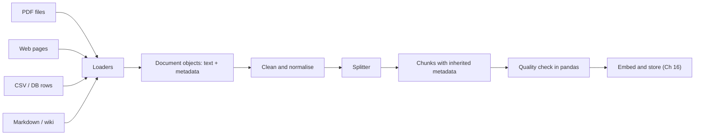
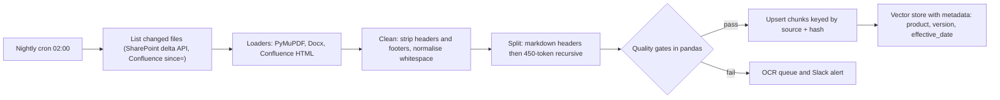

# 15 · Document Loaders & Text Splitters

> **In one line:** Before a model can answer from your documents, something has to turn PDFs, web pages, CSVs and Markdown into clean text with metadata, then cut that text into pieces small enough to embed and specific enough to retrieve. Loaders and splitters are that something, and most "the RAG bot is dumb" bugs start here, not in the model.

> **Versions used:** langchain-core 1.8 · langchain-community 0.4.2 · langchain-text-splitters 1.1 · langchain-experimental 0.4.2 · pypdf 7.0 · pymupdf 1.26 (optional) · tiktoken 0.14 · pandas 3.1 · **Fast-moving:** `langchain-community` is being sunset (0.4.x prints a `DeprecationWarning` on import) and its loaders are migrating to standalone integration packages, so import paths will change. Splitter APIs are stable; semantic chunking is still experimental.

---

## 1. Overview

> **Builds on:** [Ch 05 · Embeddings](topic.html?p=05-embeddings) (why we embed chunks) and [Ch 13 · LangChain Core](topic.html?p=13-langchain-core-lcel) (Runnables, `Document`).

Every retrieval system has an unglamorous front half. A **document loader** reads a source (a PDF, a URL, a folder, a database table) and produces `Document` objects: text plus a metadata dictionary. A **text splitter** then cuts each document into **chunks**, usually a few hundred tokens each, carrying the parent's metadata along. Those chunks are what you embed, store and retrieve in [Ch 16 · RAG Fundamentals](topic.html?p=16-rag-fundamentals).

Why bother splitting at all? Three reasons:
- **Embedding models have input limits** (often 512 to 8,192 tokens) and a single vector for a 40-page contract averages away every specific detail.
- **Retrieval precision.** A question about "notice period" should pull the two paragraphs about notice periods, not the whole employee handbook.
- **Cost and context.** You pay for every token you stuff into the prompt. Five tight chunks beat two bloated ones.



LangChain gives you a large catalogue of loaders and a handful of well-tested splitters. You don't have to use the rest of LangChain to use them: the output is plain Python objects you can feed to Chroma, LlamaIndex, pgvector or your own code. For heavy-duty layout extraction (tables, scanned pages, multi-column PDFs) see [Ch 20 · Document Parsing](topic.html?p=20-document-parsing). This chapter is about the 80% case and about measuring whether your chunks are any good.

The theory of chunking strategies and their effect on retrieval is in [AI Engineering · Chunking, Embeddings & Reranking](../ai-engineering/topic.html?p=31-chunking-embeddings-reranking).

---

## 2. Key Concepts

- **`Document`**: a tiny class from `langchain_core.documents` with `page_content: str`, `metadata: dict` and an optional `id`. Everything downstream (splitters, vector stores, retrievers) speaks `Document`.
- **Loader**: any class with `.load()` (returns a list) and `.lazy_load()` (returns an iterator). Use `lazy_load()` for big folders so you never hold 10,000 pages in memory.
- **Metadata**: `source`, `page`, `row`, `title`, `url`, plus whatever you add (`department`, `doc_version`, `acl_group`). Metadata is how you **cite**, **filter** ("only HR docs") and **delete** ("re-index this file").
- **Chunk size**: the target maximum length of a chunk, measured by a **length function** (characters by default, tokens if you choose).
- **Chunk overlap**: how much text adjacent chunks share, so a sentence cut at a boundary still appears whole in one of them. 10–20% of chunk size is the usual starting point.
- **Separators**: the recursive splitter tries to cut at paragraph breaks first, then line breaks, then spaces, then characters. It keeps natural units intact whenever they fit.
- **Structure-aware splitting**: Markdown headers, HTML sections or code syntax define the boundaries, and the header path becomes metadata.
- **Semantic chunking**: embed each sentence and start a new chunk where meaning shifts. Smarter boundaries, more cost, less predictable size.

> **Analogy:** a loader is the scanner that turns paper into files. The splitter is the person who cuts the files into index cards. If the cards are too big, every card is "about everything". If they're too small, no card has enough context to answer anything. Overlap is writing the last line of each card again at the top of the next.

How the recursive splitter decides where to cut:

```svg
<svg viewBox="0 0 860 330" width="100%" height="330" font-family="ui-sans-serif,system-ui,sans-serif" font-size="11" xmlns="http://www.w3.org/2000/svg">
  <defs><marker id="aa15a" viewBox="0 0 10 10" refX="9" refY="5" markerWidth="7" markerHeight="7" orient="auto"><path d="M0,0 L10,5 L0,10 z" fill="#334155"/></marker></defs>
  <text x="430" y="22" text-anchor="middle" font-size="14" font-weight="700" fill="#1e293b">RecursiveCharacterTextSplitter: try big separators first, fall back to smaller ones</text>
  <rect x="20" y="40" width="190" height="34" rx="6" fill="#dbeafe" stroke="#2563eb"/>
  <text x="115" y="61" text-anchor="middle" fill="#1e293b">1. split on "\n\n" (paragraphs)</text>
  <rect x="230" y="40" width="190" height="34" rx="6" fill="#dbeafe" stroke="#2563eb"/>
  <text x="325" y="61" text-anchor="middle" fill="#1e293b">2. piece too big? "\n" (lines)</text>
  <rect x="440" y="40" width="190" height="34" rx="6" fill="#dbeafe" stroke="#2563eb"/>
  <text x="535" y="61" text-anchor="middle" fill="#1e293b">3. still too big? " " (words)</text>
  <rect x="650" y="40" width="190" height="34" rx="6" fill="#fee2e2" stroke="#dc2626"/>
  <text x="745" y="61" text-anchor="middle" fill="#1e293b">4. last resort: "" (characters)</text>
  <line x1="210" y1="57" x2="228" y2="57" stroke="#334155" stroke-width="1.5" marker-end="url(#aa15a)"/>
  <line x1="420" y1="57" x2="438" y2="57" stroke="#334155" stroke-width="1.5" marker-end="url(#aa15a)"/>
  <line x1="630" y1="57" x2="648" y2="57" stroke="#334155" stroke-width="1.5" marker-end="url(#aa15a)"/>
  <text x="20" y="104" font-weight="700" fill="#1e293b">Then small pieces are merged back up to chunk_size, with chunk_overlap carried across each boundary:</text>
  <rect x="20" y="118" width="820" height="30" rx="4" fill="#f1f5f9" stroke="#94a3b8"/>
  <text x="30" y="137" fill="#334155">source text: | para A (300 chars) | para B (250) | para C (900, too big) | para D (120) |</text>
  <rect x="20" y="170" width="300" height="30" rx="4" fill="#dcfce7" stroke="#16a34a"/>
  <text x="30" y="189" fill="#1e293b">chunk 1 = A + B (550 of 600)</text>
  <rect x="270" y="210" width="300" height="30" rx="4" fill="#dcfce7" stroke="#16a34a"/>
  <text x="280" y="229" fill="#1e293b">chunk 2 = tail of B + first lines of C</text>
  <rect x="520" y="250" width="320" height="30" rx="4" fill="#dcfce7" stroke="#16a34a"/>
  <text x="530" y="269" fill="#1e293b">chunk 3 = rest of C (split on "\n") + D</text>
  <rect x="270" y="170" width="50" height="30" rx="4" fill="#fef3c7" stroke="#d97706"/>
  <rect x="520" y="210" width="50" height="30" rx="4" fill="#fef3c7" stroke="#d97706"/>
  <text x="330" y="189" fill="#d97706" font-weight="700">overlap</text>
  <text x="580" y="229" fill="#d97706" font-weight="700">overlap</text>
  <rect x="20" y="290" width="820" height="30" rx="6" fill="#ede9fe" stroke="#7c3aed"/>
  <text x="30" y="309" fill="#1e293b">Each chunk keeps the parent's metadata (source, page) plus start_index, so you can cite and highlight the exact span later.</text>
</svg>
```

### How big should a chunk be?

There is no universal answer, but there are good defaults. For question answering over prose (policies, manuals, contracts), start at **roughly 300–500 tokens with 10–15% overlap** (about 1,000–2,000 characters of English). Short FAQ entries or CSV rows should usually be **one record per chunk**, unsplit. Code should be split on function and class boundaries. Then measure: [Ch 16](topic.html?p=16-rag-fundamentals) shows how to compute retrieval hit-rate so you can compare chunk sizes with numbers instead of vibes.

---

## 3. Setup

```bash
pip install "langchain-core>=1.8,<2" "langchain-community>=0.4,<0.5" "langchain-text-splitters>=1.1,<2"
pip install "pypdf>=6" "beautifulsoup4>=4.12" "tiktoken>=0.12" "pandas>=2" "python-dotenv>=1"
pip install "pymupdf>=1.26"                                            # optional: faster PDF loader (AGPL)
pip install "langchain-experimental>=0.4" "langchain-ollama>=1,<2"   # semantic chunking only
ollama pull nomic-embed-text                                          # local embeddings for SemanticChunker
```

```bash
# .env.example
OLLAMA_HOST=http://localhost:11434
EMBED_MODEL=nomic-embed-text
USER_AGENT=handbook-ingest/1.0     # WebBaseLoader warns if this is unset
```

Every example runs against a small local corpus. This script creates it (a PDF, Markdown, a CSV and a text file), so you can run the chapter fully offline:

```python
# make_corpus.py — builds ./corpus with a 2-page PDF, a Markdown handbook, a CSV and a text note
import textwrap
from pathlib import Path

ROOT = Path("corpus")


def write_pdf(path: Path, pages: list[str]) -> None:
    """Tiny dependency-free PDF writer: Helvetica 11pt, one string per page, paragraphs kept."""
    objs = ["<< /Type /Catalog /Pages 2 0 R >>", "",
            "<< /Type /Font /Subtype /Type1 /BaseFont /Helvetica >>"]
    kids = []
    for text in pages:
        lines = []
        for para in text.split("\n\n"):
            lines += textwrap.wrap(para, 85) + [""]
        esc = [ln.replace("\\", "\\\\").replace("(", "\\(").replace(")", "\\)") for ln in lines]
        stream = "BT /F1 11 Tf 14 TL 50 790 Td " + " ".join(f"({ln}) '" for ln in esc) + " ET"
        objs.append(f"<< /Length {len(stream)} >>\nstream\n{stream}\nendstream")
        objs.append(f"<< /Type /Page /Parent 2 0 R /MediaBox [0 0 595 842] "
                    f"/Resources << /Font << /F1 3 0 R >> >> /Contents {len(objs)} 0 R >>")
        kids.append(f"{len(objs)} 0 R")
    objs[1] = f"<< /Type /Pages /Kids [{' '.join(kids)}] /Count {len(kids)} >>"
    out, offsets = b"%PDF-1.4\n", []
    for i, body in enumerate(objs, start=1):
        offsets.append(len(out))
        out += f"{i} 0 obj\n{body}\nendobj\n".encode("latin-1")
    xref = len(out)
    out += f"xref\n0 {len(objs) + 1}\n0000000000 65535 f \n".encode()
    out += "".join(f"{o:010d} 00000 n \n" for o in offsets).encode()
    out += f"trailer\n<< /Size {len(objs) + 1} /Root 1 0 R >>\nstartxref\n{xref}\n%%EOF\n".encode()
    path.write_bytes(out)

POLICY_PAGES = [
    "Acme Ltd Travel Policy (v3, effective 2026-01-01)\n\n"
    "1. Scope. This policy applies to all employees and contractors travelling on company business.\n\n"
    "2. Booking. Flights must be booked through the travel portal at least 14 days before departure. "
    "Economy class is required for flights under 6 hours. Premium economy is allowed for flights of 6 hours or more.\n\n"
    "3. Hotels. The nightly cap is EUR 180 in capital cities and EUR 130 elsewhere, excluding taxes.",
    "4. Meals. The daily meal allowance is EUR 60. Alcohol is not reimbursable.\n\n"
    "5. Expenses. Submit receipts in the expense tool within 30 days of returning. "
    "Claims older than 90 days are rejected automatically.\n\n"
    "6. Exceptions. The CFO may approve exceptions in writing before travel.",
]

HANDBOOK_MD = """# Employee Handbook

## Leave

### Annual leave
Full-time employees receive 25 days of paid annual leave per calendar year.
Up to 5 unused days may be carried over to the next year and must be used by 31 March.

### Sick leave
Notify your manager before 10:00 on the first day of absence.
A doctor's note is required from the fourth consecutive day.

## Equipment

### Laptops
Laptops are refreshed every 3 years. Report loss or theft to IT within 24 hours.
"""

FAQ_CSV = """question,answer,team
How do I reset my VPN password?,Use the self-service portal at it.acme.example and choose Reset VPN.,IT
Who approves a new software licence?,Your manager approves first and then IT procurement.,IT
When is payroll paid?,Salaries are paid on the 25th of each month or the previous business day.,Finance
"""

NOTE_TXT = ("Office move: the Berlin office moves to Torstrasse 140 on 2026-12-15. "
            "Desks must be cleared by 2026-12-12. Parking permits will be reissued.\n")


def main() -> None:
    ROOT.mkdir(exist_ok=True)
    write_pdf(ROOT / "travel_policy.pdf", POLICY_PAGES)     # real PDFs come from Word, scanners, etc.
    (ROOT / "handbook.md").write_text(HANDBOOK_MD, encoding="utf-8")
    (ROOT / "faq.csv").write_text(FAQ_CSV, encoding="utf-8")
    (ROOT / "office_move.txt").write_text(NOTE_TXT, encoding="utf-8")
    print("wrote", sorted(p.name for p in ROOT.iterdir()))


if __name__ == "__main__":
    main()
```

```text
wrote ['faq.csv', 'handbook.md', 'office_move.txt', 'travel_policy.pdf']
```

---

## 4. Code Examples

### Example 1: Loading a PDF into `Document` objects

Two common PDF loaders. **PyPDFLoader** (pure Python, `pypdf`) is the simplest. **PyMuPDFLoader** (`pymupdf`) is faster and better on tricky layouts. Both return one `Document` per page by default.

```python
# ex1_pdf_loaders.py
from langchain_community.document_loaders import PyMuPDFLoader, PyPDFLoader


def show(name: str, docs) -> None:
    print(f"--- {name}: {len(docs)} documents")
    d = docs[0]
    print("text:", d.page_content[:70].replace("\n", " "), "...")
    keep = {k: d.metadata[k] for k in ("source", "page", "total_pages") if k in d.metadata}
    print("metadata:", keep)


if __name__ == "__main__":
    show("PyPDFLoader", PyPDFLoader("corpus/travel_policy.pdf").load())
    try:
        show("PyMuPDFLoader", PyMuPDFLoader("corpus/travel_policy.pdf").load())
    except ImportError:
        print("--- PyMuPDFLoader: pip install pymupdf to compare")
    # mode="single" joins all pages into one Document (useful before splitting across pages)
    single = PyPDFLoader("corpus/travel_policy.pdf", mode="single").load()
    print("single mode:", len(single), "document,", len(single[0].page_content), "chars")
```

Output (real run; the PyMuPDF line shows its shape when installed):

```text
--- PyPDFLoader: 2 documents
text: Acme Ltd Travel Policy (v3, effective 2026-01-01) 1. Scope. This polic ...
metadata: {'source': 'corpus/travel_policy.pdf', 'page': 0, 'total_pages': 2}
--- PyMuPDFLoader: 2 documents        # with pymupdf installed; it also adds file_path, format, producer...
single mode: 1 document, 728 chars
```

> **Version note:** importing `langchain_community.document_loaders` in 0.4.x prints a `DeprecationWarning` (the package is being sunset in favour of standalone integration packages) and a `USER_AGENT environment variable not set` warning. Both are harmless today. Pin the version, set `USER_AGENT`, and expect these loaders to move to new packages.

> **Gotcha:** `page` is **0-based**. When you show citations to humans, print `page + 1`. A surprising number of RAG bots cite "page 0".

Both loaders also accept `extract_images` and password options. Scanned PDFs (images of text) return empty strings: detect that (Example 6 flags it) and route them to OCR, covered in [Ch 20](topic.html?p=20-document-parsing).

### Example 2: Web pages, CSVs, folders and lazy loading

```python
# ex2_more_loaders.py
import os

from dotenv import load_dotenv
from langchain_community.document_loaders import (CSVLoader, DirectoryLoader, TextLoader,
                                                  WebBaseLoader)

load_dotenv()


def csv_rows():
    # One Document per row. source_column sets metadata["source"] from a column instead of the file path.
    loader = CSVLoader("corpus/faq.csv", metadata_columns=["team"], content_columns=["question", "answer"])
    docs = loader.load()
    print(len(docs), "rows; first:", repr(docs[0].page_content), docs[0].metadata)


def folder():
    # glob + loader_cls: every .md and .txt file in the tree, loaded lazily one at a time
    loader = DirectoryLoader("corpus", glob="**/*.[mt][dx]*", loader_cls=TextLoader,
                             loader_kwargs={"encoding": "utf-8"}, show_progress=False)
    for doc in loader.lazy_load():                 # iterator: constant memory for big trees
        print("dir:", doc.metadata["source"], len(doc.page_content), "chars")


def web(url: str):
    # Needs network. bs_kwargs lets you keep only the article body instead of nav and footer junk.
    loader = WebBaseLoader(url, header_template={"User-Agent": os.getenv("USER_AGENT", "handbook-ingest/1.0")})
    doc = loader.load()[0]
    print("web:", doc.metadata.get("title"), "|", len(doc.page_content), "chars")


if __name__ == "__main__":
    csv_rows()
    folder()
    if os.getenv("RUN_WEB") == "1":
        web("https://python.langchain.com/docs/introduction/")
```

Output (offline parts, real run):

```text
3 rows; first: 'question: How do I reset my VPN password?\nanswer: Use the self-service portal at it.acme.example and choose Reset VPN.' {'source': 'corpus/faq.csv', 'row': 0, 'team': 'IT'}
dir: corpus/office_move.txt 141 chars
dir: corpus/handbook.md 458 chars
```

Note how `CSVLoader` formats each row as `column: value` lines. That is a reasonable default for retrieval: the column names give the embedding model context. `metadata_columns` moves filterable fields (`team`) out of the text and into metadata.

> **Why this matters:** a CSV row, a ticket, or an FAQ entry is already a perfect chunk. Don't run it through a splitter. Load one document per record and skip straight to embedding.

For `WebBaseLoader`, pass `bs_kwargs={"parse_only": bs4.SoupStrainer(class_="article-body")}` to keep only the content container. Navigation menus repeated on every page pollute retrieval badly: every chunk "matches" the menu.

### Example 3: `RecursiveCharacterTextSplitter`, the default workhorse

```python
# ex3_recursive.py
from langchain_community.document_loaders import PyPDFLoader
from langchain_text_splitters import RecursiveCharacterTextSplitter

if __name__ == "__main__":
    pages = PyPDFLoader("corpus/travel_policy.pdf").load()
    splitter = RecursiveCharacterTextSplitter(
        chunk_size=300,          # max characters per chunk (small here so you can see the cuts)
        chunk_overlap=40,        # characters shared between neighbours
        add_start_index=True,    # metadata["start_index"] = char offset in the parent page
    )
    chunks = splitter.split_documents(pages)   # keeps each page's metadata on its chunks
    for c in chunks:
        m = c.metadata
        print(f"p{m['page'] + 1} @{m['start_index']:>3} len={len(c.page_content):>3} | "
              f"{c.page_content[:60]!r}")
```

Output (real run):

```text
p1 @  0 len=229 | 'Acme Ltd Travel Policy (v3, effective 2026-01-01)\n1. Scope. '
p1 @230 len=218 | 'departure. Economy class is required for flights under 6 hou'
p2 @  0 len=278 | '4. Meals. The daily meal allowance is EUR 60. Alcohol is not'
```

Notice chunk 2 starts with "departure.": the PDF loader turned wrapped lines into single `\n`s, so the splitter found no paragraph break and cut at a line. The exact boundaries depend on how the loader rebuilt line breaks, which is why you inspect output instead of trusting defaults. `split_text(str)` returns plain strings, `split_documents(docs)` returns `Document`s with metadata, and `create_documents(texts, metadatas)` builds `Document`s from raw strings.

> **Gotcha:** `chunk_size` is a **maximum target**, not a guarantee. If a single "word" is longer than `chunk_size` (a URL, a base64 blob, a table row with no spaces) the splitter falls back to cutting characters. Always look at the length distribution (Example 7).

### Example 4: Splitting by tokens instead of characters

Embedding models and LLM context windows count **tokens**, not characters. If you mix languages or have lots of numbers and code, character counts mislead. Measure with the same tokenizer family your model uses where you can.

```python
# ex4_token_split.py
import tiktoken
from langchain_text_splitters import RecursiveCharacterTextSplitter, TokenTextSplitter

TEXT = open("corpus/handbook.md", encoding="utf-8").read() * 3   # make it long enough to split

if __name__ == "__main__":
    enc = tiktoken.get_encoding("cl100k_base")

    # Recursive separators, but chunk_size measured in tokens: the best general default.
    rec = RecursiveCharacterTextSplitter.from_tiktoken_encoder(
        encoding_name="cl100k_base", chunk_size=120, chunk_overlap=15)
    # Pure token windows: exact sizes, but cuts mid-sentence. Fine for embeddings of logs or code.
    tok = TokenTextSplitter(encoding_name="cl100k_base", chunk_size=120, chunk_overlap=15)

    for name, sp in [("recursive+tiktoken", rec), ("token windows", tok)]:
        parts = sp.split_text(TEXT)
        sizes = [len(enc.encode(p)) for p in parts]
        print(f"{name:20} chunks={len(parts)} tokens/chunk={sizes} ends_with={parts[0][-25:]!r}")
```

Output (real run):

```text
recursive+tiktoken   chunks=3 tokens/chunk=[113, 109, 103] ends_with='ployee Handbook\n\n## Leave'
token windows        chunks=3 tokens/chunk=[120, 120, 111] ends_with='## Annual leave\nFull-time'
```

The token-window splitter hits exactly 120 tokens and ends mid-sentence ("Full-time"). The recursive splitter stays under 120 and ends on a line boundary. For prose, prefer the recursive one. `tiktoken` is OpenAI's tokenizer: for Llama or nomic models it is an approximation that is usually close enough for sizing. For an exact count, use `RecursiveCharacterTextSplitter.from_huggingface_tokenizer(tokenizer, ...)` with the model's own tokenizer.

### Example 5: Markdown structure as metadata

Headers carry meaning a chunk loses when cut out of context. `MarkdownHeaderTextSplitter` splits on headers and records the header path as metadata. Then you size-limit the sections with a recursive splitter.

```python
# ex5_markdown_headers.py
from langchain_text_splitters import MarkdownHeaderTextSplitter, RecursiveCharacterTextSplitter

if __name__ == "__main__":
    md = open("corpus/handbook.md", encoding="utf-8").read()
    by_header = MarkdownHeaderTextSplitter(
        headers_to_split_on=[("#", "h1"), ("##", "h2"), ("###", "h3")],
        strip_headers=False,     # keep the header line in the text too: helps the embedding
    )
    sections = by_header.split_text(md)            # returns Documents, metadata = header path
    sized = RecursiveCharacterTextSplitter(chunk_size=200, chunk_overlap=0).split_documents(sections)
    for d in sized:
        path = " > ".join(d.metadata[k] for k in ("h1", "h2", "h3") if k in d.metadata)
        print(f"[{path}] {d.page_content[:55]!r}")
```

Output (real run):

```text
[Employee Handbook > Leave > Annual leave] '# Employee Handbook  \n## Leave  \n### Annual leave\nFull-'
[Employee Handbook > Leave > Annual leave] 'Up to 5 unused days may be carried over to the next yea'
[Employee Handbook > Leave > Sick leave] '### Sick leave\nNotify your manager before 10:00 on the '
[Employee Handbook > Equipment > Laptops] '## Equipment  \n### Laptops\nLaptops are refreshed every '
```

Headers with no body of their own (`# Employee Handbook`, `## Leave`) are folded into the next section. Look at chunk 2: "Up to 5 unused days may be carried over" is ambiguous on its own, because the 200-character cap separated it from its header. With `h3 = "Annual leave"` in metadata you can **prepend the header path to the text before embedding** ("Employee Handbook > Leave > Annual leave: Up to 5 unused days…"). This cheap trick, often called **contextual chunk headers**, measurably improves retrieval on structured documents.

LangChain has siblings for other structures: `HTMLHeaderTextSplitter`, `RecursiveJsonSplitter`, and `RecursiveCharacterTextSplitter.from_language(Language.PYTHON, ...)` for code.

### Example 6: Semantic chunking

`SemanticChunker` (in `langchain-experimental`) embeds every sentence, measures the distance between neighbours, and cuts where the distance spikes. It needs an embeddings object. The local default is Ollama. The script falls back to a deterministic fake so it runs anywhere (the boundaries are then meaningless, but the mechanics are visible).

```python
# ex6_semantic.py
import os

from dotenv import load_dotenv
from langchain_core.embeddings import DeterministicFakeEmbedding
from langchain_experimental.text_splitter import SemanticChunker

load_dotenv()

TEXT = ("Flights must be booked 14 days ahead. Economy is required under 6 hours. "
        "Premium economy is allowed above 6 hours. "
        "The Berlin office moves to Torstrasse on 15 December. Desks must be cleared by the 12th. "
        "Parking permits will be reissued after the move. "
        "Laptops are refreshed every three years. Report a lost laptop to IT within 24 hours.")


def embeddings():
    if os.getenv("USE_OLLAMA", "1") == "1":
        try:
            from langchain_ollama import OllamaEmbeddings
            emb = OllamaEmbeddings(model=os.getenv("EMBED_MODEL", "nomic-embed-text"),
                                   base_url=os.getenv("OLLAMA_HOST", "http://localhost:11434"))
            emb.embed_query("ping")                 # fail fast if Ollama isn't running
            return emb, "ollama"
        except Exception:
            pass
    return DeterministicFakeEmbedding(size=256), "fake"


if __name__ == "__main__":
    emb, kind = embeddings()
    chunker = SemanticChunker(emb, breakpoint_threshold_type="percentile",
                              breakpoint_threshold_amount=80)  # cut at the top 20% of distance jumps
    for i, chunk in enumerate(chunker.split_text(TEXT)):
        print(f"[{kind}] chunk {i}: {chunk}")
```

With the fake embedding (no Ollama) the real run cut at random places, for example `chunk 1: Parking permits will be reissued after the move.` on its own. Illustrative output with `nomic-embed-text` (boundaries vary by model):

```text
[ollama] chunk 0: Flights must be booked 14 days ahead. Economy is required under 6 hours. Premium economy is allowed above 6 hours.
[ollama] chunk 1: The Berlin office moves to Torstrasse on 15 December. Desks must be cleared by the 12th. Parking permits will be reissued after the move.
[ollama] chunk 2: Laptops are refreshed every three years. Report a lost laptop to IT within 24 hours.
```

`min_chunk_size` stops one-sentence fragments like that. `breakpoint_threshold_type` can be `"percentile"`, `"standard_deviation"`, `"interquartile"` or `"gradient"`. Semantic chunking costs one embedding call per sentence at ingest time and produces uneven chunk sizes (some can exceed your limit, so cap them with a recursive splitter afterwards). Use it when documents mix topics without headings (meeting transcripts, long emails). For structured docs, header-aware splitting is cheaper and usually as good.

### Example 7: Inspecting chunk quality with pandas

You already know pandas. Use it as your chunk microscope: one row per chunk, then look for the pathologies that wreck retrieval.

```python
# ex7_chunk_report.py
import hashlib

import pandas as pd
import tiktoken
from langchain_community.document_loaders import CSVLoader, PyPDFLoader, TextLoader
from langchain_text_splitters import RecursiveCharacterTextSplitter

ENC = tiktoken.get_encoding("cl100k_base")


def load_all():
    docs = PyPDFLoader("corpus/travel_policy.pdf").load()
    docs += TextLoader("corpus/handbook.md", encoding="utf-8").load()
    docs += TextLoader("corpus/office_move.txt", encoding="utf-8").load()
    return docs, CSVLoader("corpus/faq.csv").load()        # CSV rows are already chunks


def report(chunks) -> pd.DataFrame:
    df = pd.DataFrame({
        "source": [c.metadata["source"] for c in chunks],
        "page": [c.metadata.get("page", c.metadata.get("row")) for c in chunks],
        "chars": [len(c.page_content) for c in chunks],
        "tokens": [len(ENC.encode(c.page_content)) for c in chunks],
        "alpha_ratio": [sum(ch.isalpha() for ch in c.page_content) / max(1, len(c.page_content))
                        for c in chunks],
        "hash": [hashlib.sha1(c.page_content.strip().lower().encode()).hexdigest()[:10] for c in chunks],
        "preview": [c.page_content[:40].replace("\n", " ") for c in chunks],
    })
    df["too_small"] = df["tokens"] < 20                    # fragments that carry no meaning
    df["too_big"] = df["tokens"] > 400                     # will dilute the embedding
    df["low_text"] = df["alpha_ratio"] < 0.5               # tables, OCR junk, base64
    df["duplicate"] = df.duplicated("hash", keep="first")  # repeated headers, boilerplate
    return df


if __name__ == "__main__":
    docs, rows = load_all()
    chunks = RecursiveCharacterTextSplitter(chunk_size=400, chunk_overlap=50).split_documents(docs) + rows
    df = report(chunks)
    print(df.groupby("source")[["tokens"]].agg(["count", "min", "median", "max"]))
    flags = ["too_small", "too_big", "low_text", "duplicate"]
    print("\nflagged:", df[flags].sum().to_dict())
    bad = df[df[flags].any(axis=1)]
    if not bad.empty:
        print(bad[["source", "page", "tokens", "preview"]].to_string(index=False))
```

Output (real run):

```text
                         tokens
                          count min median max
source
corpus/faq.csv                3  23   30.0  30
corpus/handbook.md            2  27   54.5  82
corpus/office_move.txt        1  43   43.0  43
corpus/travel_policy.pdf      3  33   62.0  83

flagged: {'too_small': 0, 'too_big': 0, 'low_text': 0, 'duplicate': 0}
```

On this tiny clean corpus nothing is flagged. On a real SharePoint export you'll typically find hundreds of 3-token chunks ("Page 4 of 112"), repeated disclaimers, and empty pages from scanned PDFs. Fix them **before** embedding: drop or merge tiny chunks, strip boilerplate, de-duplicate by hash, and route `low_text` sources to OCR.

---

## 5. Real-World Use Case

**Company:** a 900-person insurance broker. **Problem:** the compliance team keeps 4,200 policy documents (PDF and Word) and a Confluence space of 1,800 pages. Advisers ask the same questions all day ("what's the cooling-off period for product X?") and get stale answers from outdated PDFs. **Automation:** a nightly ingestion job that feeds the RAG assistant built in [Ch 16](topic.html?p=16-rag-fundamentals).



The numbers that shaped the design:
- **Volume:** ~6,000 sources, ~40 changed per night. Full re-ingest takes 25 minutes on one worker. The delta run takes under 2 minutes, so the job **only reprocesses changed files** (by `last_modified` and content hash) and deletes the old chunks of each changed source before inserting new ones.
- **Chunking:** headers carry the product name, so Confluence pages are split by header first and each chunk's text is prefixed with its header path. PDFs use 450-token recursive chunks with 60 overlap. After the switch from 1,000-character chunks, top-5 retrieval hit-rate on a 120-question test set went from 71% to 86%.
- **Metadata:** `product`, `doc_version`, `effective_date` and `acl_group` on every chunk. Retrieval filters on `effective_date <= today` and the user's groups, so expired or restricted documents never reach the model.
- **Quality gates:** any file where more than 30% of chunks have `alpha_ratio < 0.5` goes to the OCR queue instead of the index. That caught 230 scanned PDFs in the first run.
- **Cost:** embedding the full corpus once (about 9M tokens) with a hosted small embedding model costs a few dollars; check the provider's pricing page and multiply. Nightly deltas are negligible. Running `nomic-embed-text` locally made it free at the cost of a 40-minute first run.

---

## 6. Mini Project: An Ingestion CLI with a Chunk-Quality Report (1–2 hours)

**Goal:** a command-line tool that loads a folder of mixed documents, splits each type with the right strategy, assigns stable chunk IDs, writes `chunks.jsonl` (ready for Ch 16) and prints a quality report.

```text
ingest/
├── .env
├── make_corpus.py      # from Setup (or point at your own folder)
├── ingest.py
└── out/
    └── chunks.jsonl    # created by ingest.py
```

**Step 1: routing by file type.** Each extension gets a loader and a splitting strategy. CSV rows aren't split, Markdown is split by headers first, everything else gets recursive token splitting.

**Step 2: stable IDs.** A chunk ID derived from `source + chunk index + content hash` lets you upsert idempotently: re-running ingestion on an unchanged file produces identical IDs, so the vector store doesn't fill with duplicates.

**Step 3: the full script.**

```python
# ingest.py — python ingest.py corpus --out out/chunks.jsonl --chunk-tokens 300 --overlap 40
import argparse
import hashlib
import json
from pathlib import Path

import pandas as pd
import tiktoken
from langchain_community.document_loaders import CSVLoader, PyPDFLoader, TextLoader
from langchain_core.documents import Document
from langchain_text_splitters import MarkdownHeaderTextSplitter, RecursiveCharacterTextSplitter

ENC = tiktoken.get_encoding("cl100k_base")
HEADERS = [("#", "h1"), ("##", "h2"), ("###", "h3")]


def ntokens(text: str) -> int:
    return len(ENC.encode(text))


def split_markdown(doc: Document, rec: RecursiveCharacterTextSplitter) -> list[Document]:
    sections = MarkdownHeaderTextSplitter(HEADERS, strip_headers=True).split_text(doc.page_content)
    out = []
    for s in sections:
        path = " > ".join(s.metadata[k] for k in ("h1", "h2", "h3") if k in s.metadata)
        s.metadata = {**doc.metadata, "section": path}
        for piece in rec.split_documents([s]):
            piece.page_content = f"{path}\n{piece.page_content}" if path else piece.page_content
            out.append(piece)                     # contextual header prepended to the text
    return out


def load_and_split(path: Path, rec: RecursiveCharacterTextSplitter) -> list[Document]:
    ext = path.suffix.lower()
    if ext == ".csv":
        return CSVLoader(str(path), encoding="utf-8").load()        # one row = one chunk
    if ext == ".pdf":
        return rec.split_documents(PyPDFLoader(str(path)).load())   # or PyMuPDFLoader
    doc = TextLoader(str(path), encoding="utf-8").load()[0]
    if ext in {".md", ".markdown"}:
        return split_markdown(doc, rec)
    return rec.split_documents([doc])


def with_ids(chunks: list[Document]) -> list[Document]:
    counters: dict[str, int] = {}
    for c in chunks:
        src = c.metadata["source"]
        i = counters.get(src, 0)
        counters[src] = i + 1
        digest = hashlib.sha1(c.page_content.encode()).hexdigest()[:12]
        c.id = f"{Path(src).name}:{i}:{digest}"
        c.metadata["chunk_index"] = i
    return chunks


def quality(chunks: list[Document]) -> pd.DataFrame:
    df = pd.DataFrame({
        "id": [c.id for c in chunks],
        "source": [Path(c.metadata["source"]).name for c in chunks],
        "tokens": [ntokens(c.page_content) for c in chunks],
        "alpha": [sum(ch.isalpha() for ch in c.page_content) / max(1, len(c.page_content)) for c in chunks],
        "norm": [" ".join(c.page_content.lower().split()) for c in chunks],
    })
    df["flag"] = ""
    df.loc[df.tokens < 15, "flag"] += "tiny "
    df.loc[df.alpha < 0.5, "flag"] += "low_text "
    df.loc[df.duplicated("norm"), "flag"] += "dup "
    return df.drop(columns="norm")


def main() -> None:
    ap = argparse.ArgumentParser()
    ap.add_argument("folder")
    ap.add_argument("--out", default="out/chunks.jsonl")
    ap.add_argument("--chunk-tokens", type=int, default=300)
    ap.add_argument("--overlap", type=int, default=40)
    args = ap.parse_args()

    rec = RecursiveCharacterTextSplitter.from_tiktoken_encoder(
        encoding_name="cl100k_base", chunk_size=args.chunk_tokens, chunk_overlap=args.overlap,
        add_start_index=True)
    files = sorted(p for p in Path(args.folder).rglob("*") if p.suffix.lower() in
                   {".pdf", ".md", ".markdown", ".txt", ".csv"})
    chunks: list[Document] = []
    for f in files:
        try:
            chunks += load_and_split(f, rec)
        except Exception as e:                          # one bad file must not kill the run
            print(f"SKIP {f}: {type(e).__name__}: {e}")
    chunks = with_ids(chunks)

    df = quality(chunks)
    keep_ids = set(df[~df.flag.str.contains("tiny|dup")].id)
    kept = [c for c in chunks if c.id in keep_ids]

    out = Path(args.out)
    out.parent.mkdir(parents=True, exist_ok=True)
    with out.open("w", encoding="utf-8") as fh:
        for c in kept:
            fh.write(json.dumps({"id": c.id, "text": c.page_content, "metadata": c.metadata}) + "\n")

    print(df.groupby("source").tokens.describe()[["count", "min", "50%", "max"]].to_string())
    print(f"\nfiles={len(files)} chunks={len(chunks)} kept={len(kept)} -> {out}")
    if (df.flag != "").any():
        print(df[df.flag != ""][["id", "tokens", "flag"]].to_string(index=False))


if __name__ == "__main__":
    main()
```

**Step 4: run it.**

```bash
python make_corpus.py
python ingest.py corpus --chunk-tokens 120 --overlap 20
head -c 400 out/chunks.jsonl
```

Output (real run):

```text
                   count   min   50%    max
source
faq.csv              3.0  23.0  30.0   30.0
handbook.md          3.0  28.0  35.0   46.0
office_move.txt      1.0  43.0  43.0   43.0
travel_policy.pdf    2.0  62.0  84.0  106.0

files=4 chunks=9 kept=9 -> out/chunks.jsonl
```

**Done when:**
- [ ] Every chunk in `chunks.jsonl` has `source`, a page or row or section, `chunk_index` and a stable `id`.
- [ ] Running the script twice produces byte-identical output.
- [ ] Markdown chunks start with their header path. CSV rows are never split.
- [ ] Dropping a scanned (image-only) PDF into the folder produces a `low_text` or `tiny` flag rather than silent garbage.

**Stretch goals:** add a `.docx` route (`Docx2txtLoader`). Add an `--only-changed` mode that compares file hashes with the previous run's manifest. Add a histogram of token counts with `df.tokens.plot.hist()`.

---

## 7. Comparison Table

**Loaders for common sources**

| Source | Loader | Package | Notes |
|---|---|---|---|
| PDF, simple | `PyPDFLoader` | `pypdf` | Pure Python, one doc per page, `mode="single"` to join |
| PDF, faster / better layout | `PyMuPDFLoader` | `pymupdf` | AGPL licence: check before shipping commercially |
| PDF / Office with tables, OCR | Unstructured, Docling | see [Ch 20](topic.html?p=20-document-parsing) | Heavier, much better on complex layouts |
| Web page | `WebBaseLoader` | `beautifulsoup4` | Use `bs_kwargs` to keep only the article body |
| CSV | `CSVLoader` | built in | One doc per row; `metadata_columns` for filters |
| Folder | `DirectoryLoader` | built in | `glob`, `loader_cls`, `lazy_load()` |
| SQL | `SQLDatabaseLoader` or your own query | `sqlalchemy` | Often simpler: `pd.read_sql` → `Document`s |

**Splitters: when to use which**

| Splitter | Cuts on | Size control | Use when |
|---|---|---|---|
| `RecursiveCharacterTextSplitter` | paragraphs → lines → words | characters | Default for prose |
| `…from_tiktoken_encoder` / `from_huggingface_tokenizer` | same, measured in tokens | tokens | Prose for a specific model's limits |
| `TokenTextSplitter` | fixed token windows | exact tokens | Logs, code, non-prose where boundaries matter less |
| `MarkdownHeaderTextSplitter` / `HTMLHeaderTextSplitter` | document headers | none (pair with recursive) | Wikis, docs, handbooks |
| `RecursiveCharacterTextSplitter.from_language` | functions, classes | characters | Source code |
| `SemanticChunker` | meaning shifts between sentences | loose | Unstructured transcripts, mixed-topic text |
| No splitter | record boundaries | n/a | FAQ rows, tickets, short emails |

---

## 8. Common Mistakes & Best Practices

**Mistake 1: using defaults without looking.** A 4,000-character default chunk on a policy PDF produces chunks that mention six topics each. *Fix:* print 20 random chunks and a length histogram before you embed anything (Example 7).

**Mistake 2: losing metadata.** Splitting raw strings with `split_text()` drops `source` and `page`, so you can't cite or delete later. *Fix:* use `split_documents()` (or `create_documents(texts, metadatas)`), and add your own business metadata at load time.

**Mistake 3: splitting records that were already chunks.** Cutting a CSV row or FAQ answer in half separates the question from its answer. *Fix:* one record = one document, no splitter.

**Mistake 4: boilerplate everywhere.** Page headers, footers, cookie banners and nav menus repeated in every chunk make every chunk look similar. *Fix:* strip them in a cleaning step, and de-duplicate by normalised hash.

```python
# Before: footer text lands in every chunk
chunks = splitter.split_documents(pages)

# After: clean first, then split
import re
for p in pages:
    p.page_content = re.sub(r"Acme Ltd · Confidential · Page \d+ of \d+", "", p.page_content)
chunks = splitter.split_documents(pages)
```

**Mistake 5: zero overlap on prose.** A sentence cut at a boundary becomes two half-sentences that both match poorly. *Fix:* 10–15% overlap. Don't overdo it either: 50% overlap doubles storage and returns near-duplicate results.

**Mistake 6: silent empty pages.** Scanned PDFs load "successfully" with empty text. *Fix:* flag pages with fewer than ~20 characters and route them to OCR.

**Mistake 7: non-deterministic IDs.** Random UUIDs per run mean every re-ingest duplicates the index. *Fix:* derive IDs from source + position + content hash, and delete a source's old chunks before inserting its new ones.

**Best-practice checklist**
- [ ] Every chunk carries `source`, location (page, row, section, `start_index`) and business metadata.
- [ ] Records (rows, tickets, FAQs) are not split. Prose uses recursive token-sized chunks with 10–15% overlap.
- [ ] Structured docs are split by headers first, and the header path is prepended to the chunk text.
- [ ] Cleaning removes boilerplate. De-duplication by normalised hash.
- [ ] A pandas quality report runs on every ingest, and it fails the job on too many tiny or low-text chunks.
- [ ] Stable chunk IDs make re-ingestion idempotent.
- [ ] Chunk size is chosen by measuring retrieval hit-rate (Ch 16), not by guessing.

---

## 9. Exercises

1. **Size sweep.** Split the travel policy with `chunk_size` 200, 400 and 800 characters. For each, count chunks and print which chunk contains "EUR 180". At which size does that chunk also contain unrelated rules?
2. **Header context.** Modify Example 5 to prepend the header path to each chunk. Embed both versions with `nomic-embed-text` (Ch 05) and compare the cosine similarity of "how many days can I carry over?" to the carry-over chunk.
3. **Web cleanup.** Load a documentation page with `WebBaseLoader` twice, once plain and once with a `SoupStrainer` on the main content. Compare character counts and the first 300 characters.
4. **Scanned PDF detector.** Create a PDF that contains only an image (render a page of the travel policy to PNG with PyMuPDF, then insert the image into a new PDF). Make `ingest.py` flag it.
5. **Code splitting.** Use `RecursiveCharacterTextSplitter.from_language(Language.PYTHON, chunk_size=400, chunk_overlap=0)` on `ingest.py` itself. Do functions stay whole?

### Self-check questions

**Q: What does a LangChain `Document` contain, and why does metadata matter so much?**
A: `page_content` (the text), a `metadata` dict and an optional `id`. Metadata (source, page, section, business fields) is what lets you cite answers, filter retrieval by department, date or permission, and delete or re-index a single source. Without it, chunks are anonymous text you can't trace.

**Q: Why does `RecursiveCharacterTextSplitter` try several separators in order?**
A: It tries to cut at the largest natural boundary that keeps pieces under `chunk_size`: paragraphs first, then lines, then words, then characters as a last resort. It then merges small pieces back up to the size limit with the configured overlap. That keeps sentences and paragraphs intact whenever possible.

**Q: When should you not split a document at all?**
A: When it is already a self-contained record smaller than your chunk size: a CSV row, an FAQ entry, a support ticket, a short email. Splitting would separate a question from its answer or a field from its context. Load one document per record instead.

**Q: Why measure chunk size in tokens rather than characters?**
A: Embedding-model limits, context windows and costs are all counted in tokens, and the characters-per-token ratio varies a lot with language, numbers and code. Token-based sizing (`from_tiktoken_encoder` or a Hugging Face tokenizer) keeps chunks within model limits predictably.

**Q: What is a contextual chunk header and when does it help?**
A: Prepending the document title or header path (for example "Employee Handbook > Leave > Annual leave") to the chunk text before embedding. It helps when chunks are ambiguous out of context, like "up to 5 days may be carried over", because the embedding then captures what the chunk is about, not just what it says.

**Q: Your ingestion job runs nightly and the vector store keeps growing even though few documents change. What's wrong and how do you fix it? (Senior)**
A: Chunk IDs are probably random or the job inserts without deleting, so every run adds duplicates. Make IDs deterministic (source + chunk index + content hash), process only changed sources (by modified time or file hash), and for each changed source delete its old chunks by `source` metadata before upserting the new ones. Add a test that running ingestion twice yields an identical index.

**Q: How would you decide between recursive, header-based and semantic chunking for a new corpus? (Senior)**
A: Start from the structure. Documents with reliable headings (wikis, handbooks) get header-based splitting plus a recursive size cap. Unstructured mixed-topic text (transcripts, long emails) is where semantic chunking can help, at the cost of embedding every sentence and uneven sizes. Everything else gets recursive token splitting. Then decide empirically: build a labelled question set, measure top-k retrieval hit-rate per strategy and size, and pick the cheapest one that meets the target.

---

## 10. Summary & Official Docs

- **Loaders** turn sources into `Document`s (text + metadata). Use `lazy_load()` for big folders.
- **Metadata** is for citing, filtering and deleting: keep `source` and location, and add business fields at load time.
- **`RecursiveCharacterTextSplitter`** is the default. Measure size in tokens for model limits, and use 10–15% overlap.
- **Records aren't split**: CSV rows, FAQs and tickets are already chunks.
- **Header-aware splitting** plus contextual headers works best on structured docs. **Semantic chunking** is for unstructured, mixed-topic text.
- **Inspect chunks in pandas** every time: tiny, huge, low-text and duplicate chunks are the usual culprits.
- **Stable IDs and delete-then-upsert** make ingestion idempotent.

| Situation | Reach for |
|---|---|
| Plain PDFs | `PyPDFLoader` / `PyMuPDFLoader` + recursive token splitter |
| Wiki / Markdown | `MarkdownHeaderTextSplitter` + recursive cap + header prefix |
| CSV / tickets | `CSVLoader`, no splitter |
| Scans, tables, complex layout | [Ch 20 · Document Parsing](topic.html?p=20-document-parsing) |

**Official docs**
- LangChain document loaders: https://python.langchain.com/docs/integrations/document_loaders/
- LangChain text splitters: https://python.langchain.com/docs/concepts/text_splitters/
- PyMuPDF: https://pymupdf.readthedocs.io/
- tiktoken: https://github.com/openai/tiktoken
- Theory: [AI Engineering · Chunking, Embeddings & Reranking](../ai-engineering/topic.html?p=31-chunking-embeddings-reranking)

**Next:** [Ch 16 · RAG Fundamentals](topic.html?p=16-rag-fundamentals): embed these chunks, store them in Chroma, retrieve them and generate answers with citations.

---

*AI Automation with Python Handbook — chapter 15.*
