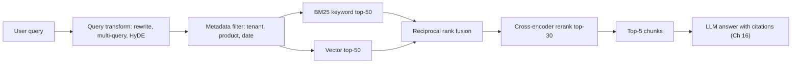
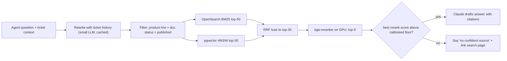

# 17 · Reranking & Hybrid Search

> **In one line:** Top-k cosine similarity is a good first draft, not a finished retriever. Combine keyword search (BM25) with vector search, fuse the lists with reciprocal rank fusion, rerank the survivors with a cross-encoder, and fix bad queries before they hit the index. Then prove each step helped with recall@k and MRR.

> **Versions used:** rank_bm25 0.2.2 · sentence-transformers 6.x (`CrossEncoder`) · ollama 0.6 (`nomic-embed-text`) · numpy 2.x · pandas 3.x · openai 3.x (for the `llm.py` helper) · cohere / voyageai SDKs (optional hosted rerankers) · **Fast-moving:** reranker model names (BGE, mxbai, ms-marco, Cohere `rerank-*`, Voyage `rerank-*`) and their prices change every few months. Read model names from env vars and re-run your eval when you swap one.

---

## 1. Overview

> **Builds on:** [Ch 05 · Embeddings](topic.html?p=05-embeddings) (cosine, prefixes, recall@k) and [Ch 16 · RAG Fundamentals](topic.html?p=16-rag-fundamentals) (the ingest → retrieve → generate pipeline). Here you upgrade the *retrieve* box.

In Ch 16 you embedded chunks, took the top 5 by cosine similarity and stuffed them into a prompt. That works for demos and fails in three predictable ways in production:

- **Exact tokens get lost.** A user types `PAY-402` or `invoice 4471`. Embeddings treat both as "some billing error", so the chunk with that exact code may rank 9th.
- **The right chunk is retrieved but ranked too low.** It's at position 14, and you only pass the top 5 to the LLM.
- **The query itself is bad.** "it's broken again??" has nothing to match against. Neither keyword nor vector search can rescue a query with no content.

The fix is a **multi-stage retriever**, the same shape every serious search engine uses: a cheap, high-recall first stage over the whole corpus, then an expensive, high-precision second stage over a few dozen candidates.



Every box in that diagram is optional and costs latency, so the chapter's real lesson is **measure first**: build a small labelled query set, compute recall@k and MRR, and keep a stage only if the numbers move. For the theory of dense vs. sparse retrieval and reranking, see [AI Engineering · Chunking, Embeddings & Reranking](../ai-engineering/topic.html?p=31-chunking-embeddings-reranking).

---

## 2. Key Concepts

### Sparse vs. dense retrieval

- **BM25** (sparse, keyword) scores a document by how often the query's words appear in it, weighted by how rare each word is across the corpus (**IDF**), with diminishing returns for repeats (`k1`) and a penalty for long documents (`b`). It's the algorithm behind Elasticsearch and OpenSearch defaults. It nails exact codes, names and jargon, and knows nothing about synonyms.
- **Dense retrieval** (vectors, Ch 05) matches meaning: "money back" finds "refund". It's weak on rare tokens, IDs and negation.

Their failure modes barely overlap, which is why combining them works so well. That combination is **hybrid search**.

> **Analogy:** BM25 is a librarian who searches the card catalogue for the exact words you said. The vector index is a librarian who understood what you meant. Ask both, then let a specialist (the reranker) read the shortlist carefully.

### Reciprocal rank fusion (RRF)

BM25 scores (e.g. 7.3) and cosine scores (e.g. 0.81) live on different scales, so you can't add them. **RRF** ignores scores and uses only **ranks**:

`score(d) = Σ over lists of  1 / (k + rank_in_list(d))`, with `k = 60` by convention.

A document ranked 1st in one list and 3rd in another beats one that's 1st in a single list. `k` dampens the advantage of the very top ranks. RRF needs no tuning and no score normalisation, which is why it's the default in Elasticsearch, OpenSearch, Qdrant, Weaviate and Haystack's `DocumentJoiner`.

### Bi-encoders vs. cross-encoders

- A **bi-encoder** (your embedding model) encodes query and document *separately*. Documents are embedded once at ingest, so search is a fast vector lookup. The model never sees query and document together.
- A **cross-encoder** (a **reranker**) reads `(query, document)` *as one input* and outputs a relevance score. It's far more accurate (it can notice that the document answers a *different* question about the same topic), but costs one model forward pass per pair. You can't run it over a million chunks, but 30–100 candidates is fine.

That's the **retrieve-then-rerank** pattern: recall from the cheap stage, precision from the expensive one.

```svg
<svg viewBox="0 0 880 340" width="100%" height="340" font-family="ui-sans-serif,system-ui,sans-serif" font-size="11" xmlns="http://www.w3.org/2000/svg">
  <defs><marker id="aa17a" viewBox="0 0 10 10" refX="9" refY="5" markerWidth="7" markerHeight="7" orient="auto"><path d="M0,0 L10,5 L0,10 z" fill="#334155"/></marker></defs>
  <text x="440" y="22" text-anchor="middle" font-size="14" font-weight="700" fill="#1e293b">Hybrid retrieval: two ranked lists, fused by rank, then reranked</text>
  <rect x="20" y="40" width="180" height="150" rx="8" fill="#fef3c7" stroke="#d97706"/>
  <text x="110" y="60" text-anchor="middle" font-weight="700" fill="#d97706">BM25 (keywords)</text>
  <text x="35" y="84" fill="#1e293b">1. kb02  "PAY-402 declined"</text>
  <text x="35" y="104" fill="#1e293b">2. kb03  "invoices, VAT"</text>
  <text x="35" y="124" fill="#1e293b">3. kb01  "refunds"</text>
  <text x="35" y="144" fill="#334155">4. kb10  ...</text>
  <text x="35" y="174" fill="#334155">exact codes, rare words</text>
  <rect x="20" y="200" width="180" height="125" rx="8" fill="#dbeafe" stroke="#2563eb"/>
  <text x="110" y="220" text-anchor="middle" font-weight="700" fill="#2563eb">Vector (meaning)</text>
  <text x="35" y="244" fill="#1e293b">1. kb01  "refunds"</text>
  <text x="35" y="264" fill="#1e293b">2. kb02  "PAY-402 declined"</text>
  <text x="35" y="284" fill="#334155">3. kb03  ...</text>
  <text x="35" y="312" fill="#334155">synonyms, paraphrases</text>
  <line x1="200" y1="115" x2="262" y2="160" stroke="#334155" stroke-width="1.5" marker-end="url(#aa17a)"/>
  <line x1="200" y1="262" x2="262" y2="200" stroke="#334155" stroke-width="1.5" marker-end="url(#aa17a)"/>
  <rect x="265" y="95" width="270" height="165" rx="8" fill="#ede9fe" stroke="#7c3aed"/>
  <text x="400" y="116" text-anchor="middle" font-weight="700" fill="#7c3aed">Reciprocal rank fusion (k = 60)</text>
  <text x="280" y="140" fill="#1e293b" font-family="ui-monospace,monospace">kb02: 1/61 + 1/62 = 0.03252</text>
  <text x="280" y="160" fill="#1e293b" font-family="ui-monospace,monospace">kb01: 1/63 + 1/61 = 0.03227</text>
  <text x="280" y="180" fill="#1e293b" font-family="ui-monospace,monospace">kb03: 1/62 + 1/63 = 0.03200</text>
  <text x="280" y="206" fill="#334155">Scores ignored, only ranks count:</text>
  <text x="280" y="222" fill="#334155">no normalisation, no tuning.</text>
  <text x="280" y="244" fill="#334155">Being high in BOTH lists wins.</text>
  <line x1="535" y1="178" x2="583" y2="178" stroke="#334155" stroke-width="1.5" marker-end="url(#aa17a)"/>
  <rect x="586" y="95" width="275" height="165" rx="8" fill="#dcfce7" stroke="#16a34a"/>
  <text x="723" y="116" text-anchor="middle" font-weight="700" fill="#16a34a">Cross-encoder rerank</text>
  <text x="600" y="140" fill="#1e293b">reads (query, chunk) TOGETHER</text>
  <text x="600" y="160" fill="#1e293b">one forward pass per candidate</text>
  <text x="600" y="186" fill="#1e293b" font-family="ui-monospace,monospace">"card declined PAY-402"</text>
  <text x="600" y="204" fill="#16a34a" font-family="ui-monospace,monospace">  kb02  9.1   keep</text>
  <text x="600" y="222" fill="#dc2626" font-family="ui-monospace,monospace">  kb01 -4.3   drop</text>
  <text x="600" y="246" fill="#334155">top-30 in, top-5 out to the LLM</text>
  <rect x="265" y="280" width="596" height="45" rx="8" fill="#f8fafc" stroke="#94a3b8"/>
  <text x="280" y="300" fill="#1e293b">Stage 1 (BM25 + vector + RRF): cheap, whole corpus, optimise RECALL@50.</text>
  <text x="280" y="317" fill="#1e293b">Stage 2 (cross-encoder): expensive, ~30 docs, optimise MRR and precision@5.</text>
</svg>
```

### Query transformations

When the query is the problem, fix the query:

- **Query rewriting**: an LLM turns "it's broken again??" plus the chat history into "CSV export fails with error EXP-500". Essential for multi-turn chat, where follow-ups like "what about annual plans?" mean nothing on their own.
- **Multi-query**: generate 3–5 paraphrases, retrieve for each, fuse with RRF. It raises recall for vague or under-specified questions.
- **HyDE** (Hypothetical Document Embeddings): ask an LLM to write a *fake answer*, then embed that and search with it. A fake answer looks more like a real document than a short question does. It helps when queries and documents look very different (questions vs. policy prose), and hurts when the LLM hallucinates confidently in the wrong direction.

Each transform costs an LLM call, so 300 ms to several seconds per query. Use a small fast model ([Ch 07](topic.html?p=07-multi-provider-routing) aliases) and cache results.

### Metadata filtering

Some constraints are facts, not similarity: "only this tenant's documents", "only `product=billing`", "updated after 2026-01-01". Apply them as **filters**, never as words in the query. **Pre-filtering** (restrict candidates, then rank) guarantees `k` results that all satisfy the filter. **Post-filtering** (rank, then drop) can return 2 results out of 10, or zero. Most vector databases ([Ch 18](topic.html?p=18-vector-databases)) do filtered search natively.

### Measuring retrieval

You need a **labelled query set**: real user questions, each with the IDs of the chunks that answer it (the **qrels**). 30–50 queries is enough to catch big regressions.

- **recall@k**: fraction of a query's relevant chunks that appear in the top k. The first-stage metric: if it isn't in the candidates, no reranker can save it.
- **MRR** (mean reciprocal rank): average of `1 / rank of the first relevant result`. 1.0 means always first. 0.5 means typically second. The reranker metric.
- **nDCG@k**: rewards graded relevance and position. Use it when you have "perfect / partial / irrelevant" labels.

---

## 3. Setup

```bash
pip install "rank_bm25>=0.2.2" "numpy>=2" "pandas>=2" "ollama>=0.6" "openai>=3,<4" "python-dotenv>=1"
pip install "sentence-transformers>=5"      # cross-encoder reranking (pulls in torch, ~1 GB)
pip install "cohere>=5" "voyageai>=0.3"    # optional hosted rerankers
ollama pull nomic-embed-text                # embeddings
ollama pull llama3.2                        # query rewriting / HyDE
```

```bash
# .env.example
OLLAMA_HOST=http://localhost:11434
EMBED_MODEL=nomic-embed-text
LLM_BASE_URL=http://localhost:11434/v1     # llm.py helper from Ch 02
LLM_API_KEY=ollama
LLM_MODEL=llama3.2
RERANK_MODEL=cross-encoder/ms-marco-MiniLM-L6-v2   # or BAAI/bge-reranker-v2-m3 (multilingual, slower)
CO_API_KEY=                                # optional: Cohere rerank
COHERE_RERANK_MODEL=rerank-v3.5            # check Cohere's model list
VOYAGE_API_KEY=                            # optional: Voyage rerank
VOYAGE_RERANK_MODEL=rerank-2.5             # check Voyage's model list
```

Load it with `from dotenv import load_dotenv; load_dotenv()` at the top of each script. The `llm.py` helper (one OpenAI-compatible `chat()` function) is the one from [Ch 02 Setup](topic.html?p=02-prompt-engineering).

> **Version note:** `CrossEncoder.rank()` and `CrossEncoder.predict()` are stable across sentence-transformers 3 → 6. Model names on the Hugging Face Hub are not: `cross-encoder/ms-marco-MiniLM-L-6-v2` (old spelling) now redirects to `cross-encoder/ms-marco-MiniLM-L6-v2`.

---

## 4. Code Examples

All examples share one tiny knowledge base and a labelled query set, so you can compare methods on equal terms.

### Example 1: The shared corpus and qrels

```python
# kb.py — a 12-article support knowledge base plus labelled test queries
DOCS = [
    {"id": "kb01", "product": "billing", "text": "Refunds: annual plans are refundable within 14 days of purchase. Monthly plans are not refunded."},
    {"id": "kb02", "product": "billing", "text": "Error PAY-402 means the card issuer declined the charge. Ask the customer to contact their bank or use another card."},
    {"id": "kb03", "product": "billing", "text": "Invoices are available under Settings > Billing > Invoices as PDF. VAT IDs can be added before the invoice is issued."},
    {"id": "kb04", "product": "access", "text": "Password reset links expire after 30 minutes. Request a new link from the login page."},
    {"id": "kb05", "product": "access", "text": "SAML single sign-on (SSO) with Okta, Azure AD or Google Workspace is available on the Business plan."},
    {"id": "kb06", "product": "access", "text": "Error AUTH-113 appears when the SSO certificate has expired. An admin must upload the new IdP certificate."},
    {"id": "kb07", "product": "reports", "text": "CSV exports over 100,000 rows are generated in the background and emailed as a download link."},
    {"id": "kb08", "product": "reports", "text": "Error EXP-500 during export is caused by a report timeout. Narrow the date range or schedule the export."},
    {"id": "kb09", "product": "reports", "text": "Scheduled reports can be sent daily, weekly or monthly to any email address in the workspace."},
    {"id": "kb10", "product": "api", "text": "API rate limits are 600 requests per minute per key. Requests over the limit return HTTP 429 with a Retry-After header."},
    {"id": "kb11", "product": "api", "text": "Webhooks are retried with exponential backoff for 24 hours. Verify the X-Signature header with your signing secret."},
    {"id": "kb12", "product": "api", "text": "API keys are created under Settings > Developers. Keys are shown once; rotate them immediately if leaked."},
]

# query -> set of relevant doc ids (the "qrels")
QRELS = {
    "can I get my money back on a yearly subscription": {"kb01"},
    "PAY-402": {"kb02"},
    "where do I download receipts": {"kb03"},
    "forgot password email link not working": {"kb04"},
    "okta login for our team": {"kb05"},
    "AUTH-113 after rotating certificates": {"kb06"},
    "huge spreadsheet export never arrives": {"kb07"},
    "EXP-500": {"kb08"},
    "send a report every monday": {"kb09"},
    "too many requests 429": {"kb10"},
    "how do I check a webhook is genuine": {"kb11"},
    "someone leaked our secret token": {"kb12"},
}
TEXT = {d["id"]: d["text"] for d in DOCS}
```

Half the queries are paraphrases (vector-friendly) and half contain exact codes (BM25-friendly). Real query logs look like this mix.

### Example 2: BM25 with rank_bm25

```python
# bm25_search.py — keyword retrieval; runs fully offline
import re

from rank_bm25 import BM25Okapi

from kb import DOCS

TOKEN = re.compile(r"[a-z0-9]+(?:-[a-z0-9]+)*")      # keeps "pay-402" and "x-signature" as one token
STOP = {"a", "an", "the", "is", "are", "to", "of", "on", "in", "for", "my", "our", "i", "do", "how", "can", "and", "or", "with", "as", "be"}


def tokenize(text: str) -> list[str]:
    return [t for t in TOKEN.findall(text.lower()) if t not in STOP]


class BM25Retriever:
    def __init__(self, docs: list[dict]):
        self.ids = [d["id"] for d in docs]
        self.bm25 = BM25Okapi([tokenize(d["text"]) for d in docs], k1=1.5, b=0.75)

    def search(self, query: str, k: int = 10) -> list[tuple[str, float]]:
        scores = self.bm25.get_scores(tokenize(query))      # one score per document
        order = scores.argsort()[::-1][:k]
        return [(self.ids[i], float(scores[i])) for i in order if scores[i] > 0]


if __name__ == "__main__":
    r = BM25Retriever(DOCS)
    for q in ["PAY-402", "can I get my money back on a yearly subscription", "too many requests 429"]:
        print(f"{q!r:55} -> {[(d, round(s, 2)) for d, s in r.search(q, 3)]}")
```

```text
'PAY-402'                                               -> [('kb02', 1.9)]
'can I get my money back on a yearly subscription'      -> []
'too many requests 429'                                 -> [('kb10', 4.44)]
```

Exact codes win instantly. The paraphrase gets *nothing*: no shared words at all. That empty list is the whole argument for hybrid search.

> **Gotcha:** the tokenizer is half of BM25's quality. The default `str.split()` keeps punctuation (`"PAY-402."` ≠ `"PAY-402"`) and is case-sensitive. Lower-case, strip punctuation but keep code-like hyphenated tokens, and drop stopwords. For non-English text use a language-aware stemmer (e.g. `snowballstemmer`).

### Example 3: Dense retrieval (the Ch 05 embedder, as a retriever)

```python
# dense_search.py — vector retrieval over the same corpus with Ollama embeddings
import os

import numpy as np
import ollama
from dotenv import load_dotenv

from kb import DOCS

load_dotenv()
client = ollama.Client(host=os.getenv("OLLAMA_HOST", "http://localhost:11434"))
MODEL = os.getenv("EMBED_MODEL", "nomic-embed-text")


def embed(texts: list[str], kind: str = "document") -> np.ndarray:
    prefix = "search_query: " if kind == "query" else "search_document: "   # nomic task prefixes (Ch 05)
    v = np.array(client.embed(model=MODEL, input=[prefix + t for t in texts]).embeddings, dtype=np.float32)
    return v / np.linalg.norm(v, axis=1, keepdims=True)


class DenseRetriever:
    def __init__(self, docs: list[dict]):
        self.ids = [d["id"] for d in docs]
        self.M = embed([d["text"] for d in docs])

    def search(self, query: str, k: int = 10, allowed: set[str] | None = None) -> list[tuple[str, float]]:
        scores = self.M @ embed([query], kind="query")[0]
        if allowed is not None:                               # pre-filter: mask disallowed docs
            mask = np.array([i in allowed for i in self.ids])
            scores = np.where(mask, scores, -np.inf)
        order = scores.argsort()[::-1][:k]
        return [(self.ids[i], float(scores[i])) for i in order if np.isfinite(scores[i])]


if __name__ == "__main__":
    r = DenseRetriever(DOCS)
    for q in ["PAY-402", "can I get my money back on a yearly subscription"]:
        print(f"{q!r:55} -> {[(d, round(s, 3)) for d, s in r.search(q, 3)]}")
```

Illustrative output (scores vary by model version):

```text
'PAY-402'                                               -> [('kb08', 0.512), ('kb06', 0.498), ('kb02', 0.491)]
'can I get my money back on a yearly subscription'      -> [('kb01', 0.712), ('kb03', 0.538), ('kb12', 0.455)]
```

The mirror image of Example 2: the paraphrase is perfect, but `PAY-402` lands third behind other `XXX-NNN` error articles, because to an embedding model all error codes look alike.

### Example 4: Reciprocal rank fusion in 15 lines

```python
# fusion.py — RRF over any number of ranked lists of ids; offline
from collections import defaultdict


def rrf(rankings: list[list[str]], k: int = 60, weights: list[float] | None = None,
        top_n: int | None = None) -> list[tuple[str, float]]:
    """Fuse ranked id lists. weights lets you trust one retriever more (default: equal)."""
    weights = weights or [1.0] * len(rankings)
    scores: dict[str, float] = defaultdict(float)
    for w, ranking in zip(weights, rankings):
        for rank, doc_id in enumerate(ranking, start=1):
            scores[doc_id] += w / (k + rank)
    return sorted(scores.items(), key=lambda kv: kv[1], reverse=True)[:top_n]


if __name__ == "__main__":
    bm25 = ["kb02", "kb03", "kb01", "kb10"]
    dense = ["kb01", "kb02", "kb03"]
    for doc_id, s in rrf([bm25, dense]):
        print(f"{doc_id}  {s:.5f}")
```

```text
kb02  0.03252
kb01  0.03227
kb03  0.03200
kb10  0.01562
```

`kb10` appears in only one list, so it falls far behind anything found by both. Weights (e.g. `[1.0, 0.7]`) are a cheap tuning knob, but tune them on your eval set, not on vibes.

> **Why not just add normalised scores?** You can (min-max normalise each list, then `α·bm25 + (1−α)·cosine`), and with a well-tuned `α` it's sometimes slightly better. But BM25 scores are unbounded and their distribution changes per query, so `α` is fragile. RRF is the robust default.

### Example 5: Cross-encoder reranking (local) and hosted rerank APIs

```python
# rerank.py — rerank a candidate list with a local cross-encoder; hosted options below
import os

from dotenv import load_dotenv
from sentence_transformers import CrossEncoder

load_dotenv()
# ms-marco MiniLM: English, ~90 MB, fast on CPU. BAAI/bge-reranker-v2-m3: multilingual, stronger, slower.
reranker = CrossEncoder(os.getenv("RERANK_MODEL", "cross-encoder/ms-marco-MiniLM-L6-v2"), max_length=512)


def rerank(query: str, candidates: list[tuple[str, str]], top_n: int = 5) -> list[tuple[str, float]]:
    """candidates: [(doc_id, text)] -> [(doc_id, relevance)] best first."""
    hits = reranker.rank(query, [text for _, text in candidates], top_k=top_n)
    return [(candidates[h["corpus_id"]][0], float(h["score"])) for h in hits]


if __name__ == "__main__":
    from kb import TEXT
    cands = [(i, TEXT[i]) for i in ["kb08", "kb06", "kb02", "kb01", "kb10"]]
    for doc_id, score in rerank("my card got declined with PAY-402", cands, top_n=3):
        print(f"{doc_id}  {score:7.3f}")
```

Illustrative output (ms-marco models return raw logits, so negatives are normal):

```text
kb02    8.912
kb01   -6.104
kb08   -8.377
```

Scores are only comparable *within one query*. Don't put a global threshold on raw logits without calibrating on your data. For a hosted reranker, the call shape is almost identical:

```python
# rerank_hosted.py — Cohere or Voyage rerank (paid, per search/token; check pricing pages)
import os

from dotenv import load_dotenv

load_dotenv()


def rerank_cohere(query: str, docs: list[str], top_n: int = 5) -> list[tuple[int, float]]:
    import cohere
    co = cohere.ClientV2(api_key=os.environ["CO_API_KEY"])
    resp = co.rerank(model=os.getenv("COHERE_RERANK_MODEL", "rerank-v3.5"),
                     query=query, documents=docs, top_n=top_n)
    return [(r.index, r.relevance_score) for r in resp.results]


def rerank_voyage(query: str, docs: list[str], top_n: int = 5) -> list[tuple[int, float]]:
    import voyageai
    vo = voyageai.Client(api_key=os.environ["VOYAGE_API_KEY"])
    resp = vo.rerank(query, docs, model=os.getenv("VOYAGE_RERANK_MODEL", "rerank-2.5"), top_k=top_n)
    return [(r.index, r.relevance_score) for r in resp.results]


if __name__ == "__main__":
    docs = ["Refunds within 14 days.", "PAY-402 means the card was declined."]
    if os.getenv("CO_API_KEY"):
        print("cohere", rerank_cohere("card declined", docs, 2))
    if os.getenv("VOYAGE_API_KEY"):
        print("voyage", rerank_voyage("card declined", docs, 2))
```

Hosted rerankers return a calibrated 0–1 `relevance_score`, handle long documents and many languages, and need no GPU. You trade that for per-call cost, an extra network hop (~100–300 ms) and sending chunk text to another vendor.

### Example 6: Query rewriting, multi-query and HyDE

```python
# query_tx.py — three query transformations using the Ch 02 llm.py helper (any OpenAI-compatible model)
import json

from llm import chat

REWRITE = ("Rewrite the user's last message as ONE standalone search query for a SaaS help centre. "
           "Keep error codes, product names and numbers exactly. Return only the query.")
MULTI = ("Write {n} different search queries that would find help-centre articles answering the question. "
         'Vary vocabulary. Return JSON: {{"queries": ["..."]}}')
HYDE = "Write a 2-sentence help-centre article excerpt that answers the question. Be concrete; no preamble."


def rewrite(history: list[dict], question: str) -> str:
    convo = "\n".join(f"{m['role']}: {m['content']}" for m in history[-6:])
    return chat([{"role": "system", "content": REWRITE},
                 {"role": "user", "content": f"{convo}\nuser: {question}"}], max_tokens=60).strip()


def multi_query(question: str, n: int = 3) -> list[str]:
    raw = chat([{"role": "system", "content": MULTI.format(n=n)},
                {"role": "user", "content": question}],
               max_tokens=200, response_format={"type": "json_object"})
    try:
        qs = json.loads(raw)["queries"][:n]
    except (json.JSONDecodeError, KeyError, TypeError):
        qs = []                                   # degrade gracefully: never fail the search
    return [question] + [q for q in qs if isinstance(q, str)]   # always keep the original


def hyde(question: str) -> str:
    return chat([{"role": "system", "content": HYDE}, {"role": "user", "content": question}], max_tokens=120)


if __name__ == "__main__":
    hist = [{"role": "user", "content": "Exports keep failing with EXP-500"},
            {"role": "assistant", "content": "Try narrowing the date range."}]
    print("rewrite :", rewrite(hist, "still broken, what else?"))
    print("multi   :", multi_query("customer wants their money back"))
    print("hyde    :", hyde("customer wants their money back"))
```

Illustrative output:

```text
rewrite : EXP-500 export error persists after narrowing date range
multi   : ['customer wants their money back', 'refund policy', 'how to request a refund', 'cancel and get reimbursed']
hyde    : Customers on annual plans can request a full refund within 14 days of purchase. Monthly plans are not refundable.
```

How to use each in retrieval:
- **Rewrite** → run the normal hybrid search on the rewritten query.
- **Multi-query** → run hybrid search for each variant and `rrf()` all the lists together.
- **HyDE** → embed the fake answer *as a document* (`kind="document"`) for the vector leg, and keep the original question for the BM25 leg. The fake text may contain invented codes that would mislead keyword search.

### Example 7: Metadata pre-filtering in a hybrid search

```python
# filtered_hybrid.py — filter first, then BM25 + dense + RRF over the allowed subset
from bm25_search import BM25Retriever
from dense_search import DenseRetriever
from fusion import rrf
from kb import DOCS

dense = DenseRetriever(DOCS)                 # embed once, filter per query via a mask


def hybrid(query: str, k: int = 5, product: str | None = None, pool: int = 20) -> list[tuple[str, float]]:
    docs = [d for d in DOCS if product is None or d["product"] == product]
    allowed = {d["id"] for d in docs}
    bm25_ids = [i for i, _ in BM25Retriever(docs).search(query, pool)]  # tiny corpus: rebuild per filter
    dense_ids = [i for i, _ in dense.search(query, pool, allowed=allowed)]
    return rrf([bm25_ids, dense_ids], top_n=k)


if __name__ == "__main__":
    for product in (None, "reports"):
        print(product, [(d, round(s, 4)) for d, s in hybrid("error when exporting", k=3, product=product)])
```

Illustrative output:

```text
None [('kb08', 0.0328), ('kb02', 0.0318), ('kb06', 0.0315)]
reports [('kb08', 0.0328), ('kb07', 0.032), ('kb09', 0.0315)]
```

Unfiltered, the generic word "error" drags in billing and SSO error articles. With `product="reports"` every result is eligible. In production the filter comes from context you trust (the logged-in tenant, the product page the widget sits on), never from the LLM's guess alone. Rebuilding BM25 per filter is fine for 12 docs. At scale, use a store that filters natively (Ch 18) or keep one BM25 index per tenant.

### Example 8: Measuring recall@k and MRR with pandas

```python
# evaluate.py — compare retrieval methods on the labelled queries; offline for BM25, needs Ollama for dense
import pandas as pd

from bm25_search import BM25Retriever
from fusion import rrf
from kb import DOCS, QRELS


def recall_at_k(ranked: list[str], relevant: set[str], k: int) -> float:
    return len(set(ranked[:k]) & relevant) / len(relevant)


def reciprocal_rank(ranked: list[str], relevant: set[str]) -> float:
    return next((1 / r for r, d in enumerate(ranked, start=1) if d in relevant), 0.0)


def evaluate(methods: dict, k: int = 3) -> pd.DataFrame:
    rows = []
    for name, search in methods.items():
        for q, rel in QRELS.items():
            ranked = search(q)
            rows.append({"method": name, "query": q, f"recall@{k}": recall_at_k(ranked, rel, k),
                         "rr": reciprocal_rank(ranked, rel)})
    df = pd.DataFrame(rows)
    return df.groupby("method", sort=False)[[f"recall@{k}", "rr"]].mean().rename(columns={"rr": "MRR"}).round(3)


if __name__ == "__main__":
    bm25 = BM25Retriever(DOCS)
    methods = {"bm25": lambda q: [i for i, _ in bm25.search(q, 20)]}
    try:
        from dense_search import DenseRetriever
        dense = DenseRetriever(DOCS)
        methods["dense"] = lambda q: [i for i, _ in dense.search(q, 20)]
        methods["hybrid_rrf"] = lambda q: [i for i, _ in rrf([methods["bm25"](q), methods["dense"](q)])]
    except Exception as e:                      # no Ollama running: still report BM25
        print("dense skipped:", type(e).__name__)
    print(evaluate(methods, k=3))
```

Output of the BM25 row (offline, real) and illustrative dense/hybrid rows:

```text
            recall@3    MRR
method
bm25           0.583  0.500
dense          0.833  0.750
hybrid_rrf     1.000  0.917
```

BM25 misses every paraphrase, and ranks `AUTH-113 after rotating certificates` second because the stopword-ish "after" matched another article and "certificates" doesn't equal "certificate" without stemming. Dense misses or misranks the code-only queries. Hybrid gets every relevant article into the top 3 on this set. Add a `hybrid_rerank` method (Example 5 over the top 20) and you'll typically see MRR rise further while recall@3 stays flat. That's exactly the division of labour: fusion buys recall, reranking buys rank.

---

## 5. Real-World Use Case

**Company:** a B2B payments platform with 2,400 help-centre articles, 900 internal runbooks and API docs full of error codes (`PAY-402`, `3DS-117`). **Users:** 60 support agents using an internal "ask the docs" assistant inside the helpdesk, ~6,000 queries/day. **Problem:** the first pure-vector RAG version answered fluently but cited the wrong runbook for ~1 in 5 error-code questions, and agents stopped trusting it.



**Numbers (after the change):**
- Labelled set of 220 real agent queries (from logs, labelled by two senior agents in a day). Recall@5 went 0.71 (vector) → 0.89 (hybrid) → 0.89 (hybrid + rerank). MRR 0.58 → 0.71 → 0.84. Wrong-runbook citations fell from ~20% to ~4%.
- Latency budget p95 < 1.2 s for retrieval: rewrite ~250 ms (cached for repeat tickets), BM25 + vector in parallel ~60 ms, rerank of 30 pairs on one small GPU ~80 ms.
- Cost: a self-hosted reranker on a single small GPU instance (a few hundred dollars a month) versus a hosted rerank API at ~180k searches/month. Compute both from the pricing pages before choosing. At this volume they were within 2× of each other, and data residency decided it.

**What made the difference** was not any single model. It was the labelled set, which let the team reject two "improvements" (HyDE and 5-way multi-query) that added 1.5 s and didn't move recall on *their* data.

---

## 6. Mini Project: A Hybrid Search Service With an Eval Gate (1–2 hours)

**Goal:** a FastAPI `/search` endpoint that supports `bm25 | dense | hybrid | hybrid_rerank` modes, plus an eval script that prints a pandas comparison table and **fails CI** if hybrid recall drops below a threshold.

```text
hybrid-search/
├── .env
├── llm.py              # Ch 02 helper (only needed for the stretch goals)
├── kb.py               # Example 1 (swap for your own chunks + qrels later)
├── bm25_search.py      # Example 2
├── dense_search.py     # Example 3
├── fusion.py           # Example 4
├── rerank.py           # Example 5
├── engine.py           # step 1
├── api.py              # step 2
└── eval_gate.py        # step 3
```

**Step 1: one engine, four modes.**

```python
# engine.py — every retrieval mode behind one function
from functools import lru_cache

from bm25_search import BM25Retriever
from dense_search import DenseRetriever
from fusion import rrf
from kb import DOCS, TEXT

POOL = 30          # candidates per first-stage retriever


@lru_cache(maxsize=1)
def _bm25() -> BM25Retriever:
    return BM25Retriever(DOCS)


@lru_cache(maxsize=1)
def _dense() -> DenseRetriever:
    return DenseRetriever(DOCS)


def search(query: str, mode: str = "hybrid", k: int = 5) -> list[dict]:
    if mode == "bm25":
        hits = _bm25().search(query, k)
    elif mode == "dense":
        hits = _dense().search(query, k)
    else:
        fused = rrf([[i for i, _ in _bm25().search(query, POOL)],
                     [i for i, _ in _dense().search(query, POOL)]], top_n=POOL)
        if mode == "hybrid":
            hits = fused[:k]
        elif mode == "hybrid_rerank":
            from rerank import rerank                      # lazy: torch loads only if used
            hits = rerank(query, [(i, TEXT[i]) for i, _ in fused], top_n=k)
        else:
            raise ValueError(f"unknown mode {mode!r}")
    return [{"id": i, "score": round(s, 4), "text": TEXT[i]} for i, s in hits]


if __name__ == "__main__":
    for m in ("bm25", "dense", "hybrid"):
        print(m, [h["id"] for h in search("PAY-402 card declined", m, 3)])
```

**Step 2: the API.**

```python
# api.py — run: uvicorn api:app --reload
from typing import Literal

from fastapi import FastAPI, Query

import engine

app = FastAPI(title="hybrid-search")
Mode = Literal["bm25", "dense", "hybrid", "hybrid_rerank"]


@app.get("/search")
def search(q: str = Query(min_length=2), mode: Mode = "hybrid", k: int = Query(5, ge=1, le=20)) -> dict:
    return {"query": q, "mode": mode, "results": engine.search(q, mode, k)}


if __name__ == "__main__":
    import uvicorn
    uvicorn.run(app, port=8000)
```

**Step 3: the eval gate.**

```python
# eval_gate.py — compare modes, save a CSV report, exit non-zero on regression
import sys
import time

import pandas as pd

import engine
from kb import QRELS

K = 3
MIN_HYBRID_RECALL = 0.9      # agree this number with your team, then raise it over time


def run(mode: str) -> pd.DataFrame:
    rows = []
    for q, rel in QRELS.items():
        t0 = time.perf_counter()
        ranked = [h["id"] for h in engine.search(q, mode, k=10)]
        ms = (time.perf_counter() - t0) * 1000
        first = next((r for r, d in enumerate(ranked, 1) if d in rel), None)
        rows.append({"mode": mode, "query": q, "recall": len(set(ranked[:K]) & rel) / len(rel),
                     "rr": 1 / first if first else 0.0, "ms": ms})
    return pd.DataFrame(rows)


if __name__ == "__main__":
    modes = sys.argv[1:] or ["bm25", "dense", "hybrid", "hybrid_rerank"]
    df = pd.concat([run(m) for m in modes])
    df.to_csv("eval_report.csv", index=False)
    summary = df.groupby("mode", sort=False).agg(recall_at_3=("recall", "mean"), MRR=("rr", "mean"),
                                                 p50_ms=("ms", "median")).round(3)
    print(summary)
    print("\nmisses:\n", df[df.recall < 1][["mode", "query"]].to_string(index=False))
    if "hybrid" in summary.index and summary.loc["hybrid", "recall_at_3"] < MIN_HYBRID_RECALL:
        sys.exit(f"FAIL: hybrid recall@3 below {MIN_HYBRID_RECALL}")
```

**Step 4: run it.**

```bash
pip install "fastapi>=0.115" "uvicorn>=0.30"
python eval_gate.py bm25 dense hybrid hybrid_rerank
uvicorn api:app --reload
curl "localhost:8000/search?q=PAY-402&mode=hybrid&k=3"
```

**Done when:**
- [ ] `eval_gate.py` prints a four-row table with recall@3, MRR and p50 latency per mode, and writes `eval_report.csv`.
- [ ] You can name, from the "misses" list, which queries each single retriever fails and why.
- [ ] The gate exits non-zero when you deliberately break hybrid (e.g. return only BM25 results).
- [ ] `/search` returns results for all four modes, and `hybrid_rerank` loads torch only when called.

**Stretch goals:** add `multi_query` and `hyde` modes from Example 6 and decide from the table whether they earn their latency; add a `product` filter parameter (Example 7); replace `kb.py` with 200 of your own chunks and 30 real queries; run the gate in GitHub Actions on every change to the retrieval code.

---

## 7. Comparison Table

| Technique | Fixes | Cost / latency | Use when | Skip when |
|---|---|---|---|---|
| BM25 only | Exact codes, names, jargon | Tiny, ~ms, no GPU | Logs, code search, ID-heavy queries | Users paraphrase freely |
| Vector only | Synonyms, paraphrase, multilingual | Embedding per query | Natural-language questions | Queries are mostly IDs and codes |
| Hybrid + RRF | Both of the above | Two lookups in parallel, ~free fusion | **Default for production RAG** | Corpus is tiny and one method already scores ~1.0 |
| Weighted score fusion | Same as RRF, tunable | Same | You have an eval set and time to tune `α` | No eval set (use RRF) |
| Local cross-encoder | Ranking within candidates (MRR) | ~2–10 ms/pair CPU, less on GPU | Data must stay in-house, steady volume | Strict p95 < 100 ms on CPU with 100+ candidates |
| Hosted rerank (Cohere, Voyage, Jina, Pinecone) | Same, multilingual, long docs | Per search/token + network hop | No GPU, spiky volume, fast start | PII constraints, very high volume |
| LLM-as-reranker | Nuanced relevance with instructions | Slowest, most expensive | Small candidate sets, complex criteria | Anything latency-sensitive |
| Query rewriting | Multi-turn follow-ups, messy input | 1 small LLM call | Chatbots and assistants | Single-shot search boxes with clean queries |
| Multi-query | Vague, under-specified questions | N retrievals + 1 LLM call | Research-style questions | Latency-sensitive UIs |
| HyDE | Query/document vocabulary gap | 1 LLM call + 1 embedding | Short questions over long formal docs | Domains where the LLM confidently invents facts or codes |
| Metadata filters | Hard constraints (tenant, date, product) | ~free in a proper store | Always for multi-tenant data | Never skip for access control |

**When to use which:** start with **hybrid + RRF + metadata filters**, which is cheap and almost always a win. Add a **reranker** when recall@20 is high but MRR or precision@5 is low (the right chunk is retrieved but ranked too low). Add **query rewriting** for any multi-turn chat. Treat **multi-query and HyDE** as experiments that must beat the baseline on your labelled set before they ship.

---

## 8. Common Mistakes & Best Practices

**Mistake 1: tuning without a labelled set.** You eyeball three queries, add HyDE, it "feels better", and p95 latency doubles. *Fix:* 30–50 labelled queries from real logs before touching any knob, and a script (Example 8) that prints the table.

**Mistake 2: adding raw BM25 and cosine scores.** BM25 can be 0–25, cosine 0–1, so BM25 silently dominates. *Fix:* fuse by rank (RRF) or normalise per query before a weighted sum.

```python
# Before: BM25 drowns the vector signal
score = bm25_score + cosine_score
# After: rank-based fusion, scale-free
fused = rrf([bm25_ids, dense_ids])
```

**Mistake 3: reranking too few candidates.** Reranking the top 5 can only reorder those 5. If the right chunk was 12th, it's still lost. *Fix:* first stage returns 20–50, reranker returns 3–8. Measure recall at the *candidate* depth (recall@30) separately from final MRR.

**Mistake 4: reranking too many.** 500 pairs through a cross-encoder on CPU takes seconds. *Fix:* cap candidates, batch pairs, use a small model or a GPU, and cache `(query_hash, doc_id) → score` for repeated queries.

**Mistake 5: post-filtering access control.** Retrieve top 10, then drop other tenants' documents: you leak timing information, may return zero results, and one bug exposes data. *Fix:* pre-filter in the store with the tenant ID from the authenticated session (Ch 18).

**Mistake 6: naive tokenization for BM25.** `"PAY-402,"` and `"pay-402"` become different tokens. *Fix:* one `tokenize()` used for both indexing and queries, with lower-casing and code-preserving regex.

**Mistake 7: letting HyDE text drive keyword search.** The fake answer contains plausible but invented codes and numbers. *Fix:* HyDE only for the vector leg. Keep the original query for BM25.

**Mistake 8: thresholding raw cross-encoder logits globally.** *Fix:* calibrate a floor on labelled data (or use a model that outputs calibrated scores) and treat it as "no confident source" rather than a hard truth.

**Best-practice checklist**
- [ ] Labelled query set (30+), with recall@k and MRR tracked per change and in CI.
- [ ] Hybrid BM25 + vector with RRF as the baseline.
- [ ] Metadata pre-filters for tenant, permissions and status.
- [ ] First stage 20–50 candidates, rerank to 3–8.
- [ ] One shared tokenizer for BM25 index and queries.
- [ ] Query rewriting for multi-turn chat. Multi-query/HyDE only if the eval says so.
- [ ] Reranker and embedding model names in env vars. Re-run the eval on every swap.
- [ ] Log per-stage latency so you know which stage blew the budget.

---

## 9. Exercises

1. **Tokenizer ablation.** Run Example 8 with `str.split()` instead of `tokenize()`. Which queries break, and by how much does BM25 recall@3 drop?
2. **RRF k sweep.** Evaluate hybrid MRR for `k` in `[1, 10, 60, 200]`. What happens at `k=1`, and why?
3. **Weighted fusion.** Implement min-max normalised `α·bm25 + (1−α)·cosine` and sweep `α` from 0 to 1. Does any `α` beat RRF on your set? Is the best `α` stable if you add 10 new queries?
4. **Reranker shoot-out.** Compare `cross-encoder/ms-marco-MiniLM-L6-v2`, `BAAI/bge-reranker-v2-m3` and one hosted reranker on MRR and p50 latency for 30 candidates. Put the results in a pandas table with a monthly cost column at your expected query volume.
5. **Multi-turn rewrite.** Build 10 two-turn conversations where the second turn is a follow-up ("and for monthly plans?"). Measure recall@3 with and without `rewrite()`.

### Self-check questions

**Q: Why do BM25 and vector search complement each other so well?**
A: Their failure modes barely overlap. BM25 matches exact tokens, so it excels on error codes, IDs, names and rare jargon but fails on paraphrases with no shared words. Dense retrieval matches meaning, so it handles synonyms and paraphrases but blurs similar-looking codes and numbers together. Fusing both lists covers each one's blind spots.

**Q: How does reciprocal rank fusion compute a document's score, and why is it preferred over adding scores?**
A: Each list contributes `1 / (k + rank)` for the document (k is usually 60) and the contributions are summed. It uses ranks only, so it needs no normalisation of BM25's unbounded scores versus cosine's 0–1 range, has essentially nothing to tune, and rewards documents ranked well by several retrievers.

**Q: What is the difference between a bi-encoder and a cross-encoder, and where does each sit in the pipeline?**
A: A bi-encoder embeds query and document separately, so document vectors are precomputed and search is a fast nearest-neighbour lookup over the whole corpus. That makes it the first stage. A cross-encoder scores the query and document together in one forward pass, which is more accurate but costs one inference per pair. That makes it the second stage, over 20–100 candidates.

**Q: When does HyDE help, and what is its main risk?**
A: It helps when short questions and long formal documents use very different vocabulary: the hypothetical answer looks more like a real passage, so its embedding lands nearer the right chunks. The risk is that the LLM invents a confident but wrong answer (or fake codes) that steers retrieval towards the wrong documents, and it adds an LLM call of latency. Use it only for the vector leg and keep it only if your eval shows a gain.

**Q: Why should access-control filters be applied before ranking rather than after?**
A: Post-filtering retrieves top-k across all tenants and then drops disallowed results. It can return few or zero results and relies on every code path remembering to filter, so one bug leaks data. Pre-filtering restricts the candidate set inside the store using the authenticated tenant, so ranking only ever sees permitted documents and you still get k results.

**Q: Your recall@30 is 0.95 but MRR is 0.45. What do you change, and what do you leave alone? (Senior)**
A: The first stage is already finding the right chunks, so leave retrieval, chunking and fusion alone. The problem is ordering, so add or improve a reranker over the top 20–30 candidates and measure MRR and precision@5. If a reranker is already present, try a stronger or domain-tuned one, check it isn't truncating long chunks (`max_length`), and confirm you're reranking the full candidate set rather than the top 5.

**Q: How would you design the latency budget for a hybrid + rerank retriever behind a chat UI with a p95 target of 1.5 s end-to-end? (Senior)**
A: Allocate per stage and measure each: query rewrite with a small fast model (≤300 ms, cached for repeated turns), BM25 and vector queries in parallel (≤100 ms), RRF (~0), reranking 20–30 candidates on a GPU or a hosted API (≤150 ms), leaving the rest for the LLM's first token, which you stream. Skip rewriting for first-turn queries, cap candidate counts, cache rerank scores for popular queries, and drop multi-query/HyDE unless the eval shows a large win. Alert on per-stage p95 so regressions are attributable.

**Q: A colleague wants to add multi-query retrieval because "it improves recall in the paper." How do you decide? (Senior)**
A: Run it against your labelled query set and compare recall@k, MRR and p50/p95 latency to the current hybrid baseline, ideally broken down by query type (codes vs. paraphrases vs. vague). Ship it only if the gain on your traffic justifies the extra LLM call and N retrievals, possibly only for a routed subset such as long or vague questions. Published gains often come from benchmarks whose queries look nothing like your users'.

---

## 10. Summary & Official Docs

- Top-k cosine misses **exact tokens** and mis-orders **near-misses**. Multi-stage retrieval fixes both.
- **BM25** for codes, names and jargon. **Vectors** for meaning. Combine them as **hybrid search**.
- Fuse ranked lists with **RRF** (`Σ 1/(60 + rank)`): no score normalisation, nothing to tune.
- **Cross-encoders** read query and chunk together. Rerank 20–50 candidates down to 3–8 for a big MRR gain.
- Fix bad queries with **rewriting** (multi-turn), **multi-query** (vague questions) and **HyDE** (vocabulary gap), each costing an LLM call.
- **Pre-filter** on metadata for tenancy, permissions and dates.
- Nothing ships without a **labelled query set** and a recall@k / MRR table, ideally enforced in CI.

| Stage | Metric it moves | Typical size |
|---|---|---|
| BM25 + vector + RRF | recall@20–50 | whole corpus → 30 |
| Cross-encoder rerank | MRR, precision@5 | 30 → 5 |
| Query transforms | recall for hard queries | +1 LLM call |

**Official docs**
- rank_bm25: https://github.com/dorianbrown/rank_bm25
- Sentence Transformers cross-encoders: https://www.sbert.net/docs/cross_encoder/usage/usage.html
- Cohere Rerank: https://docs.cohere.com/docs/rerank-overview
- Voyage AI reranker: https://docs.voyageai.com/docs/reranker
- Elasticsearch reciprocal rank fusion: https://www.elastic.co/guide/en/elasticsearch/reference/current/rrf.html
- Qdrant hybrid queries: https://qdrant.tech/documentation/concepts/hybrid-queries/

**Next:** [Ch 18 · Vector Databases](topic.html?p=18-vector-databases): where those vectors (and filters, and hybrid queries) live once numpy stops being enough.

---

*AI Automation with Python Handbook — chapter 17.*
