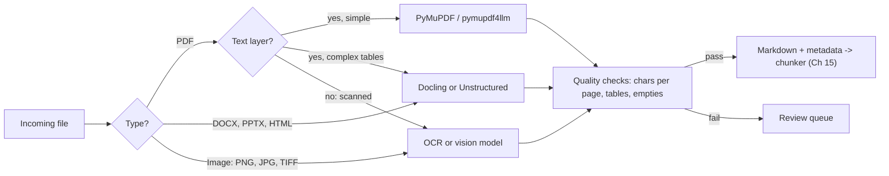
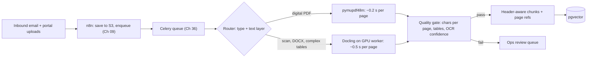

# 20 · Document Parsing: PyMuPDF, Unstructured & Docling

> **In one line:** RAG quality is capped by parsing quality. A PDF isn't text but positioned glyphs, images and lines, so you route each file to the cheapest parser that preserves what matters: PyMuPDF for fast born-digital text, layout-aware tools (pymupdf4llm, Docling, Unstructured) for headings and tables, and OCR or a vision model for scans. Then you measure the output before it reaches a vector store.

> **Versions used:** pymupdf 2.1 (MuPDF 1.28) · pymupdf4llm 2.1 (with pymupdf-layout) · docling 2.x · unstructured 0.x (verify the current release) · pandas 3.x · ollama (python) 0.6 · **Fast-moving:** this is one of the fastest-changing corners of the stack. Docling and Unstructured ship new layout and table models often, pymupdf4llm 2.x added a layout engine and automatic OCR, and vision-model OCR (local and hosted) improves every quarter. Pin versions, keep a set of 20 "nasty" sample files, and re-check output when you upgrade.

---

## 1. Overview

> **Builds on:** [Ch 15 · Document Loaders & Text Splitters](topic.html?p=15-document-loaders-splitters) (loaders produce `Document`s; this chapter is about what's *inside* them) and [Ch 16 · RAG Fundamentals](topic.html?p=16-rag-fundamentals) (where bad parsing shows up as bad answers). Vision OCR goes deeper in [Ch 34 · OCR & Multimodal Vision](topic.html?p=34-ocr-vision).

Ch 15's `PyPDFLoader` gave you "the text of each page". For a clean memo that's enough. For the documents businesses actually run on (contracts with two columns, price lists in tables, scanned invoices, slide decks, 400-page manuals with running headers), naive extraction produces:

- **Tables flattened into word soup:** `Team 6-50 EUR 99 EUR 990`. The model can't tell which number is the annual price.
- **Headers and footers in every chunk:** "ACME Corp – Confidential · Page 3 of 40" embedded 40 times, polluting retrieval.
- **Wrong reading order:** two-column layouts read across columns, mixing sentences.
- **Nothing at all:** scanned PDFs have no text layer, so the "document" is empty and nobody notices until a user asks.



The three tools in the title cover the space well:

- **PyMuPDF** (`pymupdf`, formerly `fitz`): a fast C library binding. Text, coordinates, fonts, images, tables, rendering. Its companion **pymupdf4llm** outputs LLM-ready Markdown.
- **Unstructured**: partitions 25+ file types into typed **elements** (Title, NarrativeText, Table, ListItem...) with metadata, with `fast`, `hi_res` (layout model) and `ocr_only` strategies.
- **Docling** (IBM, now an LF AI & Data project): layout analysis and the TableFormer table-structure model, producing a rich `DoclingDocument` you export to Markdown, JSON or chunks.

> **Why this matters:** every later stage inherits parsing errors. A wrong number in a flattened table becomes a confidently cited wrong answer. An hour spent looking at parsed output saves weeks of prompt tweaking.

---

## 2. Key Concepts

### What's actually inside a PDF

A PDF page is a list of drawing instructions: "place glyph *T* in font F at (72, 710)", "draw a line from A to B", "paint this image here". There are no paragraphs, no tables, no reading order, just positioned characters. Parsing means reconstructing structure from geometry:

- **Born-digital PDFs** (exported from Word, LaTeX, a billing system) have a **text layer**. Extraction is fast and exact, but structure must be inferred.
- **Scanned PDFs** are images of pages. No text layer; you need **OCR** (optical character recognition).
- **Hybrid PDFs** have a scan *plus* an OCR'd text layer added by the scanner, often of poor quality. Check it rather than trusting it.

> **Analogy:** a PDF is a printed page photographed from above with every letter's coordinates written on the back. Text extraction reads the coordinates; layout analysis works out which letters form a heading, a paragraph or a table cell; OCR is what you do when someone forgot to write the coordinates.

### Layout analysis

Layout-aware parsers run a model (or heuristics) over each page to detect **regions**: title, section header, paragraph, list, table, figure, caption, page header/footer. Then they order regions into a **reading order** and emit structured output. This is what turns a two-column paper into correctly ordered Markdown with `#` headings. That structure feeds heading-aware chunking (Ch 15).

### Tables

Tables are the hardest part and usually the most valuable (price lists, SLAs, specs). Approaches, from cheap to expensive:

1. **Ruling lines:** find drawn cell borders (PyMuPDF `find_tables()`). Excellent for ruled tables, weak for whitespace-aligned ones.
2. **Text alignment heuristics:** infer columns from x-positions (`find_tables(strategy="text")`, Camelot "stream").
3. **Table-structure models:** Docling's TableFormer and Unstructured `hi_res` with `infer_table_structure=True` predict rows, columns and spanning cells from the image.
4. **Vision LLMs:** render the page and ask for a Markdown table. Strong on messy tables, slower, and can hallucinate cells, so validate totals.

For RAG, serialise each table as **Markdown or HTML in its own chunk**, with the table's caption and section heading, and keep the DataFrame if you might want to answer numeric questions with code instead of embeddings.

### OCR choices

| Engine | Where | Notes |
|---|---|---|
| **Tesseract** | Local, CPU | Classic, many languages, needs a binary install; good on clean scans |
| **EasyOCR / RapidOCR / PaddleOCR** | Local | Deep-learning OCR; Docling uses EasyOCR by default, pymupdf4llm can use RapidOCR or Tesseract |
| **Vision LLMs** (Qwen2.5-VL, Llama 3.2 Vision via Ollama; GPT/Claude/Gemini hosted) | Local or API | Reads layout and tables too; slower and costlier; can invent text |
| **Cloud document AI** (Azure Document Intelligence, AWS Textract, Google Document AI, LlamaParse, Mistral OCR) | Paid API | Strong tables and forms, per-page pricing, data leaves your network |

```svg
<svg viewBox="0 0 880 340" width="100%" height="340" font-family="ui-sans-serif,system-ui,sans-serif" font-size="11" xmlns="http://www.w3.org/2000/svg">
  <defs><marker id="aa20a" viewBox="0 0 10 10" refX="9" refY="5" markerWidth="7" markerHeight="7" orient="auto"><path d="M0,0 L10,5 L0,10 z" fill="#334155"/></marker></defs>
  <text x="440" y="22" text-anchor="middle" font-size="14" font-weight="700" fill="#1e293b">The same PDF page, parsed three ways</text>
  <rect x="15" y="40" width="200" height="285" rx="6" fill="#ffffff" stroke="#94a3b8"/>
  <text x="25" y="58" fill="#334155" font-size="9">ACME Corp - Confidential</text>
  <text x="25" y="82" fill="#1e293b" font-size="14" font-weight="700">Pricing Policy 2026</text>
  <rect x="25" y="92" width="180" height="34" fill="#f1f5f9"/>
  <text x="29" y="106" fill="#334155" font-size="9">All prices exclude VAT. Annual plans</text>
  <text x="29" y="119" fill="#334155" font-size="9">are refundable within 14 days...</text>
  <rect x="25" y="138" width="180" height="88" fill="none" stroke="#1e293b"/>
  <line x1="25" y1="160" x2="205" y2="160" stroke="#1e293b"/><line x1="25" y1="182" x2="205" y2="182" stroke="#1e293b"/><line x1="25" y1="204" x2="205" y2="204" stroke="#1e293b"/>
  <line x1="70" y1="138" x2="70" y2="226" stroke="#1e293b"/><line x1="115" y1="138" x2="115" y2="226" stroke="#1e293b"/><line x1="160" y1="138" x2="160" y2="226" stroke="#1e293b"/>
  <text x="29" y="153" font-size="9" font-weight="700" fill="#1e293b">Plan</text><text x="74" y="153" font-size="9" font-weight="700" fill="#1e293b">Seats</text><text x="119" y="153" font-size="9" font-weight="700" fill="#1e293b">Monthly</text><text x="164" y="153" font-size="9" font-weight="700" fill="#1e293b">Annual</text>
  <text x="29" y="175" font-size="9" fill="#1e293b">Starter</text><text x="74" y="175" font-size="9" fill="#1e293b">1-5</text><text x="119" y="175" font-size="9" fill="#1e293b">EUR 29</text><text x="164" y="175" font-size="9" fill="#1e293b">EUR 290</text>
  <text x="29" y="197" font-size="9" fill="#1e293b">Team</text><text x="74" y="197" font-size="9" fill="#1e293b">6-50</text><text x="119" y="197" font-size="9" fill="#1e293b">EUR 99</text><text x="164" y="197" font-size="9" fill="#1e293b">EUR 990</text>
  <text x="29" y="219" font-size="9" fill="#1e293b">Business</text><text x="74" y="219" font-size="9" fill="#1e293b">51-500</text><text x="119" y="219" font-size="9" fill="#1e293b">EUR 499</text><text x="164" y="219" font-size="9" fill="#1e293b">EUR 4,990</text>
  <text x="85" y="315" fill="#334155" font-size="9">Page 1 of 2</text>
  <line x1="215" y1="100" x2="250" y2="80" stroke="#334155" stroke-width="1.5" marker-end="url(#aa20a)"/>
  <line x1="215" y1="180" x2="250" y2="180" stroke="#334155" stroke-width="1.5" marker-end="url(#aa20a)"/>
  <line x1="215" y1="260" x2="250" y2="280" stroke="#334155" stroke-width="1.5" marker-end="url(#aa20a)"/>
  <rect x="255" y="40" width="610" height="85" rx="8" fill="#fee2e2" stroke="#dc2626"/>
  <text x="268" y="58" font-weight="700" fill="#dc2626">Plain text extraction</text>
  <text x="268" y="78" fill="#1e293b" font-family="ui-monospace,monospace">ACME Corp - Confidential Pricing Policy 2026 All prices exclude VAT...</text>
  <text x="268" y="96" fill="#1e293b" font-family="ui-monospace,monospace">Plan Seats Monthly price Annual price Starter 1-5 EUR 29 EUR 290 Team...</text>
  <text x="268" y="115" fill="#dc2626">header/footer kept, table flattened: which EUR belongs to which column?</text>
  <rect x="255" y="135" width="610" height="95" rx="8" fill="#dcfce7" stroke="#16a34a"/>
  <text x="268" y="153" font-weight="700" fill="#16a34a">Layout-aware Markdown (pymupdf4llm, Docling, Unstructured)</text>
  <text x="268" y="173" fill="#1e293b" font-family="ui-monospace,monospace"># Pricing Policy 2026</text>
  <text x="268" y="189" fill="#1e293b" font-family="ui-monospace,monospace">|Plan|Seats|Monthly price|Annual price|</text>
  <text x="268" y="205" fill="#1e293b" font-family="ui-monospace,monospace">|Team|6-50|EUR 99|EUR 990|</text>
  <text x="268" y="222" fill="#16a34a">headings kept, table structure kept, running header/footer dropped</text>
  <rect x="255" y="240" width="610" height="85" rx="8" fill="#fef3c7" stroke="#d97706"/>
  <text x="268" y="258" font-weight="700" fill="#d97706">Scanned copy (image only)</text>
  <text x="268" y="278" fill="#1e293b" font-family="ui-monospace,monospace">""   (0 characters: no text layer)</text>
  <text x="268" y="298" fill="#1e293b">needs OCR: Tesseract / RapidOCR / EasyOCR, or a vision model</text>
  <text x="268" y="315" fill="#d97706">detect it (chars per page = 0, page has an image) or it silently vanishes from RAG</text>
</svg>
```

### Parsing at scale

Parsing is **CPU-bound** (and GPU-hungry for layout models), so: use **processes** not threads, cap per-file time and memory, **cache by content hash** so unchanged files are never re-parsed, isolate failures per file, and emit a **quality report** (characters per page, empty pages, OCR rate, table count) so a bad batch is caught before it reaches the index. For large volumes, run parsing as queued jobs ([Ch 36](topic.html?p=36-scheduling-task-queues)).

---

## 3. Setup

```bash
pip install "pymupdf>=2.1" "pymupdf4llm>=2.1" "pandas>=2" "python-dotenv>=1" "ollama>=0.6"
# Optional heavy hitters (each pulls in ML models; torch for Docling, ~1–3 GB):
pip install "docling>=2"                   # layout + TableFormer, MIT licensed
pip install "unstructured[pdf]"            # or "unstructured[all-docs]"; plus system deps below
# OCR engines (pick one): Tesseract binary, or RapidOCR for pymupdf4llm
brew install tesseract                     # macOS; apt-get install tesseract-ocr on Debian/Ubuntu
pip install rapidocr onnxruntime           # what pymupdf4llm's "RapidOCR is missing" warning refers to
ollama pull qwen2.5vl                      # optional local vision model for hard pages (check Ollama's library)
```

Unstructured's `hi_res` and Office support also need system packages: `libmagic`, `poppler`, `tesseract`, and `libreoffice` for `.doc`/`.ppt`. Their Docker image (`downloads.unstructured.io/unstructured-io/unstructured`) bundles all of it.

```bash
# .env.example
OLLAMA_HOST=http://localhost:11434
VISION_MODEL=qwen2.5vl              # or llama3.2-vision; check `ollama list`
TESSDATA_PREFIX=                    # only if PyMuPDF can't find Tesseract's language data
UNSTRUCTURED_API_KEY=               # optional: hosted Unstructured API (paid)
```

Generate the two test files used throughout: a born-digital "pricing policy" with a ruled table and running header/footer, and a scanned copy with no text layer.

```python
# make_pdfs.py — builds two test PDFs: a born-digital report with a table, and a "scanned" copy (image only)
from pathlib import Path

import pymupdf

ROWS = [("Plan", "Seats", "Monthly price", "Annual price"),
        ("Starter", "1-5", "EUR 29", "EUR 290"),
        ("Team", "6-50", "EUR 99", "EUR 990"),
        ("Business", "51-500", "EUR 499", "EUR 4,990")]


def draw_table(page: pymupdf.Page, x0: float, y0: float, col_w: float = 120, row_h: float = 22) -> None:
    for r, row in enumerate(ROWS):
        for c, cell in enumerate(row):
            rect = pymupdf.Rect(x0 + c * col_w, y0 + r * row_h, x0 + (c + 1) * col_w, y0 + (r + 1) * row_h)
            page.draw_rect(rect, color=(0, 0, 0), width=0.7)          # ruled cells: easy for table finders
            page.insert_text((rect.x0 + 5, rect.y1 - 7), cell, fontsize=10,
                             fontname="hebo" if r == 0 else "helv")


def build(out: Path) -> None:
    doc = pymupdf.open()
    for n in (1, 2):
        page = doc.new_page()                                          # A4-ish default 595 x 842
        page.insert_text((50, 30), "ACME Corp - Confidential", fontsize=8)       # running header
        page.insert_text((270, 820), f"Page {n} of 2", fontsize=8)               # running footer
        if n == 1:
            page.insert_text((50, 80), "Pricing Policy 2026", fontsize=18, fontname="hebo")
            page.insert_textbox(pymupdf.Rect(50, 100, 545, 180),
                                "All prices exclude VAT. Annual plans are billed upfront and are refundable "
                                "within 14 days of purchase. Discounts above 20% require approval by the CFO.",
                                fontsize=11)
            draw_table(page, 50, 200)
        else:
            page.insert_text((50, 80), "Approval rules", fontsize=14, fontname="hebo")
            page.insert_textbox(pymupdf.Rect(50, 100, 545, 200),
                                "Sales managers may approve discounts up to 20%. Anything above needs the CFO. "
                                "Non-profit customers receive 30% off the Team plan on request.", fontsize=11)
    doc.save(out)


def scan_copy(src: Path, out: Path, dpi: int = 150) -> None:
    """Simulate a scanner: rasterise every page, keep only the image (no text layer)."""
    scanned = pymupdf.open()
    for page in pymupdf.open(src):
        pix = page.get_pixmap(dpi=dpi)
        new = scanned.new_page(width=page.rect.width, height=page.rect.height)
        new.insert_image(new.rect, stream=pix.tobytes("png"))     # PNG keeps the file small
    scanned.save(out, garbage=3, deflate=True)


if __name__ == "__main__":
    Path("pdfs").mkdir(exist_ok=True)
    build(Path("pdfs/pricing.pdf"))
    scan_copy(Path("pdfs/pricing.pdf"), Path("pdfs/pricing_scanned.pdf"))
    for p in sorted(Path("pdfs").glob("*.pdf")):
        print(p, p.stat().st_size, "bytes")
```

```text
pdfs/pricing.pdf 6682 bytes
pdfs/pricing_scanned.pdf 87605 bytes
```

> **Licence note:** PyMuPDF and pymupdf4llm are **AGPL-3.0** (commercial licences from Artifex). Using them inside a closed-source product you distribute or offer as a network service has obligations; check with your legal team. Docling (MIT), Unstructured (Apache-2.0), pypdf (BSD) and pdfplumber (MIT) are permissive.

---

## 4. Code Examples

### Example 1: PyMuPDF basics: text, blocks, boilerplate and scan detection

```python
# pdf_basics.py — PyMuPDF: text, blocks with coordinates, header/footer removal, scanned-page detection
import re
import sys
from collections import Counter

import pymupdf


def page_report(path: str) -> None:
    doc = pymupdf.open(path)
    print(f"{path}: {doc.page_count} pages, metadata title={doc.metadata.get('title')!r}")
    for page in doc:
        text = page.get_text("text")
        images = len(page.get_images())
        print(f"  p{page.number + 1}: {len(text):5d} chars, {images} images"
              f"{'  <- no text layer: needs OCR' if len(text.strip()) < 20 and images else ''}")


def repeated_lines(doc: pymupdf.Document, min_share: float = 0.6) -> set[str]:
    """Lines (digits normalised) that appear on most pages are headers/footers."""
    counts = Counter()
    for page in doc:
        lines = {re.sub(r"\d+", "#", ln.strip()) for ln in page.get_text("text").splitlines() if ln.strip()}
        counts.update(lines)
    return {ln for ln, c in counts.items() if c >= max(2, min_share * doc.page_count)}


def clean_blocks(path: str) -> list[dict]:
    doc = pymupdf.open(path)
    boiler = repeated_lines(doc)
    out = []
    for page in doc:
        # blocks: (x0, y0, x1, y1, text, block_no, block_type); sort=True gives reading order top-left first
        for x0, y0, x1, y1, text, _, btype in page.get_text("blocks", sort=True):
            text = " ".join(text.split())
            if btype != 0 or not text or re.sub(r"\d+", "#", text) in boiler:
                continue                                    # skip images and headers/footers
            out.append({"page": page.number + 1, "bbox": [round(v) for v in (x0, y0, x1, y1)], "text": text})
    return out


if __name__ == "__main__":
    for p in sys.argv[1:] or ["pdfs/pricing.pdf", "pdfs/pricing_scanned.pdf"]:
        page_report(p)
    print("boilerplate:", repeated_lines(pymupdf.open("pdfs/pricing.pdf")))
    for b in clean_blocks("pdfs/pricing.pdf")[:4]:
        print(b)
```

Real output:

```text
pdfs/pricing.pdf: 2 pages, metadata title=''
  p1:   333 chars, 0 images
  p2:   193 chars, 0 images
pdfs/pricing_scanned.pdf: 2 pages, metadata title=''
  p1:     0 chars, 1 images  <- no text layer: needs OCR
  p2:     0 chars, 1 images  <- no text layer: needs OCR
boilerplate: {'Page # of #', 'ACME Corp - Confidential'}
{'page': 1, 'bbox': [50, 61, 214, 86], 'text': 'Pricing Policy 2026'}
{'page': 1, 'bbox': [50, 100, 495, 131], 'text': 'All prices exclude VAT. Annual plans are billed upfront and are refundable within 14 days of purchase. Discounts above 20% require approval by the CFO.'}
{'page': 1, 'bbox': [55, 204, 476, 218], 'text': 'Plan Seats Monthly price Annual price'}
{'page': 1, 'bbox': [55, 226, 456, 240], 'text': 'Starter 1-5 EUR 29 EUR 290'}
```

Three habits worth stealing. **Count characters per page** and flag pages with images but no text: that one check catches every scanned document. **Detect boilerplate statistically** (lines on most pages, digits normalised so "Page 1 of 2" and "Page 2 of 2" match) instead of hard-coding strings. **Keep bounding boxes**: they let you drop headers by position, map citations back to a highlighted region, and exclude table areas from prose. Note how the table rows came out as flat lines: readable, but the column meaning is gone.

### Example 2: Tables as DataFrames and Markdown

```python
# pdf_tables.py — find tables with PyMuPDF, get DataFrames and Markdown, and keep them out of the prose
import pymupdf


def extract_tables(path: str) -> list[dict]:
    out = []
    for page in pymupdf.open(path):
        for i, tab in enumerate(page.find_tables().tables):   # ruled tables work best; strategy="text" for unruled
            out.append({"page": page.number + 1, "index": i, "bbox": [round(v) for v in tab.bbox],
                        "markdown": tab.to_markdown(), "df": tab.to_pandas()})
    return out


def prose_without_tables(path: str) -> list[str]:
    """Text blocks that do NOT overlap a table, so table cells aren't duplicated as broken prose."""
    texts = []
    for page in pymupdf.open(path):
        boxes = [pymupdf.Rect(t.bbox) for t in page.find_tables().tables]
        for x0, y0, x1, y1, text, _, btype in page.get_text("blocks", sort=True):
            if btype == 0 and not any(pymupdf.Rect(x0, y0, x1, y1).intersects(b) for b in boxes):
                texts.append(" ".join(text.split()))
    return texts


if __name__ == "__main__":
    for t in extract_tables("pdfs/pricing.pdf"):
        print(f"page {t['page']} table {t['index']} bbox={t['bbox']}")
        print(t["markdown"])
        print(t["df"].shape, list(t["df"].columns))
    print(prose_without_tables("pdfs/pricing.pdf")[:3])
```

Real output:

```text
page 1 table 0 bbox=[50, 200, 530, 288]
|Plan|Seats|Monthlyprice|Annualprice|
|---|---|---|---|
|Starter|1-5|EUR 29|EUR 290|
|Team|6-50|EUR 99|EUR 990|
|Business|51-500|EUR 499|EUR 4,990|

(3, 4) ['Plan', 'Seats', 'Monthlyprice', 'Annualprice']
['ACME Corp - Confidential', 'Pricing Policy 2026', 'All prices exclude VAT. Annual plans are billed upfront and are refundable within 14 days of purchase. Discounts above 20% require approval by the CFO.']
```

The table structure is perfect, and so is a real-world wart: the bold header cells lost their spaces (`Monthlyprice`) because of how the font's spacing was encoded. Always eyeball a sample and map headers to known column names (`df = df.rename(columns={"Monthlyprice": "monthly_price", ...})`) before anything downstream depends on them. pymupdf4llm (Example 3) gets these headers right. `prose_without_tables()` shows the other half of the job: exclude table regions from the prose so the same numbers don't also appear as flattened text in another chunk.

> **Gotcha:** `find_tables()` defaults to line-based detection. For whitespace-aligned tables (no borders) try `page.find_tables(strategy="text")`, and expect to tune it. If you have many such tables, a model-based parser (Example 5 or 6) is usually less work.

### Example 3: LLM-ready Markdown with pymupdf4llm

```python
# pdf_markdown.py — PDF -> Markdown per page with pymupdf4llm (headings, tables, no running headers/footers)
import pymupdf4llm

if __name__ == "__main__":
    pages = pymupdf4llm.to_markdown("pdfs/pricing.pdf", page_chunks=True,   # one dict per page
                                    header=False, footer=False)             # drop detected running headers/footers
    for p in pages:
        print(f"--- page {p['metadata']['page_number']}")
        print(p["text"].strip())
```

Real output (the RapidOCR warning on stderr is omitted):

```text
--- page 1
# **Pricing Policy 2026** 

All prices exclude VAT. Annual plans are billed upfront and are refundable within 14 days of purchase. Discounts above 20% require approval by the CFO. 

|**Plan**|**Seats**|**Monthly price**|**Annual price**|
|---|---|---|---|
|Starter|1-5|EUR 29|EUR 290|
|Team|6-50|EUR 99|EUR 990|
|Business|51-500|EUR 499|EUR 4,990|
--- page 2
## **Approval rules** 

Sales managers may approve discounts up to 20%. Anything above needs the CFO. Non-profit customers receive 30% off the Team plan on request.
```

One call gives headings inferred from font size (`#`, `##`), a Markdown table with correct header spacing, and no running header or footer (`header=False, footer=False`). `page_chunks=True` returns one dict per page with `metadata` (page number, file path), `toc_items` and `page_boxes`, so you keep page numbers for citations. Feed this straight into Ch 15's `MarkdownHeaderTextSplitter`. Strip the `**` bold markers if your embedder doesn't like them.

> **Version note:** pymupdf4llm 2.x uses a layout model (the `pymupdf-layout` package) and, when RapidOCR or Tesseract is installed, OCRs pages that need it automatically (`use_ocr`, `ocr_language`, `force_ocr` options). Without an OCR engine, the scanned copy returns empty text, which is why Example 4 exists.

### Example 4: An OCR fallback chain for scanned pages

```python
# pdf_ocr.py — per-page routing: text layer -> Tesseract OCR via PyMuPDF -> local vision model (Ollama)
import os
import sys

import pymupdf
from dotenv import load_dotenv

load_dotenv()
MIN_CHARS = 50                        # below this a page is treated as "no usable text layer"


def needs_ocr(page: pymupdf.Page) -> bool:
    return len(page.get_text("text").strip()) < MIN_CHARS and bool(page.get_images())


def ocr_tesseract(page: pymupdf.Page, lang: str = "eng") -> str:
    # Needs the Tesseract binary + language data installed (brew/apt install tesseract); dpi 300 is the sweet spot
    tp = page.get_textpage_ocr(language=lang, dpi=300, full=True)
    return page.get_text("text", textpage=tp)


def ocr_vision_llm(page: pymupdf.Page) -> str:
    # A local vision model reads the page image; slower, but handles tables, stamps and handwriting better
    import ollama
    client = ollama.Client(host=os.getenv("OLLAMA_HOST", "http://localhost:11434"))
    png = page.get_pixmap(dpi=150).tobytes("png")
    resp = client.chat(model=os.getenv("VISION_MODEL", "qwen2.5vl"), messages=[{
        "role": "user",
        "content": "Transcribe this page to Markdown. Keep tables as Markdown tables. Output only the transcription.",
        "images": [png]}])
    return resp.message.content


def extract_page(page: pymupdf.Page) -> tuple[str, str]:
    """Return (text, method) for one page, trying the cheapest method first."""
    if not needs_ocr(page):
        return page.get_text("text", sort=True), "text-layer"
    for name, fn in (("tesseract", ocr_tesseract), ("vision-llm", ocr_vision_llm)):
        try:
            text = fn(page)
            if len(text.strip()) >= MIN_CHARS:
                return text, name
        except Exception as e:                    # engine missing, model not pulled, server down...
            print(f"  p{page.number + 1}: {name} unavailable ({type(e).__name__})", file=sys.stderr)
    return "", "failed"


if __name__ == "__main__":
    for path in sys.argv[1:] or ["pdfs/pricing.pdf", "pdfs/pricing_scanned.pdf"]:
        for page in pymupdf.open(path):
            text, method = extract_page(page)
            print(f"{path} p{page.number + 1}: {method:10} {len(text):4d} chars  {text[:50]!r}")
```

Real output on a machine with neither Tesseract nor Ollama running:

```text
  p1: tesseract unavailable (RuntimeError)
  p1: vision-llm unavailable (ConnectionError)
  p2: tesseract unavailable (RuntimeError)
  p2: vision-llm unavailable (ConnectionError)
pdfs/pricing.pdf p1: text-layer  562 chars  'ACME Corp - Confidential\n\nPricing Policy 2026\n\nAll'
pdfs/pricing.pdf p2: text-layer  247 chars  'ACME Corp - Confidential\n\n\nApproval rules\n\nSales m'
pdfs/pricing_scanned.pdf p1: failed        0 chars  ''
pdfs/pricing_scanned.pdf p2: failed        0 chars  ''
```

With `brew install tesseract`, the scanned pages come back as `tesseract` with roughly the original text; with Ollama and a vision model pulled, the vision step also returns the table as Markdown. The important design points are the **per-page** decision (mixed PDFs are common: a typed contract with a scanned signature page), **cheapest method first**, and an explicit `failed` status that your pipeline reports rather than silently indexing an empty page.

> **Gotcha:** vision models are fluent, so OCR errors look like plausible text. For numbers that matter (amounts, dates, IDs), cross-check: compare Tesseract and vision outputs, validate totals in tables, or send low-confidence pages to a human (Ch 24's human-in-the-loop).

### Example 5: Unstructured: typed elements and title-based chunking

Not run here (the `hi_res` strategy pulls in layout models and system packages); the code follows Unstructured's documented open-source API.

```python
# unstructured_parse.py — partition any file into typed elements, then chunk by section title
import sys
from collections import Counter

from unstructured.chunking.title import chunk_by_title
from unstructured.partition.auto import partition


def parse(path: str, strategy: str = "auto"):
    # strategy: "fast" (text layer, pdfminer), "hi_res" (layout model, tables), "ocr_only" (Tesseract), "auto"
    return partition(filename=path, strategy=strategy, infer_table_structure=True, languages=["eng"])


if __name__ == "__main__":
    path = sys.argv[1] if len(sys.argv) > 1 else "pdfs/pricing.pdf"
    elements = parse(path, strategy="hi_res")
    print(Counter(el.category for el in elements))            # e.g. Title, NarrativeText, Table, Header, Footer
    for el in elements:
        if el.category == "Table":
            print("page", el.metadata.page_number, el.metadata.text_as_html[:120])
    body = [el for el in elements if el.category not in {"Header", "Footer", "PageNumber"}]
    for chunk in chunk_by_title(body, max_characters=1500, combine_text_under_n_chars=200):
        print(f"--- {len(chunk.text)} chars, page {chunk.metadata.page_number}: {chunk.text[:70]!r}")
```

Illustrative output:

```text
Counter({'NarrativeText': 2, 'Title': 2, 'Header': 2, 'Footer': 2, 'Table': 1})
page 1 <table><thead><tr><th>Plan</th><th>Seats</th><th>Monthly price</th><th>Annual price</th></tr></thead><tbody>
--- 412 chars, page 1: 'Pricing Policy 2026\n\nAll prices exclude VAT. Annual plans are billed upfront'
--- 186 chars, page 2: 'Approval rules\n\nSales managers may approve discounts up to 20%. Anything above'
```

Unstructured's strength is **breadth**: one `partition()` call for PDF, DOCX, PPTX, XLSX, HTML, EML/MSG emails, EPUB and images, all yielding the same element types. Element categories make boilerplate removal a one-liner, and `chunk_by_title` starts a new chunk at each `Title`, which is section-aware chunking for free. Tables come back as HTML in `metadata.text_as_html`. The hosted Unstructured API (paid, `unstructured-client` package) runs the heavier models for you.

### Example 6: Docling: layout, TableFormer and structure-aware chunks

Also not run here (Docling installs PyTorch and downloads layout/table models on first use); the code follows Docling's documented API.

```python
# docling_parse.py — convert with OCR + table structure, export Markdown and DataFrames, chunk with HybridChunker
import sys

from docling.chunking import HybridChunker
from docling.datamodel.base_models import InputFormat
from docling.datamodel.pipeline_options import PdfPipelineOptions, TableStructureOptions
from docling.document_converter import DocumentConverter, PdfFormatOption


def make_converter(ocr: bool = True) -> DocumentConverter:
    opts = PdfPipelineOptions()
    opts.do_ocr = ocr                                   # OCR bitmap regions (EasyOCR by default)
    opts.do_table_structure = True                      # TableFormer: rows, columns, spanning cells
    opts.table_structure_options = TableStructureOptions(do_cell_matching=True)
    return DocumentConverter(format_options={InputFormat.PDF: PdfFormatOption(pipeline_options=opts)})


if __name__ == "__main__":
    path = sys.argv[1] if len(sys.argv) > 1 else "pdfs/pricing_scanned.pdf"
    result = make_converter().convert(path)             # also accepts DOCX, PPTX, HTML, images, URLs
    doc = result.document
    print(doc.export_to_markdown()[:500])
    for i, table in enumerate(doc.tables):
        df = table.export_to_dataframe(doc=doc)
        print(f"table {i}: {df.shape}\n{df.head()}")
    chunker = HybridChunker()                           # pass a tokenizer matching your embedder in production
    for chunk in chunker.chunk(dl_doc=doc):
        print("---", chunk.meta.headings, repr(chunker.contextualize(chunk=chunk)[:80]))
```

Illustrative output (on the *scanned* copy, with OCR):

```text
## Pricing Policy 2026

All prices exclude VAT. Annual plans are billed upfront and are refundable within 14 days of purchase. ...

| Plan     | Seats   | Monthly price   | Annual price   |
|----------|---------|-----------------|----------------|
| Starter  | 1-5     | EUR 29          | EUR 290        |
table 0: (3, 4)
       Plan   Seats Monthly price Annual price
0   Starter     1-5        EUR 29      EUR 290
--- ['Pricing Policy 2026'] 'Pricing Policy 2026\nAll prices exclude VAT. Annual plans are billed upfront and'
```

Docling's strengths are **table structure** (TableFormer handles borderless and spanning cells that line-based detection misses), a **lossless document model** you can export to Markdown, HTML, JSON or DocTags, and **HybridChunker**, which splits by document structure and token budget and repeats headings via `contextualize()`, exactly what Ch 15 recommended doing by hand. It also ships a CLI (`docling file.pdf --to md`) and a VLM pipeline (`--pipeline vlm`) for hard documents. The cost is speed: seconds per page on CPU, much faster on a GPU or Apple Silicon.

### Example 7: Comparing parsers on your own nasty files

The only benchmark that matters is your documents. This harness runs whichever parsers are installed over a folder and reports characters, table count and time per file.

```python
# compare_parsers.py — python compare_parsers.py samples/   (missing parsers are skipped)
import sys
import time
from pathlib import Path

import pandas as pd


def with_pymupdf(path: Path) -> str:
    import pymupdf
    return "\n".join(page.get_text("text", sort=True) for page in pymupdf.open(path))


def with_pymupdf4llm(path: Path) -> str:
    import pymupdf4llm
    return pymupdf4llm.to_markdown(str(path), header=False, footer=False)


def with_unstructured(path: Path) -> str:
    from unstructured.partition.auto import partition
    return "\n\n".join(el.metadata.text_as_html or el.text if el.category == "Table" else el.text
                       for el in partition(filename=str(path), strategy="hi_res", infer_table_structure=True))


def with_docling(path: Path) -> str:
    from docling.document_converter import DocumentConverter
    return DocumentConverter().convert(str(path)).document.export_to_markdown()


PARSERS = {"pymupdf": with_pymupdf, "pymupdf4llm": with_pymupdf4llm,
           "unstructured": with_unstructured, "docling": with_docling}

if __name__ == "__main__":
    folder = Path(sys.argv[1] if len(sys.argv) > 1 else "pdfs")
    rows = []
    for name, fn in PARSERS.items():
        for f in sorted(folder.glob("*.pdf")):
            t0 = time.perf_counter()
            try:
                text, err = fn(f), ""
            except ImportError:
                text, err = "", "not installed"
            except Exception as e:
                text, err = "", type(e).__name__
            Path("out", name).mkdir(parents=True, exist_ok=True)
            Path("out", name, f.stem + ".md").write_text(text)      # diff these by eye
            rows.append({"parser": name, "file": f.name, "chars": len(text), "md_tables":
                         sum(ln.startswith("|--") for ln in text.splitlines()),
                         "html_tables": text.count("<table"), "sec": round(time.perf_counter() - t0, 2), "error": err})
    print(pd.DataFrame(rows).to_string(index=False))
```

Real output with only PyMuPDF installed:

```text
      parser                file  chars  md_tables  html_tables  sec         error
     pymupdf         pricing.pdf    810          0            0 0.04              
     pymupdf pricing_scanned.pdf      1          0            0 0.00              
 pymupdf4llm         pricing.pdf    518          1            0 0.39              
 pymupdf4llm pricing_scanned.pdf      0          0            0 0.26              
unstructured         pricing.pdf      0          0            0 0.00 not installed
unstructured pricing_scanned.pdf      0          0            0 0.00 not installed
     docling         pricing.pdf      0          0            0 0.00 not installed
     docling pricing_scanned.pdf      0          0            0 0.00 not installed
```

Numbers only tell you where to look. Open the files in `out/` side by side for your 20 hardest documents (multi-column, borderless tables, scans, forms) and judge by eye before you choose.

---

## 5. Real-World Use Case

**Company:** a mid-size insurance broker. **Problem:** underwriters answer coverage questions from ~22,000 policy wordings and endorsements per year: 30% born-digital PDFs from insurers, 45% scanned or faxed PDFs, 25% DOCX. The first RAG prototype used `PyPDFLoader`; it answered well on the digital third and either hallucinated or said "I don't know" on everything else, because scanned files were silently indexed as empty and deductible tables were flattened.



**Design:** a router sends born-digital PDFs to pymupdf4llm (fast, cheap) and everything else to Docling on one GPU worker. Every page gets a `method` and quality metrics; documents with > 10% empty pages or OCR'd tables whose column count varies by row go to a review queue. Tables are stored twice: as Markdown chunks for retrieval, and as DataFrames in Postgres so "what's the deductible for flood in policy X" can be answered by SQL through a tool ([Ch 04](topic.html?p=04-function-calling)).

**Numbers:** ~22k documents × ~18 pages ≈ 400k pages/year, ~1,600 pages per working day. pymupdf4llm handles ~30% of pages at ~0.2 s/page on CPU; Docling handles the rest at ~0.5 s/page on one mid-range GPU (≈ 2.5 GPU-hours/day). A cloud document-AI service was priced as an alternative at their per-page rate. Compute your own from the vendor's pricing page; at this volume self-hosting was cheaper and kept documents in-region. Gold-set answer accuracy went from 58% to 86%; the remaining errors were mostly handwriting in endorsements, now routed to humans.

---

## 6. Mini Project: A Parsing Service With a Quality Gate (1–2 hours)

**Goal:** a CLI that parses a folder of mixed documents in parallel, caches results by content hash, writes page-level JSONL for Ch 15/16, prints a per-file quality report, and exits non-zero when too many pages are unusable, so it can run as a CI or cron step.

```text
parse-service/
├── .env
├── make_pdfs.py          # from Setup (or drop your own files in inbox/)
├── pdf_ocr.py            # Example 4 (stretch goal: wire it in)
├── parse_folder.py       # this project
├── inbox/                # files to parse
└── parsed/pages.jsonl    # output
```

**Step 1: the parser.** Routing by extension, a content-hash cache, per-file error isolation, a process pool and a quality gate.

```python
# parse_folder.py — python parse_folder.py inbox/ --out parsed/pages.jsonl --workers 4
import argparse
import hashlib
import json
import sys
import time
from concurrent.futures import ProcessPoolExecutor, as_completed
from pathlib import Path

import pandas as pd

CACHE = Path(".parse_cache")
MIN_CHARS = 50


def count_tables(md: str) -> int:
    return sum(1 for line in md.splitlines() if line.startswith("|---"))   # one separator row per table


def sha256(path: Path) -> str:
    h = hashlib.sha256()
    with path.open("rb") as fh:
        for block in iter(lambda: fh.read(1 << 20), b""):
            h.update(block)
    return h.hexdigest()


def parse_pdf(path: Path) -> list[dict]:
    import pymupdf
    import pymupdf4llm
    doc = pymupdf.open(path)
    pages = pymupdf4llm.to_markdown(doc, page_chunks=True, header=False, footer=False)
    out = []
    for p in pages:
        n = p["metadata"]["page_number"]
        text = p["text"].strip()
        method = "pymupdf4llm"
        if len(text) < MIN_CHARS and doc[n - 1].get_images():
            method = "needs-ocr"                       # route to pdf_ocr.extract_page or a vision model later
        out.append({"page": n, "text": text, "method": method, "tables": count_tables(text)})
    return out


def parse_office(path: Path) -> list[dict]:
    try:
        from docling.document_converter import DocumentConverter   # optional, heavy dependency
    except ImportError:
        return [{"page": None, "text": "", "method": "skipped: pip install docling", "tables": 0}]
    md = DocumentConverter().convert(str(path)).document.export_to_markdown()
    return [{"page": None, "text": md, "method": "docling", "tables": count_tables(md)}]


ROUTES = {".pdf": parse_pdf, ".docx": parse_office, ".pptx": parse_office, ".html": parse_office}


def parse_file(path_str: str) -> list[dict]:
    path = Path(path_str)
    digest = sha256(path)
    cached = CACHE / f"{digest}.json"
    if cached.exists():                                # unchanged file: reuse the previous parse
        return json.loads(cached.read_text())
    t0 = time.perf_counter()
    try:
        pages = ROUTES[path.suffix.lower()](path)
    except Exception as e:                             # one bad file must not kill the batch
        pages = [{"page": None, "text": "", "method": f"error: {type(e).__name__}: {e}"[:200], "tables": 0}]
    ms = round((time.perf_counter() - t0) * 1000)
    rows = [{"doc_id": digest[:16], "source": path.name, "parse_ms": ms, **p} for p in pages]
    CACHE.mkdir(exist_ok=True)
    cached.write_text(json.dumps(rows))
    return rows


def main() -> None:
    ap = argparse.ArgumentParser()
    ap.add_argument("folder")
    ap.add_argument("--out", default="parsed/pages.jsonl")
    ap.add_argument("--workers", type=int, default=4)
    a = ap.parse_args()

    files = [p for p in sorted(Path(a.folder).rglob("*")) if p.suffix.lower() in ROUTES]
    rows: list[dict] = []
    with ProcessPoolExecutor(max_workers=a.workers) as pool:   # parsing is CPU-bound: processes, not threads
        futures = {pool.submit(parse_file, str(f)): f for f in files}
        for fut in as_completed(futures):
            rows.extend(fut.result())

    Path(a.out).parent.mkdir(parents=True, exist_ok=True)
    with open(a.out, "w", encoding="utf-8") as fh:
        for r in rows:
            fh.write(json.dumps(r, ensure_ascii=False) + "\n")

    df = pd.DataFrame(rows)
    df["chars"] = df.text.str.len()
    report = df.groupby("source").agg(pages=("page", "count"), chars=("chars", "sum"), tables=("tables", "sum"),
                                      methods=("method", lambda s: ",".join(sorted(set(s)))), parse_ms=("parse_ms", "max"))
    print(report.to_string())
    bad = df[(df.chars < MIN_CHARS) | df.method.str.startswith(("error", "needs-ocr", "skipped"))]
    print(f"\n{len(files)} files, {len(df)} pages -> {a.out}; {len(bad)} pages need attention")
    if len(bad):
        print(bad[["source", "page", "method"]].to_string(index=False))
    sys.exit(1 if len(bad) > 0.2 * len(df) else 0)    # fail the job if >20% of pages are unusable


if __name__ == "__main__":
    main()
```

**Step 2: run it** on the sample files plus a deliberately broken one.

```bash
python make_pdfs.py && mkdir -p inbox && cp pdfs/*.pdf inbox/
echo "not a real pdf" > inbox/broken.pdf
python parse_folder.py inbox --out parsed/pages.jsonl
echo "exit code: $?"
python parse_folder.py inbox      # second run: served from .parse_cache
```

Real output (stderr warnings omitted):

```text
                     pages  chars  tables                                                                    methods  parse_ms
source
broken.pdf               0      0       0  error: FileDataError: Failed to open file 'inbox/broken.pdf' as type pdf.        55
pricing.pdf              2    511       1                                                                pymupdf4llm       438
pricing_scanned.pdf      2      0       0                                                                  needs-ocr       515

3 files, 5 pages -> parsed/pages.jsonl; 3 pages need attention
             source  page                                                                    method
         broken.pdf   NaN error: FileDataError: Failed to open file 'inbox/broken.pdf' as type pdf.
pricing_scanned.pdf   1.0                                                                 needs-ocr
pricing_scanned.pdf   2.0                                                                 needs-ocr
exit code: 1
```

The broken file didn't crash the batch, the scanned pages were flagged instead of indexed as empty, and the job failed loudly because 3 of 5 pages were unusable.

**Done when:**
- [ ] `pages.jsonl` has one row per page with `doc_id`, `source`, `page`, `method`, `text`, `tables`.
- [ ] A corrupt file produces an `error:` row, not a crash.
- [ ] Scanned pages are flagged `needs-ocr` and the exit code is non-zero when > 20% of pages are unusable.
- [ ] A second run is near-instant because of the content-hash cache.

**Stretch goals:** call `pdf_ocr.extract_page()` for `needs-ocr` pages and record which engine succeeded; add Docling for DOCX/PPTX and for PDFs where `find_tables()` finds nothing but the page has many aligned numbers; add a per-file timeout (run each file in a subprocess with `future.result(timeout=...)`); write tables to a `tables.parquet` alongside the JSONL; trigger the CLI from an n8n folder watcher ([Ch 12](topic.html?p=12-n8n-with-python)).

---

## 7. Comparison Table

| | **PyMuPDF** | **pymupdf4llm** | **Unstructured (OSS)** | **Docling** | **pypdf / pdfplumber** | **Vision LLM** | **Cloud doc AI** |
|---|---|---|---|---|---|---|---|
| Formats | PDF, XPS, EPUB, images | PDF (+ what PyMuPDF opens) | 25+ incl. DOCX, PPTX, XLSX, HTML, email | PDF, DOCX, PPTX, XLSX, HTML, images, audio | PDF | Images (render pages) | PDF, images, forms |
| Output | Text, blocks, spans, coordinates | Markdown / JSON per page | Typed elements + metadata | DoclingDocument → MD/JSON/HTML, chunks | Text (+ tables in pdfplumber) | Whatever you prompt | JSON with layout, key-values, tables |
| Tables | Ruled tables good | Good | `hi_res` model | **Best OSS** (TableFormer) | pdfplumber decent, pypdf none | Good, may invent cells | Very good |
| OCR | Tesseract via `get_textpage_ocr` | Auto with RapidOCR/Tesseract | Tesseract/Paddle | EasyOCR/Tesseract/others | None | Built in | Built in |
| Speed (CPU) | ~ms per page | ~0.1–0.5 s per page | fast: quick; hi_res: seconds | ~1–3 s per page; fast on GPU | Fast | Slow | Network-bound |
| Install weight | Small | Small | Medium–heavy (+ system deps) | Heavy (PyTorch, models) | Tiny | Ollama + model, or API | SDK only |
| Licence / cost | AGPL or commercial | AGPL or commercial | Apache-2.0; paid API | MIT | BSD / MIT | Free local or per-token | Per page |

**When to use which:**
- **Born-digital PDFs, high volume, simple layout:** pymupdf4llm (or plain PyMuPDF when you want coordinates). Check the AGPL fits your product, or use pypdf/pdfplumber.
- **Complex tables, multi-column reports, mixed Office formats, scans, self-hosted:** Docling.
- **Many file types through one API, element-level metadata, or a hosted option:** Unstructured.
- **The 5% of pages nothing else handles** (handwriting, stamps, photos of documents): a vision model, with validation.
- **Forms, invoices and IDs at scale with SLAs:** a cloud document-AI service, if data may leave your network.
- In practice: **route** per file and per page. Cheap parser first, escalate on quality signals.

---

## 8. Common Mistakes & Best Practices

**Mistake 1: indexing empty scanned pages.** Nothing errors; the documents just never get retrieved. *Fix:* chars-per-page check plus "has image", OCR fallback, and a report that fails the batch above a threshold.

**Mistake 2: flattening tables into prose.** Numbers lose their columns, the LLM guesses. *Fix:* extract tables as structures, store each as its own Markdown/HTML chunk with caption and heading, and exclude table regions from the prose text.

**Mistake 3: keeping headers, footers and page numbers.** They repeat in every chunk and dominate similarity for short queries. *Fix:* statistical boilerplate detection, element categories (Unstructured `Header`/`Footer`), or `header=False, footer=False` in pymupdf4llm.

```python
# Before: every chunk starts with "ACME Corp - Confidential ... Page 3 of 40"
text = "\n".join(page.get_text() for page in doc)
# After: layout-aware Markdown without running headers/footers, page numbers kept as metadata
pages = pymupdf4llm.to_markdown(doc, page_chunks=True, header=False, footer=False)
```

**Mistake 4: choosing a parser from a demo.** Every tool looks great on its showcase PDF. *Fix:* 20 of your hardest real files, run through every candidate (Example 7), judged by eye and by downstream retrieval hit rate.

**Mistake 5: re-parsing everything on every run.** Layout models at seconds per page make this expensive fast. *Fix:* cache by content hash; re-parse only when the file or the parser version changes (include the version in the cache key in production).

**Mistake 6: trusting OCR and vision output for critical numbers.** *Fix:* cross-validate (two engines, table totals, regex checks on IDs and dates), keep confidence where available, and route low-confidence pages to humans.

**Mistake 7: one giant process.** One malformed PDF hangs the batch or eats all memory. *Fix:* process pool, per-file timeouts, error rows instead of exceptions, and queue-based workers for volume.

**Mistake 8: ignoring licences and data residency.** AGPL in a SaaS backend, or confidential contracts sent to a third-party parsing API. *Fix:* check licences up front; prefer local parsing for sensitive data, or a vendor with the right regional and contractual terms.

**Best-practice checklist**
- [ ] Router per file *and* per page: text layer → layout parser → OCR → vision → human.
- [ ] Output is Markdown (or elements) with page numbers, headings and source path as metadata.
- [ ] Tables extracted as structures, chunked separately, optionally stored as DataFrames.
- [ ] Headers/footers removed; reading order verified on multi-column samples.
- [ ] Quality metrics per page (chars, method, tables, OCR used) and a batch gate.
- [ ] Content-hash cache keyed with parser version; idempotent re-runs.
- [ ] A fixed set of nasty sample files re-checked on every parser upgrade.
- [ ] Licence and data-residency review done for every parser and API.

---

## 9. Exercises

1. **Two-column trap.** Find (or make with PyMuPDF) a two-column PDF. Compare `get_text("text")`, `get_text("text", sort=True)`, `get_text("blocks", sort=True)` and pymupdf4llm. Which preserves reading order?
2. **Borderless tables.** Create a table aligned with spaces (no lines). Compare `find_tables()`, `find_tables(strategy="text")`, pymupdf4llm and (if installed) Docling. Score each by cells correct out of total.
3. **OCR shoot-out.** Install Tesseract and pull a vision model. On 5 scanned pages, measure character error rate against the original text (use `difflib.SequenceMatcher` ratio as a rough proxy) and seconds per page for each engine.
4. **Downstream impact.** Index `pricing.pdf` into Ch 16's RAG twice: once from `PyPDFLoader` text, once from pymupdf4llm Markdown with tables as separate chunks. Ask 5 price questions ("annual price of Team?") and compare correct answers.
5. **Cost model.** For 50,000 pages/month (60% digital, 40% scanned), estimate monthly cost and hours for (a) pymupdf4llm + Tesseract on CPU, (b) Docling on one GPU, (c) a cloud document-AI service at its published per-page price. Put assumptions in a table.

### Self-check questions

**Q: Why does plain text extraction from a PDF lose table structure?**
A: A PDF stores positioned glyphs and drawn lines, not rows and cells. Text extraction emits glyphs in reading order, so a row becomes a line of words with no record of which column each value came from. Recovering structure requires detecting the table region and inferring rows and columns from ruling lines, alignment, or a table-structure model.

**Q: How do you detect that a PDF page needs OCR?**
A: Check whether the page's text layer is empty or nearly empty (a characters-per-page threshold) while the page contains an image. Scanned pages typically have zero extractable characters and one full-page image. Do this per page, because mixed documents are common, and also sanity-check existing text layers on scans, which may be low-quality OCR.

**Q: What does layout analysis add over text extraction?**
A: It classifies page regions (title, heading, paragraph, list, table, figure, caption, header, footer) and orders them into a correct reading order. That yields structured output such as Markdown headings and separated tables, drops boilerplate, and fixes multi-column ordering, all of which enable heading-aware chunking and better retrieval.

**Q: How should tables be represented for a RAG system?**
A: Extract each table as a structure, then store it as its own chunk serialised as Markdown or HTML, with its caption and section heading for context, and exclude its region from the surrounding prose so values aren't duplicated as flattened text. For numeric questions, also keep it as a DataFrame or SQL table that an agent can query with a tool.

**Q: When would you choose Docling over pymupdf4llm?**
A: When documents have complex or borderless tables, spanning cells, multi-column layouts, scans needing OCR, or Office formats, and you can afford the heavier install and slower per-page speed (ideally a GPU). pymupdf4llm is the better default for high volumes of simple born-digital PDFs, provided its AGPL licence fits your product.

**Q: Your RAG bot can't answer questions about a third of your contracts, and retrieval scores for them are near zero. What do you check first? (Senior)**
A: Check parsing output for those files before touching retrieval: characters per page, whether they're scans with no text layer, whether text is garbled (encoding or font issues), and whether chunks exist for them in the store at all. Group failures by source system or scanner. The usual fix is a per-page OCR fallback plus a quality gate that fails the ingestion batch instead of silently indexing empty or garbage text.

**Q: Design a parsing pipeline for 1M pages per month of mixed documents with a 24-hour SLA. (Senior)**
A: Queue-based workers ([Ch 36](topic.html?p=36-scheduling-task-queues)) with a router: a cheap text-layer check and fast parser for born-digital pages, a GPU worker pool running a layout and table model for complex or scanned pages, and a small vision or human tier for the remainder. Content-hash caching keyed by parser version avoids rework. Per-file timeouts and error rows isolate bad files. Per-page quality metrics feed a gate and dashboards. Autoscale GPU workers on queue depth, and estimate throughput (about 33k pages per day per CPU-bound or GPU-bound tier) to size the fleet. Compare the cost with a cloud document-AI service at that volume, factoring in data residency.

**Q: Why is a vision LLM risky as the only OCR engine for invoices, and how do you mitigate it? (Senior)**
A: Vision LLMs produce fluent output even when they misread, so wrong amounts, dates or IDs look plausible, and they can invent table cells. Mitigate by validating structure (line items sum to the total, dates parse, IDs match patterns), cross-checking against a classical OCR engine, using structured output schemas, keeping page images linked for audit, and routing low-agreement documents to human review.

---

## 10. Summary & Official Docs

- Parsing quality caps RAG quality. Look at your parsed output before tuning anything downstream.
- PDFs are positioned glyphs. Structure (headings, tables, reading order) must be **reconstructed**.
- **PyMuPDF** is fast text and coordinates; **pymupdf4llm** gives LLM-ready Markdown with headings, tables and no headers/footers.
- **Unstructured** is broad format coverage with typed elements and `chunk_by_title`; **Docling** is the strongest OSS layout and table parsing, plus HybridChunker.
- Detect scans per page; fall back from text layer → OCR → vision model → human. Validate critical numbers.
- Treat tables as first-class: separate chunks, optional DataFrames.
- At scale: processes, timeouts, content-hash cache, quality gate. Check **licences** (PyMuPDF is AGPL).

| Situation | Reach for |
|---|---|
| Simple digital PDFs, high volume | pymupdf4llm |
| Need coordinates, highlights, custom logic | PyMuPDF |
| Complex tables, scans, DOCX/PPTX | Docling |
| Dozens of formats, email, element metadata | Unstructured |
| Handwriting, stamps, photos | Vision model + human review |

**Official docs**
- PyMuPDF: https://pymupdf.readthedocs.io/
- PyMuPDF4LLM: https://pymupdf.readthedocs.io/en/latest/pymupdf4llm/
- Unstructured (open source): https://docs.unstructured.io/open-source/introduction/overview
- Docling: https://docling-project.github.io/docling/
- Tesseract: https://tesseract-ocr.github.io/
- Theory: [AI Engineering · Chunking, Embeddings & Reranking](../ai-engineering/topic.html?p=31-chunking-embeddings-reranking)

**Next:** [Ch 21 · Agent Patterns](topic.html?p=21-agent-patterns): with retrieval in place, give a model tools and let it decide what to do next.

---

*AI Automation with Python Handbook — chapter 20.*
