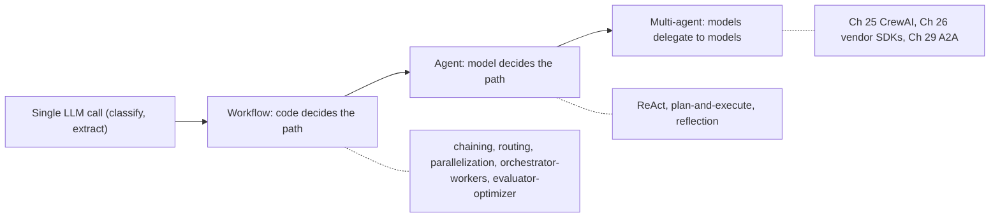
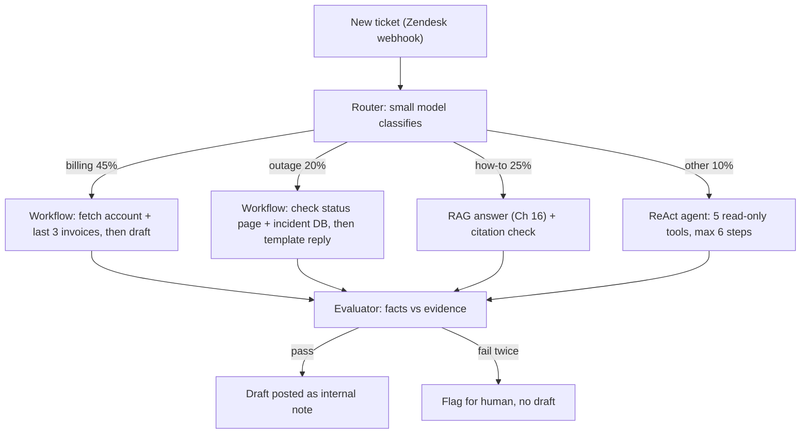

# 21 · Agent Patterns: ReAct, Planning & Reflection

> **In one line:** An agent is a loop where the model chooses the next step, and the patterns in this chapter (workflows, ReAct, plan-and-execute, reflection) are ways to decide *how much* of that control you hand over. Build the loop yourself once, with budgets and stopping conditions, and every framework in Part 5 becomes easy to read.

> **Versions used:** Python 3.13 · openai 3.49 (any OpenAI-compatible server, Ollama by default) · pydantic 2.14 · python-dotenv 1.x · no agent framework · **Fast-moving:** the patterns are stable; what changes is how much reasoning models do internally (adaptive thinking, native planning), which shifts the line between "write a workflow" and "let the model drive".

---

## 1. Overview

> **Builds on:** [Ch 04 · Function Calling](topic.html?p=04-function-calling) (the tool registry and tool loop you reuse here), [Ch 03 · Structured Outputs](topic.html?p=03-structured-outputs) (plans and critiques as Pydantic objects) and [Ch 07 · Multi-Provider Routing](topic.html?p=07-multi-provider-routing) (cheap vs strong models per step).

In Ch 04 you wrote a loop: call the model, run the tools it asks for, send the results back, repeat until it answers. That loop is already an **agent**. This chapter is about the design decisions around it: when to use one at all, how to structure its reasoning, and how to stop it.

The single most useful idea comes first. There is a **spectrum of autonomy**:



- In a **workflow**, *your code* fixes the control flow. The LLM fills in steps ("summarise this", "classify that"). Predictable, cheap, testable.
- In an **agent**, *the model* decides what to do next, how many times, and when it's done. Flexible, but slower, costlier and harder to test.

Move right on the spectrum only when the task forces you to. Most "AI agents" that succeed in production are workflows with one small agentic step. The theory of agent architectures (perception, planning, memory, tool use) is covered in [AI Engineering · AI Agents](../ai-engineering/topic.html?p=32-ai-agents). Here you implement the patterns in plain Python, so [Ch 23 · LangGraph](topic.html?p=23-langgraph-fundamentals) has something to replace.

---

## 2. Key Concepts

**Workflow patterns** (code owns the control flow):

- **Prompt chaining**: a fixed sequence of LLM calls, each consuming the previous output, with cheap code **gates** between them ("did step 1 find an order number?").
- **Routing**: one classification call picks a branch, each branch with its own prompt, tools or model. Cheap model routes, strong model answers.
- **Parallelization**: run independent subtasks at once (**sectioning**), or the same task N times and take a majority (**voting**).
- **Orchestrator-workers**: an LLM decides the subtasks *at run time*, code fans them out to workers and an LLM merges the results.
- **Evaluator-optimizer**: one call generates, another grades against explicit criteria, loop until it passes or a round limit is hit.

**Agent patterns** (the model owns the control flow):

- **ReAct** (Reason + Act): alternate *Thought → Action → Observation* until the model answers. With native tool calling, the "Action" is a tool call and the "Observation" is the tool result.
- **Plan-and-execute**: one call writes a plan (a list of steps), an executor runs each step (often a small ReAct agent), and a final call writes the answer. Optionally **replan** when a step fails.
- **Reflection / self-critique**: a critic call checks a draft against criteria or *evidence* (tool observations) and a reviser fixes it. External signals (tests, tool results, validators) beat the model grading itself from memory.

**Control concepts** you need for any of them:

- **Stopping conditions**: final answer (no tool call), step budget, tool-call budget, token or cost budget, wall-clock timeout, loop detection (same call repeated), explicit give-up.
- **Step budget**: a hard cap on model calls. Every loop has one. When it trips, either fail loudly or make one last *no-tools* call asking for a best-effort answer.
- **Trace**: the list of (thought, action, observation) steps. It's your debugging log, your audit trail and your evaluation dataset.

> **Analogy:** a workflow is a recipe card; an agent is a chef you've given a goal and a pantry. Hire the chef only when no recipe card can be written. And even a chef gets a budget and a closing time.

The ReAct loop with every guard you should build into it:

```svg
<svg viewBox="0 0 860 330" width="100%" height="330" font-family="ui-sans-serif,system-ui,sans-serif" font-size="11" xmlns="http://www.w3.org/2000/svg">
  <defs><marker id="aa21a" viewBox="0 0 10 10" refX="9" refY="5" markerWidth="7" markerHeight="7" orient="auto"><path d="M0,0 L10,5 L0,10 z" fill="#334155"/></marker></defs>
  <text x="430" y="22" text-anchor="middle" font-size="14" font-weight="700" fill="#1e293b">ReAct: Reason → Act → Observe, wrapped in budgets</text>
  <rect x="20" y="120" width="130" height="64" rx="8" fill="#dbeafe" stroke="#2563eb"/>
  <text x="85" y="144" text-anchor="middle" font-weight="700" fill="#1e293b">Task</text>
  <text x="85" y="160" text-anchor="middle" fill="#334155">system + user</text>
  <text x="85" y="174" text-anchor="middle" fill="#334155">+ tool specs</text>
  <line x1="152" y1="152" x2="208" y2="152" stroke="#334155" stroke-width="1.5" marker-end="url(#aa21a)"/>
  <rect x="210" y="110" width="150" height="84" rx="8" fill="#ede9fe" stroke="#7c3aed"/>
  <text x="285" y="134" text-anchor="middle" font-weight="700" fill="#1e293b">REASON</text>
  <text x="285" y="152" text-anchor="middle" fill="#334155">model(messages, tools)</text>
  <text x="285" y="168" text-anchor="middle" fill="#334155">Thought + tool call?</text>
  <text x="285" y="184" text-anchor="middle" fill="#334155">step += 1</text>
  <line x1="362" y1="152" x2="418" y2="152" stroke="#334155" stroke-width="1.5" marker-end="url(#aa21a)"/>
  <text x="390" y="144" text-anchor="middle" fill="#334155">yes</text>
  <rect x="420" y="110" width="160" height="84" rx="8" fill="#fef3c7" stroke="#d97706"/>
  <text x="500" y="134" text-anchor="middle" font-weight="700" fill="#1e293b">ACT</text>
  <text x="500" y="152" text-anchor="middle" fill="#334155">validate args (Pydantic)</text>
  <text x="500" y="168" text-anchor="middle" fill="#334155">approve side effects</text>
  <text x="500" y="184" text-anchor="middle" fill="#334155">dedupe repeated calls</text>
  <line x1="582" y1="152" x2="638" y2="152" stroke="#334155" stroke-width="1.5" marker-end="url(#aa21a)"/>
  <rect x="640" y="110" width="150" height="84" rx="8" fill="#dcfce7" stroke="#16a34a"/>
  <text x="715" y="134" text-anchor="middle" font-weight="700" fill="#1e293b">OBSERVE</text>
  <text x="715" y="152" text-anchor="middle" fill="#334155">append tool result</text>
  <text x="715" y="168" text-anchor="middle" fill="#334155">(errors as data)</text>
  <text x="715" y="184" text-anchor="middle" fill="#334155">record trace step</text>
  <path d="M715,108 C715,60 285,60 285,106" fill="none" stroke="#334155" stroke-width="1.5" marker-end="url(#aa21a)"/>
  <text x="500" y="56" text-anchor="middle" fill="#334155">loop: messages grow by one assistant turn + N tool results</text>
  <line x1="285" y1="196" x2="285" y2="236" stroke="#16a34a" stroke-width="1.5" marker-end="url(#aa21a)"/>
  <text x="292" y="220" fill="#16a34a">no tool call</text>
  <rect x="210" y="238" width="150" height="40" rx="8" fill="#dcfce7" stroke="#16a34a"/>
  <text x="285" y="262" text-anchor="middle" font-weight="700" fill="#1e293b">final_answer</text>
  <rect x="400" y="226" width="440" height="92" rx="8" fill="#fee2e2" stroke="#dc2626"/>
  <text x="414" y="246" font-weight="700" fill="#1e293b">Guards checked every iteration → stop with a reason</text>
  <text x="414" y="264" fill="#334155">max_steps (model calls) · max_tool_calls · max_tokens / cost</text>
  <text x="414" y="280" fill="#334155">max_seconds (wall clock) · loop_detected (same tool + args again)</text>
  <text x="414" y="296" fill="#334155">On a budget stop: optional final no-tools call for a best-effort answer</text>
  <text x="414" y="312" fill="#334155">Always return stop_reason + trace; never loop forever, never raise mid-loop</text>
</svg>
```

### When NOT to use an agent

Use a workflow (or a single call) when:

- **The steps are known.** "Fetch order, fetch shipment, draft reply" is three function calls, not an agent.
- **Latency matters.** Each ReAct step is a full model round trip. Five steps on a local 8B model is tens of seconds.
- **Errors are expensive.** Agents compound mistakes: a 95%-reliable step repeated six times is ~74% end-to-end.
- **You can't evaluate it.** If you can't write ten test cases with expected outcomes, you can't tell whether the agent got better or worse.

Use an agent when the number and order of steps genuinely depend on the input, and the tools are safe enough that a wrong step is cheap or gated.

---

## 3. Setup

```bash
pip install "openai>=3,<4" "pydantic>=2.10,<3" "python-dotenv>=1"
ollama pull qwen3:8b          # better at multi-step tool use than llama3.2; llama3.2 works for the simple examples
```

```bash
# .env.example
LLM_BASE_URL=http://localhost:11434/v1
LLM_API_KEY=ollama
LLM_MODEL=qwen3:8b
# Paid alternatives via any OpenAI-compatible endpoint (Ch 07): Groq, OpenRouter, a LiteLLM proxy in front of Claude
```

Copy `backoffice.py` and `tools.py` from [Ch 04, Setup and Example 1](topic.html?p=04-function-calling) into the same folder. Every agent below reuses that registry: `TOOLS` (name → `Tool`) and `execute(name, raw_args, approve)`, which validates arguments and never raises.

The one new file is a tiny model interface. Every agent in this chapter takes a `model` object instead of creating a client, so you can test the control flow offline with a scripted fake:

```python
# model_io.py — one interface for every agent here: model(messages, tools) -> Reply
import json
import os
import re
from dataclasses import dataclass, field
from typing import Protocol


@dataclass
class ToolCall:
    id: str
    name: str
    arguments: str                     # JSON string, as OpenAI-compatible APIs return it


@dataclass
class Reply:
    content: str | None
    tool_calls: list[ToolCall] = field(default_factory=list)
    usage_tokens: int = 0

    def as_message(self) -> dict:
        """The assistant turn to append to history (it must precede the tool results)."""
        msg: dict = {"role": "assistant", "content": self.content or ""}
        if self.tool_calls:
            msg["tool_calls"] = [{"id": c.id, "type": "function",
                                  "function": {"name": c.name, "arguments": c.arguments}}
                                 for c in self.tool_calls]
        return msg


class ChatModel(Protocol):
    def __call__(self, messages: list[dict], tools: list[dict] | None = None) -> Reply: ...


class OpenAICompatModel:
    """Ollama by default; Groq, OpenRouter, vLLM or a LiteLLM proxy work by changing .env."""
    def __init__(self, model: str | None = None):
        from openai import OpenAI
        self.client = OpenAI(base_url=os.getenv("LLM_BASE_URL", "http://localhost:11434/v1"),
                             api_key=os.getenv("LLM_API_KEY", "ollama"))
        self.model = model or os.getenv("LLM_MODEL", "qwen3:8b")

    def __call__(self, messages, tools=None) -> Reply:
        extra = {"tools": tools} if tools else {}
        resp = self.client.chat.completions.create(model=self.model, messages=messages, temperature=0, **extra)
        msg = resp.choices[0].message
        calls = [ToolCall(c.id, c.function.name, c.function.arguments) for c in (msg.tool_calls or [])]
        return Reply(msg.content, calls, resp.usage.total_tokens if resp.usage else 0)


class ScriptedModel:
    """Test double: returns pre-written replies in order and records every prompt it was sent."""
    def __init__(self, replies: list["Reply | str"]):
        self.replies = [Reply(r) if isinstance(r, str) else r for r in replies]
        self.prompts: list[list[dict]] = []

    def __call__(self, messages, tools=None) -> Reply:
        self.prompts.append([dict(m) for m in messages])
        if not self.replies:
            raise RuntimeError("ScriptedModel ran out of replies")
        return self.replies.pop(0)


class RuleModel:
    """Thread-safe fake for parallel workflows: first rule whose keyword is in the last message wins."""
    def __init__(self, rules: list[tuple[str, str]], default: str = "ok"):
        self.rules, self.default = rules, default

    def __call__(self, messages, tools=None) -> Reply:
        text = messages[-1]["content"].lower()
        return Reply(next((r for k, r in self.rules if k.lower() in text), self.default))


def tool_call(name: str, n: int = 0, thought: str | None = None, **args) -> Reply:
    """Script one tool call (with an optional Thought) for ScriptedModel."""
    return Reply(thought, [ToolCall(f"call_{name}_{n}", name, json.dumps(args))])


def loads_lenient(text: str) -> dict:
    """Parse JSON that small models wrap in markdown fences or surround with chatter."""
    match = re.search(r"\{.*\}", text or "", re.S)
    if not match:
        raise ValueError(f"no JSON object in: {text[:80]!r}")
    return json.loads(match.group(0))
```

---

## 4. Code Examples

### Example 1: The five workflow patterns

Code decides the path in every function below. The LLM only fills in steps. Note the code **gates** and the defensive handling of labels and JSON.

```python
# workflows.py — chaining, routing, parallelization, orchestrator-workers, evaluator-optimizer
from concurrent.futures import ThreadPoolExecutor

from dotenv import load_dotenv

from model_io import ChatModel, OpenAICompatModel, loads_lenient

load_dotenv()
MODEL: ChatModel | None = None          # set in __main__ or by tests


def ask(prompt: str, system: str = "You are a precise operations assistant.") -> str:
    reply = MODEL([{"role": "system", "content": system}, {"role": "user", "content": prompt}])
    return (reply.content or "").strip()


# 1) Prompt chaining: fixed sequence with a cheap code gate between steps
def chain_reply(email: str) -> str:
    facts = ask(f"Extract the request, the order number and the deadline as three bullets:\n{email}")
    if "order" not in facts.lower():                        # gate: stop early, don't draft nonsense
        return "ESCALATE: no order number found"
    draft = ask(f"Write a three-sentence reply that addresses these points:\n{facts}")
    return ask(f"Polish for a warm, concise tone. Keep every fact:\n{draft}")


# 2) Routing: classify once, then use a specialised prompt (or model) per branch
ROUTES = {"billing": "You handle invoices and refunds.",
          "shipping": "You handle delivery problems.",
          "other": "You are a general support agent."}

def route(ticket: str) -> tuple[str, str]:
    label = ask(f"Classify as one word, billing, shipping or other:\n{ticket}").lower().strip(" .")
    label = label if label in ROUTES else "other"           # never trust a free-text label blindly
    return label, ask(ticket, system=ROUTES[label])


# 3) Parallelization: sectioning shown; voting = same prompt N times, take the majority
def review_contract(contract: str) -> dict[str, str]:
    checks = {"payment": "List the payment terms.", "liability": "Summarise the liability caps.",
              "termination": "Summarise the termination clauses."}
    with ThreadPoolExecutor(max_workers=len(checks)) as pool:
        futures = {k: pool.submit(ask, f"{q}\n\n{contract}") for k, q in checks.items()}
        return {k: f.result() for k, f in futures.items()}

# 4) Orchestrator-workers: the LLM picks subtasks at run time; code fans out and merges
def orchestrate(goal: str, max_workers: int = 4) -> str:
    plan = loads_lenient(ask('Split this goal into at most 4 independent subtasks. '
                             f'Reply only with JSON {{"subtasks": ["..."]}}.\nGoal: {goal}'))
    subtasks = [str(s) for s in plan.get("subtasks", [])][:max_workers]   # cap fan-out in code
    with ThreadPoolExecutor(max_workers=max_workers) as pool:
        results = list(pool.map(lambda s: ask(f"Do this subtask and report briefly:\n{s}"), subtasks))
    notes = "\n".join(f"- {s}: {r}" for s, r in zip(subtasks, results))
    return ask(f"Merge these results into one answer to the goal '{goal}':\n{notes}")


# 5) Evaluator-optimizer: generate, grade against explicit criteria, revise, bounded rounds
def write_until_good(brief: str, max_rounds: int = 3) -> tuple[str, int]:
    draft = ask(f"Write a short product-update email about: {brief}")
    for round_no in range(1, max_rounds + 1):
        verdict = loads_lenient(ask(
            "Grade this email. Criteria: under 120 words, exactly one call to action, no jargon. "
            f'Reply only with JSON {{"pass": true or false, "feedback": "..."}}\n\n{draft}'))
        if verdict.get("pass") is True:
            return draft, round_no
        draft = ask(f"Revise the email using this feedback: {verdict.get('feedback')}\n\n{draft}")
    return draft, max_rounds                                 # best effort after the budget


if __name__ == "__main__":
    MODEL = OpenAICompatModel()
    print(route("My parcel says delivered but nothing arrived."))
    print(write_until_good("dark mode is now available in the dashboard"))
```

Each pattern is a few lines of ordinary Python. That's the point: you don't need a framework for workflows, and the control flow is unit-testable. Here is an offline test with the keyword-matching fake (safe under threads):

```python
# test_workflows.py — runs offline in milliseconds
import workflows
from model_io import RuleModel

workflows.MODEL = RuleModel([
    ("classify", "Shipping."),
    ("never arrived", "Sorry! I've opened a trace with the carrier."),
    ("independent subtasks", 'Sure! {"subtasks": ["check stock", "check price", "check eta"]} Hope that helps.'),
    ("do this subtask", "done"),
    ("merge these", "All three checks are fine."),
    ("grade this email", '{"pass": true, "feedback": ""}'),
])

if __name__ == "__main__":
    print(workflows.route("Parcel marked delivered, never arrived"))
    print(workflows.orchestrate("Can we promise 500 units by Friday?"))
    print(workflows.write_until_good("dark mode"))
```

Output (real, from the offline run):

```text
('shipping', "Sorry! I've opened a trace with the carrier.")
All three checks are fine.
('ok', 1)
```

The route label came back as `"Shipping."` and was normalised by code; the orchestrator's JSON came back wrapped in chatter and was still parsed. Those two defensive lines are where real workflows usually break.

### Example 2: ReAct from scratch on the Ch 04 registry

This is the Ch 04 loop grown up: budgets, loop detection, a per-step trace, an allowlist of tools, and an explicit `stop_reason`.

```python
# react_agent.py — a ReAct agent built on tools.TOOLS / tools.execute from Ch 04
import json
import time
from dataclasses import dataclass, field

from dotenv import load_dotenv

from model_io import ChatModel, OpenAICompatModel
from tools import TOOLS, execute

SYSTEM = ("You are an accounts-payable agent. Before each tool call, write one short sentence of reasoning. "
          "Use tools for every fact; never guess numbers or dates. When you have enough information, "
          "answer without calling a tool. Today is 2026-11-12.")


@dataclass
class Budget:
    max_steps: int = 8             # model calls
    max_tool_calls: int = 12
    max_seconds: float = 120.0
    max_tokens: int = 50_000       # summed usage across calls
    max_repeats: int = 1           # identical (tool, args) re-requests tolerated before stopping


@dataclass
class Step:
    thought: str
    tool: str
    args: str
    observation: str
    is_error: bool


@dataclass
class Result:
    answer: str
    stop_reason: str               # final_answer | max_steps | max_tool_calls | timeout | token_budget | loop_detected
    steps: list[Step] = field(default_factory=list)
    tokens: int = 0


def _call_key(name: str, raw_args: str) -> tuple[str, str]:
    try:
        return name, json.dumps(json.loads(raw_args or "{}"), sort_keys=True)
    except json.JSONDecodeError:
        return name, raw_args


def run_agent(model: ChatModel, task: str, *, system: str = SYSTEM, tool_names: list[str] | None = None,
              budget: Budget = Budget(), approve=lambda name, args: False, finalize: bool = True) -> Result:
    allowed = {n: TOOLS[n] for n in (tool_names or TOOLS)}          # least privilege per agent
    specs = [t.openai_spec() for t in allowed.values()]
    messages = [{"role": "system", "content": system}, {"role": "user", "content": task}]
    steps: list[Step] = []
    seen: dict[tuple, int] = {}
    tokens = tool_calls = 0
    started = time.monotonic()

    for _ in range(budget.max_steps):
        if time.monotonic() - started > budget.max_seconds:
            return Result("Stopped: time budget exhausted.", "timeout", steps, tokens)
        reply = model(messages, specs)                               # REASON
        tokens += reply.usage_tokens
        if tokens > budget.max_tokens:
            return Result("Stopped: token budget exhausted.", "token_budget", steps, tokens)
        if not reply.tool_calls:                                     # no action → final answer
            return Result(reply.content or "", "final_answer", steps, tokens)

        messages.append(reply.as_message())                          # assistant turn first (Ch 04 rule)
        for call in reply.tool_calls:                                # ACT
            tool_calls += 1
            key = _call_key(call.name, call.arguments)
            seen[key] = seen.get(key, 0) + 1
            if tool_calls > budget.max_tool_calls:
                return Result("Stopped: tool-call budget exhausted.", "max_tool_calls", steps, tokens)
            if seen[key] > budget.max_repeats + 1:
                return Result("Stopped: the agent kept repeating the same action.", "loop_detected", steps, tokens)
            if call.name not in allowed:
                obs, err = json.dumps({"error": f"tool {call.name} is not available to you"}), True
            elif seen[key] > 1:                                      # nudge once before stopping
                obs, err = json.dumps({"error": "duplicate call: reuse the earlier result"}), True
            else:
                obs, err = execute(call.name, call.arguments, approve)
            messages.append({"role": "tool", "tool_call_id": call.id, "content": obs})   # OBSERVE
            steps.append(Step(reply.content or "", call.name, call.arguments, obs, err))

    if finalize:                                                     # best effort, no tools allowed
        last = model(messages + [{"role": "user", "content":
                     "Step budget reached. Answer now from what you have and say what is missing."}], None)
        return Result(last.content or "", "max_steps", steps, tokens + last.usage_tokens)
    return Result("Stopped: step budget exhausted.", "max_steps", steps, tokens)


def print_trace(result: Result) -> None:
    for i, s in enumerate(result.steps, 1):
        flag = " (error)" if s.is_error else ""
        print(f"[{i}] thought: {s.thought or '-'}\n    action: {s.tool}({s.args})\n    obs{flag}: {s.observation[:90]}")
    print(f"stop_reason={result.stop_reason} tokens={result.tokens}\n{result.answer}")


if __name__ == "__main__":
    load_dotenv()
    print_trace(run_agent(OpenAICompatModel(), "Which unpaid invoices are overdue, and by how many days?",
                          tool_names=["find_invoices", "days_overdue"]))
```

Illustrative output with `qwen3:8b`:

```text
[1] thought: I need the unpaid invoices first.
    action: find_invoices({"unpaid_only": true})
    obs: [{"number": "NW-0412", "vendor": "Northwind", "total": 4698.12, "currency": "EUR", "due": "2026-
[2] thought: Now compute days overdue for each unpaid invoice.
    action: days_overdue({"number": "NW-0412", "today": "2026-11-12"})
    obs: 0
[3] thought: Now compute days overdue for each unpaid invoice.
    action: days_overdue({"number": "CT-0099", "today": "2026-11-12"})
    obs: 28
stop_reason=final_answer tokens=2140
Only CT-0099 (Contoso, USD 1,200.00) is overdue, by 28 days. NW-0412 is due on 3 December.
```

### Example 3: Testing the agent's stopping conditions offline

The loop's job is control flow, so test control flow. Each scenario scripts the model's replies and asserts the `stop_reason`:

```python
# test_react.py — every stopping condition, no model needed
import backoffice
from model_io import Reply, ScriptedModel, tool_call
from react_agent import Budget, run_agent


def scenario(name, replies, **kw):
    r = run_agent(ScriptedModel(replies), "test task", **kw)
    print(f"{name:<14} stop={r.stop_reason:<14} steps={len(r.steps)} answer={r.answer[:45]!r}")
    return r


if __name__ == "__main__":
    scenario("happy path", [tool_call("find_invoices", vendor="Contoso", unpaid_only=True),
                            tool_call("days_overdue", number="CT-0099", today="2026-11-12"),
                            "CT-0099 is 28 days overdue."])
    r = scenario("loop", [tool_call("find_invoices", vendor="Contoso")] * 5)
    assert [s.is_error for s in r.steps] == [False, True]          # second repeat was nudged, third stopped
    scenario("step budget", [tool_call("find_invoices", i, vendor=v) for i, v in
                             enumerate(["A", "B", "C"])] + ["Partial: nothing found for A, B, C."],
             budget=Budget(max_steps=3))
    r = scenario("not allowed", [tool_call("send_reminder", number="CT-0099"), "I can't send reminders."],
                 tool_names=["find_invoices"])
    assert "not available" in r.steps[0].observation
    r = scenario("declined", [tool_call("send_reminder", number="CT-0099", tone="firm"),
                              "The reminder was not sent: approval was declined."])
    assert "declined" in r.steps[0].observation and backoffice.SENT_EMAILS == []
    scenario("bad args", [tool_call("days_overdue", number=412), Reply("Invoice 412 is not a valid number.")])
    print("all assertions passed")
```

Output (real):

```text
happy path     stop=final_answer   steps=2 answer='CT-0099 is 28 days overdue.'
loop           stop=loop_detected  steps=2 answer='Stopped: the agent kept repeating the same ac'
step budget    stop=max_steps      steps=3 answer='Partial: nothing found for A, B, C.'
not allowed    stop=final_answer   steps=1 answer="I can't send reminders."
declined       stop=final_answer   steps=1 answer='The reminder was not sent: approval was decli'
bad args       stop=final_answer   steps=1 answer='Invoice 412 is not a valid number.'
all assertions passed
```

### A note on classic text ReAct

The original ReAct paper predates native tool calling: the model writes `Thought:`, `Action:` and `Action Input:` lines, your code parses them with a regex, runs the tool and appends `Observation: ...` as the next user message, until a `Final Answer:` line appears. You still meet this format with small or base models and in older LangChain code. If you implement it, cut the model's output at `Observation:` (or pass it as a `stop` sequence), because models happily invent their own tool results. Prefer native tool calling whenever the model supports it: arguments are schema-constrained and parallel calls work.

### Example 4: Plan-and-execute

A planner writes the whole plan once; a cheaper executor runs each step as a tiny ReAct agent; the planner writes the final answer. Plans are Pydantic objects, so they're validated before anything runs.

```python
# plan_execute.py — plan once, execute step by step, stop early on failure
from pydantic import BaseModel, Field, ValidationError

from model_io import ChatModel, loads_lenient
from react_agent import Budget, run_agent
from tools import TOOLS

PLANNER = ("You are a planner. Break the goal into 1-5 concrete steps that an agent with these tools can do: "
           "{tools}. Do not perform the steps. Reply only with JSON: {{\"steps\": [\"...\"]}}")


class Plan(BaseModel):
    steps: list[str] = Field(min_length=1, max_length=5)


def make_plan(planner: ChatModel, goal: str, tool_names: list[str]) -> Plan:
    msgs = [{"role": "system", "content": PLANNER.format(tools=", ".join(tool_names))},
            {"role": "user", "content": goal}]
    for _ in range(2):                                         # one repair attempt
        text = planner(msgs).content or ""
        try:
            return Plan.model_validate(loads_lenient(text))
        except (ValueError, ValidationError) as e:
            msgs += [{"role": "assistant", "content": text},
                     {"role": "user", "content": f"Invalid plan ({e}). Reply with valid JSON only."}]
    raise RuntimeError("planner could not produce a valid plan")


def plan_and_execute(planner: ChatModel, executor: ChatModel, goal: str,
                     tool_names: list[str] | None = None) -> tuple[Plan, list[str], str]:
    names = tool_names or list(TOOLS)
    plan = make_plan(planner, goal, names)
    notes: list[str] = []
    for i, step in enumerate(plan.steps, 1):
        context = "\n".join(notes) or "(nothing yet)"
        res = run_agent(executor, f"Overall goal: {goal}\nResults so far:\n{context}\n\nDo only this step: {step}",
                        tool_names=names, budget=Budget(max_steps=4), finalize=False)
        notes.append(f"Step {i} ({step}): {res.answer}")
        if res.stop_reason != "final_answer":                  # a natural place to replan instead
            notes.append(f"Step {i} failed with {res.stop_reason}; remaining steps skipped.")
            break
    final = planner([{"role": "system", "content": "Write the final answer for the user from these step results."},
                     {"role": "user", "content": f"Goal: {goal}\n" + "\n".join(notes)}])
    return plan, notes, final.content or ""


if __name__ == "__main__":
    from model_io import ScriptedModel, tool_call
    planner = ScriptedModel(['{"steps": ["List unpaid invoices", "Compute days overdue for each"]}',
                             "One invoice is overdue: CT-0099, 28 days."])
    executor = ScriptedModel([tool_call("find_invoices", unpaid_only=True), "Unpaid: NW-0412, CT-0099.",
                              tool_call("days_overdue", number="CT-0099", today="2026-11-12"),
                              "CT-0099: 28 days; NW-0412: not yet due."])
    plan, notes, answer = plan_and_execute(planner, executor, "Report overdue invoices",
                                           ["find_invoices", "days_overdue"])
    print(plan.steps, *notes, answer, sep="\n")
```

Output (real, scripted models):

```text
['List unpaid invoices', 'Compute days overdue for each']
Step 1 (List unpaid invoices): Unpaid: NW-0412, CT-0099.
Step 2 (Compute days overdue for each): CT-0099: 28 days; NW-0412: not yet due.
One invoice is overdue: CT-0099, 28 days.
```

Plan-and-execute wins when you want **a reviewable plan** (show it to a human before running), **a strong planner with a cheap executor**, or **progress reporting** ("step 2 of 4"). It loses when the right next step depends heavily on what the previous step found: then plain ReAct adapts better, or you add **replanning** (Exercise 2).

### Example 5: Reflection grounded in evidence

Self-critique works best when the critic checks the draft against **evidence** rather than its own memory. Here the evidence is the agent's tool observations, so the critic can catch a hallucinated number.

```python
# reflection.py — critique a draft against tool evidence, revise, bounded rounds
from pydantic import BaseModel

from model_io import ChatModel, ScriptedModel, loads_lenient

CRITIC = ("You are a strict reviewer. Check the draft ONLY against the evidence. Flag any number, date or "
          'name not supported by the evidence. Reply only with JSON {"ok": true or false, "problems": ["..."]}')


class Critique(BaseModel):
    ok: bool
    problems: list[str] = []


def reflect(model: ChatModel, task: str, draft: str, evidence: list[str],
            max_rounds: int = 2) -> tuple[str, list[Critique]]:
    history: list[Critique] = []
    ev = "\n".join(f"- {e}" for e in evidence)
    for _ in range(max_rounds):
        raw = model([{"role": "system", "content": CRITIC},
                     {"role": "user", "content": f"Task: {task}\nEvidence:\n{ev}\nDraft:\n{draft}"}]).content
        crit = Critique.model_validate(loads_lenient(raw or ""))
        history.append(crit)
        if crit.ok:
            break
        draft = model([{"role": "user", "content": f"Fix these problems using only the evidence.\n"
                        f"Problems: {crit.problems}\nEvidence:\n{ev}\nDraft:\n{draft}"}]).content or draft
    return draft, history


if __name__ == "__main__":
    fake = ScriptedModel([
        '{"ok": false, "problems": ["Draft says 31 days; evidence says 28."]}',
        "CT-0099 (Contoso) is 28 days overdue.",
        '{"ok": true, "problems": []}',
    ])
    final, crits = reflect(fake, "Summarise overdue invoices", "CT-0099 is 31 days overdue.",
                           ['days_overdue(CT-0099) -> 28'])
    print(final, [c.ok for c in crits])
```

Output (real, scripted):

```text
CT-0099 (Contoso) is 28 days overdue. [False, True]
```

Wire it to a real agent with `evidence=[f"{s.tool}({s.args}) -> {s.observation}" for s in result.steps]`. Each round costs two extra calls, so reserve reflection for outputs where a wrong fact is expensive (customer emails, financial summaries) and prefer hard checks (a regex, a schema, a unit test, a recomputation) wherever one exists.

---

## 5. Real-World Use Case

**Company:** a B2B SaaS with ~3,000 support tickets a month. **Problem:** agents spend the first 5 minutes of each ticket gathering context (account, plan, recent invoices, open incidents). **First attempt:** one big ReAct agent with 14 tools. It worked in demos, then averaged 7 steps, 25 seconds and ~$0.06 per ticket on a hosted model, and looped on ~3% of tickets.

**Redesign:** a **routing workflow** with one small agent for the long tail.



**Numbers after the change:** 90% of tickets take a fixed 2–3 call path (~4 s, ~$0.01). The agent handles 10% with a 6-step cap; loop rate fell below 0.5% because its tool list is smaller. Monthly model spend dropped from ~$180 to ~$45, and every path has a test suite, because workflows have known steps. The evaluator rejects ~4% of drafts, which go to humans unchanged. The lesson generalises: **start with the workflow, measure where it fails, and add agency only there.**

---

## 6. Mini Project: A Collections Agent with Traces and a Test Suite (1–2 hours)

**Goal:** an accounts-receivable assistant that answers "who owes us what, and should we chase them?", sends reminders only with approval, writes a JSONL trace of every run, and ships with an offline scenario suite.

```text
collections-agent/
├── .env
├── backoffice.py        # from Ch 04
├── tools.py             # from Ch 04
├── model_io.py          # from Setup
├── react_agent.py       # Example 2
├── tracing.py
├── agent.py
└── scenarios.py
```

**Step 1: JSONL tracing.** One line per run: task, stop reason, steps, latency. This file becomes your evaluation dataset in [Ch 41](topic.html?p=41-evaluation).

```python
# tracing.py — append one JSON line per agent run
import json
import time
from dataclasses import asdict
from pathlib import Path

from react_agent import Result

TRACE_FILE = Path("traces.jsonl")


def log_run(task: str, result: Result, started: float, model_name: str) -> None:
    record = {"ts": time.time(), "model": model_name, "task": task, "stop_reason": result.stop_reason,
              "latency_s": round(time.time() - started, 2), "tokens": result.tokens,
              "steps": [asdict(s) for s in result.steps], "answer": result.answer}
    with TRACE_FILE.open("a", encoding="utf-8") as f:
        f.write(json.dumps(record) + "\n")
```

**Step 2: the agent entry point,** with a CLI approval gate for `send_reminder`.

```python
# agent.py — collections assistant: read tools free, reminders need a human "y"
import os
import time

from dotenv import load_dotenv

from model_io import ChatModel, OpenAICompatModel
from react_agent import Budget, print_trace, run_agent
from tracing import log_run

SYSTEM = ("You are a collections assistant for accounts receivable. Use find_invoices and days_overdue for "
          "facts. Recommend a reminder only for invoices more than 14 days overdue. Call send_reminder only "
          "if the user explicitly asks you to send one. Be brief. Today is 2026-11-12.")


def cli_approve(name: str, args: dict) -> bool:
    return input(f"  approve {name}({args})? [y/N] ").strip().lower() == "y"


def ask(model: ChatModel, task: str, approve=cli_approve, model_name: str = "scripted"):
    started = time.time()
    result = run_agent(model, task, system=SYSTEM, budget=Budget(max_steps=6, max_tool_calls=8),
                       approve=approve)
    log_run(task, result, started, model_name)
    return result


if __name__ == "__main__":
    load_dotenv()
    model = OpenAICompatModel()
    while (task := input("\nar> ").strip()) not in {"", "exit"}:
        print_trace(ask(model, task, model_name=os.getenv("LLM_MODEL", "qwen3:8b")))
```

**Step 3: the scenario suite.** Scripted models make each scenario deterministic; one also checks that an approved reminder really was queued.

```python
# scenarios.py — offline regression suite for the collections agent
import json
from pathlib import Path

import backoffice
import tracing
from agent import ask
from model_io import ScriptedModel, tool_call

tracing.TRACE_FILE = Path("traces_test.jsonl")
CASES = [
    ("who is overdue", [tool_call("find_invoices", unpaid_only=True),
                        tool_call("days_overdue", number="CT-0099", today="2026-11-12"),
                        "CT-0099 (Contoso) is 28 days overdue; recommend a reminder."],
     lambda r: r.stop_reason == "final_answer" and "28" in r.answer),
    ("send the reminder", [tool_call("send_reminder", number="CT-0099", tone="firm"), "Reminder queued."],
     lambda r: backoffice.SENT_EMAILS == [{"invoice": "CT-0099", "tone": "firm"}]),
    ("loop guard", [tool_call("find_invoices")] * 6,
     lambda r: r.stop_reason == "loop_detected"),
]

if __name__ == "__main__":
    tracing.TRACE_FILE.unlink(missing_ok=True)
    for task, replies, check in CASES:
        r = ask(ScriptedModel(replies), task, approve=lambda n, a: True)
        print(f"{'PASS' if check(r) else 'FAIL'}  {task:<18} stop={r.stop_reason}")
    lines = tracing.TRACE_FILE.read_text().splitlines()
    print(len(lines), "traces written; first stop_reason:", json.loads(lines[0])["stop_reason"])
```

Output (real):

```text
PASS  who is overdue     stop=final_answer
PASS  send the reminder  stop=final_answer
PASS  loop guard         stop=loop_detected
3 traces written; first stop_reason: final_answer
```

**Step 4: run it live** with `python scenarios.py` (offline suite first), then `python agent.py` and ask "Which customers are more than 14 days overdue?" followed by "Send Contoso a firm reminder for CT-0099."

**Done when:**
- [ ] `scenarios.py` passes offline, and you've added a case for every bug you find live.
- [ ] Live questions are answered from tool results, with traces printed and appended to `traces.jsonl`.
- [ ] `send_reminder` always asks for approval; declining is reported, not retried.
- [ ] A deliberately confusing request ("check everything about everyone forever") ends with a budget or loop stop, not a hang.

**Stretch goals:** swap the executor to a cheaper model and keep a strong model for the final answer (Ch 07 aliases); add the reflection step from Example 6 before any reply that contains amounts; turn `traces.jsonl` into a pandas report of stop reasons per day.

---

## 7. Comparison Table

| Pattern | Who decides the path | Model calls per task | Predictability | Use when | Avoid when |
|---|---|---|---|---|---|
| Single call | nobody (one shot) | 1 | highest | classify, extract, rewrite | facts must be fetched |
| Prompt chaining | code | fixed N | high | known sequence of transformations | steps depend on data |
| Routing | code (after one classify) | 2 | high | distinct ticket or request types | categories blur heavily |
| Parallelization | code | N in parallel | high | independent checks, or voting for reliability | subtasks depend on each other |
| Orchestrator-workers | model picks subtasks, code runs them | 2 + N | medium | subtasks unknown until run time (research, multi-file edits) | fixed subtasks (use sectioning) |
| Evaluator-optimizer | code loop, model grades | 2–7 | medium | clear criteria, measurable improvement | no objective criteria |
| ReAct | model | 2–10+ | low | open-ended lookups, path depends on findings | latency-critical, known steps |
| Plan-and-execute | model plans once, code iterates | plan + steps + final | medium | reviewable plans, cheap executors, progress reporting | each step changes the plan |
| Reflection | code loop, model critiques | +2 per round | medium | high cost of wrong facts, evidence available | no evidence; hard checks exist |

**Frameworks vs hand-rolled:** for workflows, plain Python is usually enough. For agents that need persistence, human approval that survives restarts, streaming and visual debugging, move to [Ch 23 · LangGraph](topic.html?p=23-langgraph-fundamentals) and [Ch 24](topic.html?p=24-langgraph-production); the concepts map one to one (node = step, conditional edge = stopping logic, checkpointer = durable trace).

---

## 8. Common Mistakes & Best Practices

**Mistake 1: reaching for an agent first.** Agents feel impressive and fail unpredictably. *Fix:* write the workflow, measure, then make only the failing branch agentic.

**Mistake 2: no stop reason.** The loop returns "Stopped" and nobody knows why. *Fix:* return a `stop_reason` enum and log it. A dashboard of stop reasons per day is the cheapest agent monitoring you can build.

**Mistake 3: loops that never notice they're looping.** The model calls `find_invoices` with the same arguments five times and the step budget is the only defence. *Fix:* key each call on `(name, canonical JSON args)`, nudge once on a repeat, then stop with `loop_detected` (Example 2).

**Mistake 4: every tool for every agent.** Fourteen tools make selection worse and widen the blast radius of prompt injection. *Fix:* pass `tool_names=[...]` per agent or per route; side-effect tools only where needed.

**Mistake 5: self-critique without evidence.** The same model grading its own answer from memory tends to approve it. *Fix:* give the critic tool observations, retrieved sources or a validator result; prefer deterministic checks.

**Mistake 6: trusting free-text labels and JSON.** `"Shipping."` is not `"shipping"`, and plans arrive wrapped in markdown fences. *Fix:* normalise, validate with Pydantic, and fall back to a default branch.

**Mistake 7: unbounded fan-out.** An orchestrator asks for 40 subtasks and you launch 40 parallel calls. *Fix:* cap subtasks in code and set `max_workers`.

**Best-practice checklist**
- [ ] Start at the left of the autonomy spectrum; justify every move right.
- [ ] Every loop has step, tool-call, time and token budgets, plus loop detection.
- [ ] Return `stop_reason` and a full trace; log both.
- [ ] Least-privilege tool lists per agent; side effects gated (Ch 04).
- [ ] Control flow tested offline with a scripted model in CI.
- [ ] Critique against evidence; hard checks beat LLM judges.
- [ ] Budget stops end with a best-effort answer or a clean escalation, never a hang.

---

## 9. Exercises

1. **Parallel tools.** Make `run_agent` execute all tool calls of one turn concurrently with `ThreadPoolExecutor`, keeping the tool messages in the original order. Add a scripted test where one turn requests two calls.
2. **Replanning.** In `plan_and_execute`, when a step fails, call the planner again with the notes so far and the failure, and continue with the new plan (at most one replan). Script a scenario that exercises it.
3. **Cost budget.** Replace `max_tokens` with `max_cost_usd` using a price table per model (Ch 07) and stop with `"cost_budget"`.
4. **Voting vs single call.** Write an `is_spam(message, n)` voting function, run it with n=1 and n=5 over 30 labelled messages on a local model. Measure accuracy and latency; decide whether voting is worth it.
5. **Workflow first.** Take the ReAct agent's top three task types from your `traces.jsonl` and rewrite each as a fixed workflow. Compare steps, latency and answers.

### Self-check questions

**Q: What is the difference between a workflow and an agent?**
A: In a workflow, your code decides the control flow and the LLM fills in individual steps, so the number and order of calls are known in advance. In an agent, the model decides what to do next and when it is done. Workflows are cheaper, faster and easier to test; agents handle tasks whose steps depend on what they discover.

**Q: What are the three parts of a ReAct step, and how do they map onto native tool calling?**
A: Thought (reasoning about what to do), Action (choosing a tool and arguments) and Observation (the tool's result). With native tool calling, the thought is the assistant's text content, the action is the structured tool call, and the observation is the tool-result message you append before the next model call.

**Q: Name five stopping conditions every agent loop should have.**
A: A final answer (the model returns no tool call), a step budget on model calls, a tool-call budget, a token or cost budget, and a wall-clock timeout. Loop detection (the same tool and arguments repeated) and explicit escalation are strongly recommended too. Each should produce a distinct stop reason that you log.

**Q: When does plan-and-execute beat ReAct, and when does it lose?**
A: It wins when you want a plan a human can review before execution, when a strong model can plan and a cheap model can execute, and when you need progress reporting. It loses when each step's result changes what should happen next, because a fixed plan goes stale; then ReAct adapts better, or you add replanning.

**Q: Why should a reflection step check against evidence instead of letting the model grade itself? (Senior)**
A: A model critiquing its own output from memory shares the same blind spots that produced the error and tends to approve it. Giving the critic external evidence (tool observations, retrieved documents, validator or test output) turns critique into verification: it can spot a number that doesn't match a tool result. Where a deterministic check exists, such as recomputing a total or validating a schema, use it instead of an LLM critic.

**Q: Your agent works in demos but costs 5x the estimate and sometimes loops in production. How do you diagnose and fix it? (Senior)**
A: Log a trace and stop reason for every run, then aggregate: which stop reasons, how many steps, which tools are repeated, which task types are expensive. Typical fixes are adding loop detection and tighter budgets, shrinking the tool list per route, trimming large tool results that bloat context, moving frequent task types into fixed workflows with a router in front, and using a cheaper model for execution steps. Then lock the behaviour in with scripted regression scenarios.

**Q: An orchestrator-workers workflow occasionally launches dozens of parallel calls and hits rate limits. What went wrong? (Senior)**
A: The model, not your code, decided the fan-out width and nothing capped it. Cap the number of subtasks in code after validating the plan, bound concurrency with `max_workers` or a semaphore, and handle 429s with retries and backoff (Ch 42). If the subtasks are actually fixed, replace the orchestrator with sectioning so the width is known in advance.

---

## 10. Summary & Official Docs

- Autonomy is a spectrum: **single call → workflow → agent → multi-agent**. Move right only when the task forces you to.
- Five workflow patterns cover most automations: **chaining, routing, parallelization, orchestrator-workers, evaluator-optimizer**. They're plain Python.
- **ReAct** is the tool loop from Ch 04 plus budgets, loop detection, least-privilege tools, a trace and a stop reason.
- **Plan-and-execute** gives reviewable plans and cheap executors; add replanning when steps change the picture.
- **Reflection** is only as good as its evidence; prefer hard checks.
- Test control flow offline with a **scripted model**; log traces and stop reasons in production.

**Official docs**
- Anthropic, Building effective agents: https://www.anthropic.com/engineering/building-effective-agents
- OpenAI function calling: https://platform.openai.com/docs/guides/function-calling
- Anthropic tool use: https://docs.claude.com/en/docs/agents-and-tools/tool-use/overview
- LangGraph workflows and agents: https://docs.langchain.com/oss/python/langgraph/workflows-agents
- Theory: [AI Engineering · AI Agents](../ai-engineering/topic.html?p=32-ai-agents) and [Multi-Agent Orchestration](../ai-engineering/topic.html?p=36-multi-agent-orchestration)

**Next:** [Ch 22 · Agent Memory & Mem0](topic.html?p=22-agent-memory-mem0): your agent forgets everything between runs. Give it short-term and long-term memory, safely.

---

*AI Automation with Python Handbook — chapter 21.*
