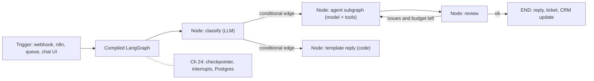
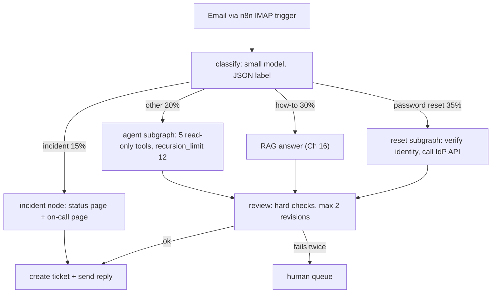

# 23 · LangGraph: State, Nodes & Edges

> **In one line:** LangGraph turns the agent loop you wrote by hand in Ch 21 into an explicit graph: a typed **state**, **nodes** that return partial updates, **reducers** that merge them, and **edges** (fixed or conditional) that decide what runs next, including cycles. You get the same control flow, plus streaming, subgraphs, fan-out and (in Ch 24) persistence for free.

> **Versions used:** Python 3.13 · langgraph 1.2 · langchain-core 1.8 · langchain-ollama 1.1 · langchain-openai 1.7 · langchain 1.5 (only for `create_agent`) · **Fast-moving:** LangGraph 1.x is stable at the `StateGraph` level, but helpers move: `langgraph.prebuilt.create_react_agent` is deprecated in favour of `langchain.agents.create_agent`, node options (`retry_policy`, `cache_policy`, `timeout`) keep growing, and `invoke`/`stream` gained a `version="v2"` output format. Check the changelog before upgrading.

---

## 1. Overview

> **Builds on:** [Ch 21 · Agent Patterns](topic.html?p=21-agent-patterns) (workflows, ReAct, budgets, stop reasons), [Ch 04 · Function Calling](topic.html?p=04-function-calling) (the tool loop), [Ch 14 · LangChain Tools & Agents](topic.html?p=14-langchain-tools-agents) (`@tool`, chat models, `bind_tools`) and [Ch 22 · Agent Memory](topic.html?p=22-agent-memory-mem0) (state that outlives one call).

Look back at the Ch 21 ReAct loop. It had a `messages` list (state), a model call (a step), tool execution (another step), and an `if not reply.tool_calls: return` (a branch), all inside a `for` loop with a budget. That works, but the control flow is buried in Python: you can't draw it, pause it halfway, stream what each step is doing, or resume it after a crash without rewriting it.

**LangGraph** makes that structure explicit. You declare:

- what the **state** looks like (a `TypedDict`),
- which **nodes** exist (plain functions `state -> partial update`),
- which **edges** connect them (fixed, or chosen at run time by a function).

Then `compile()` gives you a runnable object with `invoke`, `stream`, a drawable graph, and hooks for checkpointing and human approval.



It's a low-level library: no hidden prompts, no magic agent class. It sits in the same place as your hand-rolled loop, beneath your app and above the model SDKs. LangChain's `create_agent` is now built on top of it, and so are many other agent frameworks. If you know the five concepts in the next section, you can read all of them.

---

## 2. Key Concepts

- **State**: a `TypedDict` (or Pydantic model / dataclass) shared by every node. It is the *only* way nodes communicate. Think of it as the row a workflow is updating.
- **Node**: a function `def node(state) -> dict`. It returns a **partial update** (only the keys it changed), never the whole state. Nodes can call LLMs, tools, APIs or nothing at all.
- **Reducer**: how an update for a key merges into the current value. No reducer = **overwrite**. `Annotated[list, operator.add]` = **append**. `Annotated[list[AnyMessage], add_messages]` = append messages, **replace by id**, delete with `RemoveMessage`. Reducers are what make parallel branches safe.
- **Edge**: `add_edge("a", "b")` always goes a → b. `START` and `END` are the entry and exit.
- **Conditional edge**: `add_conditional_edges("a", route_fn)`: `route_fn(state)` returns the next node's name (or `END`, or a list of names to run in parallel). Type the return as `Literal[...]` so the graph can be drawn.
- **Cycle**: an edge back to an earlier node (tools → model). Every cycle needs an exit condition, and LangGraph adds a global one: **`recursion_limit`** (default 25 super-steps) raises `GraphRecursionError`.
- **Super-step**: one "tick" of the graph. All nodes scheduled for this tick run (in parallel if there are several), their updates are applied through reducers, then edges pick the next set. This is the Pregel / bulk-synchronous model the library is named after.
- **`Send`**: from a conditional edge, launch the same node N times with different private inputs (map-reduce).
- **`Command`**: a node can return `Command(update={...}, goto="next")` to update state *and* choose the next node in one place.
- **Subgraph**: a compiled graph used as a node, for reuse and encapsulation.
- **Streaming**: `stream(..., stream_mode=...)` yields `"values"` (full state), `"updates"` (each node's delta), `"messages"` (LLM tokens), `"custom"` (your own events) or `"debug"`.
- **Runtime context**: per-invocation, read-only configuration (user id, tenant, model choice) passed as `context=` and read via `runtime.context`. Not part of state.

> **Analogy:** the state is a shared spreadsheet row; nodes are workers who each fill in a few cells; reducers are the rules for a cell ("overwrite", "append to the list"); edges are the routing slip that says who gets the row next. Nobody passes notes behind the spreadsheet's back.

One super-step, from the graph's point of view:

```svg
<svg viewBox="0 0 880 340" width="100%" height="340" font-family="ui-sans-serif,system-ui,sans-serif" font-size="11" xmlns="http://www.w3.org/2000/svg">
  <defs><marker id="aa23a" viewBox="0 0 10 10" refX="9" refY="5" markerWidth="7" markerHeight="7" orient="auto"><path d="M0,0 L10,5 L0,10 z" fill="#334155"/></marker></defs>
  <text x="440" y="22" text-anchor="middle" font-size="14" font-weight="700" fill="#1e293b">A super-step: read state, run nodes, merge updates with reducers, route</text>
  <rect x="20" y="50" width="200" height="120" rx="8" fill="#dbeafe" stroke="#2563eb"/>
  <text x="120" y="70" text-anchor="middle" font-weight="700" fill="#1e293b">State (before)</text>
  <text x="32" y="92" fill="#334155" font-family="ui-monospace,monospace">category: "billing"</text>
  <text x="32" y="110" fill="#334155" font-family="ui-monospace,monospace">findings: [f1]</text>
  <text x="32" y="128" fill="#334155" font-family="ui-monospace,monospace">messages: [h1, a1]</text>
  <text x="32" y="146" fill="#334155" font-family="ui-monospace,monospace">attempts: 1</text>
  <line x1="222" y1="90" x2="288" y2="75" stroke="#334155" stroke-width="1.5" marker-end="url(#aa23a)"/>
  <line x1="222" y1="130" x2="288" y2="145" stroke="#334155" stroke-width="1.5" marker-end="url(#aa23a)"/>
  <rect x="290" y="45" width="190" height="56" rx="8" fill="#ede9fe" stroke="#7c3aed"/>
  <text x="385" y="66" text-anchor="middle" font-weight="700" fill="#1e293b">node A (LLM call)</text>
  <text x="385" y="84" text-anchor="middle" fill="#334155" font-family="ui-monospace,monospace">{"messages": [a2]}</text>
  <rect x="290" y="117" width="190" height="56" rx="8" fill="#ede9fe" stroke="#7c3aed"/>
  <text x="385" y="138" text-anchor="middle" font-weight="700" fill="#1e293b">node B (parallel)</text>
  <text x="385" y="156" text-anchor="middle" fill="#334155" font-family="ui-monospace,monospace">{"findings": [f2], "attempts": 2}</text>
  <line x1="482" y1="73" x2="548" y2="100" stroke="#334155" stroke-width="1.5" marker-end="url(#aa23a)"/>
  <line x1="482" y1="145" x2="548" y2="120" stroke="#334155" stroke-width="1.5" marker-end="url(#aa23a)"/>
  <rect x="550" y="50" width="310" height="120" rx="8" fill="#fef3c7" stroke="#d97706"/>
  <text x="705" y="70" text-anchor="middle" font-weight="700" fill="#1e293b">Reducers merge the partial updates</text>
  <text x="562" y="92" fill="#334155">messages: add_messages → [h1, a1, a2] (same id = replace)</text>
  <text x="562" y="110" fill="#334155">findings: operator.add → [f1, f2]</text>
  <text x="562" y="128" fill="#334155">attempts: no reducer → 2 (last write wins)</text>
  <text x="562" y="146" fill="#334155">category: untouched → "billing"</text>
  <text x="562" y="162" fill="#dc2626">two parallel writes to a no-reducer key = error</text>
  <line x1="705" y1="172" x2="705" y2="208" stroke="#334155" stroke-width="1.5" marker-end="url(#aa23a)"/>
  <rect x="520" y="210" width="340" height="56" rx="8" fill="#dcfce7" stroke="#16a34a"/>
  <text x="690" y="231" text-anchor="middle" font-weight="700" fill="#1e293b">Edges pick the next super-step</text>
  <text x="690" y="250" text-anchor="middle" fill="#334155" font-family="ui-monospace,monospace">route(state) → "tools" | "review" | END | [Send(...)]</text>
  <path d="M518,238 C300,238 120,238 120,174" fill="none" stroke="#334155" stroke-width="1.5" marker-end="url(#aa23a)"/>
  <text x="300" y="230" text-anchor="middle" fill="#334155">new state feeds the next tick (cycles allowed)</text>
  <rect x="20" y="282" width="840" height="46" rx="8" fill="#fee2e2" stroke="#dc2626"/>
  <text x="34" y="301" fill="#1e293b" font-weight="700">Guards</text>
  <text x="34" y="318" fill="#334155">recursion_limit (super-steps, default 25) · your own counters in state (attempts, revisions) · route functions that always have an exit · Ch 24: checkpoint after every super-step</text>
</svg>
```

### Graph API vs "just write Python"

LangGraph is worth it when you need at least one of: **cycles with clear exits** (agents, review loops), **persistence and resume** (Ch 24), **human approval mid-run** (Ch 24), **streaming of intermediate steps** to a UI, **parallel fan-out** with safe merging, or a **diagram** your team can reason about. For a three-step chain with no branching, a plain function is clearer; Ch 21's advice still holds. LangGraph also has a **functional API** (`@entrypoint` and `@task` in `langgraph.func`) that keeps ordinary Python control flow while still getting checkpointing; the graph API in this chapter is the one most production code and docs use.

---

## 3. Setup

```bash
pip install "langgraph>=1.2,<2" "langchain-core>=1.8,<2" "langchain-ollama>=1.1,<2" "python-dotenv>=1"
pip install "langchain-openai>=1.7,<2"       # optional: any OpenAI-compatible endpoint (OpenAI, Groq, OpenRouter, LiteLLM)
pip install "langchain-anthropic"            # optional: Claude
pip install "langchain>=1.5,<2"              # optional: create_agent (Example 6)
ollama pull qwen3:8b                         # good tool calling at 8B; llama3.2 works for simple graphs
```

```bash
# .env.example
LLM_PROVIDER=ollama              # ollama | openai | anthropic
LLM_MODEL=qwen3:8b
OLLAMA_BASE_URL=http://localhost:11434
# LLM_PROVIDER=openai  LLM_BASE_URL=https://api.groq.com/openai/v1  LLM_API_KEY=...  LLM_MODEL=...
# LLM_PROVIDER=anthropic  ANTHROPIC_API_KEY=...  CLAUDE_MODEL=claude-opus-5-5
LANGSMITH_TRACING=false          # set true + LANGSMITH_API_KEY to trace runs (Ch 40)
```

One factory for the chat model, so every graph runs on Ollama by default and switches provider through `.env`:

```python
# llm.py — one place to build the chat model for every graph in this chapter
import os

from dotenv import load_dotenv

load_dotenv()


def get_chat_model():
    provider = os.getenv("LLM_PROVIDER", "ollama")
    if provider == "ollama":                                    # free, local (Ch 08)
        from langchain_ollama import ChatOllama
        return ChatOllama(model=os.getenv("LLM_MODEL", "qwen3:8b"),
                          base_url=os.getenv("OLLAMA_BASE_URL", "http://localhost:11434"), temperature=0)
    if provider == "openai":                                    # any OpenAI-compatible endpoint (Groq, OpenRouter, LiteLLM)
        from langchain_openai import ChatOpenAI
        return ChatOpenAI(model=os.getenv("LLM_MODEL", "gpt-5-mini"),
                          base_url=os.getenv("LLM_BASE_URL") or None, api_key=os.environ["LLM_API_KEY"])
    if provider == "anthropic":                                 # pip install langchain-anthropic; no temperature on Claude
        from langchain_anthropic import ChatAnthropic
        return ChatAnthropic(model=os.getenv("CLAUDE_MODEL", "claude-opus-5-5"), max_tokens=2048)
    raise ValueError(f"unknown LLM_PROVIDER {provider!r}")
```

> **Version note:** don't pass `temperature` to Claude (current models reject sampling parameters); `ChatAnthropic` needs `max_tokens`. Model names change monthly, so they come from env vars; check the provider's model list.

For offline tests you need a chat model that returns scripted replies, including tool calls. `GenericFakeChatModel` from langchain-core does the scripting; it just lacks `bind_tools`, so subclass it:

```python
# fakes.py — a scripted chat model for offline tests (tool-calling capable)
from langchain_core.language_models.fake_chat_models import GenericFakeChatModel
from langchain_core.messages import AIMessage


class ScriptedChatModel(GenericFakeChatModel):
    """Returns pre-written AIMessages in order. bind_tools() is a no-op so graphs can use it."""

    def bind_tools(self, tools, **kwargs):
        return self


def script(*replies) -> ScriptedChatModel:
    msgs = [r if isinstance(r, AIMessage) else AIMessage(r) for r in replies]
    return ScriptedChatModel(messages=iter(msgs))


def call(name: str, i: int = 0, **args) -> AIMessage:
    """An AIMessage that requests one tool call."""
    return AIMessage("", tool_calls=[{"name": name, "args": args, "id": f"call_{name}_{i}"}])
```

---

## 4. Code Examples

### Example 1: State, reducers, conditional edges and a bounded cycle

No LLM yet: a support-ticket triage graph in plain Python, so you can see the mechanics. `log` uses an append reducer; everything else is overwritten. The review loop has an exit in the route function, not only in `recursion_limit`.

```python
# triage_graph.py — state, reducers, nodes, conditional edges and a bounded cycle (no LLM yet)
import operator
from typing import Annotated, Literal, TypedDict

from langgraph.graph import END, START, StateGraph


class TicketState(TypedDict):
    text: str                                   # input
    category: str                               # overwritten by whoever writes it last
    draft: str
    attempts: int
    log: Annotated[list[str], operator.add]     # reducer: updates are APPENDED, not replaced


def classify(state: TicketState) -> dict:
    t = state["text"].lower()
    cat = "billing" if "invoice" in t or "refund" in t else "outage" if "down" in t else "other"
    return {"category": cat, "log": [f"classify -> {cat}"]}


def draft_reply(state: TicketState) -> dict:
    n = state.get("attempts", 0) + 1
    body = f"Hi! About your {state['category']} issue: we're on it."
    if n > 1:
        body += " Ticket ref attached."               # pretend the revision fixes the review comment
    return {"draft": body, "attempts": n, "log": [f"draft #{n}"]}


def review(state: TicketState) -> dict:
    return {"log": [f"review: {'ok' if 'ref' in state['draft'] else 'missing ref'}"]}


def escalate(state: TicketState) -> dict:
    return {"draft": "", "log": ["escalated to on-call"]}


def route_after_classify(state: TicketState) -> Literal["draft_reply", "escalate"]:
    return "escalate" if state["category"] == "outage" else "draft_reply"


def route_after_review(state: TicketState) -> Literal["draft_reply", "__end__"]:
    if "ref" in state["draft"] or state["attempts"] >= 3:      # the cycle ALWAYS has an exit
        return END
    return "draft_reply"


builder = StateGraph(TicketState)
builder.add_node("classify", classify)
builder.add_node("draft_reply", draft_reply)
builder.add_node("review", review)
builder.add_node("escalate", escalate)
builder.add_edge(START, "classify")
builder.add_conditional_edges("classify", route_after_classify)
builder.add_edge("draft_reply", "review")
builder.add_conditional_edges("review", route_after_review)
builder.add_edge("escalate", END)
graph = builder.compile()

if __name__ == "__main__":
    out = graph.invoke({"text": "Where is my refund for invoice 88?", "attempts": 0, "log": []})
    print(out["category"], "|", out["draft"])
    print(out["log"])
    print(graph.invoke({"text": "API is down!", "attempts": 0, "log": []})["log"])
    print(graph.get_graph().draw_mermaid())
```

Output (real):

```text
billing | Hi! About your billing issue: we're on it. Ticket ref attached.
['classify -> billing', 'draft #1', 'review: missing ref', 'draft #2', 'review: ok']
['classify -> outage', 'escalated to on-call']
---
config:
  flowchart:
    curve: linear
---
graph TD;
	__start__([<p>__start__</p>]):::first
	classify(classify)
	...
	classify -.-> draft_reply;
	classify -.-> escalate;
	review -.-> __end__;
	review -.-> draft_reply;
```

Dotted arrows are conditional edges; LangGraph learned the possible targets from the `Literal[...]` return types. Paste the `draw_mermaid()` output into any Mermaid renderer (or call `draw_mermaid_png()`) to document a graph from its code. Without the annotations, pass the targets explicitly: `add_conditional_edges("review", route_after_review, ["draft_reply", END])`.

The three reducers you'll use 95% of the time, step by step (`stream_mode="values"` yields the full state after each super-step):

```python
# reducers_demo.py — how updates merge into state: overwrite, append, add_messages, Overwrite
import operator
from typing import Annotated, TypedDict

from langchain_core.messages import AIMessage, AnyMessage, HumanMessage, RemoveMessage
from langgraph.graph import END, START, StateGraph
from langgraph.graph.message import add_messages
from langgraph.types import Overwrite


class S(TypedDict):
    status: str                                           # no reducer: last write wins
    events: Annotated[list[str], operator.add]            # append lists
    messages: Annotated[list[AnyMessage], add_messages]   # append, replace by id, delete with RemoveMessage


def first(s: S) -> dict:
    return {"status": "drafted", "events": ["first"],
            "messages": [AIMessage("Draft v1", id="draft")]}


def second(s: S) -> dict:
    return {"status": "final", "events": ["second"],
            "messages": [AIMessage("Draft v2 (edited)", id="draft"),  # same id => replaced in place
                         RemoveMessage(id="q")]}                    # delete the original question


def reset(s: S) -> dict:
    return {"events": Overwrite(["reset"])}                # bypass the reducer once


g = (StateGraph(S).add_node("first", first).add_node("second", second).add_node("reset", reset)
     .add_edge(START, "first").add_edge("first", "second").add_edge("second", "reset").add_edge("reset", END)
     .compile())

if __name__ == "__main__":
    start = {"status": "new", "events": ["input"], "messages": [HumanMessage("Write a draft", id="q")]}
    for snap in g.stream(start, stream_mode="values"):      # full state after every step
        print(f"{snap['status']:<8} {snap['events']!s:<30} {[m.content for m in snap['messages']]}")
```

Output (real):

```text
new      ['input']                      ['Write a draft']
drafted  ['input', 'first']             ['Write a draft', 'Draft v1']
final    ['input', 'first', 'second']   ['Draft v2 (edited)']
final    ['reset']                      ['Draft v2 (edited)']
```

> **Gotcha:** the input dict goes through the reducers too. `invoke({"events": ["input"]})` *appends* to whatever a checkpointed thread already holds (Ch 24), which is usually what you want for `messages` and surprising for anything else.

### Example 2: The ReAct agent as a graph

The Ch 21 loop becomes two nodes and a conditional edge. `MessagesState` is a prebuilt state with one key, `messages`, using `add_messages`. `ToolNode` executes every tool call in the last `AIMessage` (in parallel) and appends `ToolMessage`s; `tools_condition` routes to `"tools"` if there are tool calls, else to `END`.

```python
# agent_graph.py — the Ch 21 ReAct loop as a graph: model node -> tools node -> model ... -> END
from langchain_core.messages import SystemMessage
from langchain_core.tools import tool
from langgraph.graph import START, MessagesState, StateGraph
from langgraph.prebuilt import ToolNode, tools_condition

INVOICES = {"CT-0099": {"vendor": "Contoso", "total": 1200.0, "paid": False, "days_overdue": 28},
            "NW-0412": {"vendor": "Northwind", "total": 4698.12, "paid": False, "days_overdue": 0}}


@tool
def find_invoices(unpaid_only: bool = False) -> list[dict]:
    """List invoices, optionally only the unpaid ones."""
    return [{"number": n, **v} for n, v in INVOICES.items() if not (unpaid_only and v["paid"])]


@tool
def days_overdue(number: str) -> int:
    """Days an invoice is overdue (0 if not yet due). Raises for unknown numbers."""
    if number not in INVOICES:
        raise ValueError(f"unknown invoice {number}")
    return INVOICES[number]["days_overdue"]


TOOLS = [find_invoices, days_overdue]
SYSTEM = SystemMessage("You are an accounts-payable assistant. Use tools for every fact. Be brief.")


def build_agent(model):
    model_with_tools = model.bind_tools(TOOLS)

    def call_model(state: MessagesState) -> dict:
        reply = model_with_tools.invoke([SYSTEM, *state["messages"]])
        return {"messages": [reply]}                # add_messages reducer appends it

    builder = StateGraph(MessagesState)
    builder.add_node("model", call_model)
    builder.add_node("tools", ToolNode(TOOLS))      # runs every tool call in the last AIMessage
    builder.add_edge(START, "model")
    builder.add_conditional_edges("model", tools_condition)   # tool calls? -> "tools", else -> END
    builder.add_edge("tools", "model")              # the cycle
    return builder.compile()


if __name__ == "__main__":
    import sys

    if "--offline" in sys.argv:
        from fakes import call, script
        model = script(call("find_invoices", unpaid_only=True),
                       call("days_overdue", 1, number="CT-0099"),
                       "CT-0099 (Contoso, 1,200.00) is 28 days overdue.")
    else:
        from llm import get_chat_model
        model = get_chat_model()
    agent = build_agent(model)
    result = agent.invoke({"messages": [("user", "Which unpaid invoices are overdue?")]},
                          {"recursion_limit": 12})  # hard cap on super-steps
    for m in result["messages"]:
        print(f"{m.type:>6}: {(m.content or str(m.tool_calls))[:80]}")
```

Output (real, `python agent_graph.py --offline`):

```text
 human: Which unpaid invoices are overdue?
    ai: [{'name': 'find_invoices', 'args': {'unpaid_only': True}, 'id': 'call_find_invoi
  tool: [{"number": "CT-0099", "vendor": "Contoso", "total": 1200.0, "paid": false, "day
    ai: [{'name': 'days_overdue', 'args': {'number': 'CT-0099'}, 'id': 'call_days_overdu
  tool: 28
    ai: CT-0099 (Contoso, 1,200.00) is 28 days overdue.
```

Run it without `--offline` against Ollama and the trace has the same shape with the model's own wording. Compare with Ch 21: the step budget is now `recursion_limit` (each model call and each tool round is one super-step, so 12 allows about 5 tool rounds), tool errors are caught by `ToolNode` and returned to the model as error `ToolMessage`s (configure with `handle_tool_errors=`), and loop detection is something you still add yourself (a counter in state, checked in the route function).

### Example 3: Fan-out with `Send`, routing with `Command`

Ch 21's orchestrator-workers pattern: split a contract into clauses, check each clause in parallel, then decide. The fan-out width is decided at run time; the `findings` reducer merges the workers' results safely, and `decide` runs once after all workers finish.

```python
# fanout.py — map-reduce with Send, and routing-plus-update with Command
import operator
from typing import Annotated, Literal, TypedDict

from langgraph.graph import END, START, StateGraph
from langgraph.types import Command, Send


class ReviewState(TypedDict):
    contract: str
    clauses: list[str]
    findings: Annotated[list[dict], operator.add]   # parallel workers append here safely
    verdict: str


class ClauseTask(TypedDict):                         # the private input of one worker
    clause: str


def split(state: ReviewState) -> dict:
    return {"clauses": [c.strip() for c in state["contract"].split(".") if c.strip()]}


def fan_out(state: ReviewState) -> list[Send]:
    # one worker invocation per clause, decided at RUN time (orchestrator-workers, Ch 21)
    return [Send("check_clause", {"clause": c}) for c in state["clauses"]]


def check_clause(task: ClauseTask) -> dict:
    risky = any(w in task["clause"].lower() for w in ("unlimited", "auto-renew", "exclusive"))
    return {"findings": [{"clause": task["clause"], "risky": risky}]}


def decide(state: ReviewState) -> Command[Literal["legal_review", "__end__"]]:
    risky = [f for f in state["findings"] if f["risky"]]
    if risky:                                         # update state AND choose the next node in one return
        return Command(update={"verdict": f"{len(risky)} risky clause(s)"}, goto="legal_review")
    return Command(update={"verdict": "auto-approved"}, goto=END)


def legal_review(state: ReviewState) -> dict:
    return {"verdict": state["verdict"] + " -> queued for legal"}


builder = StateGraph(ReviewState)
builder.add_node("split", split)
builder.add_node("check_clause", check_clause)
builder.add_node("decide", decide)
builder.add_node("legal_review", legal_review)
builder.add_edge(START, "split")
builder.add_conditional_edges("split", fan_out, ["check_clause"])
builder.add_edge("check_clause", "decide")           # decide runs once, after ALL workers finish
builder.add_edge("legal_review", END)
graph = builder.compile()

if __name__ == "__main__":
    text = "Payment within 30 days. Liability is unlimited. The term auto-renews yearly. Venue is Delaware."
    out = graph.invoke({"contract": text, "findings": []})
    print(len(out["findings"]), "clauses checked;", out["verdict"])
    print(graph.invoke({"contract": "Payment within 30 days. Venue is Delaware.", "findings": []})["verdict"])
```

Output (real):

```text
4 clauses checked; 2 risky clause(s) -> queued for legal
auto-approved
```

Use a conditional edge when routing is a pure function of state. Use `Command` when the node that computes something is also the one that knows where to go next (and annotate the return type `Command[Literal[...]]` so the graph can still be drawn). Cap `Send` fan-out in code, just like Ch 21's `max_workers`: the number of parallel workers is the number of `Send`s you return, and with an LLM inside each one that's your rate-limit exposure. Pass `{"max_concurrency": 4}` in the config to bound how many run at once.

### Example 4: Subgraphs

A subgraph is a compiled graph used as a node. If parent and child share key names, add the compiled graph directly; if they don't, call it inside a wrapper node and translate.

```python
# subgraphs.py — a compiled graph used as a node (shared keys) and behind a wrapper (different schema)
import operator
from typing import Annotated, TypedDict

from langgraph.graph import END, START, StateGraph


# --- a reusable "redact PII" subgraph with its own private state ---------------------------
class RedactState(TypedDict):
    text: str
    hits: int


def mask_emails(s: RedactState) -> dict:
    words = s["text"].split()
    masked = ["[email]" if "@" in w else w for w in words]
    return {"text": " ".join(masked), "hits": s.get("hits", 0) + sum(w != m for w, m in zip(words, masked))}


def mask_digits(s: RedactState) -> dict:
    out = "".join("#" if ch.isdigit() else ch for ch in s["text"])
    return {"text": out, "hits": s["hits"] + sum(ch.isdigit() for ch in s["text"])}


redact = (StateGraph(RedactState)
          .add_node("emails", mask_emails).add_node("digits", mask_digits)
          .add_edge(START, "emails").add_edge("emails", "digits").add_edge("digits", END)
          .compile())


# --- parent graph 1: shares the "text" key, so the compiled subgraph is the node itself -----
class NoteState(TypedDict):
    text: str
    hits: int
    log: Annotated[list[str], operator.add]


def store(s: NoteState) -> dict:
    return {"log": [f"stored {s['text']!r} ({s['hits']} redactions)"]}


notes = (StateGraph(NoteState)
         .add_node("redact", redact)                   # subgraph as node: keys with the same name flow in/out
         .add_node("store", store)
         .add_edge(START, "redact").add_edge("redact", "store").add_edge("store", END)
         .compile())


# --- parent graph 2: different schema, so call the subgraph inside a wrapper node ------------
class TicketState(TypedDict):
    body: str
    safe_body: str


def redact_body(s: TicketState) -> dict:
    out = redact.invoke({"text": s["body"], "hits": 0})   # translate parent -> child -> parent
    return {"safe_body": out["text"]}


tickets = (StateGraph(TicketState).add_node("redact_body", redact_body)
           .add_edge(START, "redact_body").add_edge("redact_body", END).compile())

if __name__ == "__main__":
    print(notes.invoke({"text": "Call 555 0101 or mail jo@acme.io", "hits": 0, "log": []})["log"])
    print(tickets.invoke({"body": "Card 4111 from bob@x.org"})["safe_body"])
```

Output (real):

```text
["stored 'Call ### #### or mail [email]' (8 redactions)"]
Card #### from [email]
```

Subgraphs are how you build multi-agent systems in LangGraph: each agent is its own graph with its own private state, and a supervisor graph routes between them ([Ch 27](topic.html?p=27-agent-frameworks-tour) compares this with CrewAI and vendor SDKs). Stream with `subgraphs=True` to see events from inside them.

### Example 5: Streaming and run-time context

Users stare at a spinner while an agent works. Stream three things at once: your own progress events (`"custom"`), each node's update (`"updates"`) and the LLM's tokens (`"messages"`). The run-time **context** carries the user id without polluting state.

```python
# streaming.py — stream_mode "updates", "messages" and "custom", plus run-time context
from dataclasses import dataclass

from langchain_core.messages import AIMessage
from langgraph.config import get_stream_writer
from langgraph.graph import END, START, MessagesState, StateGraph
from langgraph.runtime import Runtime

from fakes import ScriptedChatModel


@dataclass
class Ctx:                      # run-time context: per-invocation config that is NOT state
    user_id: str
    tone: str = "friendly"


model = ScriptedChatModel(messages=iter([AIMessage("Your refund of 42 EUR was issued today.")]))


def lookup(state: MessagesState, runtime: Runtime[Ctx]) -> dict:
    writer = get_stream_writer()                      # custom progress events for your UI
    writer({"progress": f"looking up orders for {runtime.context.user_id}"})
    writer({"progress": "found 1 refund"})
    return {}


def answer(state: MessagesState, runtime: Runtime[Ctx]) -> dict:
    prompt = [("system", f"Answer in a {runtime.context.tone} tone."), *state["messages"]]
    return {"messages": [model.invoke(prompt)]}


graph = (StateGraph(MessagesState, context_schema=Ctx)
         .add_node("lookup", lookup).add_node("answer", answer)
         .add_edge(START, "lookup").add_edge("lookup", "answer").add_edge("answer", END)
         .compile())

if __name__ == "__main__":
    inputs = {"messages": [("user", "Where is my refund?")]}
    for mode, chunk in graph.stream(inputs, context=Ctx(user_id="u-42"),
                                    stream_mode=["updates", "custom", "messages"]):
        if mode == "custom":
            print("custom :", chunk)
        elif mode == "messages":
            token, meta = chunk                       # (message chunk, metadata incl. langgraph_node)
            print(token.content, end="", flush=True)  # meta["langgraph_node"] says which node is talking
        else:
            print("\nupdates:", {node: sorted(upd or {}) for node, upd in chunk.items()})
```

Output (real, offline; the fake model streams word by word):

```text
custom : {'progress': 'looking up orders for u-42'}
custom : {'progress': 'found 1 refund'}

updates: {'lookup': []}
Your refund of 42 EUR was issued today.
updates: {'answer': ['messages']}
```

With multiple modes you get `(mode, chunk)` tuples; with one mode, just the chunk. `"messages"` works with any LangChain chat model, even when the node calls `.invoke()` rather than `.stream()`, because LangGraph hooks into the model's callbacks. For async web apps use `astream` with the same arguments; Ch 24 wires it into FastAPI.

> **Version note:** langgraph 1.2 also accepts `version="v2"` on `invoke`/`stream`: `invoke` then returns a `GraphOutput` (with `.value` and `.interrupts`) and stream parts become dicts `{"type", "ns", "data"}`. The default is still v1, which all examples here use.

### Example 6: The prebuilt agent

For the standard "model + tools in a loop" graph you don't need to wire nodes by hand. `create_agent` (in `langchain`, built on LangGraph) returns a compiled graph with `model` and `tools` nodes, plus a middleware system for summarisation, human approval and call limits.

```python
# prebuilt_agent.py — the same agent in three lines with LangChain's create_agent (built on LangGraph)
import sys

from langchain.agents import create_agent

from agent_graph import TOOLS

if __name__ == "__main__":
    if "--offline" in sys.argv:
        from fakes import call, script
        model = script(call("days_overdue", number="CT-0099"), "CT-0099 is 28 days overdue.")
    else:
        from llm import get_chat_model
        model = get_chat_model()
    agent = create_agent(model, TOOLS, system_prompt="You are an accounts-payable assistant. Use tools for facts.")
    out = agent.invoke({"messages": [{"role": "user", "content": "How overdue is CT-0099?"}]})
    print(type(agent).__name__, "| nodes:", [n for n in agent.get_graph().nodes if not n.startswith("__")])
    print(out["messages"][-1].content)
```

Output (real, offline):

```text
CompiledStateGraph | nodes: ['model', 'tools']
CT-0099 is 28 days overdue.
```

Because the result is an ordinary compiled graph, you can use it as a subgraph node, stream it, and give it a checkpointer. Write the graph by hand when you need custom routing, extra nodes (approval, review, retrieval) or state beyond `messages`.

> **Version note:** `from langgraph.prebuilt import create_react_agent` still works in langgraph 1.2 but emits a deprecation warning ("moved to `langchain.agents`", removal planned for LangGraph 2.0). New code should use `langchain.agents.create_agent`, whose prompt parameter is `system_prompt=`.

---

## 5. Real-World Use Case

**Company:** an IT managed-service provider handling ~9,000 helpdesk emails a month for 60 small clients. **Before:** a Ch 21-style single ReAct agent with 11 tools triaged and answered everything. Average 6 model calls per email, no way to see where it was stuck, and a crash mid-run meant re-processing from scratch (twice creating duplicate tickets).

**After:** a LangGraph graph with explicit routes, one small agent subgraph, and a bounded review loop.



**What changed:** routing is visible in a diagram generated from code, so the support lead can review it. Each route has its own tests with scripted models. The `"custom"` stream feeds a small dashboard ("classifying… researching… reviewing"). Parallel `Send` workers check attachments. Average model calls dropped to 2.4 per email; p95 latency from 41 s to 12 s on a hosted small model. At roughly 2.4 calls × ~1,500 tokens × 9,000 emails ≈ 32M tokens a month, cost is a few tens of dollars on a small hosted model (compute it from your provider's pricing page) or zero marginal cost on a local Ollama box. The duplicate-ticket bug was fixed properly in the next iteration with a checkpointer and idempotent ticket creation (Ch 24).

---

## 6. Mini Project: An Inbox Triage Graph (1–2 hours)

**Goal:** a graph that classifies an incoming email, routes billing questions to the Example 2 agent (as a subgraph), uses a template for outages, drops spam, writes a reply with an LLM, and reviews it with hard checks in a bounded loop. It streams progress and ships with an offline test of every route.

```text
inbox-graph/
├── .env
├── llm.py            # Setup
├── fakes.py          # Setup
├── agent_graph.py    # Example 2 (tools + build_agent)
├── inbox_graph.py
└── test_inbox.py
```

**Step 1: the graph.** Note the defensive label parsing (Ch 21), the reused agent subgraph, hard checks in `review`, and the `MAX_REVISIONS` exit.

```python
# inbox_graph.py — classify -> route -> (agent subgraph | template | drop) -> bounded review loop
import json
import operator
import re
from typing import Annotated, Literal, TypedDict

from langchain_core.messages import HumanMessage, SystemMessage
from langgraph.config import get_stream_writer
from langgraph.graph import END, START, StateGraph

from agent_graph import build_agent

CATEGORIES = ("billing", "outage", "spam", "other")
MAX_REVISIONS = 2


class InboxState(TypedDict):
    sender: str
    subject: str
    body: str
    category: str
    facts: str
    draft: str
    revisions: int
    issues: list[str]
    log: Annotated[list[str], operator.add]


def _json(text: str) -> dict:
    m = re.search(r"\{.*\}", text or "", re.S)
    try:
        return json.loads(m.group(0)) if m else {}
    except json.JSONDecodeError:
        return {}


def build_inbox(model, agent_model=None):
    agent = build_agent(agent_model or model)                  # the Example 2 graph, reused as a subgraph

    def classify(s: InboxState) -> dict:
        get_stream_writer()({"stage": "classifying"})
        raw = model.invoke([SystemMessage('Classify the email. Reply only with JSON {"category": '
                                          '"billing|outage|spam|other"}'),
                            HumanMessage(f"Subject: {s['subject']}\n\n{s['body']}")]).content
        cat = str(_json(raw).get("category", "other")).lower()
        cat = cat if cat in CATEGORIES else "other"            # never trust a free-text label
        return {"category": cat, "log": [f"classify={cat}"]}

    def research(s: InboxState) -> dict:
        get_stream_writer()({"stage": "agent researching"})
        out = agent.invoke({"messages": [("user", f"Customer email: {s['body']}\nFind the relevant invoice facts.")]},
                           {"recursion_limit": 12})
        return {"facts": out["messages"][-1].content, "log": [f"agent: {len(out['messages'])} messages"]}

    def outage_template(s: InboxState) -> dict:
        return {"draft": "We're aware of the incident and will update you within the hour.",
                "log": ["template"]}

    def write(s: InboxState) -> dict:
        feedback = f"\nFix these issues: {s['issues']}" if s.get("issues") else ""
        draft = model.invoke([SystemMessage("Write a short, polite reply (max 80 words). Use only the facts."),
                              HumanMessage(f"Email: {s['body']}\nFacts: {s.get('facts', '')}\n"
                                           f"Previous draft: {s.get('draft', '')}{feedback}")]).content
        return {"draft": draft, "revisions": s.get("revisions", 0) + 1, "log": [f"draft#{s.get('revisions', 0) + 1}"]}

    def review(s: InboxState) -> dict:
        issues = []                                             # hard checks first (Ch 21: evidence beats opinions)
        if len(s["draft"].split()) > 80:
            issues.append("too long")
        if s["category"] == "billing" and not re.search(r"\d", s["draft"]):
            issues.append("billing reply must quote the amount or days overdue")
        return {"issues": issues, "log": [f"review={'ok' if not issues else issues}"]}

    def route(s: InboxState) -> Literal["research", "outage_template", "write", "__end__"]:
        return {"billing": "research", "outage": "outage_template", "spam": END}.get(s["category"], "write")

    def after_review(s: InboxState) -> Literal["write", "__end__"]:
        return "write" if s["issues"] and s["revisions"] < MAX_REVISIONS else END

    b = StateGraph(InboxState)
    for name, fn in [("classify", classify), ("research", research), ("outage_template", outage_template),
                     ("write", write), ("review", review)]:
        b.add_node(name, fn)
    b.add_edge(START, "classify")
    b.add_conditional_edges("classify", route)
    b.add_edge("research", "write")
    b.add_edge("write", "review")
    b.add_conditional_edges("review", after_review)
    b.add_edge("outage_template", END)
    return b.compile()


if __name__ == "__main__":
    from llm import get_chat_model

    graph = build_inbox(get_chat_model())
    email = {"sender": "ap@contoso.com", "subject": "Overdue?",
             "body": "Hi, is our invoice CT-0099 overdue? How many days?", "revisions": 0, "log": []}
    for mode, chunk in graph.stream(email, stream_mode=["custom", "updates"]):
        print(mode, chunk if mode == "custom" else list(chunk))
    print(graph.get_graph().draw_mermaid())
```

**Step 2: the offline test.** One scripted model drives the outer graph, a second drives the agent subgraph.

```python
# test_inbox.py — every route of the inbox graph, offline
from fakes import call, script
from inbox_graph import build_inbox


def run(model, agent_model=None, body="Is CT-0099 overdue?"):
    g = build_inbox(model, agent_model)
    return g.invoke({"sender": "x@y.z", "subject": "Hi", "body": body, "revisions": 0, "log": []})


if __name__ == "__main__":
    # billing: classify -> agent subgraph -> write (no number) -> review fails -> write again -> ok
    out = run(script('{"category": "billing"}', "Thanks, we're looking into it.",
                     "Invoice CT-0099 is 28 days overdue; we'll send a copy today."),
              agent_model=script(call("days_overdue", number="CT-0099"), "CT-0099 is 28 days overdue."))
    print("billing:", out["log"])
    print("        ", out["draft"])
    print("spam:   ", run(script('{"category": "spam"}'))["log"])
    print("outage: ", run(script('Sure! {"category": "outage"}'))["log"])
    print("garbage:", run(script("I think it's a feature request", "Thanks for the idea!"))["log"])
```

Output (real):

```text
billing: ['classify=billing', 'agent: 4 messages', 'draft#1', "review=['billing reply must quote the amount or days overdue']", 'draft#2', 'review=ok']
         Invoice CT-0099 is 28 days overdue; we'll send a copy today.
spam:    ['classify=spam']
outage:  ['classify=outage', 'template']
garbage: ['classify=other', 'draft#1', 'review=ok']
```

The billing case exercised the review loop: the first draft had no number, the hard check caught it, and the second draft passed. The "garbage" case shows the classifier fallback: a model that ignores the JSON instruction lands safely in `other`.

**Step 3: run it live.** `python test_inbox.py`, then `python inbox_graph.py` with Ollama running. Watch the `custom` stages and node updates scroll by, then paste the printed Mermaid into a renderer to see your graph.

**Done when:**
- [ ] All four routes pass offline, including the malformed-label fallback.
- [ ] The review loop can never run more than `MAX_REVISIONS` drafts (add a test where every draft fails).
- [ ] A live billing email produces a reply that quotes the tool's number.
- [ ] `draw_mermaid()` output matches what you intended.

**Stretch goals:** run `classify` on a cheap model and `write` on a stronger one (two models into `build_inbox`); add an `attachments` key and a `Send` fan-out that summarises each attachment in parallel; add a `"spam"` audit log node instead of dropping silently; plug the graph into an n8n webhook ([Ch 12](topic.html?p=12-n8n-with-python)).

---

## 7. Comparison Table

| Option | Control flow lives in | Persistence / resume | Human-in-the-loop | Streaming steps | Best for |
|---|---|---|---|---|---|
| Hand-rolled loop (Ch 21) | your Python | build it yourself | build it yourself | build it yourself | small agents, learning, zero deps |
| LangGraph `StateGraph` | explicit graph | checkpointers (Ch 24) | `interrupt()` | built in (5 modes) | custom agents and workflows in production |
| LangGraph functional API | Python with `@entrypoint`/`@task` | checkpointers | `interrupt()` | built in | existing Python code that needs durability |
| `create_agent` (LangChain) | prebuilt graph + middleware | checkpointers | middleware | built in | standard tool-calling agents, fast |
| CrewAI (Ch 25) | roles, tasks, processes | flows with state | task-level | partial | role-based multi-agent prototypes |
| Vendor SDKs (Ch 26: OpenAI Agents SDK, Claude Agent SDK, Google ADK) | the SDK's runner | sessions (varies) | varies | yes | staying inside one provider's ecosystem |
| n8n AI Agent node (Ch 09) | visual workflow | execution log | wait / approval nodes | no | low-code teams, simple agents |

**When to use which:** hand-rolled for a handful of steps; `create_agent` when the standard loop is enough; a custom `StateGraph` as soon as you need routing, review loops, approvals or extra state; a vendor SDK when you're committed to one provider and want their hosted tools. Durable, approvable, resumable agents are the subject of [Ch 24](topic.html?p=24-langgraph-production).

---

## 8. Common Mistakes & Best Practices

**Mistake 1: returning the whole state from a node.** Returning `{**state, "draft": x}` re-applies every reducer, so append-reducer lists double. *Fix:* return only the keys you changed.

```python
def write_bad(state):  return {**state, "draft": "x"}      # log and messages get appended twice
def write_good(state): return {"draft": "x"}               # partial update
```

**Mistake 2: mutating state in place.** `state["log"].append("x")` changes an object LangGraph considers immutable; updates can be lost or leak between runs. *Fix:* return new values; let reducers merge.

**Mistake 3: parallel writes to a key without a reducer.** Two `Send` workers both return `{"result": ...}` and the graph raises `InvalidUpdateError`. *Fix:* give fan-in keys a reducer (`operator.add`, or a custom merge function).

**Mistake 4: cycles whose only exit is `recursion_limit`.** The graph "works" until it hits 25 steps and raises `GraphRecursionError`. *Fix:* keep an explicit counter in state and check it in the route function; set `recursion_limit` as a backstop, and catch `GraphRecursionError` to return a clean stop reason.

**Mistake 5: unannotated route functions.** Without `Literal[...]` (or a `path_map` list), the drawn graph shows edges to every node and readers can't tell what's possible. *Fix:* annotate returns, or pass the targets list.

**Mistake 6: putting config in state.** User id, tenant and model name in state get checkpointed, copied into subgraphs and are editable by nodes. *Fix:* pass them as run-time `context=` (Example 5), or under `config["configurable"]`.

**Mistake 7: one giant `messages` state for everything.** Routing labels, drafts and counters hidden inside chat messages are hard to test and route on. *Fix:* add typed keys (`category`, `draft`, `revisions`) next to `messages`.

**Mistake 8: forgetting that the graph is the unit of testing.** *Fix:* build graphs from a factory that takes the model (`build_agent(model)`), and test every route with scripted fakes, as in the mini project.

**Best-practice checklist**
- [ ] State is a small `TypedDict` with explicit reducers on every list that more than one node writes.
- [ ] Nodes return partial updates and never mutate state.
- [ ] Every cycle has an explicit exit plus `recursion_limit` as a backstop.
- [ ] Route functions are typed with `Literal[...]`; the graph diagram is reviewed like code.
- [ ] Fan-out is capped in code and with `max_concurrency`.
- [ ] Run-time config goes in `context`, not state.
- [ ] Graphs are built by factories that take models, and every route has an offline test.

---

## 9. Exercises

1. **Loop detection.** Add a `tool_calls_seen: Annotated[list[str], operator.add]` key to the Example 2 graph, record `name+args` for each tool call, and route to `END` with a "loop detected" message when the same call appears twice.
2. **Custom reducer.** Write a reducer `merge_findings(old, new)` that de-duplicates by `clause` and keeps the riskiest verdict. Use it in Example 3 and send a clause twice.
3. **Map-reduce summariser.** Build a graph that splits a long text into chunks, summarises each chunk in parallel with `Send` (local model), and combines the summaries. Measure time with and without `max_concurrency=2`.
4. **Supervisor.** Turn the mini project into a supervisor graph: one LLM node chooses between a `billing_agent` subgraph and a `kb_agent` subgraph with `Command(goto=...)`, up to 3 hand-offs.
5. **Stream to the terminal.** Build a CLI that prints `custom` stage events as a status line and streams the `write` node's tokens (filter `"messages"` chunks by `meta["langgraph_node"] == "write"`).

### Self-check questions

**Q: What does a LangGraph node return, and why not the whole state?**
A: A partial update: a dict containing only the keys the node changed. LangGraph merges each key into the current state through that key's reducer. Returning the whole state would re-apply every reducer, which duplicates append-style lists such as `messages`, and it makes it unclear which node changed what.

**Q: What is a reducer, and what are the three most common ones?**
A: A reducer is the function that merges a node's update for a key into the existing value. No reducer means overwrite (last write wins); `operator.add` on a list appends; `add_messages` appends messages, replaces a message with the same id and deletes messages via `RemoveMessage`. Reducers also make parallel writes to the same key safe.

**Q: How does a conditional edge differ from returning a `Command`?**
A: A conditional edge is a separate route function that reads the state after a node runs and returns the next node name(s). A `Command` is returned by the node itself and combines a state update with the `goto` target. Use conditional edges for pure routing logic; use `Command` when the node that computes something also knows where to go next, such as an approval or hand-off node.

**Q: What stops a LangGraph cycle from running forever?**
A: Your own exit condition in the route function (a counter or a check in state), plus LangGraph's `recursion_limit`, a cap on super-steps (default 25) after which the graph raises `GraphRecursionError`. Relying only on the recursion limit is a mistake: it turns a normal stop into an exception without a useful stop reason.

**Q: Explain a super-step and why parallel branches need reducers. (Senior)**
A: A super-step is one tick of the bulk-synchronous execution model: every node scheduled for that tick runs (in parallel when there are several), all their updates are collected and applied through reducers, then edges determine the next set of nodes. Because parallel nodes' updates are applied together, two writes to the same key need a rule to combine them; without a reducer LangGraph raises `InvalidUpdateError` rather than silently picking one.

**Q: When would you hand-write a `StateGraph` instead of using `create_agent`? (Senior)**
A: When the agent isn't just "model plus tools in a loop": you need deterministic routing before or after the model, extra nodes such as retrieval, review or approval, typed state beyond `messages`, fan-out with `Send`, or subgraphs for multiple agents. `create_agent` and its middleware cover the standard loop with summarisation, call limits and approvals; anything structurally different is clearer as an explicit graph, which you can still combine with `create_agent` graphs as subgraph nodes.

**Q: Where should a user id or tenant id live in a LangGraph app, and why? (Senior)**
A: In the run-time context (`context=` with a `context_schema`, read via `runtime.context`) or in `config["configurable"]`, not in state. State is checkpointed, copied into subgraphs and writable by any node, so configuration placed there can be persisted unnecessarily or altered by a node or a model-driven update. Context is read-only per invocation and keeps state focused on data that changes as the graph runs.

---

## 10. Summary & Official Docs

- LangGraph makes the agent loop explicit: **state** (TypedDict), **nodes** (partial updates), **reducers** (merge rules), **edges** (fixed or conditional).
- `add_messages`, `operator.add` and "overwrite" cover most state keys; parallel writes need a reducer.
- Cycles need an explicit exit; `recursion_limit` is the backstop.
- `ToolNode` + `tools_condition` = the ReAct loop in two nodes; `create_agent` builds it for you.
- `Send` gives run-time fan-out; `Command` combines update and routing.
- Subgraphs give reuse and multi-agent structure; stream with `subgraphs=True`.
- Stream `"updates"`, `"messages"` and `"custom"` to show progress; pass per-run config as `context`.
- Build graphs from factories and test every route offline with scripted models.

| You want | Use |
|---|---|
| Append to a list from several nodes | `Annotated[list, operator.add]` |
| Chat history | `MessagesState` / `add_messages` |
| Branch on state | `add_conditional_edges(node, route_fn)` |
| Update and jump from one node | `Command(update=..., goto=...)` |
| Parallel workers decided at run time | conditional edge returning `[Send(...), ...]` |
| Standard tool agent | `langchain.agents.create_agent` |

**Official docs**
- LangGraph overview: https://docs.langchain.com/oss/python/langgraph/overview
- Graph API (state, nodes, edges, reducers, Send, Command): https://docs.langchain.com/oss/python/langgraph/graph-api
- Streaming: https://docs.langchain.com/oss/python/langgraph/streaming
- Workflows and agents: https://docs.langchain.com/oss/python/langgraph/workflows-agents
- LangChain agents (`create_agent`): https://docs.langchain.com/oss/python/langchain/agents
- Theory: [AI Engineering · AI Agents](../ai-engineering/topic.html?p=32-ai-agents)

**Next:** [Ch 24 · LangGraph in Production](topic.html?p=24-langgraph-production): add a checkpointer so graphs survive crashes, pause for human approval, rewind with time travel, and deploy on Postgres.

---

*AI Automation with Python Handbook — chapter 23.*
