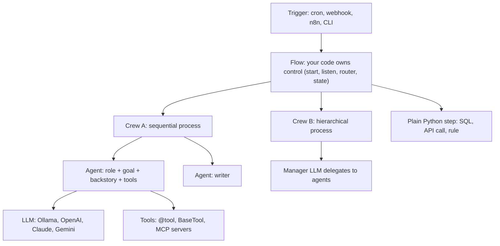
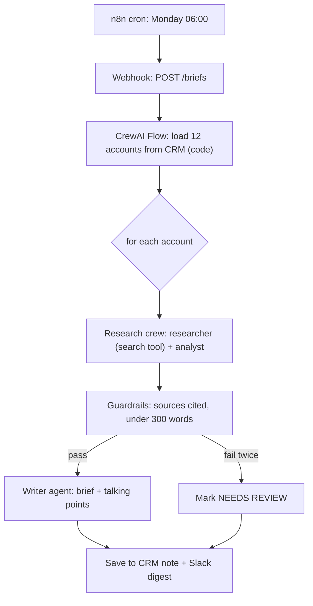

# 25 · CrewAI: Roles, Tasks & Crews

> **In one line:** CrewAI lets you describe a team (agents with a **role, goal and backstory**), the work (**tasks** with an expected output) and how the work flows (a **crew** process or a code-owned **Flow**), then runs the ReAct loops for you. It is the fastest way to get a multi-agent prototype talking, and the easiest way to burn tokens on prompts nobody reads, so learn where the calls go.

> **Versions used:** Python 3.13 · crewai 1.15.40 (with crewai-core / crewai-cli 1.15.40; requires Python `>=3.10,<3.14`) · pins `openai<3` (2.54 installed) and `pydantic<2.13` · pulls chromadb 1.5 and lancedb 0.41 · optional extras `crewai[anthropic]`, `crewai[litellm]`, `crewai[tools]` · **Fast-moving:** CrewAI ships weekly. In 1.x the LLM layer moved from LiteLLM to native provider SDKs (LiteLLM is now an extra), the four memory types merged into one `Memory` class, and Flows gained persistence and `@human_feedback` (1.8+). Re-check imports and `Agent`/`Task` fields against the docs when you upgrade.

---

## 1. Overview

> **Builds on:** [Ch 21 · Agent Patterns](topic.html?p=21-agent-patterns) (ReAct, orchestrator-workers and why workflows usually win), [Ch 04 · Function Calling](topic.html?p=04-function-calling) (the `backoffice.py` tools reused here), [Ch 03 · Structured Outputs](topic.html?p=03-structured-outputs) (Pydantic outputs) and [Ch 07 · Multi-Provider Routing](topic.html?p=07-multi-provider-routing) (one model per role).

In Ch 21 you wrote the ReAct loop, plan-and-execute and orchestrator-workers by hand. CrewAI packages those patterns behind a vocabulary that reads like an org chart: a *researcher* agent, an *analyst* agent and a *writer* agent work through a list of tasks, each passing its output to the next. You write configuration, CrewAI writes the prompts and runs the loops.

It has two layers, and the distinction is the single most important thing in this chapter:



- A **Crew** is agent-owned control: agents reason in a loop, call tools, and (optionally) delegate to each other. Good for open-ended research and drafting.
- A **Flow** is code-owned control: decorated Python methods, typed state, routers and persistence. Crews become steps inside it. Good for anything that must run unattended.

Use CrewAI when the work naturally splits into roles with distinct instructions and tools, and you want a working prototype in an afternoon. Keep the theory of multi-agent systems in [AI Engineering · Multi-Agent Orchestration](../ai-engineering/topic.html?p=36-multi-agent-orchestration); here you build, measure and control.

---

## 2. Key Concepts

- **Agent**: an LLM persona. `role` (job title), `goal` (what success means), `backstory` (context and style) become the system prompt. Plus `llm`, `tools`, `max_iter` (ReAct steps per task, default 20), `max_execution_time`, `max_rpm`, `allow_delegation` (default `False`), `reasoning` (plan before acting).
- **Task**: one unit of work. `description`, `expected_output` (the acceptance criteria the agent sees), `agent`, `context` (earlier tasks whose outputs are injected), `output_pydantic` / `output_json`, `output_file`, `guardrail` / `guardrails`, `human_input`, `async_execution`, `tools` (overrides for this task only).
- **Crew**: agents + tasks + a **process**. `Process.sequential` runs tasks in list order, each output feeding the next. `Process.hierarchical` adds a **manager** (`manager_llm` or `manager_agent`) that plans, delegates and reviews. Crew options include `memory`, `planning`, `max_rpm`, `verbose`, `stream`.
- **TaskOutput / CrewOutput**: `.raw` (string), `.pydantic`, `.json_dict`; a crew result also has `.tasks_output` and `.token_usage`.
- **Guardrail**: a function `(TaskOutput) -> tuple[bool, Any]` (or a plain-English string judged by an LLM). On `False`, the error text goes back to the agent and the task retries, up to `guardrail_max_retries` (default 3).
- **Flow**: a class subclassing `Flow[State]`, with `@start()`, `@listen(method_or_label)`, `@router(method)`, `or_` / `and_`, a Pydantic state with an auto `id`, `@persist` for resumable runs and `@human_feedback` for approval steps.
- **Tools**: `@tool("name")` on a function, or a `BaseTool` subclass with `args_schema` and `_run`. MCP servers attach with `Agent(mcps=[...])`.
- **Memory**: one `Memory` class (LanceDB in your OS user-data directory, or `$CREWAI_STORAGE_DIR/memory`) that uses an LLM to score and categorise what to save and an embedder to recall it.

> **Analogy:** a crew is a film crew. Everyone gets a call sheet (role, goal, backstory) and a scene list (tasks). The **Flow** is the production schedule: it decides which crew shoots today, and the producer, not the director, signs the cheques.

What happens when one task runs, and where the tokens go:

```svg
<svg viewBox="0 0 880 360" width="100%" height="360" font-family="ui-sans-serif,system-ui,sans-serif" font-size="11" xmlns="http://www.w3.org/2000/svg">
  <defs><marker id="aa25a" viewBox="0 0 10 10" refX="9" refY="5" markerWidth="7" markerHeight="7" orient="auto"><path d="M0,0 L10,5 L0,10 z" fill="#334155"/></marker></defs>
  <text x="440" y="22" text-anchor="middle" font-size="14" font-weight="700" fill="#1e293b">One CrewAI task: prompt assembly, ReAct loop, guardrail, hand-off</text>
  <rect x="16" y="44" width="200" height="150" rx="8" fill="#dbeafe" stroke="#2563eb"/>
  <text x="116" y="64" text-anchor="middle" font-weight="700" fill="#1e293b">Prompt assembly</text>
  <text x="28" y="84" fill="#334155">role + goal + backstory</text>
  <text x="28" y="100" fill="#334155">tool names + descriptions</text>
  <text x="28" y="116" fill="#334155">task description</text>
  <text x="28" y="132" fill="#334155">expected_output</text>
  <text x="28" y="148" fill="#334155">context: earlier task outputs</text>
  <text x="28" y="164" fill="#334155">memory recall (if enabled)</text>
  <text x="28" y="182" fill="#d97706" font-weight="700">sent on EVERY step</text>
  <line x1="218" y1="118" x2="258" y2="118" stroke="#334155" stroke-width="1.5" marker-end="url(#aa25a)"/>
  <rect x="260" y="44" width="230" height="150" rx="8" fill="#ede9fe" stroke="#7c3aed"/>
  <text x="375" y="64" text-anchor="middle" font-weight="700" fill="#1e293b">Agent ReAct loop (max_iter)</text>
  <text x="272" y="86" fill="#334155">Thought, Action, Action Input</text>
  <text x="272" y="104" fill="#334155">tool runs, Observation appended</text>
  <text x="272" y="122" fill="#334155">repeat until Final Answer</text>
  <text x="272" y="146" fill="#334155">native tool calls if the LLM</text>
  <text x="272" y="162" fill="#334155">supports them, text ReAct if not</text>
  <text x="272" y="182" fill="#d97706" font-weight="700">1 to max_iter LLM calls</text>
  <line x1="492" y1="118" x2="532" y2="118" stroke="#334155" stroke-width="1.5" marker-end="url(#aa25a)"/>
  <rect x="534" y="44" width="160" height="150" rx="8" fill="#fef3c7" stroke="#d97706"/>
  <text x="614" y="64" text-anchor="middle" font-weight="700" fill="#1e293b">Output + guardrail</text>
  <text x="546" y="86" fill="#334155">parse to output_pydantic</text>
  <text x="546" y="104" fill="#334155">guardrail(TaskOutput)</text>
  <text x="546" y="122" fill="#334155">False: feedback, retry</text>
  <text x="546" y="140" fill="#334155">(guardrail_max_retries)</text>
  <text x="546" y="182" fill="#d97706" font-weight="700">+1 loop per retry</text>
  <line x1="696" y1="118" x2="736" y2="118" stroke="#334155" stroke-width="1.5" marker-end="url(#aa25a)"/>
  <rect x="738" y="70" width="126" height="96" rx="8" fill="#dcfce7" stroke="#16a34a"/>
  <text x="801" y="92" text-anchor="middle" font-weight="700" fill="#1e293b">TaskOutput</text>
  <text x="801" y="110" text-anchor="middle" fill="#334155">.raw .pydantic</text>
  <text x="801" y="126" text-anchor="middle" fill="#334155">becomes context</text>
  <text x="801" y="142" text-anchor="middle" fill="#334155">for next task</text>
  <path d="M801,168 C801,250 116,250 116,196" fill="none" stroke="#16a34a" stroke-width="1.5" marker-end="url(#aa25a)"/>
  <text x="460" y="240" text-anchor="middle" fill="#16a34a">sequential: next task's prompt includes this output</text>
  <rect x="16" y="266" width="848" height="84" rx="8" fill="#fee2e2" stroke="#dc2626"/>
  <text x="30" y="286" font-weight="700" fill="#1e293b">Extra calls you pay for (and should measure)</text>
  <text x="30" y="304" fill="#334155">hierarchical process: manager plans, delegates via tool calls, reviews every result (often doubles the call count)</text>
  <text x="30" y="320" fill="#334155">allow_delegation=True: agents ask each other questions · planning=True: one planning call before the crew starts</text>
  <text x="30" y="336" fill="#334155">memory: LLM analysis on every save + embeddings on save and recall · LLM-string guardrails: one judge call per attempt</text>
</svg>
```

### The honest cost and control picture

A crew of three agents doing three tasks is *at least* three LLM calls, typically 6 to 15 once tools and retries are involved, each carrying the role, backstory, tool list and all prior context. A hierarchical crew adds manager calls on top. That is fine for a weekly research brief and wrong for a 10,000-tickets-a-day classifier. The rule from Ch 21 still applies: **if you can write the steps down, write a Flow (or plain Python) and call one agent where judgement is genuinely needed.**

---

## 3. Setup

CrewAI pins `openai<3` and `pydantic<2.13`, so give it **its own virtual environment**. Installing it next to `openai-agents` or the current `openai` 3.x SDK will downgrade them.

```bash
python3.13 -m venv .venv-crew && source .venv-crew/bin/activate
pip install "crewai>=1.15,<2" "python-dotenv>=1"
# optional: pip install "crewai[anthropic]>=1.15,<2"   # native Claude provider (pins an older anthropic SDK)
# optional: pip install "crewai[tools]>=1.15,<2"       # crewai-tools: search, scrape, file, RAG tools
ollama pull qwen3:8b            # handles CrewAI's ReAct format far better than 3B models
ollama pull nomic-embed-text    # only for the memory example
```

```bash
# .env.example
LLM_BASE_URL=http://localhost:11434/v1
LLM_MODEL=qwen3:8b
CREWAI_DISABLE_TELEMETRY=true     # CrewAI sends anonymous usage telemetry unless disabled
OTEL_SDK_DISABLED=true
# Paid alternatives (pick one, never commit real keys):
# OPENAI_API_KEY=sk-...           OPENAI_MODEL=gpt-5-mini
# ANTHROPIC_API_KEY=sk-ant-...    CLAUDE_MODEL=claude-opus-5-5
```

One helper module picks the model from the environment, and one fake LLM lets you test crews offline (the same idea as the `ScriptedModel` in Ch 21):

```python
# llm_setup.py: model factory + an offline fake for tests
import os

from dotenv import load_dotenv

load_dotenv()                     # before importing crewai so telemetry env vars apply
os.environ.setdefault("CREWAI_DISABLE_TELEMETRY", "true")
os.environ.setdefault("OTEL_SDK_DISABLED", "true")

from crewai import LLM, BaseLLM  # noqa: E402


def make_llm(provider: str | None = None) -> LLM:
    """Ollama by default. 'ollama/...' uses CrewAI's native OpenAI-compatible client (no LiteLLM)."""
    provider = provider or os.getenv("CREW_PROVIDER", "ollama")
    if provider == "openai":
        return LLM(model=f"openai/{os.getenv('OPENAI_MODEL', 'gpt-5-mini')}")   # reads OPENAI_API_KEY
    if provider == "anthropic":                                               # needs crewai[anthropic]
        # max_tokens is required for Claude; never pass temperature (rejected by current Claude models)
        return LLM(model=f"anthropic/{os.getenv('CLAUDE_MODEL', 'claude-opus-5-5')}", max_tokens=4096)
    return LLM(model=f"ollama/{os.getenv('LLM_MODEL', 'qwen3:8b')}",
               base_url=os.getenv("LLM_BASE_URL", "http://localhost:11434/v1"))


class ScriptedLLM(BaseLLM):
    """Offline test double: returns pre-written replies in order and records every prompt."""
    def __init__(self, replies: list[str]):
        super().__init__(model="scripted")
        self._replies = list(replies)
        self.prompts: list = []

    def call(self, messages, tools=None, callbacks=None, available_functions=None,
             from_task=None, from_agent=None, response_model=None):
        self.prompts.append(messages)
        if not self._replies:
            raise RuntimeError("ScriptedLLM ran out of replies")
        return self._replies.pop(0)

    def supports_function_calling(self) -> bool:
        return False                 # forces CrewAI's text ReAct format, easy to script
```

> **Gotcha:** CrewAI's Ollama provider also reads `OLLAMA_HOST` as a base-URL override. That variable is often set to `0.0.0.0` on machines that run the Ollama *server*, which breaks the client. Pass `base_url` explicitly, as above.

Copy `backoffice.py` from [Ch 04, Setup](topic.html?p=04-function-calling) into the folder. These wrappers expose it as CrewAI tools:

```python
# ap_tools.py: Ch 04 back office as CrewAI tools
import json

from crewai.tools import tool

import backoffice


@tool("find_invoices")
def find_invoices(vendor: str = "", unpaid_only: bool = False) -> str:
    """List invoices as JSON. vendor: exact vendor name or empty for all. unpaid_only: only unpaid ones."""
    return json.dumps(backoffice.find_invoices(vendor or None, unpaid_only))


@tool("days_overdue")
def days_overdue(number: str, today: str) -> str:
    """Days an invoice is past due. number: invoice number like CT-0099. today: ISO date YYYY-MM-DD."""
    try:
        return str(backoffice.days_overdue(number, today))
    except KeyError:
        return f"ERROR: unknown invoice {number}"      # errors as data, never raise into the loop
```

---

## 4. Code Examples

### Example 1: A two-agent sequential crew

An analyst finds overdue invoices with tools; a writer turns the finding into a reminder. The second task lists the first in `context`, so its prompt includes the analyst's answer.

```python
# crew_basic.py: analyst -> writer, sequential, structured final output
from pydantic import BaseModel

from llm_setup import make_llm
from crewai import Agent, Crew, Process, Task
from ap_tools import days_overdue, find_invoices


class Reminder(BaseModel):
    invoice: str
    subject: str
    body: str


def build_crew(llm) -> Crew:
    analyst = Agent(
        role="Accounts receivable analyst",
        goal="Find which unpaid invoices are overdue and by how many days, using tools for every fact",
        backstory="You are meticulous and never guess numbers or dates.",
        llm=llm, tools=[find_invoices, days_overdue], max_iter=6,
    )
    writer = Agent(
        role="Collections writer",
        goal="Write short, polite, specific payment reminders",
        backstory="You write for busy finance teams: concrete numbers, one clear ask.",
        llm=llm, max_iter=3,
    )
    find = Task(
        description="Today is {today}. Which unpaid invoices for {vendor} are overdue, and by how many days?",
        expected_output="One line per overdue invoice: number, amount, currency, days overdue.",
        agent=analyst,
    )
    draft = Task(
        description="Write a reminder email for the most overdue invoice found.",
        expected_output="A reminder with subject and a body under 80 words.",
        agent=writer, context=[find], output_pydantic=Reminder,
    )
    return Crew(agents=[analyst, writer], tasks=[find, draft], process=Process.sequential)


if __name__ == "__main__":
    result = build_crew(make_llm()).kickoff(inputs={"vendor": "Contoso", "today": "2026-11-12"})
    print(result.pydantic)
    print(result.token_usage)
```

`{today}` and `{vendor}` are filled from `kickoff(inputs=...)`, so one crew definition serves every vendor. Illustrative output with `qwen3:8b`:

```text
invoice='CT-0099' subject='Invoice CT-0099 is 28 days overdue' body='Hi Contoso team, invoice CT-0099 for USD 1,200.00 was due on 15 October and is now 28 days overdue. Could you confirm a payment date this week? Thank you.'
total_tokens=7412 prompt_tokens=6890 cached_prompt_tokens=0 completion_tokens=522 reasoning_tokens=0 cache_creation_tokens=0 successful_requests=5
```

Five requests and ~7k tokens for one email: three analyst steps (two tool calls and a final answer), one writer step and one conversion step. Keep that ratio in mind.

The same crew runs offline with the scripted LLM. This is how you test that the wiring (tools, context passing, output parsing) works without a model:

```python
# test_crew_basic.py: deterministic, no model needed
from llm_setup import ScriptedLLM
from crew_basic import build_crew

REPLIES = [
    'Thought: list unpaid invoices first.\nAction: find_invoices\nAction Input: {"vendor": "Contoso", "unpaid_only": true}',
    'Thought: check how overdue it is.\nAction: days_overdue\nAction Input: {"number": "CT-0099", "today": "2026-11-12"}',
    "Thought: I now know the final answer\nFinal Answer: CT-0099, 1200.00 USD, 28 days overdue.",
    'Thought: I now know the final answer\nFinal Answer: {"invoice": "CT-0099", "subject": "CT-0099 is 28 days overdue", '
    '"body": "Hi Contoso, invoice CT-0099 (USD 1,200) is 28 days overdue. Could you confirm a payment date?"}',
]

if __name__ == "__main__":
    llm = ScriptedLLM(REPLIES)
    out = build_crew(llm).kickoff(inputs={"vendor": "Contoso", "today": "2026-11-12"})
    print([t.raw[:40] for t in out.tasks_output])
    print(out.pydantic.subject, "| model calls:", len(llm.prompts))
    print("tool result reached the model:", "Observation: 28" in str(llm.prompts[2]))
```

Output (real, offline run):

```text
['CT-0099, 1200.00 USD, 28 days overdue.', '{"invoice": "CT-0099", "subject": "CT-0']
CT-0099 is 28 days overdue | model calls: 4
tool result reached the model: True
```

### Example 2: Guardrails that retry, and human review

A **function guardrail** is deterministic and free. Return `(True, value)` to accept, `(False, "feedback")` to send the agent back with that feedback.

```python
# guardrails.py: word-count and must-mention checks with automatic retry
from typing import Any

from pydantic import BaseModel, ValidationError

from crewai import Agent, Crew, Task, TaskOutput
from llm_setup import ScriptedLLM


class Reminder(BaseModel):
    invoice: str
    subject: str
    body: str


ATTEMPTS: list[str] = []


def parsed(out: TaskOutput) -> Reminder | None:
    """out.pydantic can still be None when the guardrail runs, so fall back to parsing raw."""
    if out.pydantic is not None:
        return out.pydantic
    try:
        return Reminder.model_validate_json(out.raw)
    except ValidationError:
        return None


def short_and_specific(out: TaskOutput) -> tuple[bool, Any]:   # CrewAI checks this annotation
    ATTEMPTS.append(out.raw)
    r = parsed(out)
    if r is None:
        return False, "Reply with JSON matching the Reminder schema."
    words = len(r.body.split())
    if words > 25:
        return False, f"The body has {words} words. Keep it to 25 or fewer."
    if r.invoice not in r.body:
        return False, "Mention the invoice number in the body."
    return True, out


def build(llm) -> Crew:
    writer = Agent(role="Collections writer", goal="Short, specific reminders", backstory="Concise.", llm=llm)
    task = Task(description="Write a reminder for invoice CT-0099 (USD 1,200, 28 days overdue).",
                expected_output="JSON with invoice, subject, body", agent=writer,
                output_pydantic=Reminder, guardrail=short_and_specific, guardrail_max_retries=2)
    return Crew(agents=[writer], tasks=[task])


if __name__ == "__main__":
    wordy = "Dear valued customer, " + "we would like to kindly remind you " * 5
    llm = ScriptedLLM([
        'Thought: draft\nFinal Answer: {"invoice": "CT-0099", "subject": "Reminder", "body": "%s"}' % wordy,
        'Thought: shorter\nFinal Answer: {"invoice": "CT-0099", "subject": "CT-0099 overdue", '
        '"body": "Hi Contoso, CT-0099 (USD 1,200) is 28 days overdue. Can you confirm a payment date?"}',
    ])
    out = build(llm).kickoff()
    print(out.pydantic.body)
    print("attempts:", len(ATTEMPTS))
```

Output (real, offline run):

```text
Hi Contoso, CT-0099 (USD 1,200) is 28 days overdue. Can you confirm a payment date?
attempts: 2
```

> **Gotcha:** in crewai 1.15 a guardrail can receive `out.pydantic is None` on the first attempt even when `out.raw` is valid JSON (conversion happens later). Parse `out.raw` yourself as a fallback, as `parsed()` does, or valid answers get rejected and you pay for a retry.

Two other options trade money or a human for judgement:

- `guardrail="The email must not threaten legal action and must include a payment date request."` makes CrewAI ask an LLM to judge each attempt (one extra call per attempt). Use it for fuzzy criteria, after the cheap function checks.
- `human_input=True` on a task pauses the run in the terminal and asks a person to accept or give feedback before the task completes. Fine for a CLI; for a web app or n8n approval, use a Flow step (Example 4) so the pause is a real state, not a blocked process.

### Example 3: Hierarchical process (and why it costs more)

In a hierarchical crew you don't assign agents to tasks. A **manager** LLM reads each task, delegates it to a co-worker with a tool call, reviews the answer and may delegate again.

```python
# crew_hierarchical.py: a manager delegates research and writing
import os

from crewai import Agent, Crew, Process, Task
from llm_setup import make_llm
from ap_tools import days_overdue, find_invoices


def build(worker_llm, manager_llm) -> Crew:
    analyst = Agent(role="AR analyst", goal="Facts about invoices from tools only",
                    backstory="Never guesses.", llm=worker_llm, tools=[find_invoices, days_overdue], max_iter=5)
    writer = Agent(role="Collections writer", goal="Short, polite reminders",
                   backstory="Plain English.", llm=worker_llm, max_iter=3)
    report = Task(description="Produce a collections brief for {vendor} as of {today}: overdue invoices, "
                              "days overdue, and one drafted reminder for the worst one.",
                  expected_output="A markdown brief: table of overdue invoices, then the reminder.")
    return Crew(agents=[analyst, writer], tasks=[report], process=Process.hierarchical,
                manager_llm=manager_llm, max_rpm=30)


if __name__ == "__main__":
    # A stronger manager, cheaper workers (Ch 07): e.g. CREW_MANAGER_PROVIDER=anthropic
    crew = build(make_llm(), make_llm(os.getenv("CREW_MANAGER_PROVIDER", "ollama")))
    out = crew.kickoff(inputs={"vendor": "Contoso", "today": "2026-11-12"})
    print(out.raw)
    print("requests:", out.token_usage.successful_requests, "tokens:", out.token_usage.total_tokens)
```

Illustrative numbers from the same brief on `qwen3:8b`: sequential (two explicit tasks) took 5 requests and ~7k tokens; hierarchical took 11 requests and ~19k tokens, and twice the manager re-delegated because it wanted a different format. Small local models are also weak managers: they forget to delegate or delegate with an empty question. If you need a manager, give it your strongest model and keep the worker list short. Often a Flow with a router (next example) gives you the same "decide who does what" behaviour with one cheap classification call.

### Example 4: Flows put your code back in charge

A Flow is a class of decorated methods sharing a typed state. `@start` runs first, `@listen(x)` runs after `x`, and `@router(x)` returns a label that `@listen("label")` methods subscribe to. Crews become one step among many.

```python
# ticket_flow.py: classify with a rule, run a crew only where judgement is needed
from typing import Literal

from pydantic import BaseModel

from llm_setup import make_llm, ScriptedLLM
from crewai import Agent, Crew, Task
from crewai.flow.flow import Flow, listen, router, start


class TicketState(BaseModel):
    text: str = ""
    category: str = ""
    reply: str = ""
    model_calls: int = 0


def reply_crew(llm) -> Crew:
    agent = Agent(role="Billing support agent", goal="Resolve billing questions accurately",
                  backstory="Friendly, precise, never promises refunds.", llm=llm, max_iter=3)
    task = Task(description="Customer wrote: {text}\nDraft a reply in under 70 words.",
                expected_output="A reply ready to send.", agent=agent)
    return Crew(agents=[agent], tasks=[task])


class TicketFlow(Flow[TicketState]):
    llm = None                                   # injected before kickoff (real or scripted)

    @start()
    def classify(self):
        text = self.state.text.lower()           # a rule, not an LLM: free and testable
        self.state.category = ("billing" if any(w in text for w in ("invoice", "charge", "refund"))
                               else "outage" if "down" in text else "other")

    @router(classify)
    def route(self) -> Literal["billing", "outage", "other"]:
        return self.state.category

    @listen("billing")
    def handle_billing(self):                    # handler names must differ from route labels
        out = reply_crew(self.llm).kickoff(inputs={"text": self.state.text})
        self.state.reply, self.state.model_calls = out.raw, out.token_usage.successful_requests
        return self.state.reply

    @listen("outage")
    def handle_outage(self):
        self.state.reply = "We are aware of an incident. Live status: https://status.example.com"
        return self.state.reply

    @listen("other")
    def handle_other(self):
        self.state.reply = "ESCALATE"            # a human picks these up
        return self.state.reply


if __name__ == "__main__":
    flow = TicketFlow()
    flow.llm = ScriptedLLM(["Thought: I now know the final answer\nFinal Answer: Hi! Invoice CT-0099 "
                            "was charged once; the second line is a pending authorisation that drops in 3 days."])
    print(flow.kickoff(inputs={"text": "Why was I charged twice on invoice CT-0099?"}))
    print(flow.state.category)
    flow2 = TicketFlow()
    print(flow2.kickoff(inputs={"text": "The dashboard is down again"}), "|", flow2.state.category)
```

Output (real, offline; CrewAI also prints Flow progress panels, omitted here):

```text
Hi! Invoice CT-0099 was charged once; the second line is a pending authorisation that drops in 3 days.
billing
We are aware of an incident. Live status: https://status.example.com | outage
```

`kickoff(inputs=...)` fills the state fields. Only one branch costs model calls. Two more Flow features matter in production:

- **`@persist()`** on the class (or a method) saves state to SQLite after each step, keyed by `state.id`. The default database sits in your OS user-data directory under a folder named after your project directory; pass `@persist(SQLiteFlowPersistence("flows.db"))` to choose the file. Re-running with `kickoff(inputs={"id": saved_id})` (or `restore_from_state_id=` to fork) resumes instead of starting over.
- **`@human_feedback(message=..., emit=["approved", "rejected"], llm=...)`** on a method pauses for a person, has an LLM map their free-text answer onto one of the `emit` labels, and routes to `@listen("approved")` and friends. It needs crewai 1.8+.

### Example 5: Custom tools, tool caching and MCP

Use a `BaseTool` subclass when you want a typed schema, configuration (a DB URL, an API client) or async support:

```python
# tools_advanced.py: typed tool, cache policy, and an MCP server as tools
import json
import os

from pydantic import BaseModel, Field

from crewai import Agent
from crewai.mcp import MCPServerHTTP
from crewai.tools import BaseTool

import backoffice


class OverdueArgs(BaseModel):
    number: str = Field(description="Invoice number, e.g. CT-0099")
    today: str = Field(description="ISO date YYYY-MM-DD")


class DaysOverdueTool(BaseTool):
    name: str = "days_overdue"
    description: str = "Days an invoice is past its due date. Returns an integer or an error string."
    args_schema: type[BaseModel] = OverdueArgs

    def _run(self, number: str, today: str) -> str:
        try:
            return str(backoffice.days_overdue(number, today))
        except KeyError:
            return json.dumps({"error": f"unknown invoice {number}"})


overdue_tool = DaysOverdueTool()
# Tool results are cached per (tool, args) within a run by default. Opt out for answers that change:
overdue_tool.cache_function = lambda args, result: not result.startswith("{")   # don't cache errors


def analyst_with_mcp(llm) -> Agent:
    """Attach every tool from the Ch 28 FastMCP server (Streamable HTTP) alongside local tools."""
    return Agent(role="AR analyst", goal="Answer AR questions with tools", backstory="Careful.", llm=llm,
                 tools=[overdue_tool],
                 mcps=[MCPServerHTTP(url=os.getenv("MCP_URL", "http://localhost:8000/mcp"))])


if __name__ == "__main__":
    print(overdue_tool.run(number="CT-0099", today="2026-11-12"))
    print(overdue_tool.run(number="XX-1", today="2026-11-12"))
```

Output (real):

```text
28
{"error": "unknown invoice XX-1"}
```

`MCPServerStdio(command=..., args=[...])` launches a local MCP server instead, and `tool_filter` limits which of its tools the agent sees. Build the server itself in [Ch 28 · MCP with FastMCP](topic.html?p=28-mcp-fastmcp). For off-the-shelf tools (web search, scraping, file and PDF search) install `crewai[tools]`; many of them call paid APIs, so read each tool's requirements.

### Example 6: Memory, local and explicit

Memory makes agents recall facts across tasks and runs. By default it uses an OpenAI embedder and an OpenAI model for analysis, so a local setup must say otherwise:

```python
# crew_memory.py: unified Memory with a local LLM and Ollama embeddings
import os

from crewai import Agent, Crew, Task
from crewai.memory import Memory
from llm_setup import make_llm

os.environ.setdefault("CREWAI_STORAGE_DIR", "./crew_storage")   # LanceDB files go to ./crew_storage/memory


def build() -> Crew:
    llm = make_llm()
    memory = Memory(llm=llm, embedder={"provider": "ollama", "config": {
        "model_name": "nomic-embed-text", "url": "http://localhost:11434/api/embeddings"}})
    agent = Agent(role="Account manager", goal="Remember customer preferences",
                  backstory="Personal, consistent.", llm=llm)
    task = Task(description="Customer note: {note}\nAcknowledge it in one sentence, using anything you "
                            "already know about this customer.", expected_output="One sentence.", agent=agent)
    return Crew(agents=[agent], tasks=[task], memory=memory)


if __name__ == "__main__":
    build().kickoff(inputs={"note": "Contoso prefers reminders to go to ap@contoso.example, not the CFO."})
    print(build().kickoff(inputs={"note": "Contoso asked who receives our reminders."}).raw)
```

Illustrative output from the second run:

```text
Noted: we send Contoso's reminders to ap@contoso.example rather than the CFO.
```

Every save runs an analysis call plus an embedding, so memory multiplies cost. Use `Memory.remember()` / `recall()` directly from a Flow when you know exactly what is worth keeping, and keep customer data in your database, not only in agent memory. For the design space (short-term, long-term, Mem0) see [Ch 22 · Agent Memory & Mem0](topic.html?p=22-agent-memory-mem0).

---

## 5. Real-World Use Case

**Company:** a 40-person B2B software firm. **Job:** every Monday the sales team wants a one-page brief per strategic account (12 accounts): recent news, product changes, open support tickets and two talking points. **Before:** an SDR spent ~6 hours a week on it.



**Design choices:** the Flow owns the loop over accounts, the CRM reads and the Slack post (plain code). Each account runs a two-agent **sequential** crew (researcher with a search tool and the support-ticket tool, analyst/writer), not a hierarchical one. Function guardrails check that every claim has a URL and the brief is under 300 words.

**Numbers:** 12 accounts × ~9 requests ≈ 110 requests and ~350k tokens per Monday. On a mid-tier hosted model that is a few dollars a week (check your provider's pricing page and multiply tokens by price); on a local 8B model it is free but takes ~25 minutes, which is fine for a 06:00 job. The first version used a hierarchical crew of five agents: 3× the tokens, and the manager occasionally skipped the support-ticket check. The lesson is the chapter's thesis: **roles are great for prompts, but control flow belongs in code.**

---

## 6. Mini Project: A Collections Flow with Approval (1–2 hours)

**Goal:** a Flow that finds overdue invoices with plain code, runs a two-agent crew per invoice to draft a reminder, validates each draft with guardrails, asks a human to approve, persists state so a crash doesn't resend anything, and ships with an offline test.

```text
collections-flow/
├── .env
├── backoffice.py        # from Ch 04
├── llm_setup.py         # Setup
├── ap_tools.py          # Setup
├── drafting.py          # crew per invoice
├── collections_flow.py  # the Flow
└── test_flow.py         # offline test
```

**Step 1: the per-invoice crew,** reusing the guardrail idea from Example 2.

```python
# drafting.py: one small crew per invoice
from typing import Any

from pydantic import BaseModel, ValidationError

from crewai import Agent, Crew, Process, Task, TaskOutput


class Draft(BaseModel):
    invoice: str
    subject: str
    body: str


def draft_guardrail(out: TaskOutput) -> tuple[bool, Any]:
    try:
        d = out.pydantic or Draft.model_validate_json(out.raw)    # see the Gotcha in Example 2
    except ValidationError:
        d = None
    if d is None:
        return False, "Return JSON with invoice, subject and body."
    if d.invoice not in d.body:
        return False, "Mention the invoice number in the body."
    if len(d.body.split()) > 80:
        return False, "Keep the body under 80 words."
    if any(w in d.body.lower() for w in ("legal", "lawyer", "court")):
        return False, "Do not threaten legal action."
    return True, out


def drafting_crew(llm) -> Crew:
    tone = Agent(role="Tone advisor", goal="Pick the right tone for a payment reminder",
                 backstory="You know that polite works for under 30 days, firm after that.", llm=llm, max_iter=2)
    writer = Agent(role="Collections writer", goal="Write short, specific reminders",
                   backstory="Plain English, one clear ask.", llm=llm, max_iter=3)
    advise = Task(description="Invoice {number} for {vendor}: {currency} {total}, {days} days overdue. "
                              "Say 'polite' or 'firm' and why, in one sentence.",
                  expected_output="polite or firm, plus one reason", agent=tone)
    write = Task(description="Write the reminder for invoice {number} using the advised tone.",
                 expected_output="JSON with invoice, subject, body", agent=writer, context=[advise],
                 output_pydantic=Draft, guardrail=draft_guardrail, guardrail_max_retries=2)
    return Crew(agents=[tone, writer], tasks=[advise, write], process=Process.sequential)
```

**Step 2: the Flow.** Code finds the invoices; the crew drafts; a router sends each batch to approval; `@persist` makes the run resumable.

```python
# collections_flow.py: code-owned control, crews only for drafting
import json
from pathlib import Path

from pydantic import BaseModel

import backoffice
from crewai.flow.flow import Flow, listen, router, start
from crewai.flow.persistence import SQLiteFlowPersistence, persist
from drafting import Draft, drafting_crew


class CollectionsState(BaseModel):
    id: str = ""
    today: str = "2026-11-12"
    min_days: int = 14
    candidates: list[dict] = []
    drafts: list[dict] = []
    failed: list[str] = []
    approved: list[str] = []


@persist(SQLiteFlowPersistence("collections_state.db"))   # saved after every step
class CollectionsFlow(Flow[CollectionsState]):
    llm = None
    approve = staticmethod(lambda draft: input(f"\nSend this?\n{json.dumps(draft, indent=2)}\n[y/N] ") == "y")

    @start()
    def find_overdue(self):
        rows = backoffice.find_invoices(unpaid_only=True)
        for r in rows:
            r["days"] = backoffice.days_overdue(r["number"], self.state.today)
        self.state.candidates = [r for r in rows if r["days"] >= self.state.min_days]

    @listen(find_overdue)
    def draft_all(self):
        done = {d["invoice"] for d in self.state.drafts}          # idempotent on resume
        for inv in self.state.candidates:
            if inv["number"] in done:
                continue
            try:
                out = drafting_crew(self.llm).kickoff(inputs=inv)
                draft = out.pydantic or Draft.model_validate_json(out.raw)
                self.state.drafts.append(draft.model_dump())
            except Exception as exc:                              # guardrail exhausted or model error
                self.state.failed.append(f"{inv['number']}: {exc}")

    @router(draft_all)
    def anything_to_send(self):
        return "review" if self.state.drafts else "nothing"

    @listen("review")
    def human_review(self):
        for d in self.state.drafts:
            if d["invoice"] not in self.state.approved and self.approve(d):
                backoffice.send_reminder(d["invoice"], tone="firm")
                self.state.approved.append(d["invoice"])
        Path("collections_report.json").write_text(self.state.model_dump_json(indent=2))
        return f"sent {len(self.state.approved)}, failed {len(self.state.failed)}"

    @listen("nothing")
    def done(self):
        return "nothing overdue"


if __name__ == "__main__":
    from llm_setup import make_llm
    flow = CollectionsFlow()
    flow.llm = make_llm()
    print(flow.kickoff(), "| state id:", flow.state.id)
```

**Step 3: the offline test.** Script the two agents' replies, auto-approve, and assert that exactly one reminder was sent.

```python
# test_flow.py: deterministic end-to-end check
import backoffice
from collections_flow import CollectionsFlow
from llm_setup import ScriptedLLM

if __name__ == "__main__":
    flow = CollectionsFlow()
    flow.llm = ScriptedLLM([
        "Thought: I now know the final answer\nFinal Answer: firm, it is 28 days overdue.",
        'Thought: I now know the final answer\nFinal Answer: {"invoice": "CT-0099", '
        '"subject": "CT-0099: 28 days overdue", "body": "Hi Contoso, invoice CT-0099 '
        '(USD 1,200) is 28 days overdue. Please confirm a payment date by Friday."}',
    ])
    flow.approve = lambda draft: True
    print(flow.kickoff())
    print([d["invoice"] for d in flow.state.drafts], backoffice.SENT_EMAILS)
    assert backoffice.SENT_EMAILS == [{"invoice": "CT-0099", "tone": "firm"}]
    print("ok")
```

Output (real, offline; progress panels omitted):

```text
sent 1, failed 0
['CT-0099'] [{'invoice': 'CT-0099', 'tone': 'firm'}]
ok
```

Only CT-0099 qualifies (28 days); NW-0412 isn't due yet and CT-0101 is paid, so the code, not an LLM, decided that. **Step 4:** run `python collections_flow.py` against Ollama and approve or reject in the terminal.

**Done when:**
- [ ] `test_flow.py` passes offline.
- [ ] A live run drafts reminders only for invoices 14+ days overdue, and nothing is sent without a "y".
- [ ] A draft that mentions legal action is rejected by the guardrail and retried.
- [ ] Killing the process mid-run and re-running with the same state `id` does not draft or send twice.
- [ ] `collections_report.json` records drafts, failures and approvals.

**Stretch goals:** replace `input()` with `@human_feedback` and route `approved` / `rejected`; trigger the flow from n8n with a webhook ([Ch 12](topic.html?p=12-n8n-with-python)); add a token budget by summing `token_usage.total_tokens` per crew and skipping drafting once it's exceeded.

---

## 7. Comparison Table

| Option | Who owns control flow | Calls per task (typical) | Strengths | Weaknesses | Use when |
|---|---|---|---|---|---|
| Plain Python + one agent (Ch 21) | your code | 1–5 | cheapest, fully testable | you write everything | steps are known |
| CrewAI **sequential crew** | list order, agents inside tasks | 2–8 per task | fast to prototype, role prompts, guardrails | prompt overhead per step | 2–4 distinct roles, open-ended drafting |
| CrewAI **hierarchical crew** | manager LLM | 2× sequential or more | flexible task assignment | cost, weak with small models | genuinely unknown assignment, strong manager model |
| CrewAI **Flow + crews** | your code (decorators, state) | only where a crew runs | routers, persistence, human feedback | another API to learn | production CrewAI |
| LangGraph ([Ch 23](topic.html?p=23-langgraph-fundamentals)) | explicit graph | you decide | checkpoints, interrupts, streaming, fine control | more code | complex stateful agents, durable approvals |
| OpenAI Agents SDK handoffs ([Ch 26](topic.html?p=26-vendor-agent-sdks)) | agents hand off conversation | 1–5 per agent | small API, guardrails, tracing | OpenAI-centric defaults | triage → specialist chat flows |
| AutoGen group chat ([Ch 27](topic.html?p=27-agent-frameworks-tour)) | conversation + termination rules | many | natural debate/critique loops | hard to bound | research, writer/critic pairs |

---

## 8. Common Mistakes & Best Practices

**Mistake 1: a crew for a known pipeline.** Three agents to "fetch, compute, format" costs 6–10 calls for what is two SQL queries and one LLM call. *Fix:* do fetch and compute in a Flow step, use one agent for the language part.

**Mistake 2: hierarchical by default.** It feels smarter; it doubles calls and fails silently with small managers. *Fix:* start sequential; switch only with a strong `manager_llm` and evidence it helps.

**Mistake 3: vague `expected_output`.** "A good report" gives the agent nothing to aim for and the guardrail nothing to check. *Fix:* write acceptance criteria: format, length, required fields; then enforce them with `output_pydantic` and a function guardrail.

**Mistake 4: unbounded loops.** `max_iter` defaults to 20 per task. *Fix:* set `max_iter` per agent (2–6 is typical), `max_execution_time`, and `max_rpm` on the crew; catch exceptions around `kickoff()` in Flows.

**Mistake 5: forgetting what memory costs and where it goes.** `memory=True` silently uses OpenAI defaults and writes customer data into your OS user-data directory. *Fix:* configure `Memory(llm=..., embedder=...)` explicitly, set `CREWAI_STORAGE_DIR`, and decide retention like any other datastore.

**Mistake 6: sharing a venv.** `pip install crewai` downgraded `openai` to 2.x and broke another framework in the same environment. *Fix:* one venv (or container) per agent framework.

**Mistake 7: passing `temperature` to Claude.** Current Claude models reject sampling parameters. *Fix:* leave `temperature` unset on `LLM(model="anthropic/...")`; control depth with the model's own settings (Ch 06).

**Before / after: let the code decide, let the agent write**

```python
# Before: the agent decides who is overdue (slow, can be wrong)
#   Task(description="Find all overdue invoices and write reminders for them", agent=analyst)
# After: code decides, the crew only writes
import backoffice

overdue = [r for r in backoffice.find_invoices(unpaid_only=True)
           if backoffice.days_overdue(r["number"], "2026-11-12") >= 14]
print([r["number"] for r in overdue])      # ['CT-0099'] -> kickoff the drafting crew once per row
```

**Best-practice checklist**
- [ ] Control flow in a Flow or plain code; crews only for open-ended language work.
- [ ] Sequential first; `max_iter`, `max_execution_time` and `max_rpm` set everywhere.
- [ ] Concrete `expected_output`, `output_pydantic` and function guardrails before LLM guardrails.
- [ ] Tools return errors as data; side effects happen in code after approval, not inside an agent.
- [ ] Offline tests with a scripted `BaseLLM`; `token_usage` logged per run.
- [ ] Telemetry, memory storage and model providers configured explicitly; one venv per framework.

---

## 9. Exercises

1. **Measure the overhead.** Run Example 1 with `verbose=True` on a local model, count requests and tokens, then rewrite it as one Python function plus one LLM call. Compare tokens, latency and output quality on five vendors.
2. **Sequential vs hierarchical.** Run Example 3 both ways on the same three inputs. Record `successful_requests`, total tokens and whether the brief met the expected output.
3. **Resumable runs.** Make `test_flow.py` raise inside `human_review` on the first run, then resume from the persisted state `id` and prove nothing is drafted twice.
4. **LLM guardrail.** Add `guardrail="..."` for tone on top of the function guardrail (use `guardrails=[fn, "..."]`) and count the extra calls.
5. **MCP tools.** Point Example 5's `MCPServerHTTP` at your Ch 28 server and restrict it to two tools with a `tool_filter`.

### Self-check questions

**Q: What is the difference between a CrewAI Crew and a CrewAI Flow?**
A: A Crew is agent-owned control: agents run ReAct loops over their tasks, and in a hierarchical crew a manager LLM decides who does what. A Flow is code-owned control: decorated Python methods with typed state, routers and persistence, where a crew is just one step. Production systems usually put a Flow around one or more small crews.

**Q: What do `role`, `goal`, `backstory` and `expected_output` actually do?**
A: They are prompt material. Role, goal and backstory become the agent's system prompt; the task description and expected output become the user turn, together with tool descriptions and any context from earlier tasks. They are resent on every step of the agent's loop, which is why long backstories cost real money.

**Q: How does a function guardrail work and what should it return?**
A: It receives the `TaskOutput` and returns a tuple. `(True, value)` accepts the output (optionally transformed); `(False, "message")` rejects it, and CrewAI sends the message back to the agent and retries the task up to `guardrail_max_retries` times. Use deterministic checks first and reserve LLM-judged string guardrails for fuzzy criteria.

**Q: Why does a hierarchical crew usually cost more than a sequential one?**
A: The manager LLM adds calls: it plans, delegates each piece of work through a tool call, reviews each answer and may re-delegate. Workers still run their own loops. With small models the manager also tends to delegate poorly. Use it only when task assignment genuinely can't be decided in advance, and with a strong manager model.

**Q: How do you test a crew without calling a model?**
A: Subclass `BaseLLM`, implement `call()` to return scripted replies in CrewAI's ReAct format (`Action:` / `Action Input:` / `Final Answer:`), report no native function calling, and pass it as every agent's `llm`. Then assert on task outputs, tool observations in the recorded prompts and side effects. This tests wiring, guardrails and parsing deterministically.

**Q: Your nightly CrewAI job sometimes sends the same email twice after a crash. How do you fix it? (Senior)**
A: Move the side effect out of the agents into a Flow step, decorate the Flow with `@persist` so state (drafts, approvals, sent IDs) is saved after each step, make the sending step idempotent by checking state (and ideally an idempotency key in the email system) before sending, and resume runs from the saved state `id`. Agents should draft; code should act.

**Q: A stakeholder wants a five-agent hierarchical crew for ticket triage at 10,000 tickets a day. What do you recommend? (Senior)**
A: Estimate cost first: a hierarchical crew is often 10+ requests per ticket, so 100,000+ requests a day plus latency in tens of seconds. Triage is a classification problem with known branches, so use a Flow (or plain workflow) with one cheap classification call and a router, deterministic handling for common categories, and a small crew or single agent only for the long tail. Evaluate the long-tail path against labelled tickets before scaling it.

---

## 10. Summary & Official Docs

- CrewAI models multi-agent work as **agents** (role, goal, backstory, tools), **tasks** (description, expected output, context) and **crews** (sequential or hierarchical).
- **Flows** put your code in charge: typed state, `@start` / `@listen` / `@router`, `@persist` and `@human_feedback`. Production CrewAI is usually a Flow around small crews.
- Every agent step resends role, backstory, tools and context; hierarchical managers, delegation, memory and LLM guardrails add calls. **Measure `token_usage`.**
- Use `output_pydantic` plus **function guardrails** for reliable outputs; LLM guardrails and `human_input` for judgement.
- Run locally with `LLM(model="ollama/qwen3:8b", base_url=...)`; paid providers via `openai/...`, `anthropic/...` (no `temperature` for Claude).
- Test offline with a scripted **`BaseLLM`**; give CrewAI its own venv because it pins `openai<3`.

| Need | CrewAI feature |
|---|---|
| Fixed steps, one judgement call | Flow + one agent |
| Two to four roles drafting together | sequential crew |
| Unknown assignment, strong model available | hierarchical crew |
| Reliable structured output | `output_pydantic` + function guardrail |
| Approval, resume after crash | Flow `@human_feedback`, `@persist` |
| External tools | `@tool`, `BaseTool`, `mcps=[...]` |

**Official docs**
- CrewAI documentation: https://docs.crewai.com
- Concepts (agents, tasks, crews, flows, memory, tools): https://docs.crewai.com/en/concepts/agents
- CrewAI on GitHub: https://github.com/crewAIInc/crewAI
- Theory: [AI Engineering · Multi-Agent Orchestration](../ai-engineering/topic.html?p=36-multi-agent-orchestration)

**Next:** [Ch 26 · OpenAI Agents SDK, Claude Agent SDK & Google ADK](topic.html?p=26-vendor-agent-sdks): the model vendors' own agent frameworks, with handoffs, guardrails, hooks and tracing built in.

---

*AI Automation with Python Handbook — chapter 25.*
