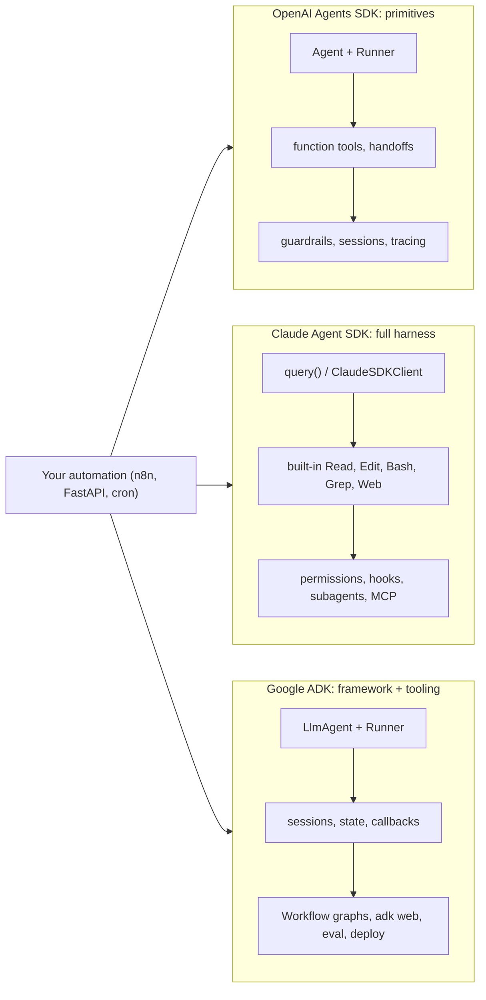
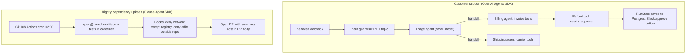

# 26 · OpenAI Agents SDK, Claude Agent SDK & Google ADK

> **In one line:** The three big model vendors each ship an agent framework, and they sit at three different altitudes: OpenAI's **Agents SDK** gives you small primitives (agents, tools, handoffs, guardrails, tracing), Anthropic's **Claude Agent SDK** gives you a whole harness (Claude Code as a library, with file, shell and web tools, permissions and hooks), and Google's **ADK** gives you a framework plus dev tooling (sessions, state, workflow agents, a web UI). Pick by altitude, not by logo.

> **Versions used:** Python 3.13 · openai-agents 0.24.0 (with openai 3.49) · claude-agent-sdk 0.2.180 (bundles the Claude Code CLI 2.1.321) · google-adk 2.14.0 (with google-genai 2.34) · pydantic 2.14 · **Fast-moving:** all three release every week or two. The Agents SDK is still 0.x (breaking changes land in minor versions); the Claude Agent SDK tracks Claude Code releases (the subagent tool was renamed `Task` → `Agent`); ADK 2.x deprecated `SequentialAgent`/`ParallelAgent`/`LoopAgent` in favour of graph `Workflow`s. Pin versions and re-read the changelog before upgrading.

---

## 1. Overview

> **Builds on:** [Ch 04 · Function Calling](topic.html?p=04-function-calling) (`backoffice.py` and the tool loop these SDKs run for you), [Ch 21 · Agent Patterns](topic.html?p=21-agent-patterns) (budgets, stop reasons, scripted test models), [Ch 06 · Model APIs](topic.html?p=06-model-apis) (the three provider SDKs underneath) and [Ch 28 · MCP](topic.html?p=28-mcp-fastmcp) (all three speak MCP).

You have written the agent loop by hand (Ch 21) and seen a role-based framework (Ch 25). The vendors' own SDKs are the third option: thin enough to understand, opinionated enough to save weeks, and first in line for new model features. They differ mostly in **how much of the agent they hand you**:



- **OpenAI Agents SDK** (`openai-agents`, import `agents`): an `Agent` is instructions + tools + handoffs + guardrails; a `Runner` drives the loop. Works with any model through Chat Completions-compatible endpoints or LiteLLM, but its defaults (Responses API, hosted tools, trace export) assume OpenAI.
- **Claude Agent SDK** (`claude-agent-sdk`): the same agent harness that powers Claude Code, run as a subprocess and driven from Python. You get file editing, shell, search, web fetch, subagents, context compaction and a permission system for free. It is the right tool when the agent's job is *working in a filesystem or codebase*.
- **Google ADK** (`google-adk`): a framework with sessions, state, memory, callbacks, multi-agent composition and a browser dev UI (`adk web`). Model-agnostic via LiteLLM, best integrated with Gemini and Google Cloud deployment.

---

## 2. Key Concepts

The same ideas appear under different names. Learn the mapping once:

| Concept | OpenAI Agents SDK | Claude Agent SDK | Google ADK |
|---|---|---|---|
| Agent definition | `Agent(name, instructions, tools, handoffs, output_type)` | `ClaudeAgentOptions(system_prompt, allowed_tools, agents, ...)` | `LlmAgent(name, model, instruction, tools, sub_agents)` |
| Run the loop | `Runner.run(agent, input, max_turns=)` | `query(prompt, options)` or `ClaudeSDKClient` | `Runner.run_async(user_id, session_id, new_message)` |
| Custom tool | `@function_tool` on a typed function | `@tool(...)` + `create_sdk_mcp_server()` | plain function with docstring (auto-wrapped) |
| Delegation | **handoffs** (transfer the conversation) or `agent.as_tool()` | **subagents** (`AgentDefinition`, invoked via the `Agent` tool) | `sub_agents` (LLM transfer), `AgentTool`, `Workflow` |
| Safety checks | input/output **guardrails** (tripwires), `needs_approval` | **permission modes**, `can_use_tool`, `PreToolUse` **hooks** | `before_tool_callback`, `before_model_callback` |
| Memory | `SQLiteSession`, Redis/SQLAlchemy sessions | sessions on disk (`resume=session_id`), compaction | `SessionService` + `state`, `MemoryService` |
| Observability | built-in **tracing** (spans per LLM/tool/handoff) | message stream, `ResultMessage.total_cost_usd`, OpenTelemetry | events, `adk web` trace view, OpenTelemetry |
| Budgets | `max_turns` | `max_turns`, `max_budget_usd`, `effort` | `RunConfig(max_llm_calls=...)` |

Three terms deserve a definition:

- A **handoff** moves the *conversation* to another agent: the triage agent calls a `transfer_to_billing` tool, and from then on the billing agent answers the user. Contrast with **agent-as-tool**, where the orchestrator stays in charge and gets a result back.
- A **guardrail** is a check that runs alongside or after the agent; when its **tripwire** fires, the run stops with an exception. Input guardrails protect the expensive agent from bad input; output guardrails protect the user from bad output.
- A **permission mode** (Claude Agent SDK) decides what happens when the agent wants a tool you haven't pre-approved: ask your callback (`default`), auto-accept file edits (`acceptEdits`), plan only (`plan`), deny (`dontAsk`), let a classifier decide (`auto`) or allow everything (`bypassPermissions`, only inside a sandbox).

> **Analogy:** the Agents SDK is a box of Lego bricks, the Claude Agent SDK is a fully equipped workshop with a safety officer at the door, and ADK is a kit with instructions, a workbench and an inspection lamp.

Where your code can intercept a run in each SDK:

```svg
<svg viewBox="0 0 880 372" width="100%" height="372" font-family="ui-sans-serif,system-ui,sans-serif" font-size="11" xmlns="http://www.w3.org/2000/svg">
  <defs><marker id="aa26a" viewBox="0 0 10 10" refX="9" refY="5" markerWidth="7" markerHeight="7" orient="auto"><path d="M0,0 L10,5 L0,10 z" fill="#334155"/></marker></defs>
  <text x="440" y="22" text-anchor="middle" font-size="14" font-weight="700" fill="#1e293b">Interception points: where your code gets a say</text>
  <text x="20" y="58" font-weight="700" fill="#1e293b">OpenAI Agents SDK</text>
  <rect x="160" y="40" width="120" height="32" rx="6" fill="#fee2e2" stroke="#dc2626"/><text x="220" y="60" text-anchor="middle" fill="#1e293b">input guardrail</text>
  <line x1="282" y1="56" x2="306" y2="56" stroke="#334155" stroke-width="1.5" marker-end="url(#aa26a)"/>
  <rect x="308" y="40" width="96" height="32" rx="6" fill="#ede9fe" stroke="#7c3aed"/><text x="356" y="60" text-anchor="middle" fill="#1e293b">model call</text>
  <line x1="406" y1="56" x2="430" y2="56" stroke="#334155" stroke-width="1.5" marker-end="url(#aa26a)"/>
  <rect x="432" y="40" width="130" height="32" rx="6" fill="#fef3c7" stroke="#d97706"/><text x="497" y="60" text-anchor="middle" fill="#1e293b">needs_approval tool</text>
  <line x1="564" y1="56" x2="588" y2="56" stroke="#334155" stroke-width="1.5" marker-end="url(#aa26a)"/>
  <rect x="590" y="40" width="100" height="32" rx="6" fill="#dbeafe" stroke="#2563eb"/><text x="640" y="60" text-anchor="middle" fill="#1e293b">handoff</text>
  <line x1="692" y1="56" x2="716" y2="56" stroke="#334155" stroke-width="1.5" marker-end="url(#aa26a)"/>
  <rect x="718" y="40" width="140" height="32" rx="6" fill="#fee2e2" stroke="#dc2626"/><text x="788" y="60" text-anchor="middle" fill="#1e293b">output guardrail</text>
  <text x="160" y="92" fill="#334155">every step becomes a trace span; interrupted runs serialise to RunState and resume later</text>
  <text x="20" y="150" font-weight="700" fill="#1e293b">Claude Agent SDK</text>
  <rect x="160" y="132" width="110" height="32" rx="6" fill="#ede9fe" stroke="#7c3aed"/><text x="215" y="152" text-anchor="middle" fill="#1e293b">model wants tool</text>
  <line x1="272" y1="148" x2="296" y2="148" stroke="#334155" stroke-width="1.5" marker-end="url(#aa26a)"/>
  <rect x="298" y="132" width="120" height="32" rx="6" fill="#fee2e2" stroke="#dc2626"/><text x="358" y="152" text-anchor="middle" fill="#1e293b">PreToolUse hooks</text>
  <line x1="420" y1="148" x2="444" y2="148" stroke="#334155" stroke-width="1.5" marker-end="url(#aa26a)"/>
  <rect x="446" y="132" width="150" height="32" rx="6" fill="#fef3c7" stroke="#d97706"/><text x="521" y="152" text-anchor="middle" fill="#1e293b">allow / deny rules, mode</text>
  <line x1="598" y1="148" x2="622" y2="148" stroke="#334155" stroke-width="1.5" marker-end="url(#aa26a)"/>
  <rect x="624" y="132" width="110" height="32" rx="6" fill="#fef3c7" stroke="#d97706"/><text x="679" y="152" text-anchor="middle" fill="#1e293b">can_use_tool</text>
  <line x1="736" y1="148" x2="760" y2="148" stroke="#334155" stroke-width="1.5" marker-end="url(#aa26a)"/>
  <rect x="762" y="132" width="96" height="32" rx="6" fill="#dcfce7" stroke="#16a34a"/><text x="810" y="152" text-anchor="middle" fill="#1e293b">PostToolUse</text>
  <text x="160" y="184" fill="#334155">a deny from any hook wins; tools in allowed_tools skip can_use_tool; budget: max_turns, max_budget_usd</text>
  <text x="20" y="242" font-weight="700" fill="#1e293b">Google ADK</text>
  <rect x="160" y="224" width="130" height="32" rx="6" fill="#fee2e2" stroke="#dc2626"/><text x="225" y="244" text-anchor="middle" fill="#1e293b">before_agent_cb</text>
  <line x1="292" y1="240" x2="316" y2="240" stroke="#334155" stroke-width="1.5" marker-end="url(#aa26a)"/>
  <rect x="318" y="224" width="130" height="32" rx="6" fill="#fee2e2" stroke="#dc2626"/><text x="383" y="244" text-anchor="middle" fill="#1e293b">before_model_cb</text>
  <line x1="450" y1="240" x2="474" y2="240" stroke="#334155" stroke-width="1.5" marker-end="url(#aa26a)"/>
  <rect x="476" y="224" width="130" height="32" rx="6" fill="#fef3c7" stroke="#d97706"/><text x="541" y="244" text-anchor="middle" fill="#1e293b">before_tool_cb</text>
  <line x1="608" y1="240" x2="632" y2="240" stroke="#334155" stroke-width="1.5" marker-end="url(#aa26a)"/>
  <rect x="634" y="224" width="100" height="32" rx="6" fill="#dbeafe" stroke="#2563eb"/><text x="684" y="244" text-anchor="middle" fill="#1e293b">tool runs</text>
  <line x1="736" y1="240" x2="760" y2="240" stroke="#334155" stroke-width="1.5" marker-end="url(#aa26a)"/>
  <rect x="762" y="224" width="96" height="32" rx="6" fill="#dcfce7" stroke="#16a34a"/><text x="810" y="244" text-anchor="middle" fill="#1e293b">after_tool_cb</text>
  <text x="160" y="276" fill="#334155">return a value from a before_* callback to skip the step and use your value instead; return None to continue</text>
  <rect x="20" y="302" width="840" height="58" rx="8" fill="#f8fafc" stroke="#94a3b8"/>
  <text x="34" y="322" font-weight="700" fill="#1e293b">Same rule in all three</text>
  <text x="34" y="340" fill="#334155">put policy in code at the interception point (guardrail, hook, callback), not in the prompt. Prompts ask; interception points enforce.</text>
</svg>
```

---

## 3. Setup

Each SDK pins its own dependencies, so use **one virtual environment per SDK** (CrewAI from Ch 25 conflicts with the Agents SDK, for example).

```bash
# OpenAI Agents SDK
python3.13 -m venv .venv-oai && .venv-oai/bin/pip install "openai-agents>=0.24,<0.25" "python-dotenv>=1"
# Claude Agent SDK (the wheel bundles the Claude Code CLI, ~300 MB installed)
python3.13 -m venv .venv-claude && .venv-claude/bin/pip install "claude-agent-sdk>=0.2.180,<0.3" "python-dotenv>=1"
# Google ADK (+ litellm only if you want Ollama or other non-Gemini models)
python3.13 -m venv .venv-adk && .venv-adk/bin/pip install "google-adk>=2.14,<3" "python-dotenv>=1" "litellm>=1.80"
ollama pull qwen3:8b
```

```bash
# .env.example
# --- local, free (Agents SDK via Chat Completions, ADK via LiteLLM) ---
LLM_BASE_URL=http://localhost:11434/v1
LLM_API_KEY=ollama
LLM_MODEL=qwen3:8b
OLLAMA_API_BASE=http://localhost:11434        # LiteLLM's name for the Ollama URL (ADK)
# --- paid ---
OPENAI_API_KEY=sk-...                          # Agents SDK default provider + trace export
OPENAI_MODEL=gpt-5-mini
ANTHROPIC_API_KEY=sk-ant-...                   # Claude Agent SDK (or Bedrock/Vertex env, see below)
CLAUDE_MODEL=claude-opus-5-5
GOOGLE_API_KEY=...                             # ADK with Gemini (AI Studio key)
GEMINI_MODEL=gemini-2.5-flash
```

> **Version note:** the Claude Agent SDK has no local-model path of its own: it talks to the Anthropic API, Amazon Bedrock (`CLAUDE_CODE_USE_BEDROCK=1`), Google Vertex AI (`CLAUDE_CODE_USE_VERTEX=1`) or Microsoft Foundry. Pointing `ANTHROPIC_BASE_URL` at an Anthropic-compatible gateway (for example a LiteLLM proxy, Ch 07) works for experiments, but the harness is tuned for Claude models. Check the docs for the current list.

Copy `backoffice.py` from [Ch 04, Setup](topic.html?p=04-function-calling) into each project folder; every example below wraps it.

---

## 4. Code Examples

### Example 1: OpenAI Agents SDK on a local model, with typed output

`@function_tool` turns a typed, docstring-ed function into a strict JSON-schema tool. `output_type` makes the final answer a validated Pydantic object. `OpenAIChatCompletionsModel` points the SDK at any Chat Completions server, here Ollama.

```python
# oai_basic.py: Agents SDK + Ollama + typed final output
import asyncio
import os

from dotenv import load_dotenv
from openai import AsyncOpenAI
from pydantic import BaseModel

from agents import Agent, OpenAIChatCompletionsModel, Runner, function_tool, set_tracing_disabled

import backoffice

load_dotenv()


def make_model():
    """Local by default. Unset LLM_BASE_URL and pass model=os.getenv('OPENAI_MODEL') to use OpenAI itself."""
    client = AsyncOpenAI(base_url=os.getenv("LLM_BASE_URL", "http://localhost:11434/v1"),
                         api_key=os.getenv("LLM_API_KEY", "ollama"))
    set_tracing_disabled(True)            # trace export goes to OpenAI and needs OPENAI_API_KEY
    return OpenAIChatCompletionsModel(model=os.getenv("LLM_MODEL", "qwen3:8b"), openai_client=client)


@function_tool
def find_invoices(vendor: str | None = None, unpaid_only: bool = False) -> list[dict]:
    """List invoices from the ledger.

    Args:
        vendor: Exact vendor name such as "Contoso". Omit for all vendors.
        unpaid_only: If true, only unpaid invoices are returned.
    """
    return backoffice.find_invoices(vendor, unpaid_only)


@function_tool
def days_overdue(number: str, today: str) -> int:
    """Days an invoice is past its due date (0 if not yet due).

    Args:
        number: Invoice number such as "CT-0099".
        today: Today's date as YYYY-MM-DD.
    """
    return backoffice.days_overdue(number, today)   # a KeyError becomes an error message for the model


class OverdueLine(BaseModel):
    number: str
    vendor: str
    amount: float
    currency: str
    days_overdue: int


class OverdueReport(BaseModel):
    lines: list[OverdueLine]
    summary: str


ar_agent = Agent(
    name="AR assistant",
    instructions="You answer accounts-receivable questions. Use tools for every fact. Today is 2026-11-12.",
    tools=[find_invoices, days_overdue],
    output_type=OverdueReport,
    model=make_model(),
)

if __name__ == "__main__":
    result = asyncio.run(Runner.run(ar_agent, "Which unpaid invoices are overdue?", max_turns=8))
    report: OverdueReport = result.final_output
    for line in report.lines:
        print(f"{line.number} {line.vendor} {line.amount} {line.currency}: {line.days_overdue} days")
    print(report.summary)
```

Illustrative output with `qwen3:8b`:

```text
CT-0099 Contoso 1200.0 USD: 28 days
One invoice is overdue: Contoso CT-0099, 28 days. NW-0412 (Northwind) is not due until 3 December.
```

`max_turns` is your step budget: exceeding it raises `MaxTurnsExceeded`. If a tool raises, the SDK's default `failure_error_function` sends the error text to the model instead of crashing, the "errors as data" rule from Ch 04. To use OpenAI itself, drop the custom client and pass `model=os.getenv("OPENAI_MODEL", "gpt-5-mini")` (Responses API by default). For Claude or Gemini through the same code, install `openai-agents[litellm]` and use `LitellmModel(model="anthropic/claude-opus-5-5")` from `agents.extensions.models.litellm_model`, without setting a temperature for Claude.

### Example 2: Handoffs and guardrails, tested offline

A triage agent hands off to specialists; an **input guardrail** blocks card numbers before any expensive work happens. The SDK's `Model` interface is small, so a scripted fake model makes the whole flow testable offline:

```python
# fake_model.py: scripted offline Model for the Agents SDK (tests and demos)
import json

from openai.types.responses import ResponseFunctionToolCall, ResponseOutputMessage, ResponseOutputText

from agents import Model, ModelResponse, Usage


def say(text: str) -> ResponseOutputMessage:
    return ResponseOutputMessage(id="msg", type="message", role="assistant", status="completed",
                                 content=[ResponseOutputText(type="output_text", text=text, annotations=[])])


def call(name: str, n: int = 0, **args) -> ResponseFunctionToolCall:
    return ResponseFunctionToolCall(id=f"fc_{n}", call_id=f"call_{name}_{n}", type="function_call",
                                    name=name, arguments=json.dumps(args))


class ScriptedModel(Model):
    """Returns one scripted output item per model call and records what each call could see."""
    def __init__(self, script):
        self.script, self.seen = list(script), []

    async def get_response(self, system_instructions, input, model_settings, tools, output_schema,
                           handoffs, tracing, **kwargs):
        self.seen.append({"tools": [t.name for t in tools], "handoffs": [h.tool_name for h in handoffs]})
        return ModelResponse(output=[self.script.pop(0)], usage=Usage(), response_id=None)

    def stream_response(self, *args, **kwargs):
        raise NotImplementedError("ScriptedModel does not stream")
```

The agents themselves take their model as a parameter, so production code and tests share one definition:

```python
# oai_triage.py: triage -> billing/shipping handoffs, with an input guardrail
import asyncio
import json
import re

from agents import (Agent, GuardrailFunctionOutput, InputGuardrailTripwireTriggered, RunContextWrapper,
                    Runner, function_tool, input_guardrail, set_tracing_disabled)
from agents.extensions.handoff_prompt import prompt_with_handoff_instructions

import backoffice

CARD = re.compile(r"\b(?:\d[ -]?){13,19}\b")


@function_tool
def get_invoice(number: str) -> str:
    """Look up one invoice by number, e.g. CT-0099."""
    rows = [r for r in backoffice.find_invoices() if r["number"] == number]
    return json.dumps(rows[0]) if rows else f"No invoice {number}"


@input_guardrail
async def no_card_numbers(ctx: RunContextWrapper, agent: Agent, user_input) -> GuardrailFunctionOutput:
    text = user_input if isinstance(user_input, str) else json.dumps(user_input)
    found = bool(CARD.search(text))
    return GuardrailFunctionOutput(output_info={"card_number": found}, tripwire_triggered=found)


def build(triage_model, billing_model, shipping_model) -> Agent:
    billing = Agent(name="Billing", model=billing_model, tools=[get_invoice],
                    handoff_description="Invoices, charges, refunds, payment dates.",
                    instructions="You handle billing. Look invoices up before answering. Be brief.")
    shipping = Agent(name="Shipping", model=shipping_model,
                     handoff_description="Deliveries, tracking, damaged parcels.",
                     instructions="You handle shipping questions. Be brief.")
    return Agent(name="Triage", model=triage_model, handoffs=[billing, shipping],
                 input_guardrails=[no_card_numbers],
                 instructions=prompt_with_handoff_instructions(
                     "Route the customer to the right specialist. Never answer billing questions yourself."))


async def main():
    from fake_model import ScriptedModel, call, say
    set_tracing_disabled(True)
    triage = build(ScriptedModel([call("transfer_to_billing")]),
                   ScriptedModel([call("get_invoice", number="CT-0099"), say("CT-0099: USD 1,200, unpaid, due 15 Oct.")]),
                   ScriptedModel([]))
    result = await Runner.run(triage, "What do I owe on CT-0099?")
    print(result.last_agent.name, "|", result.final_output)
    print([type(i).__name__ for i in result.new_items])
    try:
        await Runner.run(triage, "Please charge my card 4111 1111 1111 1111")
    except InputGuardrailTripwireTriggered as exc:
        print("blocked by guardrail:", exc.guardrail_result.output.output_info)


if __name__ == "__main__":
    asyncio.run(main())
```

Output (real, offline):

```text
Billing | CT-0099: USD 1,200, unpaid, due 15 Oct.
['HandoffCallItem', 'HandoffOutputItem', 'ToolCallItem', 'ToolCallOutputItem', 'MessageOutputItem']
blocked by guardrail: {'card_number': True}
```

Each handoff appears to the model as a tool named `transfer_to_<agent>`; `result.last_agent` tells you who finished. Input guardrails run in parallel with the first model call by default (`run_in_parallel=True`), which saves latency but means that call is already paid for when the tripwire fires; pass `@input_guardrail(run_in_parallel=False)` to block first. Output guardrails (`@output_guardrail`, raising `OutputGuardrailTripwireTriggered`) check the final answer. A guardrail can itself call a small, cheap agent, which is the usual way to do topic or jailbreak checks.

### Example 3: Human approval that survives a restart

Mark side-effect tools with `needs_approval=True`. The run stops with `interruptions` instead of executing the tool; you approve or reject each item and resume from a `RunState`, which can be serialised to JSON and stored while a human decides.

```python
# oai_approval.py: needs_approval + RunState round trip
import asyncio

from agents import Agent, Runner, RunState, function_tool, set_tracing_disabled

import backoffice
from fake_model import ScriptedModel, call, say


@function_tool(needs_approval=True)
def send_reminder(number: str, tone: str) -> str:
    """Email a payment reminder for an invoice. tone is polite or firm."""
    return str(backoffice.send_reminder(number, tone))


def build(model) -> Agent:
    return Agent(name="Collections", model=model, tools=[send_reminder],
                 instructions="Send reminders only when asked. Confirm what you did.")


async def main():
    set_tracing_disabled(True)
    agent = build(ScriptedModel([call("send_reminder", number="CT-0099", tone="firm"),
                                 say("Reminder queued for CT-0099.")]))
    first = await Runner.run(agent, "Send Contoso a firm reminder for CT-0099")
    print("paused on:", [(i.tool_name, i.raw_item.arguments) for i in first.interruptions])
    print("sent so far:", backoffice.SENT_EMAILS)

    saved: str = first.to_state().to_string()       # JSON text: store in Redis/DB while a human reviews
    state = await RunState.from_string(agent, saved)  # later, maybe in another process
    for item in state.get_interruptions():
        state.approve(item)                         # or state.reject(item)
    final = await Runner.run(agent, state)
    print(final.final_output, "| sent:", backoffice.SENT_EMAILS)


if __name__ == "__main__":
    asyncio.run(main())
```

Output (real, offline):

```text
paused on: [('send_reminder', '{"number": "CT-0099", "tone": "firm"}')]
sent so far: []
Reminder queued for CT-0099. | sent: [{'invoice': 'CT-0099', 'tone': 'firm'}]
```

### Example 4: Sessions and local tracing

A **session** stores conversation history so the next `Runner.run` continues where the last one stopped. **Tracing** records a span for every model call, tool call, handoff and guardrail. By default spans are exported to the OpenAI dashboard; a custom processor keeps them local.

```python
# oai_sessions_tracing.py: SQLite memory + JSONL trace processor
import asyncio
import json
import time

from agents import (Agent, Runner, SQLiteSession, TracingProcessor, set_trace_processors, trace)

from fake_model import ScriptedModel, say


class JsonlTraceProcessor(TracingProcessor):
    """Write one line per finished span. Replaces the OpenAI exporter (set_trace_processors)."""
    def __init__(self, path: str = "traces.jsonl"):
        self.path = path

    def on_trace_start(self, trace): pass
    def on_trace_end(self, trace): pass
    def on_span_start(self, span): pass

    def on_span_end(self, span):
        data = span.span_data.export() if span.span_data else {}
        with open(self.path, "a", encoding="utf-8") as f:
            f.write(json.dumps({"ts": time.time(), "trace_id": span.trace_id,
                                "type": data.get("type"), "name": data.get("name")}) + "\n")

    def shutdown(self): pass
    def force_flush(self): pass


async def main():
    set_trace_processors([JsonlTraceProcessor()])        # local only; nothing sent to OpenAI
    agent = Agent(name="AR assistant", instructions="Be brief.",
                  model=ScriptedModel([say("Noted: Contoso pays on the 30th."), say("They pay on the 30th.")]))
    session = SQLiteSession("customer-contoso", "sessions.db")
    with trace("ar-desk", group_id="customer-contoso"):
        await Runner.run(agent, "Remember: Contoso pays on the 30th.", session=session)
        second = await Runner.run(agent, "When does Contoso pay?", session=session)
    print(second.final_output)
    print("items in session:", len(await session.get_items()))


if __name__ == "__main__":
    asyncio.run(main())
```

Output (real, offline; `traces.jsonl` gains one line per finished span, for example `{"type": "agent", "name": "AR assistant"}`; with a real model you also get `generation` and `function` spans):

```text
They pay on the 30th.
items in session: 4
```

Use `add_trace_processor()` instead of `set_trace_processors()` to keep the OpenAI exporter *and* add yours. Langfuse and other tools ship processors for this SDK; see [Ch 40 · Observability](topic.html?p=40-observability-langsmith-langfuse).

### Example 5: Claude Agent SDK, a read-only repository auditor

`query()` starts the Claude Code harness as a subprocess and streams typed messages back. Built-in tools do the work; your options decide what is allowed.

```python
# claude_audit.py: audit a repo for hardcoded secrets, read-only, with a budget
import asyncio
import os
import sys

from dotenv import load_dotenv

from claude_agent_sdk import (AssistantMessage, ClaudeAgentOptions, ResultMessage, TextBlock,
                              ToolUseBlock, query)

load_dotenv()                                   # ANTHROPIC_API_KEY (or Bedrock/Vertex env vars)

PROMPT = ("Audit this repository for hardcoded credentials (API keys, passwords, tokens). "
          "Report file:line, what it is, and a fix. Do not modify anything.")


async def audit(repo: str) -> None:
    options = ClaudeAgentOptions(
        model=os.getenv("CLAUDE_MODEL", "claude-opus-5-5"),
        effort="medium",                        # depth control; there is no temperature knob
        cwd=repo,
        system_prompt={"type": "preset", "preset": "claude_code",
                       "append": "You are a security reviewer. Never edit files or run commands."},
        allowed_tools=["Read", "Grep", "Glob"],  # pre-approved: run without asking
        permission_mode="dontAsk",               # anything else is denied, not prompted
        setting_sources=[],                      # ignore ~/.claude and project settings/hooks
        max_turns=25,
        max_budget_usd=1.00,
    )
    try:
        async for msg in query(prompt=PROMPT, options=options):
            if isinstance(msg, AssistantMessage):
                for block in msg.content:
                    if isinstance(block, ToolUseBlock):
                        print(f"  -> {block.name} {block.input}")
                    elif isinstance(block, TextBlock):
                        print(block.text)
            elif isinstance(msg, ResultMessage):
                cost = f"${msg.total_cost_usd:.3f}" if msg.total_cost_usd is not None else "n/a"
                print(f"[{msg.subtype}] turns={msg.num_turns} cost={cost}")
    except Exception as exc:                     # query() raises after yielding an error result
        print("run ended with an error:", exc)


if __name__ == "__main__":
    asyncio.run(audit(sys.argv[1] if len(sys.argv) > 1 else "."))
```

Illustrative output on a small Flask repo:

```text
  -> Grep {'pattern': '(api[_-]?key|secret|password|token)\\s*=\\s*[\'"]', '-i': True}
  -> Read {'file_path': '/work/shop/config.py'}
  -> Read {'file_path': '/work/shop/scripts/seed.py'}
Found 2 hardcoded credentials:
1. config.py:12 STRIPE_SECRET = "sk_live_..." -> move to an environment variable, rotate the key.
2. scripts/seed.py:4 DB_PASSWORD = "admin123" -> read from os.environ; this one is dev-only but committed.
[success] turns=5 cost=$0.041
```

The interesting part is what you *didn't* write: no file-reading tool, no grep tool, no context management. `ResultMessage` gives you `subtype` (`success`, `error_max_turns`, `error_max_budget_usd`, ...), `num_turns`, `total_cost_usd`, `usage` and `session_id` (pass it as `resume=` to continue later).

### Example 6: Claude Agent SDK with your own tools, hooks and approvals

Custom tools are served by an **in-process MCP server**, so they're named `mcp__<server>__<tool>`. `ClaudeSDKClient` keeps a session open across several `query()` calls and is the documented way to use hooks and `can_use_tool`.

```python
# claude_ap_agent.py: back-office tools, a policy hook, an audit hook and human approval
import asyncio
import json
import os

from dotenv import load_dotenv

from claude_agent_sdk import (AssistantMessage, ClaudeAgentOptions, ClaudeSDKClient, HookMatcher,
                              PermissionResultAllow, PermissionResultDeny, ResultMessage, TextBlock,
                              create_sdk_mcp_server, tool)

import backoffice

load_dotenv()


def text(payload) -> dict:
    return {"content": [{"type": "text", "text": json.dumps(payload)}]}


@tool("find_invoices", "List invoices. Optional vendor filter and unpaid_only flag.",
      {"type": "object", "properties": {"vendor": {"type": "string"}, "unpaid_only": {"type": "boolean"}}})
async def find_invoices(args: dict) -> dict:
    return text(backoffice.find_invoices(args.get("vendor"), bool(args.get("unpaid_only", False))))


@tool("days_overdue", "Days an invoice is past due.", {"number": str, "today": str})
async def days_overdue(args: dict) -> dict:
    try:
        return text(backoffice.days_overdue(args["number"], args["today"]))
    except KeyError:
        return {"content": [{"type": "text", "text": f"unknown invoice {args['number']}"}], "is_error": True}


@tool("send_reminder", "Email a payment reminder. tone: polite or firm.", {"number": str, "tone": str})
async def send_reminder(args: dict) -> dict:
    return text(backoffice.send_reminder(args["number"], args["tone"]))


AP = create_sdk_mcp_server("backoffice", tools=[find_invoices, days_overdue, send_reminder])


async def policy_hook(input_data, tool_use_id, context):
    """PreToolUse: hard rules the model cannot talk its way around."""
    if input_data["tool_name"] == "mcp__backoffice__send_reminder" and \
            input_data["tool_input"].get("tone") not in ("polite", "firm"):
        return {"hookSpecificOutput": {"hookEventName": "PreToolUse", "permissionDecision": "deny",
                                       "permissionDecisionReason": "tone must be polite or firm"}}
    return {}


async def audit_hook(input_data, tool_use_id, context):
    """PostToolUse: append every back-office call to an audit log."""
    with open("audit.jsonl", "a", encoding="utf-8") as f:
        f.write(json.dumps({"tool": input_data["tool_name"], "input": input_data["tool_input"]}) + "\n")
    return {}


async def ask_human(tool_name: str, tool_input: dict, context) -> PermissionResultAllow | PermissionResultDeny:
    """Called for any tool that is not pre-approved."""
    if tool_name == "mcp__backoffice__send_reminder":
        answer = await asyncio.to_thread(input, f"Approve reminder {tool_input}? [y/N] ")
        if answer.strip().lower() == "y":
            return PermissionResultAllow()
        return PermissionResultDeny(message="A human declined this reminder.")
    return PermissionResultDeny(message=f"{tool_name} is not available in this agent.")


def options() -> ClaudeAgentOptions:
    return ClaudeAgentOptions(
        model=os.getenv("CLAUDE_MODEL", "claude-opus-5-5"),
        effort="low",                                     # simple lookups: cheap and fast
        system_prompt="You are an accounts-receivable assistant. Today is 2026-11-12. Use tools for facts.",
        mcp_servers={"backoffice": AP},
        allowed_tools=["mcp__backoffice__find_invoices", "mcp__backoffice__days_overdue"],
        disallowed_tools=["Bash", "Write", "Edit", "WebFetch", "WebSearch"],
        can_use_tool=ask_human,                           # send_reminder lands here
        hooks={"PreToolUse": [HookMatcher(matcher="^mcp__backoffice__", hooks=[policy_hook])],
               "PostToolUse": [HookMatcher(matcher="^mcp__backoffice__", hooks=[audit_hook])]},
        setting_sources=[], max_turns=10, max_budget_usd=0.50,
    )


async def main():
    async with ClaudeSDKClient(options=options()) as client:
        for prompt in ["Which invoices are overdue?", "Send a firm reminder for the worst one."]:
            await client.query(prompt)                    # same session: the second turn remembers the first
            async for msg in client.receive_response():
                if isinstance(msg, AssistantMessage):
                    print("".join(b.text for b in msg.content if isinstance(b, TextBlock)))
                elif isinstance(msg, ResultMessage):
                    print(f"[{msg.subtype}] cost={msg.total_cost_usd}")


if __name__ == "__main__":
    asyncio.run(main())
```

Tool handlers and hooks are plain async functions, so test them without the CLI or a model:

```python
# test_claude_pieces.py: offline checks of tools and hooks
import asyncio

import backoffice
from claude_ap_agent import days_overdue, policy_hook, send_reminder


async def main():
    print(await days_overdue.handler({"number": "CT-0099", "today": "2026-11-12"}))
    print((await days_overdue.handler({"number": "XX-1", "today": "2026-11-12"})).get("is_error"))
    bad = {"tool_name": "mcp__backoffice__send_reminder", "tool_input": {"number": "CT-0099", "tone": "legal"},
           "hook_event_name": "PreToolUse"}
    print((await policy_hook(bad, "t1", None))["hookSpecificOutput"]["permissionDecision"])
    await send_reminder.handler({"number": "CT-0099", "tone": "polite"})
    print(backoffice.SENT_EMAILS)


if __name__ == "__main__":
    asyncio.run(main())
```

Output (real, offline):

```text
{'content': [{'type': 'text', 'text': '28'}]}
True
deny
[{'invoice': 'CT-0099', 'tone': 'polite'}]
```

Two production notes. First, **subagents**: pass `agents={"researcher": AgentDefinition(description=..., prompt=..., tools=["Read", "Grep"], model="haiku")}` and add `"Agent"` to `allowed_tools`; each subagent gets a fresh context and returns only its final report, which keeps the main context small. Cap the tree with `max_budget_usd` and the `CLAUDE_CODE_MAX_SUBAGENT_SPAWN_DEPTH` env var. Second, **sandboxing**: only use `bypassPermissions` or `Bash` inside a container or VM ([Ch 43](topic.html?p=43-prompt-injection-sandboxing)); a hook that denies `rm` is not a security boundary, because the shell has a thousand other ways to delete a file.

### Example 7: Google ADK, an agent with state and a tool guard

ADK wraps plain functions as tools (the docstring and type hints become the schema; a `tool_context` parameter gives access to session **state**). `before_tool_callback` enforces policy.

```python
# ap_adk/agent.py: ADK looks for `root_agent` in <folder>/agent.py
import os

from dotenv import load_dotenv
from google.adk.agents import LlmAgent
from google.adk.tools import ToolContext

import backoffice

load_dotenv()


def pick_model():
    provider = os.getenv("ADK_PROVIDER", "ollama")
    if provider == "gemini":                                  # GOOGLE_API_KEY
        return os.getenv("GEMINI_MODEL", "gemini-2.5-flash")
    if provider == "claude":                                  # ANTHROPIC_API_KEY, needs the anthropic package
        from google.adk.models.anthropic_llm import AnthropicLlm
        return AnthropicLlm(model=os.getenv("CLAUDE_MODEL", "claude-opus-5-5"))
    from google.adk.models.lite_llm import LiteLlm            # needs litellm; reads OLLAMA_API_BASE
    return LiteLlm(model=f"ollama_chat/{os.getenv('LLM_MODEL', 'qwen3:8b')}")


def find_invoices(vendor: str = "", unpaid_only: bool = False) -> dict:
    """List invoices. vendor: exact vendor name or empty for all. unpaid_only: only unpaid invoices."""
    return {"invoices": backoffice.find_invoices(vendor or None, unpaid_only)}


def days_overdue(number: str, today: str) -> dict:
    """Days an invoice is past due. number like CT-0099, today as YYYY-MM-DD."""
    try:
        return {"days": backoffice.days_overdue(number, today)}
    except KeyError:
        return {"error": f"unknown invoice {number}"}


def send_reminder(number: str, tone: str, tool_context: ToolContext) -> dict:
    """Email a payment reminder. tone: polite or firm."""
    tool_context.state["last_reminder"] = number              # visible to later turns and to your app
    return backoffice.send_reminder(number, tone)


def require_approval(tool, args: dict, tool_context: ToolContext) -> dict | None:
    """before_tool_callback: return a dict to skip the tool and use it as the result; None to run it."""
    if tool.name == "send_reminder" and args.get("number") not in tool_context.state.get("approved", []):
        return {"status": "needs_approval", "message": f"Ask the user to approve {args.get('number')} first."}
    return None


root_agent = LlmAgent(
    name="ar_assistant",
    model=pick_model(),
    description="Answers accounts-receivable questions and sends approved reminders.",
    instruction="You are an AR assistant. Today is 2026-11-12. Use tools for every fact. "
                "Approved invoices for reminders: {approved?}.",
    tools=[find_invoices, days_overdue, send_reminder],
    before_tool_callback=require_approval,
)
```

`{approved?}` injects the session-state key `approved` into the instruction (the `?` makes it optional). Add `ap_adk/__init__.py` containing `from . import agent`, then run `adk web` from the parent folder for a chat UI with an event and trace inspector, or `adk run ap_adk` in the terminal. From your own code, use a `Runner`:

```python
# run_adk.py: drive the ADK agent programmatically with session state
import asyncio

from google.adk.runners import InMemoryRunner
from google.genai import types

from ap_adk.agent import root_agent


async def ask(runner, user_id, session_id, text):
    msg = types.Content(role="user", parts=[types.Part(text=text)])
    async for event in runner.run_async(user_id=user_id, session_id=session_id, new_message=msg):
        if event.is_final_response() and event.content and event.content.parts:
            print(f"[{event.author}] {event.content.parts[0].text}")


async def main():
    runner = InMemoryRunner(agent=root_agent, app_name="ap")
    session = await runner.session_service.create_session(app_name="ap", user_id="u1",
                                                          state={"approved": ["CT-0099"]})
    await ask(runner, "u1", session.id, "Which invoices are overdue?")
    await ask(runner, "u1", session.id, "Send a firm reminder for CT-0099.")
    final = await runner.session_service.get_session(app_name="ap", user_id="u1", session_id=session.id)
    print("state:", final.state)


if __name__ == "__main__":
    asyncio.run(main())
```

Illustrative output with `qwen3:8b` via LiteLLM:

```text
[ar_assistant] CT-0099 (Contoso, USD 1,200) is 28 days overdue. NW-0412 is not due until 3 December.
[ar_assistant] Done: a firm reminder for CT-0099 has been queued.
state: {'approved': ['CT-0099'], 'last_reminder': 'CT-0099'}
```

> **Gotcha:** in ADK a bare model string like `"claude-opus-5-5"` resolves to the **Vertex AI** Claude class, which needs a Google Cloud project. For the Anthropic API, construct `AnthropicLlm(model=...)` explicitly, as above. Set thinking depth there with `AnthropicGenerateContentConfig(effort=...)`, never a temperature.

### Example 8: ADK multi-agent: Workflow graphs vs LLM transfer

ADK composes agents three ways: `sub_agents=[...]` lets the LLM **transfer** control (like a handoff), `AgentTool(agent)` wraps an agent as a tool, and a **`Workflow`** wires agents into a deterministic graph (ADK 2.x; `SequentialAgent` still works but is deprecated). Each agent's `output_key` writes its final text into session state, and `{key}` placeholders read it.

```python
# adk_workflow.py: extract -> draft as a deterministic graph, tested with a fake LLM
import asyncio

from google.adk.agents import LlmAgent
from google.adk.models import BaseLlm, LlmResponse
from google.adk.runners import InMemoryRunner
from google.adk.workflow import START, Workflow
from google.genai import types


class CannedLlm(BaseLlm):
    """Offline stand-in for a model: always replies with `reply`."""
    reply: str = ""

    async def generate_content_async(self, llm_request, stream: bool = False):
        yield LlmResponse(content=types.Content(role="model", parts=[types.Part(text=self.reply)]))


def build(extract_model, draft_model) -> Workflow:
    extract = LlmAgent(name="extract", model=extract_model, output_key="facts",
                       instruction="Extract invoice number, amount and due date from the email.")
    draft = LlmAgent(name="draft", model=draft_model, output_key="draft",
                     instruction="Write a two-sentence reply confirming these facts: {facts}")
    return Workflow(name="intake", edges=[(START, extract, draft)])


async def main():
    flow = build(CannedLlm(model="fake", reply="CT-0099, USD 1,200, due 2026-10-15"),
                 CannedLlm(model="fake", reply="Thanks! We have CT-0099 for USD 1,200, due 15 Oct."))
    runner = InMemoryRunner(agent=flow, app_name="intake")
    s = await runner.session_service.create_session(app_name="intake", user_id="u1")
    msg = types.Content(role="user", parts=[types.Part(text="Invoice CT-0099 attached, 1200 USD.")])
    async for event in runner.run_async(user_id="u1", session_id=s.id, new_message=msg):
        if event.content and event.content.parts and event.content.parts[0].text:
            print(event.author, "->", event.content.parts[0].text)
    s = await runner.session_service.get_session(app_name="intake", user_id="u1", session_id=s.id)
    print(s.state)


if __name__ == "__main__":
    asyncio.run(main())
```

Output (real, offline; ADK also logs "Skipping missing token usage metadata" for the fake model):

```text
extract -> CT-0099, USD 1,200, due 2026-10-15
draft -> Thanks! We have CT-0099 for USD 1,200, due 15 Oct.
{'facts': 'CT-0099, USD 1,200, due 2026-10-15', 'draft': 'Thanks! We have CT-0099 for USD 1,200, due 15 Oct.'}
```

Use a `Workflow` when you can draw the steps (Ch 21's advice again); use `sub_agents` transfer when the model must choose the specialist. Swap `CannedLlm` for `pick_model()` to run it for real.

---

## 5. Real-World Use Case

**Company:** a 200-person e-commerce company. **Two automations, two SDKs, one week apart.**



**Support (Agents SDK):** ~4,000 tickets a month. A triage agent on a small, cheap model hands off to two specialists with read-only tools; refunds use a `needs_approval` tool whose `RunState` is stored in Postgres until a supervisor clicks "Approve" in Slack (a webhook resumes the run). Guardrails strip card numbers before any model sees them. Typical ticket: 3–4 model calls, ~6 seconds, a few cents; traces go to the OpenAI dashboard in staging and to Langfuse in production.

**Engineering (Claude Agent SDK):** a nightly job in a disposable container runs `query()` with `allowed_tools=["Read", "Grep", "Glob", "Edit", "Bash"]`, `permission_mode="acceptEdits"`, hooks that deny network access except the package registry, `max_turns=60` and `max_budget_usd=5`. It bumps patch versions, runs the test suite, fixes trivial breakages and opens a PR with `ResultMessage.total_cost_usd` in the body. About 20 PRs a month, 80% merged without changes, ~$40 a month. Writing this harness by hand (file editing, shell, context compaction) would have taken weeks.

They didn't use one SDK for both because the jobs differ: support needed fine-grained conversational control and approvals; engineering needed a battle-tested coding harness.

---

## 6. Mini Project: A Billing Desk with Handoffs, Guardrails and Approvals (1–2 hours)

**Goal:** an Agents SDK service with a triage agent, a billing specialist and a collections specialist; an input guardrail; a `needs_approval` reminder tool whose pending state is saved to disk; SQLite sessions per customer; local JSONL traces; and an offline test suite.

```text
billing-desk/
├── .env
├── backoffice.py          # from Ch 04
├── fake_model.py          # Example 2
├── desk.py                # agents + tools
├── cli.py                 # interactive runner with approvals
└── test_desk.py           # offline scenarios
```

**Step 1: agents and tools,** with every model injectable for tests.

```python
# desk.py: triage -> billing / collections; reminder needs approval
import json
import re

from agents import (Agent, GuardrailFunctionOutput, RunContextWrapper, function_tool, input_guardrail)
from agents.extensions.handoff_prompt import prompt_with_handoff_instructions

import backoffice

TODAY = "2026-11-12"
CARD = re.compile(r"\b(?:\d[ -]?){13,19}\b")


@function_tool
def find_invoices(vendor: str | None = None, unpaid_only: bool = False) -> str:
    """List invoices. vendor: exact name like Contoso, or omit. unpaid_only: only unpaid."""
    return json.dumps(backoffice.find_invoices(vendor, unpaid_only))


@function_tool
def days_overdue(number: str) -> int:
    """Days invoice `number` (e.g. CT-0099) is past due as of today."""
    return backoffice.days_overdue(number, TODAY)


@function_tool(needs_approval=True)
def send_reminder(number: str, tone: str) -> str:
    """Email a payment reminder. tone: polite (under 30 days overdue) or firm."""
    return json.dumps(backoffice.send_reminder(number, tone))


@input_guardrail(run_in_parallel=False)              # block before paying for any model call
async def no_card_numbers(ctx: RunContextWrapper, agent: Agent, user_input) -> GuardrailFunctionOutput:
    text = user_input if isinstance(user_input, str) else json.dumps(user_input)
    hit = bool(CARD.search(text))
    return GuardrailFunctionOutput(output_info={"card_number": hit}, tripwire_triggered=hit)


def build_desk(triage_model, billing_model, collections_model) -> Agent:
    billing = Agent(name="Billing", model=billing_model, tools=[find_invoices],
                    handoff_description="Questions about invoices, amounts and due dates.",
                    instructions=f"Answer invoice questions from tools only. Today is {TODAY}.")
    collections = Agent(name="Collections", model=collections_model,
                        tools=[find_invoices, days_overdue, send_reminder],
                        handoff_description="Overdue invoices and payment reminders.",
                        instructions="Find overdue invoices with tools. Send a reminder only if the user asks; "
                                     "polite under 30 days overdue, firm otherwise.")
    return Agent(name="Triage", model=triage_model, handoffs=[billing, collections],
                 input_guardrails=[no_card_numbers],
                 instructions=prompt_with_handoff_instructions("Route to Billing or Collections. "
                                                               "Do not answer yourself."))
```

**Step 2: the CLI,** with per-customer sessions, pending approvals saved as JSON, and local traces.

```python
# cli.py: interactive desk; approvals persist in pending.json between restarts
import asyncio
import os
from pathlib import Path

from dotenv import load_dotenv
from openai import AsyncOpenAI

from agents import (InputGuardrailTripwireTriggered, OpenAIChatCompletionsModel, Runner, RunState,
                    SQLiteSession, set_tracing_disabled)
from desk import build_desk

PENDING = Path("pending.json")


def local_model():
    client = AsyncOpenAI(base_url=os.getenv("LLM_BASE_URL", "http://localhost:11434/v1"),
                         api_key=os.getenv("LLM_API_KEY", "ollama"))
    return OpenAIChatCompletionsModel(model=os.getenv("LLM_MODEL", "qwen3:8b"), openai_client=client)


async def resolve(desk, result):
    """Ask a human about each interruption, then resume. Loops in case the agent asks again."""
    while result.interruptions:
        PENDING.write_text(result.to_state().to_string())   # survives a crash while a human decides
        state = await RunState.from_string(desk, PENDING.read_text())
        for item in state.get_interruptions():
            ok = input(f"  approve {item.tool_name} {item.raw_item.arguments}? [y/N] ").strip().lower() == "y"
            state.approve(item) if ok else state.reject(item)
        result = await Runner.run(desk, state)
        PENDING.unlink(missing_ok=True)
    return result


async def main():
    load_dotenv()
    set_tracing_disabled(True)
    m = local_model()
    desk = build_desk(m, m, m)
    session = SQLiteSession(input("customer id: ").strip() or "anon", "desk_sessions.db")
    while (text := input("\nyou> ").strip()) not in {"", "exit"}:
        try:
            result = await Runner.run(desk, text, session=session, max_turns=10)
            result = await resolve(desk, result)
            print(f"[{result.last_agent.name}] {result.final_output}")
        except InputGuardrailTripwireTriggered:
            print("[guardrail] Please don't send card numbers here; use the payment portal.")


if __name__ == "__main__":
    asyncio.run(main())
```

**Step 3: offline scenarios.** Each scenario scripts the three models and asserts on the final agent, the output and the side effects.

```python
# test_desk.py: deterministic scenarios, no model or network
import asyncio

import backoffice
from agents import InputGuardrailTripwireTriggered, Runner, set_tracing_disabled
from desk import build_desk
from fake_model import ScriptedModel, call, say


async def scenario(name, triage, billing, collections, text, approve=None):
    desk = build_desk(ScriptedModel(triage), ScriptedModel(billing), ScriptedModel(collections))
    try:
        result = await Runner.run(desk, text, max_turns=10)
    except InputGuardrailTripwireTriggered:
        print(f"{name:<12} blocked by guardrail")
        return None
    if result.interruptions:
        state = result.to_state()
        for item in result.interruptions:
            state.approve(item) if approve else state.reject(item)
        result = await Runner.run(desk, state)
    print(f"{name:<12} agent={result.last_agent.name:<11} out={result.final_output!r}")
    return result


async def main():
    set_tracing_disabled(True)
    await scenario("billing", [call("transfer_to_billing")],
                   [call("find_invoices", vendor="Contoso"), say("Contoso has CT-0099 (unpaid) and CT-0101 (paid).")],
                   [], "What invoices does Contoso have?")
    await scenario("declined", [call("transfer_to_collections")], [],
                   [call("send_reminder", number="CT-0099", tone="firm"), say("The reminder was not sent.")],
                   "Send Contoso a firm reminder", approve=False)
    assert backoffice.SENT_EMAILS == []
    await scenario("approved", [call("transfer_to_collections")], [],
                   [call("send_reminder", number="CT-0099", tone="firm"), say("Reminder queued for CT-0099.")],
                   "Send Contoso a firm reminder", approve=True)
    assert backoffice.SENT_EMAILS == [{"invoice": "CT-0099", "tone": "firm"}]
    await scenario("card", [], [], [], "my card is 4111 1111 1111 1111")
    print("all assertions passed")


if __name__ == "__main__":
    asyncio.run(main())
```

Output (real, offline):

```text
billing      agent=Billing     out='Contoso has CT-0099 (unpaid) and CT-0101 (paid).'
declined     agent=Collections out='The reminder was not sent.'
approved     agent=Collections out='Reminder queued for CT-0099.'
card         blocked by guardrail
all assertions passed
```

The `card` scenario passes three *empty* scripts: with `run_in_parallel=False`, the guardrail trips before any model is called, so an empty script proves no call happened.

**Step 4:** `python test_desk.py`, then `python cli.py` against Ollama: ask "What does Contoso owe?", then "Send them a firm reminder", decline, and ask again.

**Done when:**
- [ ] `test_desk.py` passes offline.
- [ ] Live, billing questions end at `Billing` and reminder requests at `Collections`.
- [ ] No reminder is sent without a "y"; killing the CLI at the prompt leaves `pending.json` behind.
- [ ] Restarting with the same customer id remembers earlier turns (SQLite session).
- [ ] Card numbers never reach a model.

**Stretch goals:** add an `@output_guardrail` that rejects answers containing amounts not present in tool outputs; add the `JsonlTraceProcessor` from Example 4 and chart handoffs per day; port `desk.py` to ADK with `sub_agents` and a `before_tool_callback` and compare the code.

---

## 7. Comparison Table

| | OpenAI Agents SDK | Claude Agent SDK | Google ADK |
|---|---|---|---|
| Altitude | primitives | complete harness (Claude Code) | framework + dev tooling |
| Core loop | `Runner.run` | `query()` / `ClaudeSDKClient` (CLI subprocess) | `Runner.run_async` over events |
| Built-in tools | hosted: web search, file search, code interpreter, computer, shell (OpenAI models) | Read, Write, Edit, Bash, Glob, Grep, WebSearch, WebFetch, Agent | Google Search, code execution, Vertex tools |
| Multi-agent | handoffs, agents-as-tools | subagents (`AgentDefinition`) | `sub_agents` transfer, `AgentTool`, `Workflow` graphs |
| Control | guardrails, `needs_approval`, `RunState` | permission modes, hooks, `can_use_tool` | before/after callbacks, tool confirmation |
| Models | any (Chat Completions, LiteLLM); best on OpenAI | Claude (API, Bedrock, Vertex, Foundry) | any via LiteLLM; best on Gemini |
| Local / free | yes (Ollama via Chat Completions) | no (Claude only) | yes (Ollama via LiteLLM) |
| Tracing | built in, OpenAI dashboard or custom processors | message stream, cost per run, OpenTelemetry | `adk web` trace view, OpenTelemetry, Cloud Trace |
| Deploy | your app (FastAPI, worker) | your app or container; needs the bundled CLI | your app, Cloud Run, Vertex AI Agent Engine |
| **Use when** | conversational agents with routing, approvals and tracing; you want small, readable code | the agent's job is files, code, shell or research on a machine; you want a proven harness | you're on Google Cloud/Gemini, want sessions, a dev UI and graph workflows |
| **Avoid when** | you need durable graph workflows (LangGraph) | you need a non-Claude model or fine-grained conversational control | you want minimal dependencies |

The hand-rolled loop from Ch 21 still wins for tiny, fixed automations; LangGraph ([Ch 23](topic.html?p=23-langgraph-fundamentals)) wins when you need durable checkpoints and explicit graphs across any model.

---

## 8. Common Mistakes & Best Practices

**Mistake 1: tracing errors in local runs.** The Agents SDK tries to export traces to OpenAI; without `OPENAI_API_KEY` you get warnings, and with it you may export data you didn't mean to. *Fix:* `set_tracing_disabled(True)` locally, or `set_trace_processors([...])` with your own exporter.

**Mistake 2: `bypassPermissions` on a laptop.** The Claude Agent SDK's tools are real: `Bash` runs commands as your user. *Fix:* least-privilege `allowed_tools`, `permission_mode="dontAsk"` for headless read-only jobs, and containers for anything that edits or executes.

**Mistake 3: inheriting settings by accident.** With `setting_sources` unset, the Claude Agent SDK loads user, project and local settings like the CLI does, including hooks and permission rules from `~/.claude`. *Fix:* pass `setting_sources=[]` (or exactly the sources you want) in services so behaviour doesn't depend on whose machine it runs on.

**Mistake 4: guardrails that run too late.** Input guardrails run in parallel with the first model call by default. *Fix:* `run_in_parallel=False` when the check must block spending or data exposure.

**Mistake 5: a handoff where you wanted a tool.** After a handoff the specialist owns the conversation; the triage agent can't summarise or combine results. *Fix:* use `agent.as_tool()` (or ADK `AgentTool`) when an orchestrator must stay in charge.

**Mistake 6: one venv for everything.** These SDKs and CrewAI pin conflicting `openai`, `pydantic` and `mcp` versions. *Fix:* one environment or container per framework; integrate across them over HTTP or A2A ([Ch 29](topic.html?p=29-a2a-protocol)).

**Mistake 7: ADK model strings that silently mean Vertex.** `"claude-..."` routes to Vertex AI. *Fix:* `AnthropicLlm(...)` for the Anthropic API, `LiteLlm("ollama_chat/...")` for Ollama.

**Before / after: approval as a prompt vs approval as code**

```python
# Before: "Only send reminders after the user confirms." (a request the model may ignore)
# After: the SDK refuses to run the tool until your code approves it.
from agents import function_tool


@function_tool(needs_approval=True)
def send_reminder(number: str, tone: str) -> str:
    """Email a payment reminder."""
    return f"queued {number} ({tone})"


print(send_reminder.name, send_reminder.needs_approval)
```

**Best-practice checklist**
- [ ] Pick the SDK by altitude: primitives (OpenAI), harness (Claude), framework (ADK).
- [ ] Budgets on every run: `max_turns`, `max_budget_usd`, `RunConfig(max_llm_calls=...)`.
- [ ] Policy at interception points (guardrails, hooks, callbacks, approvals), not in prompts.
- [ ] Least-privilege tools per agent; side effects behind approval.
- [ ] Offline tests with scripted models; tool handlers and hooks unit-tested as plain functions.
- [ ] Traces and cost per run logged; tracing destination chosen deliberately.
- [ ] Versions pinned per venv; changelog read before each upgrade.

---

## 9. Exercises

1. **Agent as tool.** Rewrite Example 2 so the triage agent calls `billing.as_tool(...)` and `shipping.as_tool(...)` and writes the final answer itself. Compare `result.new_items` and the number of model calls with the handoff version.
2. **Output guardrail.** Add an `@output_guardrail` to the Billing agent that trips when the answer contains an invoice number not returned by any tool in this run (hint: read tool outputs from `ctx.context` or capture them in a closure). Test it offline.
3. **Claude subagent.** Extend Example 5 with a `"secrets-scanner"` subagent limited to `Grep`, invoked via the `Agent` tool, and compare `total_cost_usd` and turns with the single-agent run.
4. **ADK tool confirmation.** Replace `require_approval` with ADK's built-in tool confirmation for `send_reminder` (see the ADK docs for `require_confirmation`) and drive the approval from `run_adk.py`.
5. **Same agent, three SDKs.** Implement "list overdue invoices and draft one reminder" in all three SDKs. Record lines of code, model calls, latency and how you'd test each.

### Self-check questions

**Q: What is the difference between a handoff and an agent used as a tool in the OpenAI Agents SDK?**
A: A handoff transfers the conversation: the receiving agent continues the run and produces the final output, and `result.last_agent` is that specialist. An agent used as a tool (`agent.as_tool()`) runs as a sub-call; the orchestrator gets its result back as a tool output and stays in control of the final answer. Use handoffs for routing to a specialist, tools for combining several specialists' results.

**Q: How do input guardrails work, and what does `run_in_parallel` change?**
A: An input guardrail is a function that inspects the input and returns `GuardrailFunctionOutput`; if `tripwire_triggered` is true the run raises `InputGuardrailTripwireTriggered`. By default it runs in parallel with the agent's first model call to save latency, so that call may already be made and billed. With `run_in_parallel=False` the guardrail finishes before any model call, which is what you want for blocking sensitive data or spend.

**Q: What does the Claude Agent SDK give you that a Messages API tool loop doesn't?**
A: The full Claude Code harness: built-in tools for reading, editing and searching files, running shell commands and fetching the web; context management and compaction; subagents; sessions you can resume; a permission system with modes, rules, hooks and a `can_use_tool` callback; and MCP support. You give it a prompt and options instead of writing the loop and the tools.

**Q: In the Claude Agent SDK, what happens when the agent wants to use a tool that isn't in `allowed_tools`?**
A: `PreToolUse` hooks run first and can allow, deny or ask. Then permission rules and the permission mode apply: `dontAsk` denies it, `acceptEdits` auto-approves file edits, `bypassPermissions` allows everything, and in `default` mode the decision goes to your `can_use_tool` callback, which returns `PermissionResultAllow` or `PermissionResultDeny`. Tools in `allowed_tools` are pre-approved and skip the callback, though hooks still run.

**Q: In Google ADK, how do you block or replace a tool call?**
A: Register a `before_tool_callback(tool, args, tool_context)`. Returning a dict skips the real tool and uses the dict as its result; returning `None` lets the tool run. The callback can read and write session state through `tool_context.state`, which is how you implement approvals, quotas or caching. There are matching callbacks before and after the agent and the model call.

**Q: Your team wants one framework for both a support chatbot and a nightly code-maintenance bot. What do you recommend? (Senior)**
A: Probably two. The chatbot needs conversational routing, approvals that survive restarts, guardrails and per-turn tracing on a cheap model, which the OpenAI Agents SDK (or ADK, or LangGraph) does well with any provider. The code bot needs file editing, shell, test running and context management, which the Claude Agent SDK provides as a proven harness and which would take weeks to rebuild. Keep them in separate services and venvs, share tools through MCP, and share observability through OpenTelemetry or Langfuse.

**Q: How do you make agent runs built on these SDKs testable and auditable in CI? (Senior)**
A: Inject the model so tests can use a scripted fake (the Agents SDK `Model` interface, an ADK `BaseLlm` subclass, or direct calls to Claude SDK tool handlers and hooks); assert on final agent, outputs, interruptions and side effects. Keep tools and policies as plain functions with unit tests. In production, record traces and cost per run (trace processors, `ResultMessage.total_cost_usd`, ADK events), log stop reasons and approvals, and run evals over recorded traces before every SDK or model upgrade.

---

## 10. Summary & Official Docs

- The vendor SDKs sit at three altitudes: **OpenAI Agents SDK** (primitives), **Claude Agent SDK** (complete harness), **Google ADK** (framework + tooling).
- Agents SDK: `Agent`, `Runner`, `@function_tool`, **handoffs**, input/output **guardrails**, `needs_approval` + `RunState`, sessions and built-in **tracing**; runs on Ollama through `OpenAIChatCompletionsModel`.
- Claude Agent SDK: `query()` / `ClaudeSDKClient` over Claude Code; built-in file, shell and web tools; **permission modes**, `allowed_tools`, **hooks**, `can_use_tool`, subagents, `max_budget_usd`; Claude models only.
- ADK: `LlmAgent` with plain-function tools, session **state**, `before_*` callbacks, `sub_agents`, `AgentTool` and **`Workflow`** graphs; `adk web` for debugging; Ollama via `LiteLlm`, Claude via `AnthropicLlm`.
- Put policy in **interception points**, give each agent the fewest tools, set budgets, and test with scripted models.
- One venv per SDK; pin versions; these APIs change monthly.

**Official docs**
- OpenAI Agents SDK: https://openai.github.io/openai-agents-python/
- Claude Agent SDK: https://code.claude.com/docs/en/agent-sdk/overview
- Google ADK: https://adk.dev
- OpenAI platform docs: https://platform.openai.com/docs
- Claude platform docs: https://platform.claude.com/docs
- Theory: [AI Engineering · AI Agents](../ai-engineering/topic.html?p=32-ai-agents)

**Next:** [Ch 27 · PydanticAI, AutoGen/AG2, smolagents & DSPy](topic.html?p=27-agent-frameworks-tour): four more philosophies, from type-safe agents to programs that optimise their own prompts.

---

*AI Automation with Python Handbook — chapter 26.*
