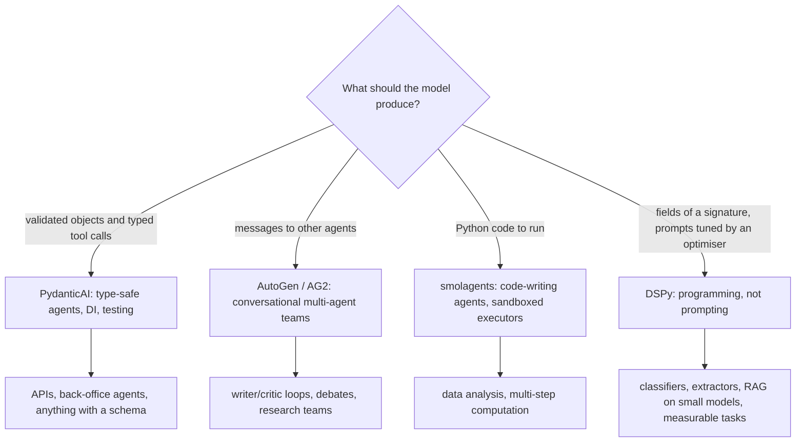
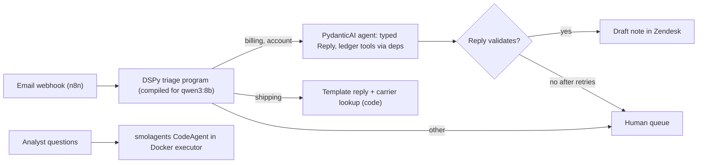

# 27 · PydanticAI, AutoGen/AG2, smolagents & DSPy

> **In one line:** Four frameworks, four answers to "what should the model produce?": **PydanticAI** says typed tool calls and validated objects, **AutoGen** says messages in a conversation between agents, **smolagents** says Python code that you execute, and **DSPy** says predictions from declared signatures whose prompts an optimiser writes for you. Knowing all four lets you pick the right shape for each job instead of forcing every job into one framework.

> **Versions used:** Python 3.13 · pydantic-ai-slim 2.68.0 (`[openai]` extra) · autogen-agentchat / autogen-ext 0.7.5 · smolagents 1.26.0 · dspy 3.5.0 · openai 3.49 · pydantic 2.14 · **Fast-moving:** PydanticAI ships several releases a month (2.x made `result.usage` a property and moved MCP onto a FastMCP-based `MCPToolset`). Microsoft has put AutoGen 0.7 into maintenance and points new projects at **Microsoft Agent Framework**; the community fork **AG2** (`pip install ag2`, `import autogen`) continues the original 0.2-style API. DSPy 3.5 replaced its LiteLLM dependency with a built-in client (LiteLLM is optional). smolagents is pre-2.0. Pin versions.

---

## 1. Overview

> **Builds on:** [Ch 03 · Structured Outputs](topic.html?p=03-structured-outputs) (Pydantic models as contracts), [Ch 21 · Agent Patterns](topic.html?p=21-agent-patterns) (ReAct, reflection, scripted test models), [Ch 25 · CrewAI](topic.html?p=25-crewai) and [Ch 26 · Vendor Agent SDKs](topic.html?p=26-vendor-agent-sdks) (the other frameworks you're comparing against), and [Ch 02 · Prompt Engineering](topic.html?p=02-prompt-engineering) (what DSPy automates).

Chapters 23–26 covered graph-based (LangGraph), role-based (CrewAI) and vendor frameworks. This chapter is a guided tour of four more, each built around a different idea. You don't need all four in one project; you need to recognise which idea fits the job in front of you.



All four run on a local Ollama model, so every example in this chapter has a free path and an offline test.

---

## 2. Key Concepts

**PydanticAI** (from the Pydantic team) treats an agent like a FastAPI endpoint:

- **`Agent(model, output_type=..., deps_type=..., instructions=...)`**: the output type is a Pydantic model (or `str`, a union, a list); the model must produce something that validates, or it gets the validation error and retries.
- **Dependencies (`deps`)**: a typed object (DB connection, HTTP client, user id) passed per run and available in tools as `ctx.deps`. This is dependency injection, so tests pass fakes.
- **Tools**: `@agent.tool` (gets `RunContext`) or `@agent.tool_plain`; raise **`ModelRetry("hint")`** to send the model a correction instead of failing.
- **Test models**: `TestModel` (calls every tool, fabricates schema-valid output) and **`FunctionModel`** (you script exactly what the "model" does). `agent.override(model=...)` swaps them in.
- **Budgets**: `UsageLimits(request_limit=..., tool_calls_limit=..., total_tokens_limit=...)`.

**AutoGen** (`autogen-agentchat`) treats multi-agent work as a **conversation**:

- **`AssistantAgent(name, model_client, tools, system_message)`**: an LLM participant.
- **Teams**: `RoundRobinGroupChat` (take turns), `SelectorGroupChat` (an LLM picks the next speaker), `Swarm` (handoffs).
- **Termination conditions**: `TextMentionTermination("APPROVE")`, `MaxMessageTermination(n)`, `TokenUsageTermination`, `TimeoutTermination`, combinable with `|` and `&`. Without them a conversation can run forever.
- **`ReplayChatCompletionClient`**: replays canned replies for offline tests.

**smolagents** (Hugging Face) makes the **action a Python snippet**:

- **`CodeAgent`**: each step the model writes code that calls your tools as functions, loops, stores variables and calls `final_answer(...)`. One step can do what takes five JSON tool calls.
- **Executors**: code runs in a restricted local interpreter (`executor_type="local"`, imports allowlisted via `additional_authorized_imports`) or in a sandbox (`"docker"`, `"e2b"`, `"modal"`, `"blaxel"`).
- **`ToolCallingAgent`**: the classic JSON tool-calling alternative. **`@tool`** needs type hints and an `Args:` docstring.

**DSPy** (Stanford) treats prompts as **compiled artefacts**:

- **Signature**: typed inputs and outputs with a docstring (`ticket: str -> category: Literal[...]`). You never write the prompt.
- **Modules**: `dspy.Predict`, `dspy.ChainOfThought` (adds a reasoning field), `dspy.ReAct` (tools), composable like PyTorch modules.
- **Metric + optimiser**: give examples and a scoring function; `BootstrapFewShot`, `MIPROv2` or `GEPA` search for instructions and few-shot demos that maximise the metric. `dspy.Evaluate` measures it. The compiled program saves to JSON.

> **Analogy:** PydanticAI is a typed API contract, AutoGen is a meeting with a chairperson and a clock, smolagents is a junior analyst with a Python notebook, and DSPy is a compiler that turns your spec and test cases into the best prompt it can find.

What the model emits in each, and who checks it:

```svg
<svg viewBox="0 0 880 330" width="100%" height="330" font-family="ui-sans-serif,system-ui,sans-serif" font-size="11" xmlns="http://www.w3.org/2000/svg">
  <defs><marker id="aa27a" viewBox="0 0 10 10" refX="9" refY="5" markerWidth="7" markerHeight="7" orient="auto"><path d="M0,0 L10,5 L0,10 z" fill="#334155"/></marker></defs>
  <text x="440" y="22" text-anchor="middle" font-size="14" font-weight="700" fill="#1e293b">Four frameworks, four kinds of model output</text>
  <rect x="16" y="40" width="200" height="200" rx="8" fill="#dbeafe" stroke="#2563eb"/>
  <text x="116" y="60" text-anchor="middle" font-weight="700" fill="#1e293b">PydanticAI</text>
  <rect x="32" y="72" width="168" height="40" rx="6" fill="#ffffff" stroke="#94a3b8"/>
  <text x="116" y="89" text-anchor="middle" fill="#334155">tool call: days(number)</text>
  <text x="116" y="104" text-anchor="middle" fill="#334155">final_result({...})</text>
  <line x1="116" y1="114" x2="116" y2="140" stroke="#334155" stroke-width="1.5" marker-end="url(#aa27a)"/>
  <text x="116" y="156" text-anchor="middle" fill="#1e293b">Pydantic validates</text>
  <text x="116" y="174" text-anchor="middle" fill="#334155">error, ModelRetry: retry</text>
  <text x="116" y="192" text-anchor="middle" fill="#334155">ok: typed object out</text>
  <text x="116" y="226" text-anchor="middle" fill="#2563eb" font-weight="700">checker: your schema</text>
  <rect x="232" y="40" width="200" height="200" rx="8" fill="#ede9fe" stroke="#7c3aed"/>
  <text x="332" y="60" text-anchor="middle" font-weight="700" fill="#1e293b">AutoGen</text>
  <rect x="248" y="72" width="168" height="24" rx="6" fill="#ffffff" stroke="#94a3b8"/>
  <text x="332" y="88" text-anchor="middle" fill="#334155">writer: Draft v1 ...</text>
  <rect x="248" y="100" width="168" height="24" rx="6" fill="#ffffff" stroke="#94a3b8"/>
  <text x="332" y="116" text-anchor="middle" fill="#334155">critic: too blunt ...</text>
  <rect x="248" y="128" width="168" height="24" rx="6" fill="#ffffff" stroke="#94a3b8"/>
  <text x="332" y="144" text-anchor="middle" fill="#334155">writer: Draft v2 ...</text>
  <text x="332" y="174" text-anchor="middle" fill="#1e293b">termination condition</text>
  <text x="332" y="192" text-anchor="middle" fill="#334155">APPROVE or max messages</text>
  <text x="332" y="226" text-anchor="middle" fill="#7c3aed" font-weight="700">checker: stop rules</text>
  <rect x="448" y="40" width="200" height="200" rx="8" fill="#fef3c7" stroke="#d97706"/>
  <text x="548" y="60" text-anchor="middle" font-weight="700" fill="#1e293b">smolagents</text>
  <rect x="464" y="72" width="168" height="56" rx="6" fill="#ffffff" stroke="#94a3b8"/>
  <text x="474" y="89" fill="#334155" font-family="ui-monospace,monospace" font-size="10">d = [days(x) for x in ids]</text>
  <text x="474" y="104" fill="#334155" font-family="ui-monospace,monospace" font-size="10">print(d)</text>
  <text x="474" y="119" fill="#334155" font-family="ui-monospace,monospace" font-size="10">final_answer(sum(d))</text>
  <line x1="548" y1="130" x2="548" y2="156" stroke="#334155" stroke-width="1.5" marker-end="url(#aa27a)"/>
  <text x="548" y="172" text-anchor="middle" fill="#1e293b">executor runs code</text>
  <text x="548" y="190" text-anchor="middle" fill="#334155">local allowlist or sandbox</text>
  <text x="548" y="226" text-anchor="middle" fill="#d97706" font-weight="700">checker: interpreter</text>
  <rect x="664" y="40" width="200" height="200" rx="8" fill="#dcfce7" stroke="#16a34a"/>
  <text x="764" y="60" text-anchor="middle" font-weight="700" fill="#1e293b">DSPy</text>
  <rect x="680" y="72" width="168" height="40" rx="6" fill="#ffffff" stroke="#94a3b8"/>
  <text x="764" y="89" text-anchor="middle" fill="#334155">ticket -&gt; category,</text>
  <text x="764" y="104" text-anchor="middle" fill="#334155">urgent (signature)</text>
  <line x1="764" y1="114" x2="764" y2="140" stroke="#334155" stroke-width="1.5" marker-end="url(#aa27a)"/>
  <text x="764" y="156" text-anchor="middle" fill="#1e293b">adapter parses fields</text>
  <text x="764" y="174" text-anchor="middle" fill="#334155">optimiser picks demos and</text>
  <text x="764" y="190" text-anchor="middle" fill="#334155">instructions by metric</text>
  <text x="764" y="226" text-anchor="middle" fill="#16a34a" font-weight="700">checker: your metric</text>
  <rect x="16" y="256" width="848" height="62" rx="8" fill="#f8fafc" stroke="#94a3b8"/>
  <text x="30" y="276" font-weight="700" fill="#1e293b">The trade-off</text>
  <text x="30" y="294" fill="#334155">more structure (PydanticAI, DSPy) = easier to test and cheaper per task; more freedom (AutoGen chat, smolagents code)</text>
  <text x="30" y="310" fill="#334155">= more capable on open-ended work, but needs hard stop rules and, for code, a real sandbox.</text>
</svg>
```

---

## 3. Setup

At the versions above these four install together, but each pins its own dependencies; keep a separate venv per framework in real projects.

```bash
python3.13 -m venv .venv-tour && source .venv-tour/bin/activate
pip install "pydantic-ai-slim[openai]>=2.68,<3" "autogen-agentchat>=0.7,<0.8" "autogen-ext[openai]>=0.7,<0.8" \
            "smolagents>=1.26,<2" "dspy>=3.5,<4" "python-dotenv>=1"
# Paid providers: pydantic-ai-slim[anthropic] / [google], smolagents[litellm], dspy works with anthropic/... directly
ollama pull qwen3:8b
```

```bash
# .env.example
LLM_BASE_URL=http://localhost:11434/v1
LLM_API_KEY=ollama
LLM_MODEL=qwen3:8b
OLLAMA_BASE_URL=http://localhost:11434/v1    # PydanticAI's Ollama provider reads this
PYDANTIC_AI_NO_BANNER=1                      # PydanticAI prints an observability banner otherwise
# Paid alternatives
# ANTHROPIC_API_KEY=sk-ant-...   CLAUDE_MODEL=claude-opus-5-5
# OPENAI_API_KEY=sk-...          OPENAI_MODEL=gpt-5-mini
```

Copy `backoffice.py` from [Ch 04, Setup](topic.html?p=04-function-calling) into the folder; the examples reuse it.

---

## 4. Code Examples

### Example 1: PydanticAI, a typed agent with dependencies and self-correction

```python
# pai_agent.py: typed deps, typed output, ModelRetry, usage limits
import os
from dataclasses import dataclass

from dotenv import load_dotenv
from pydantic import BaseModel, Field

from pydantic_ai import Agent, ModelRetry, RunContext, UsageLimits
from pydantic_ai.models.ollama import OllamaModel
from pydantic_ai.providers.ollama import OllamaProvider

import backoffice

load_dotenv()


@dataclass
class Deps:
    """Everything tools need, injected per run (swap for fakes in tests)."""
    ledger: object            # here the backoffice module; in production a DB session
    today: str


class Assessment(BaseModel):
    invoice: str = Field(pattern=r"^[A-Z]{2}-\d{4}$")
    days_overdue: int = Field(ge=0)
    action: str = Field(description="none, polite_reminder or firm_reminder")


def local_model() -> OllamaModel:
    provider = OllamaProvider(base_url=os.getenv("OLLAMA_BASE_URL", "http://localhost:11434/v1"))
    return OllamaModel(os.getenv("LLM_MODEL", "qwen3:8b"), provider=provider)
    # Paid: Agent("anthropic:claude-opus-5-5") with pydantic-ai-slim[anthropic]; no temperature for Claude


agent = Agent(
    output_type=Assessment,
    deps_type=Deps,
    instructions="You assess one invoice. Use tools for facts. action: none if not overdue, "
                 "polite_reminder under 30 days, firm_reminder otherwise.",
)


@agent.tool
def days_overdue(ctx: RunContext[Deps], number: str) -> int:
    """Days invoice `number` (format AA-1234, e.g. CT-0099) is past due."""
    try:
        return ctx.deps.ledger.days_overdue(number, ctx.deps.today)
    except KeyError:
        raise ModelRetry(f"Unknown invoice {number!r}. Use the full number, e.g. CT-0099.")


if __name__ == "__main__":
    result = agent.run_sync("How overdue is Contoso's invoice CT-0099?", model=local_model(),
                            deps=Deps(ledger=backoffice, today="2026-11-12"),
                            usage_limits=UsageLimits(request_limit=6, tool_calls_limit=4))
    print(result.output)
    print(result.usage)
```

Illustrative output with `qwen3:8b`:

```text
invoice='CT-0099' days_overdue=28 action='polite_reminder'
RunUsage(input_tokens=612, output_tokens=58, requests=2, tool_calls=1)
```

`result.output` is an `Assessment`, already validated. If the model sends `days_overdue=-3` or a malformed invoice number, PydanticAI returns the validation error to the model and retries (default one retry, configurable with `retries=`). `UsageLimits` raises `UsageLimitExceeded` instead of looping.

The real strength is testing. `FunctionModel` lets you script the model turn by turn and check that the retry path works:

```python
# test_pai_agent.py: script the model, including a bad first tool call
import os

os.environ.setdefault("PYDANTIC_AI_NO_BANNER", "1")

from pydantic_ai.messages import ModelMessage, ModelResponse, ToolCallPart
from pydantic_ai.models.function import AgentInfo, FunctionModel

import backoffice
from pai_agent import Deps, agent


def scripted(messages: list[ModelMessage], info: AgentInfo) -> ModelResponse:
    turn = len(messages)                      # 1 = user prompt; each tool round adds two messages
    if turn == 1:
        return ModelResponse(parts=[ToolCallPart("days_overdue", {"number": "0099"})])      # wrong format
    if turn == 3:
        return ModelResponse(parts=[ToolCallPart("days_overdue", {"number": "CT-0099"})])   # corrected
    final = info.output_tools[0].name           # the output schema is exposed as a tool ("final_result")
    return ModelResponse(parts=[ToolCallPart(final, {"invoice": "CT-0099", "days_overdue": 28,
                                                     "action": "polite_reminder"})])


if __name__ == "__main__":
    with agent.override(model=FunctionModel(scripted)):
        r = agent.run_sync("How overdue is 0099?", deps=Deps(backoffice, "2026-11-12"))
    print(r.output)
    for m in r.all_messages():
        for part in m.parts:
            if part.part_kind in ("tool-call", "tool-return", "retry-prompt"):
                print(f"  {part.part_kind:<11} {part.tool_name}: {getattr(part, 'args', None) or part.content}")
    print(r.usage)
```

Output (real, offline):

```text
invoice='CT-0099' days_overdue=28 action='polite_reminder'
  tool-call   days_overdue: {'number': '0099'}
  tool-return days_overdue: Unknown invoice '0099'. Use the full number, e.g. CT-0099.
  tool-call   days_overdue: {'number': 'CT-0099'}
  tool-return days_overdue: 28
  tool-call   final_result: {'invoice': 'CT-0099', 'days_overdue': 28, 'action': 'polite_reminder'}
  tool-return final_result: Final result processed.
RunUsage(input_tokens=189, output_tokens=34, requests=3, tool_calls=1)
```

`TestModel()` is the lazier option: it calls every tool once with schema-valid fake arguments and fabricates a valid output, which is enough to smoke-test wiring in CI. PydanticAI also offers streaming (`run_stream`), graph-based multi-step control (`pydantic_graph`), MCP tools (`pydantic-ai-slim[mcp]`), durable execution integrations and OpenTelemetry instrumentation (Logfire or any OTel backend).

### Example 2: AutoGen, a writer and a critic that know when to stop

```python
# ag_team.py: RoundRobinGroupChat with explicit termination
import asyncio
import os

from autogen_agentchat.agents import AssistantAgent
from autogen_agentchat.conditions import MaxMessageTermination, TextMentionTermination
from autogen_agentchat.teams import RoundRobinGroupChat
from autogen_core.models import ModelFamily
from autogen_ext.models.openai import OpenAIChatCompletionClient


def local_client() -> OpenAIChatCompletionClient:
    """Any OpenAI-compatible server. model_info is required for model names OpenAI doesn't know."""
    return OpenAIChatCompletionClient(
        model=os.getenv("LLM_MODEL", "qwen3:8b"),
        base_url=os.getenv("LLM_BASE_URL", "http://localhost:11434/v1"),
        api_key=os.getenv("LLM_API_KEY", "ollama"),
        model_info={"vision": False, "function_calling": True, "json_output": True,
                    "family": ModelFamily.UNKNOWN, "structured_output": True},
    )


def build_team(writer_client, critic_client) -> RoundRobinGroupChat:
    writer = AssistantAgent("writer", writer_client, system_message=(
        "You write payment reminder emails: under 60 words, the invoice number, the amount, one clear ask. "
        "Revise using the critic's feedback. Output only the email."))
    critic = AssistantAgent("critic", critic_client, system_message=(
        "You review payment reminders against: under 60 words, invoice number present, amount present, "
        "one clear ask, no threats. If all pass reply exactly APPROVE. Otherwise list what to fix."))
    stop = TextMentionTermination("APPROVE") | MaxMessageTermination(7)      # always add a hard cap
    return RoundRobinGroupChat([writer, critic], termination_condition=stop)


async def main():
    team = build_team(local_client(), local_client())
    result = await team.run(task="Reminder for Contoso: invoice CT-0099, USD 1,200, 28 days overdue.")
    for m in result.messages:
        print(f"{m.source:>7}: {m.to_text()}")
    print("stop:", result.stop_reason)


if __name__ == "__main__":
    asyncio.run(main())
```

The offline version replays canned replies through the same team definition:

```python
# test_ag_team.py: deterministic conversation with ReplayChatCompletionClient
import asyncio

from autogen_ext.models.replay import ReplayChatCompletionClient

from ag_team import build_team


async def main():
    writer = ReplayChatCompletionClient(["Draft v1: Your invoice is late. Pay now.",
                                         "Hi Contoso, invoice CT-0099 (USD 1,200) is 28 days overdue. "
                                         "Could you confirm a payment date this week?"])
    critic = ReplayChatCompletionClient(["Missing invoice number and amount; the ask is a demand.", "APPROVE"])
    result = await build_team(writer, critic).run(task="Reminder for CT-0099, USD 1,200, 28 days overdue.")
    for m in result.messages:
        print(f"{m.source:>7}: {m.to_text()}")
    print("stop:", result.stop_reason)


if __name__ == "__main__":
    asyncio.run(main())
```

Output (real, offline):

```text
   user: Reminder for CT-0099, USD 1,200, 28 days overdue.
 writer: Draft v1: Your invoice is late. Pay now.
 critic: Missing invoice number and amount; the ask is a demand.
 writer: Hi Contoso, invoice CT-0099 (USD 1,200) is 28 days overdue. Could you confirm a payment date this week?
 critic: APPROVE
stop: Text 'APPROVE' mentioned
```

This is the Ch 21 evaluator-optimizer pattern expressed as a conversation. Swap `RoundRobinGroupChat` for `SelectorGroupChat(participants, model_client=...)` when an LLM should pick who speaks next, or `Swarm` for handoff-style routing. Give agents tools with `AssistantAgent(..., tools=[python_function])`. Use `autogen_agentchat.ui.Console(team.run_stream(task=...))` to watch a live run.

> **Version note:** AutoGen 0.7 receives fixes but no new features; Microsoft's new projects target Microsoft Agent Framework. AG2 (`ag2` on PyPI, imported as `autogen`) is a separate, community-maintained continuation of AutoGen 0.2 with `ConversableAgent` and group chats. The two APIs are **not** compatible; check which one a tutorial uses before copying code.

### Example 3: smolagents, an agent that writes code

A `CodeAgent` with two tools answers a question that needs a loop and arithmetic in **one** step. The scripted model below shows exactly what the real model produces each turn:

```python
# smol_agent.py: CodeAgent over the Ch 04 back office, with a scripted offline model
import os

from smolagents import CodeAgent, Model, OpenAIServerModel, tool
from smolagents.models import ChatMessage, MessageRole

import backoffice


@tool
def unpaid_invoices() -> list[dict]:
    """List all unpaid invoices with number, vendor, total, currency and due date."""
    return backoffice.find_invoices(unpaid_only=True)


@tool
def days_overdue(number: str, today: str) -> int:
    """Days an invoice is past its due date (0 if not yet due).

    Args:
        number: Invoice number, e.g. CT-0099.
        today: ISO date, e.g. 2026-11-12.
    """
    return backoffice.days_overdue(number, today)


class ScriptedModel(Model):
    """Offline stand-in: returns pre-written replies in order."""
    def __init__(self, replies: list[str]):
        super().__init__(model_id="scripted")
        self.replies = list(replies)

    def generate(self, messages, stop_sequences=None, response_format=None, tools_to_call_from=None, **kwargs):
        return ChatMessage(role=MessageRole.ASSISTANT, content=self.replies.pop(0))


def build(model) -> CodeAgent:
    return CodeAgent(tools=[unpaid_invoices, days_overdue], model=model, max_steps=5,
                     additional_authorized_imports=["datetime"], verbosity_level=0)


def local_model() -> OpenAIServerModel:
    return OpenAIServerModel(model_id=os.getenv("LLM_MODEL", "qwen3:8b"),
                             api_base=os.getenv("LLM_BASE_URL", "http://localhost:11434/v1"),
                             api_key=os.getenv("LLM_API_KEY", "ollama"))


if __name__ == "__main__":
    script = [
        "Thought: get unpaid invoices and compute overdue days for each, then sum the overdue amounts.\n"
        "<code>\nrows = unpaid_invoices()\n"
        "late = [(r['number'], r['total'], days_overdue(r['number'], '2026-11-12')) for r in rows]\n"
        "print(late)\n</code>",
        "Thought: only positive day counts are overdue.\n<code>\n"
        "overdue = [x for x in late if x[2] > 0]\n"
        "final_answer({'overdue': overdue, 'total_overdue_amount': sum(x[1] for x in overdue)})\n</code>",
    ]
    agent = build(ScriptedModel(script) if os.getenv("OFFLINE", "1") == "1" else local_model())
    print(agent.run("Which unpaid invoices are overdue, and what is the total overdue amount?"))
    print("steps:", len(agent.memory.steps))
```

Output (real, offline, `OFFLINE=1`):

```text
{'overdue': [('CT-0099', 1200.0, 28)], 'total_overdue_amount': 1200.0}
steps: 3
```

The model's code called both tools inside a list comprehension: two "tool calls" for each of the N invoices in one model turn. That's the efficiency argument for code agents. The cost is security: **the model is writing code you execute**. The default local executor only allows listed imports and blocks dangerous builtins, but it is not a hardened sandbox. For untrusted input use `executor_type="docker"` or `"e2b"` (see [Ch 43 · Prompt Injection & Sandboxing](topic.html?p=43-prompt-injection-sandboxing)), and never hand a code agent tools with side effects you wouldn't let an intern run unsupervised. `ToolCallingAgent` is the JSON tool-calling alternative when you don't want code execution at all; `LiteLLMModel(model_id="anthropic/claude-opus-5-5")` (with `smolagents[litellm]`) or `InferenceClientModel` (Hugging Face Inference Providers) are paid options.

### Example 4: DSPy, declare the task, then compile the prompt

You declare what goes in and out; DSPy builds the prompt, parses the fields, and (with an optimiser) chooses demos and instructions that maximise your metric.

```python
# dspy_triage.py: signature, module, metric, BootstrapFewShot, Evaluate, save
import os
from typing import Literal

import dspy


class TriageTicket(dspy.Signature):
    """Classify a customer support ticket for routing."""
    ticket: str = dspy.InputField()
    category: Literal["billing", "shipping", "account", "other"] = dspy.OutputField()
    urgent: bool = dspy.OutputField(desc="true if money is at risk or the customer is blocked")


TRAIN = [
    dspy.Example(ticket="I was charged twice for invoice CT-0099", category="billing", urgent=True),
    dspy.Example(ticket="Where is my parcel? Tracking hasn't moved in 5 days", category="shipping", urgent=False),
    dspy.Example(ticket="I can't log in, password reset email never arrives", category="account", urgent=True),
    dspy.Example(ticket="Do you have a dark mode?", category="other", urgent=False),
]
TRAIN = [ex.with_inputs("ticket") for ex in TRAIN]       # mark which fields are inputs


def triage_metric(example, pred, trace=None) -> float:
    """1.0 for the right category, +0 if urgency is wrong (half credit)."""
    if pred.category != example.category:
        return 0.0
    return 1.0 if pred.urgent == example.urgent else 0.5


def configure_local() -> None:
    dspy.configure(lm=dspy.LM(f"ollama/{os.getenv('LLM_MODEL', 'qwen3:8b')}",
                              api_base=os.getenv("LLM_BASE_URL", "http://localhost:11434/v1"),
                              max_tokens=2000))
    # Paid: dspy.LM("anthropic/claude-opus-5-5", max_tokens=4000); leave temperature unset for Claude


def compile_triage(trainset) -> dspy.Module:
    program = dspy.Predict(TriageTicket)                  # or dspy.ChainOfThought(TriageTicket)
    optimizer = dspy.BootstrapFewShot(metric=triage_metric, max_bootstrapped_demos=3)
    return optimizer.compile(program, trainset=trainset)


if __name__ == "__main__":
    configure_local()
    triage = compile_triage(TRAIN)
    print(dspy.Evaluate(devset=TRAIN, metric=triage_metric, num_threads=4)(triage))
    pred = triage(ticket="Refund still missing after 3 weeks, this is unacceptable")
    print(pred.category, pred.urgent)
    triage.save("triage_compiled.json")                   # load later: dspy.Predict(TriageTicket).load(path)
```

Illustrative output with `qwen3:8b` (use a separate dev set in practice; Exercise 4):

```text
EvaluationResult(score=100.0, results=<list of 4 results>)
billing True
```

The same program runs offline with `DummyLM`, which answers with the field values you give it. This is how you test the plumbing (signature, metric, optimiser, save/load) in CI:

```python
# test_dspy_triage.py: DummyLM makes the whole compile-evaluate-save cycle deterministic
import dspy
from dspy.utils import DummyLM

from dspy_triage import TRAIN, TriageTicket, compile_triage, triage_metric

if __name__ == "__main__":
    # Dict mode: DummyLM answers whichever ticket text appears in the prompt
    answers = {ex.ticket: {"category": ex.category, "urgent": ex.urgent} for ex in TRAIN}
    dspy.configure(lm=DummyLM(answers))
    triage = compile_triage(TRAIN)
    print("demos:", len(triage.demos))
    print(dspy.Evaluate(devset=TRAIN, metric=triage_metric, num_threads=1)(triage))
    triage.save("triage_compiled.json")
    loaded = dspy.Predict(TriageTicket)
    loaded.load("triage_compiled.json")
    print("loaded demos:", len(loaded.demos))
```

Output (real, offline; DSPy also prints progress bars and an `Average Metric` log line):

```text
demos: 4
EvaluationResult(score=100.0, results=<list of 4 results>)
loaded demos: 4
```

Four demos: three bootstrapped traces that passed the metric plus one labelled example to fill the remaining slots (`max_labeled_demos` defaults to 16).

`dspy.ChainOfThought(TriageTicket)` adds a reasoning field (exposed as `pred.reasoning`); `dspy.ReAct(Signature, tools=[fn, ...], max_iters=...)` turns a signature into a tool-using agent. Stronger optimisers (`MIPROv2`, `GEPA`) rewrite the instructions too, at the cost of many model calls during compilation: run them once, offline, on a budget, and ship the saved JSON.

> **Why this matters:** DSPy shines when you have **labelled examples and a metric**. It lets a small local model reach accuracy you would otherwise need a bigger model for, and when you switch models you recompile instead of rewriting prompts by hand.

---

## 5. Real-World Use Case

**Company:** a payments startup with ~9,000 inbound support emails a month. **Goal:** route and pre-draft replies on a local model (customer data may not leave their cloud), with typed outputs their ticketing API accepts.



**How the pieces earn their place:**
- **DSPy** compiled the four-way triage classifier from 600 labelled historical emails. Hand-written prompts on the local 8B model scored ~0.81 on a held-out set; `BootstrapFewShot` reached ~0.88 and `MIPROv2` ~0.91 after a one-off compile of a few thousand local calls. When they later tried a newer local model, they recompiled in an hour.
- **PydanticAI** drafts billing and account replies. `deps` carries the tenant's DB session, so tools can only see that customer's data; the `Reply` model (category, draft, cited invoice numbers, confidence) is exactly what the ticketing API expects, and invalid outputs never reach it.
- **smolagents** runs in a Docker executor for the ops team's ad-hoc questions ("refund volume by week for merchants on plan X"), because a code agent answers those in one or two steps where a tool-calling agent needed eight.
- **AutoGen** was trialled for a writer/critic loop on refund-denial letters and dropped: a deterministic PydanticAI output validator plus one critique call was cheaper and easier to bound.

**Numbers:** ~2.1 model calls per email, p50 latency ~4 s on one GPU box, zero per-token cost, 63% of drafts sent with minor or no edits.

---

## 6. Mini Project: A Compiled Triage + Typed Reply Service (1–2 hours)

**Goal:** a DSPy triage program compiled from labelled tickets, used as a tool by a PydanticAI agent that returns a typed `Reply`; both testable offline.

```text
triage-service/
├── .env
├── backoffice.py        # from Ch 04
├── dspy_triage.py       # Example 4
├── reply_agent.py       # PydanticAI agent using the compiled triage
├── test_service.py      # offline end-to-end test
└── triage_compiled.json # produced by compile step
```

**Step 1: compile once.** Run `python dspy_triage.py` against Ollama to produce `triage_compiled.json` (or run `test_dspy_triage.py` to produce a deterministic one offline).

**Step 2: the reply agent.** The compiled DSPy program becomes a dependency; the agent calls it through a tool and must return a validated `Reply`.

```python
# reply_agent.py: PydanticAI agent that uses a compiled DSPy classifier as a tool
import json
from dataclasses import dataclass
from typing import Literal

import dspy
from pydantic import BaseModel, Field

from pydantic_ai import Agent, ModelRetry, RunContext

import backoffice
from dspy_triage import TriageTicket


@dataclass
class Deps:
    triage: dspy.Module
    today: str = "2026-11-12"


class Reply(BaseModel):
    category: Literal["billing", "shipping", "account", "other"]
    urgent: bool
    cited_invoices: list[str] = Field(default_factory=list)
    draft: str = Field(max_length=600)
    escalate: bool


agent = Agent(
    output_type=Reply,
    deps_type=Deps,
    instructions=("You draft first replies to support tickets. Always call classify first. For billing, look up "
                  "invoices with invoice_status and cite their numbers. Escalate if other or if unsure."),
)


@agent.tool
def classify(ctx: RunContext[Deps], ticket: str) -> str:
    """Classify the ticket. Returns JSON with category and urgent."""
    pred = ctx.deps.triage(ticket=ticket)
    return json.dumps({"category": pred.category, "urgent": bool(pred.urgent)})


@agent.tool
def invoice_status(ctx: RunContext[Deps], number: str) -> str:
    """Status of one invoice: total, currency, paid flag and days overdue."""
    rows = [r for r in backoffice.find_invoices() if r["number"] == number]
    if not rows:
        raise ModelRetry(f"No invoice {number}. Invoice numbers look like CT-0099.")
    r = rows[0]
    return json.dumps({**r, "days_overdue": backoffice.days_overdue(number, ctx.deps.today)})


@agent.output_validator
def cited_invoices_exist(ctx: RunContext[Deps], reply: Reply) -> Reply:
    known = {r["number"] for r in backoffice.find_invoices()}
    unknown = [n for n in reply.cited_invoices if n not in known]
    if unknown:
        raise ModelRetry(f"You cited invoices that don't exist: {unknown}. Cite only looked-up invoices.")
    return reply


def load_triage(path: str = "triage_compiled.json") -> dspy.Module:
    program = dspy.Predict(TriageTicket)
    program.load(path)
    return program
```

**Step 3: an offline end-to-end test.** DummyLM drives DSPy; FunctionModel drives PydanticAI, including one hallucinated invoice that the output validator must catch.

```python
# test_service.py: both frameworks scripted, no model needed
import os

os.environ.setdefault("PYDANTIC_AI_NO_BANNER", "1")

import dspy
from dspy.utils import DummyLM
from pydantic_ai.messages import ModelMessage, ModelResponse, ToolCallPart
from pydantic_ai.models.function import AgentInfo, FunctionModel

from dspy_triage import TriageTicket
from reply_agent import Deps, agent

REPLY = {"category": "billing", "urgent": True, "draft": "Hi! Invoice CT-0099 shows one charge of "
         "USD 1,200; we're checking the duplicate and will confirm within 24 hours.", "escalate": False}


def scripted(messages: list[ModelMessage], info: AgentInfo) -> ModelResponse:
    final = info.output_tools[0].name
    steps = {1: ToolCallPart("classify", {"ticket": "charged twice on CT-0099"}),
             3: ToolCallPart("invoice_status", {"number": "CT-0099"}),
             5: ToolCallPart(final, {**REPLY, "cited_invoices": ["CT-0099", "CT-9999"]}),   # hallucinated
             7: ToolCallPart(final, {**REPLY, "cited_invoices": ["CT-0099"]})}
    return ModelResponse(parts=[steps[len(messages)]])


if __name__ == "__main__":
    dspy.configure(lm=DummyLM([{"category": "billing", "urgent": True}]))
    deps = Deps(triage=dspy.Predict(TriageTicket))
    with agent.override(model=FunctionModel(scripted)):
        result = agent.run_sync("I was charged twice on invoice CT-0099!", deps=deps)
    print(result.output.category, result.output.urgent, result.output.cited_invoices, result.output.escalate)
    print("model requests:", result.usage.requests)
    assert result.output.cited_invoices == ["CT-0099"]
    print("ok")
```

Output (real, offline):

```text
billing True ['CT-0099'] False
model requests: 4
ok
```

The fourth request exists because the output validator rejected `CT-9999` and the scripted "model" corrected itself, the same loop a real model goes through.

**Step 4: run it live** with a small script: `configure_local()` from `dspy_triage.py`, `Deps(triage=load_triage())`, then `agent.run_sync(ticket, model=local_model(), deps=deps)` using `local_model()` from Example 1, on ten real tickets.

**Done when:**
- [ ] `test_dspy_triage.py` and `test_service.py` pass offline.
- [ ] `triage_compiled.json` is produced from your own labelled tickets and scored on a held-out dev set.
- [ ] Live replies are valid `Reply` objects and never cite invoices that weren't looked up.
- [ ] `UsageLimits` caps each run (add `usage_limits=UsageLimits(request_limit=8)`).

**Stretch goals:** compile with `dspy.MIPROv2` and compare dev-set scores and compile cost; expose the agent as a FastAPI endpoint returning `Reply`; add an AutoGen writer/critic pass for `urgent` tickets and measure whether it improves human edit rates enough to justify the extra calls.

---

## 7. Comparison Table

| | PydanticAI | AutoGen 0.7 / AG2 | smolagents | DSPy |
|---|---|---|---|---|
| Core idea | type-safe agents, DI | agents converse | agents write code | program, then optimise prompts |
| Model emits | tool calls + validated output | chat messages | Python code | signature fields |
| Multi-agent | agent delegation via tools, graphs | group chats, selector, swarm | managed agents | composed modules |
| Control & safety | schemas, `ModelRetry`, output validators, `UsageLimits` | termination conditions | executor sandbox, step limit | metric, assertions in modules |
| Testing | `TestModel`, `FunctionModel`, `override` | `ReplayChatCompletionClient` | custom `Model` subclass | `DummyLM`, `Evaluate` |
| Local models | yes (Ollama provider) | yes (OpenAI-compatible client + `model_info`) | yes (`OpenAIServerModel`, transformers) | yes (`ollama/...`) |
| Maturity | fast-moving, well documented | AutoGen in maintenance; AG2 community | pre-2.0, simple | research-born, stable core |
| **Use when** | production APIs and back-office agents with a schema | writer/critic, debate, research teams | data analysis, multi-step computation, in a sandbox | classifiers/extractors with labels; small models; frequent model swaps |
| **Avoid when** | you need a big ecosystem of integrations | you need tight cost bounds or a long-lived API | you can't sandbox code | no labelled data or metric |

Against the other chapters: [LangGraph](topic.html?p=23-langgraph-fundamentals) for durable explicit graphs, [CrewAI](topic.html?p=25-crewai) for role prompts and fast prototypes, [vendor SDKs](topic.html?p=26-vendor-agent-sdks) for first-party features and harnesses. Frameworks are combinable: a DSPy program is just a callable, so it can sit inside any of them.

---

## 8. Common Mistakes & Best Practices

**Mistake 1: a group chat without a hard cap.** `TextMentionTermination("APPROVE")` alone loops forever if the critic never approves. *Fix:* always `| MaxMessageTermination(n)` (and `TokenUsageTermination` for cost).

**Mistake 2: running model-written code on your laptop.** A `CodeAgent` with the local executor and a prompt-injected document is remote code execution with extra steps. *Fix:* Docker/E2B executors for anything touching untrusted input, minimal `additional_authorized_imports`, read-only tools.

**Mistake 3: evaluating DSPy on the training set.** A 100% score on the four examples you compiled from means nothing. *Fix:* split train/dev (and a final test), report dev scores, and keep the metric honest (partial credit only where it reflects business value).

**Mistake 4: optimising without a budget.** `MIPROv2` and `GEPA` can make thousands of calls. *Fix:* compile on a local model or with a spending cap, start with `BootstrapFewShot`, and cache (DSPy caches LM calls by default).

**Mistake 5: `TestModel` as your only test.** It proves wiring, not behaviour. *Fix:* `FunctionModel` scripts for the paths that matter (retry, validation failure, tool errors), plus evals with a real model ([Ch 41](topic.html?p=41-evaluation)).

**Mistake 6: copying AutoGen 0.2 code into 0.7 (or AG2 into AutoGen).** `ConversableAgent`, `initiate_chat` and `llm_config` dicts belong to 0.2/AG2; 0.7 uses `AssistantAgent`, model clients and teams. *Fix:* check the import path and version before copying.

**Mistake 7: business rules only in the prompt.** "Never cite invoices you didn't look up" is a wish. *Fix:* an `output_validator` (PydanticAI), a guardrail, or a DSPy metric that checks it.

**Before / after: let validation enforce the rule**

```python
# Before: instructions="Days overdue must never be negative."  (the model may still say -3)
# After: the schema enforces it and the model gets the error back automatically.
from pydantic import BaseModel, Field, ValidationError


class Assessment(BaseModel):
    invoice: str = Field(pattern=r"^[A-Z]{2}-\d{4}$")
    days_overdue: int = Field(ge=0)


try:
    Assessment(invoice="CT-0099", days_overdue=-3)
except ValidationError as e:
    print(e.errors()[0]["msg"])      # this text is what PydanticAI sends back to the model
```

**Best-practice checklist**
- [ ] Choose by output shape: schema (PydanticAI), conversation (AutoGen), code (smolagents), measurable prediction (DSPy).
- [ ] Every loop bounded: `UsageLimits`, termination conditions, `max_steps`, `max_iters`.
- [ ] Code agents only in a real sandbox; side-effect tools behind approval.
- [ ] Offline tests with each framework's fake model; evals with a real one.
- [ ] DSPy: train/dev split, honest metric, compile once, ship the JSON.
- [ ] One venv per framework in production; pinned versions; check AutoGen vs AG2 APIs.

---

## 9. Exercises

1. **Port the agent.** Re-implement Example 1's invoice assessment in smolagents (`ToolCallingAgent`) and in DSPy (`dspy.ReAct`). Compare lines of code, model calls and how each handles a malformed invoice number.
2. **Selector chat.** Turn Example 2 into a `SelectorGroupChat` with a third agent ("legal reviewer") that should only speak when the draft mentions penalties. Measure messages per run with and without it.
3. **Sandboxed code.** Run Example 3 with `executor_type="docker"` and ask a question that requires `import statistics`. What has to change, and what happens if the model tries `import os`?
4. **Honest DSPy.** Label 60 tickets, split 30/30, compile `dspy.Predict` and `dspy.ChainOfThought` versions, and report dev-set scores, compile calls and per-ticket latency for each.
5. **Output validators.** Add a PydanticAI output validator to the mini project that rejects drafts promising refunds, and a `FunctionModel` test that proves it triggers a retry.

### Self-check questions

**Q: What does PydanticAI's `deps_type` give you, and why does it matter for testing?**
A: It declares a typed dependency object that you pass per run (`deps=...`) and that tools receive as `ctx.deps`. Database sessions, HTTP clients and tenant ids travel through it instead of globals, so each run is scoped to the right data and tests can pass fakes without patching. Combined with `agent.override(model=FunctionModel(...))`, you can test an agent fully offline.

**Q: What is `ModelRetry` and when should a tool raise it?**
A: It's an exception that sends its message back to the model as a retry prompt instead of failing the run. Raise it when the model can fix the problem itself, such as a malformed invoice number or an unknown id, with a hint about the correct format. Output validators can raise it too, to reject a final answer that breaks a business rule.

**Q: Why must every AutoGen team have a hard termination condition?**
A: Agents in a group chat keep replying to each other until a termination condition fires. If the only condition is a phrase like "APPROVE" and the critic never says it, the conversation runs until it hits rate limits or budgets. Combining it with `MaxMessageTermination` (and token or timeout terminations) bounds cost and latency.

**Q: Why can a smolagents `CodeAgent` be more efficient than a JSON tool-calling agent, and what is the risk?**
A: In one step it can call tools inside loops and comprehensions, keep variables and compute results in Python, so work that needs many tool-call round trips happens in one model turn. The risk is that the model is writing code you execute; with untrusted input that can be exploited, so it must run in a real sandbox (Docker, E2B) with minimal imports and read-only tools.

**Q: What does a DSPy optimiser actually change?**
A: It doesn't change model weights (unless you use a fine-tuning optimiser). It changes the program's prompts: the few-shot demonstrations attached to each predictor and, for optimisers like MIPROv2 or GEPA, the instructions, chosen by running the program on training examples and keeping what maximises your metric. The result is saved as JSON and loaded at runtime.

**Q: Your DSPy classifier scores 98% after compilation but users report misroutes. What went wrong? (Senior)**
A: Most likely it was evaluated on the same examples it was compiled from, or on a dev set unlike production traffic. Re-split into train, dev and a held-out test set sampled from recent real tickets, check label quality, make the metric reflect the business cost of each error, recompile, and monitor accuracy on a labelled sample of live traffic. Also confirm the production model and adapter are the ones used at compile time, since demos tuned for one model may not transfer.

**Q: How would you choose between PydanticAI, AutoGen, smolagents and DSPy for a new automation? (Senior)**
A: Start from the shape of the output and how success is measured. If a downstream system needs a validated object, use PydanticAI. If the value comes from agents critiquing each other and you can bound the conversation, use an AutoGen-style team, or a simpler evaluator loop. If the task is computation over data and you can sandbox code, use smolagents. If you have labelled examples and a metric, especially on a small model, use DSPy. Combine them where useful, keep one venv per framework, and prove the choice with evals rather than demos.

---

## 10. Summary & Official Docs

- **PydanticAI**: typed `output_type`, dependency injection via `deps`, `ModelRetry` and output validators for self-correction, `UsageLimits`, and first-class offline testing with `TestModel` / `FunctionModel`.
- **AutoGen 0.7**: `AssistantAgent`s in `RoundRobinGroupChat` / `SelectorGroupChat` / `Swarm` teams, bounded by termination conditions; in maintenance, with AG2 as the community continuation of the 0.2 API and Microsoft Agent Framework as Microsoft's successor.
- **smolagents**: `CodeAgent` writes Python that calls your tools; efficient for computation, safe only in a sandboxed executor.
- **DSPy**: signatures and modules instead of prompts; metrics and optimisers (`BootstrapFewShot`, `MIPROv2`, `GEPA`) compile the prompt; `Evaluate` on a held-out set; save and ship JSON.
- All four run on Ollama, and each has a fake model for deterministic tests.

| Job | Reach for |
|---|---|
| Agent behind an API with a strict schema | PydanticAI |
| Writer/critic or multi-perspective discussion | AutoGen team (bounded) |
| Ad-hoc analysis, multi-step computation | smolagents CodeAgent in Docker/E2B |
| Classifier or extractor with labelled data | DSPy |

**Official docs**
- PydanticAI: https://ai.pydantic.dev
- AutoGen: https://microsoft.github.io/autogen/stable/
- AG2: https://docs.ag2.ai
- smolagents: https://huggingface.co/docs/smolagents
- DSPy: https://dspy.ai
- Theory: [AI Engineering · Multi-Agent Orchestration](../ai-engineering/topic.html?p=36-multi-agent-orchestration) and [Prompt Engineering](../ai-engineering/topic.html?p=27-prompt-engineering)

**Next:** [Ch 28 · MCP with FastMCP](topic.html?p=28-mcp-fastmcp): write your tools once as an MCP server and plug them into every framework from Part 5.

---

*AI Automation with Python Handbook — chapter 27.*
