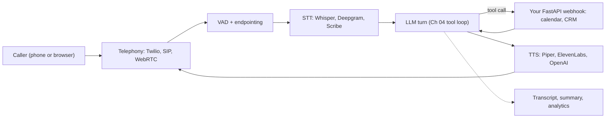
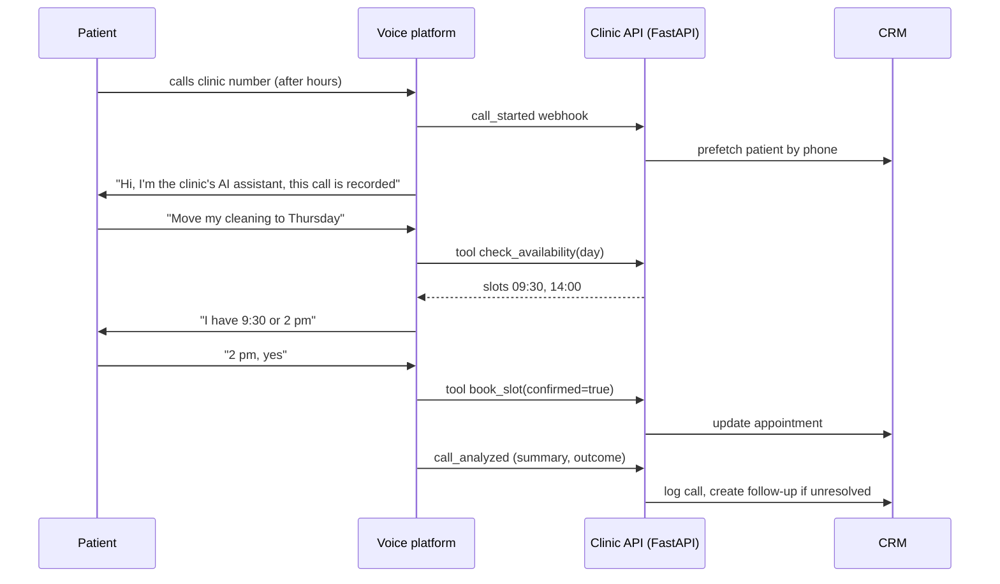

# 33 · Voice: Whisper, ElevenLabs, Vapi & Retell

> **In one line:** A voice agent is the tool loop you already know with two converters bolted on (speech-to-text in, text-to-speech out) and a brutal latency budget. Transcribe and synthesise locally with faster-whisper and Piper for batch work, and rent a managed platform (Vapi, Retell, ElevenLabs Agents) when a real phone has to ring.

> **Versions used:** faster-whisper 1.2.1 (ctranslate2 4.9, `av<17`) · piper-tts 1.8.0 · elevenlabs 2.77 · retell-sdk 6.2 · openai 3.3 · ollama 0.6 · fastapi 0.162 · httpx 0.28 · **Fast-moving:** everything about hosted voice. Vapi and Retell ship new fields monthly, ElevenLabs model ids (`eleven_flash_*`, `eleven_v3`, `scribe_*`) and OpenAI audio model names change several times a year, and speech-to-speech "realtime" models are replacing parts of the classic pipeline. Read model ids from env vars and re-check the webhook payload docs before you upgrade.

---

## 1. Overview

> **Builds on:** [Ch 04 · Function Calling](topic.html?p=04-function-calling) (the agent calls your tools mid-conversation), [Ch 08 · Local Models](topic.html?p=08-local-models) (Ollama as the brain), [Ch 21 · Agent Patterns](topic.html?p=21-agent-patterns), [Ch 31 · Chat Bots](topic.html?p=31-chat-bots) (same conversation design, different channel) and [Ch 42 · Reliability & Cost](topic.html?p=42-reliability-cost).

You've built webhook handlers and chat bots. Voice adds three things: audio has to become text (**speech-to-text, STT**, also called ASR), text has to become audio (**text-to-speech, TTS**), and a human on the line notices any pause longer than about a second. That last constraint shapes every design decision in this chapter.

Voice automations come in two shapes:

1. **Batch (offline) speech.** Transcribe meeting recordings, voicemails, call-centre audio or podcasts, then summarise or extract with an LLM. Latency barely matters, cost and accuracy do. Run **faster-whisper** on your own machine for free.
2. **Real-time voice agents.** A caller talks to an AI receptionist, booking line or outbound reminder bot. Latency is everything, plus telephony, interruptions ("barge-in"), and hand-off to humans. Most teams use a managed orchestrator (**Vapi**, **Retell**, **ElevenLabs Agents**) or an open-source framework (**Pipecat**, **LiveKit Agents**) and keep only the business logic (tools, data, prompts) in their own Python service.



> **Why this matters:** the pipeline above has five network or compute hops per turn. If each one adds 300 ms, the caller hears 1.5 s of dead air and starts talking over the bot. Platforms like Vapi and Retell exist mostly to win this latency fight for you.

---

## 2. Key Concepts

### Speech-to-text: Whisper and friends

- **Whisper** is OpenAI's open-weight speech model family (tiny → large-v3, plus `large-v3-turbo`). It handles ~100 languages, punctuation and casing out of the box.
- **faster-whisper** re-implements Whisper on **CTranslate2**: same weights, roughly 4x faster, much less memory, and **no PyTorch**. Use `compute_type="int8"` on CPU and `"float16"` on an NVIDIA GPU. This is the default for self-hosted batch transcription.
- **VAD (voice activity detection)** finds the parts of the audio that contain speech. faster-whisper ships Silero VAD (`vad_filter=True`) and skips silence before decoding. This is faster and avoids Whisper's most famous failure: **hallucinating text on silence or music** ("Thanks for watching!").
- **Segments and word timestamps.** Output comes as segments with `start`/`end` seconds, `avg_logprob` (confidence) and `no_speech_prob`. `word_timestamps=True` adds per-word times, which you need for subtitles, redaction and "jump to this moment" links.
- **Diarization** (who spoke when) is *not* part of Whisper. Use a hosted STT that offers it (ElevenLabs Scribe `diarize=True`, Deepgram, AssemblyAI) or pyannote (PyTorch-based) locally.
- **Hosted STT** (OpenAI transcription models, ElevenLabs Scribe, Deepgram, AssemblyAI, Google, Azure) trades money for zero ops, diarization, and true **streaming** recognition, which you need for live calls.

### Text-to-speech

- **Piper** is a fast local neural TTS that runs on CPU via ONNX Runtime (even on a Raspberry Pi). Voices are ~20–100 MB `.onnx` files such as `en_US-lessac-medium`. Good, slightly robotic quality.
- **Kokoro** is a small (82M-parameter) open-weight TTS with noticeably more natural voices. The reference package uses PyTorch; ONNX ports exist.
- **ElevenLabs** is the quality benchmark for hosted TTS (natural prosody, voice cloning, many languages). Flash-tier models are tuned for low **time-to-first-byte (TTFB)**, higher tiers for expressiveness. OpenAI, Google, Azure, Cartesia and Deepgram also sell TTS.
- **Streaming TTS** returns audio chunks as they're generated. Combined with **sentence chunking** (send each finished sentence of the LLM's answer to TTS immediately), the caller hears the first words while the model is still writing the rest.

### The real-time turn and its latency budget

A conversational turn has more parts than STT → LLM → TTS:

- **Endpointing** decides that the caller has *finished* speaking. Too eager and you cut people off mid-sentence. Too patient and every reply starts with a long pause. Platforms combine VAD silence timers with small "turn-detection" models.
- **Barge-in (interruption):** when the caller starts talking while the bot speaks, stop TTS playback instantly and discard the unspoken text.
- **Backchannels and fillers:** "mm-hmm", "let me check that" while a slow tool runs.
- **Telephony audio is 8 kHz μ-law.** Phone lines strip high frequencies, so STT accuracy drops compared with a laptop mic. Test on real phone audio.

```svg
<svg viewBox="0 0 880 330" width="100%" height="330" font-family="ui-sans-serif,system-ui,sans-serif" font-size="11" xmlns="http://www.w3.org/2000/svg">
  <defs><marker id="aa33a" viewBox="0 0 10 10" refX="9" refY="5" markerWidth="7" markerHeight="7" orient="auto"><path d="M0,0 L10,5 L0,10 z" fill="#334155"/></marker></defs>
  <text x="440" y="22" text-anchor="middle" font-size="14" font-weight="700" fill="#1e293b">One voice-agent turn: where the ~1 second goes (typical cascaded pipeline)</text>
  <text x="20" y="52" fill="#334155">caller stops talking</text>
  <line x1="20" y1="60" x2="20" y2="150" stroke="#94a3b8" stroke-dasharray="4 3"/>
  <rect x="20" y="70" width="150" height="50" rx="6" fill="#fef3c7" stroke="#d97706"/>
  <text x="95" y="90" text-anchor="middle" font-weight="700" fill="#1e293b">Endpointing</text>
  <text x="95" y="106" text-anchor="middle" fill="#334155">200–500 ms silence</text>
  <rect x="170" y="70" width="110" height="50" rx="6" fill="#dbeafe" stroke="#2563eb"/>
  <text x="225" y="90" text-anchor="middle" font-weight="700" fill="#1e293b">STT final</text>
  <text x="225" y="106" text-anchor="middle" fill="#334155">100–300 ms</text>
  <rect x="280" y="70" width="260" height="50" rx="6" fill="#ede9fe" stroke="#7c3aed"/>
  <text x="410" y="90" text-anchor="middle" font-weight="700" fill="#1e293b">LLM time-to-first-token</text>
  <text x="410" y="106" text-anchor="middle" fill="#334155">200–700 ms (more if a tool runs)</text>
  <rect x="540" y="70" width="160" height="50" rx="6" fill="#dcfce7" stroke="#16a34a"/>
  <text x="620" y="90" text-anchor="middle" font-weight="700" fill="#1e293b">TTS first byte</text>
  <text x="620" y="106" text-anchor="middle" fill="#334155">75–300 ms</text>
  <rect x="700" y="70" width="90" height="50" rx="6" fill="#fee2e2" stroke="#dc2626"/>
  <text x="745" y="90" text-anchor="middle" font-weight="700" fill="#1e293b">Network</text>
  <text x="745" y="106" text-anchor="middle" fill="#334155">50–150 ms</text>
  <line x1="790" y1="60" x2="790" y2="150" stroke="#94a3b8" stroke-dasharray="4 3"/>
  <text x="790" y="52" text-anchor="end" fill="#334155">caller hears first word</text>
  <line x1="22" y1="140" x2="786" y2="140" stroke="#334155" stroke-width="1.5" marker-end="url(#aa33a)"/>
  <text x="405" y="158" text-anchor="middle" fill="#1e293b" font-weight="700">target: under ~800–1000 ms voice-to-voice</text>
  <rect x="20" y="185" width="270" height="125" rx="8" fill="#ffffff" stroke="#94a3b8"/>
  <text x="155" y="206" text-anchor="middle" font-weight="700" fill="#1e293b">Cut latency</text>
  <text x="155" y="226" text-anchor="middle" fill="#334155">stream STT partials, not files</text>
  <text x="155" y="244" text-anchor="middle" fill="#334155">small, fast LLM for chit-chat</text>
  <text x="155" y="262" text-anchor="middle" fill="#334155">TTS per sentence, streamed</text>
  <text x="155" y="280" text-anchor="middle" fill="#334155">co-locate services in one region</text>
  <rect x="305" y="185" width="270" height="125" rx="8" fill="#ffffff" stroke="#94a3b8"/>
  <text x="440" y="206" text-anchor="middle" font-weight="700" fill="#1e293b">Hide latency</text>
  <text x="440" y="226" text-anchor="middle" fill="#334155">filler: "let me check that"</text>
  <text x="440" y="244" text-anchor="middle" fill="#334155">speak while the tool runs</text>
  <text x="440" y="262" text-anchor="middle" fill="#334155">prefetch caller record on ring</text>
  <text x="440" y="280" text-anchor="middle" fill="#334155">cache common answers as audio</text>
  <rect x="590" y="185" width="270" height="125" rx="8" fill="#ffffff" stroke="#94a3b8"/>
  <text x="725" y="206" text-anchor="middle" font-weight="700" fill="#1e293b">Speech-to-speech models</text>
  <text x="725" y="226" text-anchor="middle" fill="#334155">one model hears and speaks</text>
  <text x="725" y="244" text-anchor="middle" fill="#334155">fewest hops, natural prosody</text>
  <text x="725" y="262" text-anchor="middle" fill="#d97706">less control over each stage</text>
  <text x="725" y="280" text-anchor="middle" fill="#d97706">pricier per minute (check pricing)</text>
</svg>
```

The numbers are ballpark ranges for a well-tuned cascaded pipeline in one cloud region, not guarantees. Measure your own with the mini project.

> **Analogy:** a voice agent is a simultaneous interpreter. Nobody minds that interpreters think; everyone minds when they go silent. Fillers, streaming and short sentences are the interpreter's tricks.

### Build or rent?

| Layer | Rent (managed) | Build (open source) |
|---|---|---|
| Whole real-time agent | Vapi, Retell, ElevenLabs Agents, Bland, OpenAI Realtime | Pipecat, LiveKit Agents |
| Telephony | Twilio, Telnyx, Vonage, platform-provided numbers | Asterisk/FreeSWITCH + SIP trunk |
| STT | Deepgram, ElevenLabs Scribe, OpenAI, AssemblyAI | faster-whisper, whisper.cpp |
| TTS | ElevenLabs, Cartesia, OpenAI, Azure | Piper, Kokoro |

With **Vapi** and **Retell** you configure the assistant (prompt, voice, STT, LLM, tools) in their dashboard or API, and they call **your server URL** (a webhook) when the model wants a tool, when a call starts or ends, and with the final transcript and analysis. You already know how to write that server.

### Consent, recording and compliance

- **Disclose that the caller is talking to an AI** and that the call is recorded where law requires it (many US states need all-party consent for recording, and the EU AI Act requires telling people they're interacting with an AI).
- **Outbound AI calls are regulated.** In the US, the FCC treats AI-generated voices as "artificial voice" under the TCPA, so robocalls need prior express consent. Respect do-not-call lists (Retell's `honor_internal_dnc` helps). Get legal review before any outbound campaign.
- **Voice cloning needs documented consent** from the voice owner. Every major TTS vendor's terms require it.
- Transcripts contain personal data: apply [Ch 44 · Secrets & PII](topic.html?p=44-secrets-pii) redaction before storing or sending to an LLM.

---

## 3. Setup

```bash
# Local, free: STT + TTS without PyTorch
pip install "faster-whisper>=1.2,<2" "av>=11,<17" "piper-tts>=1.3,<2" "python-dotenv>=1"
pip install "ollama>=0.6" "openai>=3.3,<4" "fastapi>=0.115" "uvicorn>=0.30" "httpx>=0.27"
pip install "sounddevice>=0.5" "numpy>=2"          # only for live mic recording in the mini project

# Paid / hosted (optional)
pip install "elevenlabs>=2.20,<3" "retell-sdk>=6,<7"

# Models
python -m piper.download_voices en_US-lessac-medium   # writes en_US-lessac-medium.onnx + .onnx.json
ollama pull llama3.2                                  # a fast small model for conversational turns
# faster-whisper downloads its model (e.g. "small", "large-v3-turbo") from Hugging Face on first use
```

> **Version note:** faster-whisper 1.2.1 calls `av.open(..., metadata_errors="ignore")`, which PyAV 17+ no longer accepts (`TypeError: open() got an unexpected keyword argument 'metadata_errors'`). Pin `av<17` until a faster-whisper release fixes it. You don't need a system ffmpeg: PyAV bundles its own.

```bash
# .env.example
WHISPER_MODEL=small                 # tiny.en | base | small | medium | large-v3-turbo
WHISPER_DEVICE=cpu                  # cpu | cuda (ctranslate2 4.9 also has an experimental mps backend)
WHISPER_COMPUTE=int8                # int8 on CPU, float16 on GPU
PIPER_VOICE=en_US-lessac-medium.onnx
LLM_BASE_URL=http://localhost:11434/v1
LLM_API_KEY=ollama
LLM_MODEL=llama3.2

# hosted alternatives (leave blank to stay local)
OPENAI_API_KEY=
OPENAI_STT_MODEL=gpt-4o-mini-transcribe   # check platform.openai.com model list
OPENAI_TTS_MODEL=gpt-4o-mini-tts
ELEVENLABS_API_KEY=
ELEVENLABS_VOICE_ID=                      # from your ElevenLabs voice library
ELEVENLABS_TTS_MODEL=eleven_flash_v2_5    # low-latency tier, check current model list
ELEVENLABS_STT_MODEL=scribe_v1
VAPI_API_KEY=
VAPI_SERVER_TOKEN=                        # bearer token Vapi sends to your server URL
RETELL_API_KEY=
```

Load it the usual way: `from dotenv import load_dotenv; load_dotenv()` at the top of each script, then `os.environ[...]` for required keys and `os.getenv(..., default)` for optional ones.

---

## 4. Code Examples

### Example 1: Transcribe a file locally with faster-whisper

```python
# ex1_transcribe.py — free, offline after the first model download
import os
import sys
import time

from dotenv import load_dotenv
from faster_whisper import WhisperModel

load_dotenv()


def load_model() -> WhisperModel:
    return WhisperModel(
        os.getenv("WHISPER_MODEL", "small"),
        device=os.getenv("WHISPER_DEVICE", "cpu"),
        compute_type=os.getenv("WHISPER_COMPUTE", "int8"),
    )


def transcribe(path: str, model: WhisperModel) -> list[dict]:
    segments, info = model.transcribe(
        path,
        beam_size=5,
        vad_filter=True,                 # skip silence: faster, and fewer hallucinations
        word_timestamps=True,
        initial_prompt="Acme Dental, Dr. Okafor, Invisalign",  # bias spelling of domain words
    )
    print(f"language={info.language} p={info.language_probability:.2f} "
          f"audio={info.duration:.1f}s speech={info.duration_after_vad:.1f}s")
    out = []
    for s in segments:                   # a generator: decoding happens as you iterate
        out.append({"start": round(s.start, 2), "end": round(s.end, 2), "text": s.text.strip(),
                    "avg_logprob": round(s.avg_logprob, 3), "no_speech_prob": round(s.no_speech_prob, 3)})
    return out


if __name__ == "__main__":
    model = load_model()
    t0 = time.perf_counter()
    for seg in transcribe(sys.argv[1], model):
        suspect = seg["no_speech_prob"] > 0.6 or seg["avg_logprob"] < -1.0
        print(f"[{seg['start']:6.2f} → {seg['end']:6.2f}] {seg['text']}"
              + (f"   [CHECK no_speech={seg['no_speech_prob']}]" if suspect else ""))
    print(f"took {time.perf_counter() - t0:.2f}s")
```

On macOS you can make a test clip with the built-in `say` command: `say -o call.aiff "Hi, this is Dana from Acme Dental..."`. Real output with `WHISPER_MODEL=tiny.en` on an Apple-silicon laptop CPU:

```text
language=en p=1.00 audio=6.8s speech=6.8s
[  0.00 →   6.68] Hi, this is Dana from Acme Dental. I would like to move my cleaning appointment from Tuesday to Thursday afternoon.
[  6.68 →   6.78] Invisalign.com.   [CHECK no_speech=0.722]
took 0.73s
```

That second segment is a real hallucination, and a useful one. The 0.1 s of trailing near-silence was decoded as "Invisalign.com.", a word the model got from `initial_prompt` (the same happens with `hotwords`). Without the prompt the clip transcribes cleanly. The segment's `no_speech_prob` of 0.72 gives it away, which is why every pipeline in this chapter checks it.

> **Gotcha:** `model.transcribe` returns a **generator**. Nothing is decoded until you iterate, so timing the call alone measures nothing, and iterating twice gives you an empty second pass. Materialise with `list(segments)` if you need it more than once.

### Example 2: Batch transcription with quality flags and subtitles

For a folder of voicemails or meetings, you want structured output, a confidence flag for human review, and an `.srt` for anyone who wants to scrub the audio.

```python
# ex2_batch.py — transcribe a folder, flag low-confidence segments, write JSON + SRT
import json
import os
import sys
from pathlib import Path

from dotenv import load_dotenv
from faster_whisper import BatchedInferencePipeline, WhisperModel

load_dotenv()
AUDIO_EXT = {".wav", ".mp3", ".m4a", ".ogg", ".aiff", ".flac", ".webm"}


def srt_time(t: float) -> str:
    h, rem = divmod(int(t * 1000), 3_600_000)
    m, rem = divmod(rem, 60_000)
    s, ms = divmod(rem, 1000)
    return f"{h:02}:{m:02}:{s:02},{ms:03}"


def to_srt(segments: list[dict]) -> str:
    blocks = [f"{i}\n{srt_time(s['start'])} --> {srt_time(s['end'])}\n{s['text']}\n"
              for i, s in enumerate(segments, 1)]
    return "\n".join(blocks)


def needs_review(seg) -> bool:
    # Low average log-probability or likely-silence segments are where Whisper invents text
    return seg.avg_logprob < -1.0 or seg.no_speech_prob > 0.6 or seg.compression_ratio > 2.4


def main(folder: str) -> None:
    model = WhisperModel(os.getenv("WHISPER_MODEL", "small"),
                         device=os.getenv("WHISPER_DEVICE", "cpu"),
                         compute_type=os.getenv("WHISPER_COMPUTE", "int8"))
    pipe = BatchedInferencePipeline(model=model)   # batches VAD chunks: big speed-up on GPU, helps on CPU
    for path in sorted(Path(folder).iterdir()):
        if path.suffix.lower() not in AUDIO_EXT:
            continue
        segments, info = pipe.transcribe(str(path), batch_size=8, vad_filter=True)
        segs = [{"start": s.start, "end": s.end, "text": s.text.strip(), "review": needs_review(s)}
                for s in segments]
        record = {"file": path.name, "language": info.language, "duration_s": round(info.duration, 1),
                  "segments": segs, "flagged": sum(s["review"] for s in segs)}
        path.with_suffix(".json").write_text(json.dumps(record, indent=2))
        path.with_suffix(".srt").write_text(to_srt(segs))
        print(f"{path.name}: {len(segs)} segments, {record['flagged']} flagged, {info.duration:.0f}s audio")


if __name__ == "__main__":
    main(sys.argv[1] if len(sys.argv) > 1 else "audio")
```

Feed the JSON to an extraction step exactly like any other text (schemas from [Ch 03](topic.html?p=03-structured-outputs)): "caller name, callback number, intent, urgency". Route flagged files to a human queue instead of trusting them.

### Example 3: Local TTS with Piper, and the paid alternatives

```python
# ex3_tts.py — speak a reply locally (Piper) or via ElevenLabs/OpenAI when keys are set
import os
import sys
import wave

from dotenv import load_dotenv

load_dotenv()
TEXT = "Sure. I can move your cleaning to Thursday at 2 pm. Does that work for you?"


def piper_tts(text: str, out: str = "reply.wav") -> str:
    from piper import PiperVoice, SynthesisConfig

    voice = PiperVoice.load(os.getenv("PIPER_VOICE", "en_US-lessac-medium.onnx"))
    cfg = SynthesisConfig(length_scale=0.95)          # < 1.0 speaks slightly faster
    with wave.open(out, "wb") as wf:
        voice.synthesize_wav(text, wf, syn_config=cfg)  # sets rate/width/channels for you
    return out


def elevenlabs_tts(text: str, out: str = "reply.mp3") -> str:
    from elevenlabs import save
    from elevenlabs.client import ElevenLabs

    client = ElevenLabs(api_key=os.environ["ELEVENLABS_API_KEY"])
    audio = client.text_to_speech.convert(              # returns an iterator of MP3 byte chunks
        voice_id=os.environ["ELEVENLABS_VOICE_ID"],
        text=text,
        model_id=os.getenv("ELEVENLABS_TTS_MODEL", "eleven_flash_v2_5"),
        output_format="mp3_44100_128",
    )
    save(audio, out)
    return out


def openai_tts(text: str, out: str = "reply.mp3") -> str:
    from openai import OpenAI

    client = OpenAI()                                   # reads OPENAI_API_KEY
    with client.audio.speech.with_streaming_response.create(
        model=os.getenv("OPENAI_TTS_MODEL", "gpt-4o-mini-tts"),
        voice="alloy",
        input=text,
        instructions="Warm, brisk receptionist. Short pauses.",
    ) as resp:
        resp.stream_to_file(out)
    return out


if __name__ == "__main__":
    backend = sys.argv[1] if len(sys.argv) > 1 else "piper"
    fn = {"piper": piper_tts, "elevenlabs": elevenlabs_tts, "openai": openai_tts}[backend]
    print("wrote", fn(TEXT))
```

```text
wrote reply.wav
```

Piper synthesised that sentence in about 0.1 s on a laptop CPU with a low-quality voice. For telephony, ask hosted TTS for the line's native format (`output_format="ulaw_8000"` in ElevenLabs) so nobody has to resample.

> **Gotcha:** Piper finds its phonemizer data (`espeak-ng-data`) inside the installed package. If you install into a very long path and see `Error processing file '.../phontab'`, pass `PiperVoice.load(model, espeak_data_dir="<shorter path or symlink>")`.

### Example 4: Hosted STT for diarization (ElevenLabs Scribe or OpenAI)

Local Whisper doesn't tell you *who* spoke. For two-party call recordings, a hosted model with diarization saves you a PyTorch stack.

```python
# ex4_hosted_stt.py — speaker-labelled transcripts from a hosted API
import os
import sys

from dotenv import load_dotenv

load_dotenv()


def scribe(path: str) -> list[tuple[str, str]]:
    from elevenlabs.client import ElevenLabs

    client = ElevenLabs(api_key=os.environ["ELEVENLABS_API_KEY"])
    with open(path, "rb") as f:
        result = client.speech_to_text.convert(
            file=f,
            model_id=os.getenv("ELEVENLABS_STT_MODEL", "scribe_v1"),
            diarize=True,
            num_speakers=2,
            tag_audio_events=False,
        )
    turns: list[tuple[str, str]] = []
    for w in result.words:                    # word-level items carry a speaker_id
        if w.type != "word":
            continue
        if turns and turns[-1][0] == w.speaker_id:
            turns[-1] = (w.speaker_id, turns[-1][1] + " " + w.text)
        else:
            turns.append((w.speaker_id, w.text))
    return turns


def openai_stt(path: str) -> str:
    from openai import OpenAI

    client = OpenAI()
    with open(path, "rb") as f:
        tr = client.audio.transcriptions.create(
            model=os.getenv("OPENAI_STT_MODEL", "gpt-4o-mini-transcribe"),
            file=f,
            prompt="Acme Dental appointment call",
        )
    return tr.text


if __name__ == "__main__":
    if os.getenv("ELEVENLABS_API_KEY"):
        for speaker, text in scribe(sys.argv[1]):
            print(f"{speaker}: {text}")
    else:
        print(openai_stt(sys.argv[1]))
```

Illustrative output (needs an API key):

```text
speaker_0: Acme Dental, this is Sam, how can I help?
speaker_1: Hi, I'd like to move my cleaning from Tuesday to Thursday afternoon.
```

> **Version note:** OpenAI's newer transcription models return plain text or JSON and may not support every `response_format` that `whisper-1` does (such as `srt`/`verbose_json`). The ElevenLabs response shape (`words`, `speaker_id`) follows its current API reference. Both move quickly: check the docs before relying on a field.

### Example 5: Stream LLM tokens into TTS sentence by sentence

This is the single biggest latency trick in a cascaded pipeline: don't wait for the full reply. Cut the token stream at sentence boundaries and synthesise each sentence as soon as it's complete. The chunker is pure Python, so the demo runs offline.

```python
# ex5_sentence_stream.py — turn a token stream into speakable chunks
import os
import re
from collections.abc import Iterable, Iterator

SENTENCE_END = re.compile(r"(?<=[.!?])\s+")
MIN_CHARS = 20   # avoid sending "Ok." on its own: very short TTS calls sound choppy


def sentences(tokens: Iterable[str]) -> Iterator[str]:
    buf = ""
    for tok in tokens:
        buf += tok
        # cut at the first sentence boundary that leaves at least MIN_CHARS before it
        while (m := SENTENCE_END.search(buf, MIN_CHARS)) is not None:
            yield buf[: m.start()].strip()
            buf = buf[m.end():]
    if buf.strip():                          # flush whatever is left when the stream ends
        yield buf.strip()


def llm_tokens(prompt: str) -> Iterator[str]:
    """Stream from Ollama's OpenAI-compatible endpoint (Ch 08)."""
    from openai import OpenAI

    client = OpenAI(base_url=os.getenv("LLM_BASE_URL", "http://localhost:11434/v1"),
                    api_key=os.getenv("LLM_API_KEY", "ollama"))
    stream = client.chat.completions.create(
        model=os.getenv("LLM_MODEL", "llama3.2"),
        messages=[{"role": "system", "content": "You are a phone receptionist. Two short sentences max."},
                  {"role": "user", "content": prompt}],
        stream=True,
    )
    for chunk in stream:
        if chunk.choices and chunk.choices[0].delta.content:
            yield chunk.choices[0].delta.content


if __name__ == "__main__":
    fake = ["Sure", ", I can", " help. ", "Thursday", " at 2 pm", " is free. ", "Shall I", " book it?"]
    for s in sentences(fake):
        print("→ TTS:", s)
    # with Ollama running: for s in sentences(llm_tokens("Can I move my cleaning to Thursday?")): ...
```

```text
→ TTS: Sure, I can help. Thursday at 2 pm is free.
→ TTS: Shall I book it?
```

"Sure, I can help." is 17 characters, under `MIN_CHARS`, so it's merged with the next sentence. In a real loop each yielded sentence goes to Piper's `synthesize()` (which itself yields audio chunks) or to a streaming TTS API.

### Example 6: Your tool server for Vapi and Retell (FastAPI)

The managed platform owns audio, turn-taking and the LLM call. Your job is the **server URL**: answer tool calls fast and store the end-of-call report. One FastAPI app can serve both platforms.

```python
# ex6_voice_webhooks.py — tool + event webhooks for Vapi and Retell
import json
import os
from datetime import date, timedelta

from dotenv import load_dotenv
from fastapi import FastAPI, Header, HTTPException, Request
from retell import Retell

load_dotenv()
app = FastAPI()
retell_client = Retell(api_key=os.getenv("RETELL_API_KEY", "test-key"))
CALL_LOG: list[dict] = []          # use a database in production


def next_free_slots(day: str) -> list[str]:
    """Fake calendar lookup. Replace with Google Calendar / your booking API (Ch 30)."""
    d = date.fromisoformat(day) if day else date.today() + timedelta(days=1)
    return [f"{d.isoformat()} 09:30", f"{d.isoformat()} 14:00"]


TOOLS = {"check_availability": lambda args: {"slots": next_free_slots(args.get("day", ""))}}


# ---------- Vapi: POST {"message": {"type": "tool-calls" | "end-of-call-report" | ...}}
@app.post("/vapi")
async def vapi(request: Request, authorization: str = Header(default="")):
    expected = os.getenv("VAPI_SERVER_TOKEN", "")
    if not expected or authorization != f"Bearer {expected}":   # bearer credential set in Vapi dashboard
        raise HTTPException(401, "bad credential")
    msg = (await request.json())["message"]

    if msg["type"] == "tool-calls":
        results = []
        for call in msg["toolCallList"]:
            name, args = call["function"]["name"], call["function"].get("arguments") or {}
            if isinstance(args, str):                    # be liberal: some configs send a JSON string
                args = json.loads(args)
            fn = TOOLS.get(name)
            out = fn(args) if fn else {"error": f"unknown tool {name}"}
            results.append({"name": name, "toolCallId": call["id"], "result": json.dumps(out)})
        return {"results": results}

    if msg["type"] == "end-of-call-report":
        CALL_LOG.append({"platform": "vapi", "summary": msg.get("summary"), "ended": msg.get("endedReason")})
    return {}                                            # other events need no body


# ---------- Retell custom function: POST {"name", "call", "args"} signed with X-Retell-Signature
@app.post("/retell/tools")
async def retell_tool(request: Request, x_retell_signature: str = Header(default="")):
    raw = (await request.body()).decode()
    if not retell_client.verify(raw, os.getenv("RETELL_API_KEY", "test-key"), x_retell_signature):
        raise HTTPException(401, "bad signature")
    body = json.loads(raw)
    fn = TOOLS.get(body["name"])
    return fn(body.get("args", {})) if fn else {"error": "unknown tool"}   # Retell stringifies this for the LLM


# ---------- Retell call events: call_started, call_ended, call_analyzed
@app.post("/retell/webhook")
async def retell_webhook(request: Request, x_retell_signature: str = Header(default="")):
    raw = (await request.body()).decode()
    if not retell_client.verify(raw, os.getenv("RETELL_API_KEY", "test-key"), x_retell_signature):
        raise HTTPException(401, "bad signature")
    event = json.loads(raw)
    if event["event"] == "call_analyzed":
        call = event["call"]
        CALL_LOG.append({"platform": "retell", "call_id": call["call_id"],
                         "analysis": call.get("call_analysis")})
    return {"ok": True}           # answer within 10 s or Retell retries: store first, process later


if __name__ == "__main__":
    import uvicorn

    uvicorn.run(app, host="0.0.0.0", port=8000)
```

Test it offline with FastAPI's `TestClient`, signing the Retell payload exactly as Retell does (`v=<ms timestamp>,d=<hex HMAC-SHA256 of body+timestamp>`):

```python
# test_ex6.py — run with: pytest -q test_ex6.py
import json
import os

os.environ["VAPI_SERVER_TOKEN"] = "s3cret"
os.environ["RETELL_API_KEY"] = "test-key"

from fastapi.testclient import TestClient
from retell.lib.webhook_auth import symmetric

from ex6_voice_webhooks import app

client = TestClient(app)


def test_vapi_tool_call():
    payload = {"message": {"type": "tool-calls", "toolCallList": [
        {"id": "abc123", "type": "function",
         "function": {"name": "check_availability", "arguments": {"day": "2026-11-19"}}}]}}
    r = client.post("/vapi", json=payload, headers={"Authorization": "Bearer s3cret"})
    assert r.status_code == 200
    res = r.json()["results"][0]
    assert res["toolCallId"] == "abc123"
    assert json.loads(res["result"])["slots"][0] == "2026-11-19 09:30"


def test_vapi_rejects_missing_token():
    assert client.post("/vapi", json={"message": {"type": "status-update"}}).status_code == 401


def test_retell_signed_tool():
    raw = json.dumps({"name": "check_availability", "call": {}, "args": {"day": "2026-11-20"}})
    sig = symmetric["sign"](raw, "test-key")
    r = client.post("/retell/tools", content=raw, headers={"X-Retell-Signature": sig})
    assert r.json()["slots"][1] == "2026-11-20 14:00"
    assert client.post("/retell/tools", content=raw, headers={"X-Retell-Signature": "v=1,d=00"}).status_code == 401


if __name__ == "__main__":
    test_vapi_tool_call(); test_vapi_rejects_missing_token(); test_retell_signed_tool()
    print("all webhook tests passed")
```

```text
all webhook tests passed
```

> **Gotcha:** verify signatures on the **raw body string**. If you `json.loads` and re-serialise, whitespace and key order change and the HMAC no longer matches. Retell's signature also embeds a timestamp and the SDK rejects anything older than five minutes, which blocks replays.

### Example 7: Place an outbound call (Vapi and Retell)

Both platforms start a call with one authenticated POST. You need a phone number bought in (or imported into) the platform and an assistant/agent configured there.

```python
# ex7_outbound_call.py — trigger a reminder call from your scheduler (Ch 36)
import os
import sys
import uuid

import httpx
from dotenv import load_dotenv

load_dotenv()


def vapi_call(to_number: str, patient: str, when: str) -> dict:
    r = httpx.post(
        "https://api.vapi.ai/call",
        headers={"Authorization": f"Bearer {os.environ['VAPI_API_KEY']}"},
        json={
            "assistantId": os.environ["VAPI_ASSISTANT_ID"],
            "phoneNumberId": os.environ["VAPI_PHONE_NUMBER_ID"],
            "customer": {"number": to_number},                       # E.164, e.g. +14155550123
            "assistantOverrides": {"variableValues": {"name": patient, "when": when}},  # {{ name }} in prompt
        },
        timeout=30,
    )
    r.raise_for_status()
    return r.json()


def retell_call(to_number: str, patient: str, when: str) -> dict:
    from retell import Retell

    client = Retell(api_key=os.environ["RETELL_API_KEY"])
    call = client.call.create_phone_call(
        from_number=os.environ["RETELL_FROM_NUMBER"],
        to_number=to_number,
        retell_llm_dynamic_variables={"name": patient, "when": when},
        metadata={"source": "reminder-job"},
        idempotency_key=f"reminder-{uuid.uuid4().hex}",   # make retries safe; reuse the key on retry
        honor_internal_dnc=True,
    )
    return {"call_id": call.call_id, "status": call.call_status}


if __name__ == "__main__":
    number = sys.argv[1]
    fn = retell_call if os.getenv("RETELL_API_KEY") else vapi_call
    print(fn(number, "Dana", "Thursday 2 pm"))
```

Illustrative output:

```text
{'call_id': 'call_7f3c0b…', 'status': 'registered'}
```

Calls cost per minute (platform fee plus the STT, LLM, TTS and telephony underneath). Check each pricing page and multiply by expected minutes before launching a campaign.

---

## 5. Real-World Use Case

**Who:** a dental group with 6 clinics. **Problem:** ~900 calls a day, 40% of them reschedules or "what time do you open". Calls ring out at lunch and after 5 pm, and missed calls become lost patients.

**Design:**
- Inbound numbers forward to a **Retell** (or Vapi) agent after 3 rings or out of hours. The agent discloses it's an AI assistant and that the call is recorded.
- The agent has three tools on the clinic's FastAPI service (Example 6): `check_availability`, `book_slot` and `transfer_to_front_desk`. `book_slot` requires the caller to confirm date and time out loud ("So that's Thursday the 19th at 2 pm, correct?") before it runs.
- On ring, a `call_started` webhook prefetches the caller's record by phone number, so the first tool call is a cache hit.
- `call_analyzed` webhooks write summary, outcome and sentiment to the CRM. Calls marked "unresolved" become callback tasks for staff in the morning.
- Every night, 100 random recordings are transcribed locally with faster-whisper and spot-checked against the platform's transcript (a cheap STT quality audit), and new failure modes become test conversations ([Ch 41 · Evaluation](topic.html?p=41-evaluation)).



**Numbers:** about 360 AI-handled calls a day at ~2.5 minutes each, so ~27,000 minutes a month. At an all-in rate somewhere in the $0.07–0.20/min range (platform plus models plus telephony; check current pricing) that's roughly $2,000–5,400 a month, compared with two extra receptionists. Median voice-to-voice latency ~800 ms. About 70% of handled calls finish without a human, and the after-hours missed-call rate drops from 30% to under 5%.

---

## 6. Mini Project: Local Voice Assistant Loop with a Latency Report (1–2 hours)

**Goal:** a push-to-talk assistant that runs 100% locally (faster-whisper → Ollama → Piper), times every stage, and prints a latency budget like the diagram in section 2. It accepts a WAV file instead of the mic so you can run it on a server.

```text
voice-loop/
├── .env
├── stages.py          # STT, LLM, TTS wrappers, each timed
├── voice_loop.py      # record (or read file) → transcribe → reply → speak
└── turns.jsonl        # appended per turn: text + timings
```

**Step 1: stages with timing.**

```python
# stages.py
import os
import time
import wave
from contextlib import contextmanager

from dotenv import load_dotenv
from faster_whisper import WhisperModel
from openai import OpenAI
from piper import PiperVoice

load_dotenv()
TIMINGS: dict[str, float] = {}


@contextmanager
def timed(stage: str):
    t0 = time.perf_counter()
    yield
    TIMINGS[stage] = round((time.perf_counter() - t0) * 1000)


class Stages:
    def __init__(self) -> None:
        with timed("load_models"):
            self.stt = WhisperModel(os.getenv("WHISPER_MODEL", "base.en"),
                                    device=os.getenv("WHISPER_DEVICE", "cpu"),
                                    compute_type=os.getenv("WHISPER_COMPUTE", "int8"))
            self.tts = PiperVoice.load(os.getenv("PIPER_VOICE", "en_US-lessac-medium.onnx"))
            self.llm = OpenAI(base_url=os.getenv("LLM_BASE_URL", "http://localhost:11434/v1"),
                              api_key=os.getenv("LLM_API_KEY", "ollama"))
        self.history: list[dict] = [{"role": "system", "content":
            "You are a concise voice assistant. Answer in one or two short spoken sentences. "
            "No lists, no markdown, no emojis."}]

    def transcribe(self, wav_path: str) -> str:
        with timed("stt"):
            segments, _ = self.stt.transcribe(wav_path, beam_size=1, vad_filter=True, language="en")
            return " ".join(s.text.strip() for s in segments)   # iterate inside the timer

    def reply(self, text: str) -> str:
        self.history.append({"role": "user", "content": text})
        with timed("llm"):
            resp = self.llm.chat.completions.create(model=os.getenv("LLM_MODEL", "llama3.2"),
                                                    messages=self.history[-9:], max_tokens=120)
        answer = resp.choices[0].message.content.strip()
        self.history.append({"role": "assistant", "content": answer})
        return answer

    def speak(self, text: str, out: str = "answer.wav") -> str:
        with timed("tts"), wave.open(out, "wb") as wf:
            self.tts.synthesize_wav(text, wf)
        return out
```

**Step 2: the loop.**

```python
# voice_loop.py
import json
import sys
import time
from pathlib import Path

from stages import TIMINGS, Stages


def record(seconds: float = 5.0, path: str = "question.wav", rate: int = 16_000) -> str:
    import wave

    import sounddevice as sd                       # pip install sounddevice (needs PortAudio)

    print(f"Speak now ({seconds:.0f}s)…")
    audio = sd.rec(int(seconds * rate), samplerate=rate, channels=1, dtype="int16")
    sd.wait()
    with wave.open(path, "wb") as wf:
        wf.setnchannels(1); wf.setsampwidth(2); wf.setframerate(rate)
        wf.writeframes(audio.tobytes())
    return path


def play(path: str) -> None:
    try:
        import sounddevice as sd
        import soundfile as sf                     # optional: pip install soundfile
        data, rate = sf.read(path)
        sd.play(data, rate); sd.wait()
    except ImportError:
        print(f"(audio saved to {path}; install sounddevice + soundfile to play it)")


def turn(st: Stages, wav: str) -> dict:
    TIMINGS.clear()
    text = st.transcribe(wav)
    answer = st.reply(text)
    out = st.speak(answer)
    total = sum(TIMINGS.get(k, 0) for k in ("stt", "llm", "tts"))
    row = {"ts": time.time(), "heard": text, "said": answer, "ms": dict(TIMINGS), "total_ms": total}
    with Path("turns.jsonl").open("a") as f:
        f.write(json.dumps(row) + "\n")
    print(f"you : {text}\nbot : {answer}")
    print("latency  " + "  ".join(f"{k}={v}ms" for k, v in TIMINGS.items()) + f"  | total={total}ms")
    play(out)
    return row


if __name__ == "__main__":
    st = Stages()
    print(f"models loaded in {TIMINGS['load_models']} ms")
    if len(sys.argv) > 1:                          # file mode: python voice_loop.py question.wav
        turn(st, sys.argv[1])
    else:                                          # mic mode: Enter to talk, Ctrl+C to quit
        while True:
            input("\n[Enter] to talk… ")
            turn(st, record())
```

**Step 3: run it.**

```bash
ollama serve &                                    # if not already running
python -m piper.download_voices en_US-lessac-medium
say -o q.aiff "What's a good name for a golden retriever?"   # macOS; or record any WAV
python voice_loop.py q.aiff
```

Illustrative output (timings vary a lot by hardware):

```text
models loaded in 1180 ms
you : What's a good name for a golden retriever?
bot : How about Sunny? It suits their bright, friendly personality.
latency  stt=410ms  llm=690ms  tts=120ms  | total=1220ms
```

This is a *file-based* loop, so it's slower than a streaming agent: STT waits for the whole clip, the LLM waits for the whole transcript, and TTS waits for the whole answer. That's the point of the exercise: you now see which stage to stream first.

**Done when:**
- [ ] A WAV in produces a WAV out with no network calls (check with Wi-Fi off after models are downloaded).
- [ ] `turns.jsonl` has one row per turn with `stt`, `llm` and `tts` timings.
- [ ] You can name your slowest stage and one change that would halve it.

**Stretch goals:**
- Stream: use Example 5's `sentences()` on a streaming LLM call and `self.tts.synthesize()` per sentence. Record "time to first audio" as a new metric.
- Swap `WHISPER_MODEL` between `tiny.en`, `base.en` and `small` and chart latency vs word error rate on 10 clips you've transcribed by hand.
- Add a tool (Ch 04): "what's on my calendar tomorrow" calling a stub function.
- Put the same prompt and tool behind a Vapi or Retell agent (Example 6) and compare latency and naturalness.

---

## 7. Comparison Table

| Tool | Layer | Runs where | Strengths | Watch out for | Use when |
|---|---|---|---|---|---|
| **faster-whisper** | STT (batch) | Your CPU/GPU | Free, accurate, no PyTorch, VAD built in | No diarization, not truly streaming | Recordings, voicemails, meetings, privacy-sensitive audio |
| **whisper.cpp** | STT | CPU, edge, mobile | Tiny footprint, Apple-silicon fast | C++ build, fewer Python niceties | Embedded or on-device |
| **OpenAI / ElevenLabs Scribe / Deepgram / AssemblyAI** | STT (hosted) | Cloud | Diarization, streaming, zero ops | Per-minute cost, data leaves you | Live calls, speaker labels, scale |
| **Piper** | TTS | Your CPU | Free, very fast, offline | Less natural, fewer voices | Internal tools, kiosks, prototypes |
| **Kokoro** | TTS | Your CPU/GPU | Natural for its size, open weights | Reference package needs PyTorch | Better local voice quality |
| **ElevenLabs** | TTS, STT, agents | Cloud | Best-in-class voices, cloning, low-latency tier | Price at volume, consent rules for clones | Customer-facing voice |
| **Vapi** | Voice-agent orchestration | Cloud | Very configurable (bring any STT/LLM/TTS), API-first, tool webhooks | Many knobs, you own the tuning | Developers who want control without running media servers |
| **Retell** | Voice-agent orchestration | Cloud | Strong turn-taking, call analysis, signed webhooks, batch calls | Less low-level control | Phone agents for business teams, fast launch |
| **Pipecat / LiveKit Agents** | Open-source orchestration | Your infra | Full control, no platform fee, self-hostable | You run WebRTC/SIP, scaling, monitoring | High volume, strict data residency, custom pipelines |
| **Speech-to-speech realtime models** | Whole turn | Cloud | Lowest latency, natural prosody, emotion | Less control per stage, per-minute price | Conversational quality matters most |

**When to use which:** batch audio → faster-whisper locally (hosted STT only if you need diarization or have no GPU for long files). A voice agent that must ring a phone this month → Retell or Vapi with your FastAPI tools. Huge volume or strict data residency → Pipecat/LiveKit on your own infra once you know the requirements. Pick TTS by listening tests with your actual script, not by spec sheet.

---

## 8. Common Mistakes & Best Practices

**Mistake 1: trusting Whisper on silence.** Long silent stretches, hold music or noise produce invented sentences. *Fix:* `vad_filter=True`, and flag segments with high `no_speech_prob`, low `avg_logprob` or high `compression_ratio` (Example 2).

**Mistake 2: long, written-style replies.** Bulleted markdown and three-paragraph answers sound terrible spoken and blow the latency budget. *Fix:* a voice-specific system prompt ("one or two short sentences, no lists, spell out numbers"), `max_tokens` caps, and confirm-then-act turns.

**Mistake 3: slow tools with dead air.** A 3 s CRM query means 3 s of silence. *Fix:* prefetch on `call_started`, cache, give the agent a filler line ("let me pull that up"), and set tool timeouts with a graceful fallback reply.

```python
# before: blocks the turn for as long as the CRM takes
result = crm.lookup(phone)
# after: bounded wait, graceful fallback the agent can say out loud
import asyncio
try:
    result = await asyncio.wait_for(crm_lookup_async(phone), timeout=1.5)
except asyncio.TimeoutError:
    result = {"status": "pending", "say": "I'm still pulling up your file, one moment."}
```

**Mistake 4: unverified webhooks.** Anyone who finds your tool URL can book appointments. *Fix:* Vapi bearer/HMAC credentials, Retell `X-Retell-Signature` checked on the raw body, HTTPS only.

**Mistake 5: irreversible actions on a misheard word.** "Cancel" and "can't sell", "fifteen" and "fifty". *Fix:* read back the key facts and require an explicit yes before `book_slot`, `cancel` or payments. Log the confirmation turn.

**Mistake 6: testing only with a laptop mic.** Phone audio is 8 kHz, compressed and noisy. *Fix:* test on real calls, with accents, background noise and speakerphone. Add domain words to STT prompts/keyterms (Example 1's `initial_prompt`).

**Mistake 7: no disclosure or consent.** *Fix:* AI disclosure plus recording notice in the first sentence, DNC lists, consent records for outbound calls and voice clones, and legal review per country/state.

**Mistake 8: no evaluation loop.** *Fix:* save transcripts and outcomes, replay failure calls as simulated tests (both platforms offer test/simulation APIs), and track containment rate, latency p50/p95 and transfer rate ([Ch 40](topic.html?p=40-observability-langsmith-langfuse), [Ch 41](topic.html?p=41-evaluation)).

**Best-practice checklist**
- [ ] Latency measured per stage. p95 voice-to-voice under ~1.2 s.
- [ ] Streaming everywhere on the live path: STT partials, LLM tokens, sentence-chunked TTS.
- [ ] Voice-specific prompt: short, spoken-style, numbers and dates spelled clearly.
- [ ] Every webhook authenticated, idempotent and fast (store, then process).
- [ ] Confirm-before-act for anything that changes data. A transfer-to-human tool always available.
- [ ] Disclosure, recording consent, DNC handling and PII redaction in transcripts.
- [ ] Model ids, voices and platform settings in config, not code. Pinned `av<17` with faster-whisper 1.2.1.

---

## 9. Exercises

1. **Hallucination hunt.** Append 30 s of silence and 30 s of music to a clip. Transcribe with `vad_filter=False` and `True`, and compare. Which Example 2 flag catches the invented text?
2. **Model ladder.** Transcribe 10 clips you've labelled by hand with `tiny.en`, `base.en`, `small` and `large-v3-turbo`. Compute word error rate (`jiwer` package) and seconds per audio minute. Pick a model for 5,000 voicemail minutes a month.
3. **Voicemail triage.** Combine Example 2 with a Pydantic extraction (Ch 03): caller, callback number, intent (`reschedule | billing | emergency | other`), urgency. Route `emergency` to an on-call Slack channel ([Ch 31](topic.html?p=31-chat-bots)).
4. **Confirm-then-act.** Extend Example 6 with `book_slot(slot, confirmed: bool)` that refuses unless `confirmed` is true, and write a test that a hallucinated booking without confirmation is rejected.
5. **Barge-in simulation.** In the mini project, play the answer in a background thread and stop it if `sounddevice` detects input above an energy threshold. Measure how fast you can cut playback.

### Self-check questions

**Q: Why is faster-whisper usually preferred over the original openai-whisper package for self-hosted transcription?**
A: It runs the same Whisper weights on CTranslate2, which is several times faster and uses far less memory, supports int8 quantisation on CPU and float16 on GPU, ships VAD filtering, and doesn't need PyTorch. Accuracy is essentially the same because the model weights are identical.

**Q: What does `vad_filter=True` do, and why does it matter for accuracy as well as speed?**
A: It runs a voice-activity detector (Silero VAD) first and only feeds speech regions to Whisper. That skips silence (faster) and removes the silent or musical stretches where Whisper is prone to hallucinate plausible text that was never said.

**Q: Which parts of a voice turn contribute to latency, and which two techniques usually save the most?**
A: Endpointing (deciding the caller has finished), final STT, LLM time-to-first-token, any tool calls, TTS time-to-first-byte and network hops. The biggest wins are streaming end to end (STT partials, token streaming, TTS per sentence) and keeping slow tools off the critical path with prefetching, caching and filler speech.

**Q: How do you verify that a Retell webhook really came from Retell?**
A: Read the raw request body as a string and call the SDK's `verify(raw_body, api_key, signature)` with the `X-Retell-Signature` header. The signature is an HMAC-SHA256 over the body plus a timestamp, and the SDK rejects stale timestamps. Never re-serialise the JSON before verifying, and optionally also allowlist Retell's published IP.

**Q: What does a Vapi `tool-calls` server message look like, and what must you return?**
A: A POST with `message.type == "tool-calls"` and a `toolCallList` where each item has an `id` and `function.name`/`function.arguments`. You return `{"results": [{"name": ..., "toolCallId": <the id>, "result": "<string>"}]}`, one entry per call, so the platform can feed each result back to the model.

**Q: A product manager wants the voice agent to cancel appointments directly from what the caller says. What safeguards do you add? (Senior)**
A: Treat STT output as possibly wrong. The agent must read back the appointment (date, time, clinic) and get an explicit yes, and the cancel tool requires a `confirmed` flag plus the appointment id from a prior lookup, not free text. Make the tool idempotent, log the confirmation turn and recording reference, send an SMS/email confirmation with an undo link, and route ambiguous or low-confidence turns to a human transfer.

**Q: When would you move from Vapi/Retell to a self-hosted Pipecat or LiveKit Agents stack? (Senior)**
A: When volume makes per-minute platform fees larger than the cost of running media infrastructure and an on-call rota, when data residency or regulatory rules forbid sending audio to a third party, or when you need custom pipeline stages the platforms can't express. You take on WebRTC/SIP, scaling, turn detection tuning and monitoring yourself, so do it after the conversation design is proven on a managed platform.

**Q: Why must you test with real phone audio instead of a laptop microphone?**
A: Telephony is narrow-band (8 kHz, μ-law compressed) with packet loss, noise and speakerphone echo. STT accuracy and endpointing behave very differently on that audio, so latency and error rates measured on clean 16–48 kHz laptop recordings are misleadingly optimistic.

---

## 10. Summary & Official Docs

- A voice agent = **VAD/endpointing → STT → LLM (with tools) → TTS**, wrapped in telephony, with a **~1 s** voice-to-voice budget.
- **faster-whisper** (`WhisperModel(size, compute_type="int8")`, `vad_filter=True`) is the free default for batch transcription. The result is a generator. Pin `av<17` with 1.2.1.
- Flag low-confidence segments (`avg_logprob`, `no_speech_prob`, `compression_ratio`) instead of trusting every word.
- **Piper** gives free local TTS in milliseconds. **ElevenLabs** and OpenAI give premium hosted voices. Stream TTS per sentence.
- **Vapi** and **Retell** run the real-time loop. You write the **server URL**: fast, authenticated tool webhooks and end-of-call handlers.
- Diarization needs a hosted STT or a separate model: Whisper doesn't do it.
- Confirm before acting, disclose AI and recording, respect consent and DNC rules, redact PII.
- Measure latency and outcomes per stage, and replay failed calls as tests.

| Need | Reach for |
|---|---|
| Transcribe recordings cheaply | faster-whisper (local) |
| Speaker labels | ElevenLabs Scribe, Deepgram, AssemblyAI |
| Free voice output | Piper (Kokoro for nicer voices) |
| Premium voice | ElevenLabs |
| Phone agent this month | Retell or Vapi + your FastAPI tools |
| Full control at scale | Pipecat / LiveKit Agents |

**Official docs**
- faster-whisper: https://github.com/SYSTRAN/faster-whisper · Whisper model card: https://huggingface.co/openai/whisper-large-v3
- Piper: https://github.com/OHF-Voice/piper1-gpl · Kokoro: https://huggingface.co/hexgrad/Kokoro-82M
- OpenAI speech-to-text: https://platform.openai.com/docs/guides/speech-to-text · text-to-speech: https://platform.openai.com/docs/guides/text-to-speech
- ElevenLabs: https://elevenlabs.io/docs
- Vapi: https://docs.vapi.ai · Server URL events: https://docs.vapi.ai/server-url/events
- Retell: https://docs.retellai.com · Webhooks: https://docs.retellai.com/features/webhook
- Pipecat: https://docs.pipecat.ai · LiveKit Agents: https://docs.livekit.io/agents/
- Theory: [AI Engineering · AI Agents](../ai-engineering/topic.html?p=32-ai-agents)

**Next:** [Ch 34 · OCR & Multimodal Vision](topic.html?p=34-ocr-vision): reading images, scans and invoices.

---

*AI Automation with Python Handbook — chapter 33.*
