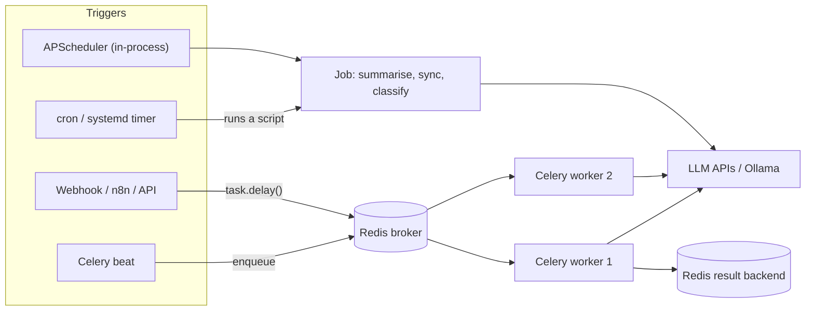
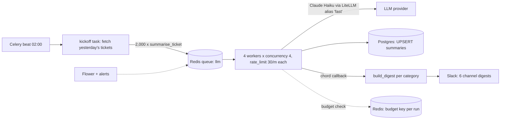

# 36 · Cron, APScheduler & Celery + Redis

> **In one line:** Most AI automations don't run when a user clicks; they run at 02:00, every 15 minutes, or in the background after a webhook returns. Cron and systemd timers fire jobs, APScheduler schedules inside a Python process, and Celery with Redis runs many long, rate-limited, retryable LLM tasks across workers. Whatever fires the job, make it idempotent, locked and budget-capped.

> **Versions used:** celery 5.7 · redis (python) 8.x · flower 2.2 · APScheduler 3.11 · python-dotenv 1.x · Redis server 7/8 · **Fast-moving:** APScheduler 4.0 has been in alpha for years with a completely different API (`Scheduler`/`AsyncScheduler`, `add_schedule`), so this chapter uses the stable 3.x line and notes 4.x where it differs. Celery is stable but changes defaults between minor versions; read the "What's new" page before upgrading.

---

## 1. Overview

> **Builds on:** [Ch 06 · Model APIs](topic.html?p=06-model-apis) (SDK retries, rate-limit errors), [Ch 07 · Multi-Provider Routing](topic.html?p=07-multi-provider-routing) (budgets), [Ch 12 · Connecting n8n with Python Scripts](topic.html?p=12-n8n-with-python) (calling Python from workflows).

You already know how to write a webhook handler that returns in 200 ms. An LLM call takes 2 to 60 seconds, an agent run can take ten minutes, and a provider can rate-limit you halfway through 5,000 documents. So AI work moves **out of the request path** into two kinds of machinery:

- **Schedulers** decide *when* something runs: cron, systemd timers, APScheduler, Celery beat.
- **Task queues** decide *where and how* it runs: a broker (Redis) holds messages, workers pull them, retry them, rate-limit them and record results.



Rules of thumb you'll justify through the chapter:
- One script, once a day, one server: **cron or a systemd timer**.
- A long-running Python service that also needs a few timed jobs: **APScheduler** inside it.
- Many tasks, parallel workers, retries, rate limits, fan-out and fan-in: **Celery + Redis** (or RQ, Dramatiq, Huey).
- Multi-step pipelines that must survive crashes for hours or days, with a UI of every run: an **orchestrator** ([Ch 37 · Prefect, Airflow & Temporal](topic.html?p=37-workflow-orchestrators)).

The Django handbook covers Celery inside a web app in depth: [Django · Celery & Background Tasks](../django/topic.html?p=31-celery-background-tasks). Broker theory lives in [Messaging · What is a Message Queue](../messaging/topic.html?p=01-what-is-a-message-queue) and [Delivery Guarantees](../messaging/topic.html?p=04-delivery-guarantees).

---

## 2. Key Concepts

- **Cron expression**: five fields, `minute hour day-of-month month day-of-week`. `0 2 * * *` is 02:00 daily, `*/15 * * * *` every 15 minutes, `0 9 * * 1-5` 09:00 on weekdays. Cron runs in the server's time zone with a nearly empty environment.
- **systemd timer**: the modern Linux alternative. A `.timer` unit triggers a `.service` unit, logs go to `journalctl`, `Persistent=true` catches up runs missed while the box was off, `RandomizedDelaySec` spreads load.
- **Idempotent job**: running it twice produces the same result as running it once. Required because every scheduler and queue in this chapter can run a job twice (retry after a timeout, redelivery after a crash, a deploy that started two schedulers).
- **Lock**: prevents two copies running *at the same time* (`flock` for cron, a Redis lock for distributed workers). A lock is not idempotency: it stops overlap, not re-runs.
- **Broker**: the queue that holds task messages (Redis or RabbitMQ). **Result backend**: where return values and states are stored (Redis, a database).
- **Worker**: a process that pulls tasks and runs them. **Concurrency** is how many tasks a worker runs at once. **Prefetch** is how many it reserves in advance.
- **At-least-once delivery**: with `acks_late=True`, a task is acknowledged *after* it finishes, so a crashed worker's task is redelivered. Combined with idempotency, that is the safe default for LLM work.
- **Visibility timeout** (Redis broker): an unacknowledged task is redelivered to another worker after this many seconds (default 1 hour). It must exceed your longest task, or long LLM tasks run twice.
- **Retry with exponential backoff and jitter**: wait 1 s, 2 s, 4 s… plus randomness, so a 429 from the provider doesn't turn into a synchronised retry storm.
- **Canvas**: Celery's composition primitives. `chain` (A then B), `group` (A, B, C in parallel), `chord` (a group plus a callback that receives all results: map-reduce).
- **Beat**: Celery's scheduler process. It enqueues tasks on a schedule. Run exactly **one** beat per schedule.
- **Cost cap per run**: a budget a job checks before every LLM call, so a bug or a data spike can't spend $900 overnight.

> **Analogy:** a restaurant. The cron table is the opening-hours sign. The broker is the ticket rail in the kitchen. Workers are cooks who take a ticket, cook, and spike it when done (`acks_late`). If a cook faints mid-dish, the ticket goes back on the rail (redelivery), which is why the recipe must be safe to cook twice (idempotency).

How a Celery task flows, and where it can run twice:

```svg
<svg viewBox="0 0 880 330" width="100%" height="330" font-family="ui-sans-serif,system-ui,sans-serif" font-size="11" xmlns="http://www.w3.org/2000/svg">
  <defs><marker id="aa36a" viewBox="0 0 10 10" refX="9" refY="5" markerWidth="7" markerHeight="7" orient="auto"><path d="M0,0 L10,5 L0,10 z" fill="#334155"/></marker></defs>
  <text x="440" y="22" text-anchor="middle" font-size="14" font-weight="700" fill="#1e293b">Celery with acks_late on Redis: at-least-once, so the task must be idempotent</text>
  <rect x="20" y="60" width="130" height="56" rx="8" fill="#ede9fe" stroke="#7c3aed"/>
  <text x="85" y="83" text-anchor="middle" font-weight="700" fill="#1e293b">Celery beat</text>
  <text x="85" y="100" text-anchor="middle" fill="#334155">crontab(hour=2)</text>
  <rect x="20" y="160" width="130" height="56" rx="8" fill="#dbeafe" stroke="#2563eb"/>
  <text x="85" y="183" text-anchor="middle" font-weight="700" fill="#1e293b">API / webhook</text>
  <text x="85" y="200" text-anchor="middle" fill="#334155">task.delay(id)</text>
  <line x1="152" y1="88" x2="228" y2="130" stroke="#334155" stroke-width="1.5" marker-end="url(#aa36a)"/>
  <line x1="152" y1="188" x2="228" y2="150" stroke="#334155" stroke-width="1.5" marker-end="url(#aa36a)"/>
  <rect x="230" y="90" width="170" height="100" rx="8" fill="#fee2e2" stroke="#dc2626"/>
  <text x="315" y="112" text-anchor="middle" font-weight="700" fill="#1e293b">Redis broker</text>
  <text x="315" y="130" text-anchor="middle" fill="#334155">queue "llm": [t3, t2, t1]</text>
  <text x="315" y="148" text-anchor="middle" fill="#334155">unacked: {t0: worker A}</text>
  <text x="315" y="172" text-anchor="middle" fill="#dc2626">visibility_timeout = 2 h</text>
  <line x1="402" y1="120" x2="478" y2="85" stroke="#334155" stroke-width="1.5" marker-end="url(#aa36a)"/>
  <line x1="402" y1="160" x2="478" y2="205" stroke="#334155" stroke-width="1.5" marker-end="url(#aa36a)"/>
  <rect x="480" y="50" width="200" height="80" rx="8" fill="#dcfce7" stroke="#16a34a"/>
  <text x="580" y="72" text-anchor="middle" font-weight="700" fill="#1e293b">Worker A (prefetch 1)</text>
  <text x="580" y="90" text-anchor="middle" fill="#334155">run t0 → LLM call (40 s)</text>
  <text x="580" y="108" text-anchor="middle" fill="#334155">429? retry with backoff</text>
  <text x="580" y="124" text-anchor="middle" fill="#16a34a">success → ACK → removed</text>
  <rect x="480" y="170" width="200" height="80" rx="8" fill="#fef3c7" stroke="#d97706"/>
  <text x="580" y="192" text-anchor="middle" font-weight="700" fill="#1e293b">Worker B crashes mid-task</text>
  <text x="580" y="210" text-anchor="middle" fill="#334155">no ACK sent</text>
  <text x="580" y="228" text-anchor="middle" fill="#d97706">after timeout: t1 redelivered</text>
  <text x="580" y="244" text-anchor="middle" fill="#d97706">→ runs a second time</text>
  <path d="M480 240 C 420 290, 330 280, 315 192" fill="none" stroke="#d97706" stroke-width="1.5" stroke-dasharray="5 4" marker-end="url(#aa36a)"/>
  <line x1="682" y1="90" x2="728" y2="90" stroke="#334155" stroke-width="1.5" marker-end="url(#aa36a)"/>
  <rect x="730" y="55" width="135" height="80" rx="8" fill="#dbeafe" stroke="#2563eb"/>
  <text x="797" y="77" text-anchor="middle" font-weight="700" fill="#1e293b">Result backend</text>
  <text x="797" y="95" text-anchor="middle" fill="#334155">state + return value</text>
  <text x="797" y="111" text-anchor="middle" fill="#334155">(expires after 1 day)</text>
  <rect x="730" y="170" width="135" height="80" rx="8" fill="#f8fafc" stroke="#94a3b8"/>
  <text x="797" y="192" text-anchor="middle" font-weight="700" fill="#1e293b">Your DB</text>
  <text x="797" y="210" text-anchor="middle" fill="#334155">UPSERT by (ticket, date)</text>
  <text x="797" y="228" text-anchor="middle" fill="#16a34a">2nd run = same row</text>
  <line x1="682" y1="210" x2="728" y2="210" stroke="#334155" stroke-width="1.5" marker-end="url(#aa36a)"/>
  <text x="440" y="310" text-anchor="middle" fill="#334155">Rule: visibility_timeout &gt; longest task (incl. retries/countdown), and every side effect keyed so a re-run is harmless.</text>
</svg>
```

---

## 3. Setup

```bash
pip install "celery[redis]>=5.5,<6" "redis>=5" "flower>=2.0" "python-dotenv>=1" "openai>=3"
pip install "APScheduler>=3.11,<4" "SQLAlchemy>=2"     # 3.x is the stable line; 4.0 is still alpha
docker run -d --name redis -p 6379:6379 redis:8        # or: brew install redis / apt install redis-server
```

```bash
# .env.example
REDIS_URL=redis://localhost:6379/0
CELERY_RESULT_BACKEND=redis://localhost:6379/1
LLM_BASE_URL=http://localhost:11434/v1      # Ollama (Ch 08); any OpenAI-compatible endpoint works
LLM_API_KEY=ollama
LLM_MODEL=llama3.2
RUN_BUDGET_USD=2.00                          # hard cost cap per scheduled run
```

The examples reuse the `llm.py` helper from [Ch 02 · Prompt Engineering](topic.html?p=02-prompt-engineering) (`chat(messages, max_tokens=...)` over an OpenAI-compatible endpoint). Every script calls `load_dotenv()` and reads settings with `os.getenv`/`os.environ`.

---

## 4. Code Examples

### Example 1: Cron, flock and systemd timers

A crontab line for a nightly summary at 02:00, with a lock so a slow run never overlaps the next one:

```bash
# crontab -e   (fields: minute hour day-of-month month day-of-week)
SHELL=/bin/bash
PATH=/usr/local/bin:/usr/bin:/bin
# m  h  dom mon dow  command
  0  2  *   *   *    cd /opt/ticketbot && flock -n /tmp/ticketbot.lock ./venv/bin/python nightly.py >> logs/nightly.log 2>&1
```

Three cron habits that save hours: set `PATH` and `cd` explicitly (cron's environment is almost empty and won't see your shell profile or `.env` location), use the venv's absolute Python, and redirect output to a log (otherwise it's mailed to a local mailbox nobody reads). `flock -n` exits immediately if the previous run still holds the lock.

On any systemd Linux server, a timer is usually better: logs in the journal, catch-up after downtime, resource limits and no overlap by design (a oneshot service can't start twice).

```ini
# /etc/systemd/system/ticketbot-nightly.service
[Unit]
Description=Nightly ticket summary
After=network-online.target

[Service]
Type=oneshot
User=ticketbot
WorkingDirectory=/opt/ticketbot
EnvironmentFile=/opt/ticketbot/.env
ExecStart=/opt/ticketbot/venv/bin/python nightly.py
TimeoutStartSec=2h
MemoryMax=1G
```

The timer that fires it:

```ini
# /etc/systemd/system/ticketbot-nightly.timer
[Unit]
Description=Run ticket summary at 02:00

[Timer]
OnCalendar=*-*-* 02:00:00
Persistent=true
RandomizedDelaySec=300

[Install]
WantedBy=timers.target
```

```bash
sudo systemctl daemon-reload
sudo systemctl enable --now ticketbot-nightly.timer
systemctl list-timers ticketbot-nightly.timer      # next and last run
journalctl -u ticketbot-nightly.service -n 50      # logs of the last run
```

### Example 2: An idempotent, locked job with a run key

Locks stop overlap. Idempotency stops double effects. This job does both with Redis, so it is safe across several servers:

```python
# idempotent_job.py — a nightly job that is safe to run twice and never runs concurrently
import datetime as dt
import os

import redis
from dotenv import load_dotenv

load_dotenv()
r = redis.Redis.from_url(os.getenv("REDIS_URL", "redis://localhost:6379/0"), decode_responses=True)


def run_nightly(day: dt.date, client: redis.Redis = r) -> str:
    run_key = f"done:nightly-summary:{day.isoformat()}"          # one key per logical run
    if client.exists(run_key):
        return "skipped: already completed"
    lock = client.lock("lock:nightly-summary", timeout=2 * 3600, blocking=False)   # auto-expires if we crash
    if not lock.acquire():
        return "skipped: another run in progress"
    try:
        if client.exists(run_key):                               # re-check after acquiring the lock
            return "skipped: completed while we waited"
        processed = 0
        for ticket_id in ("T-1", "T-2", "T-3"):
            item_key = f"summary:{day.isoformat()}:{ticket_id}"  # per-item idempotency: resume, don't redo
            if client.exists(item_key):
                continue
            client.set(item_key, f"summary of {ticket_id}", ex=7 * 86400)   # your LLM call + DB upsert goes here
            processed += 1
        client.set(run_key, "1", ex=30 * 86400)                  # mark complete only at the very end
        return f"done: {processed} new summaries"
    finally:
        lock.release()


if __name__ == "__main__":
    import fakeredis                                             # pip install fakeredis lupa (offline demo)
    fake = fakeredis.FakeRedis(decode_responses=True)
    today = dt.date(2026, 11, 12)
    print(run_nightly(today, fake))
    print(run_nightly(today, fake))
    fake.delete(f"done:nightly-summary:{today}")                 # simulate a crash before completion
    print(run_nightly(today, fake))
```

```text
done: 3 new summaries
skipped: already completed
done: 0 new summaries
```

The third line is the point: after a "crash", the re-run resumes and does **zero** duplicate LLM calls because each item has its own key. In production the per-item key is usually a unique constraint in your database (`UNIQUE (ticket_id, summary_date)` plus `INSERT ... ON CONFLICT DO NOTHING`). For Redis lock internals and their limits, see [Redis · Distributed Locks & Redlock](../redis-caching/topic.html?p=23-distributed-locks-redlock).

### Example 3: APScheduler 3.x inside a Python service

When your process is already long-running (a FastAPI app, a bot, a small daemon), APScheduler adds cron-like jobs without another system:

```python
# aps_demo.py — APScheduler 3.11: interval + cron jobs, overlap protection, missed-run handling
import datetime as dt
import logging
import time

from apscheduler.events import EVENT_JOB_ERROR, EVENT_JOB_MISSED
from apscheduler.schedulers.background import BackgroundScheduler
from apscheduler.triggers.cron import CronTrigger

logging.basicConfig(level=logging.WARNING)
runs: list[str] = []


def poll_inbox() -> None:
    runs.append(dt.datetime.now().strftime("%H:%M:%S"))     # e.g. fetch new emails and enqueue triage tasks


def nightly_summary() -> None:
    print("nightly summary would run now")


def on_event(event) -> None:
    kind = "MISSED" if event.code == EVENT_JOB_MISSED else "ERROR"
    print(f"[alert] {kind} job={event.job_id}")              # send to Slack / logs in real life


def build_scheduler() -> BackgroundScheduler:
    sched = BackgroundScheduler(
        timezone="UTC",
        job_defaults={"coalesce": True,            # many missed runs → run once, not N times
                      "max_instances": 1,           # never overlap the same job
                      "misfire_grace_time": 300},   # still run if we're up to 5 min late
    )
    sched.add_job(poll_inbox, "interval", seconds=1, id="poll_inbox", replace_existing=True)
    sched.add_job(nightly_summary, CronTrigger.from_crontab("0 2 * * *", timezone="UTC"),
                  id="nightly_summary", replace_existing=True)
    sched.add_listener(on_event, EVENT_JOB_ERROR | EVENT_JOB_MISSED)
    return sched


if __name__ == "__main__":
    s = build_scheduler()
    s.start()
    time.sleep(3.5)
    print("poll runs:", len(runs))
    print("next nightly:", s.get_job("nightly_summary").next_run_time.isoformat())
    s.shutdown(wait=False)
```

```text
poll runs: 3
next nightly: 2026-11-13T02:00:00+00:00
```

Swap `BackgroundScheduler` for `BlockingScheduler` when the scheduler *is* the process, or `AsyncIOScheduler` inside an asyncio app. To survive restarts, add a persistent job store: `jobstores={"default": SQLAlchemyJobStore(url="sqlite:///jobs.sqlite")}`.

> **Gotcha:** APScheduler runs inside *your* process. Run your web app with 4 Gunicorn/Uvicorn workers and you get 4 schedulers firing every job 4 times. Run the scheduler in exactly one dedicated process, or use a lock (Example 2) inside each job.

> **Version note:** APScheduler **4.0** (still alpha, `4.0.0a6` at the time of writing) is a rewrite: `Scheduler()`/`AsyncScheduler()` used as context managers, `add_schedule(func, CronTrigger(...))` instead of `add_job`, data stores that let several schedulers share work safely. Pin `APScheduler>=3.11,<4` until 4.0 is final and its migration guide is out.

### Example 4: A Celery app for LLM work

```python
# celery_app.py — Celery 5 + Redis, configured for slow, flaky, rate-limited LLM calls
import os

from celery import Celery
from dotenv import load_dotenv

load_dotenv()

app = Celery(
    "aiwork",
    broker=os.getenv("REDIS_URL", "redis://localhost:6379/0"),
    backend=os.getenv("CELERY_RESULT_BACKEND", "redis://localhost:6379/1"),
    include=["llm_tasks"],
)
app.conf.update(
    task_acks_late=True,                 # ack after the task finishes → redelivered if a worker dies
    task_reject_on_worker_lost=True,     # ...including when the worker process is killed (OOM)
    worker_prefetch_multiplier=1,        # don't let one worker hoard slow tasks
    broker_transport_options={"visibility_timeout": 2 * 3600},   # > longest task incl. retries
    task_time_limit=15 * 60,             # hard kill after 15 min
    task_soft_time_limit=14 * 60,        # raise SoftTimeLimitExceeded first so you can clean up
    result_expires=24 * 3600,            # don't let results fill Redis
    task_track_started=True,             # STARTED state visible in Flower
    task_routes={"llm_tasks.summarise_ticket": {"queue": "llm"}},
    timezone="UTC",
    task_always_eager=os.getenv("CELERY_EAGER") == "1",   # run inline for tests (retries run inline too)
)
```

And the tasks:

```python
# llm_tasks.py — retries with backoff, rate limit, time limits, canvas
import os

from celery import chain, chord, group
from celery.exceptions import SoftTimeLimitExceeded
from celery.utils.log import get_task_logger

from celery_app import app

log = get_task_logger(__name__)


class ProviderBusy(Exception):
    """Raised for 429/5xx from the LLM provider (map openai.RateLimitError etc. to this)."""


def fake_llm(text: str) -> str:
    if os.getenv("FAIL_ONCE") == "1":
        os.environ["FAIL_ONCE"] = "0"
        raise ProviderBusy("429 Too Many Requests")
    return text[:40] + "…"                          # replace with llm.chat([...]) from Ch 02


@app.task(bind=True, name="llm_tasks.summarise_ticket",   # explicit names: safe even when run as __main__
          autoretry_for=(ProviderBusy, ConnectionError),
          retry_backoff=2, retry_backoff_max=300, retry_jitter=True,   # 2s, 4s, 8s… capped at 5 min
          max_retries=5,
          rate_limit="30/m",                         # per worker instance, NOT global
          soft_time_limit=120, time_limit=150)
def summarise_ticket(self, ticket_id: str, text: str) -> dict:
    try:
        summary = fake_llm(text)
    except SoftTimeLimitExceeded:
        log.warning("ticket %s timed out, returning partial", ticket_id)
        return {"id": ticket_id, "summary": None, "timeout": True}
    return {"id": ticket_id, "summary": summary, "attempt": self.request.retries + 1}


@app.task(name="llm_tasks.build_digest")
def build_digest(results: list[dict]) -> str:
    ok = [r for r in results if r["summary"]]
    return f"{len(ok)}/{len(results)} summarised: " + " | ".join(r["id"] for r in ok)


@app.task(name="llm_tasks.post_to_slack")
def post_to_slack(digest: str) -> str:
    return f"posted: {digest}"                       # requests.post(SLACK_WEBHOOK, json={...})


def nightly_pipeline(tickets: dict[str, str]):
    fan_out = group(summarise_ticket.s(tid, text) for tid, text in tickets.items())
    # chord = group + callback with all results; then chain to the next step
    return chain(chord(fan_out, build_digest.s()), post_to_slack.s())


if __name__ == "__main__":
    tickets = {"T-1": "Customer charged twice for the November invoice and wants a refund",
               "T-2": "Export to CSV crashes when the report has more than 10k rows",
               "T-3": "Please add SSO with Okta for our 400 seats"}
    os.environ["FAIL_ONCE"] = "1"                   # simulates one 429 (in eager mode; a worker is another process)
    res = nightly_pipeline(tickets).apply_async()
    print(res.get(timeout=60))
```

Run it offline in eager mode (tasks run inline, retries included), then for real with a worker:

```bash
CELERY_EAGER=1 python llm_tasks.py
# real mode: terminal 1
celery -A celery_app worker -Q llm,celery --concurrency=4 --loglevel=INFO
# terminal 2
python llm_tasks.py
```

```text
posted: 3/3 summarised: T-1 | T-2 | T-3
```

What each option buys you for LLM work:

| Option | Why it matters for LLM tasks |
|---|---|
| `autoretry_for` + `retry_backoff` + `retry_jitter` | 429s and 529/503 "overloaded" are normal; back off exponentially with randomness |
| `max_retries` | Stop eventually and surface the failure instead of retrying forever |
| `rate_limit="30/m"` | Throttle per worker. With 4 workers that's 120/min total. For a global limit use a Redis token bucket ([Ch 42](topic.html?p=42-reliability-cost)) |
| `acks_late` + `reject_on_worker_lost` | A crash or OOM mid-call doesn't lose the task |
| `soft_time_limit` / `time_limit` | A hung HTTP stream can't block a worker slot forever |
| `worker_prefetch_multiplier=1` | Slow tasks are spread evenly instead of queued behind one busy worker |
| Separate `llm` queue | Slow LLM tasks don't starve fast tasks (emails, DB writes) |

> **Gotcha:** don't stack retries. The OpenAI and Anthropic SDKs already retry 429/5xx twice by default. Add Celery's 5 retries and an n8n retry on top and one outage becomes dozens of calls. Set `max_retries=0` on the SDK client inside Celery tasks, or keep the SDK's retries and use fewer Celery ones.

### Example 5: Celery beat schedules

```python
# beat_schedule.py — import this in celery_app.py or set app.conf.beat_schedule there
from celery.schedules import crontab

from celery_app import app

app.conf.beat_schedule = {
    "nightly-ticket-summary": {
        "task": "llm_tasks.post_to_slack",               # usually a "kick off the pipeline" task
        "schedule": crontab(hour=2, minute=0),           # 02:00 in app.conf.timezone
        "args": ("nightly run",), "options": {"expires": 3 * 3600},   # skip if still queued 3 h later
    },
    "inbox-poll-every-5-min": {
        "task": "llm_tasks.post_to_slack",
        "schedule": 300.0,                               # seconds
        "args": ("poll",),
    },
}

if __name__ == "__main__":
    for name, entry in app.conf.beat_schedule.items():
        print(f"{name:26} {entry['schedule']}")
```

```text
nightly-ticket-summary     <crontab: 0 2 * * * (m/h/dM/MY/d)>
inbox-poll-every-5-min     300.0
```

```bash
celery -A celery_app beat --loglevel=INFO          # exactly ONE beat process per schedule
celery -A celery_app flower --port=5555            # dashboard: queues, workers, task states, retries
```

Beat only *enqueues*; workers do the work. If two beat processes run (say, one per replica in Kubernetes), every scheduled task fires twice. Run beat as a single-replica deployment, and still make the task idempotent (Example 2) because beat can also re-send after its own restart.

### Example 6: A cost cap per run

A scheduled job is a loop over data you didn't see in advance. Cap spend per run so a 10× data spike or an infinite retry can't produce a surprise invoice:

```python
# budget.py — a per-run spend cap shared by all workers via Redis
import os

import redis
from dotenv import load_dotenv

load_dotenv()

PRICES = {"claude-haiku-5-5": (0.10, 0.50), "llama3.2": (0.0, 0.0)}   # $/M tokens (in, out); check pricing pages


class BudgetExceeded(Exception):
    pass


class RunBudget:
    def __init__(self, run_id: str, limit_usd: float, client: redis.Redis):
        self.key, self.limit, self.r = f"budget:{run_id}", limit_usd, client

    def check(self) -> None:
        spent = float(self.r.get(self.key) or 0)
        if spent >= self.limit:
            raise BudgetExceeded(f"{self.key}: ${spent:.6f} >= cap ${self.limit:.6f}")

    def charge(self, model: str, in_tok: int, out_tok: int) -> float:
        p_in, p_out = PRICES.get(model, (5.0, 25.0))          # unknown model → assume expensive
        cost = in_tok / 1e6 * p_in + out_tok / 1e6 * p_out
        total = self.r.incrbyfloat(self.key, cost)             # atomic across workers
        self.r.expire(self.key, 3 * 86400)
        return float(total)


if __name__ == "__main__":
    import fakeredis
    b = RunBudget("nightly:2026-11-12", float(os.getenv("RUN_BUDGET_USD", "0.0005")), fakeredis.FakeRedis())
    try:
        for i in range(10):
            b.check()                                          # call BEFORE each LLM request
            total = b.charge("claude-haiku-5-5", in_tok=800, out_tok=120)
            print(f"call {i + 1}: total ${total:.6f}")
    except BudgetExceeded as e:
        print("stopped:", e)
```

Run it with the small default cap (unset `RUN_BUDGET_USD`) to see the stop:

```text
call 1: total $0.000140
call 2: total $0.000280
call 3: total $0.000420
call 4: total $0.000560
stopped: budget:nightly:2026-11-12: $0.000560 >= cap $0.000500
```

The check happens before the call, so the overshoot is bounded by one call per concurrent worker. Mark `BudgetExceeded` as **not** retryable (it isn't in `autoretry_for`) and alert on it. Per-feature cost attribution is in [Ch 42 · Caching, Rate Limits, Retries & Cost Tracking](topic.html?p=42-reliability-cost).

### Example 7: RQ, Dramatiq and Huey in one glance

Celery isn't the only Redis-backed queue. The same "summarise one ticket with retries" in the lighter options (each is its own package):

| Library | Enqueue + retry | Worker command | Notes |
|---|---|---|---|
| **RQ** | `Queue("llm", connection=Redis()).enqueue(summarise, "T-1", retry=Retry(max=3, interval=[10, 30, 60]), job_timeout=300)` | `rq worker llm` | Simplest; plain functions; `rq-scheduler` or cron for timing |
| **Dramatiq** | `@dramatiq.actor(max_retries=5, min_backoff=2000, time_limit=300_000)` then `summarise.send("T-1")` | `dramatiq tasks` | Retries with backoff on by default; acks late by default |
| **Huey** | `@huey.task(retries=3, retry_delay=30)` and `@huey.periodic_task(crontab(hour="2", minute="0"))` | `huey_consumer tasks.huey` | Tiny; scheduler built into the consumer |

---

## 5. Real-World Use Case

**Company:** an online retailer's support team (12 agents, ~2,000 tickets a day in Zendesk). **Trigger:** every night at 02:00 UTC. **Goal:** before the morning stand-up, each team lead gets a Slack digest per category ("billing: 340 tickets, top 3 issues, 2 escalations") and every ticket gets a one-line summary stored back as an internal note.



**Numbers:**
- **Volume:** 2,000 tickets × ~800 input + ~100 output tokens = 1.6 M in, 0.2 M out per night.
- **Cost:** with a small model at $0.10 / $0.50 per M tokens, about $0.16 + $0.10 = **$0.26 per night, ~$8/month**. The run budget is set to $2, so a tenfold spike is still capped.
- **Latency:** 4 workers × 30 calls/min = 120 calls/min → ~17 minutes for 2,000 tickets. Fine at 02:00. A daytime real-time path uses the same task with a higher-priority queue.
- **Failure handling:** 429s retry with backoff. A worker OOM redelivers its task (`acks_late`), and the `UNIQUE (ticket_id, day)` constraint makes the re-run harmless. If the budget trips, the digest says "partial run" and pages on-call.
- **Infra:** one 4 vCPU VPS running Redis, 4 workers, beat and Flower with Docker Compose. About $20/month.

---

## 6. Mini Project: Nightly Ticket-Summary Job with Celery + Redis in Docker Compose (1–2 hours)

**Goal:** a Compose stack (Redis, worker, beat, Flower) that every night summarises tickets from a CSV with a local or hosted LLM, writes summaries idempotently to SQLite, enforces a run budget and posts a digest.

```text
nightly-summary/
├── .env
├── docker-compose.yml
├── Dockerfile
├── requirements.txt
├── llm.py              # from Ch 02
├── tickets.csv
└── nightly.py          # Celery app + tasks + beat schedule
```

**Step 1: data and dependencies.**

```text
# tickets.csv
id,category,text
T-101,billing,I was charged twice for my November order and need a refund
T-102,bug,The mobile app logs me out every time I switch tabs
T-103,billing,Invoice shows the wrong VAT number for our company
```

```text
# requirements.txt
celery[redis]>=5.5,<6
redis>=5
flower>=2.0
openai>=3
python-dotenv>=1
```

**Step 2: the Celery app, tasks and schedule.**

```python
# nightly.py — Celery app, idempotent tasks, budget cap, beat schedule
import csv
import datetime as dt
import os
import sqlite3

import redis
from celery import Celery, chord
from celery.schedules import crontab
from dotenv import load_dotenv

load_dotenv()
REDIS_URL = os.getenv("REDIS_URL", "redis://localhost:6379/0")
DB_PATH = os.getenv("DB_PATH", "summaries.db")
BUDGET = float(os.getenv("RUN_BUDGET_USD", "2.0"))

app = Celery("nightly", broker=REDIS_URL, backend=os.getenv("CELERY_RESULT_BACKEND", REDIS_URL))
app.conf.update(
    task_acks_late=True, task_reject_on_worker_lost=True, worker_prefetch_multiplier=1,
    broker_transport_options={"visibility_timeout": 2 * 3600},
    result_expires=86400, timezone="UTC",
    task_always_eager=os.getenv("CELERY_EAGER") == "1",
    beat_schedule={"nightly-summary": {"task": "nightly.kickoff",
                                       "schedule": crontab(hour=2, minute=0),
                                       "options": {"expires": 3 * 3600}}},
)
rds = redis.Redis.from_url(REDIS_URL, decode_responses=True)


def db() -> sqlite3.Connection:
    con = sqlite3.connect(DB_PATH)
    con.execute("""CREATE TABLE IF NOT EXISTS summary (ticket_id TEXT, day TEXT, category TEXT,
                   summary TEXT, PRIMARY KEY (ticket_id, day))""")
    return con


def summarise_text(text: str) -> tuple[str, int, int]:
    if os.getenv("FAKE_LLM") == "1":                       # offline mode for tests
        return text[:50], len(text) // 4, 12
    from llm import client, MODEL                          # Ch 02 helper (OpenAI-compatible)
    resp = client.chat.completions.create(
        model=MODEL, max_tokens=60,
        messages=[{"role": "system", "content": "Summarise the support ticket in one sentence."},
                  {"role": "user", "content": text}])
    u = resp.usage
    return resp.choices[0].message.content.strip(), u.prompt_tokens, u.completion_tokens


@app.task(bind=True, autoretry_for=(ConnectionError, TimeoutError), retry_backoff=2,
          retry_backoff_max=300, retry_jitter=True, max_retries=5, rate_limit="30/m",
          soft_time_limit=120, time_limit=150)
def summarise(self, ticket: dict, day: str) -> dict:
    con = db()
    row = con.execute("SELECT summary FROM summary WHERE ticket_id=? AND day=?", (ticket["id"], day)).fetchone()
    if row:                                                # idempotent: already done for this day
        return {**ticket, "summary": row[0], "cached": True}
    budget_key = f"budget:nightly:{day}"
    if float(rds.get(budget_key) or 0) >= BUDGET:
        return {**ticket, "summary": None, "skipped": "budget"}
    summary, tin, tout = summarise_text(ticket["text"])
    rds.incrbyfloat(budget_key, tin / 1e6 * 0.10 + tout / 1e6 * 0.50)   # use your model's prices
    con.execute("INSERT OR IGNORE INTO summary VALUES (?,?,?,?)", (ticket["id"], day, ticket["category"], summary))
    con.commit()
    return {**ticket, "summary": summary, "cached": False}


@app.task
def digest(results: list[dict], day: str) -> str:
    by_cat: dict[str, list[str]] = {}
    for r in results:
        by_cat.setdefault(r["category"], []).append(f"{r['id']}: {r['summary'] or '(skipped)'}")
    lines = [f"Ticket digest {day}"] + [f"*{c}* ({len(v)})\n  " + "\n  ".join(v) for c, v in sorted(by_cat.items())]
    text = "\n".join(lines)
    # post to Slack: requests.post(os.environ["SLACK_WEBHOOK_URL"], json={"text": text}, timeout=10)
    return text


def run_for_day(day: str):
    with open(os.getenv("TICKETS_CSV", "tickets.csv"), newline="") as f:
        tickets = list(csv.DictReader(f))
    return chord(summarise.s(t, day) for t in tickets)(digest.s(day))   # fan out, then digest


@app.task
def kickoff(day: str | None = None) -> str:
    day = day or (dt.date.today() - dt.timedelta(days=1)).isoformat()   # yesterday's tickets
    return f"queued chord {run_for_day(day).id} for {day}"


if __name__ == "__main__":                                  # CELERY_EAGER=1 FAKE_LLM=1 python nightly.py
    print(run_for_day("2026-11-11").get())
    second = run_for_day("2026-11-11").get()                # second run: everything served from the DB
    print("second run identical:", second == run_for_day("2026-11-11").get())
```

**Step 3: container and Compose.**

```dockerfile
# Dockerfile
FROM python:3.12-slim
WORKDIR /app
COPY requirements.txt .
RUN pip install --no-cache-dir -r requirements.txt
COPY . .
RUN useradd -m app && chown -R app /app
USER app
```

The Compose file runs one image as three different processes:

```yaml
# docker-compose.yml
services:
  redis:
    image: redis:8
    command: ["redis-server", "--appendonly", "yes"]
    volumes: ["redisdata:/data"]
    healthcheck:
      test: ["CMD", "redis-cli", "ping"]
      interval: 5s
      retries: 5
  worker:
    build: .
    command: ["celery", "-A", "nightly", "worker", "--loglevel=INFO", "--concurrency=2"]
    env_file: .env
    environment:
      REDIS_URL: redis://redis:6379/0
      DB_PATH: /data/summaries.db
      LLM_BASE_URL: http://host.docker.internal:11434/v1
    extra_hosts: ["host.docker.internal:host-gateway"]
    volumes: ["appdata:/data"]
    depends_on:
      redis: {condition: service_healthy}
  beat:
    build: .
    command: ["celery", "-A", "nightly", "beat", "--loglevel=INFO", "--schedule=/tmp/celerybeat-schedule"]
    env_file: .env
    environment:
      REDIS_URL: redis://redis:6379/0
    depends_on:
      redis: {condition: service_healthy}
  flower:
    build: .
    command: ["celery", "-A", "nightly", "flower", "--port=5555"]
    environment:
      REDIS_URL: redis://redis:6379/0
    ports: ["127.0.0.1:5555:5555"]
    depends_on: [redis]
volumes:
  redisdata:
  appdata:
```

**Step 4: run.**

```bash
CELERY_EAGER=1 FAKE_LLM=1 python nightly.py          # offline smoke test, no Redis needed for tasks
docker compose up -d --build
docker compose exec worker celery -A nightly call nightly.kickoff --args='["2026-11-11"]'
docker compose logs -f worker                         # watch summaries, retries, digest
open http://localhost:5555                            # Flower
```

The offline smoke test still needs Redis for the budget counter (`docker compose up -d redis` first).

**Done when:**
- [ ] `kickoff` fans out one `summarise` per ticket and the chord produces a digest grouped by category.
- [ ] Calling `kickoff` twice for the same day makes zero new LLM calls (served from the DB).
- [ ] Killing the worker mid-run (`docker compose kill worker`, then `up -d worker`) still ends with every ticket summarised exactly once.
- [ ] Setting `RUN_BUDGET_USD=0` produces a digest of "(skipped)" lines and no LLM calls.
- [ ] Flower shows task states, retries and runtimes.

**Stretch goals:** post the digest to a Slack incoming webhook ([Ch 31](topic.html?p=31-chat-bots)); switch `LLM_BASE_URL` to the LiteLLM proxy from [Ch 07](topic.html?p=07-multi-provider-routing); add a dead-letter list for tickets that exhausted retries; replace beat with a systemd timer that runs `celery call` and compare.

---

## 7. Comparison Table

| | cron | systemd timer | APScheduler 3.x | Celery + beat | RQ | Dramatiq | Huey |
|---|---|---|---|---|---|---|---|
| What it is | OS scheduler | OS scheduler + service manager | In-process Python scheduler | Distributed task queue + scheduler | Simple Redis queue | Task queue with good defaults | Small queue + scheduler |
| Needs a broker | No | No | No (optional DB job store) | Redis / RabbitMQ | Redis | Redis / RabbitMQ | Redis / SQLite |
| Retries / backoff | DIY | `Restart=` only | DIY | ✅ rich | ✅ basic | ✅ default on | ✅ basic |
| Rate limits | ❌ | ❌ | ❌ | Per worker | ❌ | Via middleware | ❌ |
| Fan-out / fan-in | ❌ | ❌ | ❌ | ✅ chain, group, chord | Dependencies | Pipelines, groups | Pipelines |
| Missed-run catch-up | ❌ | ✅ `Persistent=true` | ✅ `misfire_grace_time` | ❌ (beat skips) | n/a | n/a | n/a |
| Monitoring | Logs | journalctl | Events | Flower | rq-dashboard | Prometheus middleware | Logs |
| Best for | One script daily | Server jobs on Linux | Timers inside an app | High-volume LLM work | Simple background jobs | Reliable jobs, less config | Small apps |

**When to use which:**
- **A script on one server, a few times a day:** systemd timer (or cron if that's what ops knows). Add `flock` and idempotency.
- **A bot or API that needs a few timers:** APScheduler in one dedicated process.
- **Thousands of LLM calls a day, parallelism, retries, rate limits, fan-out:** Celery + Redis.
- **You want a queue with less configuration:** RQ (simplest) or Dramatiq (safer defaults). Huey for small apps that want scheduling built in.
- **Multi-step pipelines with state, human approval, run history:** step up to [Ch 37](topic.html?p=37-workflow-orchestrators).
- **No-code teams:** n8n's Schedule Trigger node ([Ch 09](topic.html?p=09-n8n-fundamentals)) calling a Python endpoint that enqueues a Celery task.

---

## 8. Common Mistakes & Best Practices

**Mistake 1: non-idempotent jobs.** A retry re-sends 2,000 emails or bills twice. *Fix:* key every side effect by a natural ID (`ticket_id + day`), use upserts and unique constraints, and set "done" markers only at the end.

**Mistake 2: visibility timeout shorter than the task.** A 90-minute agent run on Redis with the default 1-hour visibility timeout is redelivered and runs twice, in parallel. *Fix:* raise `visibility_timeout` above your longest task, split long work into smaller tasks, or use an orchestrator for multi-hour runs.

**Mistake 3: scheduler in every web worker.** APScheduler in a 4-worker Gunicorn app, or beat in every replica, fires everything N times. *Fix:* one scheduler process. Locks in the jobs as a second line of defence.

**Mistake 4: assuming `rate_limit` is global.** `rate_limit="60/m"` with 8 workers allows 480/min and you hit provider 429s. *Fix:* divide the provider limit by the number of workers, or use a shared Redis token bucket ([Ch 42](topic.html?p=42-reliability-cost)).

**Mistake 5: passing big payloads through the broker.** Sending 5 MB PDFs as task arguments bloats Redis and slows everything. *Fix:* pass IDs or object-storage URLs; the task loads the data. (`summarise.delay("s3://bucket/inv-123.pdf")`, not `summarise.delay(pdf_bytes)`).

**Mistake 6: no cost ceiling.** A bug loops over the same 50k rows every 15 minutes. *Fix:* a per-run budget (Example 6), a per-day budget at the gateway ([Ch 07](topic.html?p=07-multi-provider-routing)), and alerts on spend.

**Mistake 7: cron with a different environment.** Works in your shell, fails at 02:00 because `PATH`, the venv and `.env` aren't there. *Fix:* absolute paths, `cd` into the project, `EnvironmentFile=` in systemd, and log output.

**Mistake 8: time zones and DST.** A job at `30 2 * * *` local time is skipped or runs twice on DST change days. *Fix:* schedule in UTC (`timezone="UTC"`), convert for humans in the message.

**Best-practice checklist**
- [ ] Every job idempotent (natural keys, upserts, done markers) and locked against overlap.
- [ ] `acks_late=True`, `reject_on_worker_lost=True`, `prefetch_multiplier=1` for LLM queues.
- [ ] `visibility_timeout` > longest task; soft and hard time limits on every LLM task.
- [ ] Retries with exponential backoff and jitter in one layer only; non-retryable errors (budget, validation) excluded.
- [ ] Separate queue for slow LLM tasks; IDs not blobs in messages.
- [ ] Per-run budget with an alert; spend tagged by job.
- [ ] Exactly one scheduler process; schedules in UTC.
- [ ] Flower (behind auth, not public) or metrics plus alerts on failures, retries and queue length.

---

## 9. Exercises

1. **Cron translator.** Write cron expressions for: every weekday at 07:45; every 10 minutes during 09:00–17:59; first day of each month at midnight. Check them with `CronTrigger.from_crontab(...).get_next_fire_time(None, now)`.
2. **systemd catch-up.** Install the timer from Example 1 on a VM, stop the VM across 02:00, start it again and confirm with `systemctl list-timers` that `Persistent=true` ran the missed job.
3. **Global rate limit.** Replace `rate_limit="30/m"` with a Redis token bucket shared by all workers, run 3 workers, and prove the combined rate stays under 30/min.
4. **Crash test.** In the mini project, add `time.sleep(20)` to `summarise`, start a run, `docker compose kill worker` mid-run, restart, and count rows. Then shrink `visibility_timeout` to 10 s and observe duplicate execution in the logs.

### Self-check questions

**Q: What is the difference between a lock and idempotency for scheduled jobs?**
A: A lock prevents two copies of a job from running at the same time. Idempotency makes running the job again (after a retry, crash or double schedule) produce the same result without duplicate side effects. You need both: a lock alone doesn't stop a re-run tomorrow morning from re-sending yesterday's emails, and idempotency alone can still waste money if two copies run in parallel.

**Q: Why use a systemd timer instead of a crontab line?**
A: Timers integrate with systemd: logs go to the journal, `Persistent=true` catches up runs missed while the machine was down, `RandomizedDelaySec` spreads load, a oneshot service can't overlap itself, and you get resource limits, a dedicated user and an `EnvironmentFile`. Cron is simpler and portable, but needs manual locking and logging.

**Q: What does `acks_late=True` change in Celery, and what does it require from your task?**
A: The message is acknowledged after the task finishes instead of when it starts. If the worker crashes mid-task, the broker redelivers it, so you get at-least-once instead of at-most-once execution. The task must therefore be idempotent, because it may run more than once.

**Q: Why is APScheduler risky inside a multi-worker web server?**
A: Each worker process starts its own scheduler, so every job fires once per process. Run the scheduler in a single dedicated process (or a single replica), and add a distributed lock in the job body as protection.

**Q: How do Celery's `rate_limit` and a provider's rate limit interact? (Senior)**
A: Celery's `rate_limit` is enforced per worker instance, so the effective rate is the per-task limit times the number of workers (and it isn't coordinated across machines). To respect a provider's global limit, divide it across workers or use a shared limiter, typically a Redis token bucket or a gateway like LiteLLM Proxy, and still handle 429s with backoff and jitter because limits are also shared with other clients on the same key.

**Q: A 90-minute agent task on a Redis broker runs twice in parallel. What happened and how do you fix it? (Senior)**
A: With `acks_late`, the task stays unacknowledged while it runs. Redis redelivers unacknowledged messages after the visibility timeout (1 hour by default), so a second worker picked it up while the first was still running. Fixes: set `visibility_timeout` above the longest task duration (including countdown and ETA), split the work into shorter tasks, add a lock keyed by the job ID, and for long, multi-step agent runs move to a durable orchestrator like Temporal or Prefect.

**Q: How would you cap LLM spend for a nightly batch job across many workers? (Senior)**
A: Keep a per-run budget counter in a shared store (Redis `INCRBYFLOAT` keyed by run ID), check it before each LLM call, charge it after with real token usage times the model price, and raise a non-retryable `BudgetExceeded` error when it's hit. Overshoot is bounded by one in-flight call per worker. Add a per-day or per-key budget at the gateway as a second layer and alert when either trips.

---

## 10. Summary & Official Docs

- Move LLM work **out of the request path**: schedulers decide *when*, task queues decide *where and how*.
- **cron/systemd timers** for scripts on a server; prefer timers for logging, catch-up and no overlap.
- **APScheduler 3.x** for timers inside a long-running Python process, in exactly one process; 4.0 is an alpha rewrite.
- **Celery + Redis** for volume: `acks_late`, `reject_on_worker_lost`, prefetch 1, time limits, backoff with jitter, a separate LLM queue.
- Redis **visibility timeout** must exceed the longest task, or tasks run twice.
- `rate_limit` is **per worker**; use a shared limiter for provider limits.
- **Canvas**: chain, group, chord for fan-out/fan-in summarisation pipelines. **One beat** process.
- Every job is **idempotent**, **locked** and **budget-capped**.

**Official docs**
- Celery documentation: https://docs.celeryq.dev/en/stable/
- Celery tasks (retries, options): https://docs.celeryq.dev/en/stable/userguide/tasks.html
- Celery periodic tasks (beat): https://docs.celeryq.dev/en/stable/userguide/periodic-tasks.html
- Celery canvas: https://docs.celeryq.dev/en/stable/userguide/canvas.html
- Celery with Redis: https://docs.celeryq.dev/en/stable/getting-started/backends-and-brokers/redis.html
- Flower: https://flower.readthedocs.io/
- APScheduler 3.x user guide: https://apscheduler.readthedocs.io/en/3.x/userguide.html
- systemd.timer: https://www.freedesktop.org/software/systemd/man/latest/systemd.timer.html
- RQ: https://python-rq.org/ · Dramatiq: https://dramatiq.io/ · Huey: https://huey.readthedocs.io/

**Next:** [Ch 37 · Prefect, Airflow & Temporal](topic.html?p=37-workflow-orchestrators): when a queue isn't enough and you need durable, observable multi-step pipelines.

---

*AI Automation with Python Handbook — chapter 36.*
