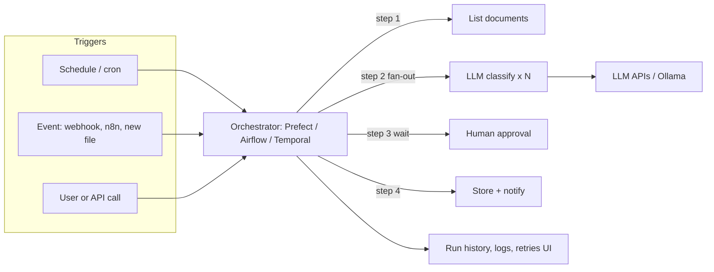
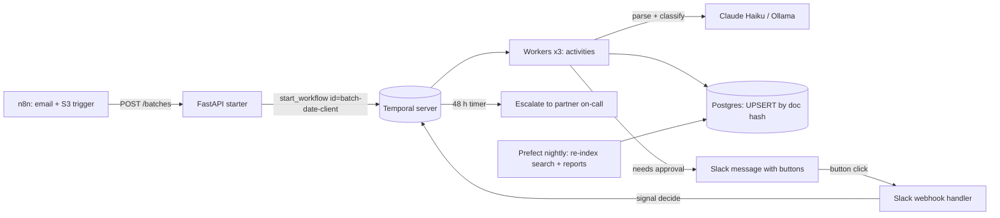

# 37 · Prefect, Airflow & Temporal

> **In one line:** When an AI automation grows into several steps that must retry, fan out, wait for a human and be inspectable after the fact, you stop writing glue and adopt an orchestrator: Prefect for Python-native flows, Airflow for scheduled data DAGs, Temporal for durable, long-running workflows that must never lose their place.

> **Versions used:** prefect 3.9 · temporalio (Python SDK) 1.36 · Temporal CLI dev server · apache-airflow 3.4 (Task SDK, `airflow.sdk`) · openai 3.x · python-dotenv 1.x · **Fast-moving:** Airflow 3 moved the authoring API to `airflow.sdk` and renamed Datasets to Assets, so 2.x tutorials are now misleading. Prefect 3 changed caching (cache policies) and deployments (`serve`/`deploy`, work pools) relative to 2.x. Temporal's Python SDK adds features each minor release (update handlers, Nexus, AI-agent integrations under `temporalio.contrib`); check the release notes before upgrading.

---

## 1. Overview

> **Builds on:** [Ch 36 · Cron, APScheduler & Celery + Redis](topic.html?p=36-scheduling-task-queues) (scheduling, idempotency, retries), [Ch 03 · Structured Outputs](topic.html?p=03-structured-outputs) (validating LLM JSON), [Ch 21 · Agent Patterns](topic.html?p=21-agent-patterns) (human-in-the-loop).

In Ch 36 a queue ran *tasks*. Real automations are *pipelines*: list new documents, extract text, classify each one with an LLM, hold big invoices for a human, store everything, notify Slack. With a queue you hand-roll the glue: which step finished, which failed, what to retry, where the half-done state lives after a deploy. An **orchestrator** owns that glue. You write the steps as plain Python functions and declare how they connect; the orchestrator records every run, retries failed steps, runs independent steps in parallel, and shows you a timeline of what happened.

Three tools dominate Python orchestration, and they solve different problems:

- **Prefect 3**: decorate ordinary functions with `@flow` and `@task`. Dynamic, Pythonic, good UI, light to run. Great for AI data pipelines and agent batch jobs.
- **Apache Airflow 3**: the long-standing standard for *scheduled* data pipelines (DAGs). Huge provider ecosystem (Snowflake, BigQuery, S3, dbt). Heavier to operate.
- **Temporal**: **durable execution**. Your workflow code survives process crashes, deploys and week-long waits because every step's result is persisted in an event history and replayed. Ideal for long-running agents, approvals and anything transactional.



Where this sits relative to Ch 36: Celery is the right tool for *many small independent tasks*. Move to an orchestrator when you need **multi-step dependencies, per-step retries, a run history UI, backfills, or waits measured in hours**. Many teams run both: Temporal or Prefect for the pipeline, with steps that enqueue bulk work.

---

## 2. Key Concepts

- **Task / activity**: one unit of work (an LLM call, a DB write). Prefect calls it a *task*, Airflow a *task* (an operator instance), Temporal an *activity*. This is where all I/O lives, and it may be **retried**, so it must be idempotent.
- **Flow / DAG / workflow**: the composition of steps. Prefect *flows* are ordinary Python with real control flow. Airflow *DAGs* are a graph defined up front and parsed by the scheduler. Temporal *workflows* are code that must be **deterministic**.
- **DAG (directed acyclic graph)**: steps plus dependencies with no cycles. Airflow is DAG-first. Prefect builds the graph dynamically as the code runs.
- **Dynamic mapping / fan-out**: run one step per item of a list discovered at runtime (`task.map(items)` in Prefect, `task.expand(x=items)` in Airflow, `asyncio.gather` of activities in Temporal).
- **Retries with backoff**: per-step policies. A failed LLM call retries only that step, not the whole pipeline.
- **Caching**: Prefect can skip a task whose inputs and source haven't changed (a cache key), saving repeat LLM calls.
- **Deployment**: a flow registered with a server so it can run on a schedule or on demand from the UI/API, executed by a **worker** (or `serve` process) on your infrastructure.
- **Durable execution** (Temporal): the server stores an **event history** of every activity result, timer and signal. If the worker dies, another worker **replays** the workflow code against the history, skipping completed steps, and continues exactly where it stopped. That's why workflow code must be deterministic: no `datetime.now()`, `random`, network calls or env reads in the workflow, only in activities (use `workflow.now()`, `workflow.uuid4()`).
- **Signal / query / update** (Temporal): send data into a running workflow (a human's approval), read its state, or do both synchronously.
- **Asset** (Airflow 3, formerly Dataset): a named piece of data a task produces; other DAGs can be scheduled to run when it updates.
- **Backfill / catchup**: re-run a schedule for past intervals. Airflow 3 defaults `catchup` to False.

> **Analogy:** Prefect is a project manager with a checklist who reruns failed items and keeps notes. Airflow is a train timetable: fixed routes, strict departure times, excellent at running the same lines every day. Temporal is a flight recorder plus autopilot: if the plane (process) goes down, a new one replays the recorder and continues the flight from the exact second it stopped.

How Temporal's durable execution survives a crash mid-pipeline:

```svg
<svg viewBox="0 0 880 340" width="100%" height="340" font-family="ui-sans-serif,system-ui,sans-serif" font-size="11" xmlns="http://www.w3.org/2000/svg">
  <defs><marker id="aa37a" viewBox="0 0 10 10" refX="9" refY="5" markerWidth="7" markerHeight="7" orient="auto"><path d="M0,0 L10,5 L0,10 z" fill="#334155"/></marker></defs>
  <text x="440" y="22" text-anchor="middle" font-size="14" font-weight="700" fill="#1e293b">Durable execution: the event history is the source of truth, workers are disposable</text>
  <rect x="300" y="45" width="280" height="190" rx="8" fill="#ede9fe" stroke="#7c3aed"/>
  <text x="440" y="66" text-anchor="middle" font-weight="700" fill="#1e293b">Temporal server: event history</text>
  <text x="315" y="90" fill="#334155">1  WorkflowStarted(threshold=10000)</text>
  <text x="315" y="108" fill="#334155">2  Activity list_documents → [3 paths]</text>
  <text x="315" y="126" fill="#334155">3  Activity classify(inv-2041) → {...}</text>
  <text x="315" y="144" fill="#334155">4  Activity classify(contract-9) → {...}</text>
  <text x="315" y="162" fill="#334155">5  Activity store(memo-17) → ok</text>
  <text x="315" y="180" fill="#7c3aed">6  Timer started: 48 h approval wait</text>
  <text x="315" y="198" fill="#16a34a">7  Signal decide(contract-9, true)</text>
  <text x="315" y="220" fill="#334155">... persisted, replicated, queryable</text>
  <rect x="20" y="60" width="220" height="90" rx="8" fill="#fee2e2" stroke="#dc2626"/>
  <text x="130" y="82" text-anchor="middle" font-weight="700" fill="#1e293b">Worker A</text>
  <text x="130" y="100" text-anchor="middle" fill="#334155">ran steps 1 to 6</text>
  <text x="130" y="118" text-anchor="middle" fill="#dc2626">crashes / is redeployed</text>
  <text x="130" y="136" text-anchor="middle" fill="#334155">in-memory state lost</text>
  <line x1="242" y1="100" x2="298" y2="120" stroke="#334155" stroke-width="1.5" marker-end="url(#aa37a)"/>
  <rect x="640" y="60" width="220" height="110" rx="8" fill="#dcfce7" stroke="#16a34a"/>
  <text x="750" y="82" text-anchor="middle" font-weight="700" fill="#1e293b">Worker B (new process)</text>
  <text x="750" y="100" text-anchor="middle" fill="#334155">replays workflow code</text>
  <text x="750" y="118" text-anchor="middle" fill="#334155">steps 2 to 5: results read</text>
  <text x="750" y="134" text-anchor="middle" fill="#334155">from history, NOT re-executed</text>
  <text x="750" y="154" text-anchor="middle" fill="#16a34a">continues at step 7 → store</text>
  <line x1="582" y1="140" x2="638" y2="115" stroke="#334155" stroke-width="1.5" marker-end="url(#aa37a)"/>
  <rect x="20" y="180" width="220" height="70" rx="8" fill="#dbeafe" stroke="#2563eb"/>
  <text x="130" y="202" text-anchor="middle" font-weight="700" fill="#1e293b">Human / Slack button</text>
  <text x="130" y="220" text-anchor="middle" fill="#334155">handle.signal(decide, ...)</text>
  <text x="130" y="236" text-anchor="middle" fill="#334155">hours or days later</text>
  <line x1="242" y1="210" x2="298" y2="198" stroke="#334155" stroke-width="1.5" marker-end="url(#aa37a)"/>
  <rect x="640" y="190" width="220" height="60" rx="8" fill="#fef3c7" stroke="#d97706"/>
  <text x="750" y="212" text-anchor="middle" font-weight="700" fill="#1e293b">Why determinism matters</text>
  <text x="750" y="230" text-anchor="middle" fill="#d97706">replay must take the same branches</text>
  <text x="750" y="244" text-anchor="middle" fill="#d97706">no now(), random, env, I/O in workflow</text>
  <rect x="20" y="270" width="840" height="52" rx="8" fill="#f8fafc" stroke="#94a3b8"/>
  <text x="440" y="292" text-anchor="middle" fill="#1e293b">Activities (LLM calls, DB writes) are at-least-once: they can retry, so key side effects by ID.</text>
  <text x="440" y="310" text-anchor="middle" fill="#334155">Workflows are exactly-once in effect: the history guarantees each recorded step's result is used once.</text>
</svg>
```

---

## 3. Setup

Install the two you can run locally in minutes. Airflow is heavier; give it its own virtualenv (its constraint files pin many packages).

```bash
pip install "prefect>=3.9,<4" "temporalio>=1.36,<2" "openai>=3,<4" "python-dotenv>=1" "ollama>=0.6"

# Temporal dev server (single binary, in-memory by default): https://docs.temporal.io/cli
brew install temporal              # or: curl -sSf https://temporal.download/cli.sh | sh
temporal server start-dev          # gRPC on localhost:7233, Web UI on http://localhost:8233

# Prefect UI/API (optional: flows also run against a temporary local server)
prefect server start               # UI on http://127.0.0.1:4200

# Airflow 3, separate venv, using the official constraints file for your Python version
python3.12 -m venv .venv-airflow && . .venv-airflow/bin/activate
AIRFLOW_VERSION=3.4.0; PY=3.12
pip install "apache-airflow==${AIRFLOW_VERSION}" \
  --constraint "https://raw.githubusercontent.com/apache/airflow/constraints-${AIRFLOW_VERSION}/constraints-${PY}.txt"
airflow standalone                 # dev only: DB, scheduler, API server + UI on :8080, prints admin password
```

Then the chapter's environment file:

```bash
# .env.example
LLM_BASE_URL=http://localhost:11434/v1     # Ollama (Ch 08); any OpenAI-compatible endpoint works
LLM_API_KEY=ollama                         # real keys come from a secrets manager in production (Ch 44)
LLM_MODEL=llama3.2
INBOX_DIR=inbox
DB_PATH=docs.db
APPROVAL_THRESHOLD=10000
FAKE_LLM=0                                 # 1 = deterministic offline classifier for tests
TEMPORAL_ADDRESS=localhost:7233
PREFECT_API_URL=http://127.0.0.1:4200/api  # omit to use a temporary local server
```

Create three sample documents so every example runs offline with `FAKE_LLM=1`:

```bash
mkdir -p inbox
echo "Invoice INV-2041 from Acme GmbH. Total due: EUR 12,400. Payment terms 30 days." > inbox/inv-2041.txt
echo "Contract renewal for Globex. Annual value USD 98,000. Signature required by Friday." > inbox/contract-9.txt
echo "Hi team, the March newsletter draft is attached for review." > inbox/memo-17.txt
```

> **Gotcha:** keep business logic **orchestrator-free**. The examples share one module, `pipeline_core.py`, and each orchestrator only wraps it. That makes the logic unit-testable and lets you switch orchestrators without rewriting the LLM code.

---

## 4. Code Examples

### Example 1: The shared business logic

Plain Python: list files, extract text, classify with an LLM through any OpenAI-compatible endpoint, upsert into SQLite. Note `max_retries=0` on the client: **the orchestrator owns retries**, so you don't multiply SDK retries by orchestrator retries.

```python
# pipeline_core.py — plain business logic, no orchestrator imports (reused by Prefect, Airflow and Temporal)
import json
import os
import pathlib
import re
import sqlite3

from dotenv import load_dotenv

load_dotenv()
INBOX = pathlib.Path(os.getenv("INBOX_DIR", "inbox"))
DB_PATH = os.getenv("DB_PATH", "docs.db")
SYSTEM = ('Classify the document. Reply with JSON only: {"type": "invoice|contract|other", '
          '"amount": number or null, "summary": "one sentence"}')


def list_documents() -> list[str]:
    return sorted(str(p) for p in INBOX.glob("*.txt"))      # PDFs: parse with Ch 20 tools first


def extract_text(path: str) -> str:
    return pathlib.Path(path).read_text(encoding="utf-8")[:8000]


def classify(text: str) -> dict:
    if os.getenv("FAKE_LLM") == "1":                         # deterministic offline stand-in
        kind = "invoice" if "invoice" in text.lower() else "contract" if "contract" in text.lower() else "other"
        m = re.search(r"(?:EUR|USD|GBP)\s?([\d,]+)", text)
        amount = float(m.group(1).replace(",", "")) if m else None
        return {"type": kind, "amount": amount, "summary": text.strip()[:60]}
    from openai import OpenAI                                # Ollama/any OpenAI-compatible endpoint (Ch 02)
    client = OpenAI(base_url=os.getenv("LLM_BASE_URL", "http://localhost:11434/v1"),
                    api_key=os.getenv("LLM_API_KEY", "ollama"), max_retries=0)   # orchestrator owns retries
    resp = client.chat.completions.create(
        model=os.getenv("LLM_MODEL", "llama3.2"), max_tokens=200,
        response_format={"type": "json_object"},
        messages=[{"role": "system", "content": SYSTEM}, {"role": "user", "content": text}])
    return json.loads(resp.choices[0].message.content)       # validate with Pydantic in real code (Ch 03)


def store(doc_id: str, result: dict, approved: bool | None = None) -> str:
    con = sqlite3.connect(DB_PATH)
    con.execute("CREATE TABLE IF NOT EXISTS docs (id TEXT PRIMARY KEY, data TEXT, approved INT)")
    con.execute("INSERT INTO docs VALUES (?,?,?) ON CONFLICT(id) DO UPDATE SET data=excluded.data, "
                "approved=excluded.approved", (doc_id, json.dumps(result), approved))   # idempotent upsert
    con.commit()
    con.close()
    return doc_id


def needs_approval(result: dict) -> bool:
    return (result.get("amount") or 0) >= float(os.getenv("APPROVAL_THRESHOLD", "10000"))


if __name__ == "__main__":
    os.environ.setdefault("FAKE_LLM", "1")
    for p in list_documents():
        r = classify(extract_text(p))
        print(pathlib.Path(p).stem, r["type"], r["amount"], "approval" if needs_approval(r) else "auto")
```

Output with `FAKE_LLM=1`:

```text
contract-9 contract 98000.0 approval
inv-2041 invoice 12400.0 approval
memo-17 other None auto
```

### Example 2: Prefect 3 flow with mapping, retries and caching

`@task` adds retries, caching and observability; `.map()` fans out one task run per document on a thread pool; the flow is plain Python, so `if`, loops and comprehensions just work.

```python
# prefect_pipeline.py — the document pipeline as a Prefect 3 flow
import os
from datetime import timedelta

from prefect import flow, task
from prefect.artifacts import create_table_artifact
from prefect.cache_policies import INPUTS, TASK_SOURCE
from prefect.tasks import exponential_backoff

import pipeline_core as core


@task
def list_documents() -> list[str]:
    return core.list_documents()


@task(retries=2, retry_delay_seconds=5)
def extract_text(path: str) -> str:
    return core.extract_text(path)


@task(retries=4, retry_delay_seconds=exponential_backoff(backoff_factor=2), retry_jitter_factor=0.5,
      cache_policy=TASK_SOURCE + INPUTS, cache_expiration=timedelta(days=7),
      tags=["llm"])                       # cache key = source + text: same content → no second LLM call
def classify(text: str) -> dict:
    return core.classify(text)


@task
def store(path: str, result: dict) -> str:
    return core.store(os.path.basename(path), result, approved=None if core.needs_approval(result) else True)


@flow(name="doc-pipeline", log_prints=True)
def doc_pipeline() -> list[dict]:
    paths = list_documents()
    texts = extract_text.map(paths)                       # fan out: one task run per document
    results = classify.map(texts)
    store.map(paths, results).wait()
    rows = [{"doc": os.path.basename(p), **r.result()} for p, r in zip(paths, results)]
    pending = [r["doc"] for r in rows if core.needs_approval(r)]
    print(f"processed {len(rows)} docs, {len(pending)} need approval: {pending}")
    create_table_artifact(key="doc-pipeline-results", table=rows, description="Classified documents")
    return rows


if __name__ == "__main__":
    doc_pipeline()
```

Run it with `FAKE_LLM=1 python prefect_pipeline.py`. Without `PREFECT_API_URL`, Prefect starts a temporary local server for the run. Real output from the first run (trimmed):

```text
INFO | prefect - Starting temporary server on http://127.0.0.1:8974
INFO | Flow run 'beige-dugong' - Beginning flow run 'beige-dugong' for flow 'doc-pipeline'
INFO | Task run 'classify-43e' - Finished in state Completed()
INFO | Task run 'classify-cdf' - Finished in state Completed()
INFO | Task run 'classify-e0f' - Finished in state Completed()
INFO | Flow run 'beige-dugong' - processed 3 docs, 2 need approval: ['contract-9.txt', 'inv-2041.txt']
INFO | Flow run 'beige-dugong' - Finished in state Completed()
```

And the second run, where the cache policy skips every LLM call because the inputs didn't change:

```text
INFO | Task run 'classify-518' - Finished in state Cached(type=COMPLETED)
INFO | Task run 'classify-889' - Finished in state Cached(type=COMPLETED)
INFO | Task run 'classify-b26' - Finished in state Cached(type=COMPLETED)
```

> **Why this matters:** caching keyed on the *input text* plus the *task source* means re-running a pipeline after a failure at step 4 doesn't pay for 5,000 LLM calls again, and editing the prompt in the task source invalidates the cache automatically. If the prompt lives in another module, add it to the task arguments so it's part of the key.

To cap how many LLM calls run at once across *all* flow runs, use a global concurrency limit (`prefect gcl create llm --limit 4`) and wrap the call:

```python
# llm_limited.py — a Prefect global concurrency limit around LLM calls (create it first: prefect gcl create llm --limit 4)
from prefect import task
from prefect.concurrency.sync import concurrency

import pipeline_core as core


@task(retries=3, retry_delay_seconds=10)
def classify_limited(text: str) -> dict:
    with concurrency("llm", occupy=1):        # blocks until one of the 4 slots is free, across all workers
        return core.classify(text)


if __name__ == "__main__":
    print(classify_limited.fn("Invoice INV-1 EUR 50"))   # .fn calls the raw function (no limit, no server)
```

### Example 3: Human approval inside a Prefect flow

`pause_flow_run(wait_for_input=...)` suspends the flow and renders a form in the Prefect UI from a Pydantic-style `RunInput` model. The reviewer fills it in and clicks Resume. Use `suspend_flow_run` instead for long waits: it releases the worker process entirely and re-runs the flow (with cached task results) after resume.

```python
# approval_flow.py — pause a Prefect flow until a human approves in the UI
from prefect import flow, get_run_logger
from prefect.flow_runs import pause_flow_run
from prefect.input import RunInput


class Approval(RunInput):
    approved: bool
    reviewer: str
    note: str = ""


@flow(name="invoice-approval")
def invoice_approval(invoice_id: str, amount: float) -> str:
    log = get_run_logger()
    if amount < 10_000:
        return "auto-approved"
    log.info("Invoice %s for %.2f needs approval: open the flow run in the UI and click Resume", invoice_id, amount)
    decision = pause_flow_run(wait_for_input=Approval, timeout=48 * 3600)   # raises if nobody answers in time
    log.info("%s decided approved=%s (%s)", decision.reviewer, decision.approved, decision.note)
    return "approved" if decision.approved else "rejected"


if __name__ == "__main__":
    print(invoice_approval("INV-2041", 12_400))
```

From code (a Slack button handler, say), resume it with `await resume_flow_run(flow_run_id, run_input={"approved": True, "reviewer": "dana"})` from `prefect.flow_runs`. Real output when resumed that way:

```text
INFO | Flow run 'prophetic-grouse' - Pausing flow, execution will continue when this flow run is resumed.
INFO | Flow run 'prophetic-grouse' - Resuming flow run execution!
INFO | Flow run 'prophetic-grouse' - dana decided approved=True ()
approved
```

### Example 4: Scheduling a Prefect flow

The simplest deployment is `serve`: a long-running process that registers a schedule and executes runs itself. For fleets, `flow.from_source(...).deploy(work_pool_name=...)` ships runs to Docker, Kubernetes or serverless work pools.

```python
# serve_pipeline.py — run doc_pipeline hourly from one long-lived process (needs a Prefect server: prefect server start)
from prefect import serve

from prefect_pipeline import doc_pipeline

if __name__ == "__main__":
    hourly = doc_pipeline.to_deployment(name="hourly", cron="0 * * * *", tags=["ai"])
    serve(hourly, limit=2)   # at most 2 concurrent runs from this process; Ctrl+C pauses the schedule
```

Trigger an ad-hoc run with `prefect deployment run 'doc-pipeline/hourly'`. A Docker work pool version is one call: `doc_pipeline.deploy(name="hourly", work_pool_name="docker-pool", image="registry.example.com/doc-pipeline:1.4", cron="0 * * * *")`, with secrets injected as environment variables by the pool, never baked into the image ([Ch 39](topic.html?p=39-deploy-docker-cicd)).

### Example 5: The same pipeline as an Airflow 3 DAG (TaskFlow API)

Airflow 3 authoring imports come from **`airflow.sdk`** (the Task SDK). `@task` functions pass return values through XCom, `.expand()` is dynamic task mapping, `max_active_tis_per_dag` caps parallel copies of a task, and `outlets=[Asset(...)]` marks data as updated so other DAGs can be scheduled on it.

```python
# dags/doc_pipeline_dag.py — the same pipeline as an Airflow 3 DAG (TaskFlow API)
import os
from datetime import datetime, timedelta

from airflow.sdk import Asset, dag, task

import pipeline_core as core      # put it next to the DAG or in an installed package

classified_docs = Asset(name="classified_docs", uri="file:///opt/data/docs.db")   # downstream DAGs can schedule on it


@dag(
    schedule="0 * * * *",                                # hourly; also "@daily", a timedelta, or [Asset(...)]
    start_date=datetime(2026, 11, 1),
    catchup=False,                                       # Airflow 3 default; don't backfill on first deploy
    max_active_runs=1,
    default_args={"retries": 3, "retry_delay": timedelta(seconds=30),
                  "retry_exponential_backoff": True, "max_retry_delay": timedelta(minutes=10)},
    tags=["ai", "documents"],
)
def doc_pipeline():
    @task
    def list_documents() -> list[str]:
        return core.list_documents()

    @task(max_active_tis_per_dag=4)                      # cap parallel LLM calls for this task
    def classify(path: str) -> dict:
        return {"doc": os.path.basename(path), **core.classify(core.extract_text(path))}

    @task(outlets=[classified_docs])                     # marks the asset as updated
    def store(results: list[dict]) -> dict:
        pending = []
        for r in results:
            approved = None if core.needs_approval(r) else True
            core.store(r["doc"], r, approved)
            if approved is None:
                pending.append(r["doc"])
        return {"processed": len(results), "pending_approval": pending}

    store(classify.expand(path=list_documents()))       # dynamic task mapping = fan-out per file


dag_object = doc_pipeline()

if __name__ == "__main__":
    dag_object.test()                                    # runs the whole DAG in-process, no scheduler needed
```

A downstream DAG that re-indexes search whenever new classifications land needs no cron at all: `@dag(schedule=[classified_docs], ...)`.

> **Version note:** this DAG follows the Airflow 3.4 docs (`from airflow.sdk import Asset, dag, task`, `.expand`, `max_active_tis_per_dag`, `Asset(name=, uri=)`, `dag.test()`). In Airflow 2.x the imports were `airflow.decorators` and `Dataset`. It was not executed for this chapter (Airflow isn't installed in the verification environment); run `python dags/doc_pipeline_dag.py` or `airflow dags test doc_pipeline` to check it against your install. XCom values should stay small: pass IDs and paths, not documents.

### Example 6: Temporal workflow with durable human approval

Two halves. **Activities** do I/O (LLM, DB) and may run more than once. The **workflow** only orchestrates: it calls activities, waits on timers and signals, and must be deterministic. Config arrives as workflow *input*, never from `os.getenv` inside workflow code.

```python
# temporal_pipeline.py — the document pipeline as a durable Temporal workflow with human approval
import asyncio
from dataclasses import dataclass
from datetime import timedelta

from temporalio import activity, workflow
from temporalio.common import RetryPolicy

with workflow.unsafe.imports_passed_through():           # non-deterministic libs are only used in activities
    import pipeline_core as core


# ---------- activities: all I/O and LLM calls live here (may run many times) ----------
@activity.defn
async def list_documents() -> list[str]:
    return core.list_documents()


@activity.defn
async def classify_document(path: str) -> dict:
    text = core.extract_text(path)
    return await asyncio.to_thread(core.classify, text)  # blocking SDK call off the event loop


@activity.defn
async def store_result(doc_id: str, result: dict, approved: bool | None) -> str:
    return core.store(doc_id, result, approved)


@dataclass
class PipelineInput:
    approval_threshold: float = 10_000          # config arrives as input: workflow code never reads env vars
    approval_timeout_hours: float = 48


@dataclass
class Decision:
    doc_id: str
    approved: bool


LLM_RETRY = RetryPolicy(initial_interval=timedelta(seconds=2), backoff_coefficient=2.0,
                        maximum_interval=timedelta(minutes=5), maximum_attempts=6,
                        non_retryable_error_types=["JSONDecodeError"])   # matched by class NAME, not subclass


# ---------- workflow: deterministic orchestration only ----------
@workflow.defn
class DocPipeline:
    def __init__(self) -> None:
        self.decisions: dict[str, bool] = {}
        self.pending: list[str] = []

    @workflow.signal
    def decide(self, decision: Decision) -> None:          # a human (Slack button, UI) sends this
        self.decisions[decision.doc_id] = decision.approved

    @workflow.query
    def pending_approvals(self) -> list[str]:
        return [d for d in self.pending if d not in self.decisions]

    @workflow.run
    async def run(self, params: PipelineInput) -> dict:
        paths = await workflow.execute_activity(list_documents, start_to_close_timeout=timedelta(seconds=30))
        results = await asyncio.gather(*[                  # fan out; Temporal records each result
            workflow.execute_activity(classify_document, p, start_to_close_timeout=timedelta(minutes=2),
                                      retry_policy=LLM_RETRY) for p in paths])
        summary: dict[str, list[str]] = {"auto": [], "approved": [], "rejected": [], "expired": []}
        held: dict[str, dict] = {}
        for path, result in zip(paths, results):
            doc_id = path.rsplit("/", 1)[-1]
            if (result.get("amount") or 0) >= params.approval_threshold:
                held[doc_id] = result
            else:
                await workflow.execute_activity(store_result, args=[doc_id, result, True],
                                                start_to_close_timeout=timedelta(seconds=30))
                summary["auto"].append(doc_id)
        self.pending = list(held)
        try:                                               # durable wait: hours or days, survives restarts
            await workflow.wait_condition(lambda: all(d in self.decisions for d in held),
                                          timeout=timedelta(hours=params.approval_timeout_hours))
        except asyncio.TimeoutError:
            pass                                           # undecided docs are marked expired below
        for doc_id, result in held.items():
            ok = self.decisions.get(doc_id)
            summary["expired" if ok is None else "approved" if ok else "rejected"].append(doc_id)
            await workflow.execute_activity(store_result, args=[doc_id, result, ok],
                                            start_to_close_timeout=timedelta(seconds=30))
        return summary
```

The worker process hosts the code. Run as many copies as you like; they share the `docs` task queue.

```python
# worker.py — hosts DocPipeline and its activities (run: python worker.py, with temporal server start-dev running)
import asyncio
import os

from dotenv import load_dotenv
from temporalio.client import Client
from temporalio.worker import Worker

from temporal_pipeline import DocPipeline, classify_document, list_documents, store_result


async def main() -> None:
    load_dotenv()
    client = await Client.connect(os.getenv("TEMPORAL_ADDRESS", "localhost:7233"),
                                  api_key=os.getenv("TEMPORAL_API_KEY"))     # None for the local dev server
    worker = Worker(client, task_queue="docs", workflows=[DocPipeline],
                    activities=[list_documents, classify_document, store_result],
                    max_concurrent_activities=4)                             # caps parallel LLM calls per worker
    print("worker listening on task queue 'docs'")
    await worker.run()


if __name__ == "__main__":
    asyncio.run(main())
```

A client starts runs, sends approvals and creates a schedule:

```python
# starter.py — start a run, approve a document, and register an hourly schedule
import asyncio
import os
import sys

from dotenv import load_dotenv
from temporalio.client import (Client, Schedule, ScheduleActionStartWorkflow, ScheduleOverlapPolicy,
                               SchedulePolicy, ScheduleSpec)

from temporal_pipeline import Decision, DocPipeline, PipelineInput


async def main(cmd: str) -> None:
    load_dotenv()
    client = await Client.connect(os.getenv("TEMPORAL_ADDRESS", "localhost:7233"))
    params = PipelineInput(approval_threshold=float(os.getenv("APPROVAL_THRESHOLD", "10000")))  # env read HERE
    if cmd == "start":
        handle = await client.start_workflow(DocPipeline.run, params, id="docs-manual-1", task_queue="docs")
        print("started", handle.id)
    elif cmd == "approve":
        handle = client.get_workflow_handle("docs-manual-1")
        print("pending:", await handle.query(DocPipeline.pending_approvals))
        await handle.signal(DocPipeline.decide, Decision(sys.argv[2], True))
    elif cmd == "schedule":
        await client.create_schedule("docs-hourly", Schedule(
            action=ScheduleActionStartWorkflow(DocPipeline.run, params, id="docs-hourly-run", task_queue="docs"),
            spec=ScheduleSpec(cron_expressions=["0 * * * *"]),
            policy=SchedulePolicy(overlap=ScheduleOverlapPolicy.SKIP)))     # never two runs at once
        print("schedule created")


if __name__ == "__main__":
    asyncio.run(main(sys.argv[1] if len(sys.argv) > 1 else "start"))
```

You can test all of it without a server using Temporal's **time-skipping test environment**, which also fast-forwards the 48-hour wait:

```python
# test_temporal.py — runs the workflow against Temporal's time-skipping test server (downloaded on first run)
import asyncio
import os
import uuid

from temporalio.testing import WorkflowEnvironment
from temporalio.worker import Worker

from temporal_pipeline import Decision, PipelineInput, DocPipeline, classify_document, list_documents, store_result


async def main() -> None:
    os.environ.setdefault("FAKE_LLM", "1")
    async with await WorkflowEnvironment.start_time_skipping() as env:
        async with Worker(env.client, task_queue="docs",
                          workflows=[DocPipeline], activities=[list_documents, classify_document, store_result]):
            handle = await env.client.start_workflow(DocPipeline.run, PipelineInput(), id=f"docs-{uuid.uuid4()}", task_queue="docs")
            await asyncio.sleep(1)
            print("pending:", await handle.query(DocPipeline.pending_approvals))
            await handle.signal(DocPipeline.decide, Decision("contract-9.txt", True))
            # no decision for inv-2041.txt: the test server skips 48 h of time instantly
            print("result:", await handle.result())


if __name__ == "__main__":
    asyncio.run(main())
```

Real output (the 48-hour timeout elapsed in under a second):

```text
pending: ['contract-9.txt', 'inv-2041.txt']
result: {'approved': ['contract-9.txt'], 'auto': ['memo-17.txt'], 'expired': ['inv-2041.txt'], 'rejected': []}
```

> **Gotcha:** the Temporal Python SDK runs workflow code in a **sandbox** that re-imports modules for each run and blocks obviously non-deterministic calls. `imports_passed_through()` tells it a module is safe to share. Never call `core.classify` or read the clock directly in `run()`; it would replay with different results. For LLM agents, Temporal also ships integrations under `temporalio.contrib` (OpenAI Agents SDK, LangGraph, Pydantic AI and others) that turn each model and tool call into an activity; check their maturity status before relying on them.

---

## 5. Real-World Use Case

**Company:** a 40-person accounting firm processing supplier documents for 120 clients. **Trigger:** documents land in a shared inbox and an S3 bucket via n8n ([Ch 09](topic.html?p=09-n8n-fundamentals)); n8n calls a small API that starts one Temporal workflow per batch. **Goal:** classify and extract every document, auto-file the routine ones, and hold anything over EUR 10,000 or any contract for a partner's approval in Slack, without ever losing a document across deploys.



**Numbers:**
- **Volume:** ~3,000 documents a day, ~1,500 input + 200 output tokens each: 4.5 M in, 0.6 M out per day.
- **Cost:** with a small hosted model at $0.10 / $0.50 per M tokens, about $0.45 + $0.30 = **~$0.75/day, ~$23/month** in LLM spend (check current pricing). Temporal self-hosted on one 4 vCPU VM with Postgres: ~$40/month; Temporal Cloud bills per action, so estimate from your step count with their calculator.
- **Latency:** classification p95 ~4 s per document; 3 workers × 4 concurrent activities clear the morning spike of 800 docs in ~5 minutes. Approvals take minutes to days, which costs nothing while waiting: a waiting workflow is a row in the database, not a running process.
- **Failure handling:** provider 429s retry inside the activity policy. A deploy mid-batch just replays on the new workers. Workflow IDs like `batch-2026-11-12-client42` plus `id_conflict_policy` make duplicate n8n triggers harmless.
- **Split of duties:** Temporal for the durable per-batch workflow with humans in it; a nightly Prefect flow for analytics and search re-indexing, where a failed run can simply be re-run.

---

## 6. Mini Project: Nightly Knowledge-Base Refresh with Prefect (1–2 hours)

**Goal:** a Prefect flow that discovers Markdown sources, chunks them, embeds each file's chunks with Ollama (cached so unchanged files cost nothing), upserts into SQLite, publishes a Markdown report artifact, and runs nightly via `serve`.

```text
kb-refresh/
├── .env
├── sources/
│   ├── policies.md
│   └── api-faq.md
└── kb_refresh.py
```

**Step 1: install and create sources.**

```bash
pip install "prefect>=3.9,<4" "ollama>=0.6" "python-dotenv>=1"
ollama pull nomic-embed-text
mkdir -p sources
printf 'Refunds are issued within 14 days of a return being received. Store credit is instant.\n\nShipping to the EU takes 3 to 5 business days. Express shipping is next day.\n' > sources/policies.md
printf 'Our API rate limit is 600 requests per minute per key.\n\nWebhooks retry 5 times with exponential backoff.\n' > sources/api-faq.md
```

**Step 2: configuration.**

```bash
# .env
KB_SOURCES=sources
KB_DB=kb.db
EMBED_MODEL=nomic-embed-text
FAKE_EMBED=0          # 1 = hash-based fake vectors, no Ollama needed
```

**Step 3: the flow.** Each stage is a task; `embed` carries the retries and the cache so a re-run after a crash, or a night with no changes, makes zero embedding calls. Chunk IDs are content hashes, so the upsert is idempotent.

```python
# kb_refresh.py — nightly knowledge-base refresh as a Prefect 3 flow
import hashlib
import json
import os
import pathlib
import sqlite3
from datetime import timedelta

from dotenv import load_dotenv
from prefect import flow, task
from prefect.artifacts import create_markdown_artifact
from prefect.cache_policies import INPUTS, TASK_SOURCE
from prefect.tasks import exponential_backoff

load_dotenv()
SOURCES = pathlib.Path(os.getenv("KB_SOURCES", "sources"))
DB_PATH = os.getenv("KB_DB", "kb.db")
EMBED_MODEL = os.getenv("EMBED_MODEL", "nomic-embed-text")


@task
def discover() -> list[str]:
    return sorted(str(p) for p in SOURCES.glob("*.md"))


@task
def chunk(path: str) -> list[dict]:
    text = pathlib.Path(path).read_text(encoding="utf-8")
    parts = [p.strip() for p in text.split("\n\n") if p.strip()]       # Ch 15 has better splitters
    return [{"id": hashlib.sha256(f"{path}:{p}".encode()).hexdigest()[:16],
             "source": os.path.basename(path), "text": p} for p in parts]


@task(retries=3, retry_delay_seconds=exponential_backoff(backoff_factor=2), retry_jitter_factor=0.5,
      cache_policy=TASK_SOURCE + INPUTS, cache_expiration=timedelta(days=30))
def embed(texts: list[str]) -> list[list[float]]:
    if os.getenv("FAKE_EMBED") == "1":                                   # offline, deterministic
        return [[b / 255 for b in hashlib.sha256(t.encode()).digest()[:8]] for t in texts]
    import ollama                                                        # Ch 05 / Ch 08
    return ollama.embed(model=EMBED_MODEL, input=texts).embeddings


@task
def upsert(chunks: list[dict], vectors: list[list[float]]) -> int:
    con = sqlite3.connect(DB_PATH)
    con.execute("CREATE TABLE IF NOT EXISTS kb (id TEXT PRIMARY KEY, source TEXT, text TEXT, vec TEXT)")
    con.executemany("INSERT INTO kb VALUES (?,?,?,?) ON CONFLICT(id) DO UPDATE SET vec=excluded.vec",
                    [(c["id"], c["source"], c["text"], json.dumps(v)) for c, v in zip(chunks, vectors)])
    con.commit()
    n = con.execute("SELECT COUNT(*) FROM kb").fetchone()[0]
    con.close()
    return n


@flow(name="kb-refresh", log_prints=True)
def kb_refresh() -> int:
    paths = discover()
    chunk_lists = chunk.map(paths).result()                               # one task run per file
    vectors = embed.map([[c["text"] for c in cl] for cl in chunk_lists])  # one cached batch per file
    totals = upsert.map(chunk_lists, vectors).result()
    total = max(totals, default=0)
    lines = [f"| {pathlib.Path(p).name} | {len(cl)} |" for p, cl in zip(paths, chunk_lists)]
    create_markdown_artifact(key="kb-refresh", markdown="| file | chunks |\n|---|---|\n" + "\n".join(lines)
                             + f"\n\n**Rows in index:** {total}")
    print(f"indexed {sum(map(len, chunk_lists))} chunks from {len(paths)} files; index has {total} rows")
    return total


if __name__ == "__main__":
    if os.getenv("SERVE") == "1":
        kb_refresh.serve(name="nightly", cron="0 2 * * *")               # long-running; Ctrl+C to stop
    else:
        kb_refresh()
```

**Step 4: run it twice.** First run embeds; the second hits the cache. Real output with `FAKE_EMBED=1`:

```text
INFO | Flow run 'magnetic-rottweiler' - indexed 4 chunks from 2 files; index has 4 rows
INFO | Task run 'embed-ba2' - Finished in state Cached(type=COMPLETED)
INFO | Task run 'embed-dec' - Finished in state Cached(type=COMPLETED)
INFO | Flow run 'discreet-rat' - indexed 4 chunks from 2 files; index has 4 rows
```

**Step 5: schedule it.** Start `prefect server start` in one terminal, set `PREFECT_API_URL=http://127.0.0.1:4200/api`, then `SERVE=1 python kb_refresh.py`. Open the UI, find the `kb-refresh/nightly` deployment, click **Run** for an ad-hoc run and open the `kb-refresh` artifact.

**Done when:**
- [ ] The first run indexes all chunks; the second shows `Cached` for every `embed` task.
- [ ] Editing one paragraph of `policies.md` re-embeds only that file.
- [ ] Stopping Ollama makes `embed` retry with backoff, then fail visibly in the UI, without partial garbage rows.
- [ ] The deployment appears in the UI with a 02:00 schedule and the artifact table shows per-file counts.

**Stretch goals:** swap SQLite for Chroma ([Ch 18](topic.html?p=18-vector-databases)); delete rows for chunks that disappeared; add an `on_failure` hook that posts to Slack; port the flow to a Temporal workflow and compare the code.

---

## 7. Comparison Table

| | Prefect 3 | Airflow 3 | Temporal | Celery (Ch 36) | n8n (Ch 09) |
|---|---|---|---|---|---|
| Model | Python flows + tasks, dynamic | DAG of tasks, parsed by scheduler | Durable workflow code + activities | Task queue | Visual workflow |
| Best at | AI/data pipelines, quick wins | Scheduled data/ETL with many integrations | Long-running, stateful, human-in-loop, transactional | High-volume independent tasks | Integrations, no-code teams |
| Dynamic fan-out | `.map()` | `.expand()` | `asyncio.gather` of activities | `group`/`chord` | Loop/split nodes |
| Retries | Per task | Per task | Per activity, policy object | Per task | Per node |
| Waits for humans (days) | `pause`/`suspend_flow_run` | Sensors / deferrable (awkward) | Signals + durable timers (native) | DIY | Wait node |
| Survives worker crash mid-flow | Task results persisted; flow reruns | Task-level retry | Yes, resumes at exact step | Task redelivery | Execution-level retry |
| Caching of results | Built-in cache policies | DIY | History holds results | Result backend | ❌ |
| Ops weight | Light (server + workers, or Cloud) | Heavy (scheduler, API server, DB, executor) | Medium-heavy (server + DB, or Cloud) | Light (broker) | Light |
| Code constraints | None | Top-level DAG code parsed often | Workflow code must be deterministic | None | n/a |

**When to use which:**
- **Python team, AI batch pipelines, want a UI and retries today:** Prefect.
- **Data platform team already on Airflow, scheduled ETL feeding AI (embeddings refresh, nightly evals):** Airflow, using Assets to chain pipelines.
- **Agents or processes that run for hours or days, wait on humans or external events, and must never double-charge or lose state:** Temporal.
- **Thousands of small independent LLM calls, no cross-step state:** Celery/RQ (Ch 36), possibly started from an orchestrator step.
- **Integrations and business-user ownership:** n8n, calling Python for the heavy steps ([Ch 12](topic.html?p=12-n8n-with-python)).
- **Agent loop logic itself** (graph of LLM decisions): LangGraph ([Ch 23](topic.html?p=23-langgraph-fundamentals)), optionally hosted inside a Temporal activity or Prefect task for durability around it.

---

## 8. Common Mistakes & Best Practices

**Mistake 1: non-determinism in Temporal workflow code.** Calling `datetime.now()`, `random`, an HTTP API or `os.getenv` inside `@workflow.run` works on the first run, then fails replay with a non-determinism error after a worker restart. *Fix:* move every side effect into an activity, use `workflow.now()` / `workflow.uuid4()`, pass config as workflow input.

```python
# before (breaks on replay)                     # after
#   if datetime.now().hour > 18: ...            #   if workflow.now().hour > 18: ...
#   thr = float(os.getenv("THRESHOLD"))         #   thr = params.approval_threshold
```

**Mistake 2: retries stacked three deep.** SDK `max_retries=2` × orchestrator `retries=4` × gateway retries = 15+ attempts and a surprise bill during an outage. *Fix:* pick one layer (usually the orchestrator) and set `max_retries=0` on the SDK client, as in `pipeline_core.py`.

**Mistake 3: passing documents through XCom or workflow history.** Airflow XCom lives in the metadata DB; Temporal history has payload size limits (warnings at hundreds of KB, hard limits in MB). *Fix:* pass IDs, paths or object-storage URLs; activities load the data.

**Mistake 4: non-idempotent tasks.** All three orchestrators retry, and Temporal activities are at-least-once. A retried "send email" step sends twice. *Fix:* upserts keyed by document hash, idempotency keys on external APIs, "already sent" checks.

**Mistake 5: heavy work at Airflow DAG top level.** The scheduler/DAG processor re-parses DAG files frequently. Importing pandas models or calling an API at module level slows every parse. *Fix:* only define structure at top level; do work inside `@task` functions.

**Mistake 6: unbounded fan-out against a rate-limited LLM.** `.map()` over 10,000 items fires as many calls as the runner allows. *Fix:* Prefect global concurrency limits, Airflow `max_active_tis_per_dag` or pools, Temporal `max_concurrent_activities` per worker, plus a shared rate limiter ([Ch 42](topic.html?p=42-reliability-cost)).

**Mistake 7: changing a running Temporal workflow's code carelessly.** Deploying a new step order breaks replay for in-flight workflows. *Fix:* use `workflow.patched("v2-step")` branches or worker versioning, and keep old code paths until old runs finish.

**Mistake 8: secrets in flow code or images.** *Fix:* environment variables injected by the work pool / Kubernetes secret / Airflow connection backend, or a Prefect `Secret` block, never literals ([Ch 44](topic.html?p=44-secrets-pii)).

**Best-practice checklist**
- [ ] Business logic in plain modules; orchestrator code is a thin wrapper.
- [ ] Every task/activity idempotent; side effects keyed by natural IDs.
- [ ] One retry layer with exponential backoff and jitter; non-retryable errors (validation, budget) fail fast.
- [ ] Explicit timeouts on every LLM step (`timeout_seconds`, `execution_timeout`, `start_to_close_timeout`).
- [ ] Concurrency caps sized to the provider's rate limit.
- [ ] Small payloads between steps: IDs, not documents.
- [ ] Prefect cache keys include the prompt/model so changing them invalidates results.
- [ ] Temporal workflows deterministic, tested with the time-skipping environment, versioned with `patched`.
- [ ] Alerts on failed runs; per-run cost recorded as an artifact, tag or search attribute.

---

## 9. Exercises

1. **Three ports.** Take a pipeline you have (or the Ch 36 nightly summary) and implement it in Prefect and Temporal. Count lines, note where each felt natural, and write a one-paragraph recommendation.
2. **Crash test.** Start the Temporal worker, start a workflow, kill the worker during the approval wait, restart it, send the signal and confirm the workflow completes without re-running classifications (check the event history in the Web UI).
3. **Cache invalidation.** In `prefect_pipeline.py`, move `SYSTEM` into a task argument and show that changing the prompt invalidates the cache while unchanged documents stay cached otherwise.
4. **Asset chaining.** In Airflow, add a second DAG scheduled on `classified_docs` that builds a daily report, and trigger it by running the first DAG.
5. **Rate-limit math.** Your provider allows 60 requests/minute and each classification takes ~3 s. Choose concurrency settings for each orchestrator so you never exceed the limit and compute the time to process 5,000 documents.

### Self-check questions

**Q: What does an orchestrator give you that a task queue like Celery does not?**
A: Multi-step structure with dependencies, per-step retries and caching, a persistent record of every run (inputs, outputs, logs, timings) with a UI, scheduling and backfills, and in Temporal's case durable state across crashes and long waits. A queue runs independent tasks well but leaves the glue between steps, and where partial progress lives, to you.

**Q: What is durable execution in Temporal?**
A: The Temporal server persists an event history of each workflow: activity results, timers, signals. Workers run the workflow code, and if a worker dies, another worker replays the code against the history, reusing recorded results instead of re-executing completed activities, then continues from where it stopped. The workflow effectively survives process crashes and deploys, and can wait for days at no compute cost.

**Q: Why must Temporal workflow code be deterministic, and where do LLM calls go?**
A: Replay re-executes the workflow function and matches each command it issues against the recorded history. If the code takes a different branch because of the clock, randomness or a network response, the commands no longer match and replay fails. LLM calls, database writes and any I/O go into activities, whose results are recorded; the workflow uses `workflow.now()`, `workflow.uuid4()` and inputs for anything variable.

**Q: How does Prefect's cache policy help an LLM pipeline?**
A: A cache policy like `TASK_SOURCE + INPUTS` computes a key from the task's code and arguments. If a completed result with that key exists and hasn't expired, the task returns it as `Cached` without running. Re-running a pipeline after a downstream failure, or nightly over mostly unchanged documents, skips the paid LLM calls, while editing the task code invalidates stale results automatically.

**Q: When would you choose Airflow over Prefect for an AI workload?**
A: When the organisation already runs Airflow, the work is scheduled batch data processing (embedding refreshes, nightly evals, feature pipelines) and you need its provider ecosystem for warehouses and cloud services, or Asset-based scheduling across many teams' DAGs. For a small team starting fresh with Python-heavy, dynamic AI pipelines, Prefect is usually lighter to operate and more natural to write.

**Q: A Temporal workflow fails with a non-determinism error after a deploy. What happened and how do you fix it? (Senior)**
A: The new code issues different commands than the history recorded for in-flight executions: a reordered or added activity, a changed branch condition, or a direct call to the clock or env. Fix by guarding changes with `workflow.patched("change-id")` so old executions follow the old path and new ones the new path (later `deprecate_patch` once old runs finish), or use worker versioning to pin old executions to old worker builds. Replay tests against saved histories catch this in CI before deploy.

**Q: How do you stop an orchestrated fan-out from blowing through a provider rate limit and budget? (Senior)**
A: Bound concurrency where the orchestrator schedules work (Prefect global concurrency limits, Airflow pools or `max_active_tis_per_dag`, Temporal `max_concurrent_activities` per worker times worker count), add a shared token-bucket limiter or LLM gateway so the limit holds across all processes, retry 429s in exactly one layer with backoff and jitter, and keep a per-run budget that raises a non-retryable error when exceeded. Record cost per run so alerts fire before the invoice does.

**Q: How would you implement a 48-hour human approval in each of the three tools? (Senior)**
A: Temporal: a signal handler records the decision and `workflow.wait_condition(..., timeout=48h)` waits durably, with no process held. Prefect: `suspend_flow_run(wait_for_input=Approval, timeout=...)` frees infrastructure and resumes the flow with cached task results when someone submits the form (or `pause_flow_run` for short waits). Airflow: split into two DAGs or use a deferrable sensor polling an approvals table, since DAG runs aren't designed to block for days; this awkwardness is a common reason to pick Temporal for approval-heavy processes.

---

## 10. Summary & Official Docs

- Use an **orchestrator** when automation becomes multi-step, long-running, needs per-step retries, history and humans in the loop.
- **Prefect 3**: `@flow`/`@task`, `.map()` fan-out, cache policies to avoid repeat LLM calls, `pause`/`suspend_flow_run` for approvals, `serve` or work pools to deploy.
- **Airflow 3**: `airflow.sdk` TaskFlow API, `.expand()` mapping, Assets for data-driven scheduling; best for scheduled data pipelines in teams that run it already.
- **Temporal**: durable execution via event history and replay; activities do I/O, workflows stay deterministic; signals, queries and durable timers make long waits free.
- Keep business logic orchestrator-free; one retry layer; idempotent steps; small payloads between steps.
- Cap concurrency to your provider's rate limit and track cost per run.

| Need | Pick |
|---|---|
| Python AI batch pipeline with UI, fast | Prefect |
| Scheduled ETL feeding AI, existing data platform | Airflow |
| Long-running agent, approvals, never lose state | Temporal |
| Many independent small tasks | Celery (Ch 36) |

**Official docs**
- Prefect: https://docs.prefect.io/
- Prefect caching: https://docs.prefect.io/v3/concepts/caching
- Apache Airflow: https://airflow.apache.org/docs/apache-airflow/stable/
- Airflow TaskFlow tutorial: https://airflow.apache.org/docs/apache-airflow/stable/tutorial/taskflow.html
- Airflow Assets: https://airflow.apache.org/docs/apache-airflow/stable/authoring-and-scheduling/assets.html
- Temporal docs: https://docs.temporal.io/
- Temporal Python SDK: https://docs.temporal.io/develop/python
- Temporal CLI dev server: https://docs.temporal.io/cli

**Next:** [Ch 38 · UIs for AI Apps: Streamlit, Gradio & Chainlit](topic.html?p=38-ai-uis): putting a face on these pipelines.

---

*AI Automation with Python Handbook — chapter 37.*
