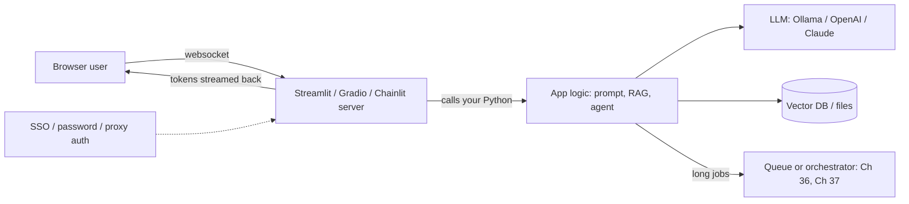
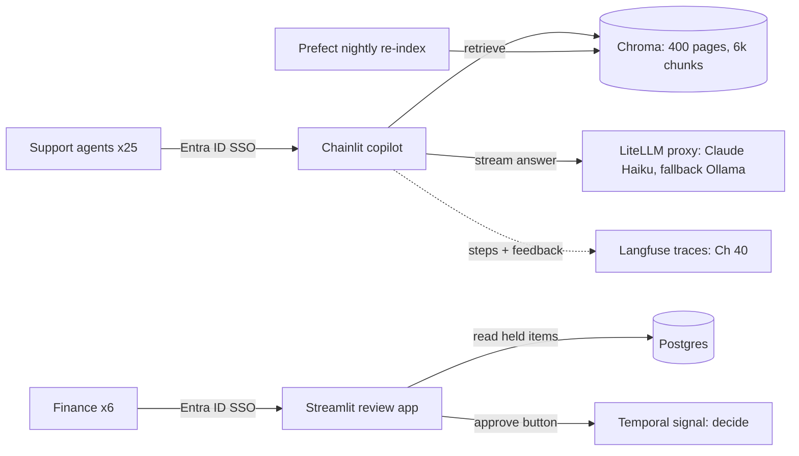

# 38 · UIs for AI Apps: Streamlit, Gradio & Chainlit

> **In one line:** Most automations eventually need a face: a chat box for the support team, an upload-and-review screen for finance, a demo for a stakeholder. Streamlit, Gradio and Chainlit turn a Python function into a web UI in under 50 lines; pick by what the UI is for (data app, model demo, or chat assistant) and add streaming, file upload, auth and hosting deliberately.

> **Versions used:** streamlit 1.67 · gradio 6.31 (+ gradio_client) · chainlit 2.12 · openai 3.x · python-dotenv 1.x · **Fast-moving:** all three ship minor releases every few weeks. Gradio 6 removed `ChatInterface(type=...)` (history is always the messages format) and defaults API endpoint names to the function name. Streamlit's chat input gained file and audio attachments and native OIDC login (`st.login`) recently. Chainlit's maintenance moved to the community in 2025, so check repository activity before betting a product on it.

---

## 1. Overview

> **Builds on:** [Ch 02 · Prompt Engineering](topic.html?p=02-prompt-engineering) (the `llm.py` helper), [Ch 08 · Local Models](topic.html?p=08-local-models) (Ollama), [Ch 16 · RAG Fundamentals](topic.html?p=16-rag-fundamentals) (retrieve, then answer with citations), [Ch 31 · Chat Bots](topic.html?p=31-chat-bots) (when the UI should be Slack or Teams instead).

You already build APIs. A UI framework for AI apps is a shortcut: you write Python, it renders the browser UI and handles the websocket plumbing for streaming tokens. The trade-off is control. These tools are perfect for internal tools, demos, review screens and MVPs. For a customer-facing product with brand design, you'll eventually put a React front end in front of your FastAPI service ([REST API handbook](../rest-api/topic.html?p=03-what-is-rest)).

The three frameworks have different centres of gravity:

- **Streamlit**: a *data app* framework. A script that reruns top to bottom on every interaction, with widgets, charts, tables and chat elements. Best when the AI part sits next to dataframes, charts and filters.
- **Gradio**: a *model demo* framework from Hugging Face. Components wired to functions; every event is also an API endpoint with a Python/JS client. Best for input → model → output demos and Hugging Face Spaces.
- **Chainlit**: a *conversational app* framework. Async event handlers (`on_message`), a polished ChatGPT-style UI, visible intermediate **steps** for agent reasoning and tool calls, auth and chat history persistence built in.



---

## 2. Key Concepts

- **Execution model**: how your code runs per user action. **Streamlit reruns the whole script** on every widget change; state you want to keep goes in `st.session_state`. **Gradio** calls an event handler function with component values and puts outputs back into components. **Chainlit** calls async decorated handlers (`@cl.on_message`) per event.
- **Session state**: per-browser-tab memory. `st.session_state`, Gradio's chat `history` argument and `gr.State`, Chainlit's `cl.user_session`. It lives in server memory: lost on restart, not shared between replicas, so anything important goes to a database.
- **Streaming**: the model yields tokens; the framework pushes them over a websocket. Streamlit: `st.write_stream(generator)`. Gradio: a generator that yields the *growing full string*. Chainlit: `await msg.stream_token(chunk)`.
- **Chat history format**: OpenAI-style `{"role": "user"|"assistant", "content": ...}` dicts everywhere. Gradio may put a list of strings and file dicts in `content` when files are attached; normalise before sending to a model.
- **File upload**: Streamlit gives you in-memory `UploadedFile` objects; Gradio saves to a temp dir and hands you a path; Chainlit gives `message.elements` with `.path`, `.name`, `.mime`. Always cap size and type.
- **Caching**: Streamlit's `st.cache_resource` (one shared object like a client or model) and `st.cache_data` (memoised data keyed by arguments). Without them the rerun model re-loads everything on each click.
- **Auth**: Streamlit `st.login()` (OIDC, configured in `secrets.toml`); Gradio `launch(auth=...)` or OAuth on Spaces; Chainlit `@cl.password_auth_callback`, `@cl.oauth_callback`, `@cl.header_auth_callback`. Behind a company proxy, header auth from the proxy is often simplest.
- **Concurrency**: one Python process serves all users. Blocking LLM calls tie up threads (Streamlit, Gradio) or the event loop (Chainlit, if you call sync code without `to_thread`). Gradio has a request **queue** with `concurrency_limit`.
- **Sharing**: Gradio `share=True` gives a temporary public tunnel; Hugging Face Spaces and Streamlit Community Cloud host public demos; anything internal goes in a container behind auth ([Ch 39](topic.html?p=39-deploy-docker-cicd)).

> **Analogy:** Streamlit is a notebook that became a web page: it re-reads the notebook top to bottom whenever you touch anything. Gradio is a vending machine: inputs in, function runs, outputs out, and the machine also has a back door (API) for other programs. Chainlit is a chat window with a glass back panel: users see the conversation and, if they want, the agent's steps behind it.

The three execution models side by side:

```svg
<svg viewBox="0 0 880 330" width="100%" height="330" font-family="ui-sans-serif,system-ui,sans-serif" font-size="11" xmlns="http://www.w3.org/2000/svg">
  <defs><marker id="aa38a" viewBox="0 0 10 10" refX="9" refY="5" markerWidth="7" markerHeight="7" orient="auto"><path d="M0,0 L10,5 L0,10 z" fill="#334155"/></marker></defs>
  <text x="440" y="22" text-anchor="middle" font-size="14" font-weight="700" fill="#1e293b">Same chat feature, three execution models</text>
  <rect x="15" y="40" width="275" height="230" rx="8" fill="#fee2e2" stroke="#dc2626"/>
  <text x="152" y="62" text-anchor="middle" font-weight="700" fill="#1e293b">Streamlit: rerun the script</text>
  <rect x="35" y="75" width="235" height="28" rx="5" fill="#ffffff" stroke="#94a3b8"/>
  <text x="152" y="93" text-anchor="middle" fill="#334155">user types → whole script runs again</text>
  <rect x="35" y="112" width="235" height="28" rx="5" fill="#ffffff" stroke="#94a3b8"/>
  <text x="152" y="130" text-anchor="middle" fill="#334155">redraw history from st.session_state</text>
  <rect x="35" y="149" width="235" height="28" rx="5" fill="#ffffff" stroke="#94a3b8"/>
  <text x="152" y="167" text-anchor="middle" fill="#334155">st.write_stream(generator)</text>
  <rect x="35" y="186" width="235" height="28" rx="5" fill="#ffffff" stroke="#94a3b8"/>
  <text x="152" y="204" text-anchor="middle" fill="#334155">append answer to session_state</text>
  <text x="152" y="236" text-anchor="middle" fill="#dc2626">cost: cache clients/models or they</text>
  <text x="152" y="252" text-anchor="middle" fill="#dc2626">reload on every click</text>
  <rect x="302" y="40" width="275" height="230" rx="8" fill="#fef3c7" stroke="#d97706"/>
  <text x="440" y="62" text-anchor="middle" font-weight="700" fill="#1e293b">Gradio: event → function</text>
  <rect x="322" y="75" width="235" height="28" rx="5" fill="#ffffff" stroke="#94a3b8"/>
  <text x="440" y="93" text-anchor="middle" fill="#334155">submit event enters the queue</text>
  <rect x="322" y="112" width="235" height="28" rx="5" fill="#ffffff" stroke="#94a3b8"/>
  <text x="440" y="130" text-anchor="middle" fill="#334155">fn(message, history) called</text>
  <rect x="322" y="149" width="235" height="28" rx="5" fill="#ffffff" stroke="#94a3b8"/>
  <text x="440" y="167" text-anchor="middle" fill="#334155">yield full text so far → re-render</text>
  <rect x="322" y="186" width="235" height="28" rx="5" fill="#ffffff" stroke="#94a3b8"/>
  <text x="440" y="204" text-anchor="middle" fill="#334155">same event = API endpoint /respond</text>
  <text x="440" y="236" text-anchor="middle" fill="#d97706">bonus: gradio_client calls it from</text>
  <text x="440" y="252" text-anchor="middle" fill="#d97706">Python, JS, or another app</text>
  <rect x="590" y="40" width="275" height="230" rx="8" fill="#ede9fe" stroke="#7c3aed"/>
  <text x="727" y="62" text-anchor="middle" font-weight="700" fill="#1e293b">Chainlit: async handlers</text>
  <rect x="610" y="75" width="235" height="28" rx="5" fill="#ffffff" stroke="#94a3b8"/>
  <text x="727" y="93" text-anchor="middle" fill="#334155">@cl.on_chat_start: init session</text>
  <rect x="610" y="112" width="235" height="28" rx="5" fill="#ffffff" stroke="#94a3b8"/>
  <text x="727" y="130" text-anchor="middle" fill="#334155">@cl.on_message(message)</text>
  <rect x="610" y="149" width="235" height="28" rx="5" fill="#ffffff" stroke="#94a3b8"/>
  <text x="727" y="167" text-anchor="middle" fill="#334155">@cl.step → visible tool/LLM step</text>
  <rect x="610" y="186" width="235" height="28" rx="5" fill="#ffffff" stroke="#94a3b8"/>
  <text x="727" y="204" text-anchor="middle" fill="#334155">await msg.stream_token(chunk)</text>
  <text x="727" y="236" text-anchor="middle" fill="#7c3aed">watch out: sync SDK calls block the</text>
  <text x="727" y="252" text-anchor="middle" fill="#7c3aed">event loop for every user</text>
  <line x1="152" y1="275" x2="152" y2="295" stroke="#334155" stroke-width="1.5" marker-end="url(#aa38a)"/>
  <line x1="440" y1="275" x2="440" y2="295" stroke="#334155" stroke-width="1.5" marker-end="url(#aa38a)"/>
  <line x1="727" y1="275" x2="727" y2="295" stroke="#334155" stroke-width="1.5" marker-end="url(#aa38a)"/>
  <rect x="15" y="298" width="850" height="26" rx="6" fill="#dbeafe" stroke="#2563eb"/>
  <text x="440" y="315" text-anchor="middle" fill="#1e293b">All three: state is in server memory per session, one process serves many users, tokens stream over a websocket.</text>
</svg>
```

---

## 3. Setup

Use a separate virtualenv per framework if you only need one; they pull large dependency trees (Gradio and Chainlit each bring FastAPI and friends).

```bash
pip install "streamlit>=1.67,<2" "openai>=3,<4" "python-dotenv>=1"
pip install "gradio>=6.31,<7"            # includes gradio_client
pip install "chainlit>=2.12,<3"
pip install "Authlib>=1.3.2"             # only for Streamlit st.login (OIDC)
ollama pull llama3.2                     # free local model (Ch 08)
```

Then the environment file:

```bash
# .env.example
LLM_BASE_URL=http://localhost:11434/v1   # Ollama; or https://api.openai.com/v1, Groq, OpenRouter, LiteLLM proxy
LLM_API_KEY=ollama                       # real keys: secrets manager / platform secrets, never in the repo
LLM_MODEL=llama3.2                       # check your provider's model list
SYSTEM_PROMPT=You are a concise, helpful assistant for an operations team.
FAKE_LLM=0                               # 1 = offline echo model for tests
APP_USER=ops                             # simple auth for internal demos
APP_PASSWORD=change-me
CHAINLIT_AUTH_SECRET=                    # generate with: chainlit create-secret
```

All three apps share one streaming helper. It speaks to any OpenAI-compatible endpoint (Ollama by default) and has an offline fake mode so you can test the UIs without a model:

```python
# llm_stream.py — one streaming helper shared by the Streamlit, Gradio and Chainlit apps
import os
import time
from collections.abc import Iterator

from dotenv import load_dotenv

load_dotenv()
SYSTEM = os.getenv("SYSTEM_PROMPT", "You are a concise, helpful assistant for an operations team.")


def stream_chat(messages: list[dict], max_tokens: int = 500) -> Iterator[str]:
    """Yield text chunks for an OpenAI-style message list (role/content dicts, no system message)."""
    if os.getenv("FAKE_LLM") == "1":                          # offline stand-in so UIs run without a model
        last = messages[-1]["content"] if messages else ""
        for word in f"(fake) You said: {last}".split(" "):
            time.sleep(0.02)
            yield word + " "
        return
    from openai import OpenAI                                 # Ollama or any OpenAI-compatible server (Ch 02, Ch 08)
    client = OpenAI(base_url=os.getenv("LLM_BASE_URL", "http://localhost:11434/v1"),
                    api_key=os.getenv("LLM_API_KEY", "ollama"))
    stream = client.chat.completions.create(
        model=os.getenv("LLM_MODEL", "llama3.2"), max_tokens=max_tokens, stream=True,
        messages=[{"role": "system", "content": SYSTEM}, *messages])
    for chunk in stream:
        if chunk.choices and chunk.choices[0].delta.content:
            yield chunk.choices[0].delta.content


if __name__ == "__main__":
    os.environ.setdefault("FAKE_LLM", "1")
    print("".join(stream_chat([{"role": "user", "content": "hello"}])))
```

> **Version note:** to use Claude instead, swap the body for `anthropic.Anthropic().messages.stream(model=os.getenv("CLAUDE_MODEL", "claude-opus-5-5"), max_tokens=..., system=SYSTEM, messages=...)` and yield from `stream.text_stream` (no `temperature`; see [Ch 06](topic.html?p=06-model-apis)). The UI code doesn't change.

---

## 4. Code Examples

### Example 1: Streamlit chat with streaming and file attachments

`st.chat_input(accept_file=True)` returns an object with `.text` and `.files`. History lives in `st.session_state` and is redrawn on every rerun.

```python
# streamlit_chat.py — a streaming chat app with history and file attachments (run: streamlit run streamlit_chat.py)
import streamlit as st

from llm_stream import stream_chat

st.set_page_config(page_title="Ops Assistant", page_icon="💬")
st.title("Ops Assistant")

with st.sidebar:
    max_tokens = st.slider("Max answer tokens", 100, 2000, 500, step=100)
    if st.button("New chat"):
        st.session_state.messages = []

if "messages" not in st.session_state:          # session_state survives reruns, one dict per browser tab
    st.session_state.messages = []

for msg in st.session_state.messages:           # the whole script reruns on every interaction: redraw history
    with st.chat_message(msg["role"]):
        st.markdown(msg["content"])

prompt = st.chat_input("Ask something or attach a .txt/.md file", accept_file=True, file_type=["txt", "md"])
if prompt:
    text = prompt.text or ""
    for f in prompt.files:                      # UploadedFile objects (in memory, max 200 MB by default)
        text += f"\n\n--- {f.name} ---\n" + f.getvalue().decode("utf-8", errors="replace")[:20_000]
    st.session_state.messages.append({"role": "user", "content": text})
    with st.chat_message("user"):
        st.markdown(prompt.text or f"📎 {', '.join(f.name for f in prompt.files)}")
    with st.chat_message("assistant"):
        answer = st.write_stream(stream_chat(st.session_state.messages, max_tokens=max_tokens))
    st.session_state.messages.append({"role": "assistant", "content": answer})
```

Streamlit ships a headless test harness, `AppTest`, so you can test UI logic in CI without a browser:

```python
# test_streamlit.py — drive the app headlessly with Streamlit's AppTest (no browser)
import os

from streamlit.testing.v1 import AppTest

os.environ["FAKE_LLM"] = "1"
at = AppTest.from_file("streamlit_chat.py", default_timeout=30).run()
at.chat_input[0].set_value("What is our refund window?").run()
at.chat_input[0].set_value("And for express orders?").run()
print("messages in state:", len(at.session_state.messages))
for m in at.session_state.messages:
    print(m["role"], "->", m["content"].strip())
assert not at.exception
```

Real output:

```text
messages in state: 4
user -> What is our refund window?
assistant -> (fake) You said: What is our refund window?
user -> And for express orders?
assistant -> (fake) You said: And for express orders?
```

### Example 2: Streamlit login with OIDC

For anything beyond a team demo, use your identity provider (Google, Microsoft Entra, Okta, Auth0). Streamlit's `st.login()` reads an `[auth]` section from `.streamlit/secrets.toml`:

```toml
# .streamlit/secrets.toml — gitignored; on a server, render it from your secrets manager at deploy time
[auth]
redirect_uri = "https://ops-assistant.example.com/oauth2callback"
cookie_secret = "generate-a-long-random-string"
client_id = "from-your-idp"
client_secret = "from-your-idp"
server_metadata_url = "https://accounts.google.com/.well-known/openid-configuration"
```

The app checks login first and authorisation second:

```python
# streamlit_login.py — gate the app behind OIDC login (needs Authlib and the [auth] secrets above)
import streamlit as st

if not st.user.is_logged_in:
    st.title("Ops Assistant")
    st.button("Log in with Google", on_click=st.login)
    st.stop()                                    # nothing below runs for anonymous users

ALLOWED_DOMAIN = "example.com"
if not str(st.user.email).endswith("@" + ALLOWED_DOMAIN):   # authentication is not authorisation
    st.error("This tool is for example.com staff only.")
    st.button("Log out", on_click=st.logout)
    st.stop()

st.sidebar.write(f"Signed in as {st.user.name}")
st.sidebar.button("Log out", on_click=st.logout)
st.write("…the chat app from Example 1 goes here…")
```

> **Gotcha:** `st.login` was not exercised end to end for this chapter (it needs a real identity provider). The `st.user` / `st.login` / `st.logout` API exists in Streamlit 1.67; check the authentication docs for provider-specific `[auth.<name>]` sections.

### Example 3: Gradio ChatInterface with multimodal input and streaming

`gr.ChatInterface` builds the whole chat UI around one function. With `multimodal=True`, `message` is `{"text": ..., "files": [paths]}`. Yield the growing answer to stream.

```python
# gradio_chat.py — streaming multimodal chat with Gradio 6 (run: python gradio_chat.py → http://127.0.0.1:7860)
import os
import pathlib

import gradio as gr

from llm_stream import stream_chat


def to_text(content) -> str:
    """Gradio history content can be a string or a list of strings / file dicts: flatten to text."""
    if isinstance(content, str):
        return content
    if isinstance(content, dict):
        return f"[file: {pathlib.Path(content.get('path', '')).name}]"
    if isinstance(content, (list, tuple)):
        return " ".join(to_text(c) for c in content)
    return str(content)


def respond(message: dict, history: list[dict]):
    """message = {"text": str, "files": [paths]}; history = [{"role", "content"}, ...]. Yield the growing answer."""
    text = message.get("text", "")
    for path in message.get("files", []):                    # files are already saved to a temp dir by Gradio
        p = pathlib.Path(path)
        if p.suffix in {".txt", ".md"}:
            text += f"\n\n--- {p.name} ---\n" + p.read_text(encoding="utf-8", errors="replace")[:20_000]
    messages = [{"role": m["role"], "content": to_text(m["content"])} for m in history]
    messages.append({"role": "user", "content": text})
    answer = ""
    for chunk in stream_chat(messages):
        answer += chunk
        yield answer                                          # Gradio streams by re-rendering the full string


demo = gr.ChatInterface(
    respond,
    multimodal=True,                                          # textbox with a file-attach button
    title="Ops Assistant",
    description="Ask a question or attach a .txt/.md file.",
    examples=[{"text": "Summarise our refund policy in 3 bullets"}],
    concurrency_limit=4,                                      # max simultaneous generations for this event
)

if __name__ == "__main__":
    user, pw = os.getenv("APP_USER"), os.getenv("APP_PASSWORD")
    demo.launch(
        server_name=os.getenv("HOST", "127.0.0.1"),          # 0.0.0.0 inside Docker
        auth=(user, pw) if user and pw else None,             # simple login page; use real SSO for production
        max_file_size="10mb",
        share=os.getenv("GRADIO_SHARE") == "1",               # temporary public *.gradio.live link (up to 1 week)
    )
```

Every Gradio event is also an API. Test the app the way another program would call it:

```python
# test_gradio.py — launch the app in-process and call it like any API client would
import os

os.environ["FAKE_LLM"] = "1"
from gradio_client import Client, handle_file  # noqa: E402

from gradio_chat import demo  # noqa: E402

demo.launch(prevent_thread_lock=True, server_port=7863, quiet=True)
client = Client("http://127.0.0.1:7863/", verbose=False)
with open("policy.md", "w", encoding="utf-8") as f:
    f.write("Refunds within 14 days.")
print(client.predict({"text": "Summarise this", "files": [handle_file("policy.md")]}, api_name="/respond"))
print(client.predict({"text": "Shorter please", "files": []}, api_name="/respond"))
demo.close()
```

Real output (the client keeps a session, so the second call's `history` contains the first turn):

```text
(fake) You said: Summarise this

--- policy.md ---
Refunds within 14 days.
(fake) You said: Shorter please
Closing server running on port: 7863
```

> **Version note:** in Gradio 6 the endpoint name defaults to the function name (`/respond`), and `ChatInterface` no longer takes `type="messages"` because that's the only format. Gradio 4/5 tutorials using `type="messages"` or tuple histories need updating. When a user message carried a file, its history `content` is a list like `[{"path": ...}, "text"]`, hence `to_text`.

### Example 4: Gradio Blocks for a review screen

Not everything is a chat. `gr.Blocks` lays out components freely. This upload → extract → review screen is the classic "human in the loop" UI for document automations:

```python
# gradio_extract.py — a Blocks layout: upload a document, get structured JSON, review it (run: python gradio_extract.py)
import json
import os
import pathlib
import re

import gradio as gr


def extract(path: str | None) -> tuple[dict, str]:
    if not path:
        raise gr.Error("Upload a .txt file first")            # shown as a toast in the UI
    text = pathlib.Path(path).read_text(encoding="utf-8", errors="replace")[:8000]
    if os.getenv("FAKE_LLM") == "1":                         # offline stand-in; real version: Ch 03 structured output
        m = re.search(r"(?:EUR|USD|GBP)\s?([\d,]+)", text)
        data = {"type": "invoice" if "invoice" in text.lower() else "other",
                "amount": float(m.group(1).replace(",", "")) if m else None}
    else:
        from openai import OpenAI
        client = OpenAI(base_url=os.getenv("LLM_BASE_URL", "http://localhost:11434/v1"),
                        api_key=os.getenv("LLM_API_KEY", "ollama"))
        resp = client.chat.completions.create(
            model=os.getenv("LLM_MODEL", "llama3.2"), max_tokens=200, response_format={"type": "json_object"},
            messages=[{"role": "system", "content": 'Return JSON: {"type": "invoice|contract|other", "amount": number|null}'},
                      {"role": "user", "content": text}])
        data = json.loads(resp.choices[0].message.content)
    status = "⚠️ needs approval" if (data.get("amount") or 0) >= 10_000 else "✅ auto-approve"
    return data, status


with gr.Blocks(title="Document extractor") as demo:
    gr.Markdown("## Document extractor\nUpload a document; review the extracted fields before filing.")
    with gr.Row():
        with gr.Column():
            doc = gr.File(label="Document (.txt)", file_types=[".txt"], type="filepath")
            run = gr.Button("Extract", variant="primary")
        with gr.Column():
            out = gr.JSON(label="Extracted fields")
            badge = gr.Markdown()
    run.click(extract, inputs=doc, outputs=[out, badge], api_name="extract")

if __name__ == "__main__":
    demo.launch()
```

Calling `/extract` with an invoice for EUR 12,400 through `gradio_client` returned:

```text
({'type': 'invoice', 'amount': 12400.0}, '⚠️ needs approval')
```

### Example 5: Chainlit with steps, file upload and password auth

Chainlit handlers are async. Uploaded files arrive as `message.elements` (enable or restrict them under `[features.spontaneous_file_upload]` in the generated `.chainlit/config.toml`). `@cl.step` shows a collapsible step in the UI: perfect for exposing tool calls and retrieval in an agent.

```python
# app.py — Chainlit chat with streaming, visible steps, file upload and password auth (run: chainlit run app.py -w)
import asyncio
import hmac
import os
import pathlib

import chainlit as cl

from llm_stream import stream_chat


@cl.password_auth_callback                                  # enabling auth requires CHAINLIT_AUTH_SECRET (chainlit create-secret)
def auth_callback(username: str, password: str) -> cl.User | None:
    expected = os.getenv("APP_PASSWORD", "")
    if username == os.getenv("APP_USER") and expected and hmac.compare_digest(password, expected):
        return cl.User(identifier=username, metadata={"role": "ops"})
    return None                                              # replace with your IdP / OAuth in production


@cl.on_chat_start
async def start() -> None:
    cl.user_session.set("history", [])                       # per-connection memory
    user = cl.user_session.get("user")
    name = user.identifier if user else "there"
    await cl.Message(content=f"Hi {name}! Ask a question or drop a .txt/.md file into the chat.").send()


@cl.step(type="tool", name="read_attachments")
async def read_attachments(elements: list) -> str:
    """Shows up as a collapsible step in the UI, with its input and output."""
    parts = []
    for el in elements:
        if el.path and pathlib.Path(el.path).suffix in {".txt", ".md"}:
            parts.append(f"--- {el.name} ---\n" + pathlib.Path(el.path).read_text(encoding="utf-8")[:20_000])
    return "\n\n".join(parts)


@cl.on_message
async def on_message(message: cl.Message) -> None:
    history: list[dict] = cl.user_session.get("history")
    text = message.content
    if message.elements:                                     # files attached to this message
        text += "\n\n" + await read_attachments(message.elements)
    history.append({"role": "user", "content": text})

    reply = cl.Message(content="")
    gen = stream_chat(history)
    while (chunk := await asyncio.to_thread(next, gen, None)) is not None:   # sync generator off the event loop
        await reply.stream_token(chunk)
    await reply.send()
    history.append({"role": "assistant", "content": reply.content})
```

Booting it headless with auth on and probing the login endpoint (real output):

```text
$ chainlit run app.py --headless --port 18765
$ curl -s localhost:18765/auth/config
{"requireLogin":true,"passwordAuth":true,"headerAuth":false,"oauthProviders":[], ...}
$ curl -s -X POST -d 'username=ops&password=pw123' localhost:18765/login
{"success":true}
$ curl -s -X POST -d 'username=ops&password=bad' localhost:18765/login
{"detail":"credentialssignin"}
```

> **Why this matters:** `asyncio.to_thread(next, gen, None)` keeps a *synchronous* SDK stream from freezing the event loop, which would stall every other user's session. If your client is async (`AsyncOpenAI`, `AsyncAnthropic`), iterate it directly with `async for`.

### Example 6: Sharing and hosting in one glance

```bash
# Gradio: temporary public link from your laptop (demo only; anyone with the URL can use your model and key)
GRADIO_SHARE=1 python gradio_chat.py
# Gradio or Streamlit on Hugging Face Spaces: push the repo; set LLM_API_KEY etc. under Settings → Secrets
gradio deploy
# Streamlit Community Cloud: connect the GitHub repo in the web UI; paste secrets into the app's Secrets box
# Any of them in a container behind your SSO proxy (Ch 39):
streamlit run docqa.py --server.address 0.0.0.0 --server.port 8501 --server.headless true
chainlit run app.py --host 0.0.0.0 --port 8000 --headless
```

---

## 5. Real-World Use Case

**Company:** a 300-person e-commerce company. **Users:** 25 support agents and 6 finance reviewers. **Need:** an internal "policy copilot" that answers agents' questions from 400 policy pages with citations, plus a review screen where finance approves invoices the automation from [Ch 37](topic.html?p=37-workflow-orchestrators) held back.



**Numbers:**
- **Volume:** ~1,200 copilot questions a day (agents ask ~50 each). ~2,500 input tokens (retrieved context) + 250 output tokens each: 3 M in, 0.3 M out per day.
- **Cost:** at $0.10 / $0.50 per M tokens for a small model, about $0.30 + $0.15 = **~$0.45/day, ~$14/month** (check current pricing). Hosting: one 2 vCPU container for Chainlit, one for Streamlit, ~$30/month.
- **Latency:** retrieval ~80 ms, time to first token ~600 ms; streaming makes a 6-second answer feel immediate.
- **Impact:** average handle time down ~40 s per ticket where a policy lookup was needed; feedback thumbs feed the eval set ([Ch 41](topic.html?p=41-evaluation)).
- **Why two frameworks:** Chainlit for the conversational copilot (steps show agents which pages were used); Streamlit for the finance screen, which is tables, filters and a chart of held amounts with an approve button.

---

## 6. Mini Project: Policy Q&A App with Citations and Feedback in Streamlit (1–2 hours)

**Goal:** an internal Streamlit app where users upload policy documents (or use bundled samples), ask questions, get streamed answers grounded in cited passages, and give thumbs feedback that is logged for evaluation. Password-gated, tested headlessly.

```text
policy-qa/
├── .env
├── docs/
│   ├── refunds.md
│   └── shipping.md
├── llm_stream.py      # from Setup
├── retrieval.py
├── docqa.py
└── test_docqa.py
```

**Step 1: sample documents.**

```bash
mkdir -p docs
printf 'Refunds are issued within 14 days of receiving a return. Store credit is instant.\n\nExpress orders can be refunded only after the courier confirms the return.\n' > docs/refunds.md
printf 'Shipping to the EU takes 3 to 5 business days.\n\nExpress shipping is next business day for orders before 14:00.\n' > docs/shipping.md
```

**Step 2: a tiny retriever.** Keyword overlap keeps the project dependency-free; swap in Chroma and embeddings from [Ch 16](topic.html?p=16-rag-fundamentals) later.

```python
# retrieval.py — tiny keyword retriever so the UI runs without a vector DB (swap for Chroma, Ch 16/18)
import re
from dataclasses import dataclass

WORD = re.compile(r"[a-z0-9]+")
STOP = {"the", "a", "an", "is", "are", "of", "to", "for", "and", "or", "in", "on", "our", "what", "how", "can", "do"}


@dataclass
class Chunk:
    source: str
    text: str


def chunk_text(source: str, text: str) -> list[Chunk]:
    return [Chunk(source, p.strip()) for p in text.split("\n\n") if p.strip()]


def terms(s: str) -> set[str]:
    return {w for w in WORD.findall(s.lower()) if w not in STOP}


def top_k(question: str, chunks: list[Chunk], k: int = 3) -> list[Chunk]:
    q = terms(question)
    scored = sorted(chunks, key=lambda c: len(q & terms(c.text)), reverse=True)
    return [c for c in scored[:k] if q & terms(c.text)]


def build_prompt(question: str, hits: list[Chunk]) -> str:
    context = "\n\n".join(f"[{i + 1}] ({c.source}) {c.text}" for i, c in enumerate(hits))
    return (f"Answer using ONLY the sources below and cite them like [1]. If the answer is not there, say so.\n\n"
            f"Sources:\n{context}\n\nQuestion: {question}")


if __name__ == "__main__":
    cs = chunk_text("refunds.md", "Refunds take 14 days.\n\nExpress orders need courier confirmation.")
    print([c.text for c in top_k("how long do refunds take", cs)])
```

**Step 3: the app.** Note `st.cache_data` so chunking only reruns when the uploaded bytes change, the "no sources, no answer" guard, and `st.feedback` per turn.

```python
# docqa.py — internal document Q&A: upload, ask, streamed cited answers, feedback (run: streamlit run docqa.py)
import hmac
import json
import os
import pathlib
import time

import streamlit as st

from llm_stream import stream_chat
from retrieval import build_prompt, chunk_text, top_k

st.set_page_config(page_title="Policy Q&A", page_icon="📚", layout="wide")


def check_password() -> bool:
    """Shared-password gate for an internal tool. Use st.login (OIDC) for anything beyond a team demo."""
    expected = os.getenv("APP_PASSWORD")
    if not expected or st.session_state.get("authed"):
        return True
    pw = st.text_input("Password", type="password")
    if pw and hmac.compare_digest(pw, expected):
        st.session_state.authed = True
        st.rerun()
    elif pw:
        st.error("Wrong password")
    return False


@st.cache_data(show_spinner=False)                      # re-chunk only when the bytes change
def load_chunks(files: tuple[tuple[str, bytes], ...]) -> list:
    out = []
    for name, data in files:
        out += chunk_text(name, data.decode("utf-8", errors="replace"))
    return out


def log_feedback(question: str, answer: str, score: int | None) -> None:
    with open(os.getenv("FEEDBACK_LOG", "feedback.jsonl"), "a", encoding="utf-8") as f:
        f.write(json.dumps({"ts": time.time(), "q": question, "a": answer, "thumbs_up": score == 1}) + "\n")


if not check_password():
    st.stop()

st.title("📚 Policy Q&A")
with st.sidebar:
    uploads = st.file_uploader("Policy documents", type=["md", "txt"], accept_multiple_files=True)
    if uploads:
        files = tuple((u.name, u.getvalue()) for u in uploads)
    else:                                                # fall back to the bundled sample docs
        files = tuple((p.name, p.read_bytes()) for p in sorted(pathlib.Path(os.getenv("DOCS_DIR", "docs")).glob("*.md")))
    chunks = load_chunks(files)
    st.caption(f"{len(files)} files · {len(chunks)} chunks indexed")

st.session_state.setdefault("turns", [])                 # [{"q", "a", "sources"}]

for i, turn in enumerate(st.session_state.turns):
    with st.chat_message("user"):
        st.markdown(turn["q"])
    with st.chat_message("assistant"):
        st.markdown(turn["a"])
        with st.expander(f"Sources ({len(turn['sources'])})"):
            for n, s in enumerate(turn["sources"], 1):
                st.markdown(f"**[{n}] {s['source']}**: {s['text']}")
        score = st.feedback("thumbs", key=f"fb-{i}")
        if score is not None and not turn.get("logged"):
            log_feedback(turn["q"], turn["a"], score)
            turn["logged"] = True

if question := st.chat_input("Ask about our policies"):
    hits = top_k(question, chunks)
    with st.chat_message("user"):
        st.markdown(question)
    with st.chat_message("assistant"):
        if not hits:
            answer = "I couldn't find that in the uploaded documents."
            st.markdown(answer)
        else:
            with st.status("Searching documents…", expanded=False) as status:
                status.update(label=f"Found {len(hits)} relevant passages", state="complete")
            answer = st.write_stream(stream_chat([{"role": "user", "content": build_prompt(question, hits)}]))
    st.session_state.turns.append({"q": question, "a": answer,
                                   "sources": [{"source": h.source, "text": h.text} for h in hits]})
    st.rerun()                                           # redraw so the new turn gets its sources + feedback widget
```

**Step 4: a headless test.**

```python
# test_docqa.py — headless test of docqa.py with AppTest and the fake LLM
import os

from streamlit.testing.v1 import AppTest

os.environ.update(FAKE_LLM="1", APP_PASSWORD="letmein", FEEDBACK_LOG="feedback-test.jsonl")
at = AppTest.from_file("docqa.py", default_timeout=30).run()
assert at.text_input[0].label == "Password"
at.text_input[0].input("letmein").run()
print("caption:", at.caption[0].value)
at.chat_input[0].set_value("How long do refunds take?").run()
turn = at.session_state.turns[0]
print("sources:", [s["source"] for s in turn["sources"]])
print("answer starts:", turn["a"][:60].replace("\n", " "))
at.chat_input[0].set_value("Do you sell gift cards?").run()
print("no-hit answer:", at.session_state.turns[1]["a"])
assert not at.exception
```

Real output:

```text
caption: 2 files · 4 chunks indexed
sources: ['refunds.md']
answer starts: (fake) You said: Answer using ONLY the sources below and cit
no-hit answer: I couldn't find that in the uploaded documents.
```

**Step 5: run it for real.** `ollama serve` in one terminal, then `streamlit run docqa.py`, open http://localhost:8501, enter the password from `.env`, ask "How long do refunds take?" and expand **Sources**.

**Done when:**
- [ ] The password gate blocks the app until the right password is entered.
- [ ] Answers stream and cite `[1]`-style sources that match the expander.
- [ ] Questions with no matching passage get a refusal instead of a hallucinated answer.
- [ ] Thumbs clicks append lines to `feedback.jsonl`.
- [ ] `python test_docqa.py` passes without a model running.

**Stretch goals:** replace the retriever with Chroma + `nomic-embed-text`; swap the password gate for `st.login`; port the same app to Chainlit with a `@cl.step(type="retrieval")` showing the passages; containerise it with the Dockerfile from [Ch 39](topic.html?p=39-deploy-docker-cicd).

---

## 7. Comparison Table

| | Streamlit | Gradio | Chainlit | Custom (FastAPI + React) |
|---|---|---|---|---|
| Centre of gravity | Data apps + chat | Model demos, input → output | Chat assistants and agents | Anything |
| Execution model | Script reruns per interaction | Event handlers + queue | Async event handlers | Yours |
| Streaming | `st.write_stream` | Yield growing string | `stream_token` | SSE / websockets |
| File upload | `file_uploader`, chat attachments | `gr.File`, multimodal chat | Message attachments, `AskFileMessage` | DIY |
| Agent step visibility | `st.status`, expanders | Chatbot metadata/thoughts | First-class `@cl.step` | DIY |
| Auth | `st.login` (OIDC) | `auth=`, HF OAuth | Password, OAuth, header callbacks | Your IdP |
| Chat history persistence | DIY | DIY | Built-in data layer (DB) | DIY |
| Free hosting | Community Cloud, HF Spaces | HF Spaces, share links | Self-host | n/a |
| Auto API | ❌ | ✅ every event | ❌ | ✅ |
| Layout flexibility | Medium (columns, tabs) | Medium (Blocks rows/columns) | Low (chat-centred) | Full |
| Time to first app | Minutes | Minutes | Minutes | Days |

**When to use which:**
- **Internal tool mixing AI with tables, charts, filters and forms:** Streamlit.
- **A model or pipeline demo, a Hugging Face Space, or a UI that other programs also call as an API:** Gradio.
- **A chat assistant or agent where users should see tool calls and retrieval, with login and saved conversations:** Chainlit.
- **Customer-facing product, brand design, complex state, mobile:** a real front end on top of your FastAPI service; keep the framework apps for internal tools and prototypes.
- **Users live in Slack or Teams:** skip the web UI and build a bot ([Ch 31](topic.html?p=31-chat-bots)).
- **Business users building their own flows:** Flowise, Langflow or Dify have chat UIs built in ([Ch 11](topic.html?p=11-flowise-langflow-dify)).

---

## 8. Common Mistakes & Best Practices

**Mistake 1: expensive setup inside the Streamlit script body.** Creating a client, loading an embedding model or reading a vector index at top level re-runs on every keystroke. *Fix:* `@st.cache_resource` for shared objects, `@st.cache_data` for data.

```python
# before: reloads the model on every rerun        # after: loaded once per process
#   model = SentenceTransformer("all-MiniLM-L6-v2")  #   @st.cache_resource
#                                                    #   def get_model(): return SentenceTransformer("all-MiniLM-L6-v2")
```

**Mistake 2: `share=True` on a demo that holds a paid key.** The link is public; anyone who finds it spends your money and can see your prompts. *Fix:* share links only with local models or tight budgets; for colleagues use auth, a VPN or an SSO proxy; set a provider spend cap ([Ch 42](topic.html?p=42-reliability-cost)).

**Mistake 3: blocking the Chainlit event loop.** A sync `client.chat.completions.create` inside `async def on_message` freezes every session while one user waits. *Fix:* async clients or `asyncio.to_thread`.

**Mistake 4: keys in code or in `secrets.toml` committed to git.** *Fix:* `.env` and `.streamlit/secrets.toml` in `.gitignore`; platform secrets on Spaces/Community Cloud; a secrets manager in production ([Ch 44](topic.html?p=44-secrets-pii)).

**Mistake 5: trusting uploads.** A 2 GB file or a zip bomb kills the process; a PDF can carry prompt-injection text. *Fix:* type and size limits (`max_file_size`, `max_size_mb`, `file_type`), truncate extracted text, treat document content as untrusted input ([Ch 43](topic.html?p=43-prompt-injection-sandboxing)).

**Mistake 6: session state as the database.** Conversations vanish on restart and don't exist on the second replica behind a load balancer. *Fix:* persist conversations and feedback to a database (Chainlit's data layer, or your own table), and use sticky sessions when scaling out websocket apps.

**Mistake 7: authentication without authorisation.** Any Google account can log in to an `st.login` app configured for Google. *Fix:* check the email domain or group claim after login, as in Example 2.

**Mistake 8: no "I don't know" path.** A RAG UI that always answers invents policies. *Fix:* refuse when retrieval finds nothing and show sources with every answer.

**Best-practice checklist**
- [ ] Business logic in plain modules (`llm_stream.py`, `retrieval.py`), UI is a thin layer; tests run without a browser (`AppTest`, `gradio_client`).
- [ ] Streaming on for every LLM answer; time to first token under ~1 s.
- [ ] Auth + authorisation on every non-public app; secrets never in the repo or the image.
- [ ] Upload size/type limits and text truncation.
- [ ] Expensive objects cached; LLM calls not blocking other users.
- [ ] Conversations, feedback and costs persisted and traced ([Ch 40](topic.html?p=40-observability-langsmith-langfuse)).
- [ ] Concurrency limits sized to your provider's rate limit.

---

## 9. Exercises

1. **One app, three frameworks.** Port `docqa.py` to Gradio (`ChatInterface` with `additional_outputs` for the sources) and to Chainlit (sources as a `cl.Text` element on the reply). Compare line counts and what felt awkward.
2. **Stop button.** Add cancellation: Gradio's `ChatInterface` has a stop button by default; in Chainlit implement `@cl.on_stop` to stop your generator; in Streamlit, what happens to a running stream when the user clicks another widget?
3. **Persist conversations.** Store Streamlit chat history in SQLite keyed by a session ID in the URL query params (`st.query_params`) so a refresh doesn't lose the conversation.
4. **Load test.** Run the Gradio app with `concurrency_limit=2` and fire 10 simultaneous `gradio_client` requests from threads. Measure queue wait time and explain the result.
5. **Agent steps.** In Chainlit, wrap a tool-calling loop from [Ch 04](topic.html?p=04-function-calling) so each tool call is a nested `cl.Step` with its arguments and result.

### Self-check questions

**Q: Why do Streamlit apps need `st.session_state` and caching when other frameworks often don't?**
A: Streamlit re-executes the entire script from top to bottom on every interaction. Ordinary variables are recreated each time, so conversation history must live in `st.session_state` (per session) and expensive objects like clients, models and indexes must be wrapped in `st.cache_resource` or `st.cache_data`, otherwise they're rebuilt on every click.

**Q: How does streaming differ between the three frameworks?**
A: Streamlit takes a generator of chunks in `st.write_stream` and returns the full text at the end. Gradio expects your function to be a generator that yields the full answer so far on each step, and it re-renders the message. Chainlit has you create an empty `cl.Message` and `await msg.stream_token(chunk)` for each delta, then `send()` it.

**Q: What does Gradio give you that Streamlit and Chainlit don't?**
A: Every event listener is automatically exposed as an API endpoint (named after the function or `api_name`), with a Python and JavaScript client (`gradio_client`) and a generated API page. That makes a Gradio app both a UI and a callable service, which is also convenient for testing and for chaining Spaces.

**Q: When is Chainlit the better choice than Streamlit for an internal assistant?**
A: When the app is fundamentally a conversation, especially an agent: Chainlit's `@cl.step` shows tool calls and retrieval as collapsible steps, it has built-in password/OAuth/header auth, chat history persistence through its data layer, file attachments, starters and chat profiles. Streamlit wins when the assistant sits beside dataframes, charts and forms.

**Q: What are the risks of `launch(share=True)` and how do you mitigate them?**
A: It creates a public URL tunnelled to your machine, valid for up to a week. Anyone with the link can use the app, consuming your API credits and seeing outputs, and the app runs with your machine's access. Use it only for short demos with local models or capped keys, add `auth=`, and host real deployments behind SSO.

**Q: Your Chainlit app becomes unresponsive for everyone when one user asks a long question. Why, and how do you fix it? (Senior)**
A: Chainlit runs handlers on a single asyncio event loop. A synchronous SDK call or synchronous stream iteration inside `async def on_message` blocks that loop, so no other session can progress until it returns. Use the async client (`AsyncOpenAI`, `AsyncAnthropic`) with `async for`, or push sync work into a thread with `asyncio.to_thread`. Long jobs (minutes) should go to a queue or orchestrator, with the UI polling or receiving updates.

**Q: How would you deploy a Streamlit or Chainlit app for 200 employees with SSO and multiple replicas? (Senior)**
A: Containerise it, inject secrets at runtime from a secrets manager, and put it behind an identity-aware proxy or use the framework's OIDC/OAuth integration with an authorisation check on domain or group claims. Because sessions are websocket connections with in-memory state, enable sticky sessions on the load balancer, persist conversations and feedback to a database, cache shared resources per process, and add health checks, request tracing and rate limits per user. Model calls go through a gateway with budgets.

**Q: How do you test these UIs in CI without a browser or a paid model? (Senior)**
A: Keep business logic in plain modules with an offline fake LLM mode. For Streamlit use `streamlit.testing.v1.AppTest` to run the script, set widget values and assert on session state and rendered elements. For Gradio, launch with `prevent_thread_lock=True` and call endpoints via `gradio_client`. For Chainlit, unit-test handler logic separately and smoke-test the server boot and auth endpoints. Add a small eval set for answer quality against a real model in a separate, scheduled job ([Ch 41](topic.html?p=41-evaluation)).

---

## 10. Summary & Official Docs

- UI frameworks turn Python functions into web apps; use them for internal tools, review screens, demos and MVPs.
- **Streamlit** reruns the script: keep state in `st.session_state`, cache expensive objects, stream with `st.write_stream`, test with `AppTest`, log in with `st.login`.
- **Gradio** wires components to functions: `ChatInterface` (messages-only in v6), `Blocks` for custom layouts, every event is an API, `share=True` for temporary links.
- **Chainlit** is chat-first and async: `on_chat_start`, `on_message`, `stream_token`, `@cl.step`, built-in auth and persistence.
- Always: streaming, auth + authorisation, upload limits, secrets outside the code, conversations persisted outside memory.
- Hosting: Spaces and Community Cloud for public demos; containers behind SSO for internal tools ([Ch 39](topic.html?p=39-deploy-docker-cicd)).

| Building… | Pick |
|---|---|
| AI + dataframes/charts internal tool | Streamlit |
| Model demo / HF Space / UI that's also an API | Gradio |
| Chat assistant or agent with visible steps | Chainlit |
| Customer-facing product | FastAPI + your front end |

**Official docs**
- Streamlit: https://docs.streamlit.io/
- Streamlit chat elements: https://docs.streamlit.io/develop/api-reference/chat
- Streamlit authentication: https://docs.streamlit.io/develop/concepts/connections/authentication
- Gradio: https://www.gradio.app/docs
- Gradio ChatInterface guide: https://www.gradio.app/guides/creating-a-chatbot-fast
- Chainlit: https://docs.chainlit.io/
- Hugging Face Spaces: https://huggingface.co/docs/hub/spaces

**Next:** [Ch 39 · Deployment: Docker, Cloud/VPS Hosting & GitHub Actions](topic.html?p=39-deploy-docker-cicd): shipping these apps and services to production.

---

*AI Automation with Python Handbook — chapter 38.*
