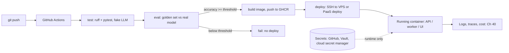
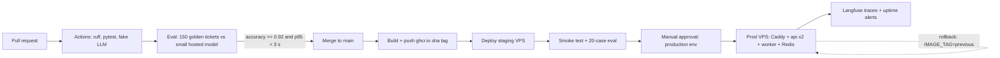

# 39 · Deployment: Docker, Cloud/VPS Hosting & GitHub Actions

> **In one line:** An AI automation is only useful once it runs somewhere reliable: package it as a small, non-root Docker image with no secrets inside, pick a host by workload shape (VPS, PaaS, serverless or GPU), inject keys at runtime, and let GitHub Actions test, **evaluate**, build and deploy every change.

> **Versions used:** Docker Engine/Desktop with BuildKit and Compose v2+ · python:3.13-slim base image · fastapi 0.150 · uvicorn 0.54 · pydantic-settings 2.16 · GitHub Actions: actions/checkout@v7, actions/setup-python@v7, actions/upload-artifact@v7, docker/setup-buildx-action@v4, docker/login-action@v4, docker/build-push-action@v7, appleboy/ssh-action@v1.2.5 (latest releases as of Nov 2026) · Caddy 2 · **Fast-moving:** GitHub Action major versions bump roughly yearly (check each action's releases page and pin by major or by commit SHA); PaaS free tiers and pricing change often; serverless GPU platforms (Modal, Cloud Run GPUs, RunPod) evolve monthly.

---

## 1. Overview

> **Builds on:** [Ch 36 · Cron, APScheduler & Celery + Redis](topic.html?p=36-scheduling-task-queues) (workers and schedulers to deploy), [Ch 37 · Prefect, Airflow & Temporal](topic.html?p=37-workflow-orchestrators), [Ch 38 · UIs for AI Apps](topic.html?p=38-ai-uis). Docker fundamentals live in the [Docker handbook](../docker/topic.html?p=05-dockerfile): this chapter only covers what is specific to AI services.

You have an API, a worker, maybe a Streamlit app. "Works on my laptop" has three AI-specific failure modes in production: the **API key** leaks (into git, an image layer or a log), the **model output quality** silently drops after a prompt or model change, and the **cost or latency** profile doesn't match the host (a 40-second LLM call on a 10-second serverless timeout). Deployment for AI services is ordinary DevOps plus three habits:

1. **Secrets at runtime, never at build time.** The image is public-safe; keys arrive as env vars or mounted files from a secrets store.
2. **Evals in the pipeline.** Unit tests use a fake model; a small golden set runs against the real model and blocks the deploy if accuracy drops ([Ch 41](topic.html?p=41-evaluation)).
3. **Host chosen by workload shape.** Long-lived, streaming or GPU work needs different hosting from bursty short requests.



---

## 2. Key Concepts

- **Image vs container**: the image is the immutable package (OS libs, venv, code); a container is a running instance with **runtime config** (env vars, mounted secrets, volumes). Same image in staging and production; only config differs.
- **Multi-stage build**: build dependencies in one stage, copy only the virtualenv and code into a slim runtime stage. Smaller images, fewer CVEs, faster deploys.
- **Layer caching**: copy `requirements.txt` and install before copying code, so code edits don't reinstall dependencies.
- **Non-root user, healthcheck, `.dockerignore`**: the three lines everyone forgets. `.dockerignore` keeps `.env`, `.git` and test data out of the build context.
- **Secrets**: keys are injected at runtime as environment variables (PaaS, CI) or as files (`/run/secrets/...` with Docker Compose secrets or Kubernetes). Build-time secrets (a private package index token) use BuildKit `--mount=type=secret`, which never lands in a layer.
- **Registry**: where images live (GitHub Container Registry `ghcr.io`, Docker Hub, ECR, Artifact Registry). Tag with the git SHA, not only `latest`, so you can roll back.
- **Hosting shapes**: a **VPS** (you run Docker on a Linux box), a **PaaS** (Render, Railway, Fly.io: push an image, they run it), **serverless containers/functions** (Cloud Run, Lambda: scale to zero, per-request billing, timeouts), **GPU platforms** (Modal, RunPod, cloud GPU VMs) for self-hosted models.
- **Reverse proxy**: Caddy, Nginx or Traefik terminates HTTPS and forwards to the app. Caddy gets Let's Encrypt certificates automatically.
- **CI/CD**: CI runs checks on every push and PR; CD builds and deploys from `main`. **Environments** in GitHub Actions add protected secrets and manual approval gates.
- **Eval gate**: a pipeline step that runs a golden dataset through the real model and fails the job below a threshold. It's the AI equivalent of an integration test.
- **Health checks and rollback**: `/healthz` for liveness, a deploy step that waits for health and keeps the previous tag ready.

> **Analogy:** the image is a sealed lunchbox prepared in the kitchen (CI). The key to the building (API key) is never packed in the lunchbox; security hands it to the employee at the door (runtime secrets). The eval gate is the taste test before the lunchbox leaves the kitchen.

What goes where, and what must never be in the image:

```svg
<svg viewBox="0 0 880 330" width="100%" height="330" font-family="ui-sans-serif,system-ui,sans-serif" font-size="11" xmlns="http://www.w3.org/2000/svg">
  <defs><marker id="aa39a" viewBox="0 0 10 10" refX="9" refY="5" markerWidth="7" markerHeight="7" orient="auto"><path d="M0,0 L10,5 L0,10 z" fill="#334155"/></marker></defs>
  <text x="440" y="22" text-anchor="middle" font-size="14" font-weight="700" fill="#1e293b">Build time vs run time: the image is shareable, secrets arrive only at run time</text>
  <rect x="15" y="40" width="250" height="250" rx="8" fill="#dbeafe" stroke="#2563eb"/>
  <text x="140" y="62" text-anchor="middle" font-weight="700" fill="#1e293b">Build stage</text>
  <text x="30" y="86" fill="#334155">FROM python:3.13-slim AS build</text>
  <text x="30" y="104" fill="#334155">COPY requirements.txt</text>
  <text x="30" y="122" fill="#334155">pip install into /opt/venv</text>
  <text x="30" y="140" fill="#334155">(compilers, headers, pip cache)</text>
  <text x="30" y="170" fill="#2563eb">optional build secret:</text>
  <text x="30" y="188" fill="#2563eb">--mount=type=secret,id=pip_token</text>
  <text x="30" y="206" fill="#2563eb">exists only during that RUN</text>
  <text x="30" y="240" fill="#dc2626">never: COPY .env, ARG API_KEY,</text>
  <text x="30" y="258" fill="#dc2626">ENV OPENAI_API_KEY=sk-...</text>
  <line x1="267" y1="150" x2="313" y2="150" stroke="#334155" stroke-width="1.5" marker-end="url(#aa39a)"/>
  <text x="290" y="140" text-anchor="middle" fill="#334155">venv</text>
  <rect x="315" y="40" width="250" height="250" rx="8" fill="#dcfce7" stroke="#16a34a"/>
  <text x="440" y="62" text-anchor="middle" font-weight="700" fill="#1e293b">Runtime image (pushed to GHCR)</text>
  <text x="330" y="86" fill="#334155">python:3.13-slim + /opt/venv</text>
  <text x="330" y="104" fill="#334155">app/ code only (.dockerignore)</text>
  <text x="330" y="122" fill="#334155">USER app (uid 10001)</text>
  <text x="330" y="140" fill="#334155">HEALTHCHECK /healthz</text>
  <text x="330" y="158" fill="#334155">APP_VERSION=sha-1a2b3c4</text>
  <text x="330" y="190" fill="#16a34a">safe to share: no keys,</text>
  <text x="330" y="208" fill="#16a34a">no customer data, no .git</text>
  <text x="330" y="240" fill="#334155">~150-250 MB for an API</text>
  <text x="330" y="258" fill="#334155">GBs if you bundle torch/models</text>
  <line x1="567" y1="150" x2="613" y2="150" stroke="#334155" stroke-width="1.5" marker-end="url(#aa39a)"/>
  <text x="590" y="140" text-anchor="middle" fill="#334155">run</text>
  <rect x="615" y="40" width="250" height="250" rx="8" fill="#fef3c7" stroke="#d97706"/>
  <text x="740" y="62" text-anchor="middle" font-weight="700" fill="#1e293b">Running container</text>
  <text x="630" y="86" fill="#334155">env: LLM_BASE_URL, LLM_MODEL</text>
  <text x="630" y="104" fill="#334155">file: /run/secrets/llm_api_key</text>
  <text x="630" y="122" fill="#334155">or env from secret manager</text>
  <text x="630" y="140" fill="#334155">volume: model weights, data</text>
  <text x="630" y="170" fill="#d97706">sources of secrets:</text>
  <text x="630" y="188" fill="#334155">GitHub env secrets → SSH deploy</text>
  <text x="630" y="206" fill="#334155">fly secrets / Render env groups</text>
  <text x="630" y="224" fill="#334155">Cloud Run --set-secrets</text>
  <text x="630" y="242" fill="#334155">Vault / AWS Secrets Manager</text>
  <rect x="15" y="298" width="850" height="26" rx="6" fill="#ede9fe" stroke="#7c3aed"/>
  <text x="440" y="315" text-anchor="middle" fill="#1e293b">Rotate a key = update the secret store + restart. Rebuilding an image to change a key means the key was in the wrong place.</text>
</svg>
```

---

## 3. Setup

```bash
# local tools
docker --version && docker compose version     # Docker Desktop or Engine with the compose plugin
pip install -r requirements-dev.txt             # fastapi, uvicorn, pydantic-settings, openai, pytest, ruff
```

The runtime dependencies, pinned to compatible ranges:

```text
# requirements.txt
fastapi>=0.150,<1
uvicorn[standard]>=0.54,<1
pydantic>=2.12,<3
pydantic-settings>=2.16,<3
openai>=3,<4
```

Then the environment file for local development:

```bash
# .env.example — local development only; production values come from the host's secret store
LLM_BASE_URL=http://localhost:11434/v1   # Ollama locally; a hosted OpenAI-compatible endpoint in prod
LLM_MODEL=llama3.2                       # check your provider's model list
LLM_API_KEY=ollama                       # real key: secrets manager / platform secrets, never committed
FAKE_LLM=0                               # 1 for tests and CI unit jobs
APP_VERSION=dev
```

Add `.env`, `secrets/` and `*.pem` to both `.gitignore` and `.dockerignore`. `pydantic-settings` reads `.env` in development; in containers there is no `.env` file, only real environment variables and mounted secrets.

---

## 4. Code Examples

### Example 1: A small AI service worth deploying

Typed settings first. `read_secret` checks the environment, then a mounted secret file, so the same code works on a PaaS (env vars), in Compose/Kubernetes (files) and in CI.

```python
# app/settings.py — typed config from env vars, with Docker/K8s secret files as a fallback
import os
import pathlib

from pydantic import Field
from pydantic_settings import BaseSettings, SettingsConfigDict


def read_secret(name: str) -> str | None:
    """Env var first (PaaS, CI); else a mounted file like /run/secrets/llm_api_key (Docker/K8s secrets)."""
    if value := os.getenv(name.upper()):
        return value
    path = pathlib.Path(os.getenv("SECRETS_DIR", "/run/secrets")) / name.lower()
    return path.read_text().strip() if path.exists() else None


class Settings(BaseSettings):
    model_config = SettingsConfigDict(env_file=".env", extra="ignore")   # .env only for local dev
    llm_base_url: str = "http://localhost:11434/v1"
    llm_model: str = "llama3.2"
    fake_llm: bool = False
    max_input_chars: int = Field(8000, ge=100)
    app_version: str = "dev"                                              # set at build time

    @property
    def llm_api_key(self) -> str:
        return read_secret("llm_api_key") or "ollama"                     # Ollama ignores the key


settings = Settings()
```

The service: a ticket classifier with a validated output schema, a liveness endpoint that never calls the LLM, structured JSON logs and a `FAKE_LLM` path for tests.

```python
# app/main.py — a small AI service worth deploying: classify a support ticket (run: uvicorn app.main:app)
import json
import logging
import time
from typing import Literal

from fastapi import FastAPI, HTTPException
from pydantic import BaseModel, Field, ValidationError

from app.settings import settings

logging.basicConfig(level=logging.INFO, format='{"ts":"%(asctime)s","level":"%(levelname)s","msg":%(message)s}')
log = logging.getLogger("ticket-api")
app = FastAPI(title="ticket-classifier", version=settings.app_version)

SYSTEM = ('Classify the support ticket. Reply with JSON only: '
          '{"category": "billing|bug|account|other", "urgent": true|false}')


class TicketIn(BaseModel):
    text: str = Field(min_length=3)


class TicketOut(BaseModel):
    category: Literal["billing", "bug", "account", "other"]
    urgent: bool


def classify(text: str) -> TicketOut:
    text = text[: settings.max_input_chars]
    if settings.fake_llm:                                   # deterministic stand-in for tests and CI
        t = text.lower()
        cat = ("billing" if any(w in t for w in ("charge", "invoice", "refund")) else
               "bug" if any(w in t for w in ("crash", "error", "broken")) else
               "account" if any(w in t for w in ("password", "login")) else "other")
        return TicketOut(category=cat, urgent=any(w in t for w in ("urgent", "asap", "down")))
    from openai import OpenAI
    client = OpenAI(base_url=settings.llm_base_url, api_key=settings.llm_api_key, timeout=30, max_retries=2)
    resp = client.chat.completions.create(
        model=settings.llm_model, max_tokens=60, response_format={"type": "json_object"},
        messages=[{"role": "system", "content": SYSTEM}, {"role": "user", "content": text}])
    return TicketOut.model_validate(json.loads(resp.choices[0].message.content))


@app.get("/healthz")
def healthz() -> dict:                                      # liveness: process is up (no LLM call here)
    return {"status": "ok", "version": settings.app_version}


@app.post("/classify", response_model=TicketOut)
def classify_ticket(ticket: TicketIn) -> TicketOut:
    start = time.perf_counter()
    try:
        result = classify(ticket.text)
    except (ValidationError, json.JSONDecodeError) as exc:
        raise HTTPException(status_code=502, detail="model returned invalid output") from exc
    log.info(json.dumps({"event": "classified", "category": result.category,
                         "ms": round((time.perf_counter() - start) * 1000)}))
    return result
```

Run it locally with `FAKE_LLM=1 APP_VERSION=1.4.0 uvicorn app.main:app --port 8000`. Real output:

```text
$ curl -s localhost:8000/healthz
{"status":"ok","version":"1.4.0"}
$ curl -s -X POST localhost:8000/classify -H 'content-type: application/json' -d '{"text":"site is down, urgent!! login error"}'
{"category":"bug","urgent":true}
# server log
{"ts":"2026-11-12 19:58:46,073","level":"INFO","msg":{"event": "classified", "category": "bug", "ms": 0}}
```

Fast offline tests that run on every push:

```python
# tests/test_api.py — fast, offline tests (FAKE_LLM=1): run on every push
import os

os.environ["FAKE_LLM"] = "1"
from fastapi.testclient import TestClient  # noqa: E402

from app.main import app  # noqa: E402

client = TestClient(app)


def test_health() -> None:
    assert client.get("/healthz").json()["status"] == "ok"


def test_classify_billing() -> None:
    r = client.post("/classify", json={"text": "I was charged twice, refund ASAP"})
    assert r.status_code == 200
    assert r.json() == {"category": "billing", "urgent": True}


def test_rejects_empty() -> None:
    assert client.post("/classify", json={"text": ""}).status_code == 422
```

Run them:

```text
$ pytest -q
...                                                                      [100%]
3 passed in 0.12s
```

### Example 2: An eval gate

Unit tests prove the plumbing; evals prove the *model + prompt* still does the job. Keep a small JSONL golden set in the repo (grow it from production failures and thumbs-down feedback) and fail the pipeline below a threshold.

```text
# evals/cases.jsonl
{"text": "I was charged twice for order 1182, please refund", "category": "billing"}
{"text": "The app crashes every time I open settings", "category": "bug"}
{"text": "I can't reset my password, the email never arrives", "category": "account"}
{"text": "Do you ship to Iceland?", "category": "other"}
{"text": "Invoice 2231 has the wrong VAT number", "category": "billing"}
{"text": "Error 500 when uploading a CSV", "category": "bug"}
{"text": "Please close my account and delete my data", "category": "account"}
```

The eval script loads them, scores each one and writes a JSON report for the CI artifact:

```python
# evals/run_evals.py — quality gate: fail the pipeline if accuracy drops below a threshold
import argparse
import json
import pathlib
import sys
import time

from app.main import classify


def main() -> int:
    ap = argparse.ArgumentParser()
    ap.add_argument("--cases", default="evals/cases.jsonl")
    ap.add_argument("--min-accuracy", type=float, default=0.85)
    ap.add_argument("--report", default="eval-report.json")
    args = ap.parse_args()

    cases = [json.loads(line) for line in pathlib.Path(args.cases).read_text().splitlines() if line.strip()]
    rows, start = [], time.perf_counter()
    for case in cases:
        try:
            got = classify(case["text"]).category
        except Exception as exc:                            # a crash counts as a wrong answer, not a pipeline error
            got = f"error: {type(exc).__name__}"
        rows.append({"text": case["text"], "expected": case["category"], "got": got, "ok": got == case["category"]})
    accuracy = sum(r["ok"] for r in rows) / len(rows)
    report = {"accuracy": round(accuracy, 3), "n": len(rows), "seconds": round(time.perf_counter() - start, 1),
              "failures": [r for r in rows if not r["ok"]]}
    pathlib.Path(args.report).write_text(json.dumps(report, indent=2))
    print(f"accuracy={accuracy:.2%} on {len(rows)} cases (min {args.min_accuracy:.0%})")
    for f in report["failures"]:
        print(f"  FAIL expected={f['expected']} got={f['got']}: {f['text'][:60]}")
    return 0 if accuracy >= args.min_accuracy else 1


if __name__ == "__main__":
    sys.exit(main())
```

Real output with the fake model (which misses one case on purpose), first at the default 85% threshold, then at 90%:

```text
$ python -m evals.run_evals
accuracy=85.71% on 7 cases (min 85%)
  FAIL expected=account got=other: Please close my account and delete my data
$ echo $?
0
$ python -m evals.run_evals --min-accuracy 0.9 > /dev/null; echo $?
1
```

> **Why this matters:** swapping `LLM_MODEL` to a cheaper model, or "just tweaking" the system prompt, is a code change with no compile error. Without an eval gate the first signal is an angry support lead. Seven cases is a demo; 50 to 200 representative cases is a useful gate. LLM-judged metrics and tools like promptfoo or DeepEval are covered in [Ch 41](topic.html?p=41-evaluation).

### Example 3: A production Dockerfile for a Python AI service

Multi-stage, slim, non-root, healthcheck, nothing secret. Uses only the standard library for the healthcheck so no `curl` is needed in the image.

```dockerfile
# syntax=docker/dockerfile:1
# Dockerfile — multi-stage build for a Python AI service: small, non-root, no secrets inside

# ---- build stage: compile wheels with the full toolchain ----
FROM python:3.13-slim AS build
ENV PIP_NO_CACHE_DIR=1 PIP_DISABLE_PIP_VERSION_CHECK=1
WORKDIR /build
COPY requirements.txt .
RUN python -m venv /opt/venv && /opt/venv/bin/pip install -r requirements.txt

# ---- runtime stage: only the venv and the code ----
FROM python:3.13-slim AS runtime
ARG APP_VERSION=dev
ENV PATH="/opt/venv/bin:$PATH" \
    PYTHONDONTWRITEBYTECODE=1 \
    PYTHONUNBUFFERED=1 \
    APP_VERSION=${APP_VERSION}
RUN useradd --create-home --uid 10001 app
WORKDIR /app
COPY --from=build /opt/venv /opt/venv
COPY --chown=app:app app/ ./app/
USER app
EXPOSE 8000
HEALTHCHECK --interval=30s --timeout=3s --start-period=10s --retries=3 \
  CMD python -c "import urllib.request,sys; sys.exit(0 if urllib.request.urlopen('http://127.0.0.1:8000/healthz', timeout=2).status == 200 else 1)"
CMD ["uvicorn", "app.main:app", "--host", "0.0.0.0", "--port", "8000", "--workers", "2", "--proxy-headers"]
```

A tight `.dockerignore` keeps secrets, git history and test data out of the build context:

```text
# .dockerignore
.env
.env.*
.git
.github
**/__pycache__
.venv
tests/
evals/
*.jsonl
secrets/
```

Build, run and inspect it:

```bash
docker build -t ticket-api:dev --build-arg APP_VERSION=dev .
docker run --rm -p 8000:8000 -e FAKE_LLM=1 ticket-api:dev            # test mode
docker run --rm -p 8000:8000 --env-file .env ticket-api:dev           # local dev with your .env (never baked in)
docker history ticket-api:dev | head                                  # inspect layers: no secrets should appear
```

If you need a token *during the build* (a private package index), use a BuildKit secret mount, which is never written to a layer:

```dockerfile
# syntax=docker/dockerfile:1
FROM python:3.13-slim
RUN --mount=type=secret,id=pip_index_url \
    pip install --index-url "$(cat /run/secrets/pip_index_url)" internal-llm-utils
# build with: docker build --secret id=pip_index_url,env=PIP_INDEX_URL .
```

> **Gotcha:** `ARG OPENAI_API_KEY` or `ENV OPENAI_API_KEY=...` in a Dockerfile is visible to anyone who can pull the image (`docker history`, `docker inspect`). Bundling model weights into the image also makes it multi-GB and slow to deploy; mount them from a volume or download on start into a cache.

### Example 4: Single-VPS stack with Compose, Ollama and automatic HTTPS

One 4 to 8 GB VPS runs a surprising amount: the API, a small local model and a reverse proxy. The API isn't published to the host; only Caddy listens on 80/443.

```yaml
# docker-compose.yml — production-ish single VPS: API + Ollama + Caddy (automatic HTTPS)
services:
  api:
    image: ghcr.io/your-org/ticket-api:${IMAGE_TAG:-latest}
    restart: unless-stopped
    environment:
      LLM_BASE_URL: ${LLM_BASE_URL:-http://ollama:11434/v1}
      LLM_MODEL: ${LLM_MODEL:-llama3.2}
    secrets:
      - llm_api_key                  # mounted at /run/secrets/llm_api_key, read by app/settings.py
    depends_on:
      ollama:
        condition: service_started
    deploy:
      resources:
        limits:
          memory: 1g
    expose:
      - "8000"                       # reachable by caddy only; no host port published

  ollama:
    image: ollama/ollama:latest      # pin a version tag in production
    restart: unless-stopped
    volumes:
      - ollama:/root/.ollama         # models survive container rebuilds

  caddy:
    image: caddy:2
    restart: unless-stopped
    ports:
      - "80:80"
      - "443:443"
    volumes:
      - ./Caddyfile:/etc/caddy/Caddyfile:ro
      - caddy_data:/data             # TLS certificates
    depends_on:
      - api

secrets:
  llm_api_key:
    file: ./secrets/llm_api_key      # chmod 600, created on the server, never committed

volumes:
  ollama:
  caddy_data:
```

The Caddyfile next to it:

```text
# Caddyfile — HTTPS via Let's Encrypt, basic auth for an internal API, then proxy to the API container
tickets.example.com {
	encode gzip
	basic_auth /classify* {
		# hash with: docker run --rm caddy:2 caddy hash-password --plaintext 'your-password'
		ops $2a$14$REPLACE_WITH_BCRYPT_HASH
	}
	reverse_proxy api:8000
}
```

Server preparation, once:

```bash
# on a fresh Ubuntu VPS, as root (SSH keys only; disable password login in /etc/ssh/sshd_config)
adduser --disabled-password --gecos "" deploy && usermod -aG docker deploy   # after installing Docker
curl -fsSL https://get.docker.com | sh                                       # official convenience script
ufw allow OpenSSH && ufw allow 80,443/tcp && ufw enable                      # only SSH and HTTPS in
apt-get install -y unattended-upgrades                                       # security patches
mkdir -p /opt/ticket-api/secrets && cd /opt/ticket-api
umask 077 && printf '%s' "$LLM_API_KEY_FROM_YOUR_VAULT" > secrets/llm_api_key   # 600 perms, not in git
# copy docker-compose.yml and Caddyfile here, then:
docker login ghcr.io -u <user> --password-stdin < ghcr_read_token.txt         # read-only token for a private image
IMAGE_TAG=sha-1a2b3c4 docker compose up -d && docker compose exec ollama ollama pull llama3.2
```

> **Gotcha:** Docker publishes ports by writing iptables rules that bypass `ufw`. That's why `api` uses `expose:` (internal network only) instead of `ports:`. Anything you publish with `ports:` is reachable from the internet regardless of `ufw`.

### Example 5: CI/CD with GitHub Actions: test → eval → build → deploy

One workflow. PRs run tests and evals; pushes to `main` also build a SHA-tagged image, push it to GHCR and deploy over SSH through a protected `production` environment.

```yaml
# .github/workflows/ci-cd.yml — test → eval → build → deploy for an AI service
name: ci-cd

on:
  pull_request:
  push:
    branches: [main]
  workflow_dispatch:

permissions:
  contents: read

concurrency:
  group: ${{ github.workflow }}-${{ github.ref }}
  cancel-in-progress: true

jobs:
  test:
    runs-on: ubuntu-latest
    steps:
      - uses: actions/checkout@v7
      - uses: actions/setup-python@v7
        with:
          python-version: "3.13"
          cache: pip
      - run: pip install -r requirements-dev.txt
      - run: ruff check .
      - run: pytest -q
        env:
          FAKE_LLM: "1"                          # unit tests never call a paid model

  eval:
    needs: test
    runs-on: ubuntu-latest
    timeout-minutes: 15
    env:
      LLM_BASE_URL: ${{ vars.EVAL_LLM_BASE_URL }}  # e.g. an OpenAI-compatible endpoint for a small model
      LLM_MODEL: ${{ vars.EVAL_LLM_MODEL }}
      LLM_API_KEY: ${{ secrets.EVAL_LLM_API_KEY }} # not available to PRs from forks
    steps:
      - uses: actions/checkout@v7
      - uses: actions/setup-python@v7
        with:
          python-version: "3.13"
          cache: pip
      - run: pip install -r requirements.txt
      - name: Run evals against the real model
        if: env.LLM_API_KEY != ''
        run: python -m evals.run_evals --min-accuracy 0.85 --report eval-report.json
      - name: Skip notice
        if: env.LLM_API_KEY == ''
        run: echo "::warning::EVAL_LLM_API_KEY not available (fork PR?); evals skipped"
      - uses: actions/upload-artifact@v7
        if: always() && env.LLM_API_KEY != ''
        with:
          name: eval-report
          path: eval-report.json

  build:
    needs: eval
    if: github.event_name == 'push' && github.ref == 'refs/heads/main'
    runs-on: ubuntu-latest
    permissions:
      contents: read
      packages: write                          # push to GitHub Container Registry
    outputs:
      tag: ${{ steps.vars.outputs.tag }}
    steps:
      - uses: actions/checkout@v7
      - id: vars
        run: |
          echo "tag=sha-${GITHUB_SHA::7}" >> "$GITHUB_OUTPUT"
          echo "IMAGE=ghcr.io/${GITHUB_REPOSITORY,,}" >> "$GITHUB_ENV"   # registry names must be lowercase
      - uses: docker/setup-buildx-action@v4
      - uses: docker/login-action@v4
        with:
          registry: ghcr.io
          username: ${{ github.actor }}
          password: ${{ secrets.GITHUB_TOKEN }}
      - uses: docker/build-push-action@v7
        with:
          context: .
          push: true
          build-args: APP_VERSION=${{ steps.vars.outputs.tag }}
          tags: |
            ${{ env.IMAGE }}:${{ steps.vars.outputs.tag }}
            ${{ env.IMAGE }}:latest
          cache-from: type=gha
          cache-to: type=gha,mode=max

  deploy:
    needs: build
    runs-on: ubuntu-latest
    environment: production                    # add required reviewers in repo settings for a manual gate
    steps:
      - uses: appleboy/ssh-action@v1.2.5
        env:
          IMAGE_TAG: ${{ needs.build.outputs.tag }}
        with:
          host: ${{ secrets.VPS_HOST }}
          username: deploy
          key: ${{ secrets.VPS_SSH_KEY }}
          envs: IMAGE_TAG
          script: |
            set -euo pipefail
            cd /opt/ticket-api
            export IMAGE_TAG
            docker compose pull api
            docker compose up -d api
            for i in $(seq 1 20); do
              if docker compose exec -T api python -c "import urllib.request; urllib.request.urlopen('http://127.0.0.1:8000/healthz', timeout=2)"; then
                echo "healthy: $IMAGE_TAG"; exit 0
              fi
              sleep 3
            done
            echo "health check failed" >&2; exit 1
```

Secrets and variables to create in the repository settings:

| Name | Kind | Where | Purpose |
|---|---|---|---|
| `EVAL_LLM_API_KEY` | secret | repository | key for a cheap eval model, scoped and budget-capped |
| `EVAL_LLM_BASE_URL`, `EVAL_LLM_MODEL` | variables | repository | eval endpoint and model id |
| `VPS_HOST`, `VPS_SSH_KEY` | secrets | `production` environment | deploy target; only jobs in that environment can read them |
| `GITHUB_TOKEN` | automatic | — | pushes to GHCR thanks to `packages: write` |

> **Version note:** action majors above were the latest releases in Nov 2026 (checkout v7, setup-python v7, build-push v7, login v4, setup-buildx v4, upload-artifact v7, ssh-action v1.2.5). For supply-chain safety, pin third-party actions to a full commit SHA and let Dependabot bump them. Secrets are not passed to workflows triggered by PRs from forks, which is why the eval step checks for the key and warns instead of failing.

### Example 6: The same image on a PaaS or serverless

The image doesn't change; only how you hand it config and secrets does.

```bash
# Fly.io: secrets are encrypted and exposed as env vars at runtime
fly launch --no-deploy --image ghcr.io/your-org/ticket-api:sha-1a2b3c4
fly secrets set LLM_API_KEY="$(op read 'op://prod/llm/key')"      # e.g. from 1Password CLI, never typed into history
fly deploy --image ghcr.io/your-org/ticket-api:sha-1a2b3c4

# Google Cloud Run: scale to zero, per-request billing; secret from Secret Manager
gcloud run deploy ticket-api \
  --image=REGION-docker.pkg.dev/PROJECT/apps/ticket-api:sha-1a2b3c4 \
  --region=europe-west1 --port=8000 --timeout=300 --concurrency=20 \
  --set-env-vars=LLM_MODEL=your-model-id,LLM_BASE_URL=https://api.openai.com/v1 \
  --set-secrets=LLM_API_KEY=llm-api-key:latest
```

Render and Railway take the same image (or build from the repo) with env vars and secret groups set in their dashboards. For a self-hosted GPU model, run vLLM or Ollama on a GPU VM or a serverless GPU platform and point `LLM_BASE_URL` at it ([AI Engineering · Serving LLMs](../ai-engineering/topic.html?p=39-serving-llms)). Model ids in these commands are examples; check your provider's list.

---

## 5. Real-World Use Case

**Company:** a 60-person SaaS company. **Service:** the ticket classifier above plus a Celery worker ([Ch 36](topic.html?p=36-scheduling-task-queues)) and a Chainlit copilot ([Ch 38](topic.html?p=38-ai-uis)). **Team:** two developers, no dedicated ops. **Goal:** every merged PR reaches production in under 15 minutes, with no chance of a prompt change silently degrading classification.



**Numbers:**
- **Traffic:** ~8,000 tickets/day classified, peaks of 5 req/s. Two API containers (2 uvicorn workers each) on a 4 vCPU / 8 GB VPS at ~$25/month; staging on a $6/month box.
- **CI cost:** ~6 minutes per PR, inside GitHub's included minutes for a small team. Eval run: 150 cases × ~400 tokens ≈ 60k tokens ≈ **under $0.05 per run** on a small model (check current pricing). Running it on every PR costs a few dollars a month.
- **LLM spend in production:** 8,000 × (~500 in + ~30 out) tokens ≈ 4 M in / 0.24 M out per day ≈ **~$0.50/day** at $0.10 / $0.50 per M tokens.
- **Catch rate:** in the first quarter the eval gate blocked two regressions: a "cheaper model" swap that dropped billing accuracy from 0.95 to 0.81, and a prompt edit that broke JSON output on 6% of cases.
- **Rollback:** re-run the deploy with the previous SHA tag; under 1 minute.

---

## 6. Mini Project: Ship the Ticket Classifier from Git Push to HTTPS (1–2 hours)

**Goal:** take the service from Example 1 to a public HTTPS URL on a VPS, with a pipeline that tests, evaluates, builds a SHA-tagged image and deploys behind a manual approval.

```text
ticket-api/
├── .github/workflows/ci-cd.yml
├── .dockerignore
├── .gitignore               # .env, secrets/, __pycache__/
├── Caddyfile
├── Dockerfile
├── docker-compose.yml
├── requirements.txt
├── requirements-dev.txt
├── app/{__init__.py, settings.py, main.py}
├── evals/{cases.jsonl, run_evals.py}
└── tests/test_api.py
```

**Step 1: run it locally.** Copy the files from Examples 1 to 3. Add the dev requirements:

```text
# requirements-dev.txt
-r requirements.txt
pytest>=8
httpx>=0.28
ruff>=0.14
```

Then run tests, the offline eval and a real-model eval:

```bash
pip install -r requirements-dev.txt
FAKE_LLM=1 pytest -q && FAKE_LLM=1 python -m evals.run_evals
ollama serve & ollama pull llama3.2
python -m evals.run_evals            # now against the real local model: note the accuracy
```

**Step 2: build and run the container.**

```bash
docker build -t ticket-api:dev .
docker run --rm -d --name t -p 8000:8000 -e FAKE_LLM=1 ticket-api:dev
sleep 5 && docker inspect --format '{{.State.Health.Status}}' t     # expect: healthy (after the first interval)
curl -s -X POST localhost:8000/classify -H 'content-type: application/json' -d '{"text":"refund please"}'
docker exec t id                                                    # expect uid=10001(app), not root
docker rm -f t
```

**Step 3: provision the VPS.** Follow the server-prep block in Example 4: Docker, `deploy` user, `ufw`, `/opt/ticket-api` with `docker-compose.yml`, `Caddyfile` (your domain, a bcrypt hash from `caddy hash-password`) and `secrets/llm_api_key`. Point a DNS A record at the server.

**Step 4: wire up GitHub.** Push the repo. Create the `production` environment with yourself as required reviewer. Add `VPS_HOST` and `VPS_SSH_KEY` (a dedicated deploy key whose public half is in `/home/deploy/.ssh/authorized_keys`) to it, and `EVAL_LLM_*` at repository level.

**Step 5: ship.** Open a PR changing the system prompt; watch `test` and `eval` run. Merge; approve the `production` deployment; open `https://your-domain/healthz` and check that `version` is the new SHA.

**Done when:**
- [ ] `docker history` and `docker inspect` of the pushed image show no keys; the container runs as uid 10001.
- [ ] A PR that lowers accuracy below the threshold (edit `cases.jsonl` or the prompt) fails the `eval` job and cannot deploy.
- [ ] `main` pushes produce `ghcr.io/<you>/ticket-api:sha-xxxxxxx` and a deploy that waits for health.
- [ ] The API is reachable only via HTTPS through Caddy; port 8000 is closed from the internet.
- [ ] Rolling back is `IMAGE_TAG=<previous sha> docker compose up -d api` on the server.

**Stretch goals:** add a staging environment that deploys automatically and a smoke eval against it; generate an SBOM and scan the image (`docker scout cves` or Trivy) in CI ([Docker · Image Scanning](../docker/topic.html?p=23-image-scanning)); deploy the same image to Cloud Run and compare cold-start latency; add Langfuse tracing ([Ch 40](topic.html?p=40-observability-langsmith-langfuse)).

---

## 7. Comparison Table

| | VPS + Docker Compose | PaaS (Render, Railway, Fly.io) | Serverless containers (Cloud Run, App Runner) | Functions (Lambda, Cloud Functions) | GPU platforms (Modal, RunPod, GPU VMs) | Kubernetes |
|---|---|---|---|---|---|---|
| You manage | OS, Docker, proxy, patches | App config only | App config only | Function code | App + GPU sizing | Cluster + manifests |
| Cost shape | Flat monthly, cheapest at steady load | Per instance, small markup | Per request/CPU-second, scales to zero | Per invocation | Per GPU-second or hour | Cluster + nodes |
| Long LLM calls / streaming | ✅ no limits | ✅ | ✅ up to a request timeout (minutes) | ⚠️ timeouts, awkward streaming | ✅ | ✅ |
| Websockets (Chainlit, Streamlit) | ✅ | ✅ (most) | ⚠️ supported with limits and session affinity | ❌ | ✅ | ✅ |
| Background workers / schedulers | ✅ | ✅ worker services | ⚠️ jobs / scheduler add-ons | ⚠️ event-driven only | ✅ | ✅ |
| Local models (Ollama, vLLM) | ✅ CPU small models; GPU VPS for more | ⚠️ limited GPU options | ⚠️ GPU in some regions | ❌ | ✅ designed for it | ✅ GPU nodes |
| Cold starts | None | None / small | Seconds (more with big images) | 100 ms to seconds | Seconds to minutes (model load) | None |
| Best for | Small teams, steady internal tools | Fast shipping without ops | Bursty APIs, webhooks | Tiny glue, event handlers | Self-hosted models, batch inference | Many services, platform teams |

**When to use which:**
- **Internal tools and steady workloads, one or two developers:** a VPS with Compose and Caddy. Cheapest and simplest to reason about.
- **You'd rather not touch servers:** a PaaS (Render, Railway, Fly.io) with the same image and their secrets UI.
- **Spiky public API or webhook receiver calling hosted LLMs:** Cloud Run-style serverless containers; set a generous timeout and keep images small.
- **Short event glue (S3 upload → enqueue job):** a function; never run the LLM agent loop itself in a 15-second function.
- **Your own open-weight model on GPUs:** Modal/RunPod or GPU VMs running vLLM; scale to zero for batch.
- **Dozens of services with a platform team:** Kubernetes ([Docker · Orchestration](../docker/topic.html?p=27-orchestration)).
- **n8n and friends:** self-host n8n with the same Compose + Caddy pattern ([Ch 09](topic.html?p=09-n8n-fundamentals)).

---

## 8. Common Mistakes & Best Practices

**Mistake 1: secrets in the image or repo.** `COPY .env .`, `ENV OPENAI_API_KEY=...`, a key in `docker-compose.yml`, or a key committed "temporarily". Images get pushed and cached; git history is forever. *Fix:* `.dockerignore` and `.gitignore` for `.env` and `secrets/`, runtime injection only, secret scanning (GitHub push protection, gitleaks) in CI, and rotate any key that ever touched git ([Ch 44](topic.html?p=44-secrets-pii)).

```dockerfile
# before                                   # after
# COPY . .                                 # COPY --chown=app:app app/ ./app/   (+ .dockerignore)
# ENV OPENAI_API_KEY=sk-live-...           # (nothing: key arrives at runtime via env or /run/secrets)
```

**Mistake 2: only unit tests in CI.** Everything is green while a model swap halves accuracy. *Fix:* an eval job with a golden set and a threshold, plus latency and cost budgets, on every PR that touches prompts, models or retrieval.

**Mistake 3: `latest` as the only tag.** You can't tell what's running or roll back. *Fix:* tag with the git SHA (and semver releases), expose it at `/healthz`, deploy by explicit tag.

**Mistake 4: huge images.** `pip install torch transformers` plus model weights inside the image = 8 GB, 10-minute deploys and slow cold starts. *Fix:* call hosted or separately served models from a slim API image; when you must bundle ML libs, use CPU-only wheels or a dedicated inference image, and mount weights from a volume or cache.

**Mistake 5: wrong host for the workload.** A 60-second agent run on a function with a 30-second timeout, or a Chainlit websocket app on a host without session affinity. *Fix:* match the host to the shape (Section 7); long work goes to a worker/orchestrator, not the request path.

**Mistake 6: publishing internal ports.** `ports: ["8000:8000"]` on a VPS bypasses `ufw` and exposes the unauthenticated API. *Fix:* `expose:` on internal services, only the proxy publishes 80/443, auth at the proxy or app.

**Mistake 7: running as root with no health check.** A compromised dependency owns the container; a hung process keeps "running". *Fix:* `USER app`, `HEALTHCHECK`, `restart: unless-stopped`, memory limits.

**Mistake 8: CI with broad permissions and unpinned third-party actions.** *Fix:* `permissions: contents: read` by default, elevate per job (`packages: write`), protected environments for deploy secrets, pin actions by SHA, and use OIDC federation to cloud providers instead of long-lived cloud keys.

**Best-practice checklist**
- [ ] Multi-stage, slim, non-root image with `HEALTHCHECK` and a tight `.dockerignore`.
- [ ] No secrets at build time; runtime env vars or mounted files from a secrets store; secret scanning on.
- [ ] Images tagged by git SHA; version visible at `/healthz`; one-command rollback.
- [ ] CI: lint + unit tests with a fake LLM; eval gate with a golden set against the real model; budgets for latency and cost.
- [ ] CD: build once, deploy the same image to staging then production behind an approval.
- [ ] Least-privilege workflow permissions; actions pinned; deploy secrets scoped to environments.
- [ ] HTTPS via a reverse proxy; only 80/443 public; auth on internal tools.
- [ ] Logs as JSON, traces and cost per request shipped to observability ([Ch 40](topic.html?p=40-observability-langsmith-langfuse)).

---

## 9. Exercises

1. **Image diet.** Build the Dockerfile as-is and a naive single-stage version (`FROM python:3.13`, `COPY . .`, `pip install`). Compare sizes with `docker images` and layers with `docker history`. Then check the naive image for your `.env`.
2. **Break the gate.** Change the system prompt to something unhelpful, push a PR and confirm the `eval` job fails. Add latency to the report and fail when p95 exceeds a budget.
3. **Secret rotation drill.** Rotate the LLM key on the VPS without rebuilding the image. Time it and write the runbook.
4. **Serverless port.** Deploy the same image to Cloud Run or Fly.io. Measure cold-start time and the cost of 10,000 requests/day vs the VPS.
5. **Staging environment.** Extend the workflow with a `staging` job that deploys automatically and runs a 10-case smoke eval against the live URL before the production approval.

### Self-check questions

**Q: Why use a multi-stage Dockerfile for a Python AI service?**
A: The build stage can contain compilers, headers and pip caches needed to install dependencies, while the runtime stage copies only the finished virtualenv and the app code onto a slim base. The result is smaller, faster to pull and deploy, and has a smaller attack surface, and dependency layers stay cached when only code changes.

**Q: Where should an LLM API key live in a containerised deployment?**
A: Outside the image and the repository: in a secrets store (GitHub environment secrets, a cloud secret manager, Vault, the PaaS's secret settings), injected at runtime as an environment variable or a mounted file like `/run/secrets/llm_api_key`. Build-time needs use BuildKit secret mounts, which don't persist in layers. Rotating a key should only need a secret update and a restart.

**Q: What does an eval gate in CI protect against that unit tests don't?**
A: Unit tests use a fake model, so they verify plumbing but not quality. An eval gate runs a golden dataset through the real model and prompt and fails the pipeline if accuracy (or latency or cost) falls below a threshold, catching regressions from prompt edits, model swaps, retrieval changes or provider-side model updates before they reach users.

**Q: When is a VPS a better choice than serverless for an AI app?**
A: When load is steady, requests are long (LLM calls and agent runs of tens of seconds or more), you need websockets or background workers, or you want to run a local model alongside the app. A VPS has flat, predictable cost, no cold starts and no request timeouts, at the price of managing the OS, patches and proxy. Serverless wins for spiky, short, stateless requests where scale-to-zero saves money.

**Q: Why tag images with the git SHA instead of only `latest`?**
A: A SHA tag identifies exactly which code is running, makes deployments reproducible across staging and production, and makes rollback a matter of redeploying the previous tag. `latest` is mutable, so you can't tell what's deployed or reliably go back.

**Q: Evals in CI need a real API key, but PRs from forks don't get secrets. How do you design the pipeline? (Senior)**
A: Split jobs: lint and unit tests with a fake model run on every PR including forks. The eval job reads the key from secrets and skips with a warning when it's absent, and is required on internal PRs and on `main` before build. For fork contributions, a maintainer can trigger evals after review (a `workflow_dispatch` or a labelled re-run on a trusted branch). Never use `pull_request_target` to check out and run untrusted fork code with secrets. Keep the eval key low-privilege and budget-capped.

**Q: How would you do a zero-downtime deploy with rollback for an LLM API on a single VPS? (Senior)**
A: Build once and push a SHA-tagged image. On the server, pull the new tag and start the new container alongside the old one (or scale to two replicas behind the proxy), wait for its health check (and optionally a smoke eval), switch traffic at the proxy, then stop the old container. Keep the previous tag recorded so rollback is redeploying it. Long-running requests need graceful shutdown (uvicorn's `--timeout-graceful-shutdown`, stop grace periods) so in-flight LLM streams finish. Beyond one box, a platform with rolling deploys does this for you.

**Q: Your AI service image is 9 GB and deploys take 12 minutes. What do you change? (Senior)**
A: Find the weight with `docker history`: usually CUDA torch wheels, model weights and build tools. Move inference to a separate model server (vLLM/Ollama/hosted API) so the API image is slim; if the app must run ML locally, use CPU-only wheels or a purpose-built inference base, keep weights out of the image (volume, object storage, or a cache warmed at start), use multi-stage builds and `.dockerignore`, and order layers so dependencies are cached. Then measure pull time and cold start again.

---

## 10. Summary & Official Docs

- Package AI services as **multi-stage, slim, non-root images** with a health check and a strict `.dockerignore`.
- **Secrets only at runtime**: env vars or mounted files from a secrets store; BuildKit secret mounts for build-time tokens; rotate without rebuilding.
- Pick hosting by **workload shape**: VPS for steady/long/websocket work, PaaS to avoid ops, serverless for spiky short requests, GPU platforms for self-hosted models.
- A **single VPS** with Compose + Caddy (auto HTTPS) is enough for many internal AI tools; publish only the proxy.
- **CI/CD**: lint and tests with a fake LLM, an **eval gate** against the real model, SHA-tagged image to GHCR, deploy through a protected environment with health checks.
- Least-privilege workflows, pinned actions, rollback by tag.

| Concern | Default |
|---|---|
| Image | python:3.13-slim, multi-stage, USER app, HEALTHCHECK |
| Secrets | runtime env / `/run/secrets`, secret manager, never in image or git |
| Host | VPS + Compose + Caddy; PaaS if no ops; Cloud Run for bursty |
| Pipeline | test → eval → build → deploy (approval) |
| Rollback | redeploy previous SHA tag |

**Official docs**
- Dockerfile reference: https://docs.docker.com/reference/dockerfile/
- Multi-stage builds: https://docs.docker.com/build/building/multi-stage/
- Build secrets: https://docs.docker.com/build/building/secrets/
- Compose secrets: https://docs.docker.com/compose/how-tos/use-secrets/
- GitHub Actions: https://docs.github.com/en/actions
- Using secrets in GitHub Actions: https://docs.github.com/en/actions/security-for-github-actions/security-guides/using-secrets-in-github-actions
- Publishing Docker images (GHCR): https://docs.github.com/en/packages/working-with-a-github-packages-registry/working-with-the-container-registry
- Caddy reverse proxy: https://caddyserver.com/docs/quick-starts/reverse-proxy
- Cloud Run: https://cloud.google.com/run/docs · Fly.io: https://fly.io/docs/ · Render: https://render.com/docs

**Next:** [Ch 40 · Monitoring: LangSmith & Langfuse](topic.html?p=40-observability-langsmith-langfuse): seeing inside the services you just shipped.

---

*AI Automation with Python Handbook — chapter 39.*
