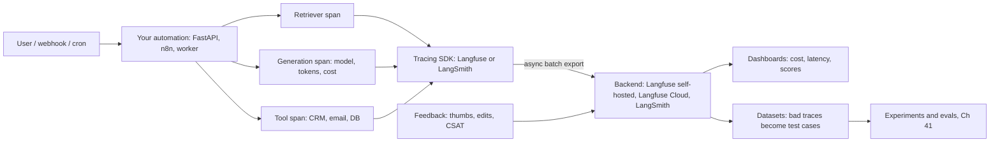
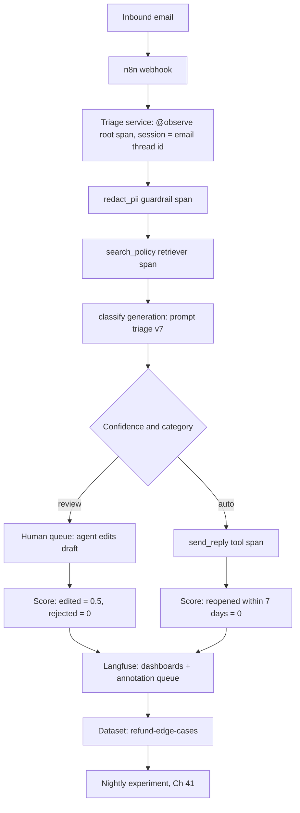

# 40 · Monitoring: LangSmith & Langfuse

> **In one line:** An LLM automation that you can't see inside is one you can't debug, price or improve. Trace every run as a tree of spans (retrieval, prompts, model calls, tools), attach tokens, cost, user and prompt version to each one, collect feedback scores, and turn bad traces into dataset items you test against tomorrow.

> **Versions used:** langfuse 5.2 (OpenTelemetry-based SDK) · langsmith 0.14 · opentelemetry-sdk 1.45 · openai 3.49 · anthropic 2.x · python-dotenv 1.x · Python 3.11+ (verified Nov 2026) · **Fast-moving:** both SDKs have had breaking major versions in the last two years (Langfuse v2 → v3 moved to OpenTelemetry, v4+ replaced `update_current_trace` with `propagate_attributes`). Pin the major version, and re-check the docs before copying snippets from blog posts.

---

## 1. Overview

> **Builds on:** [Ch 06 · Model APIs](topic.html?p=06-model-apis) (usage fields on responses), [Ch 21 · Agent Patterns](topic.html?p=21-agent-patterns) (multi-step loops you'll want to see), [Ch 39 · Deploy with Docker & CI/CD](topic.html?p=39-deploy-docker-cicd) (where the self-hosted stack runs). Pairs with [Ch 41 · Evaluation](topic.html?p=41-evaluation) and [Ch 42 · Reliability & Cost](topic.html?p=42-reliability-cost).

You already log HTTP requests, record p95 latency and wire alerts to Slack. That still matters, but it doesn't answer the questions an LLM automation raises:

- *Why* did the agent refund this customer? Which document did retrieval return, what exactly did the prompt say, and which tool call came next?
- Which **prompt version** shipped on Tuesday, and did thumbs-down rates go up after it?
- Which feature, tenant or user is burning the token budget?
- Which 20 real conversations should become regression tests for next week's prompt change?

**LLM observability** tools answer these by recording **traces**: one tree per request, with every retrieval, prompt, generation and tool call as a nested node carrying its inputs, outputs, model, token usage, cost and latency. Two tools dominate the Python ecosystem:

- **Langfuse**: open source (MIT core), self-hostable with Docker, also offered as a cloud service. Built on OpenTelemetry since SDK v3.
- **LangSmith**: LangChain's hosted platform. Works with any code (not only LangChain), deepest integration with LangChain and LangGraph. Self-hosting is an Enterprise feature.

Where tracing sits in your stack:



The SDK exports in a **background thread**, so tracing adds microseconds to your request path, not a network round trip. The price is that you must **flush on shutdown** in short-lived scripts and serverless functions, or the last batch is lost.

---

## 2. Key Concepts

- **Trace**: everything that happened for one request or job run. Has a name, user id, session id, tags, metadata, input and output.
- **Observation / span / run**: one step inside a trace (Langfuse says *observation*, LangSmith says *run*, OpenTelemetry says *span*). Spans nest, so you see a waterfall.
- **Typed observations**: Langfuse 5 types spans as `span`, `generation`, `embedding`, `retriever`, `tool`, `agent`, `chain`, `evaluator`, `guardrail`, `event`. LangSmith uses `run_type` (`llm`, `retriever`, `tool`, `chain`, `prompt`, `embedding`, `parser`). Types drive the UI: generations get token and cost columns, retrievers get a document view.
- **Generation**: a span for a model call. Records `model`, `model_parameters`, `usage_details` (input/output/cached tokens) and optionally `cost_details`. If you don't send cost, Langfuse computes it from its model price table, which you can edit for self-hosted or local models.
- **Session**: groups traces from one conversation or one long-running job (a chat thread, an n8n execution). **User id** lets you answer "who" for cost and abuse questions.
- **Scores / feedback**: numbers, booleans or categories attached to a trace or a span, from users (thumbs up), from code (JSON valid?), from humans in an annotation queue, or from an LLM judge. This is how quality becomes a time series.
- **Datasets and experiments**: curated input/expected-output items, often copied from production traces. An **experiment** runs your current code over a dataset and scores it, so you can compare prompt v3 against v4 before shipping.
- **Prompt management**: prompts stored and versioned in the tool, fetched by label (`production`, `staging`) at runtime and linked to the generations that used them. Lets a non-developer roll back a prompt without a deploy.
- **Sampling and masking**: record a fraction of traces at high volume, and scrub PII before it leaves the process (deeper in [Ch 44](topic.html?p=44-secrets-pii)).
- **OpenTelemetry (OTel)**: the vendor-neutral tracing standard. The **GenAI semantic conventions** (`gen_ai.request.model`, `gen_ai.usage.input_tokens`, ...) are still marked experimental, but most LLM tools now speak OTLP, so spans from one instrumentation library can land in Langfuse, Phoenix, Datadog or Grafana Tempo.

> **Analogy:** a flight data recorder. Logs tell you the plane landed late. The black box tells you the altitude, throttle and every pilot input along the way. A **trace** is the black box for one request, a **score** is the post-flight inspection, and a **dataset** is the simulator scenario you build from the incident so the next pilot gets trained on it.

What one trace looks like for a RAG triage request:

```svg
<svg viewBox="0 0 880 330" width="100%" height="330" font-family="ui-sans-serif,system-ui,sans-serif" font-size="11" xmlns="http://www.w3.org/2000/svg">
  <text x="440" y="22" text-anchor="middle" font-size="14" font-weight="700" fill="#1e293b">One trace = one request, drawn as a waterfall of nested observations</text>
  <text x="20" y="48" fill="#334155" font-weight="700">trace: support-triage   user=u-42   session=thread-981   tags=[prod, triage]   prompt=triage v7</text>
  <line x1="300" y1="60" x2="300" y2="300" stroke="#94a3b8" stroke-dasharray="3 3"/>
  <line x1="860" y1="60" x2="860" y2="300" stroke="#94a3b8" stroke-dasharray="3 3"/>
  <text x="300" y="316" text-anchor="middle" fill="#334155">0 ms</text>
  <text x="860" y="316" text-anchor="middle" fill="#334155">2,410 ms</text>
  <text x="20" y="84" fill="#1e293b" font-weight="700">handle_ticket (span)</text>
  <rect x="300" y="72" width="560" height="18" rx="3" fill="#dbeafe" stroke="#2563eb"/>
  <text x="36" y="114" fill="#1e293b">redact_pii (guardrail)</text>
  <rect x="300" y="102" width="22" height="18" rx="3" fill="#ede9fe" stroke="#7c3aed"/>
  <text x="330" y="115" fill="#334155">9 ms</text>
  <text x="36" y="144" fill="#1e293b">search_kb (retriever)</text>
  <rect x="322" y="132" width="70" height="18" rx="3" fill="#dcfce7" stroke="#16a34a"/>
  <text x="400" y="145" fill="#334155">120 ms, 4 docs</text>
  <text x="36" y="174" fill="#1e293b">classify (generation)</text>
  <rect x="392" y="162" width="190" height="18" rx="3" fill="#fef3c7" stroke="#d97706"/>
  <text x="590" y="175" fill="#334155">claude-sonnet-5-5  in 1,820  out 40</text>
  <text x="36" y="204" fill="#1e293b">crm.lookup (tool)</text>
  <rect x="582" y="192" width="60" height="18" rx="3" fill="#dcfce7" stroke="#16a34a"/>
  <text x="650" y="205" fill="#334155">HTTP 200</text>
  <text x="36" y="234" fill="#1e293b">draft_reply (generation)</text>
  <rect x="642" y="222" width="210" height="18" rx="3" fill="#fef3c7" stroke="#d97706"/>
  <text x="36" y="264" fill="#dc2626">score: user_feedback = 0</text>
  <rect x="300" y="252" width="560" height="18" rx="3" fill="#fee2e2" stroke="#dc2626"/>
  <text x="580" y="265" text-anchor="middle" fill="#1e293b">attached later by the support agent clicking thumbs-down</text>
  <text x="36" y="292" fill="#334155">trace totals: 2.41 s, 3,912 tokens, cost computed from usage x price table</text>
</svg>
```

---

## 3. Setup

```bash
pip install "langfuse>=5.2,<6" "langsmith>=0.14,<0.15" "openai>=3.4,<4" "anthropic>=2.8,<3" "python-dotenv>=1"
```

**Self-host Langfuse (free, recommended for this handbook).** The server needs Postgres, ClickHouse, Redis and S3-compatible blob storage; the official Compose file wires them all up (MinIO plays S3):

```bash
git clone https://github.com/langfuse/langfuse.git
cd langfuse
docker compose up -d          # UI on http://localhost:3000 after ~1-2 minutes
```

Open the UI, create an organisation and a project, then copy the project's public and secret keys. For production, change every default password in the Compose file, put the UI behind TLS, and back up Postgres and ClickHouse ([Ch 39](topic.html?p=39-deploy-docker-cicd)). Langfuse Cloud has a free hobby tier if you'd rather not run it.

**LangSmith** is hosted at smith.langchain.com (free developer tier with a monthly trace allowance; check the pricing page). Create an API key in Settings.

```bash
# .env.example — chapter 40
# Langfuse (self-hosted or cloud)
LANGFUSE_PUBLIC_KEY=pk-lf-...
LANGFUSE_SECRET_KEY=sk-lf-...
LANGFUSE_BASE_URL=http://localhost:3000      # https://cloud.langfuse.com or https://us.cloud.langfuse.com
LANGFUSE_TRACING_ENVIRONMENT=dev             # dev / staging / production, filterable in the UI
LANGFUSE_SAMPLE_RATE=1.0                     # 0.1 = keep 10% of traces at high volume

# LangSmith (hosted)
LANGSMITH_TRACING=true
LANGSMITH_API_KEY=lsv2_...
LANGSMITH_PROJECT=ai-automation-dev

# Models (free local default from Ch 02/08; paid alternatives)
LLM_BASE_URL=http://localhost:11434/v1
LLM_API_KEY=ollama
LLM_MODEL=llama3.2
ANTHROPIC_API_KEY=
CLAUDE_MODEL=claude-sonnet-5-5
```

Both SDKs read their variables from the environment, so `load_dotenv()` at the top of the entry point is all the wiring you need. Never commit `.env`; the secret key can write to and read from your whole project.

> **Version note:** older tutorials use `LANGFUSE_HOST` (still accepted as a fallback) and `LANGCHAIN_TRACING_V2` / `LANGCHAIN_API_KEY` (LangSmith still reads them). Prefer the names above.

---

## 4. Code Examples

### Example 1: Langfuse `@observe`, verified offline

`@observe` turns a function into a span and nests calls automatically through OpenTelemetry context. This script swaps the network exporter for an **in-memory exporter** so you can see exactly what would be sent, with no server and no keys.

```python
# lf_offline.py — trace a tiny pipeline and inspect the spans locally
from langfuse import Langfuse, get_client, observe, propagate_attributes
from opentelemetry.sdk.trace.export.in_memory_span_exporter import InMemorySpanExporter

exporter = InMemorySpanExporter()
Langfuse(public_key="pk-lf-local", secret_key="sk-lf-local",
         base_url="http://localhost:3000", span_exporter=exporter)   # test-only exporter


@observe(as_type="retriever")
def search_kb(query: str) -> list[str]:
    return ["Refunds within 30 days", "Duplicate charges are reversed in 3-5 days"]


@observe(as_type="generation", name="classify")
def classify(query: str, docs: list[str]) -> str:
    # In real code this wraps an LLM call; report what the model used.
    get_client().update_current_generation(
        model="llama3.2", usage_details={"input": 120, "output": 3})
    return "BILLING"


@observe(name="handle_ticket")
def handle_ticket(text: str, user_id: str) -> str:
    # Everything created inside this block inherits user, session, tags and trace name.
    with propagate_attributes(user_id=user_id, session_id="thread-981",
                              tags=["triage"], trace_name="support-triage"):
        label = classify(text, search_kb(text))
    return label


if __name__ == "__main__":
    print(handle_ticket("I was charged twice", user_id="u-42"))
    get_client().flush()                                  # always flush in scripts
    for span in exporter.get_finished_spans():
        a = span.attributes
        print(f"{span.name:13} type={a.get('langfuse.observation.type'):10} "
              f"user={a.get('user.id')} usage={a.get('langfuse.observation.usage_details')}")
```

```text
BILLING
search_kb     type=retriever  user=u-42 usage=None
classify      type=generation user=u-42 usage={"input": 120, "output": 3}
handle_ticket type=span       user=u-42 usage=None
```

Spans finish innermost first, which is why the root prints last. In real code, remove `span_exporter=` and the SDK sends the same spans over OTLP to `LANGFUSE_BASE_URL`.

> **Gotcha:** `@observe` captures function arguments and return values as span input and output by default. That is great in dev and a privacy problem in production. Use `@observe(capture_input=False)` on functions that take raw customer data, or a `mask` function (Example 5).

### Example 2: Zero-code tracing for OpenAI-compatible calls

Langfuse ships a drop-in replacement for the OpenAI client. It records model, messages, usage and latency for `chat.completions`, `responses` and `embeddings`, and works with any OpenAI-compatible server, including Ollama.

```python
# lf_openai_dropin.py — swap one import, get generation spans
import os

from dotenv import load_dotenv
from langfuse import get_client, observe
from langfuse.openai import OpenAI          # instead of: from openai import OpenAI

load_dotenv()
client = OpenAI(base_url=os.getenv("LLM_BASE_URL", "http://localhost:11434/v1"),
                api_key=os.getenv("LLM_API_KEY", "ollama"))
MODEL = os.getenv("LLM_MODEL", "llama3.2")


@observe(name="summarise-ticket")
def summarise(ticket: str) -> str:
    resp = client.chat.completions.create(
        model=MODEL, max_tokens=120,
        messages=[{"role": "system", "content": "Summarise the ticket in one sentence."},
                  {"role": "user", "content": ticket}],
        name="summary-call",                 # extra kwargs Langfuse strips before calling the API
        metadata={"feature": "ticket-summary"},
    )
    return resp.choices[0].message.content or ""


if __name__ == "__main__":
    print(summarise("Export to CSV crashes when the file has more than 50k rows."))
    get_client().flush()
```

```text
Illustrative output (needs Ollama + a running Langfuse):
Exporting large files (50k+ rows) to CSV causes a crash.
```

In the UI you get a `summarise-ticket` trace with a nested `summary-call` generation. Cost shows as zero for a local model unless you add a price for `llama3.2` in **Settings → Models**, which is worth doing if you want to compare "what this would cost on a hosted model".

### Example 3: Manual generation spans for Claude, with usage and cost

For SDKs without a drop-in wrapper (or when you want full control), open a generation yourself and report usage from the response. Prompt-cache tokens get their own keys so the cost maths stays right.

```python
# lf_claude_generation.py — explicit generation span around the Anthropic SDK
import os

import anthropic
from dotenv import load_dotenv
from langfuse import get_client, propagate_attributes

load_dotenv()
claude = anthropic.Anthropic()                             # reads ANTHROPIC_API_KEY
langfuse = get_client()                                    # reads LANGFUSE_* env vars
MODEL = os.getenv("CLAUDE_MODEL", "claude-sonnet-5-5")


def classify(ticket: str) -> str:
    with langfuse.start_as_current_observation(name="triage", as_type="span", input=ticket) as root:
        with propagate_attributes(user_id="u-42", tags=["triage"]):
            with langfuse.start_as_current_observation(
                name="classify", as_type="generation", model=MODEL,
                model_parameters={"max_tokens": 10, "effort": "low"},
                input=[{"role": "user", "content": ticket}],
            ) as gen:
                resp = claude.messages.create(
                    model=MODEL, max_tokens=10, output_config={"effort": "low"},
                    system="Reply with one word: BILLING, BUG or FEATURE.",
                    messages=[{"role": "user", "content": ticket}],
                )
                label = "".join(b.text for b in resp.content if b.type == "text").strip()
                u = resp.usage
                gen.update(output=label, usage_details={
                    "input": u.input_tokens,
                    "output": u.output_tokens,
                    "cache_read_input_tokens": u.cache_read_input_tokens or 0,
                    "cache_creation_input_tokens": u.cache_creation_input_tokens or 0,
                })
        root.update(output=label)
        root.score_trace(name="label_valid", value=float(label in {"BILLING", "BUG", "FEATURE"}))
    return label


if __name__ == "__main__":
    print(classify("I was charged twice in October"))
    langfuse.flush()
```

```text
Illustrative output (needs ANTHROPIC_API_KEY + Langfuse):
BILLING
```

Note the cheap **code-based score** (`label_valid`). Scores like this cost nothing, run on 100% of traffic, and give you a quality chart for free. Save LLM-judge scores for samples ([Ch 41](topic.html?p=41-evaluation)).

### Example 4: User feedback that lands on the right trace

Feedback arrives later, from a different HTTP request. Return the trace id with the response, and post the score against it.

```python
# lf_feedback.py — return trace_id to the client, score it when feedback arrives
from dotenv import load_dotenv
from langfuse import get_client, observe

load_dotenv()
langfuse = get_client()


@observe(name="answer-question")
def answer(question: str) -> dict:
    reply = f"(model answer to: {question})"        # call your LLM here
    return {"reply": reply, "trace_id": langfuse.get_current_trace_id()}


def record_feedback(trace_id: str, thumbs_up: bool, comment: str | None = None) -> None:
    langfuse.create_score(trace_id=trace_id, name="user_feedback",
                          value=1 if thumbs_up else 0, data_type="BOOLEAN", comment=comment)


if __name__ == "__main__":
    out = answer("How do I reset 2FA?")
    print(out)
    record_feedback(out["trace_id"], thumbs_up=False, comment="Linked to the wrong article")
    langfuse.flush()
```

```text
Illustrative output (trace ids are random 32-hex strings):
{'reply': '(model answer to: How do I reset 2FA?)', 'trace_id': '5f0c2d6e9b1a4c7f8e3d2b1a09c8d7e6'}
```

In FastAPI, return `trace_id` in the JSON body and add a `POST /feedback` endpoint that calls `record_feedback`. The same pattern works for implicit signals: "agent edited the draft before sending" (score 0.5), "customer re-opened the ticket" (score 0).

### Example 5: Masking PII before it leaves the process

The `mask` hook runs on every input, output and metadata value before export. Combine it with Presidio for real detection ([Ch 44](topic.html?p=44-secrets-pii)); this version uses regexes so it runs anywhere.

```python
# lf_mask.py — scrub emails, card numbers and API keys from everything Langfuse exports
import re
from typing import Any

from langfuse import Langfuse, get_client, observe
from opentelemetry.sdk.trace.export.in_memory_span_exporter import InMemorySpanExporter

PATTERNS = [
    (re.compile(r"[\w.+-]+@[\w-]+\.[\w.]+"), "<EMAIL>"),
    (re.compile(r"\b(?:\d[ -]?){13,16}\b"), "<CARD>"),
    (re.compile(r"\b(sk|pk|lsv2)[-_][A-Za-z0-9_-]{8,}"), "<SECRET>"),
]


def mask(*, data: Any, **kwargs) -> Any:
    if isinstance(data, str):
        for rx, repl in PATTERNS:
            data = rx.sub(repl, data)
        return data
    if isinstance(data, dict):
        return {k: mask(data=v) for k, v in data.items()}
    if isinstance(data, (list, tuple)):          # @observe passes args as a tuple
        return [mask(data=v) for v in data]
    return data


exporter = InMemorySpanExporter()                     # drop this in real code
Langfuse(public_key="pk-lf-local", secret_key="sk-lf-local", base_url="http://localhost:3000",
         mask=mask, span_exporter=exporter)


@observe()
def handle(text: str) -> str:
    return f"Replying to {text}"


if __name__ == "__main__":
    handle("jane.doe@example.com paid with 4111 1111 1111 1111")
    get_client().flush()
    span = exporter.get_finished_spans()[0]
    print(span.attributes["langfuse.observation.input"])
    print(span.attributes["langfuse.observation.output"])
```

```text
{"args": ["<EMAIL> paid with <CARD>"], "kwargs": {}}
Replying to <EMAIL> paid with <CARD>
```

Masking happens client-side, so the raw value never reaches the trace store. That matters more than any retention setting on the server.

### Example 6: Prompt management with a safe fallback

Store the prompt in Langfuse, fetch it by label, and link it to the generation so the UI can show "thumbs-down rate by prompt version". Always pass a `fallback` so an observability outage never takes down your automation.

```python
# lf_prompts.py — versioned prompts fetched at runtime, cached client-side
import os

from dotenv import load_dotenv
from langfuse import get_client, observe
from langfuse.openai import OpenAI

load_dotenv()
langfuse = get_client()
llm = OpenAI(base_url=os.getenv("LLM_BASE_URL", "http://localhost:11434/v1"),
             api_key=os.getenv("LLM_API_KEY", "ollama"))
FALLBACK = "Classify this ticket as BILLING, BUG or FEATURE. Reply with one word.\n\n{{ticket}}"


def seed_prompt() -> None:
    """Run once (or create it in the UI). Each call creates a new version."""
    langfuse.create_prompt(name="ticket-triage", prompt=FALLBACK, labels=["production"],
                           config={"max_tokens": 5})


@observe(name="triage-with-managed-prompt")
def triage(ticket: str) -> str:
    prompt = langfuse.get_prompt("ticket-triage", label="production",
                                 fallback=FALLBACK, cache_ttl_seconds=300)
    resp = llm.chat.completions.create(
        model=os.getenv("LLM_MODEL", "llama3.2"),
        max_tokens=(prompt.config or {}).get("max_tokens", 5),
        messages=[{"role": "user", "content": prompt.compile(ticket=ticket)}],
        langfuse_prompt=prompt,               # links this generation to the prompt version
    )
    return (resp.choices[0].message.content or "").strip()


if __name__ == "__main__":
    print(triage("The dashboard shows a 500 error"))
    langfuse.flush()
```

```text
Illustrative output:
BUG
```

The SDK caches prompts in memory and refreshes them in the background, so `get_prompt` doesn't add a network call per request. Promote a new version by moving the `production` label in the UI; roll back the same way.

### Example 7: LangSmith with `@traceable` and wrapped clients

LangSmith's model is the same: decorate functions, wrap the SDK client, attach feedback.

```python
# ls_traceable.py — LangSmith tracing for plain Python + OpenAI-compatible client
import os

from dotenv import load_dotenv
from langsmith import Client, traceable
from langsmith.run_helpers import get_current_run_tree
from langsmith.wrappers import wrap_openai
from openai import OpenAI

load_dotenv()                                     # LANGSMITH_TRACING / API_KEY / PROJECT
llm = wrap_openai(OpenAI(base_url=os.getenv("LLM_BASE_URL", "http://localhost:11434/v1"),
                         api_key=os.getenv("LLM_API_KEY", "ollama")))
ls = Client()


@traceable(run_type="retriever", name="search_kb")
def search_kb(query: str) -> list[dict]:
    return [{"page_content": "Refunds within 30 days", "metadata": {"id": "kb-12"}}]


@traceable(name="answer", tags=["support"], metadata={"feature": "kb-answer"})
def answer(question: str) -> dict:
    docs = search_kb(question)
    resp = llm.chat.completions.create(
        model=os.getenv("LLM_MODEL", "llama3.2"), max_tokens=150,
        messages=[{"role": "system", "content": f"Answer from: {docs}"},
                  {"role": "user", "content": question}])
    run = get_current_run_tree()
    return {"reply": resp.choices[0].message.content, "run_id": str(run.id) if run else None}


if __name__ == "__main__":
    out = answer("Can I get a refund after 40 days?")
    print(out)
    if out["run_id"]:
        ls.create_feedback(out["run_id"], key="user_feedback", score=0,
                           comment="Policy says 30 days, answer was vague")
```

```text
Illustrative output (needs LANGSMITH_API_KEY + Ollama):
{'reply': 'Refunds are only available within 30 days of purchase...', 'run_id': '1f0b7c3e-...'}
```

`wrap_anthropic(anthropic.Anthropic())` and `wrap_gemini(...)` work the same way. To keep data out of LangSmith, construct `Client(hide_inputs=True, hide_outputs=True)` or pass functions that redact, and set `LANGSMITH_TRACING=false` to switch tracing off entirely (for example, in unit tests).

### Example 8: LangChain and LangGraph in one line

Both tools trace LangChain runnables and LangGraph graphs through callbacks. With LangSmith it is automatic once `LANGSMITH_TRACING=true`. With Langfuse, pass the handler in `config`:

```python
# lf_langchain.py — trace a LangChain/LangGraph invocation in Langfuse
from dotenv import load_dotenv
from langfuse import get_client
from langfuse.langchain import CallbackHandler

load_dotenv()


def run(chain_or_graph, inputs: dict) -> dict:
    handler = CallbackHandler()                       # uses LANGFUSE_* env vars
    return chain_or_graph.invoke(inputs, config={"callbacks": [handler],
                                                  "metadata": {"langfuse_user_id": "u-42",
                                                               "langfuse_session_id": "s-7"}})


if __name__ == "__main__":
    from langchain_core.runnables import RunnableLambda   # tiny stand-in for a real chain
    print(run(RunnableLambda(lambda d: {"echo": d["q"].upper()}), {"q": "hello"}))
    get_client().flush()
```

```text
{'echo': 'HELLO'}
```

Every node, LLM call and tool call in the graph becomes a nested observation, which is the quickest way to see why an agent from [Ch 23](topic.html?p=23-langgraph-fundamentals) looped six times.

### Example 9: Plain OpenTelemetry into Langfuse (or anywhere)

If your organisation already runs OpenTelemetry, you can skip vendor SDKs and send OTLP spans directly. Langfuse accepts OTLP/HTTP at `/api/public/otel` with Basic auth (public key as user, secret key as password).

```python
# otel_direct.py — vendor-neutral spans with GenAI attributes, exported over OTLP/HTTP
import base64
import os

from dotenv import load_dotenv
from opentelemetry import trace
from opentelemetry.exporter.otlp.proto.http.trace_exporter import OTLPSpanExporter
from opentelemetry.sdk.trace import TracerProvider
from opentelemetry.sdk.trace.export import BatchSpanProcessor

load_dotenv()
auth = base64.b64encode(
    f"{os.environ['LANGFUSE_PUBLIC_KEY']}:{os.environ['LANGFUSE_SECRET_KEY']}".encode()).decode()
provider = TracerProvider()
provider.add_span_processor(BatchSpanProcessor(OTLPSpanExporter(
    endpoint=os.getenv("LANGFUSE_BASE_URL", "http://localhost:3000") + "/api/public/otel/v1/traces",
    headers={"Authorization": f"Basic {auth}"})))
trace.set_tracer_provider(provider)
tracer = trace.get_tracer("triage-service")


def classify(ticket: str) -> str:
    with tracer.start_as_current_span("chat llama3.2") as span:
        span.set_attribute("gen_ai.operation.name", "chat")
        span.set_attribute("gen_ai.request.model", "llama3.2")
        label = "BILLING"                          # call the model here
        span.set_attribute("gen_ai.usage.input_tokens", 118)
        span.set_attribute("gen_ai.usage.output_tokens", 2)
        return label


if __name__ == "__main__":
    print(classify("charged twice"))
    provider.force_flush()
```

The same spans can go to Arize Phoenix, Grafana Tempo or Datadog by changing the endpoint. Auto-instrumentation libraries (OpenLLMetry, OpenInference) emit these attributes for you; check their semantic-convention version because the GenAI conventions are still evolving.

---

## 5. Real-World Use Case

**Who:** a 40-person e-commerce company. **Trigger:** every inbound support email (about 3,000/day) hits an n8n webhook that calls a Python triage service. **Steps:** redact PII, retrieve policy snippets, classify (BILLING/BUG/FEATURE/REFUND), draft a reply, and either auto-send (high confidence, low-risk categories) or queue for a human.

The problem before tracing: refunds were being auto-approved for orders outside the 30-day window, roughly 1 in 200. Logs only showed "classified REFUND, sent reply".



**What tracing revealed:** filtering traces by `score: reopened = 0` and `tag: REFUND` showed the retriever returning the *old* 60-day policy page (a stale document in the vector store) in 80% of the bad cases. Fix: delete the stale doc, add a `policy_version` metadata filter. The 37 bad traces were added to a `refund-edge-cases` dataset in two clicks and now run in CI.

**Numbers:** about 3,000 traces/day × ~5 observations each ≈ 450k observations/month. Self-hosted Langfuse on one 4 vCPU / 16 GB VM plus managed Postgres costs roughly $80–150/month in cloud fees (your hosting prices vary). On a hosted plan, check the per-observation or per-trace pricing page for that volume. Tracing overhead in the request path was under 1 ms (background export). Two scores per trace come from code; an LLM judge scores a 5% sample.

---

## 6. Mini Project: Traced, Scored, Self-Testing Triage Service (1–2 hours)

**Goal:** a ticket triage function that is fully traced in self-hosted Langfuse, records code-based and user scores, and runs a Langfuse **experiment** over a dataset built from real traces.

**File layout**

```text
traced-triage/
├── .env                  # from the Setup .env.example
├── triage.py             # traced app code
├── feedback.py           # CLI to attach user feedback to a trace
├── build_dataset.py      # create dataset + items (could come from bad traces)
├── experiment.py         # run current code over the dataset, score it
└── test_tracing.py       # offline test: spans have the attributes we rely on
```

**Step 1: the traced app.**

```python
# triage.py — the code under observation
import os

from dotenv import load_dotenv
from langfuse import get_client, observe, propagate_attributes
from langfuse.openai import OpenAI

load_dotenv()
langfuse = get_client()
llm = OpenAI(base_url=os.getenv("LLM_BASE_URL", "http://localhost:11434/v1"),
             api_key=os.getenv("LLM_API_KEY", "ollama"))
MODEL = os.getenv("LLM_MODEL", "llama3.2")
LABELS = {"BILLING", "BUG", "FEATURE", "REFUND"}
PROMPT_VERSION = "triage.v1"


@observe(as_type="retriever")
def search_policy(text: str) -> list[str]:
    kb = {"refund": "Refunds are allowed within 30 days of delivery.",
          "charge": "Duplicate charges are reversed within 5 business days."}
    return [v for k, v in kb.items() if k in text.lower()]


@observe(name="classify")
def classify(text: str, context: list[str]) -> str:
    resp = llm.chat.completions.create(
        model=MODEL, max_tokens=5, name="classify-call",
        messages=[{"role": "system", "content": "Reply with exactly one word: "
                   "BILLING, BUG, FEATURE or REFUND. Context: " + " ".join(context)},
                  {"role": "user", "content": text}])
    label = (resp.choices[0].message.content or "").strip().upper().rstrip(".")
    langfuse.score_current_trace(name="label_valid", value=float(label in LABELS))
    return label


@observe(name="triage")
def triage(text: str, user_id: str = "anon", thread_id: str | None = None) -> dict:
    with propagate_attributes(user_id=user_id, session_id=thread_id, tags=["triage"],
                              version=PROMPT_VERSION):
        label = classify(text, search_policy(text))
        return {"label": label, "trace_id": langfuse.get_current_trace_id()}


if __name__ == "__main__":
    for t in ["I want a refund, the item arrived broken", "Please add dark mode",
              "The app crashes when I upload a photo", "I was charged twice"]:
        print(triage(t, user_id="demo-user", thread_id="demo-thread"))
    langfuse.flush()
```

**Step 2: attach feedback from the command line** (stands in for your UI's thumbs buttons).

```python
# feedback.py — usage: python feedback.py <trace_id> up|down "optional comment"
import sys

from dotenv import load_dotenv
from langfuse import get_client

load_dotenv()

if __name__ == "__main__":
    trace_id, verdict = sys.argv[1], sys.argv[2]
    comment = sys.argv[3] if len(sys.argv) > 3 else None
    lf = get_client()
    lf.create_score(trace_id=trace_id, name="user_feedback", value=1 if verdict == "up" else 0,
                    data_type="BOOLEAN", comment=comment)
    lf.flush()
    print("scored", trace_id, verdict)
```

**Step 3: build a dataset.** In real life you click "Add to dataset" on bad traces; here you seed it from code. `source_trace_id` keeps the link back to the production trace.

```python
# build_dataset.py — a small golden set for triage
from dotenv import load_dotenv
from langfuse import get_client

load_dotenv()
ITEMS = [
    ("I want my money back, it never arrived", "REFUND"),
    ("You billed my card two times", "BILLING"),
    ("Clicking Save does nothing on Safari", "BUG"),
    ("Could you support exporting to Excel?", "FEATURE"),
    ("Refund please, and also the app crashes", "REFUND"),
]

if __name__ == "__main__":
    lf = get_client()
    lf.create_dataset(name="triage-golden", description="Hand-labelled triage cases")
    for text, label in ITEMS:
        lf.create_dataset_item(dataset_name="triage-golden", input={"text": text},
                               expected_output=label)
    lf.flush()
    print(f"created triage-golden with {len(ITEMS)} items")
```

**Step 4: run an experiment.** `run_experiment` calls your task for each item, traces each run, applies item-level evaluators and a run-level evaluator, and links everything to a dataset run you can compare in the UI.

```python
# experiment.py — score the current code against the golden dataset
from dotenv import load_dotenv
from langfuse import Evaluation, get_client

from triage import PROMPT_VERSION, triage

load_dotenv()


def task(*, item, **kwargs) -> str:
    return triage(item.input["text"], user_id="experiment")["label"]


def exact_match(*, input, output, expected_output, metadata, **kwargs) -> Evaluation:
    return Evaluation(name="exact_match", value=float(output == expected_output))


def accuracy(*, item_results, **kwargs) -> Evaluation:
    vals = [e.value for r in item_results for e in r.evaluations if e.name == "exact_match"]
    return Evaluation(name="accuracy", value=sum(vals) / max(len(vals), 1))


if __name__ == "__main__":
    lf = get_client()
    dataset = lf.get_dataset("triage-golden")
    result = lf.run_experiment(name="triage-golden", run_name=PROMPT_VERSION,
                               data=dataset.items, task=task,
                               evaluators=[exact_match], run_evaluators=[accuracy],
                               max_concurrency=4)
    print(result.format())
    lf.flush()
```

```text
Illustrative output (shape from langfuse 5.2; numbers depend on your model):
🧪 Experiment: triage-golden
📋 Run name: triage.v1
5 items
Average Scores:
  • exact_match: 0.800
Run Evaluations:
  • accuracy: 0.800
```

**Step 5: an offline test** that protects the attributes your dashboards depend on. It patches the LLM call so CI needs no model and no server.

```python
# test_tracing.py — pytest; runs offline
from unittest.mock import MagicMock

from langfuse import Langfuse
from opentelemetry.sdk.trace.export.in_memory_span_exporter import InMemorySpanExporter

exporter = InMemorySpanExporter()
Langfuse(public_key="pk-test", secret_key="sk-test", base_url="http://localhost:1",
         span_exporter=exporter)

import triage  # noqa: E402  (import after the test client is configured)


def test_triage_spans_have_user_and_type(monkeypatch):
    fake = MagicMock()
    fake.choices = [MagicMock(message=MagicMock(content="REFUND"))]
    monkeypatch.setattr(triage.llm.chat.completions, "create", lambda **kw: fake)
    out = triage.triage("refund please", user_id="u-1")
    triage.langfuse.flush()
    spans = {s.name: s.attributes for s in exporter.get_finished_spans()}
    assert out["label"] == "REFUND"
    assert spans["search_policy"]["langfuse.observation.type"] == "retriever"
    assert spans["triage"]["user.id"] == "u-1"
```

**Run it**

```bash
docker compose up -d                 # in the langfuse repo, from Setup
python triage.py                     # 4 traces appear under Tracing
python feedback.py <trace_id> down "should be REFUND"
python build_dataset.py && python experiment.py
LANGFUSE_TRACING_ENABLED=false pytest -q test_tracing.py   # tracing off for other tests
```

**Done when**
- [ ] Each `triage()` call shows one trace with `triage → search_policy → classify → classify-call` nesting.
- [ ] Traces carry `user_id`, `session_id`, `version=triage.v1` and a `label_valid` score.
- [ ] A thumbs-down from `feedback.py` appears on the right trace.
- [ ] The experiment run shows up under the dataset with per-item scores and an accuracy number.
- [ ] `pytest` passes with no network.

**Stretch goals**
- Add a model price for `llama3.2` in Langfuse and compare "virtual cost" against `claude-haiku-5-5`.
- Move the prompt into Langfuse prompt management (Example 6) and run the experiment for two prompt versions; compare them side by side.
- Add an LLM-as-judge evaluator in Langfuse's UI on 10% of production traces.
- Set `LANGFUSE_SAMPLE_RATE=0.2` and confirm scores still attach to sampled traces.

---

## 7. Comparison Table

| Tool | Licence / hosting | Strengths | Weak spots | Use when |
|---|---|---|---|---|
| **Langfuse** | MIT core; self-host (Docker/K8s) or cloud | OTel-native SDK, prompt management, datasets, experiments, LLM-judge evals, annotation queues, cost tracking | Self-hosting means running ClickHouse + Postgres + Redis + S3; some enterprise features gated | Default choice; data must stay in your VPC; framework-agnostic stacks |
| **LangSmith** | Proprietary; cloud, self-host on Enterprise | Best LangChain/LangGraph integration, polished eval and dataset workflows, annotation, Studio for graphs | Paid beyond free tier; self-hosting is enterprise-only | You build on LangChain/LangGraph and are fine with SaaS |
| **Arize Phoenix** | Elastic License 2.0; self-host or Arize cloud | OpenTelemetry/OpenInference native, strong RAG and embedding analysis, runs locally in a notebook | Less prompt-management depth | OTel-first teams, notebook-driven debugging |
| **Opik (Comet)** | Apache 2.0; self-host or cloud | Tracing + evals + guardrail metrics in one OSS package | Younger ecosystem | You want OSS with built-in eval metrics |
| **Helicone** | Apache 2.0; proxy, self-host or cloud | Zero-code: change the base URL, get logging, caching, rate limits | Sees only model calls, not your retrieval/tool spans | Quick visibility on API spend, gateway-style setups |
| **Datadog / New Relic / Grafana** | Commercial / mixed | LLM spans next to your existing APM, infra and alerts | Cost per span; weaker eval and dataset tooling | The company already standardised on that APM |
| **Plain OTel + your own store** | OSS | No lock-in, full control | You build dashboards, cost tables, feedback UI yourself | Strict platform standards, or as the transport underneath any of the above |

**When to use which:** start with **self-hosted Langfuse** if you need data residency or you're cost-sensitive, **LangSmith** if your app is LangGraph-heavy and SaaS is acceptable, and **Phoenix** if you live in notebooks and OpenTelemetry. Whatever you pick, emit standard OTel where you can so switching later is a configuration change, not a rewrite.

---

## 8. Common Mistakes & Best Practices

**1. Not flushing in short-lived processes.** Cron jobs, Lambda functions and CLI scripts exit before the background exporter sends the last batch: traces silently vanish.
*Fix:* call `get_client().flush()` (Langfuse) at the end of every script and handler; in serverless, flush before returning. LangSmith's `Client().flush()` does the same.

**2. Shipping raw PII and secrets to the trace store.** `@observe` captures arguments by default, including customer emails and sometimes API keys inside config dicts.
```python
# Before: everything captured
@observe()
def handle(email_body: str, crm_token: str): ...

# After: redact centrally and stop capturing secrets
Langfuse(mask=mask)                       # Example 5, applied to every span
@observe(capture_input=False)
def call_crm(crm_token: str, customer_id: str): ...
```

**3. One giant span per request.** A single "run_agent" span with a 40 KB input tells you nothing about which step failed. *Fix:* one observation per retrieval, model call and tool call, with the right `as_type`.

**4. No user, session or version attributes.** You can't answer "did prompt v8 make things worse?" or "who is costing us $400/day?" *Fix:* `propagate_attributes(user_id=..., session_id=..., version=..., tags=[...])` at the entry point, every time.

**5. Collecting feedback you can't join to a trace.** A thumbs-down stored in your app DB without a trace id is a vanity metric. *Fix:* return `trace_id` with every response and score against it.

**6. Making observability a hard dependency.** A Langfuse outage shouldn't stop refunds from being processed. *Fix:* the SDK exports asynchronously and drops on failure; keep it that way, always pass `fallback=` to `get_prompt`, and never block on `auth_check()` in the request path.

**7. Tracing everything in high-volume paths without a plan.** Millions of embedding spans per day fill ClickHouse and your bill. *Fix:* sample (`LANGFUSE_SAMPLE_RATE`), skip noisy spans (`should_export_span`), set data retention per project.

**8. Trusting computed cost blindly.** The price table may not know your model alias, fine-tune, cache discounts or batch discount. *Fix:* send `usage_details` with cache keys, add custom model prices, and reconcile against the invoice monthly ([Ch 42](topic.html?p=42-reliability-cost)).

**Best-practice checklist**
- [ ] Every entry point opens a root span with user, session, environment, release and prompt version.
- [ ] Model calls are `generation` spans with model, parameters and usage (including cache tokens).
- [ ] PII and secrets are masked client-side before export.
- [ ] At least one cheap code-based score on 100% of traffic (valid JSON, label in set, tool call succeeded).
- [ ] User feedback is joined to trace ids.
- [ ] Bad traces are promoted to datasets weekly and run as experiments before each prompt change.
- [ ] Scripts and serverless handlers flush; tests run with tracing disabled or an in-memory exporter.
- [ ] Alerts on error rate, p95 latency, cost/day and score drops, not just on HTTP 500s.

---

## 9. Exercises

1. Instrument an existing script from [Ch 04](topic.html?p=04-function-calling) so each tool call appears as a `tool` observation nested under the model call that requested it.
2. Add a `mask` function backed by Presidio ([Ch 44](topic.html?p=44-secrets-pii)) and prove with the in-memory exporter that no email address reaches an exported span.
3. Trace the same RAG pipeline into Langfuse and LangSmith (both SDKs in one run) and write a half-page comparison of what each UI made easy.
4. Build a weekly job that queries the Langfuse API for traces with `user_feedback = 0`, and adds them to a `needs-review` dataset with `source_trace_id`.
5. Configure `should_export_span` to drop spans from a noisy HTTP instrumentation library while keeping all GenAI spans.

### Self-check questions

**Q: What is the difference between a trace, a span (observation) and a session?**
A: A trace is everything that happened for one request or job run. Spans (Langfuse observations, LangSmith runs) are the steps inside it, nested into a tree: retrieval, generations, tool calls. A session groups several traces that belong together, such as all turns of one chat conversation or all emails in one support thread, so you can replay the whole interaction.

**Q: Why does an LLM generation span need model, parameters and usage, not just input and output?**
A: Usage (input, output and cached tokens) and model id are what cost is computed from, and what lets you attribute spend to features and users. Parameters and model id explain behaviour changes: a regression after switching models or effort level is invisible if the span only stores text. Cache-token fields matter because cached input is priced differently.

**Q: How do you attach user feedback that arrives minutes later to the right trace?**
A: Return the trace id with the response (for example `get_current_trace_id()` in Langfuse or the run id in LangSmith), keep it on the client, and when the user clicks thumbs up or down, call `create_score(trace_id=..., name="user_feedback", ...)` or `create_feedback(run_id, key=..., score=...)`. Feedback stored without a trace id can't be used to find or fix the failing cases.

**Q: Why must short-lived scripts call `flush()`?**
A: Both SDKs batch spans and export them from a background thread to keep the request path fast. A cron job, CLI or serverless function can exit before the batch is sent, silently losing the last traces. Calling `flush()` (and `shutdown()` on exit) blocks until pending data is exported.

**Q: How does prompt management in Langfuse or LangSmith help operations, and what's the main risk? (Senior)**
A: Prompts become versioned artefacts fetched by label at runtime and linked to the generations that used them, so you can compare quality and cost per version, roll back by moving a label without a deploy, and let domain experts edit wording. The risk is a runtime dependency and an unreviewed change path: mitigate with client-side caching, a hard-coded fallback, a required experiment run on a dataset before a label moves to production, and access control on who can promote.

**Q: Your security team says no customer data may leave the VPC. How do you still get LLM observability? (Senior)**
A: Self-host an open-source backend (Langfuse or Phoenix) inside the VPC with its databases, mask or pseudonymise PII client-side before export anyway (defence in depth against logs and backups), set retention limits per project, restrict UI access with SSO and roles, and avoid SaaS tracing SDK defaults that point to public endpoints. Using OTLP as the transport keeps the option to forward non-sensitive metrics to the corporate APM.

**Q: When would you sample traces, and what do you lose? (Senior)**
A: At high volume (hundreds of thousands of requests a day) storing every span costs storage and money and slows queries. Sampling keeps a random fraction of full traces. You lose the ability to inspect any specific request and to compute exact totals from traces, so keep cost and error counters as unsampled metrics (or in a ledger), always keep traces with errors or negative feedback, and sample whole traces, never individual spans, so trees stay complete.

**Q: Why emit OpenTelemetry-compatible spans even if you only use one vendor today?**
A: OTel is the vendor-neutral transport. Instrumentation written against it (or against libraries such as OpenLLMetry and OpenInference) can be re-pointed to Langfuse, Phoenix, Datadog or Tempo by changing an exporter endpoint, so switching vendors or sending to two backends doesn't require touching application code. It also correlates LLM spans with your existing HTTP and database spans.

---

## 10. Summary & Official Docs

- **Trace every request** as a tree: root span, then retriever, generation and tool observations with the right type.
- Put **user, session, version, environment and tags** on every trace with `propagate_attributes` (Langfuse) or `@traceable` metadata (LangSmith).
- Record **model, parameters and usage** (including cache tokens) on generations so cost per feature and user falls out for free.
- **Scores** turn quality into a time series: cheap code checks on 100%, user feedback joined by trace id, LLM judges on samples.
- **Mask PII client-side**, sample at high volume, set retention, and **flush** in short-lived processes.
- Promote bad traces into **datasets** and run **experiments** before every prompt or model change.
- **Langfuse** for open-source and self-hosting, **LangSmith** for LangChain-centric SaaS, **OTel** underneath both for portability.

| You want to... | Langfuse 5.x | LangSmith 0.14 |
|---|---|---|
| Trace a function | `@observe(as_type=...)` | `@traceable(run_type=...)` |
| Trace OpenAI calls | `from langfuse.openai import OpenAI` | `wrap_openai(OpenAI())` |
| Set user/session | `propagate_attributes(user_id=, session_id=)` | `metadata` / `tracing_context(...)` |
| Feedback | `create_score(trace_id=, name=, value=)` | `Client().create_feedback(run_id, key=, score=)` |
| Dataset run | `run_experiment(data=, task=, evaluators=)` | `Client().evaluate(target, data=, evaluators=)` |
| Turn off in tests | `LANGFUSE_TRACING_ENABLED=false` | `LANGSMITH_TRACING=false` |

**Official docs**
- Langfuse docs: https://langfuse.com/docs
- Langfuse self-hosting: https://langfuse.com/self-hosting
- Langfuse Python SDK: https://langfuse.com/docs/observability/sdk/python/overview
- LangSmith docs: https://docs.langchain.com/langsmith
- OpenTelemetry GenAI semantic conventions: https://opentelemetry.io/docs/specs/semconv/gen-ai/
- Arize Phoenix: https://arize.com/docs/phoenix
- Theory: [AI Engineering · Deployment, Monitoring & Drift](../ai-engineering/topic.html?p=42-deployment-monitoring-drift)

**Next:** [Ch 41 · Evaluation: RAGAS, DeepEval & promptfoo](topic.html?p=41-evaluation): you can see what your automation did; now prove it does the right thing, before and after every change.

---

*AI Automation with Python Handbook — chapter 40.*
