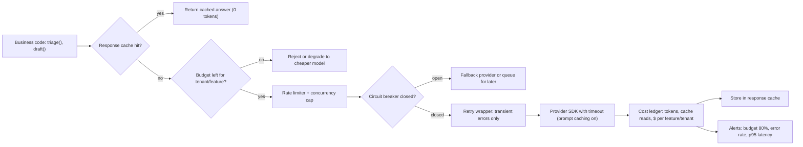
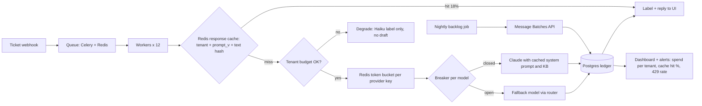

# 42 · Caching, Rate Limits, Retries & Cost Tracking

> **In one line:** A production LLM call is a flaky, metered, rate-limited network dependency. Wrap it in the same armour you'd give a payment API: cache what repeats, throttle before the provider throttles you, retry only what is transient, trip a breaker when a provider is down, and write every token to a cost ledger with a budget attached.

> **Versions used:** anthropic 2.8 · openai 3.49 · tenacity 9.2 · aiolimiter 1.3 · redis (redis-py) 8.1 · fakeredis 2.40 (tests) · python-dotenv 1.x · Python 3.11+ (verified Nov 2026) · **Fast-moving:** provider prices, cache discounts and minimum cacheable sizes, rate-limit tiers, batch limits and discount levels. Re-read the pricing and rate-limit pages before you trust any number in this chapter.

---

## 1. Overview

> **Builds on:** [Ch 01 · How LLMs Work](topic.html?p=01-how-llms-work) (tokens and cost), [Ch 06 · Model APIs](topic.html?p=06-model-apis) (SDK errors and built-in retries), [Ch 07 · Multi-Provider Routing](topic.html?p=07-multi-provider-routing) (fallbacks and cooldowns), [Ch 40 · Monitoring](topic.html?p=40-observability-langsmith-langfuse) (where these numbers end up on a dashboard).

You already know how to harden a call to Stripe or a flaky partner API: timeouts, retries with backoff, idempotency keys, a circuit breaker, metrics. LLM APIs need all of that plus three things ordinary APIs don't:

- **Every call costs money proportional to its size**, and the size is set partly by the model's output. A loop bug can burn a month's budget in an hour.
- **Rate limits are measured in tokens as well as requests** (input tokens per minute, output tokens per minute, requests per minute), and they differ per model and per account tier.
- **Latency is seconds, not milliseconds**, so the usual "just retry" instinct multiplies user-visible delay and cost.

The hardening layer sits between your business code and the provider SDK (or the router from Ch 07):



Order matters. The cache comes first because a hit costs nothing. The budget check comes before the limiter so you don't wait in line for a call you were never going to make. The breaker sits outside the retry loop so a dead provider fails fast instead of being retried.

---

## 2. Key Concepts

- **Response cache (exact match)**: key = hash of everything that affects the output (model, prompt version, messages, parameters). Same key, same stored answer. Safe and cheap. Only helps when inputs repeat exactly: classification of templated emails, FAQ answers, re-runs of a pipeline.
- **Semantic cache**: key = embedding of the request; a hit is any stored request with cosine similarity above a threshold. Higher hit rate, but it **can return the right answer to the wrong question** ("cancel my order" vs "don't cancel my order").
- **Provider prompt caching**: the provider caches the *processed prefix* of your prompt (system prompt, tools, long documents). You still pay for output and for the uncached tail, but the cached prefix is billed at a steep discount and processed faster. Claude needs an explicit `cache_control` marker; OpenAI caches long prefixes automatically; Gemini offers explicit **context caches** you create and reference.
- **Batch APIs**: submit thousands of requests as one job, get results within 24 hours at a large discount (Anthropic and OpenAI both advertise 50%). Ideal for nightly enrichment, backfills, and evals.
- **Rate limiting (client side)**: a **token bucket** refills at a fixed rate and each request spends from it; `asyncio.Semaphore` caps how many calls are *in flight*. You need both: one controls rate, the other controls concurrency.
- **Retry with backoff and jitter**: retry only **transient** failures (429, 5xx, overloaded, connection reset, timeout). Wait exponentially longer each time, add random jitter so a thousand workers don't retry in lockstep, and honour the provider's `retry-after` header.
- **Circuit breaker**: after N consecutive failures, stop calling the provider for a cool-down period (open), then let one probe through (half-open). Protects your latency budget and the provider.
- **Timeouts**: every call has a deadline. Remember that SDK retries multiply it: wall-clock can reach `timeout × (max_retries + 1)`.
- **Idempotency**: an LLM call is safe to repeat; the *side effect* it triggers (send email, create refund) is not. Key side effects by a stable request id.
- **Cost ledger**: one row per call with feature, tenant, model, input/output/cache tokens and dollars. Budgets and alerts are queries over this table.

> **Analogy:** a busy restaurant kitchen. The **cache** is the tray of pre-made desserts. **Prompt caching** is the mise en place: chopped onions you don't re-chop for every order. The **rate limiter** is the ticket rail that only lets the kitchen take so many orders at once. **Retries** are re-firing a dish that came out wrong, but not one the customer cancelled. The **circuit breaker** is taking the fryer offline when it keeps tripping. The **cost ledger** is the food-cost spreadsheet the owner reads every Monday.

How the request flows through the layers and what each one costs:

```svg
<svg viewBox="0 0 880 320" width="100%" height="320" font-family="ui-sans-serif,system-ui,sans-serif" font-size="11" xmlns="http://www.w3.org/2000/svg">
  <defs><marker id="aa42a" viewBox="0 0 10 10" refX="9" refY="5" markerWidth="7" markerHeight="7" orient="auto"><path d="M0,0 L10,5 L0,10 z" fill="#334155"/></marker></defs>
  <text x="440" y="22" text-anchor="middle" font-size="14" font-weight="700" fill="#1e293b">Where each hardening layer saves money or protects you</text>
  <rect x="20" y="50" width="130" height="90" rx="8" fill="#dcfce7" stroke="#16a34a"/>
  <text x="85" y="72" text-anchor="middle" font-weight="700" fill="#1e293b">Response cache</text>
  <text x="85" y="92" text-anchor="middle" fill="#334155">hit = $0, ~1 ms</text>
  <text x="85" y="108" text-anchor="middle" fill="#334155">key = sha256(model,</text>
  <text x="85" y="122" text-anchor="middle" fill="#334155">prompt_v, messages)</text>
  <line x1="152" y1="95" x2="188" y2="95" stroke="#334155" stroke-width="1.5" marker-end="url(#aa42a)"/>
  <rect x="190" y="50" width="130" height="90" rx="8" fill="#fef3c7" stroke="#d97706"/>
  <text x="255" y="72" text-anchor="middle" font-weight="700" fill="#1e293b">Budget gate</text>
  <text x="255" y="92" text-anchor="middle" fill="#334155">spent(tenant, feature)</text>
  <text x="255" y="108" text-anchor="middle" fill="#334155">&lt; monthly cap?</text>
  <text x="255" y="124" text-anchor="middle" fill="#d97706">no → degrade / 402</text>
  <line x1="322" y1="95" x2="358" y2="95" stroke="#334155" stroke-width="1.5" marker-end="url(#aa42a)"/>
  <rect x="360" y="50" width="150" height="90" rx="8" fill="#dbeafe" stroke="#2563eb"/>
  <text x="435" y="72" text-anchor="middle" font-weight="700" fill="#1e293b">Limiter</text>
  <text x="435" y="92" text-anchor="middle" fill="#334155">token bucket: 50 req/min</text>
  <text x="435" y="108" text-anchor="middle" fill="#334155">semaphore: 8 in flight</text>
  <text x="435" y="124" text-anchor="middle" fill="#2563eb">smooths bursts</text>
  <line x1="512" y1="95" x2="548" y2="95" stroke="#334155" stroke-width="1.5" marker-end="url(#aa42a)"/>
  <rect x="550" y="50" width="140" height="90" rx="8" fill="#fee2e2" stroke="#dc2626"/>
  <text x="620" y="72" text-anchor="middle" font-weight="700" fill="#1e293b">Breaker + retry</text>
  <text x="620" y="92" text-anchor="middle" fill="#334155">open after 5 fails</text>
  <text x="620" y="108" text-anchor="middle" fill="#334155">retry 429/5xx only</text>
  <text x="620" y="124" text-anchor="middle" fill="#334155">backoff + jitter</text>
  <line x1="692" y1="95" x2="728" y2="95" stroke="#334155" stroke-width="1.5" marker-end="url(#aa42a)"/>
  <rect x="730" y="50" width="135" height="90" rx="8" fill="#ede9fe" stroke="#7c3aed"/>
  <text x="797" y="72" text-anchor="middle" font-weight="700" fill="#1e293b">Provider</text>
  <text x="797" y="92" text-anchor="middle" fill="#334155">timeout 60 s</text>
  <text x="797" y="108" text-anchor="middle" fill="#334155">prompt cache: prefix</text>
  <text x="797" y="124" text-anchor="middle" fill="#334155">billed at a discount</text>
  <rect x="20" y="175" width="845" height="120" rx="8" fill="#f8fafc" stroke="#94a3b8"/>
  <text x="440" y="197" text-anchor="middle" font-weight="700" fill="#1e293b">Prompt anatomy for provider caching (Claude: explicit breakpoint)</text>
  <rect x="40" y="212" width="300" height="34" rx="4" fill="#dcfce7" stroke="#16a34a"/>
  <text x="190" y="233" text-anchor="middle" fill="#1e293b">tools + system prompt + policy doc (stable)</text>
  <rect x="342" y="212" width="160" height="34" rx="4" fill="#dcfce7" stroke="#16a34a"/>
  <text x="422" y="233" text-anchor="middle" fill="#1e293b">few-shot examples</text>
  <line x1="505" y1="205" x2="505" y2="256" stroke="#dc2626" stroke-width="2"/>
  <text x="505" y="270" text-anchor="middle" fill="#dc2626">cache_control breakpoint</text>
  <rect x="508" y="212" width="200" height="34" rx="4" fill="#fef3c7" stroke="#d97706"/>
  <text x="608" y="233" text-anchor="middle" fill="#1e293b">this customer's email (varies)</text>
  <rect x="710" y="212" width="135" height="34" rx="4" fill="#fee2e2" stroke="#dc2626"/>
  <text x="777" y="233" text-anchor="middle" fill="#1e293b">output (full price)</text>
  <text x="270" y="285" text-anchor="middle" fill="#16a34a">read from cache: a fraction of the input price</text>
  <text x="700" y="285" text-anchor="middle" fill="#d97706">processed and billed normally</text>
</svg>
```

---

## 3. Setup

```bash
pip install "anthropic>=2.8,<3" "openai>=3.4,<4" "tenacity>=9,<10" "aiolimiter>=1.2,<2" \
            "redis>=5" "python-dotenv>=1" "fakeredis>=2"      # fakeredis only for offline tests
docker run -d --name redis -p 6379:6379 redis:8-alpine        # optional: shared cache + counters
```

```bash
# .env.example — chapter 42
ANTHROPIC_API_KEY=
CLAUDE_MODEL=claude-opus-5-5
OPENAI_API_KEY=
OPENAI_MODEL=gpt-5-mini
REDIS_URL=redis://localhost:6379/0
LLM_CACHE_TTL_SECONDS=86400           # response cache lifetime
LLM_RPM=50                            # client-side requests/minute per provider key
LLM_MAX_CONCURRENCY=8                 # in-flight calls per process
MONTHLY_BUDGET_USD=200                # default per-tenant cap
ALERT_WEBHOOK_URL=                    # Slack/Teams incoming webhook for budget alerts
```

Every script loads it with `load_dotenv()` and reads keys with `os.environ[...]`. All the cache, limiter, retry, breaker and ledger examples run **offline** with a fake model call, so you can test the plumbing before spending a cent.

---

## 4. Code Examples

### Example 1: Exact-match response cache (SQLite or Redis)

The cache key must include **everything that changes the answer**. Forget the prompt version and you'll serve answers from last week's prompt.

```python
# llm_cache.py — exact-match response cache with SQLite (single box) or Redis (shared)
import hashlib
import json
import os
import sqlite3
import time
from typing import Callable

from dotenv import load_dotenv

load_dotenv()


def cache_key(*, model: str, prompt_version: str, messages: list[dict], **params) -> str:
    """Canonical JSON (sorted keys, no whitespace) → sha256. Any change → new key."""
    payload = {"model": model, "prompt_version": prompt_version, "messages": messages, "params": params}
    blob = json.dumps(payload, sort_keys=True, separators=(",", ":"), ensure_ascii=False)
    return "llm:" + hashlib.sha256(blob.encode()).hexdigest()


class SQLiteStore:
    def __init__(self, path: str = "llm_cache.db"):
        self.db = sqlite3.connect(path, check_same_thread=False)
        self.db.execute("CREATE TABLE IF NOT EXISTS cache (k TEXT PRIMARY KEY, v TEXT, expires REAL)")

    def get(self, key: str) -> str | None:
        row = self.db.execute("SELECT v, expires FROM cache WHERE k = ?", (key,)).fetchone()
        if row and row[1] > time.time():
            return row[0]
        return None

    def set(self, key: str, value: str, ttl: int) -> None:
        self.db.execute("INSERT OR REPLACE INTO cache VALUES (?, ?, ?)", (key, value, time.time() + ttl))
        self.db.commit()


class RedisStore:
    def __init__(self, client):                     # redis.Redis(...) or fakeredis.FakeRedis()
        self.r = client

    def get(self, key: str) -> str | None:
        v = self.r.get(key)
        return v.decode() if isinstance(v, bytes) else v

    def set(self, key: str, value: str, ttl: int) -> None:
        self.r.set(key, value, ex=ttl)              # Redis expires it for you


def cached_call(store, call: Callable[..., str], *, model: str, prompt_version: str,
                messages: list[dict], ttl: int = 86400, **params) -> tuple[str, bool]:
    key = cache_key(model=model, prompt_version=prompt_version, messages=messages, **params)
    if (hit := store.get(key)) is not None:
        return hit, True
    answer = call(model=model, messages=messages, **params)
    store.set(key, answer, ttl)
    return answer, False


if __name__ == "__main__":
    calls = 0

    def fake_llm(*, model: str, messages: list[dict], **params) -> str:   # stands in for a real SDK call
        global calls
        calls += 1
        return "BILLING"

    store = SQLiteStore(":memory:")
    msgs = [{"role": "user", "content": "I was charged twice"}]
    for _ in range(3):
        print(cached_call(store, fake_llm, model="claude-opus-5-5", prompt_version="triage.v2",
                          messages=msgs, max_tokens=10))
    print(cached_call(store, fake_llm, model="claude-opus-5-5", prompt_version="triage.v3",
                      messages=msgs, max_tokens=10))           # new prompt version → miss
    print("real calls:", calls)
```

```text
('BILLING', False)
('BILLING', True)
('BILLING', True)
('BILLING', False)
real calls: 2
```

To share the cache across workers, swap in `RedisStore(redis.Redis.from_url(os.environ["REDIS_URL"]))`. For tests, `RedisStore(fakeredis.FakeRedis())` behaves the same with no server. Redis patterns (TTL, eviction, stampede protection) are covered in depth in the [Redis caching handbook](../redis-caching/topic.html?p=08-cache-aside).

> **Gotcha:** only cache **deterministic-enough** tasks: classification, extraction, FAQ answers. Never cache answers that depend on time ("what's due today?"), on user permissions, or on data that changed. Put the tenant id in the key if answers differ per tenant, or you'll leak one customer's answer to another.

### Example 2: Semantic cache and why it's risky

A semantic cache embeds the request and looks for a close neighbour. This demo uses a tiny bag-of-words "embedding" so it runs offline; in real life use `nomic-embed-text` via Ollama or `text-embedding-3-small` ([Ch 05](topic.html?p=05-embeddings)).

```python
# semantic_cache.py — nearest-neighbour cache with a similarity threshold
import math
import re
from collections import Counter


def toy_embed(text: str) -> Counter:                       # replace with a real embedding model
    return Counter(re.findall(r"[a-z']+", text.lower()))


def cosine(a: Counter, b: Counter) -> float:
    dot = sum(a[t] * b[t] for t in a)
    return dot / (math.sqrt(sum(v * v for v in a.values())) * math.sqrt(sum(v * v for v in b.values())))


CACHE = [(toy_embed("How do I cancel my order?"), "Go to Orders → Cancel within 24 hours.")]


def lookup(question: str, threshold: float = 0.8) -> tuple[str | None, float]:
    q = toy_embed(question)
    vec, answer = max(CACHE, key=lambda item: cosine(q, item[0]))
    score = cosine(q, vec)
    return (answer if score >= threshold else None), score


if __name__ == "__main__":
    for q in ["how do i cancel my order", "How can I cancel my order?", "How do I NOT cancel my order?"]:
        answer, score = lookup(q)
        print(f"{score:.2f}  {'HIT ' if answer else 'miss'}  {q!r}")
```

```text
1.00  HIT   'how do i cancel my order'
0.83  HIT   'How can I cancel my order?'
0.93  HIT   'How do I NOT cancel my order?'
```

The third line is the whole lesson: **negation barely moves the vector**, so the cache confidently returns the wrong answer. Real embedding models do better than this toy, but the failure mode is the same. If you use one, scope it per tenant and prompt version with a short TTL, use a high threshold, log every hit with its score, and keep it to low-risk read-only FAQ answers, never in front of an action. Measure natural repetition first: many automations have almost none, and exact-match plus provider prompt caching already capture most savings.

### Example 3: Provider prompt caching (Claude, OpenAI, Gemini)

**Claude** caches a prefix you mark with `cache_control`. The simplest form is the top-level field, which caches up to the last cacheable block. When the tail varies per request (the customer's email), put an explicit marker at the end of the **shared** part instead, so you don't pay a cache write on bytes nobody will read again.

```python
# claude_prompt_cache.py — cache the big stable prefix, verify with usage fields
import os
from pathlib import Path

import anthropic
from dotenv import load_dotenv

load_dotenv()
client = anthropic.Anthropic()                     # reads ANTHROPIC_API_KEY
MODEL = os.getenv("CLAUDE_MODEL", "claude-opus-5-5")
POLICY = Path("refund_policy.md").read_text() if Path("refund_policy.md").exists() else "Refund policy... " * 400

SYSTEM = [
    {"type": "text", "text": "You answer customer refund questions using ONLY the policy below."},
    {"type": "text", "text": f"<policy>\n{POLICY}\n</policy>",
     "cache_control": {"type": "ephemeral"}},      # breakpoint at the end of the shared prefix (5-min TTL)
]


def ask(question: str) -> anthropic.types.Message:
    return client.messages.create(
        model=MODEL, max_tokens=400, system=SYSTEM,
        output_config={"effort": "low"},           # no temperature on current Claude models
        messages=[{"role": "user", "content": question}],
    )


if __name__ == "__main__":
    for q in ["Can I get a refund after 40 days?", "Do you refund shipping costs?"]:
        r = ask(q)
        u = r.usage
        text = "".join(b.text for b in r.content if b.type == "text")
        print(f"write={u.cache_creation_input_tokens} read={u.cache_read_input_tokens} "
              f"uncached_in={u.input_tokens} out={u.output_tokens} | {text[:60]}")
```

```text
Illustrative output (needs ANTHROPIC_API_KEY):
write=2412 read=0 uncached_in=14 out=58 | Refunds are available within 30 days of purchase...
write=0 read=2412 uncached_in=12 out=41 | Shipping costs are refunded only when the item...
```

What to know:
- **Verify, don't assume.** If `cache_read_input_tokens` stays 0 across repeated calls, something in the prefix changes: a timestamp in the system prompt, tools in a different order, unsorted JSON. Any byte change before the breakpoint invalidates the cache.
- Prefixes below a model-dependent **minimum size** silently don't cache (no error, just zero writes). Check the prompt-caching docs for the current minimum per model.
- Default TTL is 5 minutes and every read refreshes it; `{"type": "ephemeral", "ttl": "1h"}` costs more to write and pays off only when requests sharing the prefix arrive 5–60 minutes apart.
- Pricing shape: writes cost a premium over normal input (about 1.25× for the 5-minute TTL), reads cost a small fraction (on current Opus/Sonnet 5.5 about 0.05× of the input price). Two requests within the TTL already break even.

**OpenAI** caches long prompt prefixes automatically on supported models: no code change. You see it in the usage object (`usage.prompt_tokens_details.cached_tokens` in Chat Completions, `usage.input_tokens_details.cached_tokens` in the Responses API). The same rule applies: stable content first, variable content last. A `prompt_cache_key` parameter lets you hint which requests share a prefix, which improves hit rates when many different prefixes go through one key.

**Gemini** has implicit caching on recent models plus **explicit context caching**: you create a cache object (contents + system instruction + TTL) with `client.caches.create(...)` and pass its name as `cached_content` in `GenerateContentConfig`. You pay a storage fee per hour for explicit caches, so delete them when the batch is done.

### Example 4: Batch APIs for work that can wait

If nobody is waiting on the answer (nightly ticket tagging, re-scoring a backlog, eval runs), batch it. Both Anthropic and OpenAI price batches at about half the normal rate, with results within 24 hours (usually much sooner).

```python
# claude_batch.py — submit, poll, collect; results come back in ANY order → key by custom_id
import json
import os
import time

import anthropic
from anthropic.types.message_create_params import MessageCreateParamsNonStreaming
from anthropic.types.messages.batch_create_params import Request
from dotenv import load_dotenv

load_dotenv()
client = anthropic.Anthropic()
MODEL = os.getenv("CLAUDE_MODEL", "claude-opus-5-5")

TICKETS = {"t-1001": "Charged twice for October", "t-1002": "Export crashes on big files",
           "t-1003": "Please add SSO"}


def submit() -> str:
    batch = client.messages.batches.create(requests=[
        Request(custom_id=tid, params=MessageCreateParamsNonStreaming(
            model=MODEL, max_tokens=10,
            system="Reply with one word: BILLING, BUG or FEATURE.",
            messages=[{"role": "user", "content": text}]))
        for tid, text in TICKETS.items()
    ])
    return batch.id


def collect(batch_id: str) -> dict[str, str]:
    while client.messages.batches.retrieve(batch_id).processing_status != "ended":
        time.sleep(60)
    labels = {}
    for item in client.messages.batches.results(batch_id):
        if item.result.type == "succeeded":
            msg = item.result.message
            labels[item.custom_id] = "".join(b.text for b in msg.content if b.type == "text").strip()
        else:                                          # errored / canceled / expired → resubmit later
            labels[item.custom_id] = f"<{item.result.type}>"
    return labels


if __name__ == "__main__":
    bid = submit()
    print("batch:", bid)
    print(json.dumps(collect(bid), indent=2))
```

OpenAI's Batch API works on a JSONL file: one line per request with `custom_id`, `method`, `url` (e.g. `/v1/responses` or `/v1/chat/completions`) and `body`; upload it with `client.files.create(file=..., purpose="batch")`, then `client.batches.create(input_file_id=..., endpoint="/v1/responses", completion_window="24h")`, poll `client.batches.retrieve(id)`, and download the output file. Prompt caching still applies inside batches, so a shared system prompt is discounted twice.

### Example 5: Client-side rate limiting and concurrency caps

The provider enforces limits with 429s. You'd rather never hit them: throttle yourself slightly below your tier. Here is a token bucket you can read in one sitting, compared with the `aiolimiter` library.

```python
# rate_limit.py — token bucket + semaphore around an async LLM call (runs offline)
import asyncio
import os
import time

from aiolimiter import AsyncLimiter


class TokenBucket:
    """Allows `rate` units per `per` seconds with bursts up to `capacity`."""

    def __init__(self, rate: float, per: float = 60.0, capacity: float | None = None):
        self.rate_per_s, self.capacity = rate / per, capacity or rate
        self.tokens, self.updated, self.lock = self.capacity, time.monotonic(), asyncio.Lock()

    async def acquire(self, cost: float = 1.0) -> None:
        while True:
            async with self.lock:
                now = time.monotonic()
                self.tokens = min(self.capacity, self.tokens + (now - self.updated) * self.rate_per_s)
                self.updated = now
                if self.tokens >= cost:
                    self.tokens -= cost
                    return
                wait = (cost - self.tokens) / self.rate_per_s
            await asyncio.sleep(wait)


RPM = int(os.getenv("LLM_RPM", "600"))
bucket = TokenBucket(rate=RPM, per=60, capacity=5)            # small burst
limiter = AsyncLimiter(max_rate=RPM, time_period=60)          # library equivalent
in_flight = asyncio.Semaphore(4)                              # concurrency cap


async def fake_llm(i: int) -> str:
    await asyncio.sleep(0.2)                                  # pretend the model takes 200 ms
    return f"answer {i}"


async def limited_call(i: int, use_library: bool) -> str:
    if use_library:
        async with limiter, in_flight:                        # rate, then concurrency
            return await fake_llm(i)
    await bucket.acquire()
    async with in_flight:
        return await fake_llm(i)


async def main() -> None:
    for use_library in (False, True):
        t0 = time.perf_counter()
        await asyncio.gather(*(limited_call(i, use_library) for i in range(30)))
        print(f"{'aiolimiter' if use_library else 'TokenBucket':11} 30 calls in {time.perf_counter() - t0:.1f}s")


if __name__ == "__main__":
    asyncio.run(main())
```

```text
TokenBucket 30 calls in 2.7s
aiolimiter  30 calls in 1.6s
```

At 600 requests/minute (10/s) with a burst of 5, the hand-written bucket paces 30 calls over about 2.7 s. `AsyncLimiter`'s capacity equals `max_rate`, so a fresh limiter lets a burst of up to 600 through and here the semaphore is the bottleneck (30 × 0.2 s / 4 slots ≈ 1.5 s). A full-size burst at startup is exactly what trips a provider's per-second limits, so know which behaviour you want. Set the rate to roughly 80% of your tier. For **tokens-per-minute** limits, `acquire(cost=estimated_tokens)` with input plus `max_tokens` (Claude: count exactly with `client.messages.count_tokens`, [Ch 01](topic.html?p=01-how-llms-work)). Across many processes the bucket must live in Redis ([sorted-set rate limiting](../redis-caching/topic.html?p=19-sorted-sets-rate-limiting)) or in the LiteLLM proxy ([Ch 07](topic.html?p=07-multi-provider-routing)).

### Example 6: Retries with tenacity, transient errors only, honouring retry-after

The Anthropic and OpenAI SDKs already retry 408/409/429/5xx and connection errors twice by default (`max_retries=2`). Pick **one** layer to own retries. If you use tenacity, set `max_retries=0` on the client so 3 × 3 doesn't become 9.

```python
# retry.py — tenacity policy: retry transient errors, back off with jitter, respect retry-after
import random

import anthropic
from tenacity import (RetryCallState, retry, retry_if_exception, stop_after_attempt,
                      stop_after_delay, wait_random_exponential)

TRANSIENT_STATUS = {408, 409, 429, 500, 502, 503, 504, 529}       # 529 = Anthropic "overloaded"


def is_transient(exc: BaseException) -> bool:
    if isinstance(exc, (anthropic.APIConnectionError, anthropic.APITimeoutError)):
        return True
    if isinstance(exc, anthropic.APIStatusError):
        return exc.status_code in TRANSIENT_STATUS
    return isinstance(exc, (TimeoutError, ConnectionError))        # also covers our offline demo


_backoff = wait_random_exponential(multiplier=1, max=30)           # "full jitter" exponential


def wait_retry_after_or_backoff(state: RetryCallState) -> float:
    exc = state.outcome.exception() if state.outcome else None
    response = getattr(exc, "response", None)
    header = response.headers.get("retry-after") if response is not None else None
    if header:
        try:
            return min(float(header), 60.0) + random.uniform(0, 1)  # server knows best; cap it
        except ValueError:
            pass
    return _backoff(state)


llm_retry = retry(
    retry=retry_if_exception(is_transient),
    wait=wait_retry_after_or_backoff,
    stop=(stop_after_attempt(5) | stop_after_delay(120)),           # attempts AND wall-clock cap
    reraise=True,                                                   # surface the real error, not RetryError
)

client = anthropic.Anthropic(max_retries=0, timeout=60)            # tenacity owns retries now


@llm_retry
def classify(text: str) -> str:
    r = client.messages.create(model="claude-opus-5-5", max_tokens=10,
                               messages=[{"role": "user", "content": f"BILLING, BUG or FEATURE? {text}"}])
    return "".join(b.text for b in r.content if b.type == "text")


if __name__ == "__main__":
    attempts = {"n": 0}                                             # offline demo

    @retry(retry=retry_if_exception(is_transient), wait=wait_random_exponential(multiplier=0.1, max=0.5),
           stop=stop_after_attempt(5), reraise=True)
    def flaky() -> str:
        attempts["n"] += 1
        if attempts["n"] < 3:
            raise ConnectionError("connection reset")
        return "ok"

    @retry(retry=retry_if_exception(is_transient), stop=stop_after_attempt(5), reraise=True)
    def bad_request() -> str:
        attempts["bad"] = attempts.get("bad", 0) + 1
        raise ValueError("400: invalid schema")                    # NOT transient → no retry

    print("flaky →", flaky(), "after", attempts["n"], "attempts")
    try:
        bad_request()
    except ValueError as e:
        print("bad_request raised immediately:", e, "| attempts:", attempts["bad"])
```

```text
flaky → ok after 3 attempts
bad_request raised immediately: 400: invalid schema | attempts: 1
```

Never retry 400 (bad request), 401/403 (auth), 404, or a validation error from your own parser by blindly re-sending the same request. A **parse failure** deserves a *different* request (a repair prompt, [Ch 03](topic.html?p=03-structured-outputs)), and it should be counted separately so you notice when a prompt change breaks parsing.

### Example 7: A small circuit breaker

```python
# breaker.py — closed → open after N failures → half-open probe after cooldown
import time
from typing import Callable, TypeVar

T = TypeVar("T")


class CircuitOpen(RuntimeError):
    pass


class CircuitBreaker:
    def __init__(self, name: str, failure_threshold: int = 5, cooldown_s: float = 30.0):
        self.name, self.threshold, self.cooldown = name, failure_threshold, cooldown_s
        self.failures, self.opened_at, self.state = 0, 0.0, "closed"

    def allow(self) -> bool:
        if self.state == "open":
            if time.monotonic() - self.opened_at < self.cooldown:
                return False
            self.state = "half-open"                      # let one probe through
        return True

    def record_success(self) -> None:
        self.failures, self.state = 0, "closed"

    def record_failure(self) -> None:
        self.failures += 1
        if self.state == "half-open" or self.failures >= self.threshold:
            self.state, self.opened_at = "open", time.monotonic()

    def call(self, fn: Callable[[], T]) -> T:
        if not self.allow():
            raise CircuitOpen(f"{self.name} is open; failing fast")
        try:
            result = fn()
        except Exception:
            self.record_failure()
            raise
        self.record_success()
        return result


if __name__ == "__main__":
    br, healthy = CircuitBreaker("anthropic", failure_threshold=3, cooldown_s=0.5), {"up": False}

    def provider() -> str:
        if not healthy["up"]:
            raise ConnectionError("503")
        return "ok"

    for i in range(6):
        try:
            print(i, br.call(provider), br.state)
        except (ConnectionError, CircuitOpen) as e:
            print(i, type(e).__name__, br.state)
    time.sleep(0.6)
    healthy["up"] = True
    print("after cooldown:", br.call(provider), br.state)
```

```text
0 ConnectionError closed
1 ConnectionError closed
2 ConnectionError open
3 CircuitOpen open
4 CircuitOpen open
5 CircuitOpen open
after cooldown: ok closed
```

When the breaker is open, route to a fallback model (Ch 07), serve a cached or degraded answer, or enqueue the job for later ([Ch 36](topic.html?p=36-scheduling-task-queues)). Keep one breaker **per provider and model**, not one global one. For a maintained library, `pybreaker` implements the same state machine with listeners and Redis-backed state.

### Example 8: Timeouts and idempotent side effects

Set a deadline on every call: `anthropic.Anthropic(timeout=30.0, max_retries=1)` means a worst case of about 2 × 30 s, and `client.with_options(timeout=8.0)` gives a UI path a tighter one. Then make the **side effect**, not the LLM call, exactly-once:

```python
# idempotency.py — claim a key before acting; duplicates become no-ops
import hashlib
import sqlite3

DB = sqlite3.connect(":memory:")
DB.execute("CREATE TABLE done (idem_key TEXT PRIMARY KEY, result TEXT)")


def send_refund_email(ticket_id: str, body: str) -> str:
    key = hashlib.sha256(f"{ticket_id}|refund_email|{body}".encode()).hexdigest()
    try:
        DB.execute("INSERT INTO done VALUES (?, 'pending')", (key,))   # claim the key first
    except sqlite3.IntegrityError:
        return "skipped: already sent"
    # ... call the email API here, passing `key` as its Idempotency-Key header if it supports one
    DB.execute("UPDATE done SET result = 'sent' WHERE idem_key = ?", (key,))
    return "sent"


if __name__ == "__main__":
    for _ in range(2):                                                 # second = a worker retry
        print(send_refund_email("t-1001", "Your refund of $40 is on its way."))
```

```text
sent
skipped: already sent
```

Retries, queue redeliveries and a user double-clicking all produce duplicate attempts, so the guard belongs on the action.

### Example 9: Cost ledger, budgets and alerts

```python
# cost_ledger.py — per-call cost rows, per-tenant monthly budget, alert at 80% / block at 100%
import datetime as dt
import os
import sqlite3

from dotenv import load_dotenv

load_dotenv()

# USD per 1M tokens. EXAMPLE values only: copy current prices from each provider's pricing page.
PRICES = {
    "claude-opus-5-5":   {"in": 4.00, "out": 20.00, "cache_read": 0.20, "cache_write": 5.00},
    "claude-sonnet-5-5": {"in": 2.00, "out": 10.00, "cache_read": 0.10, "cache_write": 2.50},
    "claude-haiku-5-5":  {"in": 0.10, "out": 0.50,  "cache_read": 0.01, "cache_write": 0.125},
}
BATCH_DISCOUNT = 0.5

DB = sqlite3.connect(os.getenv("LEDGER_DB", "ledger.db"), check_same_thread=False)
DB.execute("""CREATE TABLE IF NOT EXISTS ledger (ts TEXT, tenant TEXT, feature TEXT, model TEXT,
              in_tok INT, out_tok INT, cache_read INT, cache_write INT, usd REAL, batch INT)""")


def call_cost(model: str, in_tok: int, out_tok: int, cache_read: int = 0, cache_write: int = 0,
              batch: bool = False) -> float:
    p = PRICES[model]
    usd = (in_tok * p["in"] + out_tok * p["out"] + cache_read * p["cache_read"]
           + cache_write * p["cache_write"]) / 1_000_000
    return usd * (BATCH_DISCOUNT if batch else 1.0)


def record(tenant: str, feature: str, model: str, usage, batch: bool = False) -> float:
    """`usage` is an anthropic Usage object (or anything with the same attributes)."""
    cr = getattr(usage, "cache_read_input_tokens", 0) or 0
    cw = getattr(usage, "cache_creation_input_tokens", 0) or 0
    usd = call_cost(model, usage.input_tokens, usage.output_tokens, cr, cw, batch)
    DB.execute("INSERT INTO ledger VALUES (?,?,?,?,?,?,?,?,?,?)",
               (dt.datetime.now(dt.UTC).isoformat(), tenant, feature, model,
                usage.input_tokens, usage.output_tokens, cr, cw, usd, int(batch)))
    DB.commit()
    return usd


def month_spend(tenant: str) -> float:
    month = dt.datetime.now(dt.UTC).strftime("%Y-%m")
    row = DB.execute("SELECT COALESCE(SUM(usd), 0) FROM ledger WHERE tenant = ? AND substr(ts, 1, 7) = ?",
                     (tenant, month)).fetchone()
    return row[0]


class BudgetExceeded(RuntimeError):
    pass


def check_budget(tenant: str, budget: float | None = None) -> None:
    budget = budget or float(os.getenv("MONTHLY_BUDGET_USD", "200"))
    spent = month_spend(tenant)
    if spent >= budget:
        raise BudgetExceeded(f"{tenant} spent ${spent:.2f} of ${budget:.2f}")
    if spent >= 0.8 * budget:
        alert(f"{tenant} at {spent / budget:.0%} of monthly LLM budget (${spent:.2f}/${budget:.2f})")


def alert(msg: str) -> None:
    url = os.getenv("ALERT_WEBHOOK_URL")
    if url:
        import httpx
        httpx.post(url, json={"text": msg}, timeout=5)
    print("ALERT:", msg)


if __name__ == "__main__":
    from types import SimpleNamespace as U
    DB.execute("DELETE FROM ledger")
    for _ in range(400):
        record("acme", "draft_reply", "claude-opus-5-5",
               U(input_tokens=1200, output_tokens=350, cache_read_input_tokens=8000, cache_creation_input_tokens=0))
    record("acme", "nightly_tagging", "claude-haiku-5-5",
           U(input_tokens=2_000_000, output_tokens=20_000), batch=True)
    for row in DB.execute("SELECT feature, model, COUNT(*), ROUND(SUM(usd), 2) FROM ledger GROUP BY 1, 2"):
        print(row)
    try:
        check_budget("acme", budget=6.0)
        check_budget("acme", budget=5.0)
    except BudgetExceeded as e:
        print("BLOCKED:", e)
```

```text
('draft_reply', 'claude-opus-5-5', 400, 5.36)
('nightly_tagging', 'claude-haiku-5-5', 1, 0.1)
ALERT: acme at 91% of monthly LLM budget ($5.46/$6.00)
BLOCKED: acme spent $5.46 of $5.00
```

Per draft: 1,200 uncached input tokens cost $0.0048, 8,000 cached tokens cost $0.0016 (they'd cost $0.032 uncached), and 350 output tokens cost $0.007. Output is the biggest line even though it's the fewest tokens: output tokens are five times the input price, so `max_tokens` and "be concise" instructions are cost controls. The SQL in this ledger is the same one you'd point a Grafana or Metabase panel at; Langfuse and LangSmith compute similar numbers from traces ([Ch 40](topic.html?p=40-observability-langsmith-langfuse)), but your own ledger is the one finance can reconcile against invoices.

---

## 5. Real-World Use Case

**Company:** a B2B SaaS helpdesk vendor with 1,400 tenant companies. **Automation:** every inbound ticket gets an AI triage label and a suggested reply; a nightly job re-tags the backlog for analytics. **Volume:** about 90,000 tickets/day, peaks of 40 tickets/second on Monday mornings.



What moved the numbers:
- **Prompt caching** on the 6k-token system prompt + tenant knowledge-base excerpt: 85% of input tokens now billed as cache reads. Input spend fell by roughly two thirds.
- **Exact-match cache** on triage (templated notification emails repeat a lot): 18% of triage calls never reach the provider.
- **Batching the nightly re-tag** (300k tickets) halved that job's cost and removed it from the daytime rate-limit budget.
- **Client-side limiter** at 80% of the tier: 429s dropped from about 3% of calls at peak to under 0.1%, and p95 latency stopped spiking from retry pile-ups.
- **Per-tenant budgets** tied to plan tiers: free-plan tenants degrade to label-only after their cap, which ended the "one free tenant costs more than ten paid ones" problem.
- **Cost:** from about $41k/month to about $14k/month at the same volume. Your numbers will differ; compute yours from the ledger, not from this paragraph.

---

## 6. Mini Project: A Resilient, Budgeted LLM Client (1–2 hours)

**Goal:** one function, `resilient_complete()`, that applies cache → budget → limiter → breaker → retry → provider → ledger, plus a chaos test that proves it under failure. It runs fully offline against a fake provider; swapping in Claude is one function.

```text
resilient-llm/
├── .env
├── llm_cache.py        # Example 1
├── breaker.py          # Example 7
├── cost_ledger.py      # Example 9
├── resilient.py        # this project
└── chaos_test.py
```

**Step 1: the client.**

```python
# resilient.py — cache → budget → limiter → breaker → retry → provider → ledger
import asyncio
import os
import random
from types import SimpleNamespace

from aiolimiter import AsyncLimiter
from dotenv import load_dotenv
from tenacity import AsyncRetrying, retry_if_exception, stop_after_attempt, wait_random_exponential

from breaker import CircuitBreaker, CircuitOpen
from cost_ledger import check_budget, record
from llm_cache import SQLiteStore, cache_key

load_dotenv()
STORE = SQLiteStore(os.getenv("CACHE_DB", "cache.db"))
LIMITER = AsyncLimiter(max_rate=int(os.getenv("LLM_RPM", "600")), time_period=60)
SEM = asyncio.Semaphore(int(os.getenv("LLM_MAX_CONCURRENCY", "8")))
BREAKERS: dict[str, CircuitBreaker] = {}
STATS = {"calls": 0, "cache_hits": 0, "retries": 0, "fast_fails": 0}


class Transient(Exception):
    pass


async def fake_provider(model: str, messages: list[dict], max_tokens: int):
    """Stand-in for the SDK: 30% transient failures, returns text + usage."""
    STATS["calls"] += 1
    await asyncio.sleep(0.01)
    if random.random() < float(os.getenv("CHAOS_FAIL_RATE", "0.3")):
        raise Transient("529 overloaded")
    usage = SimpleNamespace(input_tokens=900, output_tokens=60,
                            cache_read_input_tokens=0, cache_creation_input_tokens=0)
    return f"label for: {messages[-1]['content'][:20]}", usage


# For real use, replace with:
#   r = await anthropic.AsyncAnthropic(max_retries=0).messages.create(model=..., max_tokens=..., messages=...)
#   return "".join(b.text for b in r.content if b.type == "text"), r.usage
PROVIDER = fake_provider


async def resilient_complete(*, tenant: str, feature: str, model: str, prompt_version: str,
                             messages: list[dict], max_tokens: int = 200) -> str:
    key = cache_key(model=model, prompt_version=prompt_version, messages=messages,
                    max_tokens=max_tokens, tenant=tenant)
    if (hit := STORE.get(key)) is not None:
        STATS["cache_hits"] += 1
        return hit
    check_budget(tenant)                                            # raises BudgetExceeded
    breaker = BREAKERS.setdefault(model, CircuitBreaker(model, failure_threshold=8, cooldown_s=5))

    async for attempt in AsyncRetrying(retry=retry_if_exception(lambda e: isinstance(e, Transient)),
                                       wait=wait_random_exponential(multiplier=0.05, max=0.5),
                                       stop=stop_after_attempt(5), reraise=True):
        with attempt:
            if attempt.retry_state.attempt_number > 1:
                STATS["retries"] += 1
            if not breaker.allow():
                STATS["fast_fails"] += 1
                raise CircuitOpen(model)                            # not Transient → no retry
            async with LIMITER, SEM:
                try:
                    text, usage = await PROVIDER(model, messages, max_tokens)
                except Exception:
                    breaker.record_failure()
                    raise
                breaker.record_success()
    record(tenant, feature, model, usage)
    STORE.set(key, text, ttl=int(os.getenv("LLM_CACHE_TTL_SECONDS", "86400")))
    return text
```

**Step 2: the chaos test.**

```python
# chaos_test.py — 200 requests, 30% provider failure, 25% duplicate inputs
import asyncio
import os
import random

os.environ.setdefault("CACHE_DB", ":memory:")
os.environ.setdefault("LEDGER_DB", ":memory:")

import resilient                                     # noqa: E402
from cost_ledger import DB                           # noqa: E402

TEXTS = [f"ticket {i}: something broke" for i in range(150)]


async def one(i: int) -> str:
    text = random.choice(TEXTS[:50]) if i % 4 == 0 else TEXTS[i % 150]
    try:
        return await resilient.resilient_complete(
            tenant="acme", feature="triage", model="claude-opus-5-5", prompt_version="triage.v2",
            messages=[{"role": "user", "content": text}], max_tokens=10)
    except Exception as e:                           # noqa: BLE001
        return f"FAILED {type(e).__name__}"


async def main() -> None:
    random.seed(7)
    results = []
    for start in range(0, 200, 20):              # waves of 20, like a worker pool draining a queue
        results += await asyncio.gather(*(one(i) for i in range(start, start + 20)))
    failed = sum(r.startswith("FAILED") for r in results)
    spent = DB.execute("SELECT COUNT(*), ROUND(SUM(usd), 4) FROM ledger").fetchone()
    print(f"ok={200 - failed} failed={failed} stats={resilient.STATS} ledger_rows={spent[0]} usd={spent[1]}")


if __name__ == "__main__":
    asyncio.run(main())
```

**Step 3: run.**

```bash
python chaos_test.py
CHAOS_FAIL_RATE=0.9 python chaos_test.py      # provider mostly down: breaker should fast-fail
```

```text
Output from a real run (random timing changes the exact numbers):
ok=200 failed=0 stats={'calls': 183, 'cache_hits': 69, 'retries': 52, 'fast_fails': 0} ledger_rows=131 usd=0.6288
ok=6 failed=194 stats={'calls': 26, 'cache_hits': 4, 'retries': 24, 'fast_fails': 194} ledger_rows=2 usd=0.0096
```

The second line is the 90%-failure run: the breaker opened after a handful of real calls, and 194 attempts failed fast without touching the provider. Notice too that the test runs in waves of 20. If you `gather` all 200 at once, every duplicate misses the cache because its twin is still in flight: a **cache stampede**. Fix it with a per-key in-flight lock ("single flight") when duplicates arrive concurrently.

```text
MONTHLY_BUDGET_USD=0.10 → ALERT lines, then ok=94 failed=106 (BudgetExceeded)
```

**Done when:**
- [ ] With 30% failures, (almost) every request succeeds, and `retries` is roughly a third of `calls`.
- [ ] Duplicate inputs show up as `cache_hits` and produce no ledger rows.
- [ ] With 90% failures, `fast_fails` climbs and the run finishes quickly instead of hanging on retries.
- [ ] Setting `MONTHLY_BUDGET_USD=0.10` makes later requests fail with `BudgetExceeded` (and you notice the alert fires on every call: alert once per threshold per month in real code).
- [ ] Ledger rows = provider successes; cost per feature is one SQL query.

**Stretch goals:**
1. Add single-flight: an `asyncio.Lock` per cache key so concurrent duplicates wait for the first call.
2. Move the cache, limiter and budget counters to Redis so 12 workers share them.
3. Replace `fake_provider` with `AsyncAnthropic(max_retries=0)` and a cached system prompt; log `cache_read_input_tokens` into the ledger and chart the cache-hit ratio.
4. On `BudgetExceeded`, degrade to `claude-haiku-5-5` instead of failing.

---

## 7. Comparison Table

| Technique | Saves | Typical effect | Risk | Use when |
|---|---|---|---|---|
| Exact-match response cache | Whole call | 100% of the cost of a hit | Stale answers if key misses a factor | Inputs repeat exactly; deterministic tasks |
| Semantic cache | Whole call | Higher hit rate than exact | Wrong answer to a similar-looking question | Low-risk FAQ; strict threshold, audited |
| Provider prompt caching | Input cost and latency of the prefix | Large input savings on long stable prefixes | Silent misses if prefix changes | Long system prompts, tools, documents, agent loops |
| Batch API | ~50% of cost | Half price, results within 24 h | Latency; partial failures | Nightly jobs, backfills, evals |
| Client rate limiter | 429s and retry storms | Smooth throughput, stable p95 | Under-using your quota if set too low | Always, at ~80% of tier |
| Retries (tenacity / SDK) | Failed requests | Recovers transient errors | Multiplied cost/latency if layered or non-transient | One layer, transient only |
| Circuit breaker | Latency during outages | Fails fast, enables fallback | Flapping if thresholds too tight | Any provider dependency in a user path |
| Budgets + ledger | Runaway spend | Caps per tenant/feature | Hard blocks annoy users; prefer degrade | Multi-tenant or multi-team usage |

**When to use which:** start with the **ledger** (you can't optimise what you don't measure), then **prompt caching** (usually the biggest single win for automations with long prompts), then **batching** anything that can wait, then the **exact-match cache**. Add the **limiter, single-layer retries, breaker and timeouts** before your first real traffic peak. Reach for a **semantic cache** last, and only with an audit trail.

---

## 8. Common Mistakes & Best Practices

**Mistake 1: cache key without the prompt version or tenant.** You ship a better prompt and keep serving yesterday's answers; or tenant A sees tenant B's answer. *Fix:* the key includes model, prompt version, all parameters, and tenant whenever answers can differ per tenant.

**Mistake 2: a timestamp at the top of the system prompt.** `f"Today is {datetime.now()}"` changes every second, so the provider prompt cache never hits. *Fix:* stable content first, volatile content (date, user name, the ticket) after the cache breakpoint. Verify with `cache_read_input_tokens`.

```python
# before: prefix changes on every call → zero cache reads
system = f"Now: {datetime.now().isoformat()}\n{POLICY}"
# after: stable policy is cached; the date travels with the user turn
system = [{"type": "text", "text": POLICY, "cache_control": {"type": "ephemeral"}}]
messages = [{"role": "user", "content": f"(today: {date.today()})\n{question}"}]
```

**Mistake 3: retries in three layers, or retrying the wrong things.** SDK × tenacity × queue redelivery turns one outage into a request storm; a 400 from a bad schema fails five times, slowly; backoff shorter than the server's `retry-after` just earns another 429. *Fix:* one retry owner (`max_retries=0` on the SDK when you wrap it), transient errors only, honour `retry-after`, cap attempts *and* total time.

**Mistake 4: no concurrency cap on `asyncio.gather` over 10,000 items.** You open 10,000 connections and get rate-limited instantly. *Fix:* semaphore + limiter, or a batch API.

**Mistake 5: side effects inside the retried function.** The email goes out, then the parse fails, then the retry sends it again. *Fix:* retry only the model call; guard actions with idempotency keys.

**Mistake 6: cost tracked only on the provider dashboard.** You learn about the runaway loop from the invoice. *Fix:* ledger per call, budgets per tenant/feature, alerts at 50/80/100%, and a hard per-run cap in agent loops (max steps, max tokens).

**Best-practice checklist**
- [ ] Every call has a timeout; worst-case wall clock is known.
- [ ] Exactly one retry layer; transient-only; jitter; honours `retry-after`; capped by attempts and time.
- [ ] Client-side limiter at ~80% of tier, shared across workers when you scale out.
- [ ] Circuit breaker per provider/model with a fallback or degrade path.
- [ ] Provider prompt caching on long stable prefixes, verified by usage fields.
- [ ] Exact-match cache for repeatable tasks; key includes prompt version and tenant.
- [ ] Batch API for anything that can wait hours.
- [ ] Ledger row per call (incl. cache tokens); budgets and alerts per tenant and feature.
- [ ] Side effects are idempotent.

---

## 9. Exercises

1. **Cache-hit audit.** Wrap a real Claude call with a 3k-token system prompt and `cache_control`. Make 5 calls 30 seconds apart, then add `datetime.now()` to the system prompt and repeat. Plot `cache_read_input_tokens` for both runs.
2. **Retry-after test.** Write a tiny FastAPI server that returns 429 with `retry-after: 3` twice, then 200. Point a tenacity-wrapped `httpx` client at it and assert the total wait is about 6 seconds.
3. **Distributed limiter.** Re-implement the token bucket in Redis (Lua script or sorted set) and run three worker processes against it. Prove the combined rate stays under the limit.
4. **Batch vs online.** Classify 1,000 tickets via the Message Batches API and via online calls with a limiter. Compare wall-clock time and cost from your ledger.
5. **Budget degrade.** Change `check_budget` so that at 100% it returns a cheaper model alias instead of raising. Write a test for each threshold.

### Self-check questions

**Q: What must an exact-match LLM response cache key include, and why?**
A: Everything that can change the answer: the model id, the prompt (template) version, the full message list, generation parameters such as `max_tokens` or structured-output schema, and the tenant or user scope when answers or permissions differ. Leaving out the prompt version serves stale answers after a prompt change; leaving out the tenant can leak one customer's data to another.

**Q: How does provider prompt caching differ from a response cache?**
A: A response cache stores the final answer and skips the call entirely, but only for identical requests. Provider prompt caching stores the processed prefix of the prompt on the provider's side; the call still happens and output is still generated and billed, but the cached prefix is billed at a fraction of the input price and processed faster. It helps every request that shares a long stable prefix, even when the questions differ.

**Q: Why is a semantic cache risky, and how would you contain that risk?**
A: Embedding similarity measures topical closeness, not meaning equivalence: negations, different amounts or different entities can produce near-identical vectors, so the cache returns a confident answer to a different question. Contain it by scoping per tenant and prompt version, using a high threshold and short TTL, restricting it to low-risk read-only answers, logging every hit with its score, and never placing it in front of actions.

**Q: Which errors should you retry and how?**
A: Only transient ones: 408, 409, 429, 5xx (including Anthropic's 529 overloaded), timeouts and connection errors. Use exponential backoff with jitter, honour the `retry-after` header when present, cap both the number of attempts and total elapsed time, and let exactly one layer own retries. Never blindly retry 400/401/403/404 or your own parse failures.

**Q: Why do you need both a rate limiter and a concurrency cap? (Senior)**
A: They bound different things. A token-bucket limiter bounds requests (or tokens) per unit of time, which is how providers meter you. A semaphore bounds how many requests are in flight, which protects memory, connection pools and latency, and matters because LLM calls are long: at 10 requests/second and 20-second responses you'd have 200 concurrent connections without a cap. In a multi-process deployment the rate limiter must be shared (Redis or a gateway), while the semaphore can stay per process.

**Q: How would you design per-tenant cost control for a multi-tenant AI feature? (Senior)**
A: Record a ledger row per call with tenant, feature, model, input/output/cache tokens and computed cost (including batch discounts). Check the tenant's month-to-date spend before each call, cached in Redis to avoid a database hit per request. Alert at 50/80% and, at 100%, degrade (cheaper model, shorter output, label only) rather than hard-fail where the product allows. Map budgets to plan tiers, add per-run caps for agent loops, and reconcile the ledger monthly against provider invoices because price tables drift.

**Q: Where does a circuit breaker sit relative to retries, and why? (Senior)**
A: Outside (in front of) the retry loop, and checked on every attempt. When a provider is down, retries alone keep hammering it and stretch every request to the full retry budget. The breaker counts failures across requests, opens after a threshold so new calls fail fast to a fallback or queue, and lets a single probe through after a cool-down. Keeping it per provider and model avoids one bad deployment taking down healthy ones.

---

## 10. Summary & Official Docs

- Treat the LLM call like a metered, flaky payment API: **timeouts, one retry layer, limiter, breaker, idempotent side effects, ledger.**
- **Cache in layers:** exact-match responses (free on hit), provider **prompt caching** for long stable prefixes, semantic caching only for low-risk FAQ answers.
- Put stable prompt content first and verify caching with `usage.cache_read_input_tokens` (Claude) or `cached_tokens` (OpenAI).
- **Batch** anything that can wait: about half price.
- Retry only **transient** errors with backoff, jitter and `retry-after`; never retry side effects.
- Throttle yourself at ~80% of your tier; cap concurrency with a semaphore.
- **Measure cost per feature and tenant**, set budgets with alerts, and degrade instead of failing where you can.

**Official docs**
- Claude prompt caching: https://platform.claude.com/docs/en/build-with-claude/prompt-caching
- Claude Message Batches: https://platform.claude.com/docs/en/build-with-claude/batch-processing
- Claude rate limits and errors: https://platform.claude.com/docs/en/api/rate-limits
- OpenAI prompt caching: https://platform.openai.com/docs/guides/prompt-caching
- OpenAI Batch API: https://platform.openai.com/docs/guides/batch
- Gemini context caching: https://ai.google.dev/gemini-api/docs/caching
- tenacity: https://tenacity.readthedocs.io/
- aiolimiter: https://aiolimiter.readthedocs.io/
- Theory on monitoring in production: [AI Engineering · Deployment, Monitoring & Drift](../ai-engineering/topic.html?p=42-deployment-monitoring-drift)

**Next:** [Ch 43 · Prompt Injection & Sandboxing Code Execution](topic.html?p=43-prompt-injection-sandboxing): your automation is reliable and affordable; now make it hard to hijack.

---

*AI Automation with Python Handbook — chapter 42.*
