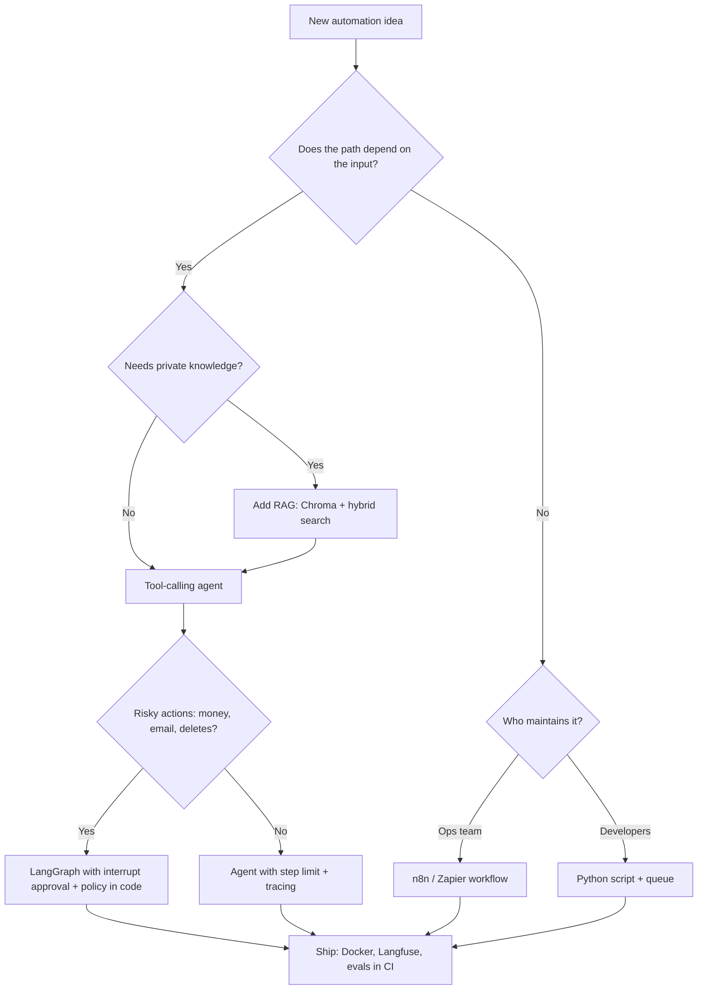

# 46 · Appendix B · Cheat Sheet: Key Commands & Snippets

> **In one line:** The one-screen reference for the whole handbook: what to install, which env vars to set, the canonical call for every SDK and framework, the Docker and CLI one-liners you type every week, and a "which tool when" table for the decisions you make on every project.

> **Versions used:** checked Nov 2026 against openai 3.49 · anthropic 2.x · google-genai 3.x · groq 1.x · litellm 1.x · ollama (Python) 0.6 · pydantic 2.14 · langchain-core 1.8 · langchain-ollama 1.1 · langgraph 1.2 · chromadb 1.5 · fastmcp 4.1.8 / mcp 2.3 · langfuse 5.2 · fastapi 0.162 · n8n 2.47 · **Fast-moving:** model names (monthly), n8n node versions (weekly), MCP spec (twice a year), agent SDKs (monthly). Every snippet reads model names from env vars for that reason. When a line here disagrees with the home chapter, the chapter wins.

---

## How to use this page

- Each block is the **shortest correct form** of something taught in full elsewhere. The arrow after a heading points at the home chapter: go there for the why, the edge cases and the error handling.
- Every snippet assumes a `.env` file loaded with `python-dotenv` and keys read with `os.environ[...]`. Nothing here hardcodes a key, and neither should you.
- **Free/local first:** the default path is Ollama + Chroma + self-hosted n8n. Paid alternatives are named next to them.
- Theory (attention, sampling maths, ANN internals) lives in the companion [AI Engineering handbook](../ai-engineering/topic.html?p=25-how-llms-work). Terms are defined in the [Ch 45 · Glossary](topic.html?p=45-glossary).

**Jump to:** [Install](#install-lines) · [Env vars](#environment-variables) · [Model SDKs](#model-sdks) · [Structured output and tools](#structured-output-and-tool-calling) · [Embeddings and vectors](#embeddings-and-vector-stores) · [LangChain and LangGraph](#langchain-and-langgraph) · [Agent frameworks](#agent-frameworks-entry-points) · [MCP](#mcp-with-fastmcp) · [n8n](#n8n) · [Ollama](#ollama-cli) · [LiteLLM](#litellm-proxy) · [Docker](#docker-one-liners) · [Queues](#scheduling-and-queues) · [Observability and evals](#observability-and-evaluation) · [Reliability](#reliability-and-cost) · [Security](#security-one-liners) · [Deploy](#deployment) · [Which tool when](#which-tool-when)

---

## Versions at a glance

| Area | Package / product | Version line used in this handbook | Churn |
|---|---|---|---|
| OpenAI | `openai` | 3.x (Responses API primary, Chat Completions for compatible servers) | medium |
| Claude | `anthropic` | 2.x (effort + adaptive thinking, no `temperature`) | medium |
| Gemini | `google-genai` | 3.x (`from google import genai`; *not* `google-generativeai`) | medium |
| Groq | `groq` | 1.x | low |
| Gateway | `litellm` | 1.x, pin exactly (several releases a week) | high |
| Local | Ollama server 0.12+ · `ollama` (Python) 0.6 | | medium |
| Schemas | `pydantic` 2.14 · `instructor` 1.17 | | low |
| LangChain | `langchain-core` 1.8 · `langchain-text-splitters` 1.1 · `langchain-community` 0.4 (being sunset) | | high |
| Graphs | `langgraph` 1.2 · `langgraph-checkpoint-sqlite` 3.1 / `-postgres` | | medium |
| Vectors | `chromadb` 1.5 · Qdrant 1.x · pgvector 0.8 | | low |
| MCP | `fastmcp` 4.1.8 · `mcp` 2.3 (spec 2026-07-28) | | high |
| Workflow | n8n 2.47 (`n8nio/n8n` + `n8nio/runners`) | | very high |
| Queues | `celery` 5.7 · `redis` 8.x · `APScheduler` 3.11 (4.x still alpha) | | low |
| Tracing | `langfuse` 5.2 · `langsmith` | | medium |
| API | `fastapi` 0.162 · `uvicorn` 0.54 · `httpx` 0.28 | | low |

---

## Install lines

All on Python 3.11+ inside a venv (`python -m venv .venv && source .venv/bin/activate`). Pin with ranges like below, then freeze exact versions in `requirements.txt` or `uv.lock` for deploys.

```bash
# core: every chapter
pip install "python-dotenv>=1" "pydantic>=2.10,<3" "httpx>=0.28" "tenacity>=9,<10"

# model SDKs                                            -> Ch 06, Ch 07, Ch 08
pip install "openai>=3,<4" "anthropic>=2,<3" "google-genai>=3" "groq>=1" "ollama>=0.6"
pip install "litellm>=1.70"                 # SDK;  "litellm[proxy]" for the gateway server
pip install "instructor>=1.17" "tiktoken>=0.14"

# RAG                                                    -> Ch 15-20
pip install "langchain-core>=1.8,<2" "langchain-text-splitters>=1.1,<2" "langchain-ollama>=1,<2"
pip install "chromadb>=1.5,<2"              # or: qdrant-client, faiss-cpu, "psycopg[binary]" pgvector
pip install "rank_bm25>=0.2.2" "pypdf>=6"   # hybrid search, PDFs
pip install "sentence-transformers>=5"      # cross-encoder rerankers (pulls torch, ~1 GB)

# agents and protocols                                   -> Ch 21-29
pip install "langgraph>=1.2,<2" "langgraph-checkpoint-sqlite>=3"     # or -postgres
pip install "fastmcp>=4.1,<5"               # MCP servers + clients
pip install crewai "openai-agents" "claude-agent-sdk" "google-adk" "pydantic-ai"   # one per venv, they pin deps

# integrations and ops                                   -> Ch 30-44
pip install "fastapi>=0.115" "uvicorn[standard]>=0.30"
pip install "celery[redis]>=5.5,<6" "APScheduler>=3.11,<4" "flower>=2"
pip install "playwright>=1.50,<2" && playwright install chromium
pip install "langfuse>=3" "deepeval" "ragas"                          # tracing + evals
pip install "presidio-analyzer" "presidio-anonymizer" && python -m spacy download en_core_web_lg
npx promptfoo@latest --version              # Node 20+; pin the version once you have a passing suite
```

> **Gotcha:** agent frameworks pin conflicting versions of `openai`, `pydantic` and `httpx`. Give each experiment its own venv (`uv venv` is fast) instead of fighting one giant environment.

---

## Environment variables

One `.env.example` for the whole handbook. Copy what a project needs, commit the example, never the `.env`.

```bash
# ---- default local path (Ch 02 llm.py helper; any OpenAI-compatible server) ----
LLM_BASE_URL=http://localhost:11434/v1     # Ollama. Groq: https://api.groq.com/openai/v1  OpenRouter: https://openrouter.ai/api/v1
LLM_API_KEY=ollama                         # any string for Ollama
LLM_MODEL=llama3.2                         # or qwen3:8b
EMBED_MODEL=nomic-embed-text
OLLAMA_HOST=http://localhost:11434

# ---- hosted providers (set only what you use; check each provider's model list) ----
OPENAI_API_KEY=
OPENAI_MODEL=gpt-5-mini
ANTHROPIC_API_KEY=
CLAUDE_MODEL=claude-opus-5-5               # also claude-sonnet-5-5, claude-haiku-5-5 (no date suffixes)
GEMINI_API_KEY=
GEMINI_MODEL=gemini-2.5-flash
GROQ_API_KEY=
GROQ_MODEL=llama-3.3-70b-versatile
OPENROUTER_API_KEY=
LITELLM_MASTER_KEY=                        # proxy admin key, long random value
HF_TOKEN=

# ---- n8n (Ch 09) ----
N8N_VERSION=2.47.4
N8N_ENCRYPTION_KEY=                        # lose it and every stored credential is unreadable
N8N_RUNNERS_AUTH_TOKEN=
N8N_WEBHOOK_URL=http://localhost:5678/     # was WEBHOOK_URL before 2.35
N8N_API_KEY=

# ---- tracing (Ch 40) ----
LANGFUSE_PUBLIC_KEY=
LANGFUSE_SECRET_KEY=
LANGFUSE_BASE_URL=https://cloud.langfuse.com   # self-hosted: http://localhost:3000 (LANGFUSE_HOST is deprecated)
LANGSMITH_TRACING=false
LANGSMITH_API_KEY=
LANGSMITH_PROJECT=default
```

```bash
python -c "import secrets; print(secrets.token_urlsafe(32))"   # generate any secret above
openssl rand -hex 32                                         # same, from the shell
```

---

## Model SDKs

→ [Ch 06 · Model APIs](topic.html?p=06-model-apis), [Ch 07 · Routing](topic.html?p=07-multi-provider-routing), [Ch 08 · Local Models](topic.html?p=08-local-models)

**Any OpenAI-compatible server** (Ollama, Groq, OpenRouter, vLLM, LiteLLM proxy). This is the `llm.py` helper from Ch 02:

```python
import os
from dotenv import load_dotenv
from openai import OpenAI

load_dotenv()
client = OpenAI(base_url=os.getenv("LLM_BASE_URL", "http://localhost:11434/v1"),
                api_key=os.getenv("LLM_API_KEY", "ollama"))
resp = client.chat.completions.create(
    model=os.getenv("LLM_MODEL", "llama3.2"),
    messages=[{"role": "system", "content": "Be brief."}, {"role": "user", "content": "Define RAG."}],
    max_tokens=200,
)
print(resp.choices[0].message.content)
```

**OpenAI, Responses API** (new OpenAI-specific code):

```python
import os
from openai import OpenAI

client = OpenAI()                                         # reads OPENAI_API_KEY
r = client.responses.create(model=os.getenv("OPENAI_MODEL", "gpt-5-mini"),
                            instructions="Be brief.", input="Define RAG.")
print(r.output_text)
```

**Claude** (no `temperature`; steer depth with effort):

```python
import os
import anthropic

client = anthropic.Anthropic()                            # reads ANTHROPIC_API_KEY, retries 429/5xx twice
msg = client.messages.create(
    model=os.getenv("CLAUDE_MODEL", "claude-opus-5-5"),
    max_tokens=1024,                                      # always required
    system="Be brief.",
    messages=[{"role": "user", "content": "Define RAG."}],
    output_config={"effort": "low"},                      # low | medium | high | xhigh | max
)
print("".join(b.text for b in msg.content if b.type == "text"))
```

**Gemini and Groq:**

```python
import os
from google import genai
from groq import Groq

g = genai.Client()                                        # reads GEMINI_API_KEY or GOOGLE_API_KEY
print(g.models.generate_content(model=os.getenv("GEMINI_MODEL", "gemini-2.5-flash"),
                                contents="Define RAG.").text)

q = Groq()                                                # reads GROQ_API_KEY; Chat Completions shape
r = q.chat.completions.create(model=os.getenv("GROQ_MODEL", "llama-3.3-70b-versatile"),
                              messages=[{"role": "user", "content": "Define RAG."}])
print(r.choices[0].message.content)
```

**Ollama native and LiteLLM:**

```python
import os
import litellm
import ollama

r = ollama.chat(model="llama3.2", messages=[{"role": "user", "content": "Define RAG."}])
print(r.message.content)
vecs = ollama.embed(model="nomic-embed-text", input=["a", "b"]).embeddings

r = litellm.completion(model="ollama_chat/llama3.2",       # or anthropic/claude-opus-5-5, groq/..., openrouter/vendor/model
                       messages=[{"role": "user", "content": "Define RAG."}], max_tokens=200)
print(r.choices[0].message.content, litellm.completion_cost(completion_response=r) if os.getenv("SHOW_COST") else "")
```

| Task | OpenAI | Claude | Gemini | OpenAI-compatible |
|---|---|---|---|---|
| Plain call | `responses.create(input=)` → `.output_text` | `messages.create(max_tokens=, messages=)` → text blocks | `models.generate_content(contents=)` → `.text` | `chat.completions.create(messages=)` → `.choices[0].message.content` |
| Stream | `responses.create(..., stream=True)` | `with messages.stream(...) as s: s.text_stream` | `generate_content_stream(...)` | `stream=True`, read `chunk.choices[0].delta.content` |
| Reasoning depth | `reasoning={"effort": ...}` | `output_config={"effort": ...}` | thinking config in `GenerateContentConfig` | model-specific |
| Count tokens | `tiktoken` (approx) | `messages.count_tokens(...)` | `models.count_tokens(...)` | `tiktoken` approx |
| Prompt cache | automatic on long prefixes | `cache_control={"type": "ephemeral"}` | implicit + explicit caches | server-specific |
| Errors | `RateLimitError`, `APIConnectionError` | `anthropic.RateLimitError`, `APIStatusError` | `google.genai.errors.APIError` | `openai.*` errors |

---

## Structured output and tool calling

→ [Ch 03 · Structured Outputs](topic.html?p=03-structured-outputs), [Ch 04 · Function Calling](topic.html?p=04-function-calling)

```python
from typing import Literal
from pydantic import BaseModel


class Ticket(BaseModel):
    intent: Literal["refund", "bug", "question"]
    urgency: int


# OpenAI-compatible (incl. Ollama):  .chat.completions.parse(..., response_format=Ticket) -> .choices[0].message.parsed
# OpenAI Responses:                  .responses.parse(..., text_format=Ticket)             -> .output_parsed
# Claude:                            .messages.parse(..., output_format=Ticket)            -> .parsed_output
# Gemini:                            config=types.GenerateContentConfig(response_mime_type="application/json",
#                                                                       response_schema=Ticket) -> .parsed
# Ollama native:                     ollama.chat(..., format=Ticket.model_json_schema())  -> Ticket.model_validate_json(...)
schema = Ticket.model_json_schema()
```

| Tool-calling piece | OpenAI Chat Completions | Claude Messages |
|---|---|---|
| Declare | `tools=[{"type": "function", "function": {"name", "description", "parameters", "strict": True}}]` | `tools=[{"name", "description", "input_schema", "strict": True}]` |
| Model asks | `message.tool_calls[i].function.arguments` (JSON string) | `block.type == "tool_use"` → `block.input` (dict) |
| You answer | `{"role": "tool", "tool_call_id": id, "content": "..."}` | `{"type": "tool_result", "tool_use_id": id, "content": "..."}` in a user turn |
| Loop ends | `finish_reason == "stop"` | `stop_reason == "end_turn"` |
| Force a tool | `tool_choice={"type": "function", ...}` | use `auto` + prompt + strict (forced choice 400s on Opus/Sonnet 5.5) |

> **Gotcha:** strict schemas need `additionalProperties: false` and every property listed in `required`. Pydantic's `model_json_schema()` does not add that for you; the SDK `parse` helpers do.

---

## Embeddings and vector stores

→ [Ch 05 · Embeddings](topic.html?p=05-embeddings), [Ch 16 · RAG](topic.html?p=16-rag-fundamentals), [Ch 18 · Vector DBs](topic.html?p=18-vector-databases)

```python
import chromadb
import ollama

docs = ["Refunds take 5 days.", "Shipping is free over 50 USD."]
emb = lambda texts: ollama.embed(model="nomic-embed-text", input=texts).embeddings   # noqa: E731

client = chromadb.PersistentClient(path="data/chroma")   # HttpClient(host=, port=8000) for the server
col = client.get_or_create_collection("kb-docs", embedding_function=None,
                                      configuration={"hnsw": {"space": "cosine"}})
col.upsert(ids=["d1", "d2"], documents=docs, embeddings=emb(docs), metadatas=[{"src": "faq"}] * 2)
hits = col.query(query_embeddings=emb(["how long for my money back?"]), n_results=2,
                 where={"src": "faq"}, include=["documents", "distances", "metadatas"])
print(hits["documents"][0], [1 - d for d in hits["distances"][0]])   # cosine distance -> similarity
```

| Store | Start it | Python entry point | Pick when |
|---|---|---|---|
| Chroma | embedded, or `docker run -p 8000:8000 chromadb/chroma` | `chromadb.PersistentClient` / `HttpClient` | prototypes, single service, < ~10 M vectors |
| Qdrant | `docker run -p 6333:6333 qdrant/qdrant` | `QdrantClient(url=)` | filtering-heavy, production self-host |
| pgvector | `pgvector/pgvector:pg16` image | SQL `ORDER BY embedding <=> %s` | you already run Postgres, want joins |
| FAISS | in-process | `faiss.IndexFlatIP` / `IndexHNSWFlat` | offline batch, no server at all |
| Pinecone | managed | `Pinecone().Index(name)` | zero ops, pay per usage |

RAG one-liners: chunk 300–800 tokens with 10–15 % overlap; keep `source`/`page` metadata; retrieve k=4–8; hybrid = BM25 + vector fused with **RRF** (`score = Σ 1/(60 + rank)`); rerank the top 20–50 with a cross-encoder; always cite chunk ids. → [Ch 17](topic.html?p=17-reranking-hybrid-search)

---

## LangChain and LangGraph

→ [Ch 13 · LCEL](topic.html?p=13-langchain-core-lcel), [Ch 23 · LangGraph](topic.html?p=23-langgraph-fundamentals), [Ch 24 · Production](topic.html?p=24-langgraph-production)

```python
import os
from langchain_core.output_parsers import StrOutputParser
from langchain_core.prompts import ChatPromptTemplate
from langchain_ollama import ChatOllama   # or langchain_anthropic.ChatAnthropic (no temperature for Claude)

prompt = ChatPromptTemplate.from_messages([("system", "Answer in one line."), ("human", "{q}")])
chain = prompt | ChatOllama(model=os.getenv("LLM_MODEL", "llama3.2")) | StrOutputParser()
# chain.invoke({"q": "What is LCEL?"});  chain.batch([...]);  for tok in chain.stream({...}): ...
```

The LangGraph skeleton: typed state, nodes return partial updates, conditional edges route, a checkpointer makes it durable, `interrupt()` pauses for a human.

```python
from typing import TypedDict

from langgraph.checkpoint.memory import InMemorySaver   # SqliteSaver / PostgresSaver in production
from langgraph.graph import END, START, StateGraph
from langgraph.types import Command, interrupt


class State(TypedDict, total=False):
    text: str
    label: str
    approved: bool


def classify(s: State) -> dict:
    return {"label": "refund" if "refund" in s["text"].lower() else "other"}


def approve(s: State) -> dict:
    decision = interrupt({"label": s["label"], "text": s["text"]})   # pauses; state saved
    return {"approved": bool(decision.get("approved"))}


g = StateGraph(State)
g.add_node("classify", classify)
g.add_node("approve", approve)
g.add_edge(START, "classify")
g.add_conditional_edges("classify", lambda s: "approve" if s["label"] == "refund" else END, ["approve", END])
g.add_edge("approve", END)
graph = g.compile(checkpointer=InMemorySaver())

if __name__ == "__main__":
    cfg = {"configurable": {"thread_id": "t-1"}}
    out = graph.invoke({"text": "Refund please"}, cfg)
    print(out["__interrupt__"][0].value)                     # what the reviewer sees
    print(graph.invoke(Command(resume={"approved": True}), cfg))
```

```text
{'label': 'refund', 'text': 'Refund please'}
{'text': 'Refund please', 'label': 'refund', 'approved': True}
```

| LangGraph need | API |
|---|---|
| Chat history state | `MessagesState` (or `Annotated[list, add_messages]`) |
| Prebuilt tool executor | `from langgraph.prebuilt import ToolNode, tools_condition` |
| Persistence | `compile(checkpointer=SqliteSaver(conn))`, thread = `{"configurable": {"thread_id": ...}}` |
| Inspect / time travel | `graph.get_state(cfg)`, `graph.get_state_history(cfg)` |
| Human approval | `interrupt(payload)` in a node → resume with `Command(resume=value)` |
| Streaming | `graph.stream(inp, cfg, stream_mode="updates")` (or `"messages"`, `"values"`) |
| Loop guard | `graph.invoke(inp, {"recursion_limit": 25, ...})` |

---

## Agent frameworks: entry points

→ [Ch 14](topic.html?p=14-langchain-tools-agents), [Ch 25](topic.html?p=25-crewai), [Ch 26](topic.html?p=26-vendor-agent-sdks), [Ch 27](topic.html?p=27-agent-frameworks-tour), [Ch 19](topic.html?p=19-llamaindex-haystack)

| Framework | Package | Minimal shape | Reach for it when |
|---|---|---|---|
| LangChain agents | `langchain` | `create_agent(model, tools=[...])` → `.invoke({"messages": [...]})` | quick tool-calling agent, middleware |
| LangGraph | `langgraph` | `StateGraph` → `compile()` (above) | you need control, durability, approvals |
| CrewAI | `crewai` | `Crew(agents=[Agent(role=, goal=, backstory=)], tasks=[Task(description=, expected_output=, agent=)]).kickoff()` | role-based content/research pipelines |
| OpenAI Agents SDK | `openai-agents` | `Runner.run_sync(Agent(name=, instructions=, tools=[...]), "input").final_output` | OpenAI-centric, handoffs + guardrails + tracing |
| Claude Agent SDK | `claude-agent-sdk` | `async for m in query(prompt=..., options=ClaudeAgentOptions(...))` | file/shell-heavy agents, Claude Code as a library |
| Google ADK | `google-adk` | `Agent(name=, model=, instruction=, tools=[...])`, `adk web` | Gemini / Vertex shops |
| PydanticAI | `pydantic-ai` | `Agent(model, output_type=Model).run_sync("...").output` | type-safe outputs, DI for tools |
| smolagents | `smolagents` | `CodeAgent(tools=[...], model=...).run("...")` | code-writing agents (sandbox them) |
| DSPy | `dspy` | `dspy.Predict("question -> answer")(question=...)` | optimise prompts from examples |
| LlamaIndex | `llama-index` | `VectorStoreIndex.from_documents(docs).as_query_engine().query("...")` | RAG-first apps |
| Haystack | `haystack-ai` | `Pipeline()` + `add_component` + `connect` | explicit, typed RAG pipelines |

> **Version note:** these SDKs ship monthly and rename things. The shapes above are the stable core; check the home chapter's Versions line before copying anything deeper.

---

## MCP with FastMCP

→ [Ch 28 · MCP](topic.html?p=28-mcp-fastmcp), [Ch 29 · A2A](topic.html?p=29-a2a-protocol)

```python
import asyncio
from typing import Annotated

from fastmcp import Client, FastMCP
from fastmcp.exceptions import ToolError
from pydantic import Field

mcp = FastMCP("crm")


@mcp.tool(annotations={"readOnlyHint": True})
def get_order(order_id: Annotated[str, Field(pattern=r"^ORD-\d{4}$")]) -> dict:
    """Fetch one order by id."""                      # the docstring is the tool description
    if order_id != "ORD-1001":
        raise ToolError(f"{order_id} not found")      # the model sees this message
    return {"id": order_id, "total": 129.0}


async def demo() -> None:
    async with Client(mcp) as c:                      # in-memory: perfect for tests
        print([t.name for t in await c.list_tools()])
        print((await c.call_tool("get_order", {"order_id": "ORD-1001"})).data)
        print((await c.call_tool("get_order", {"order_id": "ORD-9999"}, raise_on_error=False)).is_error)


if __name__ == "__main__":
    asyncio.run(demo())          # serve instead: mcp.run()  (stdio)  or  mcp.run(transport="http", port=8000)
```

```text
['get_order']
{'id': 'ORD-1001', 'total': 129.0}
True
```

| MCP task | Command / call |
|---|---|
| Run over stdio (desktop hosts) | `mcp.run()` or `fastmcp run server.py` |
| Run over Streamable HTTP | `mcp.run(transport="http", host="0.0.0.0", port=8000)` → endpoint `/mcp` |
| Connect to a URL / spawn a script | `Client("http://host:8000/mcp", auth=token)` / `Client("server.py")` |
| Bearer-token auth (simple) | `FastMCP(..., auth=StaticTokenVerifier(tokens={token: {"client_id": ..., "scopes": [...]}}))` |
| Debug interactively | `npx @modelcontextprotocol/inspector` |
| Add to Claude Code | `claude mcp add --transport http crm http://localhost:8000/mcp` |
| A2A discovery | `GET https://agent.example.com/.well-known/agent-card.json` |

---

## n8n

→ [Ch 09 · n8n](topic.html?p=09-n8n-fundamentals), [Ch 12 · n8n + Python](topic.html?p=12-n8n-with-python)

```bash
docker run -it --rm -p 5678:5678 -v n8n_data:/home/node/.n8n n8nio/n8n:2.47.4      # 60-second trial
docker compose up -d                                       # the Ch 09 stack: postgres + n8n + runners + ollama
docker compose exec n8n n8n export:workflow --all --output=/home/node/.n8n/backup/ --separate
docker compose exec n8n n8n import:workflow --separate --input=/home/node/.n8n/backup/
docker compose exec n8n n8n export:credentials --all --decrypted --output=creds.json   # handle like a secret
curl -s -H "X-N8N-API-KEY: $N8N_API_KEY" http://localhost:5678/api/v1/workflows | jq '.data[].name'
curl -s -X POST -H "X-Webhook-Token: $N8N_WEBHOOK_TOKEN" -H "Content-Type: application/json" \
     -d '{"text":"hi"}' http://localhost:5678/webhook-test/assistant      # /webhook/ once published
```

| Expression / concept | Meaning |
|---|---|
| `{{ $json.email }}` | field of the current item |
| `{{ $('Gmail Trigger').item.json.subject }}` | field from a named earlier node (paired item) |
| `{{ $now.toISO() }}`, `{{ $today }}` | Luxon dates |
| `{{ $execution.id }}` | execution id: use it as an idempotency key |
| Code node returns | JS: `return items.map(i => ({json: {...}}))` · Python (runner): `return [{"json": {...}}]` |
| Webhook test vs production | `/webhook-test/<path>` while editing, `/webhook/<path>` after **Publish** |
| Secrets | credentials (encrypted with `N8N_ENCRYPTION_KEY`), never env vars in Code nodes |
| Scale out | queue mode: Redis + `n8n worker` processes sharing Postgres and the encryption key |

---

## Ollama CLI

→ [Ch 08 · Local Models](topic.html?p=08-local-models)

| Command | Does |
|---|---|
| `ollama pull llama3.2` · `qwen3:8b` · `nomic-embed-text` | download a model (handbook defaults) |
| `ollama run llama3.2 "hi"` | one-shot prompt in the terminal |
| `ollama list` / `ollama ps` / `ollama rm <m>` | installed / loaded in memory / delete |
| `ollama show qwen3:8b` | context length, quantisation, template |
| `ollama serve` | start the server (the desktop app does this for you) |
| `OLLAMA_HOST=0.0.0.0:11434 ollama serve` | listen beyond localhost (put auth in front!) |
| `OLLAMA_KEEP_ALIVE=30m` · `OLLAMA_NUM_PARALLEL=4` · `OLLAMA_CONTEXT_LENGTH=8192` | memory residency, concurrency, default context |
| `curl localhost:11434/api/tags` | health check / list models over REST |
| `curl localhost:11434/v1/chat/completions -d '{"model":"llama3.2","messages":[...]}'` | OpenAI-compatible endpoint |
| `docker run -d -p 127.0.0.1:11434:11434 -v ollama:/root/.ollama ollama/ollama` | server in Docker (add `--gpus=all` on NVIDIA) |

Rule of thumb for VRAM at Q4: about 0.6 GB per billion parameters plus context. 3B fits in 4 GB, 8B in 8 GB, 70B needs 48 GB.

---

## LiteLLM proxy

→ [Ch 07 · Routing](topic.html?p=07-multi-provider-routing)

```yaml
# litellm.yaml: apps call aliases, the gateway owns keys, fallbacks and budgets
model_list:
  - model_name: smart
    litellm_params: {model: anthropic/claude-opus-5-5, api_key: os.environ/ANTHROPIC_API_KEY}
  - model_name: fast
    litellm_params: {model: groq/llama-3.3-70b-versatile, api_key: os.environ/GROQ_API_KEY}
  - model_name: local
    litellm_params: {model: ollama_chat/llama3.2, api_base: http://ollama:11434}
router_settings:
  num_retries: 2
  fallbacks: [{smart: [local]}, {fast: [local]}]
general_settings:
  master_key: os.environ/LITELLM_MASTER_KEY
```

```bash
litellm --config litellm.yaml --port 4000                     # or the ghcr.io/berriai/litellm image
curl -s localhost:4000/key/generate -H "Authorization: Bearer $LITELLM_MASTER_KEY" \
     -H "Content-Type: application/json" -d '{"models":["fast","local"],"max_budget":5}'
# any app: OpenAI(base_url="http://localhost:4000", api_key=<virtual key>).chat.completions.create(model="fast", ...)
```

---

## Docker one-liners

→ [Ch 39 · Deployment](topic.html?p=39-deploy-docker-cicd), companion [Docker handbook · Compose](../docker/topic.html?p=18-compose)

| Service | One-liner (dev only: no auth, local ports) |
|---|---|
| n8n | `docker run -d -p 5678:5678 -v n8n_data:/home/node/.n8n n8nio/n8n:2.47.4` |
| Ollama | `docker run -d -p 127.0.0.1:11434:11434 -v ollama:/root/.ollama ollama/ollama` |
| Chroma | `docker run -d -p 8000:8000 -v chroma:/data chromadb/chroma` |
| Qdrant | `docker run -d -p 6333:6333 -v qdrant:/qdrant/storage qdrant/qdrant` |
| Postgres + pgvector | `docker run -d -p 5432:5432 -e POSTGRES_PASSWORD=dev pgvector/pgvector:pg16` |
| Redis | `docker run -d -p 6379:6379 redis:8` |
| Langfuse (self-host) | `git clone https://github.com/langfuse/langfuse && cd langfuse && docker compose up -d` → :3000 |
| LiteLLM proxy | `docker run -p 4000:4000 -v $PWD/litellm.yaml:/app/config.yaml ghcr.io/berriai/litellm:main-stable --config /app/config.yaml` |

```bash
docker compose up -d --build            # build + start everything
docker compose logs -f api              # follow one service
docker compose exec api python -m app.kb /kb     # run a one-off inside a service
docker compose ps                       # health status
docker compose down                     # stop (add -v to DELETE volumes: n8n creds, vectors, traces)
docker system df && docker image prune  # reclaim disk (models and images are big)
```

---

## Scheduling and queues

→ [Ch 36 · Scheduling](topic.html?p=36-scheduling-task-queues), [Ch 37 · Orchestrators](topic.html?p=37-workflow-orchestrators)

| Need | Snippet |
|---|---|
| Cron: weekdays 07:30 | `30 7 * * 1-5  cd /app && .venv/bin/python digest.py >> digest.log 2>&1` |
| Cron: every 15 min | `*/15 * * * *` |
| APScheduler 3.x | `BlockingScheduler().add_job(fn, "cron", hour=7, minute=30)` then `.start()` |
| Celery task with retries | `@app.task(bind=True, autoretry_for=(Exception,), retry_backoff=True, max_retries=5, acks_late=True)` |
| Run a worker | `celery -A tasks worker -l info --concurrency 4` |
| Periodic tasks | `celery -A tasks beat -l info` (exactly one beat process) |
| Monitor | `celery -A tasks flower --port=5555` |
| Prefect | `@flow` / `@task(retries=3)`, `flow.serve(name=, cron="0 7 * * *")` |
| Temporal | durable workflows that survive restarts: activities hold the LLM calls |

> **Why this matters:** LLM tasks are slow and flaky. Anything that takes more than a few seconds belongs on a queue with retries and an **idempotency key**, not inside a webhook handler.

---

## Observability and evaluation

→ [Ch 40 · Monitoring](topic.html?p=40-observability-langsmith-langfuse), [Ch 41 · Evaluation](topic.html?p=41-evaluation)

```python
from langfuse import get_client, observe, propagate_attributes   # reads LANGFUSE_* env vars


@observe(as_type="generation", name="classify")      # also: span, tool, agent, retriever, evaluator
def classify(text: str) -> str:
    return "refund"


if __name__ == "__main__":
    with propagate_attributes(session_id="ticket-42", user_id="u-7", tags=["support"]):
        classify("refund please")
    get_client().flush()                               # short scripts must flush before exit
```

| Eval tool | Command | Good for |
|---|---|---|
| promptfoo | `npx promptfoo@latest init` · `eval -c promptfooconfig.yaml` · `view` · `redteam run` | prompt regressions, model A/B, red-teaming in CI |
| DeepEval | `deepeval test run tests/test_llm.py` | pytest-style LLM asserts (faithfulness, G-Eval) |
| RAGAS | `ragas.evaluate(dataset, metrics=[...])` | RAG metrics: faithfulness, context precision/recall |
| LangSmith | `LANGSMITH_TRACING=true` + `client.evaluate(...)` | hosted datasets + experiments for LangChain shops |
| Langfuse | datasets + LLM-as-judge evaluators in the UI | self-hosted traces + scores together |

Minimum eval habit: a **golden set** of 30–100 real inputs with expected labels, deterministic checks first (schema valid, label correct, citation exists), LLM-as-judge only for what code can't check, and a CI threshold that fails the build.

---

## Reliability and cost

→ [Ch 42 · Reliability & Cost](topic.html?p=42-reliability-cost)

```python
from openai import APIConnectionError, APITimeoutError, RateLimitError
from tenacity import retry, retry_if_exception_type, stop_after_attempt, wait_random_exponential


@retry(stop=stop_after_attempt(4), wait=wait_random_exponential(min=1, max=30), reraise=True,
       retry=retry_if_exception_type((RateLimitError, APIConnectionError, APITimeoutError)))
def call_model(prompt: str) -> str:
    ...  # never retry 400s (bad request) or auth errors: they won't get better
```

| Lever | One-liner |
|---|---|
| Cost per call | `in_tokens/1e6 * price_in + out_tokens/1e6 * price_out` (read `usage` from every response) |
| Prompt caching | stable prefix first (system + tools + docs), variable part last |
| Response cache | key = hash(model, prompt, params); Redis with TTL; only for deterministic tasks |
| Concurrency cap | `asyncio.Semaphore(8)` or `aiolimiter.AsyncLimiter(rpm, 60)` |
| Batch APIs | ~50 % cheaper for non-urgent jobs (OpenAI Batch, Claude Message Batches) |
| Model cascade | cheap model first, escalate on low confidence or failed validation |
| Budget guard | LiteLLM virtual keys with `max_budget`, plus a daily spend alert |
| Timeouts | `OpenAI(timeout=60)`, `Anthropic(timeout=...)`, and a wall-clock cap per agent run |

---

## Security one-liners

→ [Ch 43 · Prompt Injection](topic.html?p=43-prompt-injection-sandboxing), [Ch 44 · Secrets & PII](topic.html?p=44-secrets-pii)

- **Lethal trifecta:** private data + untrusted content + a way to send data out. Never give one agent all three without a human gate.
- Wrap untrusted text in tags (`<ticket>...</ticket>`) and say "data, not instructions". Helps; does **not** solve injection.
- Enforce policy in **code after the model** (amount limits, allow-listed tools, ownership checks), not in the prompt.
- Least privilege: read-only DB users, per-tool scopes, MCP tools that validate their own inputs.
- Model-written code runs in a sandbox (container with no network, E2B, Docker with `--network none --read-only`).
- Redact before logging and tracing: `AnonymizerEngine().anonymize(text=t, analyzer_results=AnalyzerEngine().analyze(text=t, language="en")).text`.
- Secrets: env vars or a secret manager, `.env` in `.gitignore`, `gitleaks detect` in CI, rotate on any leak.

---

## Deployment

→ [Ch 39 · Deployment](topic.html?p=39-deploy-docker-cicd)

```dockerfile
FROM python:3.12-slim
ENV PYTHONDONTWRITEBYTECODE=1 PYTHONUNBUFFERED=1
WORKDIR /app
COPY requirements.txt .
RUN pip install --no-cache-dir -r requirements.txt
COPY app ./app
RUN useradd -m appuser
USER appuser
HEALTHCHECK CMD python -c "import urllib.request; urllib.request.urlopen('http://localhost:8080/healthz')"
CMD ["uvicorn", "app.main:app", "--host", "0.0.0.0", "--port", "8080"]
```

```yaml
# .github/workflows/ci.yml: tests on every push, evals before deploy
name: ci
on: [push, pull_request]
jobs:
  test:
    runs-on: ubuntu-latest
    steps:
      - uses: actions/checkout@v4
      - uses: actions/setup-python@v5
        with: {python-version: "3.12", cache: pip}
      - run: pip install -r requirements.txt pytest
      - run: pytest -q
        env: {EMBED_BACKEND: hash}            # offline: no model, no keys
```

| Host | Use it for |
|---|---|
| A VPS (Hetzner, DigitalOcean) + Docker Compose + Caddy | n8n + API + vector DB for one team, cheapest per month |
| PaaS (Render, Railway, Fly.io) | a stateless FastAPI service, quick previews |
| Serverless (Cloud Run, Lambda) | spiky webhook traffic; keep state outside (Postgres, Redis) |
| GPU cloud (RunPod, Modal) or a GPU box | serving your own open-weight model at volume |

---

## Which tool when

| You need to… | Start with | Move to when… |
|---|---|---|
| Glue SaaS apps with a little AI | n8n (self-hosted) | logic grows past ~10 Code nodes → a FastAPI service n8n calls ([Ch 12](topic.html?p=12-n8n-with-python)) |
| Non-technical team owns the flow | Zapier / Make / Power Automate | volume or data residency hurts → n8n ([Ch 10](topic.html?p=10-make-zapier-power-automate)) |
| A demo chatbot over docs this week | Flowise / Langflow / Dify | you need tests, versioning, custom auth → code ([Ch 11](topic.html?p=11-flowise-langflow-dify)) |
| Extract fields reliably | Pydantic + structured outputs | accuracy plateaus → better model or few-shot, not more retries ([Ch 03](topic.html?p=03-structured-outputs)) |
| Many models, one interface | LiteLLM SDK | several apps/teams → LiteLLM proxy with virtual keys ([Ch 07](topic.html?p=07-multi-provider-routing)) |
| Private data, zero API cost | Ollama + 8B model | quality gap matters → hosted model for the hard 10 % |
| Answer questions from documents | Chroma + hybrid search | > ~10 M vectors or multi-tenant filtering → Qdrant / pgvector ([Ch 18](topic.html?p=18-vector-databases)) |
| A fixed sequence of steps | plain Python / n8n workflow | the path depends on the input → an agent |
| An agent you must control and pause | LangGraph | — (it's the production choice here) ([Ch 24](topic.html?p=24-langgraph-production)) |
| Role-play team of agents | CrewAI | cost/control matters → LangGraph |
| Expose your tools to any AI host | an MCP server (FastMCP) | other *agents* must delegate to yours → add A2A |
| Recurring jobs | cron / APScheduler | retries, fan-out, many workers → Celery + Redis; multi-step durable → Prefect / Temporal |
| A UI for an internal tool | Streamlit | chat-first → Chainlit; ML demo → Gradio ([Ch 38](topic.html?p=38-ai-uis)) |
| A website with no API | Playwright script | layout changes weekly → browser agent, with a human check ([Ch 32](topic.html?p=32-browser-agents)) |
| A desktop app with no API | pyautogui | enterprise scale → UiPath ([Ch 35](topic.html?p=35-rpa)) |
| See what happened in production | Langfuse (self-host) | LangChain-everywhere team → LangSmith |
| Prove it still works after a change | promptfoo in CI | RAG-specific metrics → RAGAS / DeepEval |



---

## Official docs index

- Models: [OpenAI](https://platform.openai.com/docs) · [Claude](https://platform.claude.com/docs) · [Gemini](https://ai.google.dev/gemini-api/docs) · [Groq](https://console.groq.com/docs) · [Ollama](https://ollama.com) · [LiteLLM](https://docs.litellm.ai) · [OpenRouter](https://openrouter.ai/docs) · [Hugging Face](https://huggingface.co/docs)
- Frameworks: [LangChain](https://python.langchain.com) · [LangGraph](https://langchain-ai.github.io/langgraph/) · [LlamaIndex](https://docs.llamaindex.ai) · [CrewAI](https://docs.crewai.com) · [FastMCP](https://gofastmcp.com) · [MCP spec](https://modelcontextprotocol.io)
- Automation and ops: [n8n](https://docs.n8n.io) · [Chroma](https://docs.trychroma.com) · [Qdrant](https://qdrant.tech/documentation/) · [Celery](https://docs.celeryq.dev) · [Langfuse](https://langfuse.com/docs) · [promptfoo](https://www.promptfoo.dev/docs/intro/) · [DeepEval](https://deepeval.com/docs/getting-started)

**Next:** put it all together in [Ch 47 · Portfolio Projects](topic.html?p=47-portfolio-projects) and the [Ch 48 · Capstone](topic.html?p=48-capstone).

---

*AI Automation with Python Handbook — chapter 46.*
