# 47 · Appendix C · 10 Portfolio Project Ideas

> **In one line:** Ten projects that climb from a weekend inbox classifier to a production LLM gateway, each scoped so you can finish it, with an architecture, milestones, stretch goals and a clear statement of what it proves to an employer or a client.

---

## How to use this list

A portfolio project is not a tutorial you followed. It is a small system that solves a **named problem for a named user**, runs on someone else's machine with one command, and shows evidence that it works: an eval table, a trace, a cost number. Three finished projects beat ten half-built ones.

How to choose:

1. **Pick one per level.** One beginner project to prove you can make a model do a reliable job, one intermediate project with retrieval or integrations, one advanced project with agents, approvals and operations. The [Ch 48 · Capstone](topic.html?p=48-capstone) counts as your advanced one.
2. **Pick a domain you know.** A recruiter-tools project built by someone who used to recruit, or an invoice extractor built by someone from finance, reads as expertise, not homework.
3. **Swap the data, keep the skeleton.** Every project below works with public or synthetic data. Replace it with data from your own field (anonymised) and the project becomes yours.
4. **Local first.** Each one runs on Ollama, Chroma and self-hosted n8n for free. Add one paid model as a comparison column in your eval table; that comparison is often the most interesting part of the write-up.

| # | Project | Level | Time | Core stack | Proves |
|---|---|---|---|---|---|
| 1 | Inbox Triage Assistant | Beginner | 1 weekend | Pydantic, Ollama, n8n | reliable structured outputs, evals |
| 2 | Invoice and Receipt Extractor | Beginner | 1 weekend | vision LLM, PyMuPDF, Google Sheets | multimodal extraction with validation |
| 3 | Meeting Notes to Action Items | Beginner+ | 1–2 weekends | Whisper, Slack bot, Celery | audio pipeline, bot integration |
| 4 | Cited Docs Q&A | Intermediate | 2 weekends | hybrid RAG, reranker, Streamlit, RAGAS | retrieval quality you can measure |
| 5 | Lead Research and Outreach Drafts | Intermediate | 2 weekends | n8n + FastAPI, Playwright, approval step | hybrid low-code + code, safe automation |
| 6 | Competitor Change Monitor | Intermediate | 2 weekends | Playwright, Celery beat, diffing, LLM summary | scheduled pipelines, cost control |
| 7 | MCP Server for an Internal API | Intermediate+ | 1–2 weekends | FastMCP, auth, Claude Desktop / Code | tool design, least privilege |
| 8 | Multi-Agent Research Reports | Advanced | 3 weekends | LangGraph vs CrewAI, reflection | agent control, honest framework comparison |
| 9 | Voice Receptionist | Advanced | 3 weekends | Whisper/TTS or Vapi/Retell, calendar API | real-time latency budgets, telephony |
| 10 | LLM Gateway and Observability Platform | Advanced | 3 weekends | LiteLLM proxy, Langfuse, promptfoo CI | platform thinking: cost, budgets, evals |

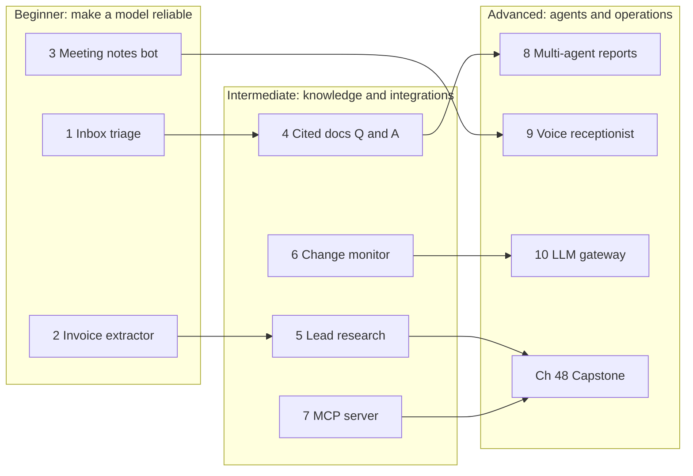

Every project uses the same Definition of Done:

- `docker compose up` (or one documented command) starts it from a clean clone.
- `.env.example` lists every variable; no key in the repo, ever ([Ch 44](topic.html?p=44-secrets-pii)).
- A golden set of at least 30 examples and an eval script with a results table in the README ([Ch 41](topic.html?p=41-evaluation)).
- Tests that run offline in CI with the model mocked ([Ch 39](topic.html?p=39-deploy-docker-cicd)).
- Cost per run (or per 1,000 items) measured from `usage`, not guessed ([Ch 42](topic.html?p=42-reliability-cost)).
- A two-to-three-minute demo video and an architecture diagram.

---

## 1 · Inbox Triage Assistant (Beginner)

**Problem.** A five-person support or sales team gets 150 emails a day into a shared inbox. Someone spends the first hour of each morning tagging and routing them. Classify each email (intent, urgency, customer, language), extract key fields, and route it, with a confidence score that sends uncertain ones to a human.

**Stack.** Python 3.11+, Pydantic, Ollama (`qwen3:8b` or `llama3.2`) through the `llm.py` helper, one paid model for comparison, self-hosted n8n with the Gmail trigger (or an IMAP folder), SQLite for results.

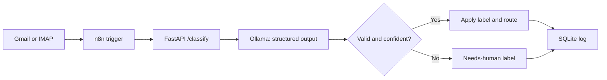

**Milestones.**
1. Pydantic `Triage` model with `Literal` intents and a `confidence` field; a CLI that classifies a `.eml` folder ([Ch 03](topic.html?p=03-structured-outputs)).
2. Golden set: 50 real (anonymised) emails labelled by hand; `eval.py` prints accuracy per intent and a confusion matrix with pandas.
3. Prompt iteration with few-shot examples, tracked in Git, each version with its eval score ([Ch 02](topic.html?p=02-prompt-engineering)).
4. Wrap in FastAPI; n8n workflow calls it and applies Gmail labels ([Ch 09](topic.html?p=09-n8n-fundamentals), [Ch 12](topic.html?p=12-n8n-with-python)).
5. Compare Ollama vs one hosted model on accuracy, latency and cost per 1,000 emails.

**Stretch goals.** Draft replies for the two most common intents (drafts only, never sent); route via LiteLLM aliases so the model is a config change ([Ch 07](topic.html?p=07-multi-provider-routing)); language detection and reply in the customer's language.

**What it proves.** You can turn fuzzy text into validated data, measure accuracy instead of eyeballing it, and choose a model on evidence.

**Chapters.** 01, 02, 03, 06, 07, 08, 09, 12, 41.

---

## 2 · Invoice and Receipt Extractor (Beginner)

**Problem.** A small accounting firm receives supplier invoices as PDFs and phone photos. Staff retype vendor, date, totals, VAT and line items into a spreadsheet. Extract them automatically, check the arithmetic, and flag anything that doesn't add up.

**Stack.** PyMuPDF for digital PDFs, a vision model (a local vision model through Ollama such as `qwen2.5vl`, or Claude/GPT/Gemini) for scans and photos, Tesseract as a cheap baseline, Pydantic with validators, Google Sheets API (or a CSV), a Streamlit upload page.

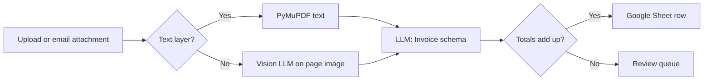

**Milestones.**
1. `Invoice` and `LineItem` Pydantic models with a `model_validator` that checks `sum(lines) + tax == total` within one cent ([Ch 03](topic.html?p=03-structured-outputs)).
2. Text path for digital PDFs; vision path for images; route by whether the PDF has a text layer ([Ch 20](topic.html?p=20-document-parsing), [Ch 34](topic.html?p=34-ocr-vision)).
3. Golden set of 30 invoices from at least 8 layouts; field-level accuracy table (vendor, date, total, VAT ID).
4. Append validated rows to Google Sheets with a service account ([Ch 30](topic.html?p=30-google-workspace-m365)).
5. Streamlit page: upload, see extracted fields beside the image, correct and approve ([Ch 38](topic.html?p=38-ai-uis)).

**Stretch goals.** Email intake through n8n; duplicate detection (same vendor + invoice number); currency normalisation; per-field confidence highlighting in the UI.

**What it proves.** You can handle messy real-world inputs, combine deterministic checks with model output, and design a human review step instead of trusting the model blindly.

**Chapters.** 03, 08, 20, 30, 34, 38, 41.

---

## 3 · Meeting Notes to Action Items (Beginner+)

**Problem.** A team records its calls, nobody writes notes, and action items get lost. Upload a recording (or drop it in a folder); get a summary, decisions and owner-assigned action items posted to Slack, with tasks created in the team's tracker.

**Stack.** `faster-whisper` locally (or a hosted transcription API), an LLM with a structured `Minutes` schema, a Slack bot (Bolt for Python), Celery + Redis because transcription takes minutes, an optional Trello/Linear/Jira API.

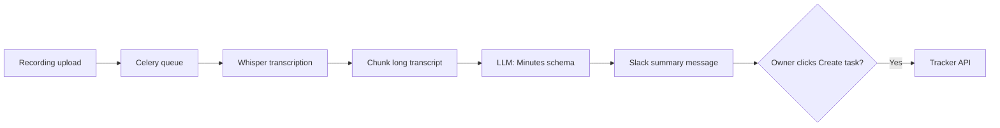

**Milestones.**
1. Transcribe a 30-minute recording locally and record real-time factor on your hardware ([Ch 33](topic.html?p=33-voice-agents)).
2. Map-reduce summarisation for transcripts longer than the context window; `Minutes` schema with `decisions`, `action_items[owner, task, due]` ([Ch 01](topic.html?p=01-how-llms-work), [Ch 03](topic.html?p=03-structured-outputs)).
3. Celery task with retries and an idempotency key per file hash ([Ch 36](topic.html?p=36-scheduling-task-queues)).
4. Slack bot posts a formatted message with buttons; clicking creates the task ([Ch 31](topic.html?p=31-chat-bots)).
5. Eval: 10 transcripts with hand-written action items; measure recall of action items and owner accuracy.

**Stretch goals.** Speaker diarisation; a weekly digest of open action items; redact names and phone numbers before anything leaves your machine ([Ch 44](topic.html?p=44-secrets-pii)).

**What it proves.** You can build an asynchronous pipeline with slow steps, handle long inputs, and meet users inside the tool they already use.

**Chapters.** 01, 03, 31, 33, 36, 44.

---

## 4 · Cited Docs Q&A (Intermediate)

**Problem.** An internal team (HR, IT, a product's support desk) answers the same questions from a pile of PDFs and wiki pages. Build a Q&A assistant that answers only from those documents, cites the exact chunk, says "I don't know" when the answer isn't there, and keeps its index fresh.

**Stack.** Document loaders and splitters, Ollama `nomic-embed-text`, Chroma (or Qdrant), BM25 hybrid search with RRF, a cross-encoder reranker, Streamlit or Chainlit, RAGAS or DeepEval for retrieval and faithfulness metrics.

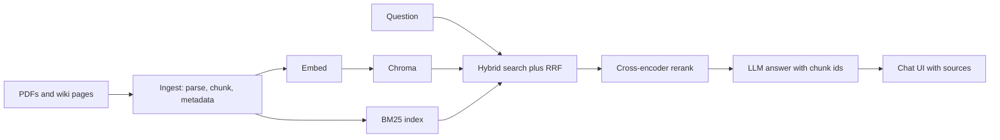

**Milestones.**
1. Ingest 50+ real documents with source, page and section metadata; idempotent re-ingest by content hash ([Ch 15](topic.html?p=15-document-loaders-splitters), [Ch 20](topic.html?p=20-document-parsing)).
2. Baseline vector RAG with citations; 40-question golden set with the expected source for each ([Ch 16](topic.html?p=16-rag-fundamentals)).
3. Add BM25 + RRF and a reranker; report **hit@5** and **MRR** before and after ([Ch 17](topic.html?p=17-reranking-hybrid-search)).
4. Faithfulness and answer-relevance scores with RAGAS or DeepEval; an "unanswerable" subset that must produce a refusal ([Ch 41](topic.html?p=41-evaluation)).
5. Chat UI with streaming and clickable sources ([Ch 38](topic.html?p=38-ai-uis)).

**Stretch goals.** Compare Chroma, Qdrant and pgvector on the same data ([Ch 18](topic.html?p=18-vector-databases)); rebuild the same app in LlamaIndex and compare lines of code and quality ([Ch 19](topic.html?p=19-llamaindex-haystack)); per-user document permissions as metadata filters.

**What it proves.** You understand retrieval as an engineering problem with metrics, not a magic box, and you can show the numbers that justify each component.

**Chapters.** 05, 15, 16, 17, 18, 19, 20, 38, 41.

---

## 5 · Lead Research and Outreach Drafts (Intermediate)

**Problem.** A B2B founder spends evenings researching inbound leads: company size, what they do, a recent news hook, then writing a first email. Automate the research and the draft, but never send without a human click.

**Stack.** n8n (form or CRM trigger, Slack approval message, Gmail draft), a FastAPI research service, Playwright for the company website, a search API, an LLM for the summary and draft, SQLite for history.

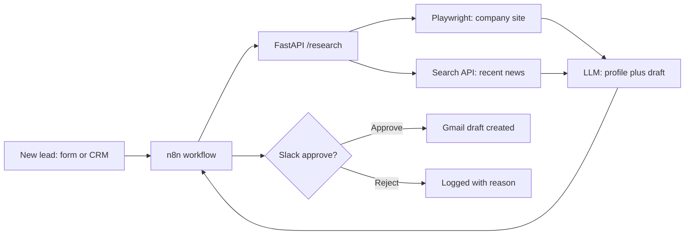

**Milestones.**
1. Playwright scraper that extracts the homepage, about page and pricing page text with timeouts and a robots.txt check ([Ch 32](topic.html?p=32-browser-agents)).
2. `LeadProfile` schema (industry, size band, product, hook with source URL) and a draft generator with a style guide prompt ([Ch 02](topic.html?p=02-prompt-engineering), [Ch 03](topic.html?p=03-structured-outputs)).
3. n8n workflow: trigger → HTTP Request to FastAPI with header auth → Slack message with Approve/Reject → Gmail **draft** ([Ch 09](topic.html?p=09-n8n-fundamentals), [Ch 12](topic.html?p=12-n8n-with-python)).
4. Treat scraped pages as untrusted: tags around web content, no tools available to the drafting call, injection test cases in the eval set ([Ch 43](topic.html?p=43-prompt-injection-sandboxing)).
5. Eval: 25 leads, human-rated hook accuracy (is the fact true and sourced?) and draft quality on a 1–5 rubric.

**Stretch goals.** CRM write-back (HubSpot or a Postgres table); A/B two prompt styles and track reply rate; rebuild the n8n part in Make or Zapier and compare ([Ch 10](topic.html?p=10-make-zapier-power-automate)).

**What it proves.** You know where logic belongs (n8n for glue, Python for brains), you design human approval into anything that talks to customers, and you treat the web as hostile input.

**Chapters.** 02, 03, 09, 10, 12, 32, 43.

---

## 6 · Competitor Change Monitor (Intermediate)

**Problem.** A product marketing team wants to know when competitors change pricing pages, feature lists or changelogs. Check a list of URLs daily, detect meaningful changes (not ads or timestamps), summarise what changed and why it matters, and send a weekly digest.

**Stack.** Playwright, `trafilatura` or BeautifulSoup for main-content extraction, `difflib`, Celery beat + Redis (or APScheduler), an LLM for "is this change meaningful?" plus summary, a response cache, email or Slack digest.

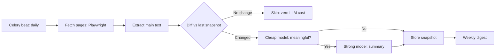

**Milestones.**
1. Snapshot store (SQLite: url, hash, text, fetched_at) and a fetcher with retries, jittered timing and per-domain rate limits ([Ch 32](topic.html?p=32-browser-agents)).
2. Deterministic diff first: only changed pages ever reach a model. Log how many LLM calls that saves.
3. Two-model cascade: a small local model filters noise, a stronger one writes the summary ([Ch 42](topic.html?p=42-reliability-cost)).
4. Celery beat schedule, idempotent tasks keyed by `(url, date)`, Flower for monitoring ([Ch 36](topic.html?p=36-scheduling-task-queues)).
5. Weekly digest grouped by competitor, with before/after snippets and links.

**Stretch goals.** Move the pipeline to Prefect and compare the developer experience ([Ch 37](topic.html?p=37-workflow-orchestrators)); screenshot diffs with a vision model; a cost dashboard per competitor per month.

**What it proves.** You build cheap, boring, reliable pipelines: deterministic filters before LLM calls, model cascades, scheduling with idempotency, and cost you can quote.

**Chapters.** 32, 36, 37, 42.

---

## 7 · MCP Server for an Internal API (Intermediate+)

**Problem.** A company has an internal REST API (inventory, HR directory, ticketing). People want to ask Claude Desktop, Claude Code or Cursor questions about it. Build an MCP server that exposes a small, safe set of tools and resources over that API, with auth and an audit log.

**Stack.** FastMCP, httpx, Pydantic-typed tool parameters, bearer-token or OAuth auth, Streamable HTTP transport behind Caddy, an audit log, pytest with the in-memory `Client`.

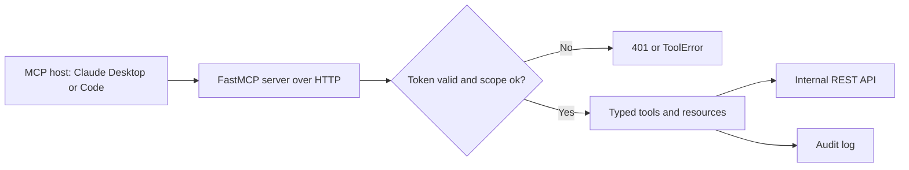

**Milestones.**
1. Pick 5 tools from real user questions; design names, docstrings and typed parameters so a model can't misuse them ([Ch 04](topic.html?p=04-function-calling), [Ch 28](topic.html?p=28-mcp-fastmcp)).
2. Read-only first: `readOnlyHint` annotations, a read-only API token, resources for reference data.
3. In-memory tests for every tool, including error paths that return helpful `ToolError` messages.
4. HTTP transport with auth, deployed in Docker, connected to Claude Code with `claude mcp add`.
5. One write tool (e.g. create a ticket) gated by a confirmation parameter and logged with the caller identity ([Ch 43](topic.html?p=43-prompt-injection-sandboxing)).

**Stretch goals.** Use the same server from a LangGraph agent and an n8n MCP Client node; expose the agent itself over A2A with an agent card ([Ch 29](topic.html?p=29-a2a-protocol)); per-tool rate limits.

**What it proves.** You can design tools for models (the hardest part of agents), apply least privilege, and ship something that plugs into every major AI host.

**Chapters.** 04, 28, 29, 43, 44.

---

## 8 · Multi-Agent Research Reports (Advanced)

**Problem.** An analyst writes two-page briefs on companies or technologies from public sources. Build an agent system that plans the research, gathers sources, drafts, critiques and revises, and produces a cited report. Then build it twice, once in LangGraph and once in CrewAI, and write an honest comparison.

**Stack.** LangGraph (plan-and-execute with a reflection loop and a step budget), CrewAI for the comparison build, a search API and a page fetcher, RAG over gathered sources, Langfuse traces for both builds.

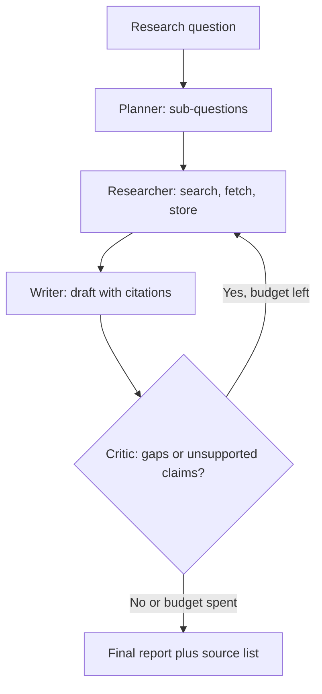

**Milestones.**
1. Single-agent ReAct baseline with search and fetch tools; record cost, steps and quality on 10 topics ([Ch 21](topic.html?p=21-agent-patterns)).
2. LangGraph version: typed state, planner/researcher/writer/critic nodes, a max-iterations guard and checkpointing ([Ch 23](topic.html?p=23-langgraph-fundamentals), [Ch 24](topic.html?p=24-langgraph-production)).
3. Citation checker in code: every claim sentence must map to a fetched source chunk; unsupported claims go back to the critic.
4. CrewAI version with the same roles and tools ([Ch 25](topic.html?p=25-crewai)).
5. Comparison table: quality score (rubric judged by a model plus your own spot check), tokens, latency, lines of code, debuggability, from Langfuse traces ([Ch 40](topic.html?p=40-observability-langsmith-langfuse)).

**Stretch goals.** A third build with the OpenAI Agents SDK or PydanticAI ([Ch 26](topic.html?p=26-vendor-agent-sdks), [Ch 27](topic.html?p=27-agent-frameworks-tour)); long-term memory of past reports with Mem0 ([Ch 22](topic.html?p=22-agent-memory-mem0)); a human checkpoint on the plan before research starts.

**What it proves.** You can build agents that stop, cite and stay on budget, and you can evaluate frameworks with evidence instead of hype. The comparison write-up is often what gets you the interview.

**Chapters.** 21, 22, 23, 24, 25, 26, 27, 40, 41.

---

## 9 · Voice Receptionist (Advanced)

**Problem.** A dental clinic or a repair shop misses calls after hours. Build a voice agent that answers, handles FAQs from the clinic's documents, checks calendar availability, books or reschedules appointments, and texts a confirmation, handing off to a human for anything medical or angry.

**Stack.** Either a managed voice platform (Vapi or Retell) with your FastAPI tool endpoints, or a DIY pipeline (streaming STT, LLM, streaming TTS such as ElevenLabs or a local TTS), Google Calendar API, small RAG over the FAQ, Twilio for SMS.

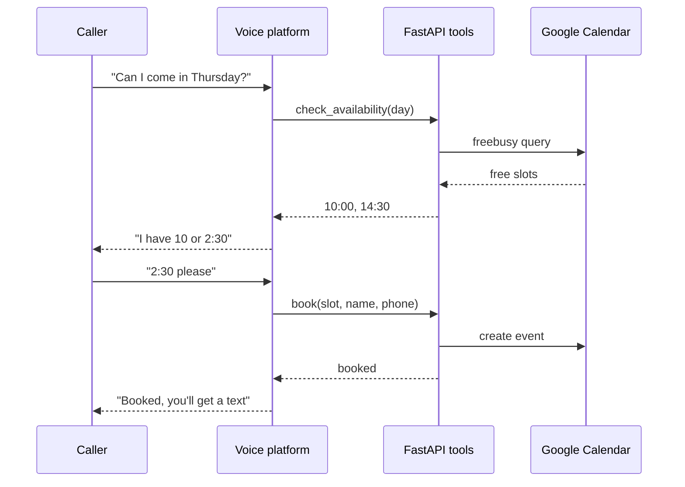

**Milestones.**
1. Text-only version first: the same tools (`faq`, `check_availability`, `book`, `handoff`) in a tool loop, tested with 30 scripted conversations ([Ch 04](topic.html?p=04-function-calling)).
2. Calendar integration with a service account and timezone-correct slots ([Ch 30](topic.html?p=30-google-workspace-m365)).
3. Voice: wire the tools to Vapi or Retell webhooks (or the DIY pipeline); measure end-to-end response latency per turn and keep it under about 1 second ([Ch 33](topic.html?p=33-voice-agents)).
4. Guardrails: never give medical advice, confirm details back before booking, handoff on keywords or sentiment ([Ch 43](topic.html?p=43-prompt-injection-sandboxing)).
5. Call summaries with PII redacted, stored for 30 days only ([Ch 44](topic.html?p=44-secrets-pii)).

**Stretch goals.** Outbound reminder calls; a WhatsApp channel that shares the same tools ([Ch 31](topic.html?p=31-chat-bots)); a dashboard of calls, bookings and handoffs.

**What it proves.** You can design for real-time latency, integrate with telephony and calendars, and put safety rails on an agent that talks to the public.

**Chapters.** 04, 16, 30, 31, 33, 43, 44.

---

## 10 · LLM Gateway and Observability Platform (Advanced)

**Problem.** A company has five teams calling three model providers with keys pasted into each app. Nobody knows the monthly spend per team, outages take apps down, and prompt changes ship without tests. Build the internal platform: one gateway, per-team keys and budgets, fallbacks, caching, tracing and an eval gate in CI.

**Stack.** LiteLLM proxy with Postgres, Redis response cache, Ollama as the always-on fallback, Langfuse self-hosted, promptfoo in GitHub Actions, Docker Compose on a VPS with Caddy for TLS.

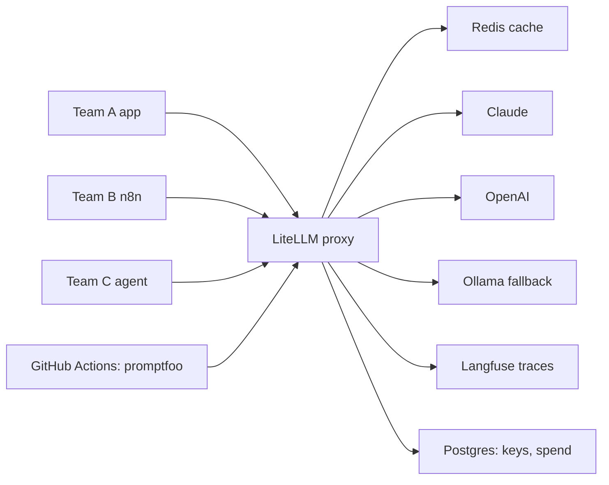

**Milestones.**
1. Proxy with aliases (`fast`, `smart`, `local`), fallbacks and per-alias retries; prove failover by killing a provider key ([Ch 07](topic.html?p=07-multi-provider-routing)).
2. Virtual keys per team with budgets and rate limits; a spend report per team per day.
3. Response caching for deterministic calls and a measured hit rate; prompt-caching guidance for teams ([Ch 42](topic.html?p=42-reliability-cost)).
4. Langfuse callbacks on the proxy; a dashboard of cost, latency p95 and error rate per alias ([Ch 40](topic.html?p=40-observability-langsmith-langfuse)).
5. A reusable GitHub Actions workflow that runs a team's promptfoo suite against the gateway and blocks merges below threshold ([Ch 39](topic.html?p=39-deploy-docker-cicd), [Ch 41](topic.html?p=41-evaluation)).

**Stretch goals.** PII redaction as a proxy guardrail ([Ch 44](topic.html?p=44-secrets-pii)); a cost-based router that sends short prompts to cheap models; a load test with Locust and a capacity note.

**What it proves.** You think like a platform engineer: shared infrastructure, cost attribution, failure isolation and quality gates. This is the profile companies hire for once their second AI feature ships.

**Chapters.** 06, 07, 08, 39, 40, 41, 42, 44.

---

## Skills coverage

| Skill | 1 | 2 | 3 | 4 | 5 | 6 | 7 | 8 | 9 | 10 |
|---|---|---|---|---|---|---|---|---|---|---|
| Structured outputs | ● | ● | ● | | ● | ● | | | | |
| RAG and retrieval eval | | | | ● | | | | ● | ● | |
| n8n / low-code | ● | | | | ● | | ○ | | | ○ |
| Agents and tool design | | | | | | | ● | ● | ● | |
| MCP / A2A | | | | | | | ● | ○ | | |
| Integrations (mail, chat, calendar) | ● | ● | ● | | ● | ● | | | ● | |
| Queues and scheduling | | | ● | | | ● | | | | |
| Human approval | ○ | ● | ● | | ● | | ● | ○ | ● | |
| Observability and cost | ○ | | | ○ | | ● | ○ | ● | ○ | ● |
| Evals in CI | ● | ● | ○ | ● | ○ | ○ | ● | ● | ○ | ● |
| Security and PII | | | ● | | ● | | ● | | ● | ● |

● core to the project · ○ natural stretch goal. A portfolio of 1 + 4 + 7 + the capstone covers every row.

---

## Presenting a project

A hiring manager or client gives your repo about five minutes. Spend them well.

**README skeleton.**

```markdown
# Support Inbox Triage

Classifies ~150 support emails/day into 6 intents with 94% accuracy on a 50-email golden set,
routes them in Gmail via n8n, and sends uncertain ones (12%) to a human. Runs fully local on Ollama.

  · [3-minute demo](https://...)

## Results
| Model            | Accuracy | p95 latency | Cost / 1k emails |
|------------------|----------|-------------|------------------|
| qwen3:8b (local) | 0.91     | 2.1 s       | $0 (hardware)    |
| hosted model X   | 0.95     | 1.3 s       | $0.40            |

## Run it
cp .env.example .env && docker compose up -d && make eval

## How it works / Decisions / Limits
- Why structured outputs instead of free text …
- What it gets wrong and how I know …
```

**What reviewers look for.**

| Signal | How to show it |
|---|---|
| It runs | one command from a clean clone; CI badge green |
| It works | an eval table with real numbers, including failures |
| You understand cost | cost per item measured from `usage`, local vs hosted |
| You understand risk | where the human approves, what the model can never do, how secrets are handled |
| You make decisions | a "Decisions" section: what you tried, what you dropped, why |
| You can operate it | a screenshot of traces, a note on what you'd monitor |

> **Gotcha:** don't hide the failures. A table that says "fails on handwritten receipts, 40 % accuracy, so they go to the review queue" is more convincing than a perfect score nobody believes.

**Talking about it in an interview.** Prepare three two-minute stories per project: the hardest bug, the decision you'd change, and the number you're proudest of. Use the checkpoint questions in [Ch 49 · Roadmap](topic.html?p=49-roadmap) as practice prompts.

---

## Official docs

- [n8n docs](https://docs.n8n.io) · [LangGraph](https://langchain-ai.github.io/langgraph/) · [CrewAI](https://docs.crewai.com) · [FastMCP](https://gofastmcp.com) · [Chroma](https://docs.trychroma.com)
- [Ollama](https://ollama.com) · [LiteLLM](https://docs.litellm.ai) · [Langfuse](https://langfuse.com/docs) · [promptfoo](https://www.promptfoo.dev/docs/intro/) · [RAGAS](https://docs.ragas.io)

**Next:** build the advanced one end to end in [Ch 48 · Capstone](topic.html?p=48-capstone).

---

*AI Automation with Python Handbook — chapter 47.*
