# 49 · Appendix E · 12-Week Learning Roadmap

> **In one line:** Twelve weeks, eight to twelve hours a week, one shipped deliverable every Sunday: from your first LLM call to a deployed, traced, eval-gated support agent you can show an employer or client.

---

## How this plan works

You already write Python, call REST APIs, handle webhooks and query SQL. This plan does not waste your time on those. It spends every hour on the parts that are new: model behaviour, retrieval, agents, protocols and the operational discipline that keeps AI automations honest in production.

Three rules shape every week:

1. **Build beats read.** Each week ends with a deliverable that runs on your machine and lives in a Git repo. Reading a chapter without running its mini project counts as half a chapter.
2. **Local first, paid second.** Everything can be done with Ollama, Chroma and self-hosted n8n for free. Add a paid model (Claude, OpenAI, Gemini, Groq) when you want to compare quality, and set a spend limit in every console on day one.
3. **Checkpoints before progress.** Each week lists checkpoint questions. If you can't answer them out loud in two minutes each, spend the first session of next week on review instead of new material.

**Budget:** 8–12 hours per week. A typical rhythm is two weekday evenings of reading and examples (2 × 2 h) plus one long weekend session for the build (4–6 h). If you only have 5 hours a week, stretch the plan to 20 weeks by splitting the heavy weeks (6, 8, 9 and 12) in two.

**What you will need:** Python 3.11+, Docker Desktop (or Docker Engine on Linux), 16 GB RAM for comfortable local models (8 GB works with `llama3.2` 3B), a GitHub account, and optionally a free Langfuse Cloud account.

---

## Overview

| Week | Theme | Chapters | Hours | Deliverable |
|---|---|---|---|---|
| 1 | Talking to models | 01, 02, 03 | 8–10 | Email triage CLI with Pydantic output and a 30-row golden set |
| 2 | Tools, vectors and vendors | 04, 05, 06 | 9–11 | Ops assistant with a tool loop that runs on Ollama and Claude |
| 3 | Routing, local models, n8n | 07, 08, 09 | 9–11 | LiteLLM router (`fast`/`smart`/`local`) and a self-hosted n8n triage workflow |
| 4 | Low-code meets code | 10, 11, 12 | 8–10 | n8n workflow calling your FastAPI classifier, with auth and retries |
| 5 | LangChain foundations | 13, 14, 15 | 9–11 | LCEL extraction chain and a document ingest script with metadata |
| 6 | Retrieval that works | 16, 17, 18, 19, 20 | 11–13 | Hybrid RAG over 50+ real documents with citations and a retrieval eval |
| 7 | Agents as graphs | 21, 22, 23, 24 | 10–12 | LangGraph agent with tools, memory, checkpoints and an approval interrupt |
| 8 | Frameworks and protocols | 25, 26, 27, 28, 29 | 10–12 | FastMCP server used by your Week 7 agent, plus a framework comparison note |
| 9 | Where users live | 30, 31, 32, 33, 34, 35 | 10–12 | A Gmail or Slack bot that answers from your RAG, end to end |
| 10 | Running on time and with a face | 36, 37, 38 | 8–10 | Celery or Prefect nightly pipeline plus a Streamlit chat UI |
| 11 | Production discipline | 39, 40, 41, 42, 43, 44 | 11–13 | Dockerised app with Langfuse traces, an eval job in CI, retries and PII redaction |
| 12 | Capstone and portfolio | 45, 46, 47, 48 | 12–15 | Support Ops Copilot shipped, README, demo video and a portfolio write-up |

Total: roughly 115–140 hours.

```mermaid
flowchart LR
  subgraph M1["Month 1 - Foundations"]
    W1["W1 Prompts and JSON"] --> W2["W2 Tools and embeddings"] --> W3["W3 Routing and n8n"] --> W4["W4 Hybrid n8n plus Python"]
  end
  subgraph M2["Month 2 - Retrieval and agents"]
    W5["W5 LangChain"] --> W6["W6 RAG"] --> W7["W7 LangGraph"] --> W8["W8 MCP and frameworks"]
  end
  subgraph M3["Month 3 - Ship it"]
    W9["W9 Integrations"] --> W10["W10 Queues and UIs"] --> W11["W11 Deploy, observe, evaluate, secure"] --> W12["W12 Capstone"]
  end
  W4 --> W5
  W8 --> W9
  W12 --> P["Portfolio and interviews"]
```

The three months map to three questions an employer asks: *Can you make a model do a reliable job?* *Can you give it knowledge and agency without losing control?* *Can you run it in production?*

---

## Week 1 · Talking to models

**Goals**
- Explain tokens, context windows, sampling and cost well enough to estimate a monthly bill.
- Write prompts as versioned code with a system prompt, delimiters and few-shot examples.
- Get schema-valid JSON every time with Pydantic and structured outputs.

**Reading**
- [Ch 01 · How LLMs Work](topic.html?p=01-how-llms-work)
- [Ch 02 · Prompt Engineering](topic.html?p=02-prompt-engineering)
- [Ch 03 · Structured Outputs](topic.html?p=03-structured-outputs)

**Setup tasks (first session)**
- Install Ollama, run `ollama pull llama3.2` and `ollama pull nomic-embed-text`.
- Create a repo `ai-automation-lab` with a venv, `.env.example`, `.gitignore` (including `.env`) and the shared `llm.py` helper from Ch 02.

**Build task:** an email triage CLI. It reads a CSV of emails, returns `{label, account_id, summary}` per row as a validated Pydantic object, and writes a results CSV. Add the 30-row golden set from the Ch 02 mini project and a `regress.py` that prints accuracy per label.

**Checkpoint questions**
- Why does the same prompt cost more tokens in German than in English?
- What is the difference between JSON mode and schema-constrained structured outputs?
- Why can't you set `temperature` on current Claude models, and what do you use instead?
- Your extraction is valid JSON but the date is wrong. Which layer failed, and how would you catch it?

---

## Week 2 · Tools, vectors and vendors

**Goals**
- Implement the tool loop by hand: schemas out, tool calls in, results back, step limit.
- Use embeddings for semantic search, dedup and routing without a vector database.
- Call OpenAI, Claude, Gemini and Groq with their native SDKs and know their differences.

**Reading**
- [Ch 04 · Function Calling](topic.html?p=04-function-calling)
- [Ch 05 · Embeddings](topic.html?p=05-embeddings)
- [Ch 06 · Model APIs](topic.html?p=06-model-apis)

**Build task:** extend the Ch 04 Ops Assistant over SQLite. It must run on Ollama by default and on Claude with one env-var change, ask for human confirmation before any write tool, and log tokens per call. Add a `search_faq` tool backed by an in-memory embedding index from Ch 05.

**Checkpoint questions**
- Draw the tool loop from memory. Where do tool results go in Claude's message list, and in OpenAI's?
- Why should every tool loop have a `max_steps`?
- When would cosine similarity on unnormalised vectors give you a misleading ranking?
- Name one thing the Responses API gives you that Chat Completions does not.

---

## Week 3 · Routing, local models and n8n

**Goals**
- Put a routing layer between your code and providers: aliases, fallbacks, budgets.
- Know when a local model is good enough and how to size it to your hardware.
- Run n8n in Docker and build a webhook-triggered workflow with the AI Agent node.

**Reading**
- [Ch 07 · Multi-Provider Routing](topic.html?p=07-multi-provider-routing)
- [Ch 08 · Local Models](topic.html?p=08-local-models)
- [Ch 09 · n8n Fundamentals](topic.html?p=09-n8n-fundamentals)

**Build task:** two pieces.
1. `router.py` with LiteLLM aliases `fast`, `smart` and `local`, a fallback chain ending in `local`, and a chaos test (wrong API key) that proves the fallback works.
2. A self-hosted n8n workflow: Webhook → AI Agent (Ollama chat model) → IF (label) → Slack or email node, with credentials stored in n8n, never in the workflow JSON.

**Checkpoint questions**
- What is the difference between a fallback and load balancing?
- Ollama answers your long prompt with nonsense. What setting do you check first?
- What is an n8n *item*, and why does that matter when an HTTP node returns a list?
- Where would you keep the `smart` → model mapping so product managers can't break it by accident?

---

## Week 4 · Low-code meets code

**Goals**
- Compare n8n with Make, Zapier and Power Automate on cost model, limits and governance.
- Know when a visual LLM builder (Flowise, Langflow, Dify) is the right tool and when to graduate.
- Split responsibilities cleanly between an n8n workflow and a Python service.

**Reading**
- [Ch 10 · Make, Zapier & Power Automate](topic.html?p=10-make-zapier-power-automate)
- [Ch 11 · Flowise, Langflow & Dify](topic.html?p=11-flowise-langflow-dify)
- [Ch 12 · Connecting n8n with Python](topic.html?p=12-n8n-with-python)

**Build task:** move the triage logic out of n8n into a FastAPI service (`POST /classify` with an API key header). n8n keeps the trigger, the branching and the integrations; Python owns the prompt, the schema and the tests. Add a Python script that triggers an n8n webhook with an HMAC signature.

**Checkpoint questions**
- A client pays per Zapier task and sends 40,000 emails a month. What does your cost comparison look like?
- Which logic belongs in n8n and which in Python? Give two examples of each.
- How do you authenticate n8n calling your FastAPI service, and the reverse?

---

## Week 5 · LangChain foundations

**Goals**
- Compose prompt, model and parser with LCEL and use `invoke`, `batch` and `stream`.
- Build a LangChain tool-calling agent and know how it relates to LangGraph.
- Load and split real documents with sensible chunk sizes and useful metadata.

**Reading**
- [Ch 13 · LangChain Core](topic.html?p=13-langchain-core-lcel)
- [Ch 14 · LangChain Tools & Agents](topic.html?p=14-langchain-tools-agents)
- [Ch 15 · Document Loaders & Splitters](topic.html?p=15-document-loaders-splitters)

**Build task:** re-implement the Week 1 extractor as an LCEL chain with `with_structured_output`, then write `ingest.py` that loads a folder of PDFs and Markdown files, splits them (try two strategies), and writes chunks with `source`, `page` and `section` metadata to JSONL.

**Checkpoint questions**
- What do you get for free when a component is a Runnable?
- When would you choose a Markdown-header splitter over a recursive character splitter?
- Why does chunk overlap help, and when does it hurt?

---

## Week 6 · Retrieval that works

This is the heaviest reading week. If you are short on time, read 16, 17 and 18 carefully and skim 19 and 20.

**Goals**
- Build the full RAG pipeline with citations and know where each failure mode lives.
- Add hybrid search, reciprocal rank fusion and a cross-encoder reranker, and measure the gain.
- Pick a vector database for a given workload and justify it.

**Reading**
- [Ch 16 · RAG Fundamentals](topic.html?p=16-rag-fundamentals)
- [Ch 17 · Reranking & Hybrid Search](topic.html?p=17-reranking-hybrid-search)
- [Ch 18 · Vector Databases](topic.html?p=18-vector-databases)
- [Ch 19 · LlamaIndex & Haystack](topic.html?p=19-llamaindex-haystack) (skim)
- [Ch 20 · Document Parsing](topic.html?p=20-document-parsing) (skim)

**Build task:** RAG over at least 50 real documents (your company wiki export, a product's public docs, or a set of policy PDFs). Store chunks in Chroma, add BM25 + vector hybrid retrieval with RRF, rerank the top 20 to 5, and answer with numbered citations. Write 20 question/expected-source pairs and report hit@5 before and after reranking.

**Checkpoint questions**
- Your RAG bot answers confidently but wrongly. List the four places the fault could be.
- Why does BM25 catch `ERR-4471` when embeddings miss it?
- HNSW vs IVF: which uses more memory, and why?
- When is a vector database overkill?

---

## Week 7 · Agents as graphs

**Goals**
- Recognise ReAct, plan-and-execute and reflection, and decide when a workflow beats an agent.
- Add short- and long-term memory without leaking one user's data to another.
- Build a LangGraph agent with typed state, conditional edges, a checkpointer and an `interrupt` for approval.

**Reading**
- [Ch 21 · Agent Patterns](topic.html?p=21-agent-patterns)
- [Ch 22 · Agent Memory & Mem0](topic.html?p=22-agent-memory-mem0)
- [Ch 23 · LangGraph Fundamentals](topic.html?p=23-langgraph-fundamentals)
- [Ch 24 · LangGraph in Production](topic.html?p=24-langgraph-production)

**Build task:** a LangGraph agent that uses your Week 6 retriever as a tool plus one write tool (`create_ticket`). The write tool must go through an approval node that calls `interrupt()`. Persist with a SQLite checkpointer, kill the process mid-run, and resume the same `thread_id`.

**Checkpoint questions**
- What does a reducer do, and what goes wrong if `messages` has none?
- Why does `interrupt()` need a checkpointer?
- Give one task where you would refuse to build an agent and build a workflow instead.

---

## Week 8 · Frameworks and protocols

**Goals**
- Know the shape of CrewAI, the vendor agent SDKs, PydanticAI, AG2, smolagents and DSPy well enough to pick one.
- Build and secure an MCP server with FastMCP and connect it to an agent and to an MCP host.
- Explain what A2A adds on top of MCP.

**Reading**
- [Ch 25 · CrewAI](topic.html?p=25-crewai)
- [Ch 26 · Vendor Agent SDKs](topic.html?p=26-vendor-agent-sdks)
- [Ch 27 · Agent Frameworks Tour](topic.html?p=27-agent-frameworks-tour) (skim)
- [Ch 28 · MCP with FastMCP](topic.html?p=28-mcp-fastmcp)
- [Ch 29 · A2A Protocol](topic.html?p=29-a2a-protocol)

**Build task:** move your SQLite tools into a FastMCP server (`lookup_customer`, `get_order`, `create_ticket`), run it over Streamable HTTP, and point your Week 7 agent at it through an MCP client. Also connect it to an MCP host such as Claude Desktop or an IDE. Write a one-page note comparing LangGraph and one other framework on the same task.

**Checkpoint questions**
- Tools, resources and prompts in MCP: which one is model-controlled?
- When would you choose stdio over Streamable HTTP?
- CrewAI or LangGraph for a refund workflow with an approval step? Defend it.
- What does an A2A agent card contain?

---

## Week 9 · Where users live

Pick **three** of the six chapters to do deeply (always include Ch 30 or Ch 31) and skim the rest.

**Goals**
- Automate email with OAuth or service accounts, with push notifications instead of polling.
- Ship a chat bot on Slack, Telegram or WhatsApp with conversation state.
- Know the limits of browser agents, voice agents, vision OCR and RPA.

**Reading**
- [Ch 30 · Gmail, Google Workspace & Microsoft 365](topic.html?p=30-google-workspace-m365)
- [Ch 31 · Chat Bots](topic.html?p=31-chat-bots)
- [Ch 32 · Browser Agents](topic.html?p=32-browser-agents)
- [Ch 33 · Voice Agents](topic.html?p=33-voice-agents)
- [Ch 34 · OCR & Multimodal Vision](topic.html?p=34-ocr-vision)
- [Ch 35 · RPA](topic.html?p=35-rpa)

**Build task:** a Slack bot (or Gmail auto-drafter) that answers from your Week 6 RAG, cites sources, and escalates to a human channel when retrieval confidence is low. Use webhooks, verify signatures, and keep per-thread state.

**Checkpoint questions**
- Why must a Slack event handler acknowledge within three seconds, and how do you still run a 20-second LLM call?
- Selectors or vision for a browser agent on a site you don't control?
- What is a realistic latency budget for a phone voice agent, and where does it go?

---

## Week 10 · Running on time and with a face

**Goals**
- Move slow LLM work off the request path with Celery and Redis, with retries and idempotency.
- Orchestrate multi-step pipelines with Prefect (or Temporal for long waits).
- Put a chat UI with streaming and file upload in front of an automation.

**Reading**
- [Ch 36 · Cron, APScheduler & Celery + Redis](topic.html?p=36-scheduling-task-queues)
- [Ch 37 · Prefect, Airflow & Temporal](topic.html?p=37-workflow-orchestrators)
- [Ch 38 · UIs for AI Apps](topic.html?p=38-ai-uis)

**Build task:** a nightly Prefect flow (or Celery beat job) that re-ingests changed documents into Chroma, re-runs the retrieval eval, and posts the score to Slack. Add a Streamlit chat page over the same RAG with streaming answers and a sources expander.

**Checkpoint questions**
- What makes a task idempotent, and why does it matter more with LLM calls?
- Celery or Prefect for a nightly 6-step pipeline with a dashboard requirement?
- Streamlit reruns the script on every interaction. How do you keep the chat history?

---

## Week 11 · Production discipline

The second heavy week. These six chapters are what separate a demo from a system.

**Goals**
- Containerise the app, deploy it to a VPS or PaaS, and run CI with GitHub Actions.
- Trace every request with Langfuse (or LangSmith) including tokens and cost.
- Gate merges on an eval suite with promptfoo or DeepEval.
- Add caching, retries with backoff, rate limits and per-feature cost tracking.
- Defend against prompt injection and keep secrets and PII out of prompts and logs.

**Reading**
- [Ch 39 · Deployment](topic.html?p=39-deploy-docker-cicd)
- [Ch 40 · Monitoring: LangSmith & Langfuse](topic.html?p=40-observability-langsmith-langfuse)
- [Ch 41 · Evaluation](topic.html?p=41-evaluation)
- [Ch 42 · Caching, Rate Limits, Retries & Cost](topic.html?p=42-reliability-cost)
- [Ch 43 · Prompt Injection & Sandboxing](topic.html?p=43-prompt-injection-sandboxing)
- [Ch 44 · Secrets & PII](topic.html?p=44-secrets-pii)

**Build task:** take your Week 9 bot to production quality. Dockerfile plus Compose, Langfuse traces with user and session ids, a 25-case eval suite that runs in GitHub Actions on every PR and fails below a threshold, tenacity retries on the model client, Presidio redaction before logging, and an injection test case that must be refused.

**Checkpoint questions**
- What is the lethal trifecta, and which leg does your bot remove?
- Your eval passes locally and fails in CI. Name three likely causes.
- Where does PII redaction belong: before the model, before the logs, or both? Why?
- How do you attribute LLM cost to a specific feature or customer?

---

## Week 12 · Capstone and portfolio

**Goals**
- Build and ship the [Ch 48 · Capstone](topic.html?p=48-capstone): n8n intake → FastAPI → LangGraph agent with RAG and MCP tools → human approval → actions, all in Docker Compose with tracing and evals.
- Turn it into a portfolio piece that a hiring manager or client can evaluate in five minutes.

**Reading**
- [Ch 48 · Capstone](topic.html?p=48-capstone) (full)
- [Ch 47 · Portfolio Projects](topic.html?p=47-portfolio-projects) (pick your next project)
- [Ch 46 · Cheat Sheet](topic.html?p=46-cheat-sheet) and [Ch 45 · Glossary](topic.html?p=45-glossary) as references

**Build task:** capstone milestones M1–M6 in order. Reuse code from Weeks 6, 7, 8 and 11 rather than starting over. Finish with a README (architecture diagram, how to run, eval results table, cost per ticket), a three-minute demo video, and a short write-up of one hard decision you made.

**Checkpoint questions**
- Walk through one ticket end to end and name every trust boundary it crosses.
- What happens if the model proposes a refund larger than policy allows?
- Which three metrics would you put on the dashboard for the support lead?
- What would you change to serve 10× the ticket volume?

---

## Pacing tips

- **Front-load setup.** Weeks 1 and 3 have install-heavy first sessions (Ollama, Docker, n8n). Do them on a weekday so the weekend is for building.
- **Timebox the heavy weeks.** Weeks 6, 8, 9 and 11 have five or six chapters. Use the "skim" marks, and take an extra week rather than skipping the build.
- **One repo, growing.** Keep a single `ai-automation-lab` repo with a folder per week. By Week 12 you reuse almost everything, and your commit history becomes evidence of steady work.
- **Keep a cost log.** Note your provider spend each Sunday. If a week costs more than a few dollars, you're probably skipping the local default.
- **Write the checkpoint answers down.** Two or three sentences each in a `NOTES.md`. These become your interview prep in Week 12.
- **When stuck for more than 45 minutes,** reduce the problem: swap in the scripted fake model, print the full message list, or run the single node in isolation. Most agent bugs are message-ordering bugs.
- **Don't chase new frameworks mid-plan.** Something new will ship every week. Note it in a "later" list and keep going; the concepts in this handbook transfer.
- **Rest week.** If you fall behind, Week 10 can be compressed to one session; protect Weeks 11 and 12.

| If you have… | Do this |
|---|---|
| 5 h/week | Stretch to 20 weeks: split Weeks 6, 8, 9, 11 and 12 in two |
| 15–20 h/week | Finish in 7–8 weeks: pair Weeks 1+2, 4+5, 9+10 |
| Only n8n experience, little Python | Spend an extra week on Weeks 1–2; the rest of the plan assumes comfort with Python |
| A specific job target | After Week 8, jump to Weeks 11–12 and build the portfolio project closest to the role |

---

## Using the site: Journey, Interview and Review

This handbook site has three companion pages in the header. Use them alongside the 12-week plan, not instead of it.

**🗓️ 30-Day Journey.** It distributes all 49 chapters across 30 days with spaced-repetition revisions woven in, and tracks your activity on a 15-week calendar.
- Use it as a **reading tracker**: mark chapters complete as you finish them in this plan, and the dashboard and milestones update.
- If you are on a sprint (for example, preparing for an interview in a month), follow the Journey's daily schedule for reading and keep this roadmap's weekly builds as your weekend work.

**🎤 Interview Mode.** It turns the self-check questions at the end of every chapter into a mock interview: read the question, answer aloud, reveal the model answer, grade yourself.
- **Rapid Q&A** at the end of each week: run the questions for that week's chapters until you grade yourself "got it" on at least 80%.
- **Design Round** from Week 8 onward: practise the open-ended "design an automation for…" prompts. Use the capstone architecture as your default answer skeleton and adapt it.
- The questions tagged *(Senior)* are the ones interviewers use to separate people who built things from people who read about them. Don't skip them.

**🔁 Review.** Every chapter you complete is enrolled automatically and resurfaces on a 1 → 3 → 7 → 14 → 30 → 90 day schedule.
- Spend **15 minutes at the start of each session** clearing the "Due today" list before reading anything new. It's the cheapest way to keep Weeks 1–4 fresh by Week 12.
- If a chapter keeps coming back because you miss it, re-run its mini project instead of re-reading it.

A weekly loop that works: **Review (15 min) → read and run examples → build → checkpoint questions → Interview Mode for the week's chapters → commit and write the cost log.**

---

## After the 12 weeks

- Build one more project from [Ch 47 · Portfolio Projects](topic.html?p=47-portfolio-projects) at the level just above your capstone, ideally in a domain you know (finance, healthcare ops, e-commerce, recruiting).
- Read the theory you skipped in the companion [AI Engineering handbook](../ai-engineering/topic.html?p=25-how-llms-work), especially decoding, RAG internals and serving.
- Contribute a small fix or example to one tool you used (an n8n community node, a LangChain integration, an MCP server). It's the best signal you can send.
- Re-run your capstone's eval suite every time you change models. The habit is worth more than any single framework.

**Next:** start Week 1 with [Ch 01 · How LLMs Work](topic.html?p=01-how-llms-work).

---

*AI Automation with Python Handbook — chapter 49.*
